# Declarations

**Copyright**
© InHand Networks. All rights reserved.
No part of this document may be reproduced, transmitted, or distributed in any form or by any means without prior written consent from InHand Networks.

**Disclaimer**
The contents of this document are subject to change without notice due to product updates or other reasons. InHand Networks reserves the right to modify the document contents without any notice or prompt. This manual is intended only as a guide. All statements, information, and recommendations in this document do not constitute any express or implied guarantee.

# GUI Conventions

This manual uses the following formatting to signify GUI elements:

| Symbol | Meaning | Example |
|--------|---------|---------|
| `< >` | Indicates a variable or parameter that needs to be replaced with an actual value. | `<IP Address>` indicates a specific IP must be entered. |
| `" "` | Indicates a text label on the interface. | Click the "Save" button. |
| `>>` | Indicates menu hierarchy or sub-menu navigation. | **Services >> Device Manager** |

# Technical Support

For technical assistance, please contact InHand Networks Support:
- Email: support@inhandnetworks.com
- Website: [https://www.inhandnetworks.com/](https://www.inhandnetworks.com/)

# How to Use This Manual

**Target Audience:**
- New Users: Recommended to read "Registration and Login" → "Connect Gateway Devices to DM" → "Appendix How to Connect Device to Network".
- Existing Users: Can directly refer to "Gateway Management", "Update Gateway Configurations in Batches", "Edge Computing", and "DashBoard".
- Administrators: Should focus on "System Management", "Alerts", "Logs", and "Integrations".

**Quick Task Navigation:**

| Task | Corresponding Chapter | Estimated Time |
|------|-----------------------|----------------|
| Learn about the platform | [1. About the Platform](#1-about-the-platform) | ~5 minutes |
| Register and login | [2. Registration and Login](#2-registration-and-login) | ~5 minutes |
| Connect devices to the platform | [3. Connect Gateway Devices to DM](#3-connect-gateway-devices-to-dm) | ~10 minutes |
| Manage gateways remotely | [4. Gateway Management](#4-gateway-management) | ~15 minutes |
| Update configurations in batches | [5. Update Gateway Configurations in Batches](#5-update-gateway-configurations-in-batches) | ~10 minutes |
| Upgrade firmware in batches | [6. Upgrade Gateway Firmware in Batches](#6-upgrade-gateway-firmware-in-batches) | ~10 minutes |
| Manage edge computing apps | [7. Edge Computing](#7-edge-computing) | ~15 minutes |
| Manage system users and access | [8. System Management](#8-system-management) | ~10 minutes |
| View the platform dashboard | [9. DashBoard](#9-dashboard) | ~5 minutes |
| Connect device to network | [10. Appendix How to Connect Device to Network](#10-appendix-how-to-connect-device-to-network) | ~15 minutes |

---

# 1. About the Platform

Device Manager ("DM") is an Internet of Things (IoT) device management cloud platform of the "new generation" independently developed and operated by InHand Networks. With visual user interfaces (UIs) and easy-to-use processes, it allows administrators to conveniently manage and monitor hardware devices of InHand such as routers and gateways, and quickly deploy and manage massive devices in a one-click manner. Administrators can deploy applications on the cloud without caring about maintenance, empowering the enterprise to focus on core business.

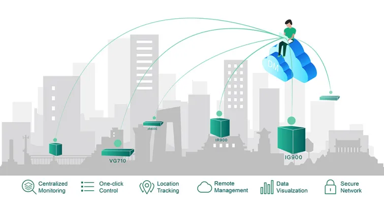

<strong>Figure 1-1 Device Manager Dashboard</strong>

**Quick start with the platform:**
Register an account >> Configure a router or gateway and connect it to the platform >> Enable management of the router or gateway device.

# 2. Registration and Login

## 2.1 Registration

On a browser, enter [https://iot.inhandnetworks.com/](https://iot.inhandnetworks.com/) to visit the official website of Device Manager. Click **Register Account**, enter an email account and relevant information, and click **Submit**. The authenticity of the email account will be verified. Please activate the account as instructed.

## 2.2 Login

After registration, log in to the platform with the registered email account and password. After login, choose **Personal Center >> Settings**, modify the login password and bind a phone number. Then, the phone number and the verification code or the phone number and password can be used for login. The phone number can also be used for recovering the password.

If access to Device Manager or InConnect via InHand Cloud Service is required, [click here](https://help.inhand.com/portal/en/kb/articles/access-to-device-manager).

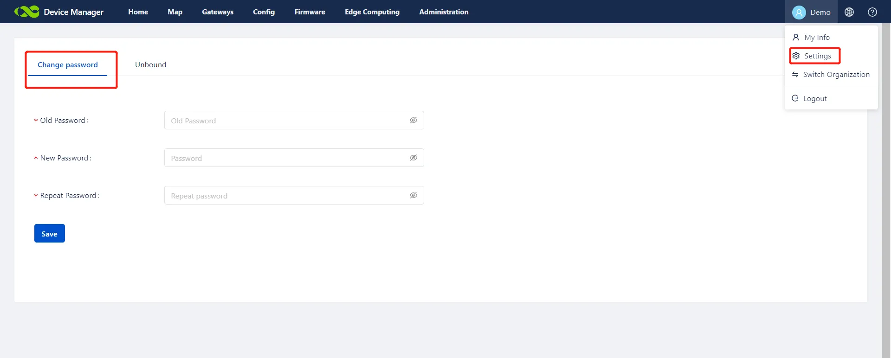

<strong>Figure 2-1 Device Manager Login Interface</strong>

# 3. Connect Gateway Devices to DM

The following devices are supported for management on the Device Manager platform: InRouter200, InRouter300, InRouter600, InRouter900, InGateway900, InGateway500, InVehicleG710, InVehicleG810. After connection configuration is made on the device, a new device data record is automatically added to DM. Administrators do not need to manually record the device data on DM. The following describes the details.

Configure the router to connect it to DM. Before configuration, make sure that the router has been connected to the network. For more information about networking operation, see the appendix.

## 3.1 Connect IR300/IR600 to DM

After connecting the router to a PC, visit `192.168.2.1` or `192.168.1.1` on a browser, enter the login account `adm` and password `123456` to log in to the device web page. On the web page, choose **Services >> Device Manager**, choose **Service Type** as **Device Manager** and **Server** as `iot.inhandnetworks.com` and enter the email account used for registration with DM in **Registered Account**:

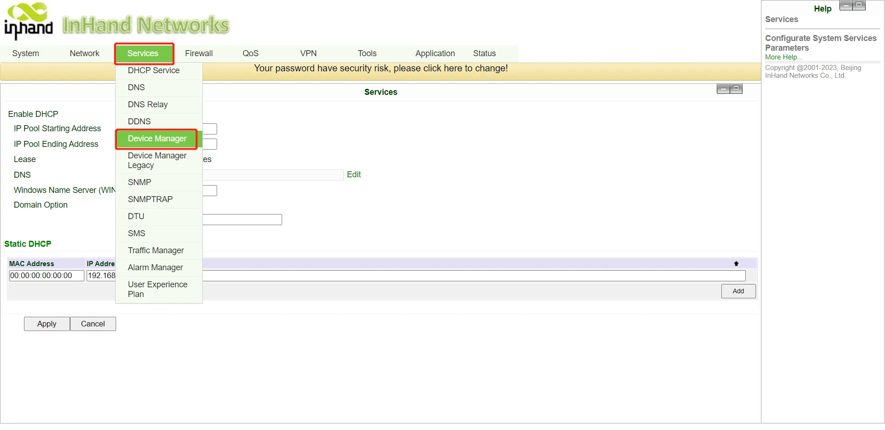

<strong>Figure 3-1 Device Manager Service Configuration (1)</strong>

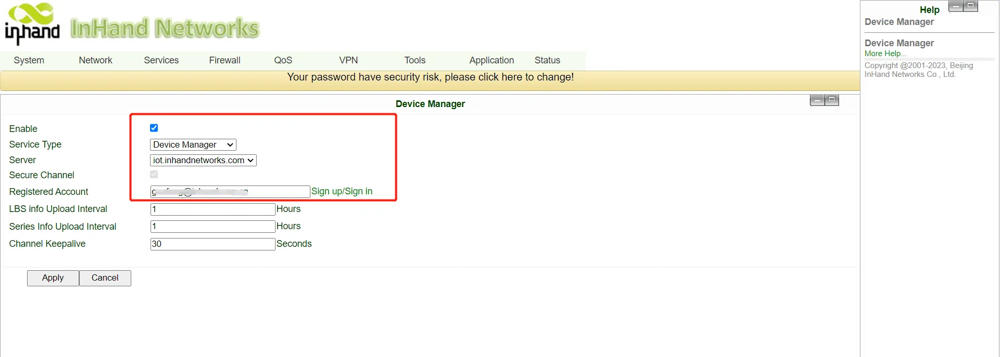

<strong>Figure 3-2 Device Manager Service Configuration (2)</strong>

> [!NOTE]
> The page varies with the device firmware version. The actual page shall prevail.

After the router is configured, a gateway data record is automatically added to the **Gateways** page on DM. When the router status is **Online**, the device has been connected to DM:

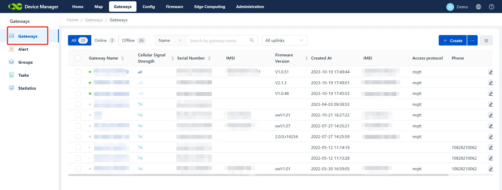

<strong>Figure 3-3 Gateway Online Status</strong>

## 3.2 Connect IR900/VG710 to DM

After connecting the router to a PC, visit `192.168.2.1` or `192.168.1.1` on a browser, enter the login account `adm` and password `123456` to log in to the device web page. On the web page, choose **Administration >> Device Manager**, set **Service Type** to **Device Manager**, select `iot.inhandnetworks.com` from **Server Address**, and enter the email account used for registration with DM in **Registered Account**:

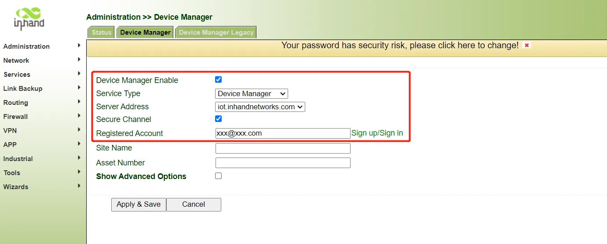

<strong>Figure 3-4 Connecting IR900/VG710 to DM</strong>

Click **Apply & Save**. If the status is **Connected**, the device has been connected to DM:

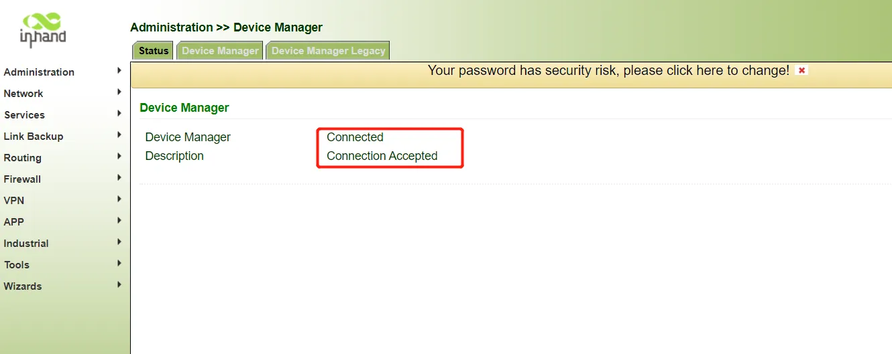

<strong>Figure 3-5 Connection Status</strong>

> [!NOTE]
> The page varies with the device firmware version. The actual page shall prevail.

After the router is configured, a gateway data record is automatically added to the **Gateways** page on DM. When the router status is **Online**, the device has been connected to DM.

## 3.3 Connect IG500/IG900 to DM

After connecting the router to a PC, visit `192.168.1.1` on a browser, enter the login account `adm` and password `123456` to log in to the device web page. On the web page, choose **System >> InHand Cloud**, on the tab page of **InHand Device Manager**, set **Server Address** to `iot.inhandnetworks.com`, and enter the email account used for registration with DM in **Registered Account**:

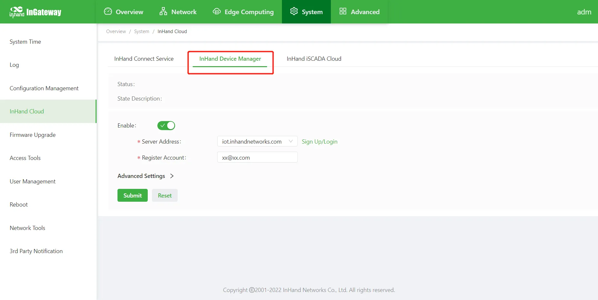

<strong>Figure 3-6 Connecting IG500/IG900 to DM</strong>

## 3.4 Add Gateway to DM

As mentioned above, after the router is configured, a gateway data record is automatically added to the **Gateways** page on DM. Administrators can manually add the data before configuring the router. The status of the manually added gateway is **Offline**. After the gateway can be connected, its status changes to **Online**.

### 3.4.1 Add a single gateway

1. Choose **Gateways >> +**. Enter a gateway name in **Gateway Name**, enter the serial number in **Serial Number**. To view the serial number, on the home page, choose **Administration >> System >> Status or Gateway Nameplate S/N**, and then click **OK**.

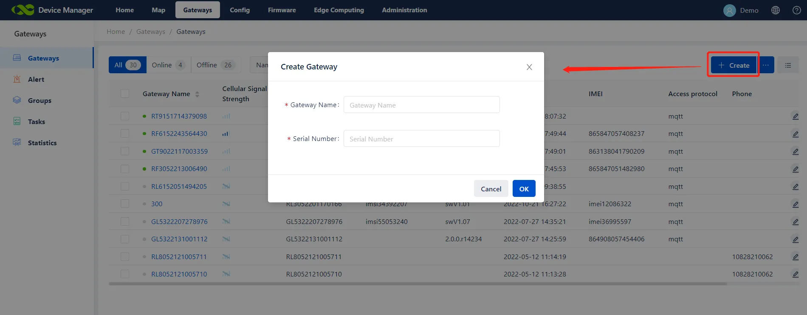

<strong>Figure 3-7 Adding a Single Gateway</strong>

2. Return to the **Gateways** page. The device is added. If the dot before the gateway name turns green, the device is online and connected to DM and the network. If the dot is gray, the device is offline and disconnected from the network. DM cannot manage and monitor offline devices.

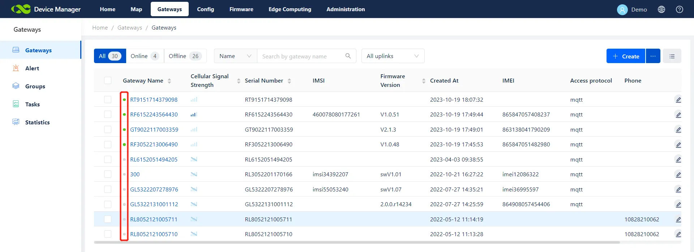

<strong>Figure 3-8 Gateway Online/Offline Status Indicators</strong>

### 3.4.2 Add gateways in batches

1. Choose **Gateways >> Import >> Download Template**, enter the gateway information, and save the template. Click **Select File**, select the saved template, and click **OK**. Administrators can choose to override the import or import the gateway into a group when importing the file.

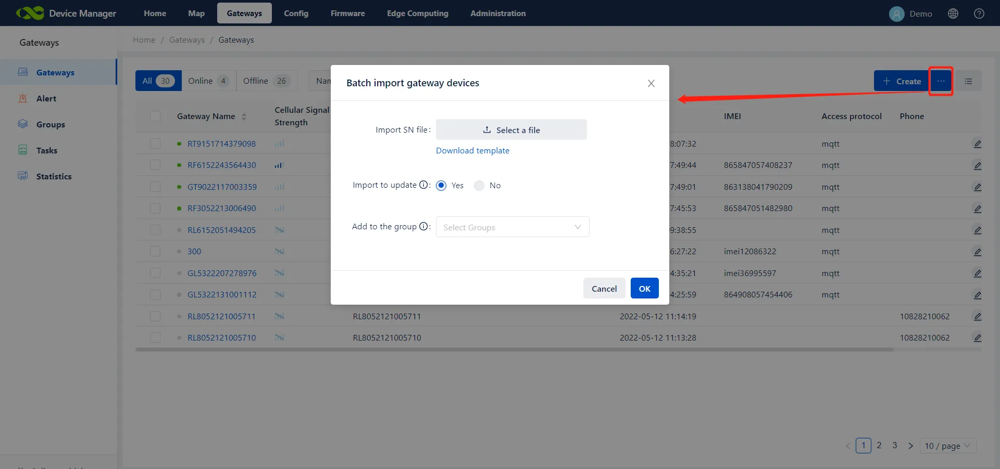

<strong>Figure 3-9 Importing Gateways in Batches</strong>

2. Return to the **Gateways** page to view the imported devices.

# 4. Gateway Management

After a gateway is connected to DM, administrators can manage the device on DM, enabling functions such as device asset management, configuration update, firmware upgrade, position tracking, running monitoring, and operation command monitoring.

## 4.1 Basic Management

### 4.1.1 Information Management

In the **Details Information** section of the **Gateways** page, administrators can manage key information of the gateway, including basic information (such as the model, serial number, IP address, RSSI, and IMSI), running information (such as traffic statistics and online statistics), and control information (such as task list). Devices connected to DM regularly report their traffic, online status, and other running information to DM for real-time monitoring and analysis.

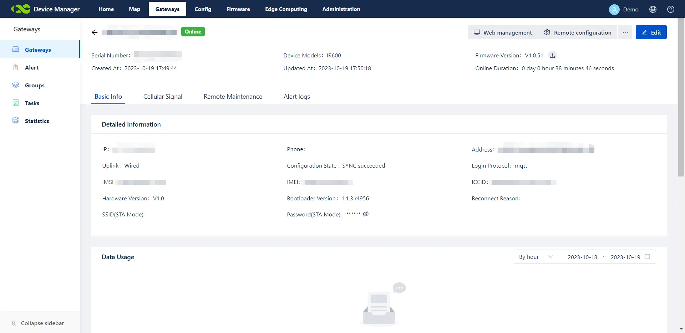

<strong>Figure 4-1 Details Information Page</strong>

### 4.1.2 Remote Web Access

1. On the **Gateways** or **Device Details** page, click the **Web Management** icon to go to the **Web Management** page of the gateway. On this page, administrators can directly modify the device configuration locally. This function is only applicable for online devices.

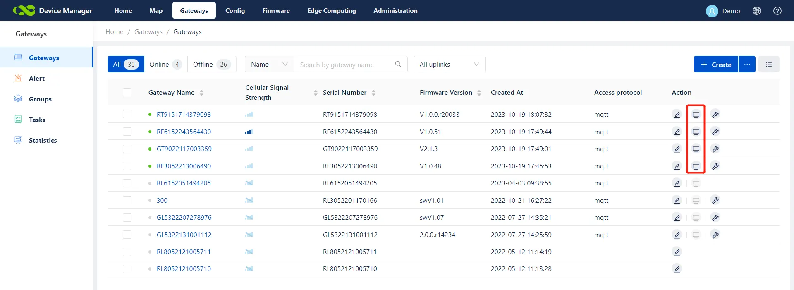

<strong>Figure 4-2 Web Management Icon</strong>

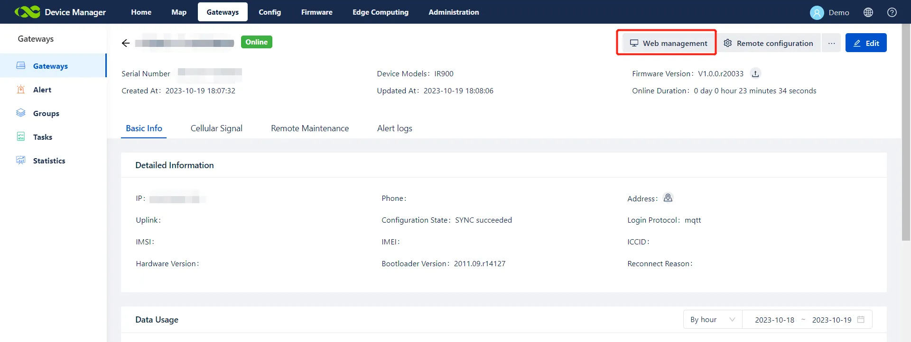

<strong>Figure 4-3 Remote Web Management Interface</strong>

2. Enter the username and password to go to the **Web Management** page of the gateway, and then remotely operate and control the device through commands.

### 4.1.3 Update Configuration

Administrators can only update the configuration of online devices.

On the gateway details page of an online device, click **Remote Configuration**. Edit and update the device configuration and then click **Deliver**. The device configuration is remotely updated, and a task record is generated in the task list on the details page. The task status is updated in real time to reflect the execution status.

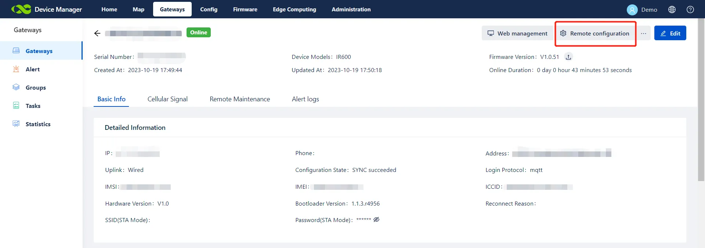

<strong>Figure 4-4 Remote Configuration Editor</strong>

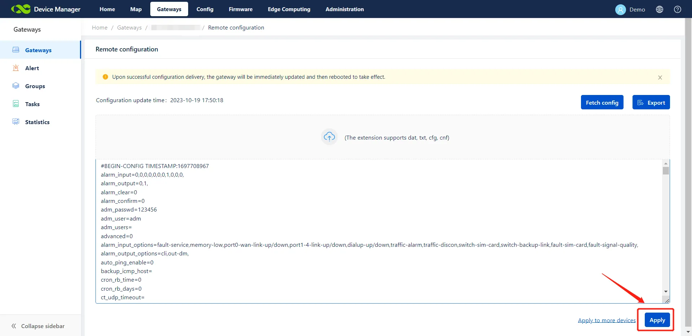

<strong>Figure 4-5 Task Execution Status</strong>

### 4.1.4 Upgrade Firmware

On the device details page, click the edit icon  next to **Firmware Version**, and upload a file. After the file is uploaded, a task record is generated in the task list on the details page. The task status is updated in real time to reflect the execution status.

Online devices execute the upgrade task immediately, while offline devices will execute the upgrade task after they are online again.

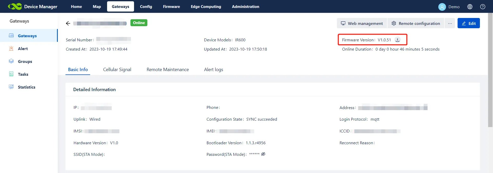

<strong>Figure 4-6 Firmware Upgrade Interface</strong>

### 4.1.5 Forced Offline

When configuration delivery and firmware upgrade fail multiple times, administrators can try to force a gateway offline, connect it to DM again, and then try to deliver the configuration and upgrade the firmware again.

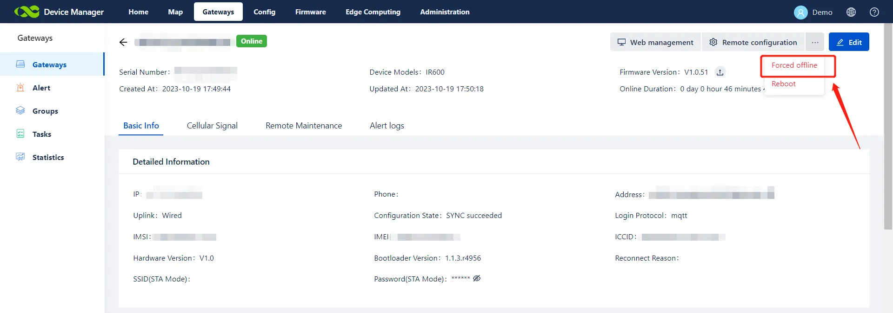

<strong>Figure 4-7 Forced Offline Option</strong>

## 4.2 Alerts

The Device Manager platform supports setting alerts to monitor some important events of the devices. When an event occurs, it can push SMS or email messages to specified users. The support of each device is subject to the information displayed on the interface. Taking IR600 for example, an offline alarm is used to perform operations.

1. **Configure alert rules:** On the page of **Gateways >> Alerts >> Alert Rules**, click **Add Rule**, select devices, alert rules, and notification rules in the form as needed:

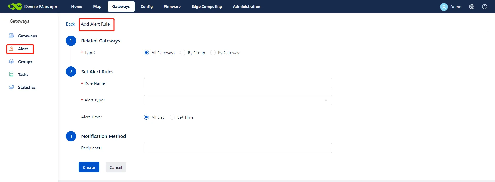

<strong>Figure 4-8 Configuring Alert Rules</strong>

2. After the rule is added, click **Save**. The rule takes effect immediately; as shown in the figure, an offline alarm rule is configured for a gateway: When the gateway is offline for 10 minutes, the user's email will receive an alert email, and the alert messages will also be recorded on the **Gateways >> Alerts >> Alert Logs** page.

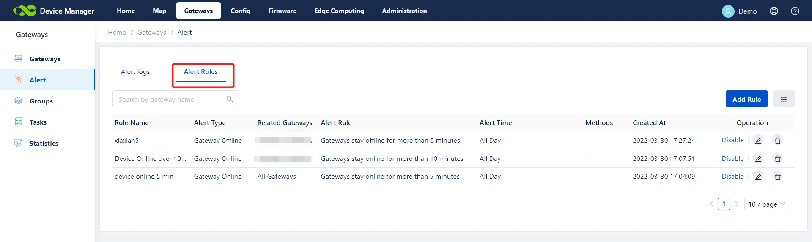

<strong>Figure 4-9 Alert Rule Activation</strong>

3. For some specific alert types, administrators must enable alert reporting on the device before the alert takes effect. Take the IR600 for example: on the device WEB management page, visit the page **Services >> Alarm Manager**, select alarm type, select **Device Manager** as the alarm output, then click **Apply**.

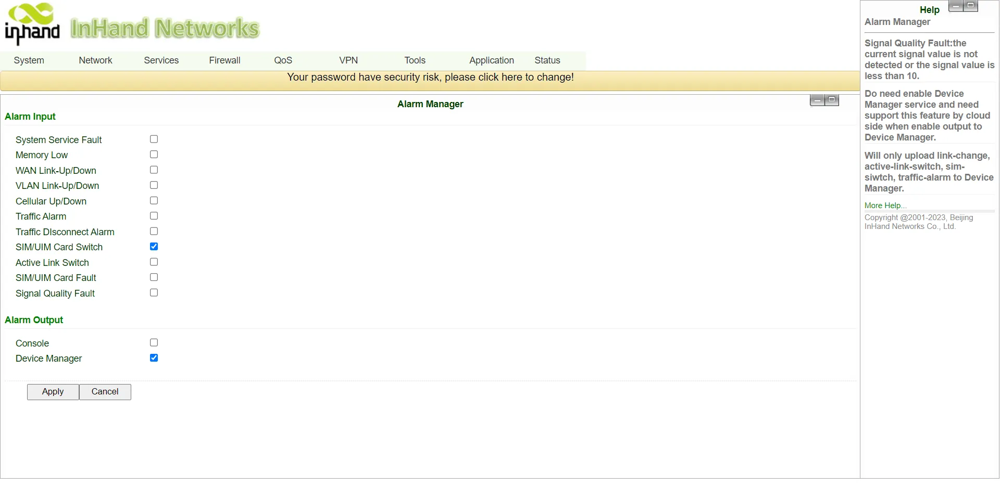

<strong>Figure 4-10 Enabling Local Alert Reporting</strong>

4. After the application is successful, when the device has the above event, it will send an event message to the platform, and the user will receive an email or SMS alert message according to the settings. The following table lists the alert types of the platform and the device:

| Device Manager | The WEB management page of device |
| --- | --- |
| **Gateway Online/Offline** | For the monitoring item of the Device Manager platform, there is no such alert type on the local device. **Trigger condition:** The device establishes/disconnects a connection with the platform. |
| **Hourly Traffic Alarm** | The alarm type is "Traffic Alarm", and the traffic alarm threshold should be defined in the **Services >> Traffic Manager** section at the same time. After setting the required hourly, 24-hours (day) and monthly thresholds, the platform will send an alarm message when the specified alarm threshold is reached.  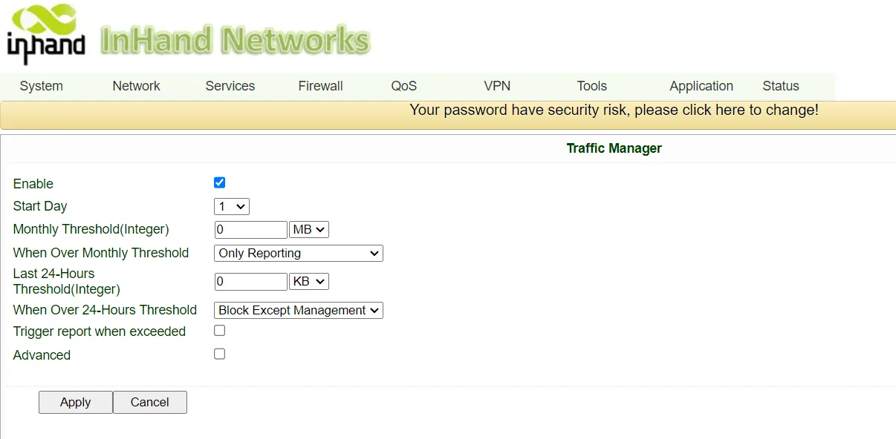 |
| **Daily Traffic Alarm** | See Hourly Traffic Alarm |
| **Monthly Traffic Alarm** | See Hourly Traffic Alarm |
| **SIM Switch** | Active Link Switch |
| **Link Backup** | Active Link Switch |
| **Interface Up/Down** | WAN Link-Up/Down, LAN Link-Up/Down, Dialup Up/Down |
| **Power Type Switch** | The local alert type corresponding to the device is "Power Supply Switch". **Trigger conditions:** 1. If the device is powered only by the battery and then the power adapter is plugged in, the "Switch to Adapter Power Supply" alert will be triggered. 2. If the device is already powered by the adapter and then the adapter is unplugged, the "Switch to Battery Power Supply" alert will be triggered.  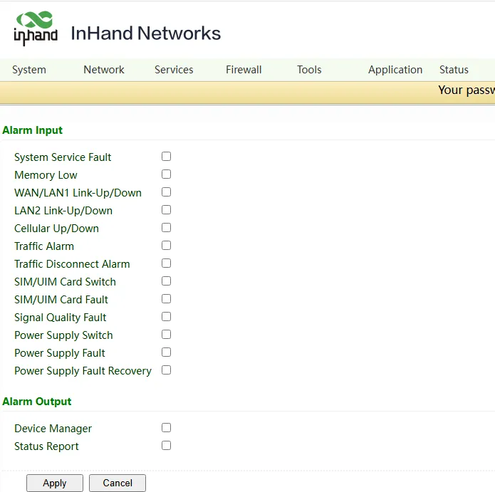 |
| **Battery Fault** | The local alert type corresponding to the device is "Power Supply Fault". **Trigger condition:** The battery of the device cannot be used normally for power supply. |
| **Battery Fault Recovery** | The local alert type of the corresponding equipment is "Power Supply Fault Recovery". **Trigger condition:** The battery fault has been resolved. |

## 4.3 Device Group Management

When the system has a great number of devices, administrators can group devices for centralized management in the **Groups** table. For example, devices can be managed by industry, clarifying the scenarios of each device. Abnormal devices can also be placed in the same group for centralized management. When the device error is removed, the device can be moved out of the group.

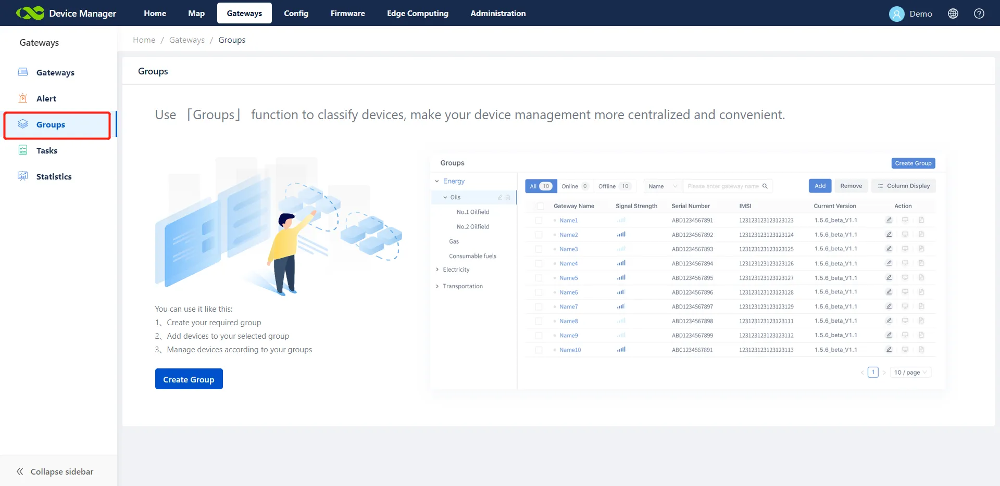

<strong>Figure 4-11 Device Group Management</strong>

The following describes the details:

1. Click **Create Group** and enter the group name and other information:

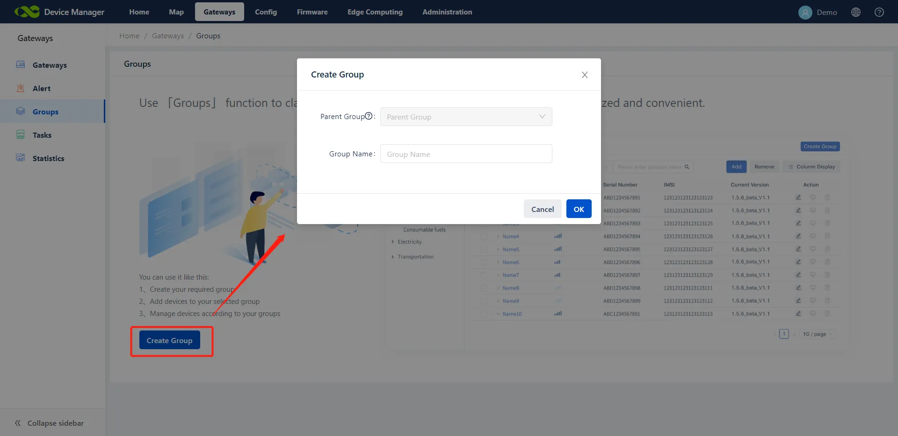

<strong>Figure 4-12 Creating a Group</strong>

2. After the group is created, administrators can add devices to the current group:

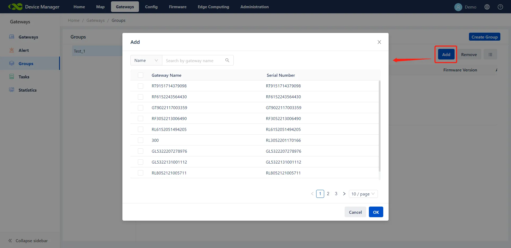

<strong>Figure 4-13 Adding Devices to a Group</strong>

3. If an added group has changed, select the group and then move it out of the current group.

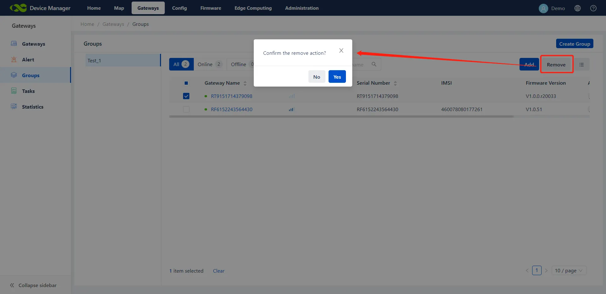

<strong>Figure 4-14 Moving a Group</strong>

Administrators can create groups of multiple levels based on service demands to manage devices by level.

## 4.4 Position Tracking

The **Map** page displays the real-time position and online status of the gateway. After clicking the device icon on the map, the device basic information is displayed. Then, administrators can click the gateway name to view the device details.

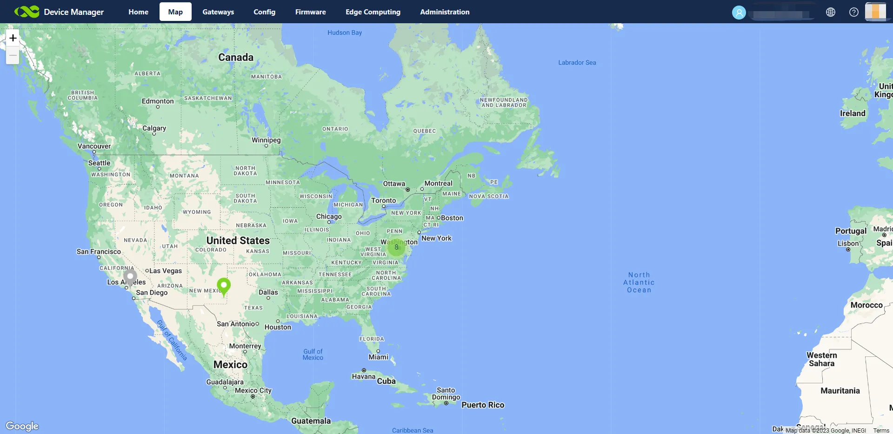

<strong>Figure 4-15 Map Position Tracking</strong>

## 4.5 Gateway Running Monitoring

1. On the **Gateways >> Statistics** page, administrators can view online duration statistics and traffic usage of a device and export the list of its online duration and traffic usage.

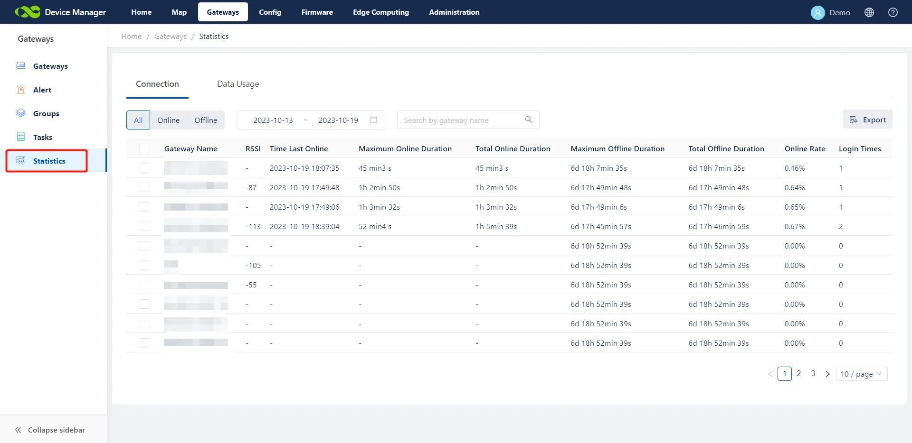

<strong>Figure 4-16 Gateway Statistics Page</strong>

2. Click the device. The device status bar chart is displayed.
   - **Online**: The device is connected to DM.
   - **Offline**: The device is disconnected from DM.
   - **Abnormal**: When the statistical period is less than three days, if the status changes for more than three times in two hours, it is abnormal. When the statistical period is more than three days, if the status changes for more than three times in one day, it is abnormal.

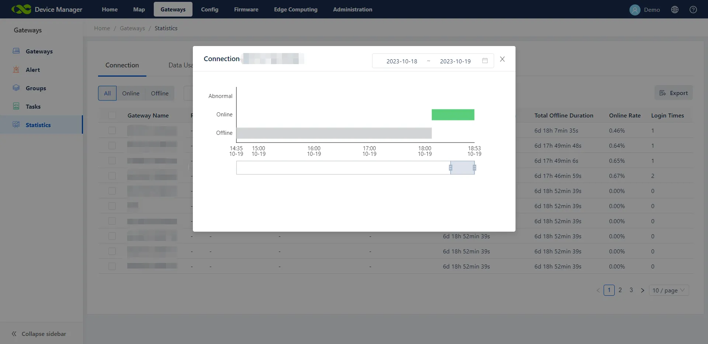

<strong>Figure 4-17 Device Status Bar Chart</strong>

## 4.6 Operation Command Monitoring

On the page of **Gateways >> Tasks**, administrators can view the execution status of the tasks sent from DM to devices. In the **Action** column, click to re-execute a task or cancel an in-progress task.

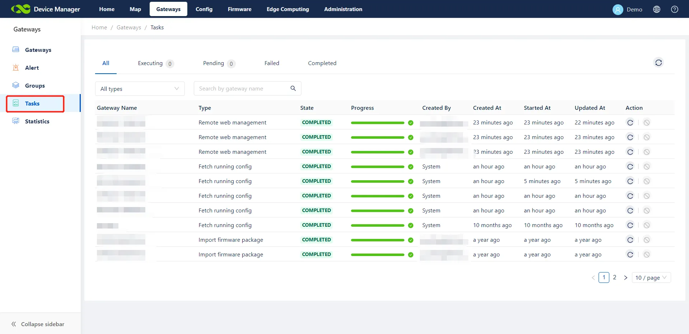

<strong>Figure 4-18 Operation Command Tasks</strong>

# 5. Update Gateway Configurations in Batches

When a large number of devices are connected to DM, it takes a great amount of time to update the configuration device by device. Administrators can update the configuration in batches on the **Config** page. The following describes the details:

1. Choose **Gateways >> Config >> + >> Select File**. Select a configuration file (which can be exported from the **Web Management** page of the gateway, edited, and then applied), enter a name in **Config Name**, enter the model in the template in **Device Models**, and then click **OK**.

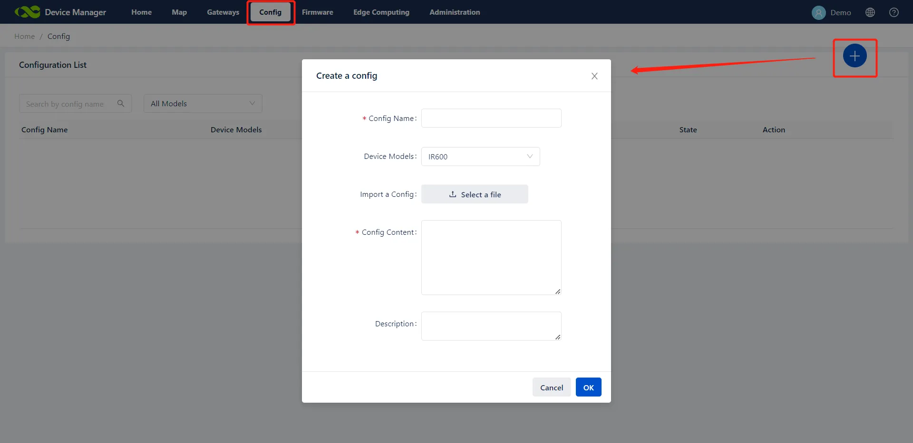

<strong>Figure 5-1 Adding a Batch Configuration</strong>

2. Select the device to which the configuration will be delivered and click **OK**.

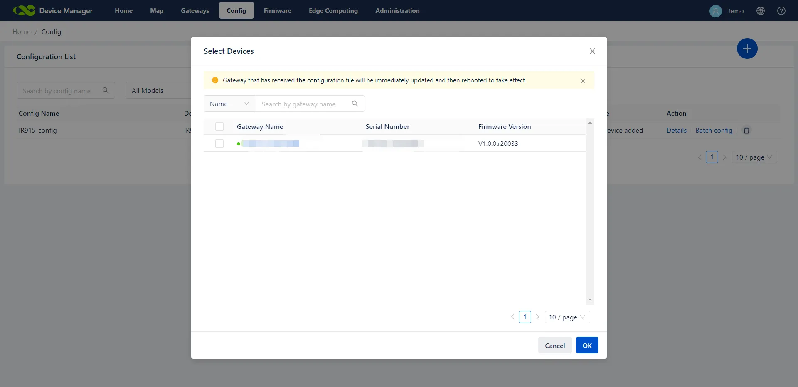

<strong>Figure 5-2 Selecting Target Devices for Configuration</strong>

3. Return to the configuration list, click **View details** to view details of the current configuration, such as its update progress and status:

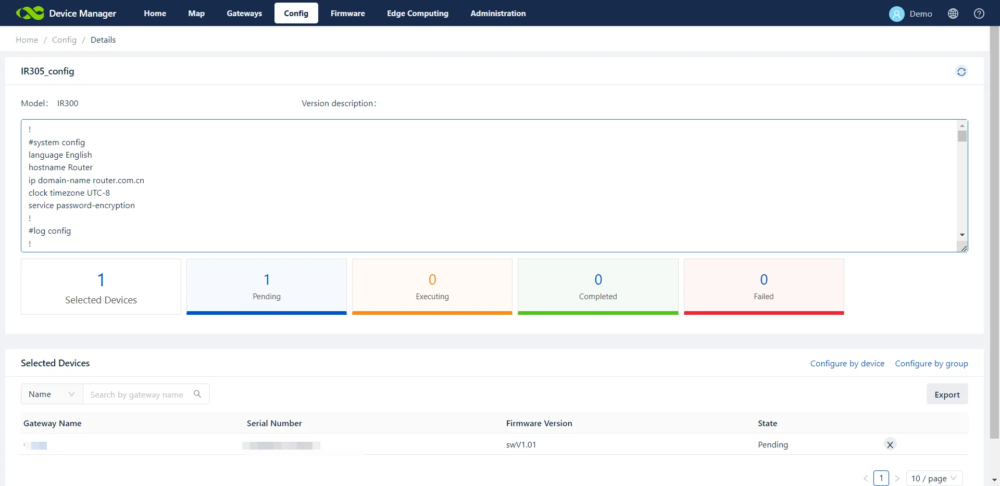

<strong>Figure 5-3 Batch Configuration Status Details</strong>

# 6. Upgrade Gateway Firmware in Batches

When a large number of devices are connected to DM, it takes a great amount of time to upgrade the firmware device by device. Administrators can upgrade the firmware in batches through the **Firmware** page. The following describes the details:

1. Choose **Firmware >> +**. Select a gateway firmware and click **OK**.

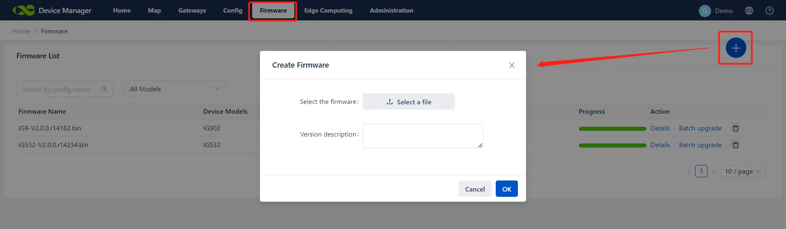

<strong>Figure 6-1 Adding Firmware for Batch Upgrade</strong>

2. Select the device for which the firmware will be upgraded and click **OK**.

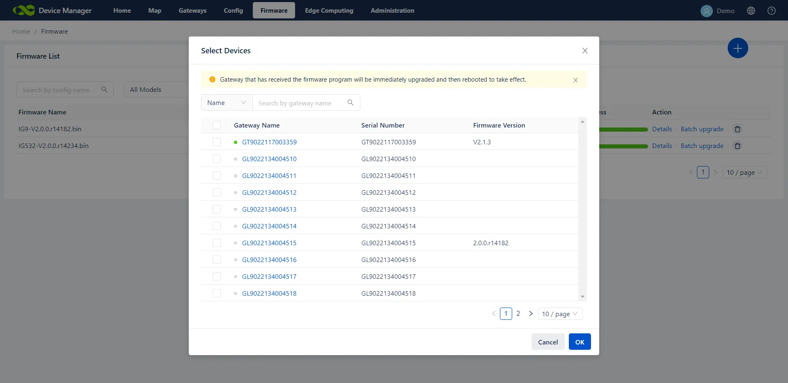

<strong>Figure 6-2 Selecting Target Devices for Firmware Upgrade</strong>

3. Return to the firmware list, click **Details** to view the details of the current firmware, such as its upgrade progress and status:

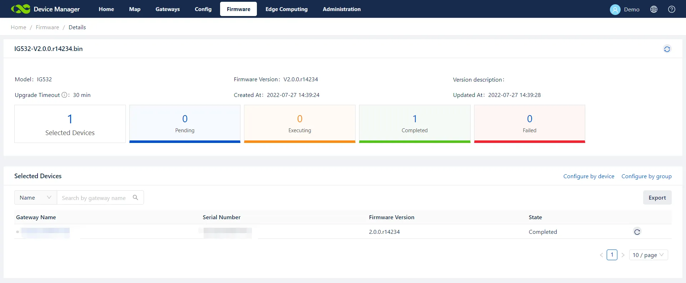

<strong>Figure 6-3 Batch Firmware Upgrade Status Details</strong>

# 7. Edge Computing

As one of the core features of the Edge Gateway, the edge computing functions of the DM platform are mainly applied to gateway devices with edge computing features, such as IG500, IG900, and VG series.

## 7.1 Edge Agent

Edge engine is the operating environment for edge applications of the gateway device. It integrates the Python, Azure IoT Edge, and Docker programming development environment, and can strengthen the ability of edge applications to cooperate with the cloud. Administrators can flexibly customize applications according to business needs. The edge engine must be installed before installing edge applications.

1. On the page of **Edge Agent**, click **Add Edge Agent**, select the edge SDK from InHand Networks.

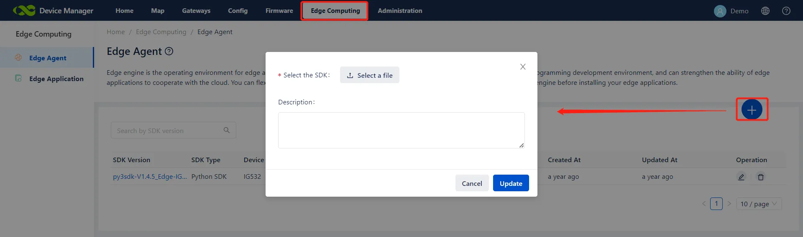

<strong>Figure 7-1 Adding Edge Agent SDK</strong>

2. Then click **SDK Version** to view more information, click **Deploy**, and select Gateways to install this SDK.

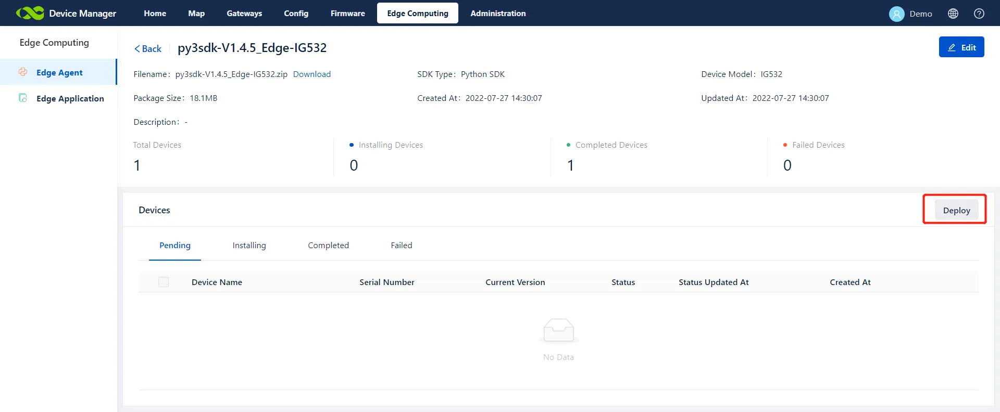

<strong>Figure 7-2 Deploying Edge SDK</strong>

3. On the installation page, the detailed progress status of each installation task is displayed, including **Pending**, **Installing**, **Completed**, and **Failed**. For failed tasks, administrators can view the failure reason in the task list.

## 7.2 Edge Application

1. Click **Add Applications**, import the APP to be installed.

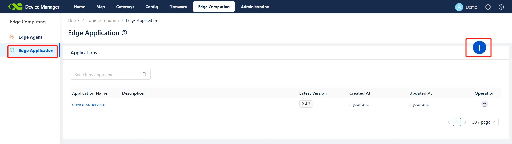

<strong>Figure 7-3 Adding Edge Applications</strong>

2. Then click **Application Name** to view the details. If there is a version update, administrators can also upload a new version here.

3. Click **App Deploy**, select **Deploy**, and select the required device. The system will automatically send the APP to these devices to perform the upgrade. On the installation page, the detailed progress status of each installation task is displayed, including **Pending**, **Installing**, **Completed**, and **Failed**. For failed tasks, administrators can view the failure reason in the task list.

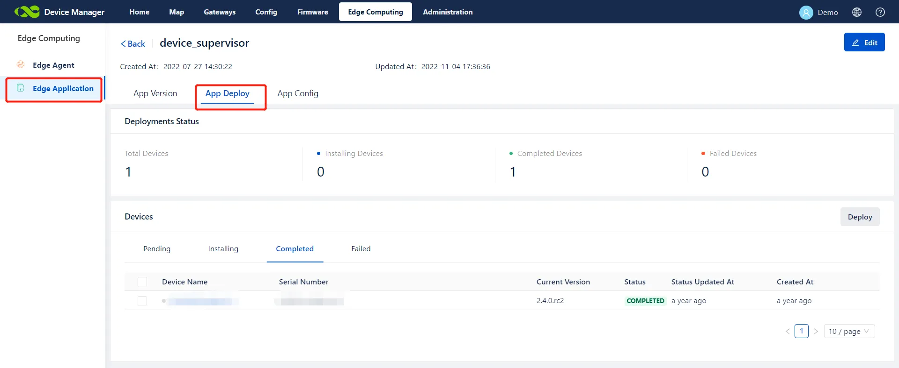

<strong>Figure 7-4 Deploying Edge Applications</strong>

4. Click **App Config** to maintain the app configuration or view the configuration details and the update records of the gateway configuration in detail.

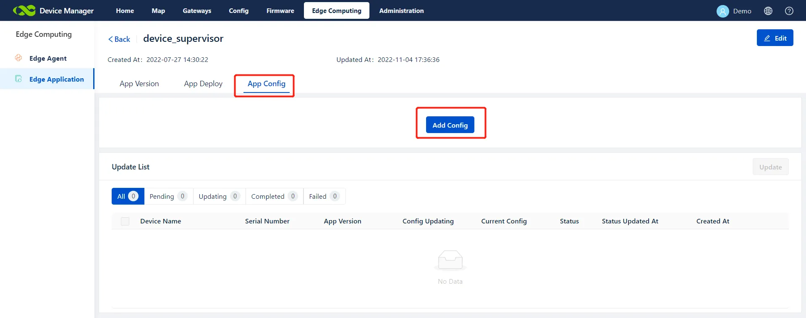

<strong>Figure 7-5 Edge Application Configuration</strong>

## 7.3 Gateway Details

1. In the details of a gateway with edge features, administrators can view the current status of the device's SDK and APP installation history.

2. Administrators can directly update the SDK and APP of a single gateway in the gateway details. The updated SDK and APP need to be added in the **Edge Agent** and **Edge Application** in advance.

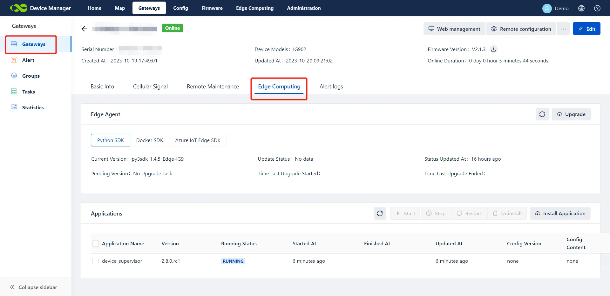

<strong>Figure 7-6 Edge Features in Gateway Details</strong>

# 8. System Management

## 8.1 User

### 8.1.1 Add a User

To manage devices through multiple users, administrators can add multiple accounts in the **Users** list, and grant different roles and permissions to different accounts for permission security control.

The system roles and their permissions are as follows:

| Function Page | | Organization Manager | Device Manager | Device Monitor |
| --- | --- | --- | --- | --- |
| Home | | √ | | |
| Map | | √ | √ | √ |
| Gateways | Gateways | √ | √ | √ |
| | Alert | √ | √ | √ |
| | Groups | √ | √ | √ |
| | Tasks | √ | √ | √ |
| | Statistics | √ | √ | √ |
| Config | | √ | √ | |
| Firmware | | √ | √ | |
| Edge Computing | Edge Agent | √ | | |
| | Edge Application | √ | | |
| Administration | Users | √ | | |
| | Access Control | √ | | |
| | Company Info | √ | | |
| | Operation Log | √ | | |

The operation is described below:

Choose **Administration >> Users >> +**, and add a user. The system automatically sends the password to the email account of the new user. The new user can use the email account and the password in the email to log in to DM.

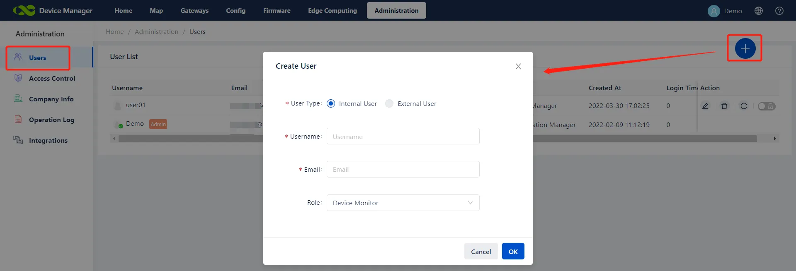

<strong>Figure 8-1 Adding a New User</strong>

### 8.1.2 Delete a User, Reset User Password, and Lock a User

1. **Delete user:** Used to permanently remove a user.
2. **Reset password:** Used to reset the password for a user. The new password is sent to the login email account of the reset user through email.
3. **Lock user:** After a user is locked, they cannot log in to DM.

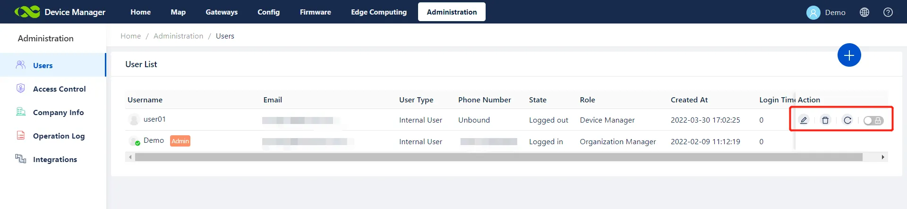

<strong>Figure 8-2 User Management Actions</strong>

## 8.2 Access Control

When the system has multiple users, devices, and groups, for secure device management and control, administrators can grant the management permissions of gateway devices and groups for each user in the **Access Control** list.

The **Access Control** module is used to divide the users' permission to view and manage gateway devices and groups. It allows customization of multiple permission groups. Gateway devices and groups in each permission group can only be viewed and managed by users in the current group.

**Example:**
User A has 120 devices, 50 in California and 50 in Florida. Two persons are required to manage these devices separately, wherein Tom manages the 50 devices in California, and Mary manages the 50 devices in Florida.

**Procedure:**
The administrator creates two permission groups on the **Access Control** page, assigns Tom and the 50 devices in California to one permission group, and assigns Mary and the 50 devices in Florida to the other permission group. The remaining 20 devices are placed in another permission group.

**Specific functions:**
1. New non-admin users are grouped into "Unallocated" by default. They can view all ungrouped devices by default.
2. Newly added devices and groups are grouped into "Unallocated" by default, and all users can view them.
3. Users in "Unallocated" can view all unallocated devices and groups.
4. Users in a custom group can view the devices in the current access control group and the devices in the "Unallocated" group.
5. Users in a custom group can view the groups in the current access control group and the groups in the "Unallocated" group.
6. The organization administrator (admin) does not participate in the permission grouping, and can view all device data.
7. A user can be divided into multiple groups.
8. A device and a group can only be divided into one group.
9. If a group is not in the same permission group as the devices in the group, users in the permission group in which the device is located can see the device but not the group or other devices in the group.

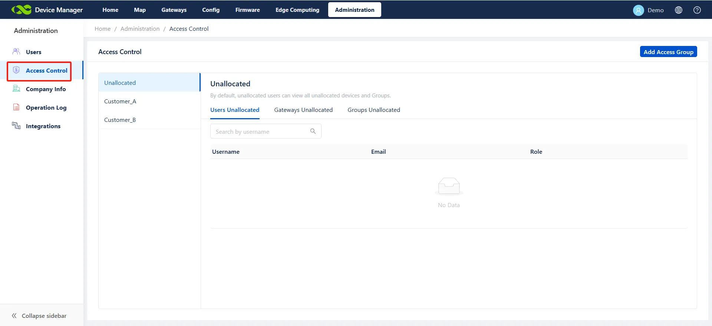

<strong>Figure 8-3 Access Control Interface</strong>

**Creating a permission group:**

**Step 1:** Choose **Access Control >> Add Access Group**. Enter a name for the permission group and click **OK**.

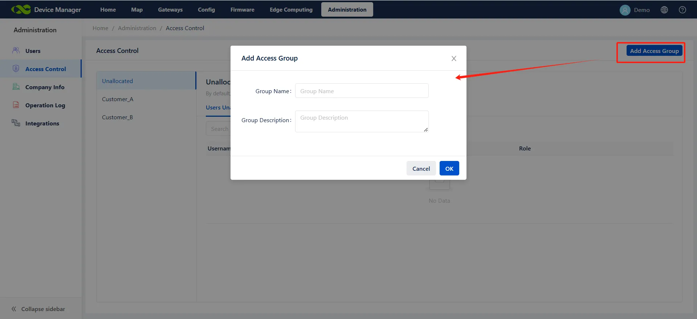

<strong>Figure 8-4 Creating a Permission Group</strong>

**Step 2:** Allocate users for the created permission group. Choose **User Included >> Add Users to Group**, select users, and then click **OK**.

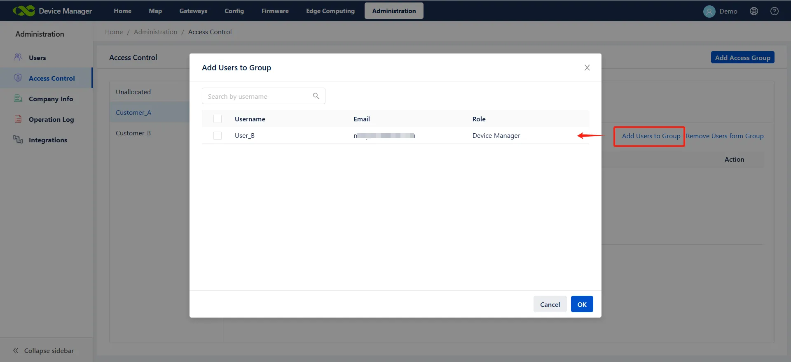

<strong>Figure 8-5 Allocating Users to a Group</strong>

**Step 3:** Allocate gateways to the created permission group. Choose **Gateway Included >> Add Gateways to Group**, select gateways, and then click **OK**. Devices in the permission group can only be viewed and managed by users in this permission group.

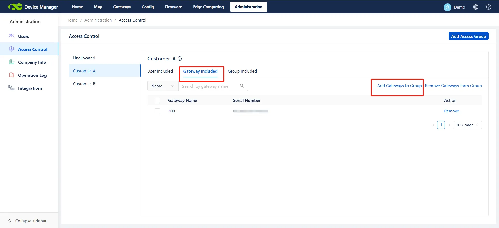

<strong>Figure 8-6 Allocating Gateways to a Group</strong>

**Step 4:** Allocate groups to the created permission group. Choose **Group Included >> Add Groups to Access Control**, select groups, and then click **OK**. Groups in the permission group can only be viewed and managed by users in this permission group.

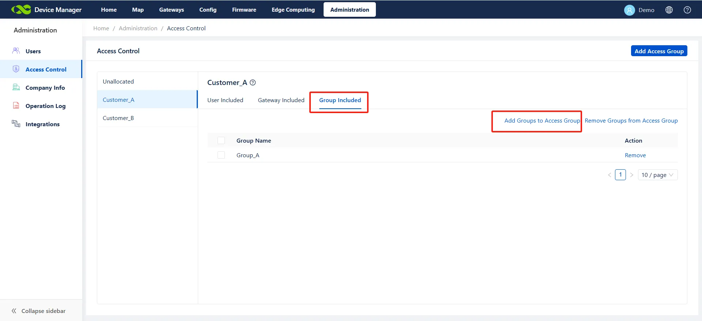

<strong>Figure 8-7 Allocating Groups to Access Control</strong>

**Modifying a permission group:**

When administrators need to modify users, devices, and groups in a permission group after permissions have changed, select a permission group, remove one or multiple devices, users, or groups from the permission group, and then add some devices, users or groups to the permission group.

<strong>Figure 8-8 Modifying Permission Groups</strong>

> [!CAUTION]
> New gateway devices, users, and groups are in the state of **Unallocated** by default. This means new gateways and groups can be viewed by all users, and new users can view all unallocated gateway devices and groups by default. Therefore, after creating a user, gateway device, or group, grant permissions for the user, gateway, and group as soon as possible.

## 8.3 Switch Organization

When a company external user is required to join an organization to provide external support, if the external user has registered an email account in DM, administrators can invite them to join the current organization by adding them as an "External User".

<strong>Figure 8-9 External User Support View</strong>

On the **Administration >> Users** page, click **Add** and select **User Type** as **External User**, fill in the email address of the external user and submit. An invitation email will be sent to this email. External users can join the current organization after accepting the invitation. At the same time, they can switch between multiple organizations in the personal center of their accounts:

<strong>Figure 8-10 Switch Organization Options</strong>

Administrators can set user roles and add gateway permissions to this external user so that they can provide full technical support when accessing the organization without causing unnecessary data leakage.

## 8.4 Company Information

On the **Administration >> Company Info** page, administrators can maintain the background information of the current account's owner.

<strong>Figure 8-11 Company Information Page</strong>

## 8.5 System Logs

On the **Administration >> Logs** page, administrators can view system records about user login, device operation, firmware upgrade, and other information of the platform.

## 8.6 Integrations

When administrators need to push device-reported data such as data usage and location to third-party services, Device Manager's Integrations functionality can be utilized. Simply configure external server information on the platform (such as MQTT or Kafka servers) to establish connections between the platform and these external servers. The following example demonstrates integration with an external MQTT server:

1. Go to **Administration >> Integrations** and click **Add Integration**.

<strong>Figure 8-12 Adding an Integration</strong>

2. Select the service type as **MQTT** and enter the corresponding **server address**, **port**, **username**, **password**, and other information for the MQTT service. Choose the event types to receive and define custom **topics**. The configuration shown below receives events such as device online/offline status, location, and device information via an open-source MQTT service (client ID, username, and password can be left blank).

<strong>Figure 8-13 MQTT Service Configuration</strong>

| Event Type | Description | Trigger Time |
| --- | --- | --- |
| **connected** | The device establishes a connection with Device Manager. | Immediately triggered. |
| **disconnected** | The device is disconnected from Device Manager. | Immediately triggered. |
| **device.series** | The device's time-sequential data such as flow usage. | The triggering time is determined by the local configuration of the device and is usually set to report once every 1 hour by default. |
| **lbs** | Cellular base station information, such as: MNC, MCC, LAC, CID. | The triggering time is determined by the local configuration of the device. |
| **device.info** | The basic information of the equipment, such as: serial number, MAC address, network port, IP, etc. | The device will report when it is launched on the platform. |

3. Configure and connect to the MQTT service using MQTTX or other MQTT tools. Using MQTTX as an example:
   - Click **New Connection**.
   - Configure the MQTT server information (matching the settings in Device Manager).

<strong>Figure 8-14 MQTTX Connection Configuration</strong>

   - After configuration is complete, click **Connect**. A successful connection will be established. If the connection fails, please verify that the MQTT service is functioning properly or that the MQTT server information configured is correct.

<strong>Figure 8-15 MQTTX Successful Connection</strong>

4. In MQTTX, click **Add Subscription**, enter the topic to subscribe to, and save. For example:
   - `inhandnetworks/+/+` or `inhandnetworks/#`: Indicates subscribing to all topics prefixed with `inhandnetworks/`.
   - `inhandnetworks/{deviceId}/lbs`: Indicates subscribing to location messages for a specific device. `deviceId` is the unique identifier for the device in Device Manager.

<strong>Figure 8-16 Adding an MQTT Subscription</strong>

<strong>Figure 8-17 Subscription List in MQTTX</strong>

5. Configuration is complete. When the device generates the selected event, the corresponding event notification will be immediately received.

<strong>Figure 8-18 Receiving Event Notifications in MQTTX</strong>

# 9. DashBoard

On the **Home** page of DM, recent running status of gateway devices and system device information are displayed via charts:

<strong>Figure 9-1 Device Manager Dashboard View</strong>

# 10. Appendix How to Connect Device to Network

Taking IR915 as an example, devices can be connected to the network in any of three ways: **Ethernet (wired)**, **SIM card**, and **Wi-Fi**.

For more information about other networking methods, see the hardware user manual or visit the official website of InHand: [https://www.inhandnetworks.com/](https://www.inhandnetworks.com/)

> [!CAUTION]
> Disable the "cellular interface" when accessing the network without the SIM card; otherwise repeated dial-up is performed, interfering with the network connection.

<strong>Figure 10-1 Cellular Interface Configuration</strong>

## 10.1 Method 1: Access the network through dial-up or SIM card

**Step 1:** Insert the SIM card into slot 1 and tighten the 4G LTE antenna to the ANT terminal. Connect the network cable to a PC and connect to the power supply.

<strong>Figure 10-2 SIM Card and Antenna Installation</strong>

> [!CAUTION]
> When inserting or removing the SIM card, you must disconnect the device from the power supply to avoid data loss or damage to the device.

**Step 2:** Open the browser and log in to the web page of the device. (See **Method 2: Ethernet.**)

**Step 3:** Choose **Network >> Cellular >> Enable**, and then click **Apply & Save**.

<strong>Figure 10-3 Enabling Cellular Connection</strong>

**Step 4:** Wait until the network connection status is **Connected** and an IP address is allocated. Then, the network is connected through the SIM card.

**Step 5:** For devices that support the dual-card mode and the SIM card is inserted to slot 2, select **Dual SIM Enable**.

## 10.2 Method 2: Ethernet

**Step 1:** Connect the power supply and network cable to the device, and connect the LAN (FE 1/1, FE1/2, FE1/3, or FE1/4) port to a PC and the WAN (FE0/1) port to the Internet.

<strong>Figure 10-4 Ethernet Port Connections</strong>

**Step 2:** Set the IP addresses of the PC and gateway to be in the same network segment.
1. **Method 1:** Automatically get the IP address (recommended)
2. **Method 2:** Use a fixed IP address and set the PC and gateway to be in the same network segment. Set the initial IP address of the device to `192.168.2.1` and the subnet mask to `255.255.255.0`. Select **Use the following IP address**. Enter an IP address ranging from `192.168.2.2` to `192.168.2.254`, a subnet mask `255.255.255.0`, and the default gateway `192.168.2.1`, and then click **OK**.

<strong>Figure 10-5 Automatic IP Address Configuration</strong>

<strong>Figure 10-6 Fixed IP Address Configuration</strong>

**Step 3:** In the address bar of the browser, enter the default device address `192.168.2.1` to enter the device web management page. (If it prompts that the website is insecure, unfold the menu and click **Go Still** or **Proceed**.)

**Step 4:** Log in to the device.

<strong>Figure 10-7 Device Web Login Interface</strong>

**Step 5:** Choose **Network >> New WAN**. Configure an IP address for the WAN port to connect the router to the Internet.

<strong>Figure 10-8 New WAN Configuration</strong>

**Step 6:** It is recommended to select **Dynamic Address (DHCP)**. If **Static IP Address** is selected, manually configure the network parameters, and then click **Apply & Save**.

<strong>Figure 10-9 Dynamic Address (DHCP) Configuration</strong>

<strong>Figure 10-10 Static IP Address Configuration</strong>

**Step 7:** Choose **Tools >> Ping**. In the **Host** field, enter a common website (e.g., a reliable public server) to test whether the device can connect to the Internet. If data transmission is displayed, the device can connect to the Internet.

<strong>Figure 10-11 Ping Test for Network Verification</strong>

## 10.3 Method 3: Wi-Fi

**Step 1:** Connect the Wi-Fi antenna to the WLAN port and use a network cable to connect the PC and the power supply.

<strong>Figure 10-12 Wi-Fi Antenna Connection</strong>

**Step 2:** Set the IP addresses of the PC and the gateway to be in the same network segment. On a browser, visit the web management page of the gateway. (See **Method 2: Ethernet**).

**Step 3:** Choose **Network >> WLAN**, enable the WLAN port, and configure the parameters.

<strong>Figure 10-13 WLAN Port Configuration</strong>

**Step 4:** Click the **Status** tab. The network connection status should be **Connected**.

**Step 5:** Choose **Wizards >> New WLAN**, and configure the parameters.

**Step 6:** Choose **Firewall >> Network Address Translation (NAT)**. If a connection named `dot11radio 1` is displayed, Wi-Fi is connected.

<strong>Figure 10-14 NAT Configuration Verification</strong>

