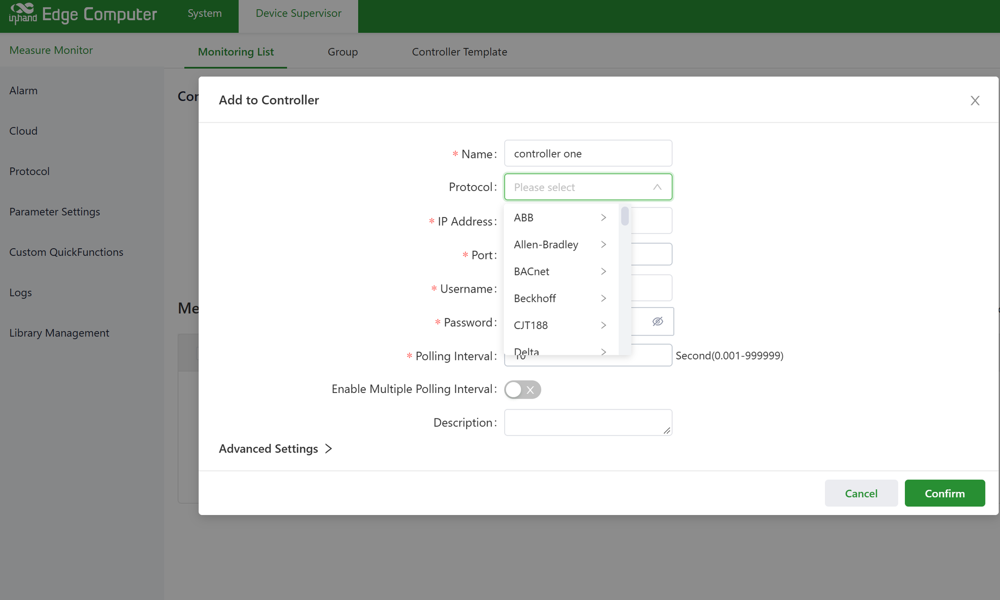

<div style="width: 100%;height: 100%;background: url(img/DSA规格书封面.jpg); background-size: 100% 100%;">
  <div style="height:60%;">
    <div style="width:35%; padding: 40px 40px">
      
    </div>
    <div style="font-size: 28px; font-weight: bold; color:#000;text-align: center; margin-top: 130px;">
      Software-Defined Acquisition, Intelligence-Driven Edge
    </div>
  </div>
  <div style="padding-left: 40px; padding-top: 90px;">
    <div style="font-size: 40px; font-weight: bold; color:#000;margin-bottom: 30px;">
      DeviceSupervisor™ Agent Industrial Edge Agent Software
    </div>
    <div style="text-align: center;">
      <div style="display: flex; flex-wrap: wrap; gap: 16px; ">
        <div style="width: 200px;background-color: #4CAF50; color: white; padding: 8px 8px; border-radius: 6px; font-size: 18px;">· 80+ Acquisition Protocols</div>
        <div style="width: 200px;background-color: #4CAF50; color: white; padding: 8px 8px; border-radius: 6px; font-size: 18px;">· Multi-Cloud Integration</div>
      </div>
      <div style="display: flex; flex-wrap: wrap; gap: 16px;margin-top:16px">
        <div style="width: 200px;background-color: #4CAF50; color: white; padding: 8px 8px; border-radius: 6px; font-size: 18px;">· Python Edge Intelligence</div>
        <div style="width: 200px;background-color: #4CAF50; color: white; padding: 8px 8px; border-radius: 6px; font-size: 18px; ">· Zero-Code / Low-Code</div>
      </div>
    </div>
  </div>
</div>

<div style="page-break-after: always;"></div>

# DeviceSupervisor™ Agent (DSA)
## Industrial Edge Agent Software · Product Datasheet

**Version**: V1.0
**Based on Software Version**: DSA V3.1.10
**Release Date**: September 2026
**Vendor**: InHand Networks

---

## 1. Product Overview

**DeviceSupervisor™ Agent (DSA)** is an **industrial edge agent software** developed by InHand Networks, purpose-built for InHand IG series industrial gateways and EC series edge computers. Through a **"zero-code / low-code"** approach, DSA empowers customers to rapidly deploy the following capabilities at the industrial edge:

- **Southbound Data Acquisition** — one-stop connectivity to nearly 100 industrial device protocols
- **Northbound Protocol Conversion** — expose acquired data via standard industrial protocols to upstream systems
- **Cloud Platform Integration** — real-time streaming to mainstream Industrial IoT cloud platforms
- **Edge Intelligence** — Python-scripted data filtering, aggregation, alarming, and analytics at the edge

DSA delivers **low-latency data access management** and **intelligent analytics services**, enabling customers to quickly identify business trends and improve operational efficiency and sustainability.

### 1.1 Product Positioning

> **"An integrated edge agent software that runs embedded within industrial-grade gateways, with deep native support for Chinese industrial protocols, delivered through zero-code / low-code workflows."**

### 1.2 Target Markets

| Industry | Typical Use Cases |
|---|---|
| **Smart Power** | Substation SCADA/telecontrol, meter reading, DTU/FTU, PV / storage monitoring |
| **Smart Energy** | BMS battery management, microgrid coordination, EMS energy management |
| **Smart Manufacturing** | PLC data acquisition, CNC connectivity, equipment OEE analytics, industrial cloud enablement |
| **Building Automation** | BACnet/Modbus acquisition, HVAC control, power monitoring |
| **Smart Environmental** | HJ212 emissions monitoring, pollution source tracking, water utility telemetry |
| **Smart Water Utilities** | Water meter acquisition, SL651 water resource telemetry, remote pump-station O&M |
| **Smart Transportation** | Tunnel monitoring, roadside equipment connectivity, EV charging station management |
| **Oil & Gas** | Modbus/OPC UA tank farm monitoring, oilfield data acquisition |

---

## 2. Key Features

### 2.1 Ten Product Highlights

| # | Feature | Description |
|---|---|---|
| 1 | **Rich Southbound Protocol Library** | Supports **80+ industrial protocols** covering PLCs, CNC, robots, SCADA, smart meters, and sensors |
| 2 | **Extensive Northbound Protocol Conversion** | Supports **10+ northbound protocol servers** (Modbus / OPC UA / IEC 104 / BACnet / DNP3 / SNMP, etc.), eliminating upstream integration complexity |
| 3 | **Multi-Cloud Concurrent Publishing** | Simultaneously supports **AWS IoT, Azure IoT, AliCloud IoT, Siemens Insights Hub, InHand iSCADA / XEnergy** — one gateway publishes to multiple clouds in parallel |
| 4 | **Lightweight, Flexible Deployment** | Installs/uninstalls as an **APP/plug-in** on EC series products; low memory footprint; easy management |
| 5 | **Python Edge Intelligence** | Add Python scripts via **QuickFunction** for edge-side filtering, format conversion, analytics, and cloud-to-device control |
| 6 | **100ms High-Frequency Acquisition** | Per-controller and per-tag polling intervals; critical data acquired as fast as **100ms** |
| 7 | **Massive Tag Scalability** | Up to **190,000 tags per gateway** (EC942 hardware); concurrent multi-device polling |
| 8 | **Excel Bulk Configuration** | CSV/Excel bulk import/export of devices and tags; **device templates** for rapid deployment |
| 9 | **Local Historical Storage + Alarm Engine** | Built-in SQLite time-series database; **5-level alarms** (Notice/Warning/Minor/Major/Critical); power-loss data preservation |
| 10 | **Real-Time Communication Diagnostics** | Southbound controllers support online viewing / downloading of communication messages for rapid on-site troubleshooting |

---

## 3. System Architecture

DSA follows a **layered modular architecture** consisting of five main modules:

```
┌──────────────────────────────────────────────────────────────┐
│              InHand IG / EC Hardware Platform                │
├──────────────────────────────────────────────────────────────┤
│  ┌─────────────────────────────────────────────────────────┐ │
│  │  ⑤ Northbound Cloud Services                             │ │
│  │  MQTT / Sparkplug B / AliCloud / AWS IoT /              │ │
│  │  Azure IoT / iSCADA / XEnergy / Insights Hub            │ │
│  └───────────────▲─────────────────────────────────────────┘ │
│                  │                                            │
│  ┌───────────────┼─────────────────────────────────────────┐ │
│  │  ④ Northbound Protocol Conversion                        │ │
│  │  Modbus TCP/RTU Slave, OPC UA Server, IEC 104 Server,   │ │
│  │  IEC 101 Server, IEC 61850 Server, BACnet Server,       │ │
│  │  DNP3 Outstation, SNMP Agent, SL651, HJ212 Client       │ │
│  └───────────────▲─────────────────────────────────────────┘ │
│                  │                                            │
│  ┌───────────────┼─────────────────────────────────────────┐ │
│  │  ③ QuickFunction Processing Module (Python)              │ │
│  │  • Periodic trigger    • Message trigger                  │ │
│  │  • Boot trigger                                           │ │
│  │  • Publish scripts     • Subscribe scripts                │ │
│  │  • Custom quick functions                                 │ │
│  └───────────────▲─────────────────────────────────────────┘ │
│                  │                                            │
│  ┌───────────────┼─────────────────────────────────────────┐ │
│  │  ② DataHub Processing Center (Internal MQTT Event Bus)   │ │
│  │  • Data mapping & operations   • Grouping                │ │
│  │  • Historical storage          • Alarm rules             │ │
│  │  • Real-time monitoring        • Event Bus               │ │
│  └───────────────▲─────────────────────────────────────────┘ │
│                  │                                            │
│  ┌───────────────┼─────────────────────────────────────────┐ │
│  │  ① Southbound Data Acquisition (80+ Protocol Drivers)    │ │
│  │  Ethernet / Serial / USB / GPIO                          │ │
│  └───────────────▲─────────────────────────────────────────┘ │
└──────────────────┼───────────────────────────────────────────┘
                   │
        ┌──────────┴──────────┐
        │  Field Industrial   │
        │  Equipment          │
        │  PLC / CNC / Meters │
        │  Sensors / Robots   │
        └─────────────────────┘
```

### 3.1 Module Descriptions

| Module | Function |
|---|---|
| **① Southbound Acquisition** | 80+ protocol drivers; supports Ethernet / RS485 / RS232; concurrent multi-device polling |
| **② DataHub** | Internal MQTT event bus for data mapping, operations, grouping, historical storage, and alarming |
| **③ QuickFunction** | Python scripting engine with periodic, message, and boot trigger modes |
| **④ Northbound Protocol Conversion** | 10+ northbound server protocols with concurrent multi-protocol output |
| **⑤ Northbound Cloud Services** | Concurrent multi-cloud publishing including MQTT, Sparkplug B, AliCloud, AWS, Azure, etc. |

---

## 4. Southbound Protocol List (80+)

### 4.1 PLC Protocols (40+)

| Brand | Supported Protocols |
|---|---|
| **Rockwell / Allen-Bradley** | EtherNet/IP (CompactLogix / Micro / MicroLogix / Unconnected), SLC Net |
| **Siemens** | ISO on TCP (S200 / S200 Smart / S1200 / S1500), PPI, PPI over TCP, Fetch/Write |
| **Mitsubishi** | FX Links (Serial/TCP), FX Serial over TCP, MC 1E/3E/3C, MC 3C over TCP, MC R, MITSUBISHI Programming Port |
| **Omron** | C-Mode (Serial/TCP), EtherNet/IP CompactLogix, FINS TCP/UDP, HostLink (Serial/TCP) |
| **Beckhoff** | ADS |
| **Delta** | Delta TCP, Delta Serial, Delta Serial ASCII, Delta Serial over TCP |
| **FATEK** | FATEK Programming Port (Serial/TCP) |
| **Fuji** | SPB (Serial/TCP), SPH Net |
| **General Electric** | SRTP |
| **Inovance** | INOVANCE Serial, INOVANCE TCP, INOVANCE Serial over TCP |
| **KEBA** | KEBA Socket |
| **Keyence** | KEYENCE MC 3E |
| **Panasonic** | Mewtocol (Serial/TCP), Panasonic MC 3E, Nano (Serial/TCP) |
| **VIGOR** | VIGOR Serial, VIGOR Serial over TCP |
| **XINJE** | XINJE TCP (Dedicated), XINJE TCP (Modbus), XINJE Serial, XINJE Serial over TCP |
| **Yokogawa** | Link TCP |
| **Generic** | Modbus RTU / ASCII / TCP / RTU over TCP / RTU Slave, OPC DA, OPC UA, OPC UA PubSub, Euromap-63 (Injection Molding), WebApi |

### 4.2 Power Protocols (Chinese Power Standards)
- **DLT645-1997** (Chinese electric meter standard)
- **DLT645-2007** (Chinese electric meter standard)
- **DLT645-2007 over TCP**
- **DLT698** (next-generation Chinese meter standard)
- **DNP3 TCP / UDP / RTU** (North American mainstream)
- **IEC 101** (serial telemetry / telecontrol)
- **IEC 103** (NR Electric variant)
- **IEC 104** (Ethernet telemetry / telecontrol)
- **IEC 61850** (digitalized substation MMS messaging)

### 4.3 Building Automation Protocols
- **BACnet IP**
- **BACnet MS/TP**

### 4.4 CNC & Robots
- **ABB Robot**
- **EFORT Robot**
- **FANUC Robot**
- **FANUC CNC 0i**

### 4.5 Environmental & Water Utilities
- **HJ212-2005 Serial** (Chinese environmental protection standard)
- **HJ212-2017 Serial** (Chinese environmental protection standard)

### 4.6 Meters
- **CJT188-2004** (Chinese water meter standard)

### 4.7 Custom Protocols
- **Easy COM** — serial custom protocol acquisition
- **Easy TCP** — Ethernet custom protocol acquisition
- **Virtual Controller** — virtual controller for scripts / 3rd-party applications

---

## 5. Northbound Protocol Conversion List (10+)

Expose acquired data via standard industrial protocols to upstream systems (SCADA / DCS / HMI):

| Northbound Protocol | Interface | Description |
|---|---|---|
| **Modbus TCP Slave** | TCP | Standard Modbus TCP slave for master polling |
| **Modbus RTU Slave** | RS232/485 | Standard Modbus RTU slave |
| **OPC UA Server** | TCP | Standard OPC UA server for master polling |
| **IEC 104 Server** | TCP | Supports both TCP client and server modes |
| **IEC 101 Server** | RS232/485, TCP | Provides RS232/RS485/TCP transparent transmission |
| **IEC 61850 Server** | TCP | IEC 61850 MMS protocol with reporting functionality |
| **BACnet IP Server** | UDP | BACnet IP protocol for external acquisition |
| **BACnet MS/TP Server** | RS232/485 | BACnet MS/TP protocol for external acquisition |
| **DNP3 Outstation** | TCP/UDP | Supports both TCP and UDP |
| **SNMP Agent** | UDP | SNMP protocol for external data reading |
| **SL651-2014** | TCP | Chinese Water Resources Ministry standard; data forwards to multiple hubs |
| **HJ212 Client** | TCP | Forwards data to multiple hubs using HJ212-2017 |

---

## 6. Northbound Cloud Service List

| Cloud Platform | Type | Description |
|---|---|---|
| **Standard MQTT** | Generic | Docking with any standard MQTT broker |
| **MQTT Sparkplug B** | Standard | Industrial IoT data transfer specification built on MQTT 3.1.1 |
| **InHand iSCADA Cloud** | InHand | Deep integration with InHand iSCADA cloud |
| **InHand XEnergy** | InHand | Deep integration with InHand XEnergy cloud |
| **InHand XEnergy (IEC104)** | InHand | Docking with XEnergy via IEC 104 |
| **AliCloud IoT** | Alibaba | Docking with Alibaba Cloud IoT platform |
| **AWS IoT** | Amazon | Docking with AWS IoT Core |
| **Azure IoT** | Microsoft | Docking with Azure IoT Hub |
| **Siemens MindSphere (Insights Hub)** | Siemens | Docking with Siemens MindSphere / Insights Hub |

---

## 7. Edge Computing Capabilities (QuickFunction)

### 7.1 Three Trigger Modes

| Trigger Mode | Use Case |
|---|---|
| **Periodic Trigger** | Executes at fixed intervals (seconds / minutes / hours); ideal for scheduled data processing, aggregation, and reporting |
| **Local Subscription Message Trigger** | Subscribes to the internal MQTT event bus; triggers on message arrival — ideal for event-driven workflows |
| **Boot Trigger** | Executes once at DSA startup; ideal for initialization tasks |

### 7.2 QuickFunction API Reference

| API Category | Key Functions |
|---|---|
| **Data Publish** | Publish measurement points / alarms / custom data to cloud (publish QuickFunction) |
| **Data Write** | Update controller measurement point values (write) |
| **Data Recall** | Retrieve controller measurement point data (recall) |
| **Global Parameters** | Read global parameters, controller connection status, cloud connection status, global configuration |
| **File I/O** | Read / write files from within scripts |
| **Time-Series DB** | LwTSDB general API: insert / find / delete |
| **Sparkplug B** | Publish NBIRTH / NDATA; subscribe to NCMD |

### 7.3 Internal MQTT Event Bus

| Parameter | EC Series | IG Series |
|---|---|---|
| MQTT Broker Address | 127.0.0.1 | 127.0.0.1 |
| Port | (Docker network) | 9009 |
| Southbound Read Topic | `ds2/eventbus/south/read/{driverServiceId}` | Same |

---

## 8. Data Management Capabilities

### 8.1 Tag Configuration



| Feature | Description |
|---|---|
| **Controller Management** | Add / edit / copy / delete / disable / enable controllers |
| **Tag Management** | Add / import / export / delete tags; Excel bulk configuration |
| **Device Templates** | Save common device configurations as templates; one-click deployment of identical devices |
| **Data Mapping & Operations** | Data type conversion, byte-order adjustment, arithmetic operations, value mapping |
| **Data Grouping** | Group tags by business / scenario for easier reporting and querying |
| **Real-Time Communication Messages** | Online view / download of southbound controller messages for O&M troubleshooting |

### 8.2 Data Type Support

| Type | Byte Order |
|---|---|
| 16 Bit Int | AB, BA (default AB) |
| 32 Bit Int | ABCD, CDAB, DCBA, BADC (default ABCD) |
| 32 Bit Float | ABCD, CDAB, DCBA, BADC (default ABCD) |
| 64 Bit Int | ABCDEFGH, GHEFCDAB, HGEFDCBA, BADCFEHG (default ABCDEFGH) |
| 64 Bit Float | ABCDEFGH, GHEFCDAB, HGEFDCBA, BADCFEHG (default ABCDEFGH) |

### 8.3 Historical Data

- Built-in **SQLite3 time-series database**, storing historical data by group
- Per-tag storage frequency configuration
- Historical data CSV export

### 8.4 Alarm Engine

| Parameter | Description |
|---|---|
| **Alarm Levels** | 5 levels: Notice / Warning / Minor / Major / Critical |
| **Comparison Operators** | `=`, `!=`, `>`, `≥`, `<`, `≤` |
| **Logical Operators** | No logic / && (AND) / || (OR) |
| **Alarm Labels** | Group alarm items; MQTT reporting can select by label |
| **Historical Alarms** | Historical alarm records including trigger / restoration time and values |
| **CSV Import / Export** | Bulk alarm rule management |

---

## 9. Data Storage & Failover

### 9.1 Storage Configuration

| Item | Parameter | Default |
|---|---|---|
| Log Level | DEBUG / INFO / WARNING / ERROR | INFO |
| Max Historical Alarms | Per-alarm maximum | 2000 |
| Offline Data Storage | USB / SD Card / Gateway Storage | Gateway Storage |
| Offline Data Max | Maximum records | 10000 |
| Offline Data Upload Period | ms | 200 |
| Offline Data Report Timeout | ms | 1000 |
| Offline Data Report Strategy | Offline-priority / Realtime-priority | Offline-priority |
| Offline Data Retransmit Strategy | Continuous retry / Discard after limit | Continuous retry |
| Max Retry Count | Applied when "Discard after limit" | 3 |
| Communication Message Storage | USB / SD Card / Gateway Storage | Gateway Storage |
| Max Communication Messages | | 2000 |

### 9.2 Custom Parameters

Define **global parameters** for use in cloud service configuration and QuickFunction scripts:

- Built-in parameters: `SN` (device serial number), `MAC` (device MAC address)
- Add / import / export custom parameters
- Usage: `${parameter_name}` (as a wildcard placeholder)

---

## 10. Performance Specifications

Measured DSA performance across InHand hardware platforms (single protocol, single controller, continuous tags):

### 10.1 IG502 (Entry-Level Industrial Gateway)

| Protocol | Polling | Frame Gap | Tags | CPU |
|---|---|---|---|---|
| Modbus TCP | 1s | 0ms | 6,000 | 100% |
| Modbus TCP | 10s | 10ms | 40,000 | 100% |
| Modbus RTU | 10s | 10ms | 40,000 | 100% |
| OPC UA | 10s | - | 38,000 | 85% |

### 10.2 IG902 (Mainstream Industrial Gateway)

| Protocol | Polling | Tags | CPU |
|---|---|---|---|
| Modbus TCP | 10s | 50,000 | 100% |
| Modbus RTU | 10s | 50,000 | 40–50% |
| OPC UA | 10s | 80,000 | 85% |

### 10.3 IG532 (High-End Industrial Gateway)

| Protocol | Polling | Tags | CPU |
|---|---|---|---|
| Modbus TCP | 10s | 48,000 | 100% |
| Modbus RTU | 10s | 48,000 | 65–75% |
| OPC UA | 10s | 45,000 | 70% |

### 10.4 EC312 (Entry-Level Edge Computer)

| Protocol | Polling | Tags | CPU |
|---|---|---|---|
| Modbus TCP | 10s | 45,000 | 65–85% |
| Modbus RTU | 10s | 45,000 | 40–50% |
| OPC UA | 10s | 42,400 | 100% |

### 10.5 EC942 (Flagship Edge Computer)

| Protocol | Polling | Tags | CPU |
|---|---|---|---|
| Modbus TCP | 10s | **190,000** | 60% |
| Modbus RTU | 10s | **190,000** | 24–30% |
| OPC UA | 10s | 80,000 | 30% |

> **Performance Highlight**: A single EC942 supports ~190,000 tags — sufficient for a large substation or full factory site.

---

## 11. Hardware Compatibility

DSA is pre-installed on or available as an APP for the following InHand hardware platforms:

### 11.1 IG Series Industrial Gateways (DSA Pre-installed)

| Model | Positioning | CPU | Memory | Typical Application |
|---|---|---|---|---|
| **IG502** | Entry 4G/5G industrial gateway | ARM Cortex-A7 | 512MB | Small equipment connectivity |
| **IG902** | Mainstream 4G/5G industrial gateway | ARM Cortex-A7 | 512MB–1GB | PLC acquisition, protocol conversion |

### 11.2 EC Series Edge Computers (APP Installation)

| Model | Positioning | CPU | Memory | Typical Application |
|---|---|---|---|---|
| **EC312** | Entry-level edge computer | ARM Cortex-A55 | 1–2GB | Building automation / water utilities |
| **EC942** | Flagship edge computer | ARM Cortex-A72/A53 | 4–8GB | Large factories / substation edge |

---

## 12. System Requirements

| Item | Requirement |
|---|---|
| **Operating System** | InHand custom Linux (kernel 5.x based) |
| **CPU Architecture** | ARM Cortex-A7 / A53 / A55 / A72 |
| **Minimum RAM** | 256MB (IG series) / 512MB (EC series) |
| **Minimum Storage** | 512MB Flash |
| **Network** | Ethernet / 4G / 5G / Wi-Fi (per hardware) |
| **Web Configuration Browser** | Chrome 90+ / Edge 90+ / Firefox 88+ |

---

## 13. Deployment & Operations

### 13.1 EC Series APP Installation
1. Log into the EC gateway web UI
2. Navigate to "Application Management" → "Upload Application"
3. Select the DSA package (`.tar.gz` format)
4. Click "Install" → resources are auto-configured
5. Configuration files auto-load upon startup

### 13.2 IG Series Built-in Operation
1. IG series ships with DSA pre-installed
2. Log into the IG gateway web UI
3. Navigate to "Edge Computing" → "DeviceSupervisor"
4. Directly configure controllers, tags, and cloud services

### 13.3 Configuration Updates
- Online update of DSA configuration files (JSON format)
- Web UI version upgrade
- Bulk deployment via InHand iSCADA cloud platform

### 13.4 Log Diagnostics
- Online view / download of runtime logs
- Configurable log levels: DEBUG / INFO / WARNING / ERROR
- Critical log power-loss preservation

---

## 14. Licensing & Ordering

### 14.1 Licensing Models

| License Model | Description |
|---|---|
| **Hardware Embedded** | IG series ships with full DSA functionality; no separate license required |
| **EC Series APP** | EC series can install DSA as an APP with corresponding license |
| **Enterprise Subscription** | Enterprise annual subscription available for large-scale deployments, including technical support and cloud management |

### 14.2 Services & Support

| Service | Content |
|---|---|
| **Technical Documentation** | User manuals, API references, protocol integration guides |
| **Online Knowledge Base** | help.inhand.com — 24/7 access |
| **Technical Support** | Email / phone / remote support |
| **Software Upgrades** | Free major version upgrades (within license validity) |
| **Protocol Extension** | Custom new protocols available upon customer request |

### 14.3 Ordering Information

Please contact InHand Networks sales for pricing and ordering:
- **China Region**: sales@inhand.com.cn
- **Overseas**: sales@inhand.com
- **Website**: www.inhand.com

---

## 15. About InHand Networks

Founded in 2001, InHand Networks is a leading global provider of Industrial IoT solutions, dedicated to driving digital transformation across industries. Our business spans **Enterprise Networking, Industrial & Building IoT, Digital Energy, Smart Commerce, and Intelligent Transportation**, with products and services deployed in 60+ countries including China, the United States, France, Germany, the United Kingdom, and Italy.

**Headquarters**: Beijing, China
**Overseas Offices**: USA, UK, Germany, France, Italy
**Website**: www.inhand.com

---

## Appendix A: Differentiation Quick Reference vs. Competitors

| Capability | **DSA** | Competitor with same capability |
|---|:---:|:---:|
| Chinese power protocols (DLT645/IEC61850) | ✅ Native | Kepware ✅ |
| Chinese environmental protocols (HJ212) | ✅ **Industry Exclusive** | None |
| 100ms high-frequency acquisition | ✅ | Kepware / Litmus ✅ |
| Python scripting | ✅ | Robustel / EdgeLink ✅ |
| Excel bulk configuration | ✅ | EdgeLink ✅ |
| Hardware-embedded, zero integration | ✅ | Robustel / Advantech ✅ |
| 5-level alarm engine | ✅ | Advantech ✅ |
| Multi-cloud concurrent publishing | ✅ | Litmus ✅ |
| Tag scale (EC942) | **190,000** | Hardware-dependent |

---

## Appendix B: Revision History

| Version | Date | Changes |
|---|---|---|
| V1.0 | 2026-09 | Initial release based on DSA V3.1.10 |

---

*© 2026 InHand Networks. All rights reserved. DeviceSupervisor™ is a trademark of InHand Networks.*
*Other trademarks or registered trademarks mentioned in this document belong to their respective owners.*
*Technical specifications are subject to change without notice.*
