# Enterprise AP600 Quick Installation Guide

## Part 1: Quick Setup (Illustrated Workflow)

> **First:** Unbox → Mount the device on the ceiling → Plug in the PoE Ethernet cable → Connect your PC to the device Wi-Fi → Open the Web configuration page in a browser.  
> **Then:** Scroll down to **Part 2** for full details on the packing list, LED meanings, ceiling installation, and network configuration.

### Before You Begin (Read First)

| Item | Requirement |
|------|-------------|
| Power | The EAP600 is powered over Ethernet per the **802.3af/at** standards — a single Ethernet cable delivers both power and data. Make sure the **upstream device has PoE enabled**. |
| Ethernet cable | After inserting the RJ45 connector, **gently wiggle it to confirm a secure connection**. |
| Network access | The **DHCP Server is enabled by default**; your PC must join the device's Wi-Fi and obtain an address in the **192.168.10.0** network segment. |
| Cloud platform | **Chrome** is the recommended browser for the InCloud platform. |

### Step 1: Check the Device and Port Layout

Check the product model and accessories in the package, and locate the Ethernet port on the device. A single Ethernet cable handles both power and networking.

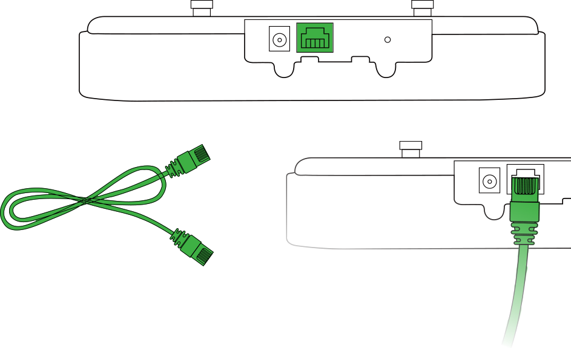

> For the full packing list see §2.1; product overview see §2.2; LED meanings see §2.3.

### Step 2: Mount the Device on the Ceiling

1. Use a drill or an appropriate tool to pre-drill holes at the marked positions on the ceiling. Ensure the hole dimensions suit the expansion screws you are using. Thread the screw through the bracket and secure it into the ceiling hole so the bracket is firmly mounted.

   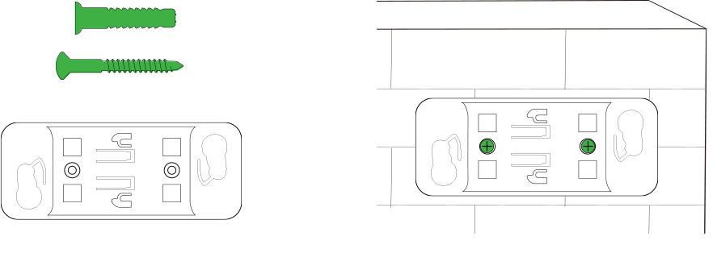

2. Align the bottom connectors of the device with the ceiling bracket, then **rotate the device clockwise** to securely attach it to the bracket.

   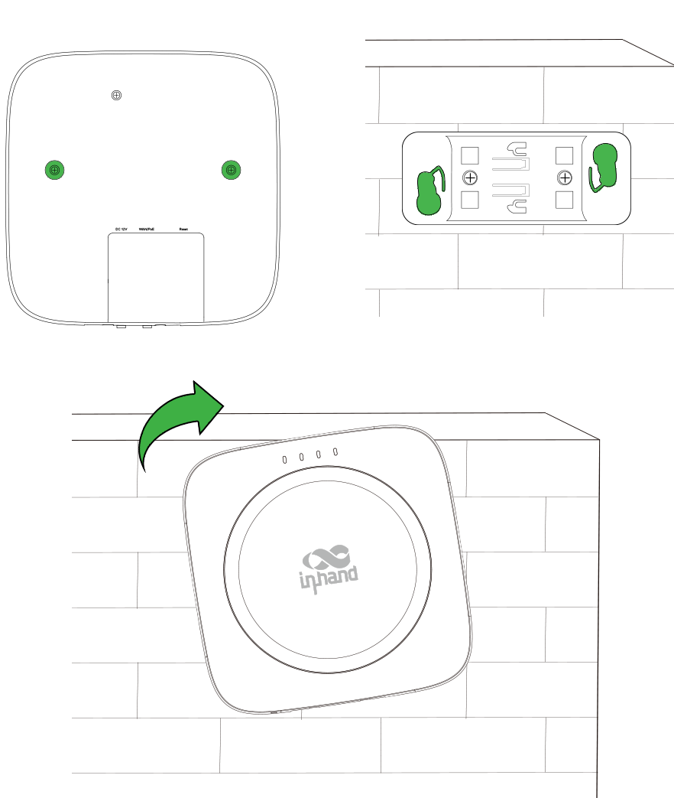

> Full ceiling installation steps are in §2.4.

### Step 3: Connect Power and Ethernet

Insert the Ethernet cable's RJ45 connector into the device's port, then gently wiggle the connector to confirm a secure connection. When using PoE, make sure the **upstream device has PoE functionality enabled**.

> 802.3af/at power delivery details are in §2.5; post-installation checks are in §2.4.

### Step 4: Power On and Confirm the Device Is Ready

Check the LED indicators:

- **PWR** blinking green → the system is starting up.
- **WAN** blinking green → the router is connecting to the wired network.
- **Wi-Fi 2.4G / Wi-Fi 5G** blinking rapidly green → the device is functioning normally as an AP.

> See §2.3 for the complete LED status table.

### Step 5: Log In to the Web Page from a PC

1. Connect the power cable and Ethernet cable. When using PoE, ensure the upstream device has PoE functionality enabled.
2. Connect the PC to the device's Wi-Fi (SSID and password: see the device's default settings) and confirm the PC has obtained an address in the **192.168.10.0** network segment.
3. Open a browser and go to the device's Web login page.

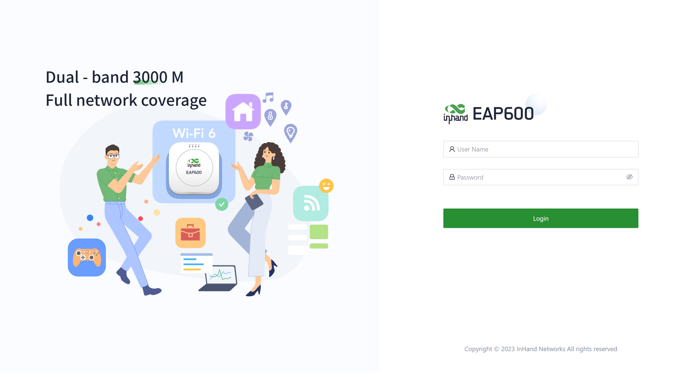

> First-time login details are in §2.6; factory reset is in §2.8.

### Post-Installation Checklist

- ☐ The ceiling bracket is firmly fixed with expansion screws, and the device is rotated clockwise into the bracket.
- ☐ The Ethernet cable is securely plugged in; the upstream device's PoE is enabled and working.
- ☐ **PWR** is on, and **Wi-Fi 2.4G / 5G** are blinking rapidly green (normal operating state).
- ☐ The PC is connected to the device Wi-Fi and has obtained an address in the 192.168.10.0 segment.
- ☐ The browser opens the Web login page.

> If the network connection fails, check the upstream PoE power supply and the WAN configuration (DHCP / Static IP, see §2.6). If the problem persists, restore the device to factory defaults (see §2.8).

---

## Part 2: Detailed Instructions

### 2.1 Packing List

| Category | Part Name | Quantity | Description |
|----------|-----------|----------|-------------|
| Standard Accessories | EAP600 | 1 | Enterprise AP600 |
| Standard Accessories | Ceiling Mount Bracket | 1 | Ceiling mounting bracket for fixing the AP |
| Optional Accessories | Power Adaptor | 1 | 12V DC power adaptor with power cable |
| Optional Accessories | Ethernet Cable | 1 | 1.5M Ethernet cable |

### 2.2 Product Overview

This manual is for the installation and operation of the EAP600 of InHand Networks. Before installation, please confirm the product model and accessories in the package. Please refer to the actual product for specific operations.

### 2.3 LED Indicators

| LED Indicator | Status and Description |
|---------------|------------------------|
| PWR | OFF — The device is OFF. Blinking green — The system is starting. Blinking rapidly green — The system does not work properly. Blinking green — The system is upgrading. |
| WAN | OFF — The network is disconnected. Blinking green — The router is connecting to the wired network. |
| Wi-Fi 2.4G | OFF — AP mode disabled. Always on — Other anomalies. Blinking rapidly green — The device functions normally as an AP. |
| Wi-Fi 5G | OFF — AP mode disabled. Always on — Other anomalies. Blinking rapidly green — The device functions normally as an AP. |

> **Note:**
> 1. The rapidly blinking interval is 200ms and the blinking interval is 500ms.

#### Reset Button

The **Reset** button on the device performs a hardware factory restore. See §2.8 for the full factory reset procedure.

### 2.4 Mechanical Installation

#### 2.4.1 Ceiling Installation

1. Use a drill or an appropriate tool to pre-drill holes at the marked positions on the ceiling. Ensure that the hole dimensions are suitable for the expansion screws you are using. Thread the screw through the bracket and secure it into the ceiling hole to ensure that the ceiling bracket is firmly mounted to the ceiling.

   

2. Align the bottom connectors of the device with the ceiling bracket, then rotate the device clockwise to securely attach it to the ceiling bracket.

   

#### 2.4.2 Inspection after Installation

1. Verify that the Ethernet cable is correctly connected.
2. Confirm that the PoE device supplying power to the AP is functioning properly and has PoE enabled.

### 2.5 Connections and Cabling

#### 2.5.1 Ethernet and PoE Power

The EAP600 supports power delivery according to the 802.3af/at standards, allowing it to simultaneously provide power and transmit data through a single Ethernet cable.

1. Insert the Ethernet cable's RJ45 connector into the device's port, then gently wiggle the connector to confirm a secure connection.

   

> When using PoE to power the EAP600, please ensure that the upstream device has PoE functionality enabled (see §2.4.2 Inspection after Installation).

### 2.6 First-Time Login and Network Configuration

#### 2.6.1 Add the Device via the APP

1. Power on the device and log into the InCloud APP.
2. Navigate to the "Device" section below to access the [Device] page, then click the menu button in the upper right corner and select [Add Device]. Then scan the QR code on the device to add it.  
   (The original text reads "the QR Code on the ER805"; based on context this should be the **EAP600** — corrected here as a typo.)

   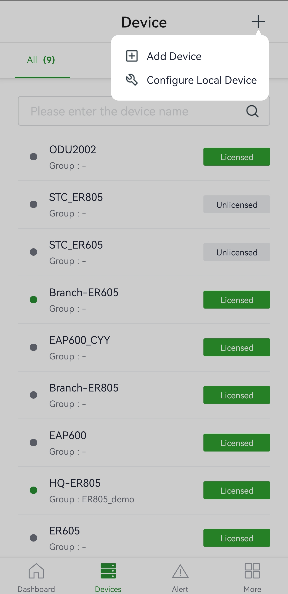

3. Once the QR code is successfully scanned, proceed to configure the device's name, serial number, and description information.
4. If the device fails to connect to the network after adding it, you can click "Configure local device" to set up the device for cloud connectivity. The AP is configured with default HTTP access and Wi-Fi AP functionality.
5. Scan the QR code on the unit's nameplate, and the app will establish a Wi-Fi connection with the AP automatically.
6. Once the connection is established, the app will log in to the device, and you will be directed to the network configuration interface. Confirm the information and click "Submit."

#### 2.6.2 Log In via PC

**Step 1:** Connect the power cable and Ethernet cable. When using PoE (Power over Ethernet) to power the EAP600, please ensure that the upstream device has PoE functionality enabled.

**Step 2:** Set the PC and device management IP addresses in the same network segment. The DHCP Server function is enabled by default, and the PC and device must be in the same address segment. The PC needs to be connected to the device's Wi-Fi (SSID and password: see the device's default settings), and check whether the PC has obtained an address, which should belong to the 192.168.10.0 network segment.

#### 2.6.3 Internet Connection

The EAP600 supports single-port wired access, and you can configure it to use DHCP or static IP address assignment based on your requirements. Click on "Configuration > WAN" to select the network connection type.

1. **DHCP:** The device's WAN interface is set to enable DHCP service by default. You can simply connect the WAN interface to the internet using an Ethernet cable to establish the AP's network connection.

   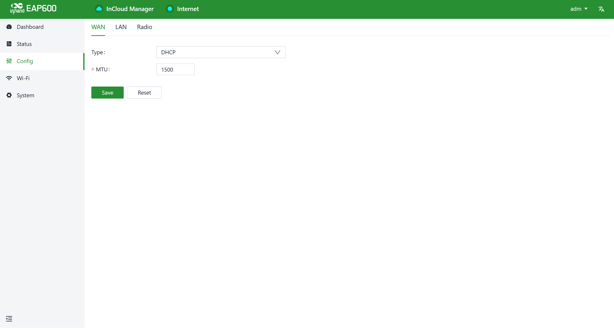

2. **Static IP:** You can manually configure the address assigned by the ISP or upstream device. After the configuration is completed, the AP will connect to the network using the specified static IP.

   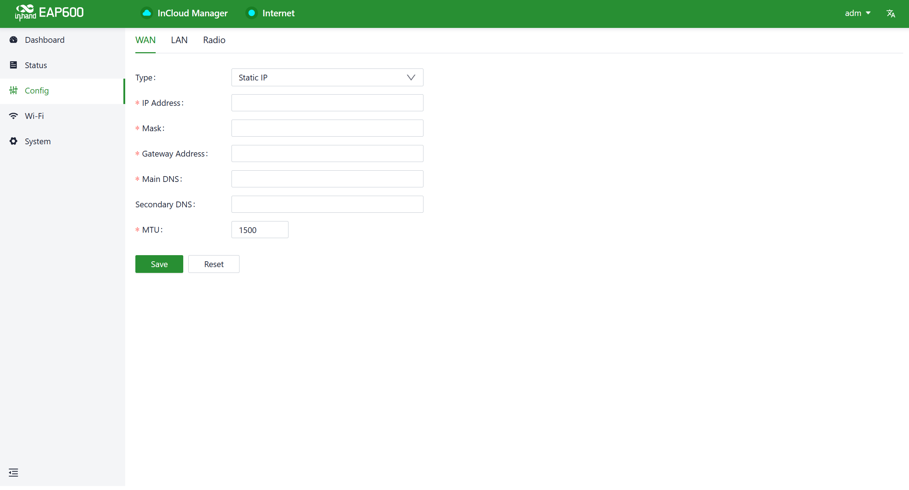

### 2.7 Remote Management Platform (InCloud Manager)

#### 2.7.1 Register / Log in to InCloud Manager

1. Open your web browser and visit InCloud at the following address: <https://star.inhandcloud.com/>. This will take you to the InCloud registration and login page. (We recommend using Chrome.)

   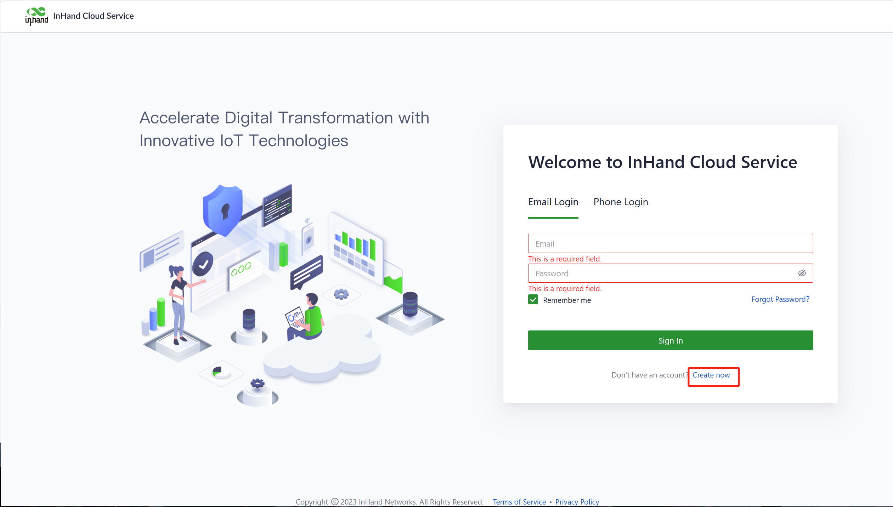

   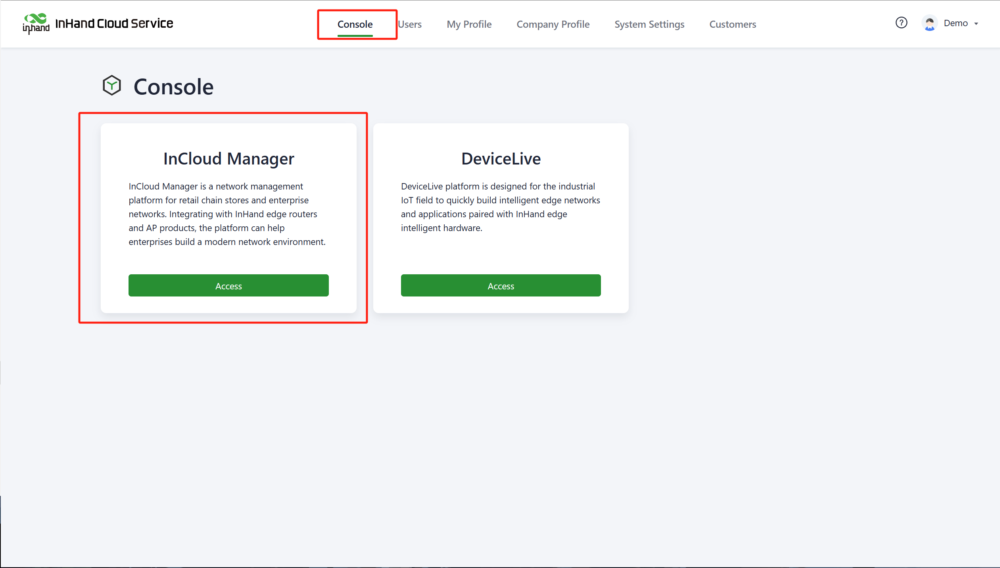

2. After registering, log in to the cloud platform using your registered email. Navigate to the "Security Settings" page where you can change your password and link your mobile phone number. Once your phone number is linked, you can use it for future logins to the cloud platform.

   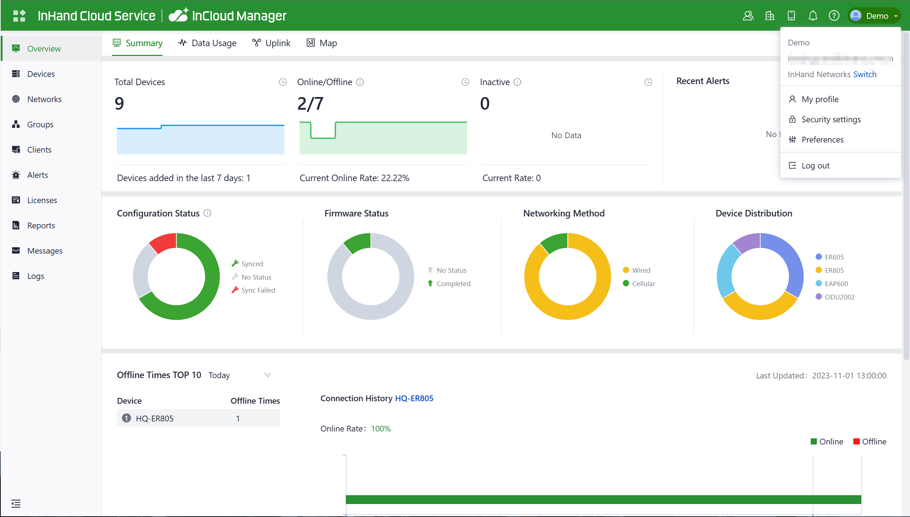

#### 2.7.2 Add Devices to the Platform

Log in to the InCloud Manager platform, then go to "Device" and click "Add" in the navigation menu. Fill in the device's serial number and MAC address to add it.

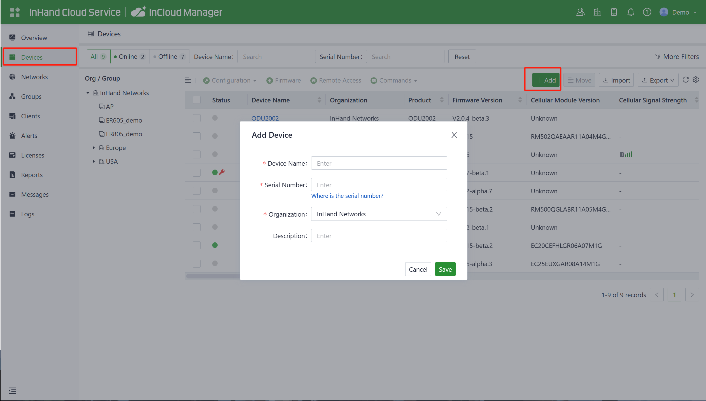

### 2.8 Factory Reset and Log/Diagnostic Data

#### 2.8.1 Remote Reset

Log in to the InCloud Manager platform, navigate to "Device," and select "Command" from the menu. Click the "Restore to Factory" button, confirm the action, and the device will reboot and revert to its default settings.

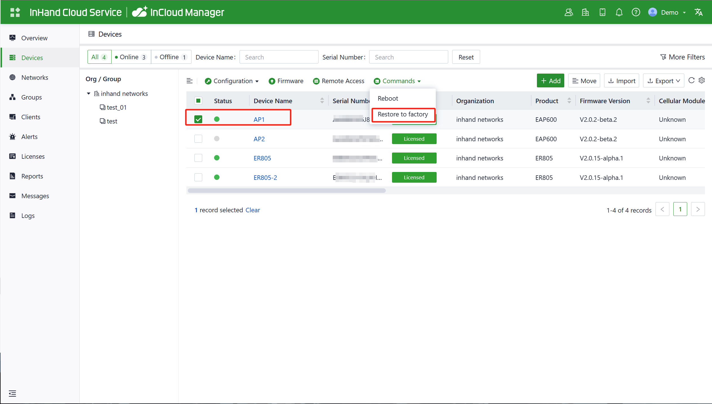

#### 2.8.2 Hardware Reset

**Step 1:** Power on the device, and within 10 seconds, long-press the Reset button until the PWR indicator light rapidly blinks green with a 200ms interval.

**Step 2:** After the rapid blinking, release the Reset button and wait for the device to complete the factory reset process. The PWR indicator light will stay constantly lit, indicating that the factory reset is complete.

#### 2.8.3 Logs and Diagnostic Data

Log in to InCloud Manager, navigate to "Device," select "Device Details," and click on the "Tools" menu in the navigation bar. Then, click the corresponding button to initiate the download of logs and diagnostic data.

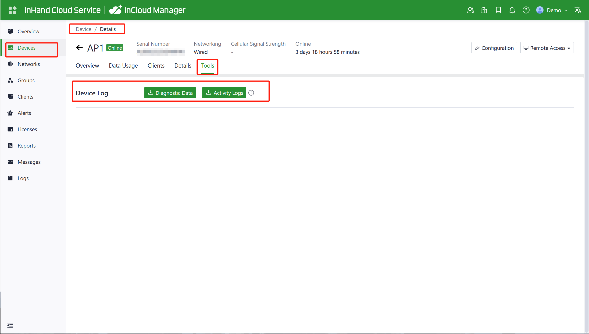

### 2.9 Related Documents

| Need | Where to Go |
|------|-------------|
| Original version of this guide (English) | [Enterprise AP600 Product Quick Guide](https://help.inhand.com/portal/en/kb/articles/enterprise-ap600-product-quick-guide) |
