# EC300-LoRaWAN Series LoRaWAN Gateway User Manual

Version 1.1 (June 2025) | For Debian 11 (IEOS)

## Front Matter

### Declaration

Thank you for choosing our product! Before use, please read this user manual carefully and follow the declarations below, which will help protect intellectual property rights and ensure legal compliance, so that your experience remains consistent with the latest product information. If you have any questions or need to obtain written permission, please feel free to contact our technical support team.

**Copyright**

This user manual contains copyrighted content owned by Beijing InHand Networks Technology Co., Ltd. and its licensors. Without written permission, no organization or individual may excerpt or reproduce part or all of this manual, or distribute it in any form.

**Disclaimer**

As product technologies and specifications are continuously updated, the company cannot guarantee that the materials in this user manual are fully consistent with the actual product. Therefore, it assumes no liability for any dispute arising from discrepancies between actual technical parameters and this user manual. Any change to the product will not be notified in advance; the company reserves the right of final interpretation.

**Copyright Notice**

The content of this user manual is protected by copyright laws and is owned by Beijing InHand Networks Technology Co., Ltd. and its licensors. All rights reserved. Without written permission, the content of this manual may not be used, reproduced, or distributed.

### Conventions

| Symbol | Meaning | Example |
|--------|---------|---------|
| `< >` | Indicates a variable or parameter to be replaced with an actual value | `<IP address>` indicates a specific IP to be filled in |
| `" "` | Indicates a text label on the interface | Click the "Save" button |
| `→` | Indicates menu levels or operation sequence | 【Network】→【Cellular】 |
| `【 】` | Indicates a menu or page name | Go to the【System】page |
| `> **NOTE**:` | Highlights matters that need attention during operation | > **NOTE**: Insert or remove the SIM card only when the device is powered off |
| Code block | Indicates command-line input or output | `sudo -s` |

### Technical Support

**Beijing InHand Networks Technology Co., Ltd. (Headquarters)**

Tel: 010-8417 0010

Address: 5F, Building 3, Yard 18, Ziyue Road, Chaoyang District, Beijing

**Chengdu Office**

Tel: 028-8679 8244

Address: 14F, China Taiping Financial Tower, No. 1777 North Tianfu Avenue, Wuhou District, Chengdu, Sichuan

**Guangzhou Office**

Tel: 020-8562 9571

Address: Unit B-130, Yuanyang Xinxi banchuang Park, No. 5 Tangdong East Road, Tianhe District, Guangzhou

**Wuhan Office**

Tel: 027-8716 3566

Address: Room 2001, Building 11, Bali Haoting, No. 2 Luoyu East Road, Hongshan District, Wuhan, Hubei

**Shanghai Office**

Tel: 021-5480 8501

Address: Room 1103, No. 18 Shunyi Road, Putuo District, Shanghai

### How to Use This Manual

**Find your role**

- First-time users: it is recommended to read "Getting to Know the Device" → "Installation and First Use" → "Common Configuration Scenarios" → "Function Description and Parameter Reference" in order.
- Existing users: go directly to "Function Description and Parameter Reference" or "Appendix Troubleshooting".
- Cloud platform users: see "Scenario 7: Connecting to the DeviceLive Cloud Platform".
- Secondary developers: see "Advanced Configuration of Peripheral Interfaces" and "Programming Guide".

**Quick task navigation**

| Task | Section | Estimated time |
|------|---------|----------------|
| Power on and log in to the device via SSH/Web | [Installation Guide](#22-installation-guide) | About 10 min |
| Access the Internet over 4G/5G cellular | [Scenario 2: Cellular Networking](#scenario-2-cellular-networking) | About 10 min |
| Get online via Wi-Fi / provide Wi-Fi access | [Scenario 3: Wi-Fi Internet Access (Station)](#scenario-3-wi-fi-internet-access-station), [Scenario 4: Providing Wi-Fi Access (AP)](#scenario-4-providing-wi-fi-access-ap) | About 5 min |
| Forward LoRaWAN data to a third-party network server | [Scenario 5: LoRaWAN Packet Forwarding](#scenario-5-lorawan-packet-forwarding) | About 10 min |
| Manage LoRa nodes with the built-in network server (ChirpStack) | [Scenario 6: Using the Built-in Network Server](#scenario-6-using-the-built-in-network-server-chirpstack) | About 30 min |
| Connect to the DeviceLive cloud platform | [Scenario 7: Connecting to the DeviceLive Cloud Platform](#scenario-7-connecting-to-the-devicelive-cloud-platform) | About 5 min |
| Restore factory settings | [Restoring Factory Settings](#14-restoring-factory-settings) | About 5 min |
| Use and program peripherals (serial/CAN/IO/AIN) | [Advanced Configuration of Peripheral Interfaces](#46-advanced-configuration-of-peripheral-interfaces), [Programming Guide](#47-programming-guide) | As needed |
| Troubleshoot device faults | [Appendix Troubleshooting](#appendix-troubleshooting) | As needed |

## 1 Getting to Know the Device

### 1.1 Overview

The EC300-LoRaWAN is an Arm-based LoRaWAN gateway running Debian 11, pre-installed with IEOS, a management suite developed by InHand. The device provides a web interface and supports multiple uplink methods: Ethernet, cellular (4G LTE/5G, model-dependent) and Wi-Fi (Station/AP). It features built-in LoRaWAN packet forwarding and a built-in network server (ChirpStack), so LoRa terminal data can either be forwarded to a third-party network server or managed directly by the built-in server. The device also provides serial ports, CAN, DI/DO, AIN, USB and MicroSD peripherals, integrates a TPM2.0 security module and a super capacitor for power-off protection, and supports remote monitoring and management through InHand's DeviceLive platform.

IEOS is enabled by default and takes over network and system management. You can also disable IEOS and manage the device with native Linux commands instead. Mixing the two may cause abnormal running states; see [Managing the Device via Command Line](#45-managing-the-device-via-command-line).

### 1.2 Appearance and Interfaces

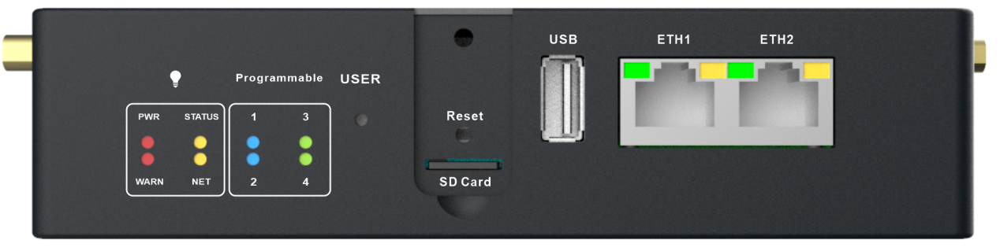

**Figure 1-1 Front panel**

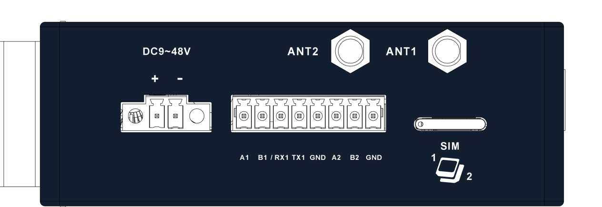

**Figure 1-2 Left panel**

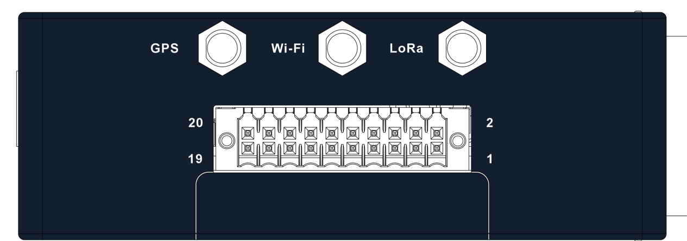

**Figure 1-3 Right panel**

| Interface | Description |
|-----------|-------------|
| DC power input | Supports 9~48V DC input |
| Ethernet ports (ETH1/ETH2) | 2 RJ45 ports, 10M/100M adaptive; yellow LED is the LINK indicator, green LED is the ACT indicator (flashes when data is being transmitted) |
| Serial ports (COM1/COM2) | COM1: RS-232/RS-485 (RX1 TX1 / A1 B1), selectable between RS-232 and RS-485 but the two cannot work at the same time; COM2: RS-485 (A2 B2) |
| USB | 1 USB 2.0 Host port, mainly for storage expansion; hot-pluggable |
| SIM card slots | 2 SIM slots; insert/remove by pressing, only when the device is powered off |
| MicroSD card slot | 1 MicroSD slot; hot-plugging is not supported, insert/remove only when powered off |
| Restore factory button | Used to restore factory settings; see [Restoring Factory Settings](#14-restoring-factory-settings) |
| Antenna interfaces | 5 in total: ANT1 (4G LTE main antenna/5G antenna), ANT2 (4G LTE diversity receiving antenna/5G antenna), GNSS (positioning antenna, passive GPS antenna required), Wi-Fi (Wi-Fi antenna), LoRa (LoRa antenna); screw the antenna into the corresponding connector |
| User programmable keys | The API interface can be used to detect key states so that users can implement their own key logic |
| LEDs | 8 LEDs indicating power supply and system running status; see [LED Indicators](#13-led-indicators) |

### 1.3 LED Indicators

| LED | State | Meaning |
|-----|-------|---------|
| PWR (red) | Solid on | Powered on |
| STATUS (yellow) | Flashing | System started normally |
|  | Off | An exception occurred during system startup and the system failed to start; or the factory restore operation has not completed |
| WARN (green) | Flashing | The system has a warning, e.g. system upgrade or factory restore not completed, or dialing abnormality (cellular function needs to be enabled) |
| NET (green) | Off | Not dialing |
|  | Solid on | Dialing successful |
|  | Flashing | Dialing in progress |
| User1 (green) | Off by default | User programmable LED 1, controllable by user programming |
| User2 (green) | Off by default | User programmable LED 2, controllable by user programming |
| User3 (green) | Off by default | User programmable LED 3, controllable by user programming |
| User4 (green) | Off by default | User programmable LED 4, controllable by user programming |

### 1.4 Restoring Factory Settings

> **NOTE**: Restoring factory settings erases all configurations on the device. Back up the configuration first (see [Basic Configuration](#431-basic-configuration) for config export).

The device supports two ways to restore factory settings.

**Method 1: By command**

Run the restore command on the device CLI. The system will restart automatically and restore factory settings.


**Figure 1-4 Restoring factory settings by command**

**Method 2: By button**

1. Press and hold the restore button for 10~20 seconds until the WARN LED lights up.
2. Release the button when the WARN LED is on.
3. After the button is released, the WARN LED flashes several times, and the system starts to restart and perform the factory reset.
4. After the restart, the WARN LED flashes and the STATUS LED stays off. After about 30 seconds, when the WARN LED stops flashing and the STATUS LED starts flashing at the same time, the factory reset is complete.

### 1.5 Default Settings

| Item | Default value |
|------|---------------|
| ETH1 default IP | 192.168.3.100 |
| ETH2 default IP | 192.168.4.100 |
| SSH username/password | edge / security@edge |
| root account | Created at factory but login disabled; switch via `sudo -s` |
| Web login address | https://192.168.4.100:9100 (HTTPS only; HTTP access redirects to HTTPS automatically) |
| Web username/password | adm / 123456 |
| ChirpStack username/password | admin / admin |
| IEOS program | Enabled by default |
| Reserved ports | 9100~9200 (web uses 9100); user programs should avoid these ports |
| Cellular function | Enabled by default, default route enabled |
| Dual SIM (single standby) | Disabled by default, main SIM defaults to sim1 |
| Wi-Fi | Disabled by default |
| LoRaWAN mode | Off |
| Wi-Fi AP default address | 192.168.100.100 / 255.255.255.0 |
| Local MQTT broker | 127.0.0.1:9121, username carrier, password mqtt@carrier |
| Auto restart after firmware upgrade | Disabled by default |

## 2 Installation and First Use

### 2.1 Before Installation

| Item | Description |
|------|-------------|
| Computer | For accessing the device CLI or web interface |
| Ethernet cable | Connects the computer to the device Ethernet port |
| Power supply | 9~48V DC |
| SIM card (optional) | Required for the cellular function, 1~2 cards |
| Antennas | Shipped according to device model; screw into the corresponding interfaces |
| MicroSD card (optional) | Required for storage expansion, must be formatted as FAT32 (see [MicroSD Card Mounting](#463-microsd-card-mounting)) |

> **NOTE**:
> 1. Neither SIM cards nor MicroSD cards support hot-plugging. Insert or remove them only when the device is powered off.
> 2. The GNSS antenna interface requires a passive GPS antenna.
> 3. Before connecting the power supply, confirm that its output is within the 9~48V DC range.

### 2.2 Installation Guide

#### 2.2.1 Installing Antennas and Inserting SIM Cards

1. Screw each antenna into its corresponding interface (ANT1, ANT2, GNSS, Wi-Fi, LoRa) and tighten it.
2. With the device powered off, press the SIM card into the slot. For the dual SIM (single standby) feature, insert both SIM cards.

#### 2.2.2 Connecting Network and Power

1. Use an Ethernet cable to connect the ETH1 or ETH2 port of the device to the computer (or a LAN switch).
2. Connect the 9~48V DC power supply. The PWR LED lights up; after normal startup, the STATUS LED flashes.

#### 2.2.3 Logging In via SSH

Factory default account:

- Username: edge
- Password: security@edge

The root user is created at the factory but login is disabled. The edge user belongs to the sudo group, so you can run `sudo -s` under edge to switch to root and execute system-level commands; see [User Account Management](#452-user-account-management).

> **NOTE**: When **command not found** appears, enter `sudo -s` to switch to the root user, or run the command with sudo.

> **NOTE**: For security reasons, it is recommended to disable the default user account and create your own account; see [Disabling the Default User Account](#452-user-account-management).

Default IP addresses of the device:

| Port | Default IP |
|------|------------|
| ETH1 | 192.168.3.100 |
| ETH2 | 192.168.4.100 |

**Linux**

Set the computer's Ethernet IP to the same subnet as the device (ETH1: 192.168.3.0/24, ETH2: 192.168.4.0/24) and run the ssh command, taking ETH1 as an example:


**Figure 2-1 Running the ssh command on Linux**

Enter **yes** to confirm the host fingerprint and continue the connection.

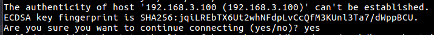

**Figure 2-2 Confirming the host fingerprint**

When the terminal prompt `edge@lorawan-gw:~$` appears, shell commands can be entered, indicating a successful connection.

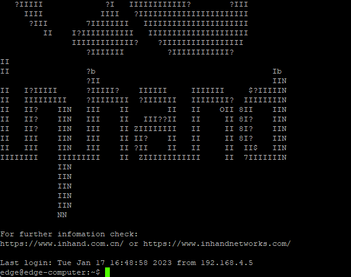

**Figure 2-3 SSH login successful**

**Windows**

Download PuTTY (free software) and connect to the device over SSH.

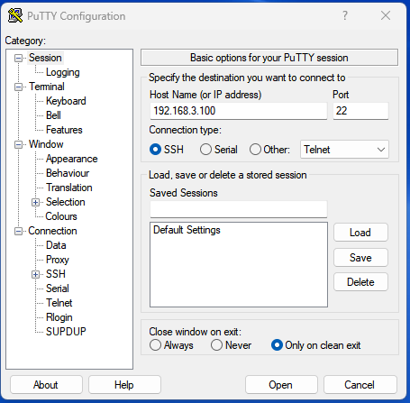

**Figure 2-4 PuTTY SSH connection example**

#### 2.2.4 Logging In to the Web Interface

IEOS serves the web interface over HTTPS on port 9100 only; HTTP access is not supported and redirects to HTTPS automatically.

1. Set the computer's Ethernet IP to the same subnet as ETH2 (192.168.4.0/24).
2. Visit https://192.168.4.100:9100 in a browser.
3. Enter the initial username adm and password 123456 to log in.


**Figure 2-5 Web login page**

> **NOTE**: When IEOS is enabled, ports 9100~9200 are reserved for internal communication. User programs should avoid using these ports, otherwise conflicts may occur and functions may fail.

### 2.3 Quick Checks

| Check item | Expected result |
|------------|-----------------|
| PWR LED | Solid on |
| STATUS LED | Flashing (system running normally) |
| SSH login | The edge account can log in to the CLI |
| Web login | https://192.168.4.100:9100 is reachable |
| NET LED (with SIM inserted) | Solid on after successful dialing |
| Cellular status page | Signal strength and IP address visible |

## 3 Common Configuration Scenarios

### Scenario 1: Wired Access and Web Management Login

**Goal**: Access the IEOS web interface of the device through an Ethernet port for network and system configuration.

**Prerequisites**: The device is powered on and connected to the computer via an Ethernet cable.

**Estimated time**: About 5 minutes.

**Steps**:

1. Set the computer IP to the same subnet as the connected port (ETH1: 192.168.3.0/24; ETH2: 192.168.4.0/24).
2. Visit https://192.168.4.100:9100 (the default eth2 address is used as an example in this manual).
3. Log in with username adm and password 123456.

**Verification**:

1. After login, the IEOS home page shows menus such as【Network】、【System】and【Status】.

**Common issues**:

- Page unreachable: make sure HTTPS and port 9100 are used, and the computer is in the same subnet as the device. IEOS does not support plain HTTP access.
- Login failure: confirm the account is adm/123456; if the password has been changed, restore factory settings to reset it.

### Scenario 2: Cellular Networking

**Goal**: Access the Internet over the 4G/5G cellular network.

**Prerequisites**: A SIM card is inserted and cellular antennas are installed; the device is powered on and the web interface is reachable.

**Estimated time**: About 10 minutes.

**Steps**:

1. Go to【Network】→【Cellular】and make sure the cellular switch (Enabled) is on (enabled by default).
2. Select the cellular system in Network Mode. If the local network system is unknown, select Automatic and the program will choose a suitable system. The default is Automatic.
3. For private-network SIM cards, configure APN, username, password and authentication in Profiles; public SIM cards usually need no change here.
4. Keep Enable Default Route on (enabled by default) so that a cellular default route is added after successful dialing.
5. Click "Save" and wait for dialing to complete.
6. It is recommended to enable ICMP detection against dialing fake connections; see [Cellular Configuration](#422-cellular).

**Verification**:

1. The NET LED is solid on, indicating successful dialing.
2. Go to【Status】→【Cellular】to check signal strength, IP address, DNS, etc.
3. Run a ping test under【Network】→【Diagnostics】to verify Internet access.

**Common issues**:

- Dialing fails: check whether the SIM card is inserted properly and not in arrears, whether APN parameters are correct, and whether the antennas are installed.
- Dialed but no data traffic: this may be a fake connection; ICMP detection can recover it automatically.
- WARN LED flashing: dialing is abnormal; make sure the cellular function is enabled.

### Scenario 3: Wi-Fi Internet Access (Station)

**Goal**: The device acts as a Wi-Fi client and accesses the network through a nearby Wi-Fi hotspot.

**Prerequisites**: A usable Wi-Fi hotspot exists nearby, and its SSID and password are known.

**Estimated time**: About 5 minutes.

**Steps**:

1. Install the Wi-Fi antenna.
2. Go to【Network】→【Wi-Fi】and select Client (Station) for Network.
3. Enable Enable Wi-Fi.
4. Enter the SSID in Client SSID manually, or click the scan button to list nearby connectable SSIDs.
5. Select the Auth Method (no authentication, WPA-PSK, WPA2-PSK, or WPA-PSK/WPA2-PSK mixed).
6. Select the Encrypt Mode (CCMP, TKIP, or TKIP&CCMP) and fill in WPA/WPA2 PSK Key.
7. Keep Enable Default Route on, click "Save" and wait for the connection.

**Verification**:

1. Go to【Status】→【Wi-Fi Station】to check the obtained IP address, gateway and DNS.

**Common issues**:

- Connection failure: check the SSID, authentication method and key against the hotspot settings.

### Scenario 4: Providing Wi-Fi Access (AP)

**Goal**: The device acts as a Wi-Fi hotspot and provides wireless access for nearby terminals.

**Prerequisites**: The device is powered on, the web interface is reachable, and the Wi-Fi antenna is installed.

**Estimated time**: About 5 minutes.

**Steps**:

1. Go to【Network】→【Wi-Fi】and select AP for Network.
2. Enable Enable Wi-Fi, configure the SSID and SSID Broadcast (whether the SSID is broadcast).
3. Select Band (2.4G/5.8G) and Radio Type (802.11b/g/n for 2.4G, 802.11a/n/ac for 5G).
4. Select Channel and Bandwidth (20MHz suits interference-prone environments; 40MHz/80MHz suits high-speed transmission in low-interference environments).
5. Select Auth Method (Open/WPA-PSK/WPA2-PSK/WPA-PSK&WPA2-PSK), encryption mode, and the Wi-Fi password (WEP Key).
6. Set Stations Limit (maximum number of clients) and the AP-mode IP address as needed (default 192.168.100.100/255.255.255.0).
7. Click "Save".

**Verification**:

1. Search for and connect to the SSID from a terminal, then verify it obtains an IP and reaches the network.

**Common issues**:

- The SSID cannot be found: make sure SSID Broadcast is enabled; with a hidden SSID, it must be entered manually on the terminal.

### Scenario 5: LoRaWAN Packet Forwarding

**Goal**: Forward received LoRaWAN packets to a third-party network server platform.

**Prerequisites**: Basic networking (cellular/Ethernet/Wi-Fi) is done and the LoRa antenna is installed; the third-party server address, port and frequency plan are known.

**Estimated time**: About 10 minutes.

**Steps**:

1. Go to【Network】→【LoRaWAN】and select Packet Forward as the working mode.
2. Confirm Region (determined by the device model, not configurable); select the Frequency Plan, which must match the terminal nodes and the network server.
3. Select the forwarding protocol:
   - **UDP forwarding**: configure the network server address (up to 5) and port; configure Keepalive Interval (in seconds, range [1,3600], default 10), Keepalive Max Failures (maximum heartbeat failures), and CRC forwarding options (Forward CRC OK enabled by default; Forward CRC Invalid/Missing disabled by default) as needed.
   - **MQTT forwarding**: configure the MQTT broker address and port provided by the network server, and Client ID; enable User Auth and TLS as needed; configure topic prefix (prepended to the default topics), Use JSON (JSON or binary), Keepalive, QoS and Clean Session as needed.
4. Adjust Log Level as needed (default Error).
5. Click "Save". The device starts forwarding LoRaWAN packets to the network server.

**Verification**:

1. Trigger the terminal node to report data and check on the network server platform whether the gateway is online and data is received.

**Common issues**:

- The server receives nothing: verify the server address and port, that the frequency plan matches the nodes and the server, and that the gateway is online.

### Scenario 6: Using the Built-in Network Server (ChirpStack)

**Goal**: Use the built-in LoRaWAN network server (ChirpStack) to manage LoRa terminal nodes directly and push data via MQTT.

**Prerequisites**: The device is online; the gateway EUI (viewable on the status page) and the terminal's DevEUI, JoinEUI and AppKey (from the terminal vendor) are known.

**Estimated time**: About 30 minutes.

**Steps**:

1. Go to【Network】→【LoRaWAN】and select Build-in Network Server as the working mode.
2. Select the Frequency Plan (consistent with the terminals), and configure Network ID, ADR and other parameters as needed (see [LoRaWAN Configuration](#423-lorawan)).
3. Click the Go to the Network Server Manage Page link to open the ChirpStack page, log in with the default admin/admin, and change the default password immediately.
4. Complete the following in ChirpStack (detailed steps and screenshots in [Build-in Network Server and ChirpStack](#build-in-network-server-and-chirpstack)):
   1. Add the gateway: the Gateway EUI can be found on the device status page, Device Overview.
   2. Add a Device Profile: the Region options follow the previous configuration; MAC version and Regional parameters revision must match the terminal's supported specifications.
   3. Add an application: an application id is generated after adding, used later for MQTT push.
   4. Add devices under the application: DevEUI, JoinEUI and AppKey are obtained from the terminal vendor.
5. Enable the data push integration (Enable Integration) as needed, and configure the MQTT broker address (default 127.0.0.1), port (default 9121), authentication and topic templates; see [Build-in Network Server and ChirpStack](#build-in-network-server-and-chirpstack).

**Verification**:

1. Trigger the terminal to report data and check the gateway status and the device Events in ChirpStack.
2. Subscribe to the corresponding topics with an MQTT client to verify LoRaWAN data is received.

**Common issues**:

- The gateway is offline: check the Gateway EUI and that the device is online.
- Nodes cannot join: check the Frequency Plan and DevEUI/JoinEUI/AppKey against the terminal.

### Scenario 7: Connecting to the DeviceLive Cloud Platform

**Goal**: Connect the device to InHand's DeviceLive platform for remote monitoring and management.

**Prerequisites**: The device is online via Ethernet/cellular/Wi-Fi.

**Estimated time**: About 5 minutes.

**Steps**:

1. Go to【System】→【Basic】.
2. Enable the cloud management switch (Enabled).
3. Select the Cloud Server: domestic platform or overseas platform.
4. Click "Save". The device registers to DeviceLive automatically.

**Verification**:

1. Log in to the DeviceLive platform and check that the device is online and manageable.

**Common issues**:

- The device is invisible on the platform: make sure the device can reach the Internet, and that the switch is on with the correct platform address selected.

## 4 Function Description and Parameter Reference

### 4.1 IEOS Web Management Overview

IEOS is a network and system management suite developed by InHand and runs on top of the Linux system. It provides a web interface through which users can configure the Ethernet port IP address, cellular dialing, Wi-Fi Station, DHCP Client/Server, static routes, firewall and other network functions, and operate the system time, time zone, firmware upgrade and system restart. In addition, IEOS supports docking with InHand's DeviceLive platform, so users can remotely monitor and manage EC300-LoRaWAN devices through DeviceLive.

IEOS adopts a design that separates state from configuration, and is divided into three functional areas: network management (Network), system management (System) and status (Status). Network and system configurations are performed under the【Network】and【System】menus respectively, while status information is viewed on the【Status】page.

> **NOTE**: When using IEOS to manage network and system configurations, using Linux native commands at the same time may cause the two to interfere with each other and lead to abnormal running states. It is recommended to manage all configurations supported by IEOS through the IEOS web; configurations not supported by IEOS can be combined with Linux native commands.

For the web login method and default account, see [Logging In to the Web Interface](#224-logging-in-to-the-web-interface). Considering that user programs may need the standard HTTP/HTTPS port numbers 80/443, IEOS uses port 9100 for HTTPS access; HTTP access is not supported and redirects to HTTPS automatically.

### 4.2 Network Management

#### 4.2.1 Ethernet Interfaces

**Configuring a static IP**

Configure a static IP address for the eth1 interface:

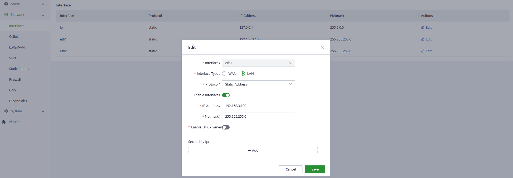

**Figure 4-1 eth1 static IP configuration**

**Configuring a DHCP Client**

When configuring the DHCP Client for the eth1 interface, set Interface Type to WAN:

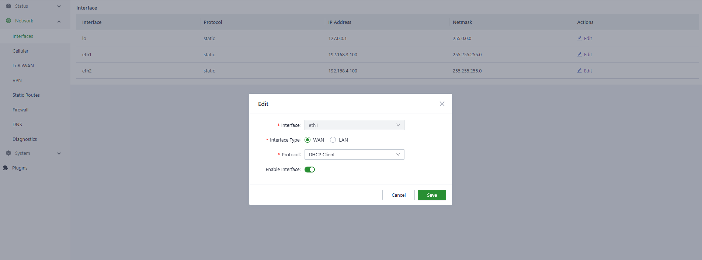

**Figure 4-2 eth1 DHCP Client configuration**

**Configuring a DHCP Server**

Enable the DHCP Server function on the eth1 interface to assign addresses to devices under eth1:

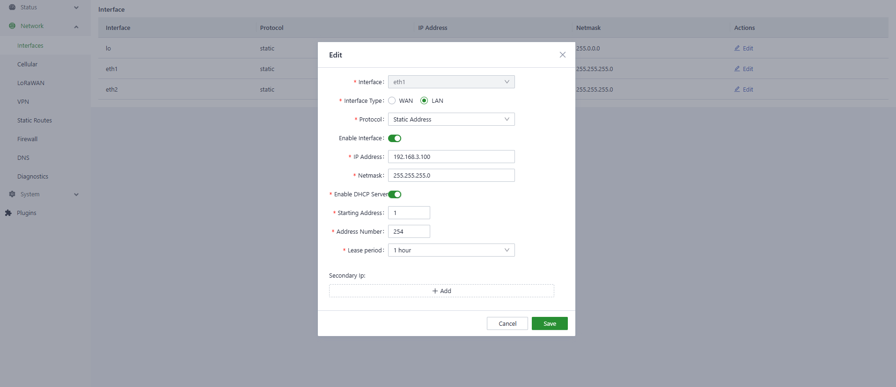

**Figure 4-3 eth1 DHCP Server configuration**

DHCP Server parameters:

| Parameter | Description |
|-----------|-------------|
| Enable DHCP Server | Switch of the DHCP Server function |
| Starting Address | Base address of the address pool. Network segment + starting address = the first IP address of the pool. For example, if the eth1 segment is 192.168.3.0/24 and the base address is 1, the pool starts at 192.168.3.1/24 |
| Max Address Number | Maximum number of addresses in the pool |
| Lease Period | Lease time |

#### 4.2.2 Cellular

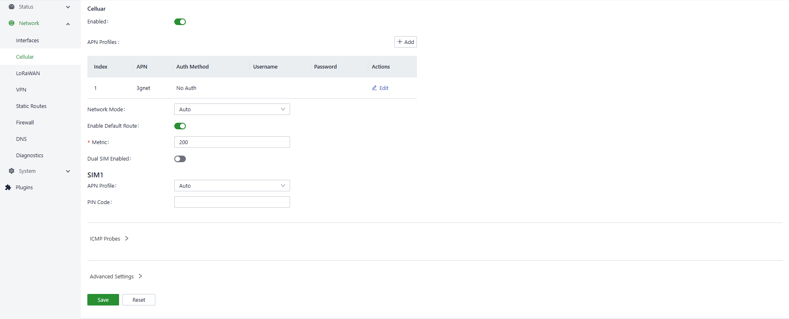

**Figure 4-4 Cellular basic configuration**

Basic cellular parameters:

| Parameter | Description |
|-----------|-------------|
| Enabled | Switch of the cellular function; enabled by default |
| Profiles | Dial parameter sets, used to configure APN, username, password, authentication method, etc. for private-network SIM cards; usually no change needed for public SIM cards. A parameter set can hold up to 10 records |
| Network Mode | Cellular network system; 3G, 4G and related systems (LTE, WCDMA, etc.) can be selected. If the local network system is unknown, select Automatic and the program will pick a suitable system automatically. Default: Automatic |
| Enable Default Route | Switch for adding the default route. When enabled, a cellular default route is added after successful dialing. Enabled by default |
| Metric | Metric of the cellular default route. When the cellular, Wi-Fi and Ethernet ports all have default routes configured, the one with the lowest metric takes effect |

##### Dual SIM (Single Standby)

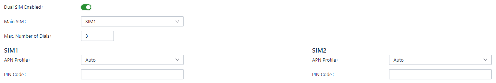

**Figure 4-5 Dual SIM configuration**

| Parameter | Description |
|-----------|-------------|
| Dual SIM Enabled | Switch of the dual SIM (single standby) feature. To improve network reliability, the EC300-LoRaWAN supports dual SIM single dialing with two SIM cards inserted. When enabled, if the sim1 dialing fails (e.g. due to arrears), it automatically switches to sim2. Disabled by default |
| Main SIM | Main SIM card. The selected SIM card is used for dialing first; after dialing fails a number of times, it switches to the other SIM card. Defaults to sim1 |
| Max Number of Dials | With dual SIM enabled, switch to the other SIM card after the current one reaches the specified number of dials |
| APN Profile | Dial parameter set selected by the SIM card, default Automatic. Private-network SIM cards usually need a parameter set configured and its Index selected here |
| PIN Code | PIN code of the SIM card |

##### ICMP Detection

Wireless cellular networks are complex; a dialing fake connection may occur, i.e. the dial status is successful but the target address cannot be pinged. Redialing restores normality in such cases. IEOS cellular dialing supports ICMP probing to detect fake connections.

> **NOTE**: For cellular networking scenarios, it is recommended to enable ICMP detection so that fake connections can be recovered quickly.

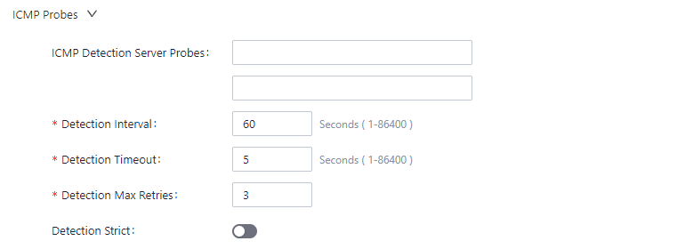

**Figure 4-6 ICMP detection configuration**

| Parameter | Description |
|-----------|-------------|
| ICMP Detection Server Probes | ICMP detection addresses; two can be configured. Detection of either address succeeding means there is no fake connection; with neither address configured, ICMP detection is off |
| Detection Interval | How often the ICMP probe is performed |
| Detection Timeout | ICMP detection timeout; if no probe response is received within this period, the probe is considered failed |
| Detection Max Retries | Maximum number of probes; when failures reach this value, redialing is triggered. Range [1,5] |
| Detection Strict | Whether to enable strict detection. When off, each detection cycle first checks whether the packets received on the cellular interface change; any change means the cellular network is open and no ICMP probe is sent, saving some traffic. When on, ICMP probes are sent periodically regardless of packet changes. Off by default |

##### Advanced Settings

The advanced area contains some rarely changed options.

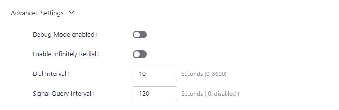

**Figure 4-7 Cellular advanced configuration**

| Parameter | Description |
|-----------|-------------|
| Debug Mode enabled | Whether to enable the debug function. When enabled, some dial-related debug information is added to the log. Disabled by default |
| Enable Infinitely Redial | Switch for unlimited redialing. In some cases dialing may enter an abnormal state, and the system can recover by restarting; after a certain number of dial failures the system restarts to try to recover. Since dialing is enabled by default, customers without a SIM inserted may see repeated restarts due to dial failures. In that case, enabling unlimited redialing prevents restarts no matter how many times dialing fails. Disabled by default |
| Dial Interval | Dialing interval; the time to wait before the next dial after a failed dial |
| Signal Query Interval | Signal query interval. Poor signal may cause fake connections, which redialing may solve with a certain probability; the dialer periodically detects the signal strength, and the detection period is configured here |

#### 4.2.3 LoRaWAN

The LoRaWAN configuration has three working modes:

- **Off**: closed state, no business processing.
- **Packet Forward**: packet forwarding state, forwarding LoRaWAN data to a third-party network server platform.
- **Build-in Network Server**: built-in network server mode.

##### Off Mode

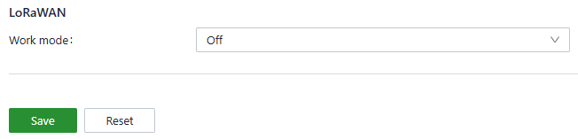

**Figure 4-8 LoRaWAN Off mode**

##### Packet Forward Mode

Packet forwarding is divided into UDP forwarding and MQTT forwarding.

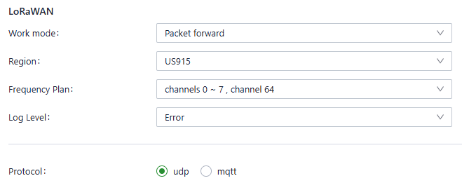

**Figure 4-9 Packet Forward configuration**

| Parameter | Description |
|-----------|-------------|
| Region | The EC300-LoRaWAN has different models for different regions. The region here is determined by the model, cannot be configured, and is for display only |
| Frequency Plan | Frequency band information, which must be consistent with the terminal nodes and the network server |
| Log Level | Log level; adjust as needed. Default: Error |
| Protocol | Forwarding protocol: UDP forwarding or MQTT forwarding |

UDP forwarding configuration:

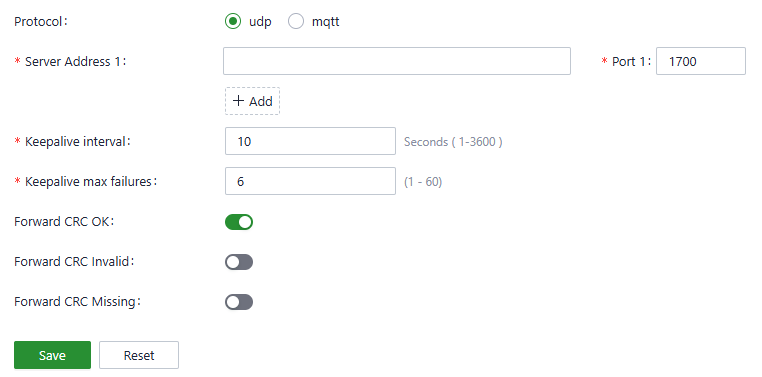

**Figure 4-10 UDP forwarding configuration**

| Parameter | Description |
|-----------|-------------|
| Server Address | Address of the network server; up to 5 can be added |
| Port | Port number of the network server |
| Keepalive Interval | Heartbeat interval maintained with the network server, in seconds, range [1,3600], default 10 |
| Keepalive Max Failures | Maximum number of heartbeat failures; exceeding it means the gateway and the platform have lost connection |
| Forward CRC OK | Whether to forward LoRaWAN messages that pass CRC verification; enabled by default |
| Forward CRC Invalid | Whether to forward LoRaWAN messages with invalid CRC; disabled by default |
| Forward CRC Missing | Whether to forward LoRaWAN messages without CRC; disabled by default |

MQTT forwarding configuration:

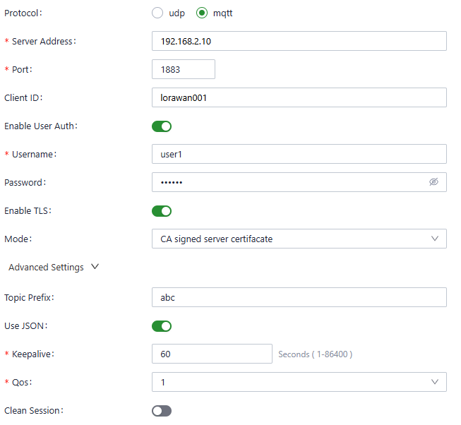

**Figure 4-11 MQTT forwarding configuration**

| Parameter | Description |
|-----------|-------------|
| Server Address | IP address that the MQTT broker provided by the network server listens on |
| Port | Listening port number of the MQTT broker provided by the network server |
| Client ID | Client id of the MQTT client |
| Enable User Auth | Whether to enable user authentication; enter the username and password after enabling |
| Username | Username used for authentication when establishing the connection with the MQTT broker |
| Password | Password used for authentication when establishing the connection with the MQTT broker |
| Enable TLS | Whether to enable TLS |
| Mode | Visible after TLS is enabled; configures whether to use a CA certificate or a self-signed certificate |
| Topic Prefix | The configured prefix is prepended to the default topics as the final topics. Default topics: `gateway/{{gateway_dev_eui}}/event/up`, `gateway/{{gateway_dev_eui}}/event/stats` |
| Use JSON | Send data in JSON or binary format |
| Keepalive | MQTT heartbeat interval |
| QoS | QoS level of MQTT messages |
| Clean Session | Whether to clear the session |

##### Build-in Network Server Mode

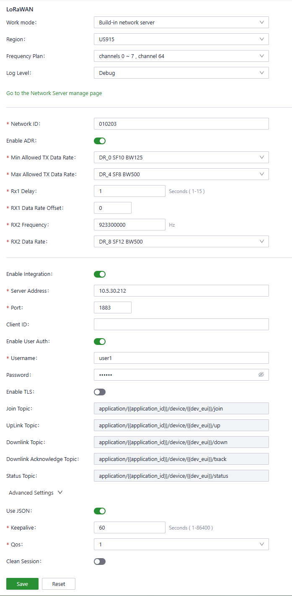

**Figure 4-12 Build-in network server configuration**

| Parameter | Description |
|-----------|-------------|
| Region | Determined by the device model, cannot be configured, display only |
| Frequency Plan | Frequency band information, which must be consistent with the terminal nodes and the network server |
| Log Level | Log level; adjust as needed. Default: Error |
| Go to the Network Server Manage Page | A link; clicking it jumps to the ChirpStack configuration page. Information such as Gateway EUI, terminal JoinEUI and AppKey is configured on the ChirpStack page; see usage below |
| Network ID | LoRa networking ID, used to distinguish different networks |
| Enable ADR | Whether to enable ADR (Adaptive Data Rate). This function takes effect only if the terminal supports ADR |
| Min Allowed TX Data Rate | Configure the minimum sending rate; requires ADR to be enabled |
| Max Allowed TX Data Rate | Configure the maximum sending rate; requires ADR to be enabled |
| Rx1 Delay | Delay of the Rx1 window, in seconds, range [1,15] |
| RX1 Data Rate Offset | Data rate offset of the RX1 receive window |
| RX2 Frequency | Frequency used by the RX2 receive window |
| RX2 Data Rate | Data rate used by the RX2 receive window |
| Enable Integration | Whether to enable the data push integration. After enabling, data received from terminals can be pushed to the MQTT broker |
| Server Address | Address of the MQTT broker. The EC300-LoRaWAN runs an MQTT broker locally and pushes to 127.0.0.1 by default. When a user program runs on the EC300-LoRaWAN, it can subscribe to the related topics to obtain LoRaWAN data |
| Server Port | Port number of the MQTT broker; default 9121 |
| Client ID | Client id of the MQTT client |
| Enable User Auth | Whether to enable user authentication; username and password are required after enabling. The MQTT broker running on the EC300-LoRaWAN has username/password authentication enabled |
| Username | Username used for authentication when connecting to the MQTT broker. The username for the local MQTT broker is carrier |
| Password | Password used for authentication when connecting to the MQTT broker. The password for the local MQTT broker is mqtt@carrier |
| Enable TLS | Whether to enable TLS |
| Mode | Visible after TLS is enabled; configures whether to use a CA certificate or a self-signed certificate |
| Join topic / Uplink topic / Downlink topic / Downlink Acknowledge topic / Status topic | Message templates are defined here, where {{application_id}} and {{dev_eui}} are variables. {{application_id}} is generated automatically after an application is added on the ChirpStack page, and its value can be obtained from the ChirpStack server page. {{dev_eui}} is the device EUI of the terminal, obtained from the terminal vendor |

##### Build-in Network Server and ChirpStack

Meaning of each topic and payload examples:

| Topic template | Meaning |
|----------------|---------|
| `application/{{application_id}}/device/{{dev_eui}}/join` | Topic corresponding to the join event of a terminal device. Example: `application/acb57b95-2c39-486e-a8e7-724d4d6343ac/device/9620853c959b5856/join` |
| `application/{{application_id}}/device/{{dev_eui}}/up` | Topic corresponding to uplink data sent by the terminal. The data field is the service data sent by the terminal, encoded in base64; decode it to get the original data |
| `application/{{application_id}}/device/{{dev_eui}}/down` | Topic for sending downlink data to the terminal. The devEui field must match the dev_eui in the topic |
| `application/{{application_id}}/device/{{dev_eui}}/txack` | Topic corresponding to the ack message returned by the terminal after receiving downlink data |
| `application/{{application_id}}/device/{{dev_eui}}/status` | Topic corresponding to demodulation margin and battery status |

Join payload example:

```json
{
    "deduplicationId": "feef733a-bd99-4b54-b0f9-ed045d03f898",
    "time": "2025-03-07T06:54:35.594623020+00:00",
    "deviceInfo": {
        "tenantId": "52f14cd4-c6f1-4fbd-8f87-4025e1d49242",
        "tenantName": "ChirpStack",
        "applicationId": "acb57b95-2c39-486e-a8e7-724d4d6343ac",
        "applicationName": "ddd",
        "deviceProfileId": "6a5e561f-17bd-4bee-a6ff-707a81e71008",
        "deviceProfileName": "profile-01",
        "deviceName": "node-01",
        "devEui": "9620853c959b5856",
        "deviceClassEnabled": "CLASS_C",
        "tags": {}
    },
    "devAddr": "06b0b667"
}
```

Up payload example:

```json
{
  "deduplicationId": "ce397905-f943-45af-8ab5-cebb371b2a3a",
  "time": "2025-03-07T08:10:33.292943009+00:00",
  "deviceInfo": {
    "tenantId": "52f14cd4-c6f1-4fbd-8f87-4025e1d49242",
    "tenantName": "ChirpStack",
    "applicationId": "acb57b95-2c39-486e-a8e7-724d4d6343ac",
    "applicationName": "ddd",
    "deviceProfileId": "6a5e561f-17bd-4bee-a6ff-707a81e71008",
    "deviceProfileName": "profile-01",
    "deviceName": "node-01",
    "devEui": "9620853c959b5856",
    "deviceClassEnabled": "CLASS_C",
    "tags": {}
  },
  "devAddr": "06b0b667",
  "adr": false,
  "dr": 1,
  "fCnt": 79,
  "fPort": 51,
  "confirmed": false,
  "data": "7u7u",
  "rxInfo": [
    {
      "gatewayId": "0016c001f10550c9",
      "uplinkId": 314812379,
      "nsTime": "2025-03-07T08:10:33.035682529+00:00",
      "rssi": -12,
      "snr": 12.25,
      "channel": 4,
      "location": {
        "latitude": 35.86166,
        "longitude": 104.195397
      },
      "context": "BhqN7A==",
      "metadata": {
        "region_config_id": "us915_0",
        "region_common_name": "US915"
      },
      "crcStatus": "CRC_OK"
    }
  ],
  "txInfo": {
    "frequency": 903100000,
    "modulation": {
      "lora": {
        "bandwidth": 125000,
        "spreadingFactor": 9,
        "codeRate": "CR_4_5"
      }
    }
  }
}
```

Down payload example:

```json
{
    "devEui": "9620853c959b5856",
    "fPort": 1,
    "data": "7u7u"
}
```

Txack payload example:

```json
{
  "downlinkId": 2677400421,
  "time": "2025-03-07T08:15:27.302565414+00:00",
  "deviceInfo": {
    "tenantId": "52f14cd4-c6f1-4fbd-8f87-4025e1d49242",
    "tenantName": "ChirpStack",
    "applicationId": "acb57b95-2c39-486e-a8e7-724d4d6343ac",
    "applicationName": "ddd",
    "deviceProfileId": "6a5e561f-17bd-4bee-a6ff-707a81e71008",
    "deviceProfileName": "profile-01",
    "deviceName": "node-01",
    "devEui": "9620853c959b5856",
    "deviceClassEnabled": "CLASS_C",
    "tags": {}
  },
  "queueItemId": "98b73db8-4631-479c-a315-aa9d1b58b35a",
  "fCntDown": 2,
  "gatewayId": "0016c001f10550c9",
  "txInfo": {
    "frequency": 923300000,
    "power": 21,
    "modulation": {
      "lora": {
        "bandwidth": 500000,
        "spreadingFactor": 12,
        "codeRate": "CR_4_5",
        "polarizationInversion": true
      }
    },
    "timing": {
      "immediately": {}
    },
    "context": "FSvtpQ=="
  }
}
```

Status payload example:

```json
{
  "deduplicationId": "a0047d3f-b432-4400-8ef8-ed8fad4c9025",
  "time": "2025-03-07T08:16:15.688878229+00:00",
  "deviceInfo": {
    "tenantId": "52f14cd4-c6f1-4fbd-8f87-4025e1d49242",
    "tenantName": "ChirpStack",
    "applicationId": "acb57b95-2c39-486e-a8e7-724d4d6343ac",
    "applicationName": "ddd",
    "deviceProfileId": "6a5e561f-17bd-4bee-a6ff-707a81e71008",
    "deviceProfileName": "profile-01",
    "deviceName": "node-01",
    "devEui": "9620853c959b5856",
    "deviceClassEnabled": "CLASS_C",
    "tags": {}
  },
  "margin": 10,
  "externalPowerSource": false,
  "batteryLevelUnavailable": false,
  "batteryLevel": 100
}
```

Other parameters:

| Parameter | Description |
|-----------|-------------|
| Use JSON | Whether to send data in JSON format; protobuf format is used when disabled |
| Keepalive | MQTT heartbeat interval, in seconds |
| QoS | QoS level of MQTT messages |
| Clean Session | Whether to clear the session |

##### Using ChirpStack

1. After clicking the Go to the Network Server Manage Page link, the ChirpStack login page opens. The default username/password is admin/admin.

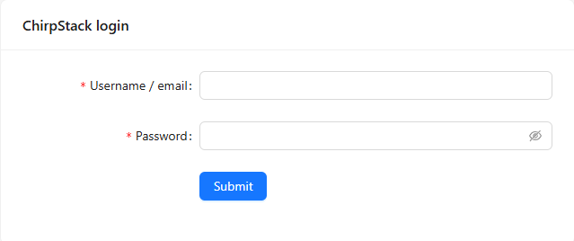

**Figure 4-13 ChirpStack login page**

2. After logging in, it is recommended to change the default password first.

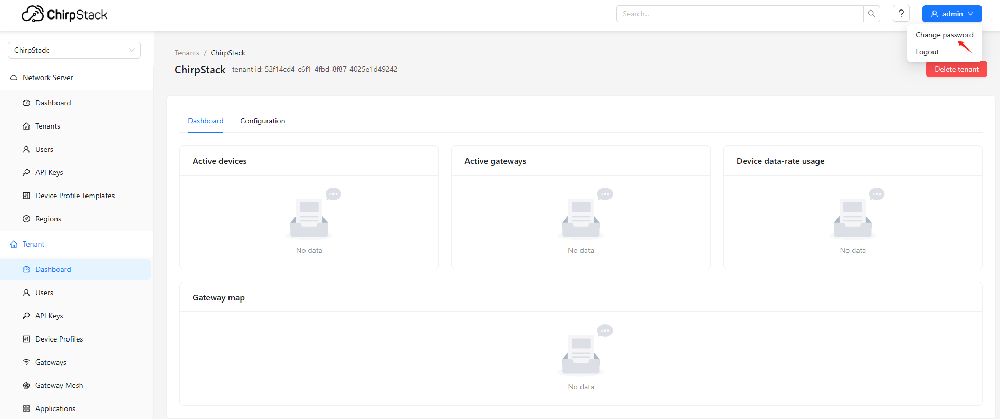

**Figure 4-14 Change default password entry**

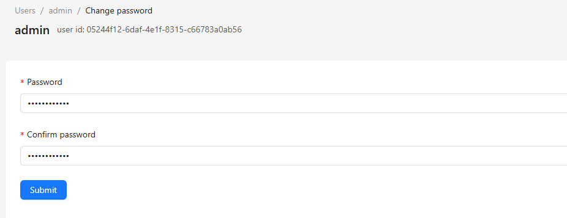

**Figure 4-15 Changing the password**

3. Switch to the Gateway menu and click Add gateway to add a gateway. The Gateway EUI is required when adding a gateway; this information can be obtained from the Device Overview status page.

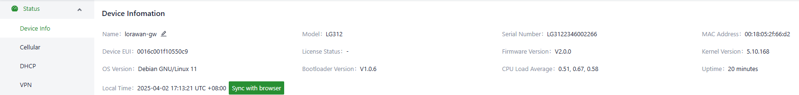

**Figure 4-16 Viewing the gateway EUI**

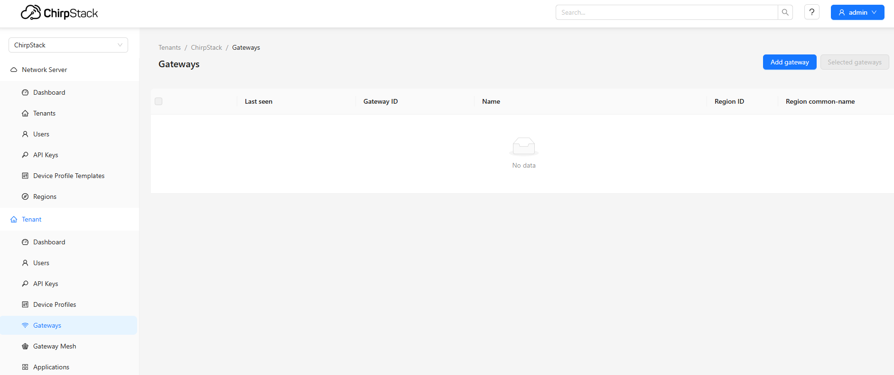

**Figure 4-17 Adding a gateway**

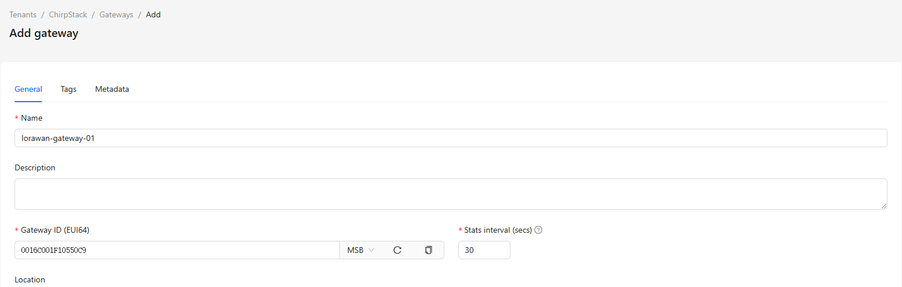

**Figure 4-18 Gateway configuration details**

Tens of seconds after adding the gateway, click the Gateway menu again and the gateway is shown online.

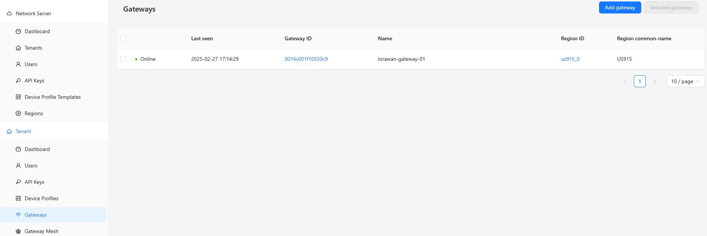

**Figure 4-19 Gateway online status**

4. Switch to the Device Profiles menu and click Add device profile to add a profile.

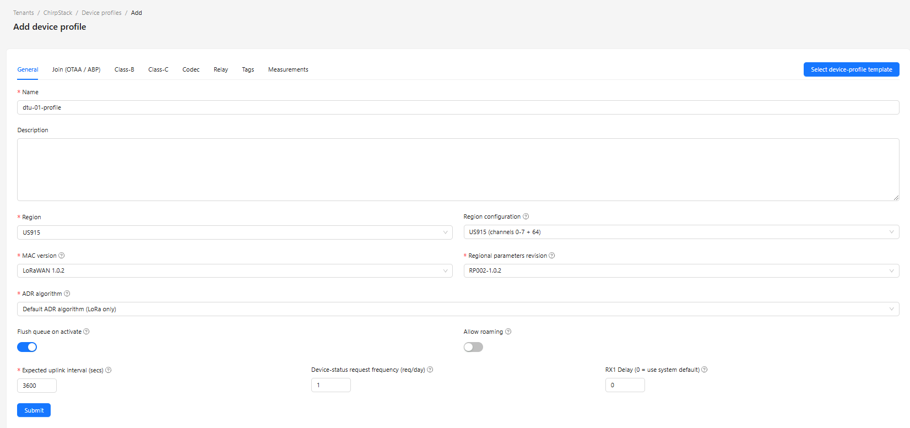

**Figure 4-20 Adding a device profile**

The Region configuration options are determined by the previous configuration.

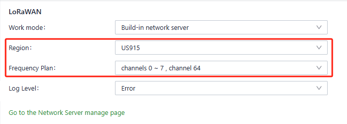

**Figure 4-21 Region configuration options**

The MAC version and Regional parameters revision need to be set according to the specifications supported by the terminal.

5. Switch to the Applications menu and click Add application to add an application.

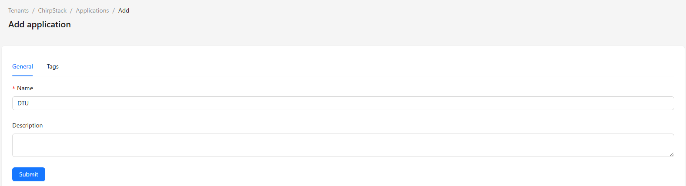

**Figure 4-22 Adding an application**

After the application is added, an application id is generated, which is used when LoRaWAN data needs to be pushed out via MQTT.

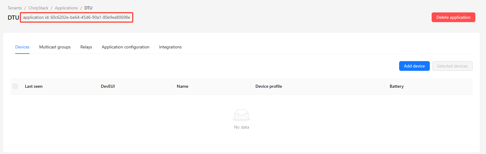

**Figure 4-23 Application ID**

6. After the application is created, click Add device under the application to add a device.

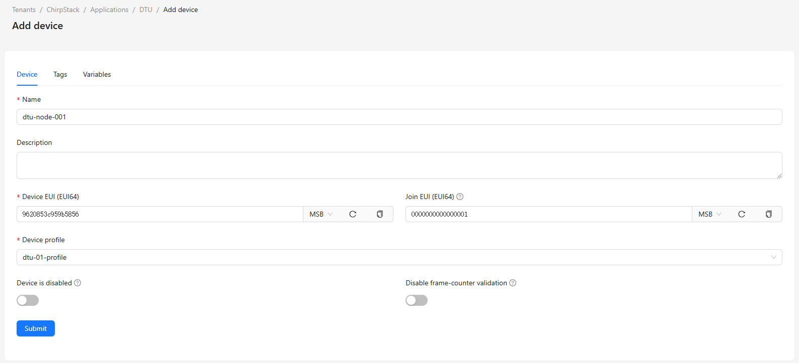

**Figure 4-24 Adding a device**

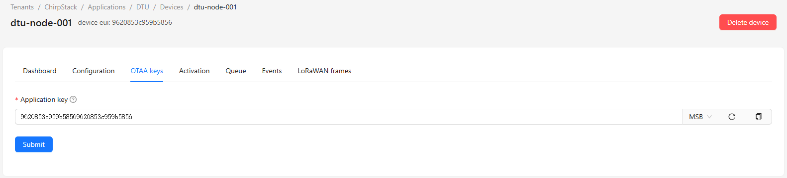

**Figure 4-25 Device key configuration**

Device EUI, Join EUI and Application key need to be obtained from the terminal vendor.

7. Test communications.

Trigger the terminal to generate data, then click the device's EUI and select Events to check whether the terminal data is received.

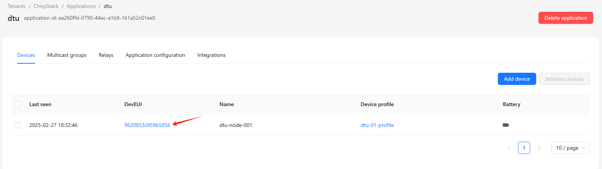

**Figure 4-26 Viewing Events**

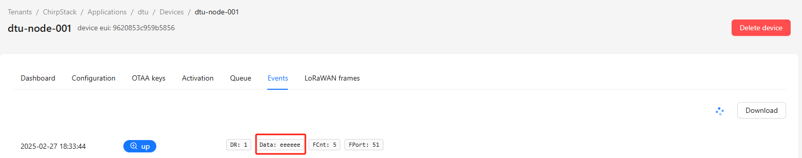

**Figure 4-27 Terminal uplink data**

When testing the network server sending data to the terminal, the terminal needs to be switched to Class C mode. Class C can be enabled in the Device profiles configuration; then switch to the Queue menu to send data to the terminal and check whether the data is received on the terminal side.

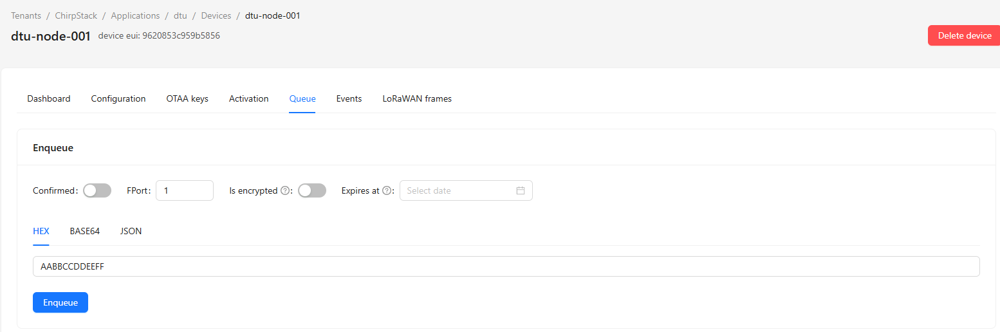

**Figure 4-28 Sending downlink via Queue**

#### 4.2.4 Wi-Fi

The EC series supports both Station and AP modes.

##### Station Mode

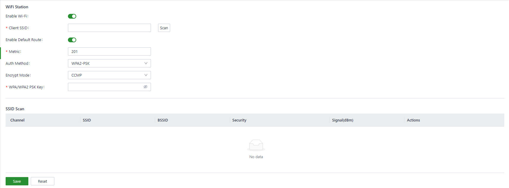

**Figure 4-29 Wi-Fi Station configuration**

| Parameter | Description |
|-----------|-------------|
| Enable Wi-Fi | Enable switch; off by default |
| Client SSID | The SSID to connect to; can be entered manually or obtained with the scan button |
| Enable Default Route | Whether to add the default route. When enabled, a wlan default route is added after a successful Wi-Fi connection. Enabled by default |
| Metric | Metric of the Wi-Fi default route. When the cellular, Wi-Fi and Ethernet ports all have default routes, the lowest metric takes effect |
| Auth Method | Authentication method: no authentication, WPA-PSK, WPA2-PSK, or WPA-PSK/WPA2-PSK mixed |
| Encrypt Mode | Encryption method: CCMP, TKIP, or TKIP&CCMP |
| WPA/WPA2 PSK Key | Key information |

##### Access Point Mode

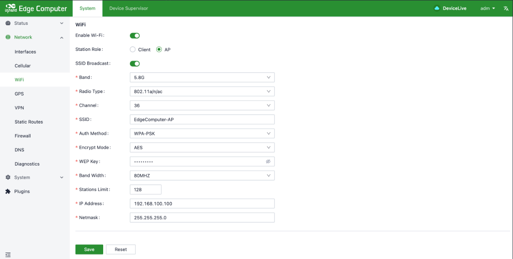

**Figure 4-30 Wi-Fi AP configuration**

| Parameter | Description |
|-----------|-------------|
| SSID Broadcast | Whether the SSID is broadcast, enabled by default. Enabled: the SSID can be detected by nearby devices; Disabled: the SSID is hidden and must be entered manually to connect |
| Band | Wi-Fi frequency band: 2.4G suits longer coverage; 5.8G suits high-speed data transmission |
| Radio Type | Wireless standard: 802.11a/n/ac supports 5G; 802.11b/g/n supports 2.4G |
| Channel | The wireless channel used; can be selected manually or set to default |
| SSID | Set the Wi-Fi network name |
| Auth Method | Wi-Fi authentication method: Open, WPA-PSK, WPA2-PSK, or WPA-PSK/WPA2-PSK Mixed |
| Encrypt Mode | Wireless encryption mode: AES or TKIP |
| WEP Key (Wi-Fi password) | Set the Wi-Fi access password |
| Bandwidth | Bandwidth: 20MHz suits complex environments with strong anti-interference; 40MHz/80MHz suit high-speed transmission in low-interference environments |
| Stations Limit | Maximum number of clients allowed to connect to the AP |
| IP Address | Local IP address in Wi-Fi AP mode (default 192.168.100.100) |
| Subnet Mask | Subnet configuration parameter (default 255.255.255.0) |

#### 4.2.5 Static Routes

Static routes of Ethernet are configured here. When Ethernet, cellular and Wi-Fi default routes are configured at the same time, the default route with the lowest metric takes effect. Make sure the Metric values of the default routes are different.

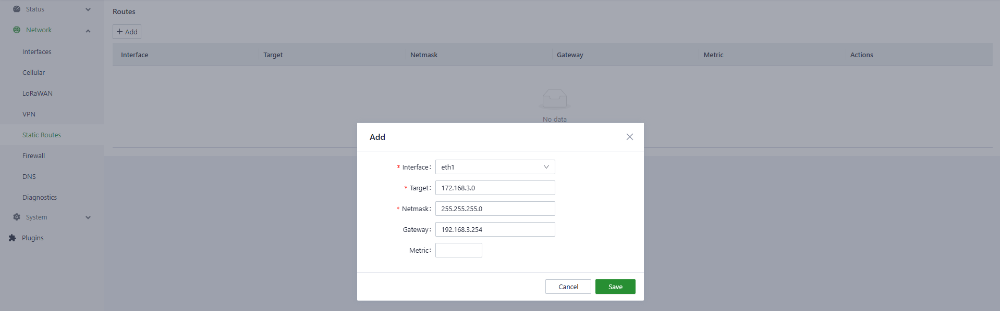

**Figure 4-31 Static route configuration**

Static route parameters:

| Parameter | Description |
|-----------|-------------|
| Interface | Outbound interface of the static route |
| Target | Target network |
| Netmask | Destination network mask |
| Gateway | Next-hop address |
| Metric | Metric of the static route |

#### 4.2.6 Firewall

**Basic Settings**

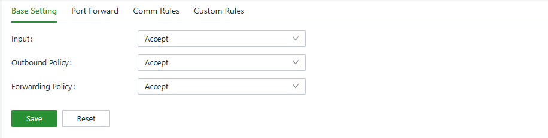

**Figure 4-32 Firewall basic settings**

Inbound (Input), outbound (Output) and forwarding (Forward) policies can be set separately.

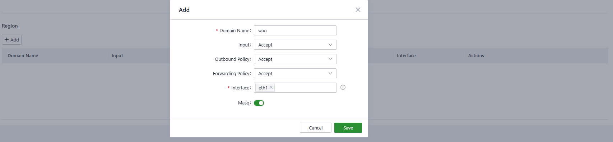

**Figure 4-33 Input/output/forward policies**

Zone rules can be added in the Zone configuration. Zones are interface-based; WAN and LAN zones can be configured. Masq controls whether NAT rules are enabled: for a WAN interface with devices behind it that need Internet access, enable this option.

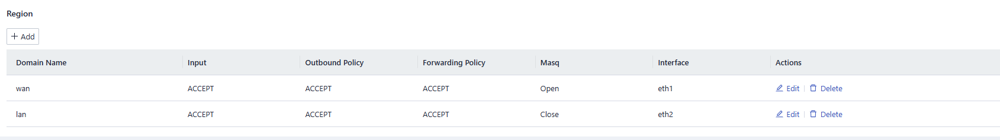

**Figure 4-34 Zones and Masq**

**Port Forward**

DNAT rules are usually used when packets enter from the WAN side and access devices under the LAN.

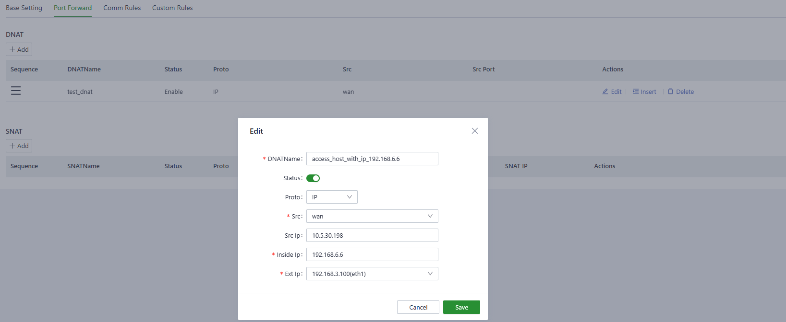

**Figure 4-35 DNAT rule configuration**

| Parameter | Description |
|-----------|-------------|
| DNAT Name | Name of the DNAT rule, used to describe its purpose |
| Status | After a rule is added, it can be enabled or disabled; when Status is off, the rule is disabled |
| Proto | Supported protocol types such as IP, UDP, TCP |
| Src | The domain from which the device receives the packet, i.e. which interface |
| Src IP | Source IP address of the packet; if empty, all packets are matched |
| Inside IP | IP address of the target device to be accessed, usually a device in the LAN such as an HTTP server |
| Ext IP | When a domain has multiple IP addresses, identifies the IP of the interface corresponding to the Src domain; select one |

The rule in the screenshot means: when the wan domain receives a packet with source address 10.5.30.198 and destination address 192.168.3.100, the destination address is rewritten to 192.168.6.6.

SNAT rules are usually used when packets enter the WAN and the source IP address needs to be changed to the WAN port IP address.

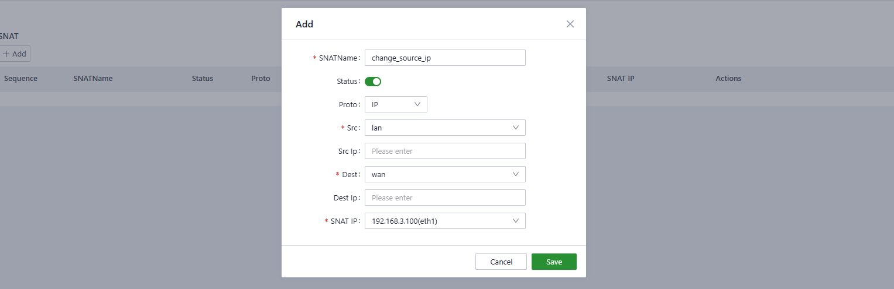

**Figure 4-36 SNAT rule configuration**

| Parameter | Description |
|-----------|-------------|
| SNAT Name | Name of the SNAT rule, used to describe its purpose |
| Status | After a rule is added, it can be enabled or disabled; when Status is off, the rule is disabled |
| Proto | Supported protocol types such as IP, UDP, TCP |
| Src | The domain the packet comes from, usually the LAN domain |
| Src IP | Source IP address to match; optional, matches all source IP addresses if empty |
| Dest | The domain the packet is sent to, usually the WAN domain |
| Dest IP | Destination IP address of the packet; optional, matches all if empty |
| SNAT IP | The rewritten source IP address |

The rule in the screenshot means: for packets entering from the lan domain (eth2) and routed to the wan domain (eth1), the source IP address is rewritten to the IP address of eth1, i.e. 192.168.3.100.

**Comm Rules**

Communication rules are used to filter forwarded packets.

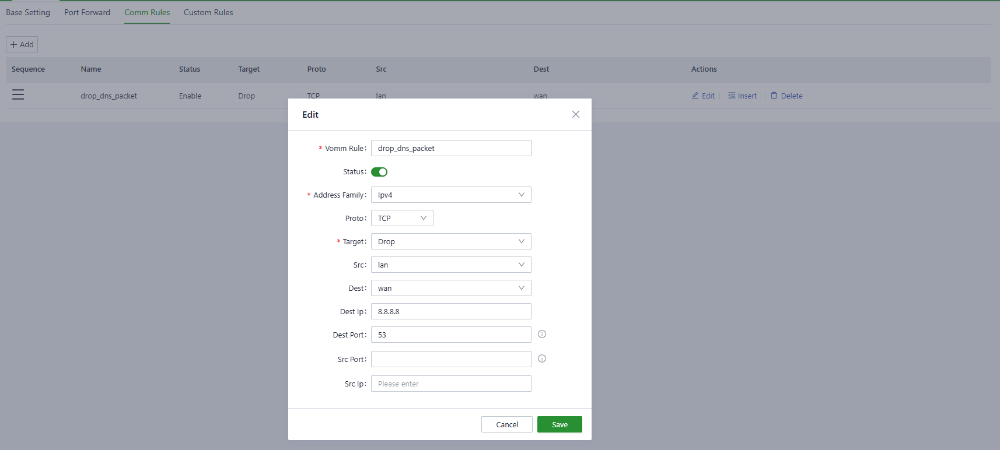

**Figure 4-37 Comm rules configuration**

| Parameter | Description |
|-----------|-------------|
| Comm Rule | Identifies the rule and describes its purpose |
| Status | After a rule is added, it can be enabled or disabled; when Status is off, the rule is disabled |
| Proto | Supported protocol types such as IP, UDP, TCP |
| Target | Target action: Drop, Accept or Reject |
| Src | The domain the packet enters the device from |
| Dest | The domain the packet leaves the device through |
| Dest IP | Destination address of the packet; if not configured, all destination addresses are matched |
| Dest Port | Destination port of the packet; matches all ports if not configured |
| Src IP | Source IP address of the packet; if not configured, all source IP addresses are matched |
| Src Port | Source port of the packet; matches all source ports if not configured |

**Custom Rules**

Custom firewall rules can be added using iptables commands.

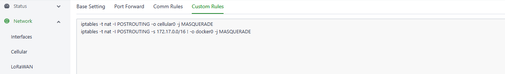

**Figure 4-38 Custom rules configuration**

#### 4.2.7 DNS

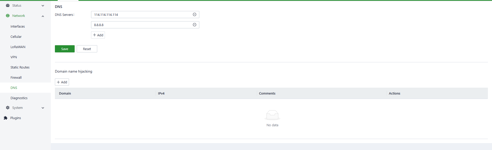

**Figure 4-39 DNS configuration**

| Parameter | Description |
|-----------|-------------|
| DNS Servers | DNS server addresses; up to 4 can be configured |
| Domain Name Hijacking | Domain hijacking function, enabling binding between IP addresses and domain names |


**Figure 4-40 Domain hijacking configuration**

#### 4.2.8 Network Diagnostics

Network diagnostics supports ping, traceroute and nslookup.

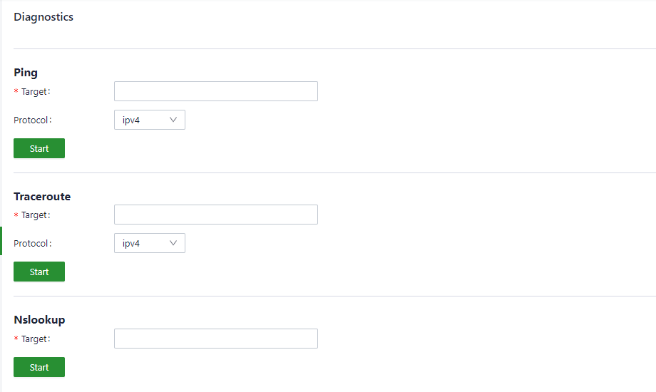

**Figure 4-41 Network diagnostics**

#### 4.2.9 OpenVPN

**Configuring the OpenVPN Server**

OpenVPN can be configured manually on the web page or by importing a configuration file.

a. Manual configuration

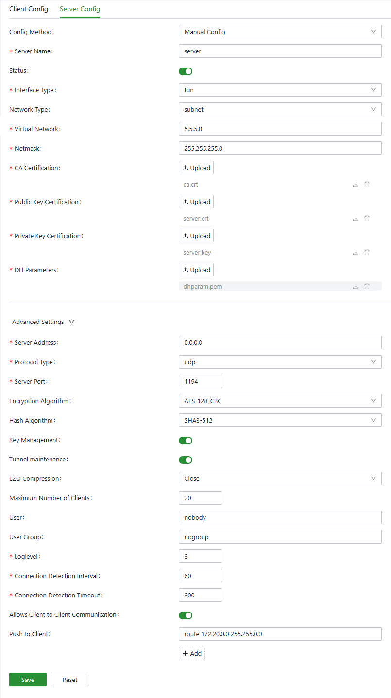

**Figure 4-42 OpenVPN Server manual configuration**

| Parameter | Description |
|-----------|-------------|
| Server Name | String uniquely identifying the server configuration; English letters and numbers only, starting with a letter, no longer than 64 characters |
| Status | On or off; controls starting or stopping the OpenVPN Server |
| Interface Type | Currently only tun mode is supported |
| Network Type | Supports p2p, net30 and subnet. p2p and net30 establish point-to-point connections; subnet establishes a virtual LAN. In subnet mode, configure the virtual network segment; in p2p or net30 mode, configure the local and remote IP addresses |
| Netmask | Subnet mask of the virtual network in subnet mode |
| CA Certification | Import the CA certificate file here |
| Public Key Certification | Import the server's public key certificate file here |
| Private Key Certification | Import the server's private key certificate file here |
| DH Parameters | Import the server's DH parameters file here |

In the advanced settings, some rarely changed parameters can be configured:

| Parameter | Description |
|-----------|-------------|
| Server Address | IP address the OpenVPN listens on; listens on 0.0.0.0 (all IP addresses) by default |
| Protocol Type | Supports udp and tcp, default udp |
| Server Port | Port the server listens on, default 1194 |
| Encryption Algorithm | Encryption algorithm ensuring data confidentiality |
| Hash Algorithm | Hash algorithm ensuring data integrity |
| Key Management | With key retention enabled, OpenVPN can recover quickly without a new handshake even after a temporary disconnection caused by network exceptions |
| Tunnel Maintenance | With tunnel maintenance enabled, the tunnel is protected against closure caused by short-term network fluctuations |
| LZO Compression | Whether to enable LZO compression |
| Maximum Number of Clients | Number of clients that can connect to the OpenVPN Server simultaneously |
| User | Specifies the user running the OpenVPN process |
| User Group | Specifies the user group running the OpenVPN process |
| Loglevel | Range 1~11; the larger the value, the more detailed the log. ALL type views the OpenVPN log |
| Connection Detection Interval | Cycle of sending heartbeat packets to check whether the VPN connection is alive |
| Connection Detection Timeout | If no response is received within the timeout, the connection is considered broken and a restart is attempted |
| Allows Client to Client Communication | Whether clients may communicate with each other |
| Push to Client | Can push routing, DNS and other information to clients |

b. Import configuration

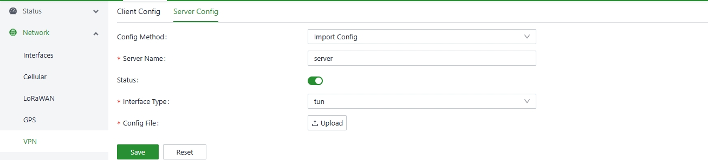

**Figure 4-43 OpenVPN Server import configuration**

| Parameter | Description |
|-----------|-------------|
| Server Name | String uniquely identifying the server configuration; English letters and numbers only, starting with a letter, no longer than 64 characters |
| Status | On or off; controls starting or stopping the OpenVPN Server |
| Interface Type | Currently only tun mode is supported |
| Config File | Import the OpenVPN Server configuration file, which must contain the CA certificate, Server certificate, Server key, etc. |

**Configuring the OpenVPN Client**

a. Manual configuration

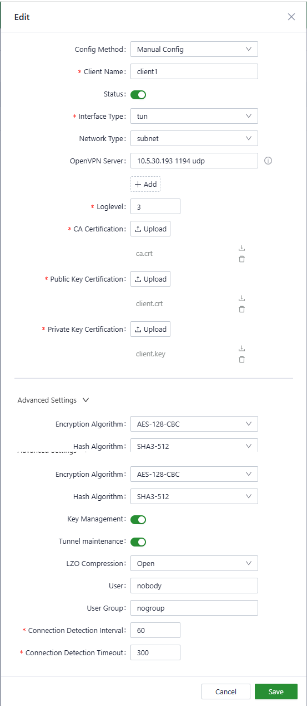

**Figure 4-44 OpenVPN Client manual configuration**

| Parameter | Description |
|-----------|-------------|
| Client Name | String uniquely identifying the client configuration; English letters and numbers only, starting with a letter, no longer than 64 characters |
| Status | On or off; controls starting or stopping the OpenVPN Client |
| Interface Type | Currently only tun mode is supported |
| Network Type | Supports p2p, net30 and subnet. When the network type is p2p or net30, configure the local and remote IP addresses |
| OpenVPN Server | Configure the OpenVPN Server's IP address, port and protocol in the format ip port proto, e.g. `192.168.3.200 1194 udp`. Up to 10 server addresses can be configured; the client tries them one by one until the tunnel is established |
| Loglevel | Range 1~11; the larger the value, the more detailed the log. ALL type views the OpenVPN log |
| CA Certification | Import the CA certificate file here |
| Public Key Certification | Import the client's public key certificate file here |
| Private Key Certification | Import the client's private key certificate file here |

In the advanced settings, some rarely changed parameters can be configured: Encryption Algorithm, Hash Algorithm, Key Management, Tunnel Maintenance, LZO Compression, User, User Group, Connection Detection Interval, Connection Detection Timeout (if no response is received within the timeout, the connection is considered broken and a restart is attempted). Their meanings are the same as on the Server side.

b. Import configuration

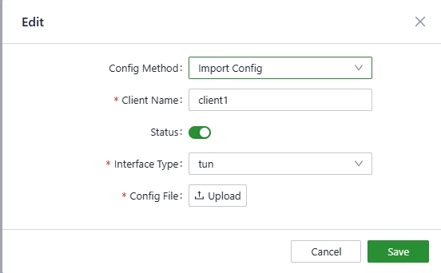

**Figure 4-45 OpenVPN Client import configuration**

| Parameter | Description |
|-----------|-------------|
| Client Name | String uniquely identifying the client configuration; English letters and numbers only, starting with a letter, no longer than 64 characters |
| Status | On or off; controls starting or stopping the OpenVPN Client |
| Interface Type | Currently only tun mode is supported |
| Config File | Import the OpenVPN Client configuration file, which must contain the CA certificate, Client certificate, Client key, etc. |

### 4.3 System Management

#### 4.3.1 Basic Configuration

##### Cloud Management


**Figure 4-46 Cloud management configuration**

| Parameter | Description |
|-----------|-------------|
| Enabled | Enable switch for connecting to the DeviceLive platform; DeviceLive is InHand's remote monitoring and management platform |
| Cloud Server | The DeviceLive platform has two addresses: a domestic platform and an overseas platform; select the one to connect to here |

##### Time Zone and NTP Client


**Figure 4-47 Time zone and NTP configuration**

Up to 10 NTP server addresses can be configured. The program periodically sends synchronization requests to each server address in turn. After a successful synchronization, the system time is written to the RTC and no further requests are sent to subsequent NTP servers.

In addition to NTP synchronization, the Device Info status page has a manual synchronization button, but it is displayed only when the difference between the device time and the local time (the time of the computer accessing the device) exceeds 3 seconds.

##### Config Import/Export and Factory Reset


**Figure 4-48 Config import/export**

Configuration import, export and factory restoration are supported here.

#### 4.3.2 Firmware Upgrade


**Figure 4-49 Firmware upgrade**

The automatic restart option is disabled by default: after the firmware is upgraded, the system must be restarted manually for the upgrade to take effect. When the automatic restart option is enabled, the system restarts automatically after the upgrade.

#### 4.3.3 Others (Restart and Reset)


**Figure 4-50 Restart and reset**

This page has two functions: restart the system and reset the system.

> **NOTE**: Use the reset function with care. Resetting restores the system's configuration state and file system state to the factory state, which means software installed by the user is also erased.

### 4.4 Status

#### 4.4.1 Device Information

The Device Information page displays the host name, device model, serial number, firmware version, kernel version, file system version, and an overview of CPU, memory and disk space usage.


**Figure 4-51 Device information**

#### 4.4.2 Cellular Dial Status

The cellular dialing status page displays the SIM card, IMEI, IMSI, ICCID, signal strength, IP address, DNS and other information of the current dialing connection.


**Figure 4-52 Cellular dial status**

#### 4.4.3 Wi-Fi Station Status

The Wi-Fi status page displays the IP address, gateway and DNS obtained after a successful Wi-Fi connection.


**Figure 4-53 Wi-Fi Station status**

#### 4.4.4 DHCP Server Status

The DHCP Server status page shows the IP address, client host name, client host MAC and expiration time of addresses assigned by the device as DHCP server.


**Figure 4-54 DHCP Server status**

#### 4.4.5 Route Status

The route status page displays information such as IPv4 directly connected routes, static routes and route neighbors.


**Figure 4-55 Route status**

#### 4.4.6 Firewall Status

The firewall status page displays filtering rules, IP address mapping rules and other information.


**Figure 4-56 Firewall status**

#### 4.4.7 Logs

On the Logs page, system logs and user logs can be viewed, and the log level to display can be set to Error, Info or Debug. Logs can also be downloaded locally.


**Figure 4-57 Logs**

#### 4.4.8 OpenVPN Status

**OpenVPN Server status**

The OpenVPN Server status page shows the status update time, connected OpenVPN clients, and other information.


**Figure 4-58 OpenVPN Server status**

**OpenVPN Client status**

The OpenVPN Client status page shows the virtual IP address obtained by the client, the tunnel connection duration, and other information.


**Figure 4-59 OpenVPN Client status**

### 4.5 Managing the Device via Command Line

#### 4.5.1 Connecting to the Device

Connect the computer to the device over an Ethernet cable and log in via SSH. For the login steps and default account, see [Logging In via SSH](#223-logging-in-via-ssh).

#### 4.5.2 User Account Management

**Switching to the root user**

Use the `sudo -s` command to switch to the root user.

> **NOTE**: For security reasons, do not run all commands under root privileges.

> **NOTE**: For more information about the sudo command, visit https://wiki.debian.org/sudo.

When using some pipes or redirections under non-root privileges, a "permission denied" prompt may appear. In that case, use `sudo su -c` instead of redirection commands such as `>` and `<`; the complete command must be enclosed in single quotes.

**Creating and deleting user accounts**

Use the **useradd** and **userdel** commands to create and delete user accounts. Be sure to use these commands in the main interface to set the relevant access permissions for the account. The following example creates test1 in the sudo group (the default login shell of test1 is bash, and its home directory is /home/test1):


**Figure 4-60 Creating user test1**

To change the password of test1, use the passwd command; enter the new password and repeat it to confirm:


**Figure 4-61 Changing the user password**

To delete user test1, use the userdel command:


**Figure 4-62 Deleting user test1**

**Disabling the default user account**

> **NOTE**: Create your own user account before disabling the default account.

Use the passwd command to lock the default user account so that the edge user cannot log in:


**Figure 4-63 Locking the edge account**

Unlocking the edge user:


**Figure 4-64 Unlocking the edge account**

#### 4.5.3 Closing and Disabling IEOS

When using the Linux command line for network and system configuration, the IEOS program must be closed first. IEOS is managed through systemctl. To close IEOS:

```shell
systemctl stop ieos_daemon
```

This shutdown takes effect only for the current boot; IEOS still starts after a system restart. To prevent IEOS from starting at boot:

```shell
systemctl disable ieos_daemon
```

> **NOTE**: After IEOS is closed, wireless networking functions such as dialing and Wi-Fi must be implemented by the user based on native Linux commands, and remote management through the DeviceLive platform is no longer available.

#### 4.5.4 Setting a Static IP Address

To set a static IP address, use `vim /etc/network/interfaces.d/eth1` or `vim /etc/network/interfaces.d/eth2` to modify the corresponding network configuration file and set the default gateway, address, network and subnet mask of the Ethernet interface. The following example sets a static IP for the eth2 port:


**Figure 4-65 Setting a static IP for eth2**

After modifying the IP configuration, run `/etc/init.d/networking restart` to restart the network service and make the configuration take effect.

#### 4.5.5 Setting a Dynamic IP Address

To set a dynamic IP address, run `vim /etc/network/interfaces.d/eth1` or `vim /etc/network/interfaces.d/eth2` to modify the corresponding network configuration file, and set dhcp after inet to obtain the IP address automatically. The following example sets a dynamic IP for the eth1 port:


**Figure 4-66 Setting a dynamic IP for eth1**

After modifying the IP configuration, run `/etc/init.d/networking restart` to restart the network service and make the configuration take effect.

#### 4.5.6 Checking the Firmware Version

To check the firmware version of the EC300-LoRaWAN, type:


**Figure 4-67 Checking the firmware version**

#### 4.5.7 Viewing Free Disk Space

To determine the amount of free drive space, use the df command with the -h option. The system returns the drive space broken down by file system. For EC300-LoRaWAN products, the available disk partition is /dev/mmcblk0p8. Example:


**Figure 4-68 Viewing free disk space**

#### 4.5.8 Adjusting the Time

The EC300-LoRaWAN has two time settings: the system time, and the RTC (real-time clock) time maintained by hardware. Use the date command to query the current system time or set a new system time; use the hwclock command to query the current RTC time or set a new RTC time.

Use the command `date MMDDhhmmYYYY` to set the system time:

- MM: month
- DD: day
- hh: hour
- mm: minute
- YYYY: year


**Figure 4-69 Setting the system time**

Use the following command to set the RTC time to the system time:


**Figure 4-70 Syncing the RTC time**

For more information about dates and times, see:

- https://www.debian.org/doc/manuals/system-administrator/ch-sysadmin-time.html
- https://wiki.debian.org/DateTime

#### 4.5.9 Setting the Time Zone

There are two ways to configure the time zone: using the tzselect command, or using the /etc/localtime file.

**Method 1: Using the tzselect command**

After typing the tzselect command, the region selection interface appears. First select the approximate region (by continent/ocean) by entering the number in front of it:


**Figure 4-71 tzselect: selecting the region**

Then select the country or region under the continent:


**Figure 4-72 tzselect: selecting the country**

Following the steps above, obtain the time zone keyword (e.g. Asia/Shanghai) and confirm as prompted:


**Figure 4-73 tzselect: confirming the time zone**

**Method 2: Using /etc/localtime**

The local time zone is stored in /etc/localtime and is used by the GNU C library (glibc) if the TZ environment variable is not set. This file is either a copy of a /usr/share/zoneinfo/ file or a symbolic link to it. If the required file cannot be found under /usr/share/zoneinfo/, download the needed time zone information file from https://www.iana.org/time-zones and relink it to the local time file.

> **NOTE**: After downloading the time zone information file, decompress it and use the zic command to compile the corresponding binary file. The generated time zone file is /usr/share/zoneinfo/custom-timezone-file-name.

### 4.6 Advanced Configuration of Peripheral Interfaces

#### 4.6.1 Serial Port

The EC300-LoRaWAN has 4 serial ports: one supports RS-485, and three support RS-232 or RS-485 mode.

| Serial port | Device node |
|-------------|-------------|
| COM1 | /dev/ttyS4 |
| COM2 | /dev/ttyS5 |
| COM3 | /dev/ttyS6 |
| COM4 | /dev/ttyS8 |

**Changing serial port settings**

Use the stty command to view and set the serial ports. Type `sudo stty --help` to view the detailed command content:


**Figure 4-74 stty help 1**


**Figure 4-75 stty help 2**


**Figure 4-76 stty help 3**


**Figure 4-77 stty help 4**


**Figure 4-78 stty help 5**

**Viewing serial port information**


**Figure 4-79 Viewing serial port information**

**Setting the baud rate of COM1**


**Figure 4-80 Setting the COM1 baud rate**

> **NOTE**: More information about the stty command is available at http://www.gnu.org/software/coreutils/manual/coreutils.html.

#### 4.6.2 USB Interface

The EC300-LoRaWAN provides a USB 2.0 Host interface, mainly used to expand storage devices.

USB storage devices on the EC300-LoRaWAN support hot-plugging.

> **NOTE**: Before disconnecting a USB mass storage device, remember to run the `sync` command to prevent data loss; exit from the mount directory before disconnecting the device.

#### 4.6.3 MicroSD Card Mounting

The SD card partition needs to be formatted as FAT32. Formatting methods:

- SD card capacity ≤ 32GB: insert the SD card into a card reader and plug the reader into a Windows computer. Most Windows systems only support formatting SD cards smaller than 32GB as FAT32, and a partition is created automatically during formatting. It can also be formatted as FAT32 under Linux, in the same way as for capacity > 32GB.
- SD card capacity > 32GB: FAT32 formatting must be done under Linux. Insert the SD card into a card reader and plug the reader into a Linux computer, or a computer running a Linux virtual machine.

1. Run `fdisk -l` to view the device node of the SD card, e.g. /dev/sda.
2. Run `fdisk /dev/sda` to partition (p: view current partitions, d: delete a partition, n: create a new partition, w: save changes), creating partition /dev/sda1.
3. Run `sudo mkfs.vfat -F 32 /dev/sda1` to format the partition as FAT32.
4. After formatting, remove the SD card from the reader and insert it into the device while the device is powered off.

> **NOTE**: The MicroSD card of the EC300-LoRaWAN does not support hot-plugging. For mounting, refer to https://www.man7.org/linux/man-pages/man8/mount.8.html.

#### 4.6.4 CAN Bus Interface

The three CAN ports of the EC300 support the CAN bus.

**Configuring the CAN interface**

By default, the CAN ports are initialized. For other configurations, check the CAN devices with the ip link command:


**Figure 4-81 Checking CAN devices**

To configure a CAN device, first turn it off with `ip link set can* down`, where can* is can1, can2 or can3.

Then configure the bit rate (50k as an example):


**Figure 4-82 Configuring the CAN bit rate**

Finally turn the device back on:


**Figure 4-83 Enabling the CAN device**

#### 4.6.5 IO Debugging

The EC300-LoRaWAN supports 4 DI (input) and 4 DO (output) channels.

| Port | Device description file |
|------|--------------------------|
| DI1 | /sys/class/gpio/gpio454/value |
| DI2 | /sys/class/gpio/gpio455/value |
| DI3 | /sys/class/gpio/gpio456/value |
| DI4 | /sys/class/gpio/gpio457/value |
| DO1 | /sys/class/gpio/gpio323/value |
| DO2 | /sys/class/gpio/gpio453/value |
| DO3 | /sys/class/gpio/gpio465/value |
| DO4 | /sys/class/gpio/gpio461/value |

To read a DI state, use `cat <device-file>`:


**Figure 4-84 Reading a DI state**

To control a DO state, run `echo 1 > <device-file>` or `echo 0 > <device-file>` under the root user:


**Figure 4-85 Controlling a DO state**

#### 4.6.6 AIN Debugging

The EC300-LoRaWAN supports 2 AIN channels.

| Port | Device description file |
|------|--------------------------|
| AIN1 | /dev/ain1 |
| AIN2 | /dev/ain2 |

To read the current AIN value, use `cat <device-file>`. The return value is the channel current in microamperes (uA).


**Figure 4-86 Reading the AIN value**

#### 4.6.7 Super Capacitor

**Specifications**

The super capacitor is rated 10.8V/5F.

**Power-off retention**

Depending on the load, the power-off retention module can keep the system running for 20~30 seconds after power failure.

**Functions**

- **Power failure alarm**: the EC300 supports the power-down alarm function. When the external power supply is disconnected, the system sends a UDP broadcast message `power_down` to port 9107 of 255.255.255.255.
- **Safe shutdown**: power failure means the external power supply stays disconnected for more than 0.5 seconds. After sending the UDP broadcast, the system waits 3 seconds and actively powers off.

### 4.7 Programming Guide

#### 4.7.1 Device Information Description File

The EC300-LoRaWAN provides a device information description file in JSON format. Customers who need to operate peripherals such as IO, LEDs and serial ports can obtain the device node information of these peripherals by querying this file.

Device description file path: `/tmp/ieos/etc/system_info.json`, as follows:

```json
{
    "device_info":{
        "model_info": {
           "model": "EC312",
           "pn": "B-LQA3",
           "sn": "CL3122402000012",
           "oem": "inhand",
           "features": "std;cell-LQA3;gps;"
       },
       "software_info": {
           "boot_loader": "V1.0.4",
           "kernel": "5.10.168",
           "version": "V2.0.2-beta2",
           "os": "Debian GNU/Linux 11"
       },
        "hardware_info":{
            "arch": "aarch64",
            "soc": "k3",
            "interface":{
                "eth": [
                   {
                        "iface_name":"eth1",
                     "iface_mac": "e2:29:3f:03:3f:f6"
                   },
                   {
                     "iface_name":"eth2",
                     "iface_mac": "e2:29:3f:03:3f:f7"
                   },
                   {
                      "iface_name":"eth3",
                     "iface_mac": "e2:29:3f:03:3f:f8"
                   },
                   {
                      "iface_name":"eth4",
                     "iface_mac": "e2:29:3f:03:3f:f9"
                   }
                 ],
                "wlan": [
                    {
                       "iface_name":"wlan0",
                       "iface_mac":"e6:29:3f:03:2f:f9"
                    },
                    {
                       "iface_name":"wlan1",
                       "iface_mac":"e6:29:3f:03:2f:f8"
                    }
                ],
                "ble":[
                   {
                          "iface_name":"hci0",
                        "iface_mac":"e6:39:3f:03:4f:f8"
                   },
                   {
                          "iface_name":"hci1",
                        "iface_mac":"e6:39:3f:03:4f:f9"
                   }
                ],
                "can": [
                   {
                        "iface_name": "can1"
                   },
                   {
                        "iface_name": "can2"
                   },
                   {
                        "iface_name": "can3"
                   }
               ]
            },
            "gpio":[
                {
                  "gpio_name": "cellular_power",
                  "dev_node": "/sys/class/gpio/gpio0"
                },
                {
                  "gpio_name": "sim_switch",
                  "dev_node": "/sys/class/gpio/gpio19"
                },
                {
                  "gpio_name":"msata_power",
                  "dev_node": "/sys/class/gpio/gpio20"
                },
                {
                  "gpio_name":"gnss_power",
                  "dev_node": "/sys/class/gpio/gpio110"
                },
                {
                  "gpio_name":"ble_power",
                  "dev_node":"/sys/class/gpio/gpio220"
                }
            ],
            "user_key":[
                 {
                     "user_key_name":"user1",
                     "dev_node":"/sys/class/gpio/gpio50"
                 },
                 {
                     "user_key_name":"user2",
                     "dev_node":"/sys/class/gpio/gpio51"
                 }
            ],
            "uart":[
                {
                   "uart_name":"com1",
                   "dev_node":"/dev/ttyS1"
                },
                {
                   "uart_name":"com2",
                   "dev_node":"/dev/ttyS2"
                },
                {
                   "uart_name":"com3",
                   "dev_node":"/dev/ttyS3"
                },
                {
                    "uart_name":"com4",
                   "dev_node":"/dev/ttyS4"
                }
            ],
            "led":[
                {
                  "led_name": "user1",
                  "dev_node": "/sys/class/leds/user1"
                },
                {
                  "led_name": "user2",
                  "dev_node": "/sys/class/leds/user2"
                },
                {
                  "led_name": "cell",
                  "dev_node": "/sys/class/leds/cell"
                },
                {
                   "led_name": "sim1",
                   "dev_node": "/sys/class/leds/sim1"
                },
                {
                   "led_name": "sim2",
                   "dev_node": "/sys/class/leds/sim2"
                },
                {
                   "led_name": "error",
                   "dev_node": "/sys/class/leds/error"
                },
                {
                   "led_name": "warn",
                   "dev_node": "/sys/class/leds/warn"
                },
                {
                   "led_name": "status",
                   "dev_node": "/sys/class/leds/status"
                },
                {
                   "led_name": "level1",
                   "dev_node": "/sys/class/leds/level1"
                },
                {
                   "led_name": "level2",
                   "dev_node": "/sys/class/leds/level2"
                },
                {
                   "led_name": "level3",
                   "dev_node": "/sys/class/leds/level3"
                }
            ],
            "io":{
                "di": [
                    {
                       "di_name":"di1",
                       "dev_node":"/sys/class/gpio/gpio1"
                    },
                    {
                       "di_name":"di2",
                       "dev_node":"/sys/class/gpio/gpio2"
                    }
                ],
                "do": [
                   {
                      "do_name":"do1",
                      "dev_node": "/sys/class/gpio/gpio11"
                   },
                   {
                      "do_name":"do2",
                      "dev_node":"/sys/class/gpio/gpio12"
                   }
                ]
            }
        }
    }
}
```

#### 4.7.2 IO Programming Guide

The device has 8 IO interfaces in total: DI1~DI4 on the panel are 4 input pins, and DO1~DO4 are 4 output pins.

The IO device nodes can be obtained from the device description file `/tmp/ieos/etc/system_info.json`. When programming the IO interfaces, directly operate the value under the device node (**sys/class/gpio/gpioxxx/value**).

Example: to make DO1 output a high level, write 1 to **sys/class/gpio/gpio323/value**:

```shell
echo 1 > /sys/class/gpio/gpio323/value
```

To check the level of DI1, read the value of **sys/class/gpio/gpio454/value**:

```shell
cat /sys/class/gpio/gpio454/value
```

Full shell script:

```plain
#!/bin/bash

gpio323="/sys/class/gpio/gpio323/value"
gpio453="/sys/class/gpio/gpio453/value"
gpio465="/sys/class/gpio/gpio465/value"
gpio461="/sys/class/gpio/gpio461/value"
# To output a high voltage from DO1, simply write '1' to the sys/class/gpio/gpio323/value file
if [ -f "$gpio323" ]; then
    echo 1 > /sys/class/gpio/gpio323/value
else
    echo "no file exit "$gpio323
fi

# To output a low voltage from DO1, simply write '0' to the sys/class/gpio/gpio323/value file
if [ -f "$gpio323" ]; then
    echo 0 > $gpio323
else
    echo "no file exit "$gpio323
fi

gpio454="/sys/class/gpio/gpio454/value"
gpio455="/sys/class/gpio/gpio455/value"
gpio456="/sys/class/gpio/gpio456/value"
gpio457="/sys/class/gpio/gpio457/value"
# To check the DI1 signal level, simply read the value at sys/class/gpio/gpio454/value
if [ -f "$gpio454" ]; then
    cat $gpio454
else
    echo "no file exit "$gpio454
fi
```

#### 4.7.3 LED Programming Guide

Users can use the four LEDs USER1, USER2, USER3 and USER4 on the device for status indication; confirm the LED positions by the panel silkscreen.

The LED device nodes can be obtained from the device description file `/tmp/ieos/etc/system_info.json`:

- user1: /sys/class/leds/user1
- user2: /sys/class/leds/user2
- user3: /sys/class/leds/user3
- user4: /sys/class/leds/user4

The /sys/class/leds/user1 directory contains control files for the LED properties and states:

| Control file | Description |
|--------------|-------------|
| /sys/class/leds/user1/brightness | Turns USER1 on or off: write 1 for solid on, 0 for off |
| /sys/class/leds/user1/trigger | Trigger of the LED: write timer to enable timer triggering, none to cancel |
| /sys/class/leds/user1/delay_on | LED-on time in ms |
| /sys/class/leds/user1/delay_off | LED-off time in ms |

Once the trigger is configured as a timer trigger, the value in brightness no longer takes effect and automatically becomes 0. Replacing user1 with user2 in the file paths controls the USER2 LED; the same applies to USER3 and USER4.

Example: to light USER1, write 1 to the brightness file:

```shell
echo 1 > /sys/class/leds/user1/brightness
```

To make USER1 flash, write timer to the trigger file and control the on/off times via delay_on and delay_off:

```plain
# Start timer
echo timer > /sys/class/leds/user1/trigger

# Lights up for 1 second
echo 1000 > /sys/class/leds/user1/delay_on

# Off for 1 second
echo 1000 > /sys/class/leds/user1/delay_off
```

Full shell script:

```plain
#!/bin/bash

USER1_BRIGTHNESS="/sys/class/leds/user1/brightness"
USER1_TRIGGER="/sys/class/leds/user1/trigger"
USER1_DELAY_ON="/sys/class/leds/user1/delay_on"
USER1_DELAY_OFF="/sys/class/leds/user1/delay_off"

# Turn on the USER1 light
if [ -f "$USER1_BRIGTHNESS" ]; then
    echo 1 > $USER1_BRIGTHNESS
else
    echo "no file exit "$USER1_BRIGTHNESS
fi

# Set USER1 light to flash
if [ -f "$USER1_TRIGGER" ]; then
    echo timer > $USER1_TRIGGER
else
    echo "no file exit "$USER1_TRIGGER
fi

# Set the USER1 light to be on for 1000ms
if [ -f "$USER1_DELAY_ON" ]; then
    echo 1000 > $USER1_DELAY_ON
else
    echo "no file exit "$USER1_DELAY_ON
fi

# Set USER1 light to off for 1000ms
if [ -f "$USER1_DELAY_OFF" ]; then
    echo 1000 > $USER1_DELAY_OFF
else
    echo "no file exit "$USER1_DELAY_OFF
fi

# Stop USER1 from flashing
if [ -f "$USER1_TRIGGER" ]; then
    echo none > $USER1_TRIGGER
else
    echo "no file exit "$USER1_TRIGGER
fi
```

#### 4.7.4 Cross Compilation

Users can cross-compile their own `c/c++` programs on a development machine with the cross-compilation tool chain, then upload the target files to the EC300-LoRaWAN for execution.

Cross-compilation tool package: `gcc-linaro-6.3.1-2017.05-x86_64_aarch64-linux-gnu.tar.gz`

How to configure the environment variables of the cross-compilation tool chain:

1. On the development machine, decompress gcc-linaro-6.3.1-2017.05-x86_64_aarch64-linux-gnu.tar.gz to /opt (other paths also work; adjust the PATH in step 2 accordingly).
2. Edit `~/.bashrc` and append a line `PATH=$PATH:/opt/gcc-linaro-6.3.1-2017.05-x86_64_aarch64-linux-gnu/bin`.
3. Run `source ~/.bashrc` to make the variables take effect in the current terminal; newly opened terminals take effect automatically.

Taking the classic hello world program as an example, create the following directories and files:

```shell
mkdir ~/example
touch ~/example/hello.c
touch ~/example/Makefile
```

`~/example/hello.c`:

```c
#include <stdio.h>

int main(void)
{
        printf("hello, world!\n");
        return 0;
}
```

`~/example/Makefile`:

```makefile
# Define the target file name and source file name
TARGET  := hellworld
DIRS    := $(shell find . -maxdepth 3 -type d)
SRCS    := $(foreach dir,$(DIRS),$(wildcard $(dir)/*.c))
OBJS    := $(SRCS:.c=.o)


CC=aarch64-linux-gnu-gcc

# Defining compiler and compilation options
CFLAGS  := -Wall -Wextra -g -Wno-unused-parameter

# Defining a default target
all: $(TARGET)

# Define target file dependencies and compilation commands
$(TARGET): $(OBJS)
        $(CC) $(CFLAGS) $(LIBS) $^ -o $@

# Defines commands for compiling source files into target files
%.o: %.c
        $(CC) $(CFLAGS) $(LIBS) -c $< -o $@

# Defines the command to clear temporary files
clean:
        rm -f $(TARGET) $(OBJS)

# Declare a pseudo target ".PHONY"
.PHONY: all clean
```

Run make under the `~/example` directory to generate the target file `helloworld`.

#### 4.7.5 Watchdog Programming

- The device has an external hardware watchdog; the device restarts if the watchdog is not fed for 60 seconds.
- You can disable the system watchdog program and feed the dog in your own program, so the device restarts when your program is abnormal.
- Use this command to stop the system watchdog: `systemctl stop watchdog`.
- Example watchdog program:

```c
#include <fcntl.h>
#include <unistd.h>
#include <stdlib.h>
#include <stdio.h>
#include <string.h>
#include <signal.h>
#include <sys/types.h>
#include <sys/stat.h>

static int fd = 0;

/* Signal processing function */
void signal_handler(int signal)
{
    /* Turn off the watchdog. If you do not feed the watchdog after turning it off, the device will restart after 60 seconds */
    write(fd, "V", 1);
    close(fd);
    exit(0);
}

int main(int argc, char **argv)
{
    /* Open the watchdog through open */
    fd = open("/dev/watchdog0", O_WRONLY);

    /* Register Kill Signal */
    signal(SIGTERM, signal_handler);

    while (1) {
        /* Use write to feed the dog */
        write(fd, "\0", 1);

        /* Feed the dog every 10 seconds */
        sleep(10);
    }
}
```

### 4.8 Security

#### 4.8.1 The sudo Mechanism

For better security, the root user is disabled. Sudo is a program that allows system administrators to grant approved users the ability to run commands as root or other users. The most basic principle is to give as few privileges as possible to get the job done. Using sudo is more secure than opening a session as root for a number of reasons, including:

- There is no need to know the root password (sudo prompts for the current user's password), while ordinary users can be granted privileges.
- Privileged commands can conveniently be run via sudo, while the rest of the time is spent as an unprivileged user, reducing the damage that misoperations may cause.

#### 4.8.2 Firewall

Netfilter/iptables (hereinafter referred to as iptables) is a completely free packet-filtering firewall tool for Unix/Linux systems. It is powerful and flexible in use, and can finely control the packets entering, leaving and passing through the server.

#### 4.8.3 TPM2.0

TPM stands for "Trusted Platform Module", a hardware security module designed to provide security and encryption capabilities for computer systems. It is a secure microcontroller that can be embedded in a computer system or sold as a standalone hardware device. It contains a cryptographic coprocessor for storing encryption keys, digital certificates and other secure data, and supports multiple cryptographic algorithms and security protocols. On the EC300, the standard TPM2 protocol stack and TPM2 tools are integrated for users.

The ARM computer provides TPM2.0 hardware support and comes pre-installed with tpm2-tools, which can be used to test and verify TPM2.0. For example, generating random numbers:


**Figure 4-87 TPM2.0 random number generation**

> **NOTE**: For more information on using tpm2-tools, refer to https://tpm2-tools.readthedocs.io/en/latest/.

## 5 Typical Application

### Case 1: LoRaWAN Node Data Collection and Cloud Reporting

**Scenario description**: In a smart factory (or smart agriculture) site, multiple LoRaWAN sensor nodes periodically collect data such as temperature and humidity. An EC300-LoRaWAN gateway receives the uplink data from the nodes, forwards it to a LoRaWAN network server over a 4G cellular connection, and the data is finally displayed on the cloud platform for remote monitoring.

**Network topology**:

```text
+----------------+    LoRa wireless    +---------------------+     4G cellular
| LoRaWAN sensor | ------------------> | EC300-LoRaWAN       | ---------------->
| nodes          |                     | gateway             |      | 
+----------------+                     +---------------------+      v
                                                          +-----------+     +----------------+
                                                          | Base      | --> | Internet -->   |
                                                          | station   |     | Cloud platform |
                                                          +-----------+     +----------------+
```

**Device role**: The EC300-LoRaWAN acts as the LoRaWAN gateway and edge access device in this topology. It is responsible for receiving LoRa uplink data from the sensor nodes, running the LoRaWAN packet forwarding or the built-in network server (ChirpStack), and dialing up over the cellular network to report the data to the cloud platform.

**Configuration steps**:

1. Complete the hardware installation: attach the LoRa antenna and cellular antennas, insert the SIM card, and connect the device to power. See [2.2 Installation Guide](#22-installation-guide).
2. Configure cellular networking so that the gateway can access the Internet. See [Scenario 2: Cellular Networking](#scenario-2-cellular-networking).
3. Check the cellular dial status on the web interface to confirm that the connection has been established. See [4.4.2 Cellular Dial Status](#442-cellular-dial-status).
4. Choose a LoRaWAN working mode according to the deployment:
   - If an external LoRaWAN network server is used, select the packet forward mode and configure the server address and port. See [Packet Forward Mode](#packet-forward-mode).
   - If no external network server is available, select the built-in network server mode and use the pre-installed ChirpStack. See [Build-in Network Server Mode](#build-in-network-server-mode) and [Build-in Network Server and ChirpStack](#build-in-network-server-and-chirpstack).
5. In ChirpStack, add the gateway, create device profiles, and register the sensor nodes. See [Using ChirpStack](#using-chirpstack).
6. If required, enable the ICMP detection function to keep the cellular connection alive. See [ICMP Detection](#icmp-detection).
7. Log in to the cloud platform (e.g. DeviceLive) and confirm that the device is online and the node data is reported. See [Scenario 7: Connecting to the DeviceLive Cloud Platform](#scenario-7-connecting-to-the-devicelive-cloud-platform).

**Verification method**: Trigger an uplink from a sensor node (or wait for its reporting period), then check on the LoRaWAN network server or cloud platform that the uplink frame count of the device increases and the reported data is correct.

**Reference sections**:

- [2.2 Installation Guide](#22-installation-guide)
- [Scenario 2: Cellular Networking](#scenario-2-cellular-networking)
- [4.2.3 LoRaWAN](#423-lorawan)
- [Build-in Network Server and ChirpStack](#build-in-network-server-and-chirpstack)
- [Scenario 7: Connecting to the DeviceLive Cloud Platform](#scenario-7-connecting-to-the-devicelive-cloud-platform)

## Appendix Troubleshooting

### 1 Power and Startup Issues

| Phenomenon | Possible cause | Troubleshooting steps | Section |
|------------|----------------|------------------------|---------|
| PWR indicator off, device does not power on | Power adapter not connected or damaged | 1. Check that the power cable is securely connected<br>2. Confirm that the power supply voltage meets the device specifications<br>3. Replace the power adapter and retry | [Quick Checks](#23-quick-checks) |
| Device restarts repeatedly | Insufficient power supply capacity | 1. Confirm that the power adapter meets the device power requirements<br>2. Remove unnecessary external devices and retry | [Super Capacitor](#467-super-capacitor) |
| SYS indicator stays red or flashes red after power-on | System startup error | 1. Power off and restart the device<br>2. If the problem persists, upgrade the firmware | [4.3.2 Firmware Upgrade](#432-firmware-upgrade) |

### 2 Web Access Issues

| Phenomenon | Possible cause | Troubleshooting steps | Section |
|------------|----------------|------------------------|---------|
| Web page cannot be opened | Computer and device are not on the same subnet | 1. Check the computer IP address and the device IP address<br>2. Set the computer to the same subnet as the device | [2.2.4 Logging In to the Web Interface](#224-logging-in-to-the-web-interface) |
| Web page cannot be opened | Wrong access protocol or port | 1. Access the device using HTTPS<br>2. Confirm that the port number is correct | [2.2.4 Logging In to the Web Interface](#224-logging-in-to-the-web-interface) |
| Forgotten web login password | Password changed and not recorded | 1. Restore the device to factory settings and log in with the default account<br>2. Reconfigure the device after restoring | [1.4 Restoring Factory Settings](#14-restoring-factory-settings) |
| Page elements display abnormally | Browser compatibility issue | 1. Use the recommended browser (Chrome)<br>2. Clear the browser cache and retry | [2.2.4 Logging In to the Web Interface](#224-logging-in-to-the-web-interface) |

### 3 CLI Login Issues

| Phenomenon | Possible cause | Troubleshooting steps | Section |
|------------|----------------|------------------------|---------|
| SSH login fails | Wrong IP address or the SSH service is unreachable | 1. Confirm that the computer can ping the device<br>2. Check the login IP address, port and account | [2.2.3 Logging In via SSH](#223-logging-in-via-ssh) |
| SSH login fails | The edge account has been locked | 1. Log in with another account in the sudo group<br>2. Unlock the edge account with the passwd -u command | [4.5.2 User Account Management](#452-user-account-management) |
| "Permission denied" when running commands | Insufficient privileges | 1. Use sudo -s to switch to the root user<br>2. For pipes and redirections, use sudo su -c | [4.5.2 User Account Management](#452-user-account-management) |

### 4 Cellular Networking Issues

| Phenomenon | Possible cause | Troubleshooting steps | Section |
|------------|----------------|------------------------|---------|
| SIM card not detected | SIM card not inserted properly or damaged | 1. Power off the device and re-insert the SIM card<br>2. Check whether the SIM card works in another device | [2.2.1 Installing Antennas and Inserting SIM Cards](#221-installing-antennas-and-inserting-sim-cards) |
| Cannot register on the network | Weak signal or antenna not installed | 1. Check that the cellular antennas are installed<br>2. Check the signal strength on the status page<br>3. Adjust the antenna position or device location | [4.4.2 Cellular Dial Status](#442-cellular-dial-status) |
| Cannot register on the network | Wrong APN parameters | 1. Obtain the correct APN from the carrier<br>2. Reconfigure the APN parameters | [Advanced Settings](#advanced-settings) |
| Dialing succeeds but no data is transmitted | Fake connection or abnormal default route | 1. Enable ICMP detection to verify the connection<br>2. Check the route status on the web interface | [ICMP Detection](#icmp-detection) |
| Connection drops frequently | Unstable signal or ICMP detection targets unreachable | 1. Check the signal strength and improve the antenna installation<br>2. Replace the ICMP detection target with a reliably reachable address | [ICMP Detection](#icmp-detection) |

### 5 Wi-Fi Issues

| Phenomenon | Possible cause | Troubleshooting steps | Section |
|------------|----------------|------------------------|---------|
| Station mode cannot connect to the hotspot | Wrong SSID or password | 1. Re-enter the SSID and password<br>2. Confirm that the hotspot is working properly | [Station Mode](#station-mode) |
| Station mode cannot connect to the hotspot | Band or channel mismatch | 1. Confirm the band supported by the hotspot<br>2. Select the correct band in the configuration | [Station Mode](#station-mode) |
| Clients cannot connect in AP mode | Wrong password or security mode | 1. Check the password length and encryption mode<br>2. Reconfigure the AP parameters | [Access Point Mode](#access-point-mode) |
| Weak Wi-Fi signal | Antenna not installed or blocked | 1. Check that the Wi-Fi antenna is installed<br>2. Keep the device away from metal obstacles | [2.2.1 Installing Antennas and Inserting SIM Cards](#221-installing-antennas-and-inserting-sim-cards) |

### 6 LoRaWAN Issues

| Phenomenon | Possible cause | Troubleshooting steps | Section |
|------------|----------------|------------------------|---------|
| No uplink data in packet forward mode | Wrong server address or port | 1. Check the server address and port configuration<br>2. Confirm that the LoRaWAN server is reachable | [Packet Forward Mode](#packet-forward-mode) |
| Packets forwarded but not displayed on the server | Gateway ID not added on the network server | 1. Check the gateway ID on the device<br>2. Add the gateway on the LoRaWAN server | [Packet Forward Mode](#packet-forward-mode) |
| Cannot log in to the built-in ChirpStack | Wrong address, account or service not started | 1. Access ChirpStack at the default address and port<br>2. Log in with the default account<br>3. Check the LoRaWAN mode configuration | [Build-in Network Server and ChirpStack](#build-in-network-server-and-chirpstack) |
| Node joined but no data on ChirpStack | Device profile or channel plan mismatch | 1. Check the device profile and channel plan of the node<br>2. Re-create the node on ChirpStack | [Using ChirpStack](#using-chirpstack) |

### 7 Storage Issues

| Phenomenon | Possible cause | Troubleshooting steps | Section |
|------------|----------------|------------------------|---------|
| MicroSD card not recognized | File system not supported or card damaged | 1. Check that the card is inserted in place<br>2. Format the card to a supported file system<br>3. Replace the card and retry | [4.6.3 MicroSD Card Mounting](#463-microsd-card-mounting) |
| USB storage device not recognized | File system not supported | 1. Confirm that the file system of the device is supported<br>2. Format the device and retry | [4.6.2 USB Interface](#462-usb-interface) |
| Insufficient disk space | Excessive log or application files | 1. Use the df -h command to check the space usage<br>2. Back up and delete unnecessary files | [4.5.7 Viewing Free Disk Space](#457-viewing-free-disk-space) |

### 8 Upgrade and Restore Issues

| Phenomenon | Possible cause | Troubleshooting steps | Section |
|------------|----------------|------------------------|---------|
| Firmware upgrade fails | Wrong firmware package or power interruption | 1. Confirm that the firmware package matches the device model<br>2. Ensure a stable power supply during the upgrade<br>3. Retry the upgrade | [4.3.2 Firmware Upgrade](#432-firmware-upgrade) |
| Configuration import fails | File format incorrect | 1. Confirm that the imported file is a configuration file exported from this type of device<br>2. Export a configuration file as a template and re-edit it | [Config Import/Export and Factory Reset](#config-importexport-and-factory-reset) |
| Factory reset does not take effect | Incorrect reset operation | 1. Press and hold the reset button for the specified time<br>2. Observe the indicator behavior to confirm the reset | [1.4 Restoring Factory Settings](#14-restoring-factory-settings) |

### 9 Time Issues

| Phenomenon | Possible cause | Troubleshooting steps | Section |
|------------|----------------|------------------------|---------|
| Time is incorrect after reboot | System time not synced to RTC or NTP not enabled | 1. Set the system time and sync it to the RTC<br>2. Configure the NTP client | [4.5.8 Adjusting the Time](#458-adjusting-the-time) |
| Displayed time does not match the local time | Wrong time zone | 1. Set the time zone on the web interface<br>2. Or set the time zone via the command line | [Time Zone and NTP Client](#time-zone-and-ntp-client) |

## Appendix Safety Precautions

1. Use the power adapter provided with the device or a power supply that meets the specifications in this manual. Using an inappropriate power supply may damage the device.
2. Power off the device before inserting or removing the SIM card, the microSD card or any wiring.
3. Install the device indoors in a dry, ventilated location, away from water, moisture and direct sunlight.
4. Install the antennas properly before powering on the device; do not operate the cellular or LoRa modules for long periods without antennas attached.
5. Keep the device and its antennas away from metal objects and strong electromagnetic interference sources.
6. Take electrostatic discharge (ESD) precautions when handling the SIM card, the microSD card or the internal interfaces.
7. Confirm that the LoRa frequency band configured on the device complies with the radio regulations of the country or region where the device is deployed.
8. Use the device within the operating temperature and humidity ranges specified in this manual.

> **WARNING**: Non-professionals must not open the device enclosure. Opening the enclosure may cause electric shock or device damage and voids the warranty.

## Appendix Command Line Reference

### 1 Common Commands

| Command | Function | Example |
|---------|----------|---------|
| `sudo -s` | Switch to the root user | `sudo -s` |
| `useradd` | Create a user account | `useradd -m -s /bin/bash -G sudo test1` |
| `passwd` | Set or change a user password | `passwd test1` |
| `passwd -l` / `passwd -u` | Lock / unlock a user account | `passwd -l edge` |
| `userdel` | Delete a user account | `userdel test1` |
| `systemctl stop ieos_daemon` | Stop the IEOS service | `systemctl stop ieos_daemon` |
| `systemctl disable ieos_daemon` | Disable IEOS from starting at boot | `systemctl disable ieos_daemon` |
| `/etc/init.d/networking restart` | Restart the network service | `/etc/init.d/networking restart` |
| `df -h` | View free disk space | `df -h` |
| `date MMDDhhmmYYYY` | Query or set the system time | `date 101012002026` |
| `hwclock` | Query the RTC time or sync the RTC with the system time | `hwclock --systohc` |
| `tzselect` | Set the time zone interactively | `tzselect` |
| `stty` | Configure serial port parameters | `stty -F /dev/ttyS4 115200` |
| `echo` / `cat` (GPIO sysfs) | Debug DO and DI channels | `echo 1 > /sys/class/gpio/gpio323/value` |

### 2 Usage Examples

**Example 1: Create a user account and switch to the root user**

```shell
sudo -s
useradd -m -s /bin/bash -G sudo test1
passwd test1
```

**Example 2: Set a static IP address for eth2**

```shell
sudo -s
vim /etc/network/interfaces.d/eth2
# Set the address, netmask and gateway, then save the file
/etc/init.d/networking restart
```

**Example 3: Debug a serial port and a DO channel**

```shell
stty -F /dev/ttyS4 115200
echo 1 > /sys/class/gpio/gpio323/value
cat /sys/class/gpio/gpio454/value
```

## FAQ

### Question 1: What is the relationship between IEOS and the Debian system?

1. The EC300-LoRaWAN runs the Debian 11 operating system and provides a standard Debian environment; users can install software packages and develop applications with apt and native tools.
2. IEOS is the management program pre-installed by InHand, which takes over network dialing, Wi-Fi, LoRaWAN and system management, and provides the web interface and cloud management access.
3. IEOS is enabled by default and occupies ports 9100~9200. If the device needs to be managed via native Linux commands, IEOS must be stopped first; after IEOS is closed, functions such as cellular dialing and Wi-Fi need to be implemented by the user based on native Linux commands.

### Question 2: Why can't the web page be opened after entering the device IP address?

1. Check that the computer and the device are on the same subnet.
2. The device web interface is accessed via HTTPS; make sure the protocol and the port number are correct.
3. If the page still cannot be opened, clear the browser cache or use the recommended browser (Chrome).

See [2.2.4 Logging In to the Web Interface](#224-logging-in-to-the-web-interface).

### Question 3: The SIM card is inserted but the device cannot register on the network. What should be checked?

1. Check whether the SIM card is inserted in the correct direction and in place, and whether the card works normally in another device.
2. Check that the cellular antennas are installed and the signal strength is acceptable.
3. Check whether the APN parameters match those provided by the carrier.
4. Check the dial status and cause information on the status page.

See [4.2.2 Cellular](#422-cellular) and [4.4.2 Cellular Dial Status](#442-cellular-dial-status).

### Question 4: How to check the cellular signal quality?

1. Log in to the web interface and view the signal strength information on the status page.
2. When the signal is weak, adjust the antenna position or the device location, or contact the carrier to confirm the local network coverage.

See [4.4.2 Cellular Dial Status](#442-cellular-dial-status).

### Question 5: Can the two SIM card slots work at the same time?

1. No. The device supports dual SIM cards in single standby mode; only one SIM card is active at a time.
2. When the active SIM card fails or the network is abnormal, the device can switch to the standby SIM card according to the configured detection and switching policy.

See [Dual SIM (Single Standby)](#dual-sim-single-standby).

### Question 6: Which LoRaWAN working modes does the device support, and how to choose?

1. Off mode: the LoRaWAN function is disabled.
2. Packet forward mode: the device forwards LoRa data to an external LoRaWAN network server via UDP (or MQTT), which is suitable for deployments where a server is already available.
3. Built-in network server mode: the device runs the pre-installed ChirpStack network server locally, which is suitable for deployments without an external server.

See [4.2.3 LoRaWAN](#423-lorawan).

### Question 7: What are the default address and account of the built-in ChirpStack?

1. When the built-in network server mode is enabled, ChirpStack can be accessed through the device web interface entry, and the local MQTT broker listens on port 9121 of the device.
2. The default account is carrier and the default password is mqtt. It is recommended to change the password after the first login.

See [Build-in Network Server and ChirpStack](#build-in-network-server-and-chirpstack).

### Question 8: The gateway is online on ChirpStack but the node has no uplink data. What are the possible causes?

1. The device profile, channel plan or frequency band of the node does not match the actual node configuration.
2. The node has not completed network join (OTAA) or the session has expired (ABP).
3. The uplink receiving window of the node is interfered with or the node is too far from the gateway.

See [Using ChirpStack](#using-chirpstack).

### Question 9: What should be done if the web login password is forgotten?

1. Restore the device to factory settings using the reset button.
2. Log in with the default account and reconfigure the device.

See [1.4 Restoring Factory Settings](#14-restoring-factory-settings).

### Question 10: How to develop and deploy custom applications on the device?

1. The device provides a standard Debian 11 environment; applications can be developed in shell, C and other languages supported by Debian.
2. For performance-sensitive applications, use the provided cross-compilation toolchain to build binaries on a PC and deploy them to the device.
3. The device also provides programming references for the device information description file, IO, LED and the watchdog.

See [4.7 Programming Guide](#47-programming-guide).
