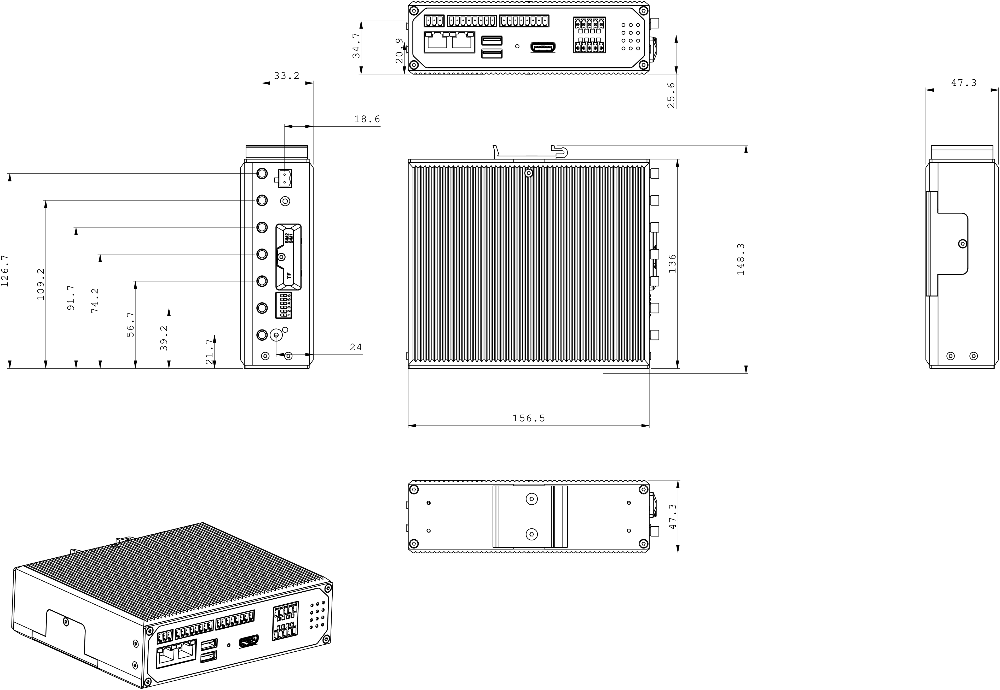
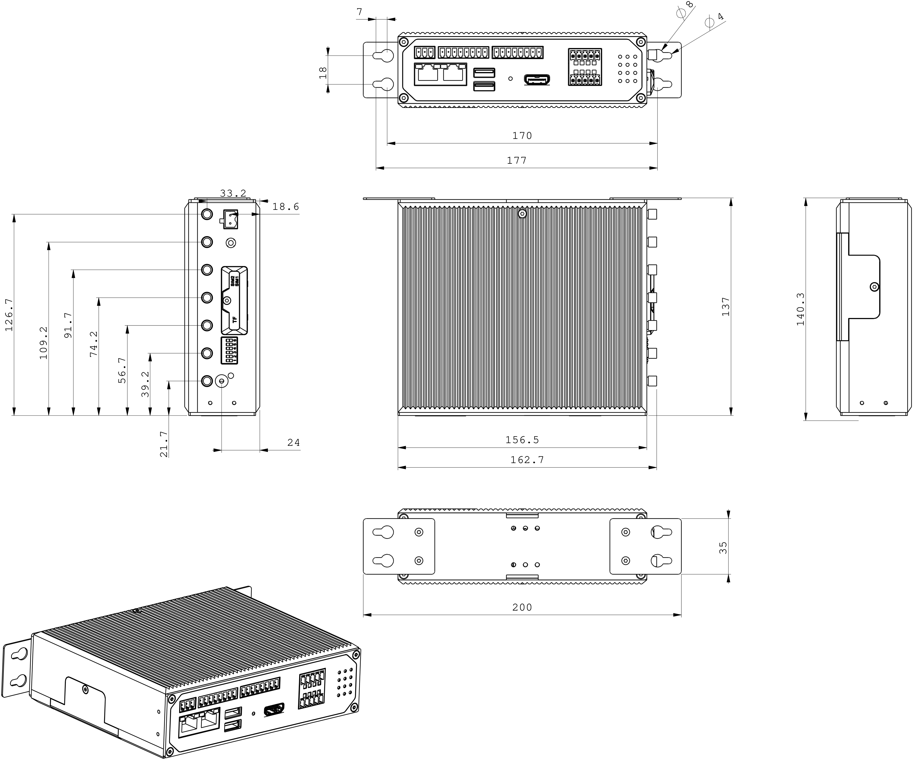
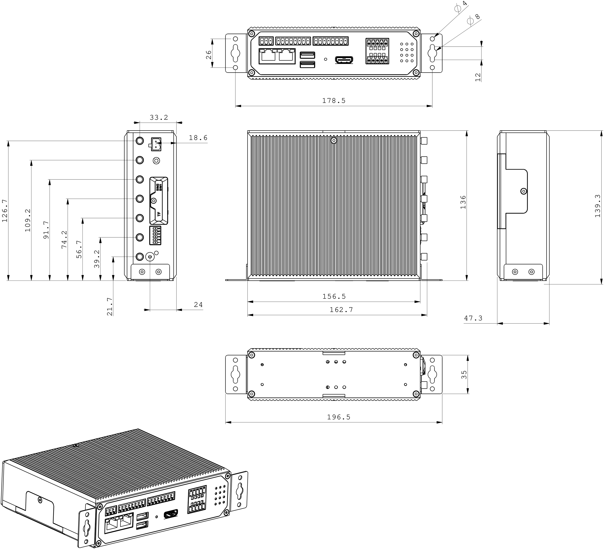
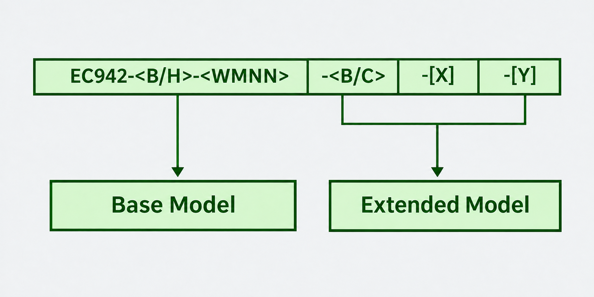

  

    

      
    

    

      EC942 Series lite AI Edge Computer
    

    

      Embrace Edge AI, Empower Industrial Digitalization
    

  

  

    

      

        
· Strong Computing

        
· High Security

      

      

        
· High Reliability

        
· Cloud-Managed

      

    

  

# 1. Product Overview

**EC942 series edge computer is a lightweight AI-accelerated edge computer launched by InHand for the industrial Internet of Things. It is equipped with an ARM Cortex-A55@2.0GHz quad-core processor, and comes standard with 4GB RAM and 16GB eMMC, providing a powerful computing platform. The product uses the Linux distribution system to provide users with flexible and diverse secondary development environment. Security features such as Secure Boot and TPM2.0 are supported to ensure software and data security. Built-in Device-Supervisor™ Agent (DSA) service, easy to achieve data collection, processing and cloud, and support DeviceLive cloud management.**

**Key features:**
- **Performance platform:** Quad-core Cortex-A55@2.0GHz with Mali-G52 and RKNN
- **Industrial security:** Secure Boot, TPM2.0, firewall and VPN
- **Rich interfaces:** Gigabit Ethernet, serial, CAN, USB, HDMI, mSATA, DI/DO
- **Reliable networking:** 5G/4G/Wi-Fi/GbE backup, dual-SIM failover, watchdog
- **Cloud operations:** DeviceLive remote monitoring and edge app/container management

## Core Technical Specifications

| Technical Indicator | Specification |
|------|---------------|
| Open Platform | Yocto/Linux (Debian 10, Kernel 4.19), Debian package manager |
| CPU/GPU | Quad-core Cortex-A55@2.0GHz / Mali-G52 2EE |
| NPU | RKNN, 1 TOPS |
| RAM/Storage | 4GB / 16GB eMMC |
| Data Acquisition | Modbus RTU/TCP, EtherNet/IP, OPC UA, DNP3.0, BACnet, CNC |
| Interfaces | 2×GE, 2×RS-232/485/422 (Terminal block), USB2.0, HDMI2.0, mSATA, microSD |
| Security (TPM2.0 Optional) | Secure Boot, TPM2.0, firewall, VPN |
| Cloud Management | DeviceLive, HTTP/HTTPS/SSH remote management |
| Cellular Network | 5G, LTE Cat.4/Cat.6 (model-dependent) |
| Network Features | APN/VPDN, CHAP/PAP, ARP/Ethernet, static IP/DHCP |
| Power Input | DC 12~48V (8W) |
| Dimensions (W × D × H) | 47.3 × 162.7 × 148.3 mm (1.86 × 6.41 × 5.84 in) |
| Protection Rating | IP30 |

# 2. Product Dimensions

  

    
    
Dimension Drawing

  

  

    
  

  

    
  

  
Note: 1. All dimensions are in millimeters (mm). 2. All dimensions are approximate and for reference only. 3. Dimensioned drawings are not intended for machining. 4. Dimensions are subject to part and manufacturing tolerances. 5. Specifications may change without prior notice.

# 3. Hardware Specifications

| Category/Parameter | Specification |
|--------------------------|------|
| **Hardware Platform** |  |
| CPU | Quad-core Cortex-A55@ 2.0GHz |
| GPU | Mali-G52 2EE |
| NPU | RKNN, 1 TOPS |
| RAM | 4GB |
| FLASH | 16GB eMMC |
| **Connectivity & Interfaces** |  |
| Ethernet Ports | 2×10/100/1000 Mbps GE |
| I/O Ports (Optional) | 4×DI + 4×DO |
| Serial Ports | 2×RS-232/485/422, Terminal block |
| CAN (Optional) | 1×CAN 2.0A/B |
| Buttons | Pinhole reset button |
| SIM Card Holders | 2×MicroSIM |
| LED Indicators | 4G/5G, Signal Strength (L1, L2, L3), SIM1, SIM2, User1, User2, PWR, STATUS, WARN, ERR |
| USB | USB2.0 (2×Type-A + 1×Type-C) |
| microSD | Supports microSD cards up to 32GB (recommended maximum capacity) |
| Expansion Interfaces |  1x mSATA, supports mSATA SSD |
| HDMI | HDMI2.0 |
| Wi-Fi (Optional) |  AP&STA, 802.11ac/a/b/g/n, 2.4G/5G dual band |
| Bluetooth (Optional) | BLE4.2 |
| GPS (Optional) | GPS/Beidou/GLONASS |
| **Power & Power Consumption** |  |
| Input Voltage | DC 12~48V, polarity reversal protection |
| Power Interface | Industrial terminal block |
| Maximum Value (Full Load) | 8W |
| **Mechanical Specifications** |  |
| Product Dimensions | 47.3 × 162.7 × 148.3 mm (1.86 × 6.41 × 5.84 in) |
| Product Weight | 810 g (1.79 lb) |
| Mounting Method | DIN-rail / wall mounting |
| Protection Rating | IP30 |
| Enclosure & Heat Dissipation | Metal housing, fanless design |
| TPM (Optional) | TPM2.0 |
| **Environment & Certifications** |  |
| Storage Temperature | -40 °C ~ 85 °C (-40 °F ~ 185 °F) |
| Operating Temperature | -20 °C ~ 70 °C (-4 °F ~ 158 °F) |
| Environmental Humidity | 5~95% RH (non-condensing) |
| Physical Characteristics | IEC60068-2-27 shock resistance IEC60068-2-6 vibration resistance IEC60068-2-32 drop resistance |
| EMC Standard | EN61000-4-2, level 3, Static EN61000-4-3, level 3, Radiation Electric Field EN61000-4-4, level 3, Pulsed Electric Field EN61000-4-5, level 3, Surge EN61000-4-6, level 3, Conducted Disturbance Immunity EN61000-4-8, Power Frequency Field Resistance, horizontal / vertical 400A/m (>level 2) EN61000-4-12, level 3, Shock Wave Resistance |
| Certifications | CE, FCC, PTCRB, Verizon Wireless, AT&T, T-Mobile |

  
*TPM: The EC942 supports TPM when it is equipped with Terminal Block serial ports (-T) and is the high-spec (-H) variant.

# 4. Software Specifications

| Category/Parameter | Specification |
|--------------------------|------|
| **Operating System** |  |
| Operating System | Yocto/Linux, Debian 10 (Kernel 4.19) |
| File System | Debian core root filesystem |
| Package Manager | Debian package manager |
| **Network Features** |  |
| Network Access | 5G / LTE Cat.4 / LTE Cat.6 (model-dependent), Ethernet |
| Access Authentication | APN, VPDN, CHAP/PAP |
| WAN Protocols | static IP, DHCP |
| LAN Protocols | ARP, Ethernet  |
| **Security** |  |
| Secure Boot | Supported |
| **Reliability** |  |
| Link Detection | Multi-level link detection and auto-redial |
| Built-in Watchdog | Device self-diagnosing, auto-recovers from operation faults |
| Backup Mechanism | Dual-SIM backup |
| **Data Acquisition Protocols (DSA)** |  |
| Industrial Protocols | Modbus RTU Master/Slave, Modbus TCP Master/Slave, EtherNet/IP, ISO on TCP, OPC UA Client/Server, Mitsubishi MC 3C/3E/3C OverTCP, Mitsubishi CPU Port, FINSUDP, HostLink, PPI |
| Electricity Protocols | DLT645-2007, IEC101/104, DNP3.0 |
| Other Protocols | BACnet, CNC |
| **Network Management** |  |
| Upgrade Method | Supports patent upgrade mechanism, local or remote firmware upgrade |
| Log Functions | Support local system logs, remote logs, and important log power-off preservation |
| Remote Management | DeviceLive / HTTP / HTTPS / SSH remote management |
| DeviceLive Cloud | Supports cloud-based parameter configuration, container management, application and firmware management |

  
*DSA: The DeviceSupervisor Agent (DSA), developed by InHand Networks, is a cutting-edge intelligence software designed to operate on Edge Computer products. It enables clients to quickly implement data collection, processing, protocol conversion, and cloud connectivity through a "zero code/low code" approach. If you need the DSA application on the EdgeComputer product, please contact us to obtain the DSA software package.

# 5. Ordering Information

## Model code

EC942-\<B/H\>-\<WMNN\>-\<B/C\>-[X]-[Y]

  

    
  

## Base Model

\<B/H\>: Wi-Fi/GPS/CAN/TPM & I/O capability (B=NO, H=YES)  
\<WMNN\>: Cellular Type & Frequency Band

**Base model list**

<table style="width:100%; table-layout:fixed; font-size:11px;">
  <colgroup>
    <col style="width:19%;">
    <col style="width:12%;">
    <col style="width:8%;">
    <col style="width:33%;">
    <col style="width:18%;">
    <col style="width:10%;">
  </colgroup>
  <tr><th>Model</th><th>Region</th><th>&lt;B/H&gt;</th><th>&lt;WMNN&gt;</th><th>Wi-Fi/GPS/CAN</th><th>I/O</th></tr>
  <tr><td style="white-space: nowrap;">EC942-B-LQA8</td><td>China</td><td>NO</td><td>LTE Cat.4: LTE-FDD B1/B3/B5/B8; LTE-TDD B34/B38/B39/B40/B41; WCDMA B1/B8; TD-SCDMA B34/B39; CDMA BC0; GSM 900/1800MHz</td><td>NO</td><td>NO</td></tr>
  <tr><td style="white-space: nowrap;">EC942-H-LQA8</td><td>China</td><td>YES</td><td>LTE Cat.4: LTE-FDD B1/B3/B5/B8; LTE-TDD B34/B38/B39/B40/B41; WCDMA B1/B8; TD-SCDMA B34/B39; CDMA BC0; GSM 900/1800MHz</td><td>YES</td><td>YES</td></tr>
  <tr><td style="white-space: nowrap;">EC942-H-NRQ1</td><td>China</td><td>YES</td><td>5G NR NSA: n78/n79; 5G NR SA: n1/3/5/8/28/41/77/78/79; LTE-FDD B1/B3/B5/B8; LTE-TDD B34/B38/B39/B40/B41; WCDMA B1/B8</td><td>YES</td><td>YES</td></tr>
  <tr><td style="white-space: nowrap;">EC942-H-NRQ3</td><td>Global (excluding China)</td><td>YES</td><td>5G NR NSA: n1/n2/n3/n5/n7/n8/n12/n20/n25/n28/n38/n40/n41/n48/n66/n71/n77/n78/n79; 5G NR SA: n1/n2/n3/n5/n7/n8/n12/n20/n25/n28/n38/n40/n41/n48/n66/n71/n77/n78/n79; LTE FDD: B1/B2/B3/B5/B7/B8/B12(B17)/B13/B14/B18/B19/B20/B25/B26/B28/B29/B30/B32/B66/B71; LTE TDD: B34/B38/B39/B40/B41/B42/B48; LAA: B46; WCDMA Bands: B1/B2/B3/B4/B5/B6/B8/B19</td><td>YES</td><td>YES</td></tr>
  <tr><td style="white-space: nowrap;">EC942-B-FQ58</td><td>EMEA</td><td>NO</td><td>LTE Cat.4: LTE-FDD Band1/3/7/8/20/28A; LTE-TDD Band38/40/41; WCDMA Band1/8; GSM Band3/8</td><td>NO</td><td>NO</td></tr>
  <tr><td style="white-space: nowrap;">EC942-H-FQ58</td><td>EMEA</td><td>YES</td><td>LTE Cat.4: LTE-FDD Band1/3/7/8/20/28A; LTE-TDD Band38/40/41; WCDMA Band1/8; GSM Band3/8</td><td>YES</td><td>YES</td></tr>
  <tr><td style="white-space: nowrap;">EC942-H-FQ38</td><td>North America</td><td>YES</td><td>LTE Cat.4: LTE-FDD Band2/4/5/12/13/14/66/71; WCDMA Band 2/4/5</td><td>YES</td><td>YES</td></tr>
  <tr><td style="white-space: nowrap;">EC942-B-FQ78</td><td>Australia &amp; Latin America</td><td>NO</td><td>Cat.4: LTE-FDD Band1/2/3/4/5/7/8/28; LTE-TDD B40; UMTS(DC-HSPA+) Band1/2/5/8; EDGE/GPRS/GSM 850/900/1800/1900MHz</td><td>NO</td><td>NO</td></tr>
  <tr><td style="white-space: nowrap;">EC942-H-FQ78</td><td>Australia &amp; Latin America</td><td>YES</td><td>Cat.4: LTE-FDD Band1/2/3/4/5/7/8/28; LTE-TDD B40; UMTS(DC-HSPA+) Band1/2/5/8; EDGE/GPRS/GSM 850/900/1800/1900MHz</td><td>YES</td><td>YES</td></tr>
  <tr><td style="white-space: nowrap;">EC942-B-EN00</td><td>Global</td><td>NO</td><td>No Cellular</td><td>NO</td><td>NO</td></tr>
  <tr><td style="white-space: nowrap;">EC942-H-EN00</td><td>Global</td><td>YES</td><td>No Cellular</td><td>YES</td><td>YES</td></tr>
</table>

## Extended Model (Optional)

| Option | Description |
|--------|-------------|
| \<B/C\> | RAM:B=4GB, C=4GB; eMMC: B = 16GB eMMC, C = 32GB eMMC |
| [X] | Operating System (see OS Option below) |
| [Y] | -T:Terminal block serial ports |

## OS Option (Optional)

| [X] P/N Code | Feature |
|--------------|---------|
| — | IEOS (default) |
| D | Debian Linux OS |

  
· IEOS(InHand Edge Operating System) is InHand Networks’ operating system based on distribution Linux for IoT ARM platform edge computers, helping customers achieve safe and stable industrial edge intelligent applications. IEOS contains InHand applications such as web configuration, dialing, routing, firewall, VPN, cloud management etc.

  
· Debian Linux OS: Debian OS without InHand application.

  
Note: -T indicates terminal block serial ports. The EC942 supports TPM when it is equipped with Terminal Block serial ports (-T) and is the high-spec (-H) variant.

# 6. Contact Us

- **Address:** 3650 Concorde Pkwy, Suite 200, Chantilly, VA 20151, USA
- **Tel:** +1 (703) 348-2988
- **Email:** info@inhand.com
- **Website:** [InHand Networks](https://www.inhand.com)
- **Copyright:** © 2026 InHand Networks. All rights reserved.
