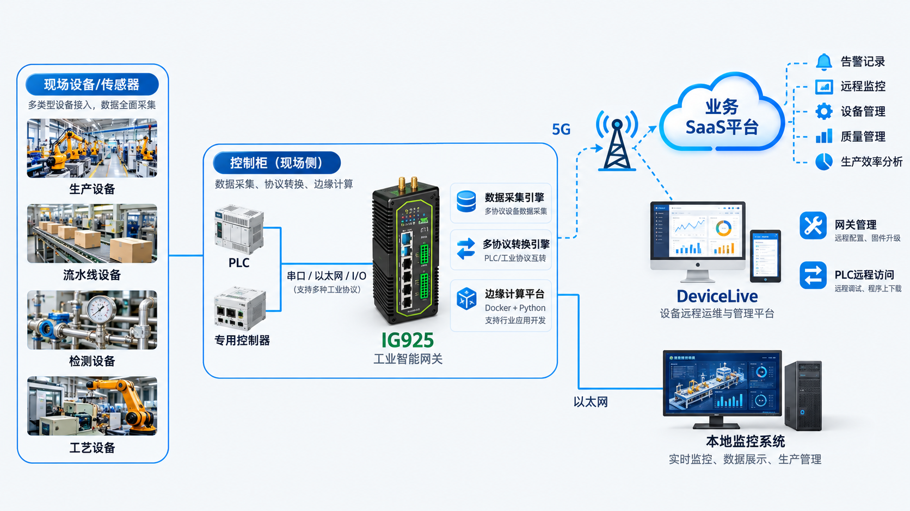
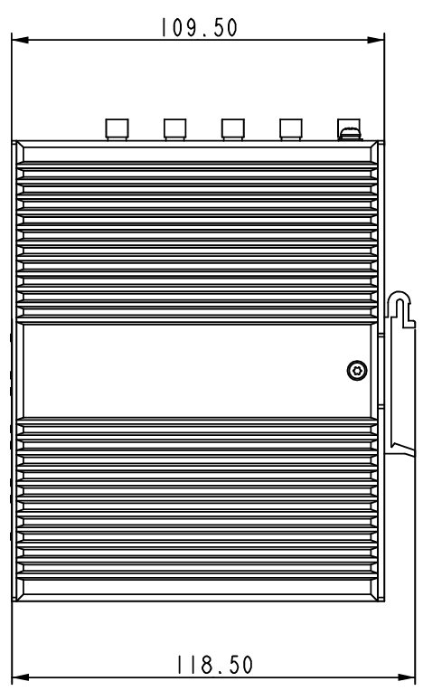
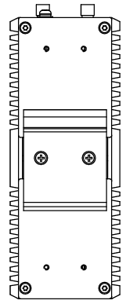
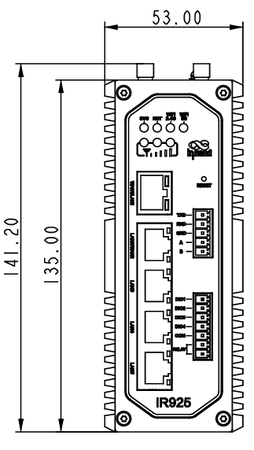

  

    

      
    

    

      Embrace 5G, Embark on a Journey of Edge Intelligence
    

  

  

    

      IG925 High-Performance 5G Edge Computing Gateway
    

    

      

        
· 5G

        
· Wi-Fi 6

      

      

        
· Edge Computing

        
· Cloud Management

      

    

  

---

## Product Positioning & Core Value
### Product Positioning

**IG925 is InHand Networks' high-performance 5G edge computing gateway for industrial IoT** — combining high-performance 5G cellular access + Wi-Fi 6 wireless connectivity with a built-in edge computing platform. While delivering strong networking capabilities, it performs **multi-type industrial data acquisition, protocol conversion, and edge computing** on the device itself, processing isolated field data locally and uploading it to the cloud on demand. A single device replaces the traditional combination of "industrial gateway + RTU + data collector", and industry-specific services can be extended through containerized applications.

IG925 is an integrated high-performance 5G edge computing gateway built by InHand Networks. The hardware platform provides a 1 GHz processor, 512 MB of memory, and rich industrial interfaces (5G/4G, Wi-Fi 6, 2.5GbE, RS232/RS485, DIO, Relay), while the software platform running on top provides a **data acquisition engine, protocol conversion engine, and edge computing framework**. All data processing and business logic are completed locally on the device, **breaking down data silos and uploading to the cloud on demand**. Customers can also deploy their own or third-party Docker applications and Python programs on the same platform, truly enabling a single device to carry multiple services.

### Core Value
| Value Dimension | Description |
| --- | --- |
| **Data Acquisition** | Collects real-time data from field devices such as PLCs, meters, sensors, and controllers via serial ports (RS232/RS485), Ethernet, I/O, Modbus, and other protocols, breaking down information silos |
| **Protocol Conversion** | Built-in protocol conversion engine supports bidirectional Modbus RTU/TCP conversion and interconversion of multiple industrial protocols, enabling interconnection of heterogeneous devices |
| **Edge Computing** | Built-in Docker containerized application platform and Python secondary development environment; data is processed locally and logic is dispatched at the edge, reducing cloud traffic and response latency |
| **Cloud-Edge Collaboration** | Connects to the DeviceLive unified cloud management platform for remote access, batch O&M, and OTA upgrades — "data to the cloud, management in the cloud, computing at the edge" |
| **Industrial Reliability** | Metal housing, fanless cooling, IP30; operating temperature -40°C ~ +70°C; wide-range DC 9~48 V power supply; DIN-rail / wall mounting |

### "One Device Replaces Multiple Devices"
| Traditional Solution (Multiple Devices) | IG925 Solution (1 Device) |
| --- | --- |
| Industrial gateway (networking + data acquisition) | ✅ Built-in |
| Protocol converter | ✅ Built-in |
| DTU transparent transmission unit | ✅ Built-in |
| Edge acquisition / front-end processing device | ✅ Built-in (Docker + Python) |
| Field server (data front-end processing) | ✅ Built-in (edge computing) |
| **Multiple devices + multiple cable sets** | **1 device + 1 cable set** |

### Core Technical Specifications
| Item | Value |
| --- | --- |
| Cellular Network | 5G, up to 3.4 Gbps downlink, Sub6, backward compatible with 4G/3G |
| Wi-Fi | Wi-Fi 6, dual-band concurrent 3000 Mbps (2.4 GHz & 5.8 GHz) |
| Ethernet | 1 × 2.5GbE + 4 × 1GbE RJ45, WAN/LAN/VLAN |
| Serial Ports | 1 × RS232 + 1 × RS485 |
| I/O | 4 × DI (dry contact) + 4 × DO (configurable) + 1 × Relay |
| Protocol Conversion | Modbus RTU/TCP, OPC UA Client, ISO on TCP, etc. |
| Edge Computing | Docker containerized deployment + Python secondary development |
| Remote Management | DeviceLive unified cloud management + OTA upgrades |
| Operating Temperature | -40°C ~ +70°C |
| Power Supply | Wide-range DC 9~48 V |
| Protection Rating | IP30 |

### Target Application Scenarios
| Priority | Scenario | Typical Customers | Key Requirements | Entry Point |
| --- | --- | --- | --- | --- |
| **P0** | Smart Factory | Manufacturing enterprises, system integrators | Production line device networking, data acquisition, protocol conversion | "5G / wired multi-link access supporting 24/7 continuous production" |
| **P0** | Power Distribution Automation | Power grid companies, energy service providers | Fast reporting of abnormal information, secure isolated communication | "VPN and multi-layer firewall for faster, more accurate grid control" |
| **P1** | Warehouse Automation | Logistics and warehousing, automation integrators | AGV/AMR networking, on-site wireless coverage, centralized management | "Wi-Fi 6 with cellular backup to improve operational efficiency" |
| **P1** | Telemedicine | Hospitals, medical device vendors | Remote consultation, secure medical data transmission | "High-bandwidth, low-latency connectivity extending the reach of expert care" |
| **P1** | Inspection Robots | Power, petrochemical, and manufacturing inspection scenarios | Real-time video and status backhaul, continuous mobile connectivity | "Dual SIM and link detection for strict monitoring of production processes" |
| **P2** | Smart City | Municipalities, campuses, city operators | Distributed site networking, unified cloud management | "DeviceLive centralized management for secure and sustainable city connectivity" |

---

## System Architecture & Topology
### Solution Composition
The IG925 solution consists of three parts: **edge terminal (IG925 host) + external field devices/sensors + cloud management platform (DeviceLive)**. Field devices such as PLCs, meters, and sensors connect to the IG925 via serial ports, Ethernet, or I/O. The IG925's built-in **data acquisition engine and multi-protocol conversion engine** provides unified access for heterogeneous devices and performs protocol conversion such as Modbus RTU/TCP and OPC UA. The **edge computing platform** (Docker + Python) then processes data locally and dispatches logic at the edge, with data uploaded to DeviceLive on demand — achieving "data acquisition at the edge, protocol conversion at the edge, and computing at the edge".

### Single-Site Deployment
One IG925 terminal is installed at each site. Standard configuration connections:

| Component | Qty | Description |
| --- | --- | --- |
| IG925 host | 1 | DIN-rail or wall mounted, installed in cabinets / field enclosures |
| 5G / 4G antennas | 4 / 2 | 4 × 5G or 2 × 4G antennas (cellular models) |
| Wi-Fi antennas | 0 / 2 | WLAN models come with 2 × Wi-Fi antennas |
| GNSS antenna | 0 / 1 | WLAN models (with GPS) come with a GNSS antenna |
| SIM card | 1 ~ 2 | Drawer-type card holder, supports dual Nano-SIM; optional eSIM |
| Power | 1 | DC 9~48 V, 2-pin industrial terminal, over-current / reverse-polarity protection |
| Ethernet connections | Up to 5 | 1 × 2.5GbE + 4 × 1GbE RJ45, WAN/LAN/VLAN |
| Field devices | As needed | PLCs, meters, sensors, etc. connected via RS232/RS485/Ethernet |

### Multi-Site Deployment
A single platform instance can manage **tens of thousands of devices**. Each IG925 independently performs data acquisition and edge computing; site expansion does not affect system performance, enabling unified cloud management of distributed industrial networks.

---

## Hardware Platform — IG925
### Core Specifications
| Category | Parameter |
| --- | --- |
| **Product Name** | IG925 High-Performance 5G Edge Computing Gateway |
| **Processor** | 1 GHz |
| **Memory** | 512 MB |
| **Storage** | 8 GB eMMC |
| **Cellular Network** | 5G, up to 3.4 Gbps downlink, Sub6 (450 MHz ~ 6 GHz), backward compatible with 4G/3G |
| **Wi-Fi** | 2.4 GHz & 5.8 GHz, dual-band concurrent 3000 Mbps; 802.11 ax/ac/a/b/g/n (WLAN models) |
| **Ethernet Ports** | 1 × 2.5GbE + 4 × 1GbE RJ45, WAN/LAN/VLAN; 1.5 KV network isolation transformer protection |
| **Serial Ports** | 1 × RS232 + 1 × RS485; 15 KV ESD protection |
| **I/O** | 4 × digital I/O (DI / DO configurable) + 1 × Relay (2 A @ 30 V DC) |
| **SIM Card Slot** | 1 × drawer-type holder, supports dual Nano-SIM, 1.8 V / 3 V; eSIM (optional) |
| **Antenna Connectors** | 4 × 5G or 2 × 4G; 2 × Wi-Fi; 1 × GNSS |
| **LED Indicators** | 1 × System, 1 × Network, 1 × 2.4G Wi-Fi, 1 × 5G Wi-Fi, 3 × Signal |
| **Hardware Components** | RTC support; TPM support |
| **Power Supply** | DC 9~48 V, over-current protection, reverse-polarity protection, 2 × PIN industrial terminal |
| **Operating Temperature** | -40°C ~ +70°C |
| **Storage Temperature** | -40°C ~ +85°C |
| **Protection Rating** | IP30 |
| **Dimensions** | 141.2 × 118.5 × 53 mm |
| **Weight** | 1002 g |
| **Mounting** | DIN-rail, wall |
| **Housing / Cooling** | Metal housing, fanless cooling |

### Product Dimensions

  

    
    
Front View

  

  

    
    
Side View

  

  

    
    
Interface View

  

  
Notes:

1. All dimensions are in millimeters (mm).

2. All dimensions are approximate and for reference only.

3. Drawing dimensions must not be used for manufacturing.

4. Dimensions are subject to part and manufacturing tolerances.

5. Dimensions are subject to change without notice.

### Key Hardware Advantages
|  | Advantage | Description |
| --- | --- | --- |
| 1 | **High-Speed 5G Access** | Downlink up to 3.4 Gbps, backward compatible with 4G/3G; high bandwidth and low latency for a next-generation industrial networking experience |
| 2 | **Multi-Rate Ethernet** | 1 × 2.5GbE + 4 × 1GbE, meeting the access needs of high-bandwidth field devices and multiple terminals |
| 3 | **Complete Industrial Interfaces** | RS232 / RS485, digital I/O (DI / DO configurable), relay output for easy integration with industrial control and field devices |
| 4 | **Wide Temperature & Voltage Range** | -40°C ~ +70°C operating temperature, DC 9~48 V power supply, suitable for harsh industrial environments |
| 5 | **TPM + Fanless** | Hardware TPM support; fanless passive cooling for long-term unattended operation |
| 6 | **Flexible Mounting** | DIN-rail and wall mounting for easy deployment in cabinets and enclosures |

---

## Data Acquisition
### Acquisition Capability Overview
The IG925's built-in data acquisition engine provides unified access and unified modeling for heterogeneous field devices:

| Channel | Type | Typical Devices |
| --- | --- | --- |
| **Serial Port** | RS232 / RS485 | PLCs, power meters, water meters, gas meters, temperature/humidity sensors, etc. |
| **Ethernet** | 2.5GbE / GbE | Ethernet PLCs, Modbus TCP devices, industrial cameras, host computers |
| **I/O** | 4 × digital I/O (DI / DO configurable) + 1 × Relay | Switch signals, pulse signals, dry contacts, alarm signals, etc. |
| **Wireless** | 5G/4G, Wi-Fi | Wireless devices, mobile terminals, unattended sites |

### Acquisition Features
+ **Multi-channel parallel acquisition**: serial and Ethernet channels collect data simultaneously without mutual interference
+ **Polling and active reporting**: supports scheduled polling, change reporting, command dispatch, and other acquisition modes
+ **Store-and-forward on disconnection**: data is cached locally during network outages and automatically retransmitted after recovery
+ **Multi-level link detection**: heartbeat detection + automatic reconnection to keep acquisition links stable and reliable

## Protocol Conversion
### Conversion Capabilities
The IG925's built-in protocol conversion engine enables interconnection between heterogeneous devices:

| Conversion Direction | Description |
| --- | --- |
| **Modbus RTU → Modbus TCP** | Connects serial RTU devices to IP networks with transparent data forwarding and address mapping |
| **Modbus TCP → Modbus RTU** | Host computers / cloud platforms access serial devices over TCP |
| **Industrial Protocol Interconversion** | Supports interconversion and data mapping of multiple industrial and fieldbus protocols |
| **Transparent Data Transmission** | TCP / UDP transparent transmission for DTU scenarios |

### Supported Industrial Protocols
The IG925 comes with a rich stack of industrial and power protocols covering mainstream field devices and systems:

| Protocol Category | Supported Protocols |
| --- | --- |
| **General Industrial Protocols** | Modbus RTU / Modbus TCP, OPC UA Client, ISO on TCP, etc. |
| **PLC Protocols** | Siemens S7, Mitsubishi MC / CPU, Omron FINS, HOSTLINK, PPI, etc. |
| **Power Protocols** | DLT645-2007, IEC 101 / 104, DNP3.0, etc. |
| **Building & IT Protocols** | BACnet, EtherNet/IP, etc. |
| **Transparent Transmission** | TCP / UDP transparent transmission for DTU scenarios |

### Conversion Features
+ **Zero-code / low-code configuration**: configure channels, devices, and point mapping through a graphical interface without writing code
+ **Rich protocol stack**: mainstream industrial protocols built in (see ordering information for the specific protocol list)
+ **Bidirectional synchronization**: supports bidirectional data read and write operations for control applications
+ **Coordination with edge computing**: converted structured data can be directly used by edge applications

---

## Edge Computing
Building on standard gateway functions, the IG925 extends edge computing software capabilities, supporting deployment and execution of edge applications on the device for local data acquisition, processing, and forwarding — reducing cloud dependency and network traffic while shortening service response latency.

### Edge Computing Advantages
| Capability | Description |
| --- | --- |
| **Local Real-Time Processing** | Data is acquired, processed, and forwarded locally on the device, reducing cloud traffic and response latency |
| **Coordination with Basic Functions** | Edge applications run alongside routing, VPN, firewall, and other basic functions without mutual interference |
| **Docker Containerization** | Supports containerized application deployment; applications are isolated from the system and can be installed, uninstalled, and upgraded independently |
| **Multi-Application Parallelism** | Supports parallel deployment and lifecycle management of multiple applications |
| **SDK / Python Secondary Development** | Provides application development and secondary development capabilities, supporting Python application development |
| **Resource Access** | Edge applications can access device serial ports, I/O, network, and other resources to extend industry-specific services |
| **AI / Edge Applications** | Provides AI / edge application capabilities |
| **Cloud Platform Integration** | Edge applications can integrate with the DeviceLive cloud management platform and third-party cloud platforms as needed to upload data to the cloud |

---

## Networking & Communication
### Multi-Network Access
| Network | Specification |
| --- | --- |
| **5G / 4G** | 5G network, up to 3.4 Gbps downlink, Sub6, backward compatible with 4G/3G, dual SIM switching |
| **Wi-Fi 6** | Dual-band concurrent 3000 Mbps; AP / Client dual mode, Wi-Fi Portal, multiple SSIDs |
| **Ethernet** | 1 × 2.5GbE + 4 × 1GbE, WAN/LAN/VLAN |

### Network Protocols
| Protocol Category | Supported Protocols |
| --- | --- |
| **Network Access** | APN, VPDN |
| **Authentication** | CHAP, PAP |
| **Network Types** | WCDMA, TDD LTE / FDD LTE, 5G NR (SA/NSA) |
| **LAN Protocols** | ARP, Ethernet |
| **WAN Protocols** | Static IP, DHCP, PPPoE |
| **Routing** | Static routing, OSPF, BGP |
| **Protocols & Applications** | TCP, UDP, IPv4, IPv6, ICMP, NTP, DNS, HTTP, HTTPS, SSL/TLS, VRRP*, SSH, DHCP Server/Relay/Client, DDNS, Telnet, IP Passthrough |

### Network Security
| Security Feature | Description |
| --- | --- |
| **Firewall** | Filtering based on MAC / IP / port / protocol; NAT, port mapping; access control; policy routing; 802.1X |
| **Data Security** | IPsec VPN, L2TP VPN, OpenVPN, WireGuard VPN, VXLAN*; CA certificates |
| **Management Security** | Multi-level user privilege management |

### Link Management & Backup
+ **Backup functions**: interface backup, VRRP*
+ **Dual SIM link switching**: seamless switching between dual SIMs
+ **Link online detection**: heartbeat packet detection, automatic reconnection after disconnection
+ **Embedded watchdog**: device self-inspection and automatic fault recovery

---

## Cloud Management Platform
### DeviceLive Platform Integration
The IG925 can connect to InHand's DeviceLive device management and operations platform, enabling real-time management of tens of thousands of distributed site devices through a unified cloud platform — keeping track of field device status anytime, anywhere. Through cloud services, users can remotely connect to field devices to diagnose, debug, and repair distributed field devices, reducing losses from device failures and making management easier, more efficient, and more cost-effective.

### Platform Features
| Feature Module | Description |
| --- | --- |
| **Real-Time Monitoring** | Keep track of field device status anytime, anywhere |
| **Batch Management** | Batch management of distributed site devices via DeviceLive |
| **Remote Maintenance** | Supports remote maintenance, reducing on-site O&M costs |
| **Remote Access** | Remotely connect to field devices via cloud services for diagnosis, debugging, and repair |

### Monitoring & Alarms
+ **Dashboard**: device information, interface status, fine-grained traffic statistics
+ **Link monitoring**: link latency, jitter, packet loss, and throughput monitoring
+ **Cellular signal**: real-time view of cellular signal strength, RSSI, RSRP, RSRQ, SINR
+ **Logs & alarms**: system logs, diagnostic logs, device events, email alarms
+ **SMS**: restart devices via SMS

### System Management
+ **Remote access**: Web / CLI remote access
+ **Network management**: DeviceLive batch management; remote maintenance; SNMP v1 / v2c / v3
+ **Network diagnostics**: Ping, Traceroute, packet capture, speed test tools
+ **Configuration backup**: configuration import / export

---

## OTA Remote Upgrade
### Upgrade Capabilities
| Type | Description |
| --- | --- |
| **Application / Firmware Upgrade** | Remotely upgrade device firmware and edge applications via DeviceLive |
| **Batch Upgrade** | Supports single-device and batch operations, as well as canary releases |

### Reliability Guarantees
+ Automatic retry on download failure
+ Automatic package integrity verification before upgrade
+ Upgrade results automatically reported to the platform (success / failure / retry status)

---

## Environment & Regulatory Support
### Reliability Specifications
| Test Item | Standard | Level/Result |
| --- | --- | --- |
| **ESD (Electrostatic Discharge)** | EN61000-4-2 | Level 3 |
| **Radiated Immunity** | EN61000-4-3 | Level 3 |
| **EFT (Electrical Fast Transient)** | EN61000-4-4 | Level 3 |
| **Surge** | EN61000-4-5 | Level 3 |
| **Conducted Immunity** | EN61000-4-6 | Level 3 |
| **Oscillatory Wave** | EN61000-4-12 | Level 3 |
| **Power Frequency Magnetic Field** | EN61000-4-8 | Horizontal / vertical 400 A/m (≥ Level 2) |
| **Shock** | IEC60068-2-27 | Compliant |
| **Vibration** | IEC60068-2-6 | Compliant |
| **Free Fall** | IEC60068-2-32 | Compliant |

---

## Deployment & Installation
### Mounting Options
+ **DIN-rail mounting**: supports DIN-rail mounting, suitable for industrial cabinet deployment
+ **Wall mounting**: supports wall mounting, suitable for fixing to enclosures and walls

### Installation Steps
| Step | Operation |
| --- | --- |
| 1 | Mount the IG925 on a DIN rail or wall as required by the site |
| 2 | Connect external antennas (5G/4G, Wi-Fi, GNSS, depending on model) |
| 3 | Insert SIM card(s) (install as needed in dual-SIM configurations) |
| 4 | Connect power (DC 9~48 V) and ensure proper grounding |
| 5 | Connect Ethernet, serial, and I/O devices (as needed) |
| 6 | Power on and complete initial configuration via Web / CLI |
| 7 | (Optional) Connect to the DeviceLive cloud platform |

---

## Ordering Information
### Model Code Structure
**Model code:** IG925-\<WMNN\>-\<WLAN/NA\>

+ \<WMNN\>: Wireless communication type & module
+ \<WLAN/NA\>: WLAN = Wi-Fi and GPS; NA = no Wi-Fi and GPS

| Model | Region | Network Bands |
| --- | --- | --- |
| **IG925-GLNR-WLAN** | **Global** | **5G NR NSA** n1/2/3/5/7/8/12/13/14/18/20/25/26/28/29/30/38/40/41/48/66/70/71/75/76/77/78/79 **5G NR SA** n1/2/3/5/7/8/12/13/14/18/20/25/26/28/29/30/38/40/41/48/66/70/71/75/76/77/78/79 **LTE FDD** B1/2/3/4/5/7/8/12/13/14/17/18/19/20/25/26/28/29/30/32/66/71 **LTE TDD** B34/38/39/40/41/42/43/48 **LTE LAA** B46 **WCDMA** B1/2/4/5/8/19 |

**Example:** IG925-GLNR-WLAN indicates an IG925 series industrial computing gateway with 5G/4G cellular network, Wi-Fi 6 with AP & Client modes, RS232 and RS485, digital I/O, and GPS.

---

## Contact Us
+ **Website:** [InHand Networks](https://www.inhand.com)
+ **Copyright:** © InHand Networks. All rights reserved.

---
