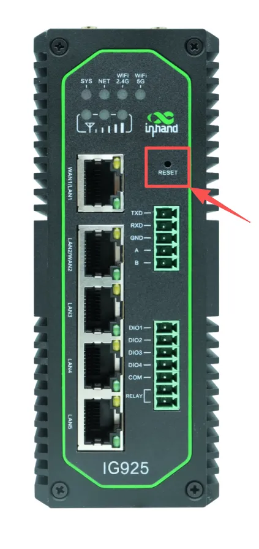
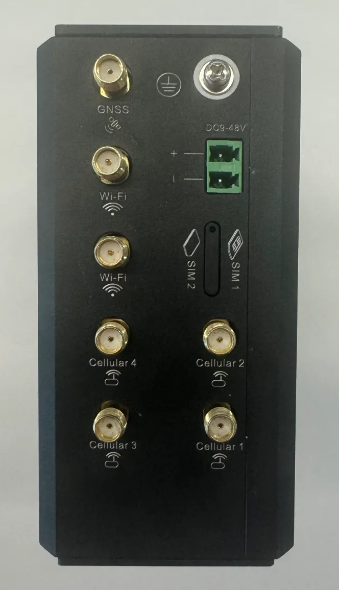
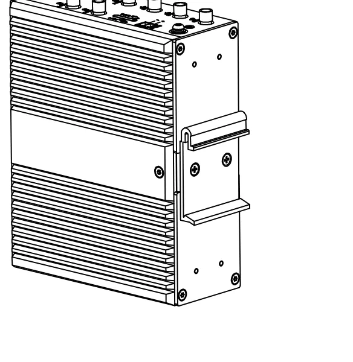
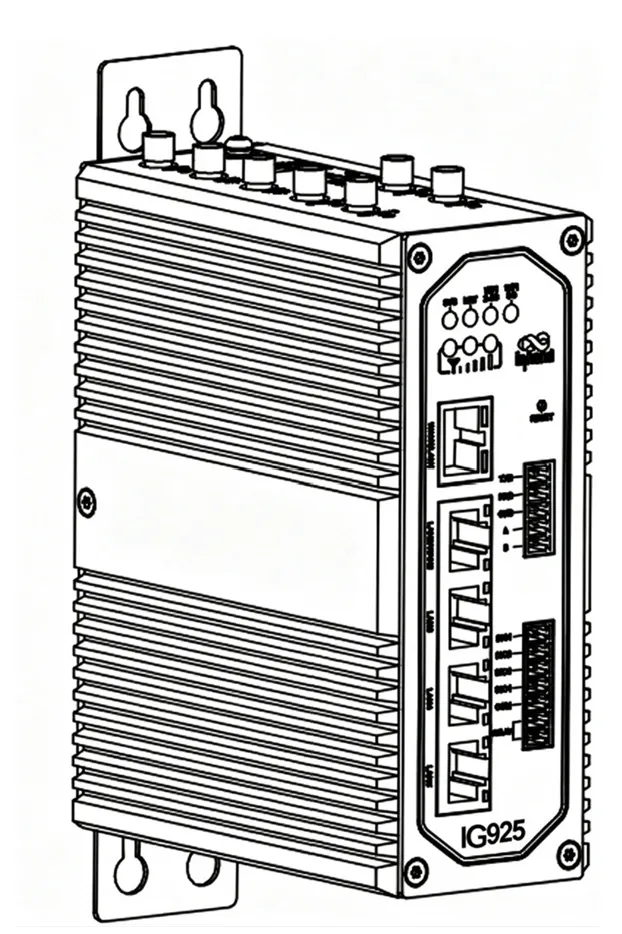
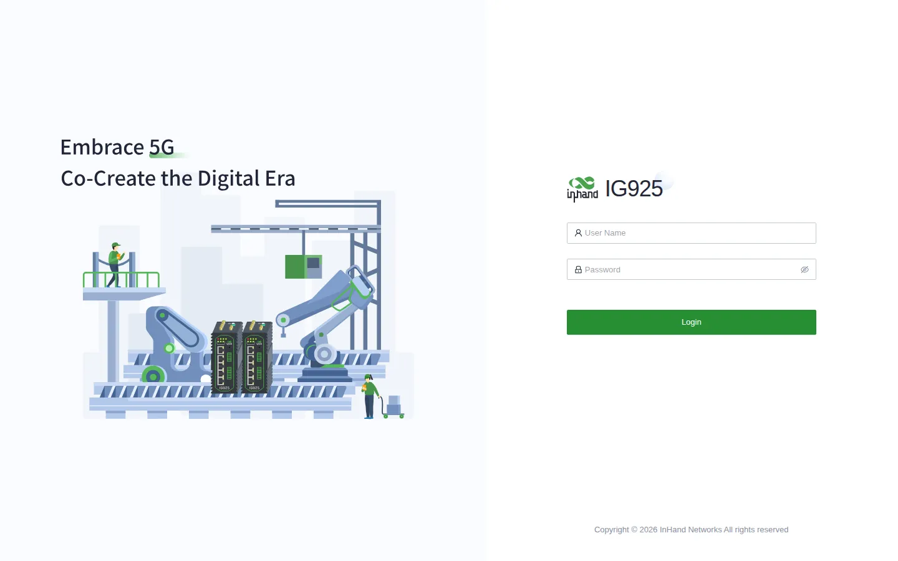
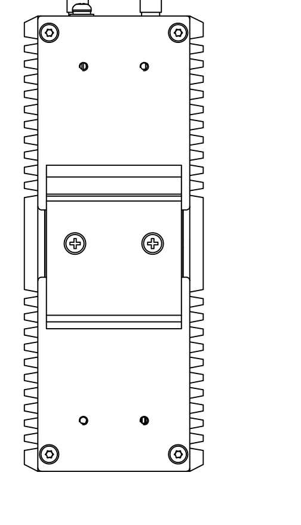
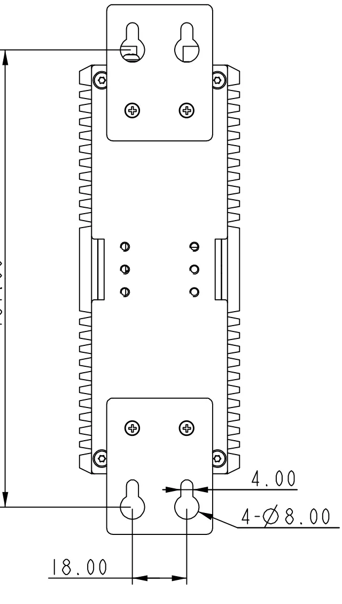

# IG925 Quick Start Guide

**IG925 High-Performance 5G Edge Computing Gateway**

**Quick Start Guide V1.0**

---

## Part 1: Quick Installation (Visual Step-by-Step)

> **You need to do first:** Unbox → Fix the device → Connect power and network cable → (If using cellular) **Power off** to install SIM, connect antenna → Power on → Set PC to same subnet → Open Web in browser.
> **Then:** Flip to **Part 2** below to check the packing list, indicator meanings, mounting, pinouts, etc.

### Must-Read Summary (Before Wiring and Power-On)

| Item | Requirement |
|------|-------------|
| Power supply | **9–48 V DC**, 2-pin industrial terminal with over-current and reverse-polarity protection; check polarity against the terminal markings. |
| SIM card | Drawer-type slot, supports dual Nano-SIM; **power off** before installing or removing; **no hot-swap**. |
| Antenna | Connect the cellular antennas (4×5G or 2×4G), Wi-Fi antennas (2) and GNSS antenna (1) according to the interface labels; subject to the actual model. |
| Environment | Operating temperature **−40 to +70 °C**, storage temperature **−40 to +85 °C**; rating **IP30** — keep the device free of water. |
| Installation location | Avoid strong electromagnetic interference and keep the device away from high-power equipment; leave clearance for heat dissipation and cabling. |

### Step 1: Check the Panel and Interface Areas Against the Physical Device

Unbox the device and verify the accessories against the packing list in §2.1. The front panel concentrates the indicators, Ethernet ports, serial and I/O terminals:

**Figure 1 Front panel (with Reset button location)**

- Top: **SYS / NET / Wi-Fi 2.4G / Wi-Fi 5G indicators** and **3 cellular signal LEDs**;
- Middle: **5 RJ45 ports — WAN1/GE1, LAN2/WAN2, LAN3, LAN4, LAN5**;
- Right: **serial terminal (TXD/RXD/GND, A/B)**, **DIO terminal (DIO1–DIO4/COM)**, **RELAY terminal**;
- The **Reset button** is at the upper right of the ports (see the red box in Figure 1).

The top panel carries the antenna connectors, power terminal and SIM slots:

**Figure 2 Top panel (antenna connectors, power terminal, SIM slots)**

For detailed panel and interface descriptions, see §2.2; for indicator meanings, see §2.3.

### Step 2: Fix the Device to a DIN Rail or in a Cabinet

The IG925 supports two mounting methods — choose one to suit the site:

- **DIN rail mounting**: suitable for industrial cabinets, see §2.4.1.
- **Wall mounting**: suitable for enclosures and walls, see §2.4.2.

**Figure 3 DIN rail mounting (clip on the back)**

**Figure 4 Wall mounting**

After fixing, make sure the device does not wobble and the cables do not pull on the terminals.

### Step 3: Connect Power and Ethernet

1. **Connect power**: with the power off, wire the **9–48 V DC** supply to the 2-pin power terminal following the top-panel silkscreen (**+** / **−**), and ground the device (terminal location see the top-panel photo in Step 1).
2. **Connect Ethernet (PC management)**: use a network cable to connect the PC to any LAN port of the IG925 (**LAN2–LAN5**; if LAN2 has been configured as WAN2, use **LAN3–LAN5**).
3. **Connect the uplink (for wired Internet)**: use a network cable to connect the **WAN1/GE1** port to the upstream device (modem, upstream switch or router).

### Step 4: (If Using Cellular) Power Off, Install SIM and Connect Antennas

> ⚠ **Make sure the device is powered off** before installing the SIM card, to avoid data loss or device damage.

1. Pull out the SIM tray, place the **Nano-SIM** card in the tray and push the tray back into the slot (dual SIM supported; the factory default dialing mode is "SIM1 only"). The SIM1/SIM2 slots are on the top panel (see the top-panel photo in Step 1).
2. Screw the cellular, Wi-Fi and GNSS antennas (subject to model) onto the corresponding antenna connectors following the top-panel silkscreen (Cellular 1–4, Wi-Fi, GNSS).

For detailed antenna connector and SIM slot descriptions, see §2.5.5.

### Step 5: Power On and Confirm the Device Is Ready

Apply power and observe the front-panel indicators:

- **SYS solid red** → system booting / running normally;
- **NET solid green** → cellular connection established (when using cellular);
- **Cellular signal LEDs**: 1 lit = weak signal, 2 lit = medium, 3 lit = good;
- **Wi-Fi 2.4G / 5G blinking green** → the corresponding band is operating normally.

For full indicator meanings, see §2.3.

### Step 6: Log In to the Web Interface from a PC

1. Set the PC IP address to the same subnet as the device:

   - Recommended: set the PC to "Obtain an IP address automatically" (the LAN ports run a DHCP server by default, address pool 192.168.2.2–192.168.2.254);
   - If the PC cannot obtain an address automatically, configure it manually: any IP address in **192.168.2.2–192.168.2.254**, subnet mask **255.255.255.0**, default gateway **192.168.2.1**, DNS **8.8.8.8**.

2. Open **<https://192.168.2.1>** in the browser.
3. Log in with the user name and password (**the initial user name and password are printed on the device nameplate**).
   - If the page warns that the connection is not secure, confirm that you are accessing this device, click "Advanced" and select "Proceed".

   

   **Figure 5 Web login page**

4. After logging in, go to 【Dashboard】 and check that the model, serial number and firmware version match the nameplate; it is recommended to change the initial password immediately after the first login.

For detailed login and factory-reset procedures, see §2.7.

### Post-Installation Checklist

- ☐ Device is fixed (DIN rail or wall) and does not wobble.
- ☐ Power is wired with correct polarity to 9–48 V DC and grounded; the PC network cable is connected to a LAN port.
- ☐ If using cellular: SIM is installed with **power off**, and all antennas are tightened onto the labeled connectors.
- ☐ **SYS solid red**; when using cellular, **NET solid green** and the signal LEDs read normally.
- ☐ PC has obtained an address in the 192.168.2.0 subnet.
- ☐ The browser opens <https://192.168.2.1> and login succeeds; the 【Dashboard】 information matches the nameplate.

> If the Web interface is unreachable: check that the PC IP is on the same subnet as the device and that the network cable is plugged into a LAN port; if necessary, restore factory settings per §2.7 and retry.

---

## Part 2: Detailed Description

### 2.1 Packing List

| Item | Qty | Notes |
|------|------|------|
| IG925 edge computing gateway | 1 | - |
| Cellular antennas | several | subject to model |
| Wi-Fi antennas | several | subject to model (WLAN models) |
| GNSS antenna | several | subject to model (WLAN models) |
| Quick start guide | 1 | - |

### 2.2 Product Structure and Labels

#### 2.2.1 Front Panel

**Figure 6 Front panel**

| Area | Description |
| --- | --- |
| Indicator area | SYS, NET, Wi-Fi 2.4G, Wi-Fi 5G status LEDs + 3 cellular signal LEDs (see §2.3) |
| Ethernet ports | WAN1/GE1 (1× 2.5GbE, WAN1 uplink by default), LAN2/WAN2, LAN3–LAN5 (1GbE, local access); 1.5 KV isolation-transformer protection |
| Serial terminal | TXD/RXD/GND (RS232), A/B (RS485); 15 KV ESD protection |
| I/O terminal | DIO1–DIO4/COM (4 digital I/O channels, each independently configurable as input or output) |
| Relay terminal | RELAY, contact rating 2 A @ 30 V DC |
| Reset button | Restores factory settings (see §2.7.2) |

#### 2.2.2 Top Panel

The top panel carries the antenna connectors, power terminal and SIM slots.

**Figure 7 Top panel**

| Item | Silkscreen | Description |
| --- | --- | --- |
| GNSS antenna connector | GNSS | 1, GNSS antenna (WLAN models) |
| Wi-Fi antenna connectors | Wi-Fi | 2, Wi-Fi antennas (WLAN models) |
| Cellular antenna connectors | Cellular 1–Cellular 4 | 4 (5G models); 2 on 4G models — subject to the physical unit |
| Power terminal | DC9-48V, silkscreen **+** / **−** | 2-pin industrial terminal, DC 9–48 V, over-current and reverse-polarity protection |
| SIM slots | SIM1, SIM2 | Drawer-type slot, dual Nano-SIM (1.8 V / 3 V), eSIM optional |
| Grounding screw | Ground symbol | For grounding the device |

### 2.3 Indicators and Reset Button

#### 2.3.1 Operating Status Indicators

| Indicator | State | Meaning |
|--------|------|------|
| System status (SYS) | Off | Device not powered |
| | Solid red | System booting / running normally |
| | Blinking red | Firmware upgrading / system error |
| Cellular status (NET) | Blinking green | Cellular connecting |
| | Solid green | Cellular connected |
| Wi-Fi 2.4G | Off | AP & STA not enabled |
| | Blinking green | 2.4G operating normally |
| | Solid green | Working in STA mode but not associated with an AP |
| Wi-Fi 5G | Off | AP & STA not enabled |
| | Blinking green | 5G operating normally |
| | Solid green | Working in STA mode but not associated with an AP |

#### 2.3.2 Cellular Signal LEDs

| Signal LEDs | Meaning |
| --- | --- |
| All off | No cellular connection |
| 1 green lit | Poor signal quality (check that the antennas are installed properly, the SIM card is recognized, and the signal coverage in the area) |
| 2 green lit | Medium signal quality; the device can operate normally |
| 3 green lit | Good signal quality |

> **Note**: Indicators only reflect the general state of the device and links. Lit cellular signal LEDs do not guarantee that the service server is reachable; verify service status on the Web interface.

#### 2.3.3 Reset Button

The Reset button is at the upper right of the ports on the front panel (see Figures 1 and 6). For factory-reset steps, see §2.7.2.

> **Note**: If the hardware reset button is disabled in 【System】→【Other Settings】 on the Web interface, the Reset button cannot be used to restore factory settings.

### 2.4 Mechanical Installation

#### 2.4.1 DIN Rail Mounting

1. Select the installation location with enough clearance for heat dissipation and cabling.
2. The back of the device has a DIN rail clip: hook the upper part of the clip onto the DIN rail, then press the lower end of the device towards the rail until it snaps in; confirm the device is secure and does not wobble.

**Figure 8 DIN rail clip (back)**

**Figure 9 DIN rail mounting (rear isometric view)**

To remove, press the release spring of the clip to disengage it from the DIN rail, then pull the device outward.

#### 2.4.2 Wall Mounting

1. Select the installation location with enough space.
2. Screw the wall-mount bracket to the back of the device, then screw the bracket to the wall or enclosure.

**Figure 10 Wall-mount bracket hole dimensions (back)**

**Figure 11 Wall mounting (front isometric view)**

> The wall-mount bracket uses keyhole slots: 2 slots per bracket, hole diameter Ø8 mm, center distance 18 mm (see Figure 10). Fix the bracket to the back of the device first, then hang the device on screws driven through the keyhole slots into the wall or enclosure; remove in reverse order. After installation, confirm the device is firmly fixed to prevent damage from falling.

### 2.5 Connection and Wiring

#### 2.5.1 Ethernet

The IG925 provides 5 RJ45 ports: **1× 2.5GbE + 4× 1GbE**, configurable as WAN or LAN; by default **WAN1 is the uplink port** (WAN1/GE1) and **LAN2–LAN5 are used for local access** (LAN2 can be switched to WAN2).

| Port silkscreen | Default role | Notes |
| --- | --- | --- |
| WAN1/GE1 | WAN1 (uplink) | 2.5GbE, obtains an address via DHCP by default |
| LAN2/WAN2 | LAN | Can be added as a second WAN in the Web interface |
| LAN3 | LAN | Local access |
| LAN4 | LAN | Local access |
| LAN5 | LAN | Local access |

- The LAN side runs a DHCP server by default, address pool 192.168.2.2–192.168.2.254.
- For a wired uplink: connect WAN1/GE1 to the upstream device; for a static IP or PPPoE, edit WAN1 under 【Internet】 in the Web interface.

#### 2.5.2 Power

The IG925 supports a wide-range **9–48 V DC** supply on a 2-pin industrial terminal (on the top panel, silkscreen **DC9-48V**) with **over-current and reverse-polarity protection**.

| Terminal silkscreen | Name | Definition |
| --- | --- | --- |
| **+** | Power positive | Connect to the positive pole of the DC 9–48 V supply |
| **−** | Power negative | Connect to the negative pole |

**Wiring requirements**:

1. Wire with the power off and check polarity against the terminal silkscreen (**+** / **−**);
2. Use a compliant DC 9–48 V power supply;
3. Ground the device (a grounding screw is provided on the top panel);
4. After power-on, **SYS solid red** indicates the device is powered normally.

The power terminal location is shown in the top-panel photo (Figure 7) in §2.2.2.

#### 2.5.3 Serial Ports (RS232 / RS485)

The IG925 provides 1× RS232 and 1× RS485 for connecting field devices such as PLCs and meters.

| Pin (terminal silkscreen) | Name | Definition |
| --- | --- | --- |
| TXD | RS232 transmit | |
| RXD | RS232 receive | |
| GND | RS232 signal ground | |
| A | RS485+ | |
| B | RS485− | |

**Wiring notes**:

- RS232: TX and RX must be **cross-connected** to the peer and share a common ground;
- RS485: connect the A/B differential pair according to the documentation of both ends; do not swap A and B;
- Serial parameters (baud rate, data bits, stop bits, parity) must match the serial device and are configured under 【Industrial Interface】 in the Web interface.

> **Note**: The same serial port cannot be shared by multiple functions such as DTU, GNSS serial forwarding and the AT service at the same time.

#### 2.5.4 Digital I/O and Relay

| Terminal silkscreen | Name | Notes |
| --- | --- | --- |
| DIO1–DIO4 | Digital input/output | 4 DIO channels, each independently configurable as input or output (factory default: dry-contact input) |
| COM | I/O common | |
| RELAY | Relay output | 1 channel (2-pin terminal), contact rating 2 A @ 30 V DC |

- Working mode, output level and relay contact state are configured under 【Industrial Interface】→【IO】 in the Web interface;
- Wiring must comply with the electrical parameters of the interface.

#### 2.5.5 Cellular SIM and Antennas

**SIM slots**: The IG925 has a drawer-type SIM slot supporting dual Nano-SIM, located on the top panel.

Installation steps:

1. **Power off**: the SIM card must be installed with the power off — make sure the device power is disconnected before installation.
2. **Insert the card**: pull out the SIM tray, place the Nano-SIM card in the tray and push the tray back into the slot.
3. The factory default dialing mode is "SIM1 only"; to use SIM2 or dual-SIM mode, change "Working Mode" under 【Internet】→ Edit "Cellular" in the Web interface.

> **Warning**: Disconnect power before inserting or removing the SIM card to avoid data loss or device damage.

**Antenna connectors**: the antenna connectors are on the top panel — match them by silkscreen:

| Silkscreen | Name | Qty | Notes |
| --- | --- | --- | --- |
| Cellular 1–Cellular 4 | Cellular antenna connectors | 4 | 5G models (4×5G); 2 on 4G models |
| Wi-Fi | Wi-Fi antenna connectors | 2 | WLAN models |
| GNSS | GNSS antenna connector | 1 | WLAN models (with GPS) |

Screw the required antennas onto the corresponding connectors and confirm they are tight and making good contact.

**Antenna configuration per ordering model**:

| Model | Cellular antennas | Wi-Fi antennas | GNSS antenna |
| --- | --- | --- | --- |
| IG925 | 4 × 5G | 2 | 1 |

> **Note**: Wi-Fi and GNSS antennas are supplied with WLAN models only; refer to the actual ordering information.

#### 2.5.6 Other Interfaces

| Item | Notes |
| --- | --- |
| Reset button | On the front panel; restores factory settings (see §2.7.2) |
| USB / storage expansion | Neither the specification nor the user manual lists USB, Micro SD or similar expansion interfaces; this device does not provide them (refer to the physical unit if otherwise) |

### 2.6 Power and Environment

| Item | Specification |
| :---: | :--- |
| Input voltage | 9–48 V DC (2-pin industrial terminal, over-current and reverse-polarity protection) |
| Operating temperature | −40 to +70 °C |
| Storage temperature | −40 to +85 °C |
| Ingress rating | IP30 (keep free of water) |
| Cooling | Metal enclosure, fanless |
| Dimensions | 141.2 × 118.5 × 53 mm |
| Weight | 1002 g |
| Mounting | DIN rail, wall |

### 2.7 First Login and Factory Reset

#### 2.7.1 Web Login

Connect to the IG925 using the following defaults:

| Item | Default |
| :---: | :---: |
| Local management address | <https://192.168.2.1> (LAN port, HTTPS) |
| User name | See the device nameplate |
| Password | See the device nameplate |
| PC same-subnet address | 192.168.2.2–192.168.2.254 (obtained via DHCP) |
| Default gateway | 192.168.2.1 |
| Subnet mask | 255.255.255.0 |

**Step 1: Connect the IG925 and the PC**

Connect the PC with a network cable to any LAN port of the IG925 (LAN2–LAN5), and set the PC IP address to the same subnet as the device ("Obtain an IP address automatically" is recommended).

**Step 2: Log in via the Web interface**

1. Enter **<https://192.168.2.1>** in the browser; the login page opens.
2. Log in with the user name and password (see the device nameplate).
   - If the page warns that the connection is not secure, confirm that you are accessing this device, click "Advanced" and select "Proceed".

   

   **Figure 12 Web login page**

3. After logging in, go to 【Dashboard】 and check that the model, serial number and firmware version match the nameplate.
4. For device security, **it is recommended to click the user name in the upper-right corner after the first login, select "Change Password" and change the initial password**, and keep the new password safe.

> **Note**: HTTPS, SSH and Ping access to the device via uplink interfaces are disabled by default; local LAN management is not affected. For remote management, enable the required services under 【System】→【Remote Access Control】; change the initial password and assess the network security risk before doing so.

#### 2.7.2 Factory Reset (Reset)

Use the Reset button on the front panel to restore factory settings in hardware:

1. While powering on the device, **press and hold the Reset button for 5–10 seconds**, then release it; the **SYS LED blinks slow red**. If SYS does not blink slow red after release, power off and repeat.
2. While SYS is **blinking slow red (within about 10 seconds)**, **press and hold the Reset button again for about 2 seconds**; release it when the SYS LED blinks fast — the device starts restoring factory settings.

Factory settings can also be restored in 【System】→【Device Options】 on the Web interface.

> **Note**:
> - Restoring factory settings resets the gateway configuration to defaults and **does not delete** installed Python Apps, Docker containers or their service data; however, the Python edge computing engine, the Docker manager and each App return to the default disabled state and must be enabled again afterwards.
> - It is recommended to export the configuration in 【System】→【Configuration Management】 before the operation.
> - After the device connects to a cloud platform, the platform may push the previous configuration back to the device.
> - If the hardware reset button is disabled in 【System】→【Other Settings】, the Reset button has no effect.

### 2.8 Quick Troubleshooting

| Symptom | Possible cause | Troubleshooting |
|------|----------|----------|
| Cannot open the Web interface | PC and device on different subnets | 1. Confirm the PC obtained an address in the 192.168.2.0 subnet 2. Check that the network cable is plugged into a LAN port |
| Cannot open the Web interface | Browser compatibility or certificate warning | 1. Try another browser (Chrome/Edge/Firefox recommended) 2. On a certificate warning, click "Advanced" → "Proceed" |
| Forgot the login password | The initial password was changed | 1. See the device nameplate (only if never changed) 2. If changed and forgotten, restore factory settings (§2.7.2) |
| Cannot connect to the cellular network | SIM card problem | 1. Power off and check that the SIM card is inserted correctly 2. Check for out-of-service SIM or a manually configured APN |
| Cannot connect to the cellular network | Weak or no signal | 1. Check that the antennas are tight 2. Adjust the device or antenna position and observe the signal LEDs |
| SYS blinking red | Firmware upgrading / system error | 1. Do not remove power during the upgrade 2. If not upgrading, contact technical support |

For more troubleshooting, see the appendix of the *IG925 User Manual*.

### 2.9 Related Documents

| Need | Refer to |
| --- | --- |
| Full feature description, scenario configuration, Python/Docker edge computing, DeviceLive usage | *IG925 User Manual* |
| Ordering information, models and bands, detailed specifications | *IG925 Specification* |
| Software downloads and announcements | [www.inhand.com](https://www.inhand.com) |

### 2.10 Legal Information

**Copyright**

© InHand Networks. All rights reserved.

**Trademarks**

InHand is a registered trademark of InHand Networks.

All other trademarks or registered trademarks in this manual belong to their respective manufacturers.

**Disclaimer**

The company reserves the right to change this manual without further notice when the product changes. The company is not responsible for any direct, indirect, intentional or unintentional damage or hazard caused by improper installation or use.
