# InGateway925 Edge Computing Gateway User Manual
## Front Matter

### Declaration

Thank you for choosing this product. Before use, read this user manual carefully and comply with the following declarations. This helps maintain intellectual property rights and legal compliance, and ensures that the user experience remains consistent with the latest product information. For any questions or to obtain written permission, contact the technical support team.

- **Copyright Notice**

This user manual contains copyright-protected content. Copyright belongs to Beijing InHand Networks Technology Co., Ltd. and its licensors. Without written permission, no entity or individual may excerpt, reproduce, or distribute any part or all of this manual in any form.

- **Disclaimer**

Due to continuous updates in product technology and specifications, the company cannot guarantee that the information in this user manual is completely identical to the actual product. Therefore, the company assumes no liability for any disputes arising from discrepancies between actual technical parameters and the user manual. Any product changes will not be notified in advance. The company reserves the right of final modification and interpretation.

- **Copyright Information**

The content of this user manual is protected by copyright law. Copyright belongs to Beijing InHand Networks Technology Co., Ltd. and its licensors. All rights reserved. Without written permission, no one may use, reproduce, or distribute the content of this manual.

### GUI Conventions

| Symbol | Meaning | Example |
|--------|---------|---------|
| `< >` | Indicates a variable or parameter to be replaced with an actual value | `<IP Address>` indicates a specific IP address needs to be entered |
| `" "` | Indicates text labels on the interface | Click the "Save" button |
| `→` | Indicates menu hierarchy or operation sequence | 【Internet】→【Uplink Table】 |
| `【 】` | Indicates a menu or page name | Enter the 【System】page |

### Technical Support

Email: support@inhandnetworks.com

URL: www.inhand.com

### How to Use This Manual

- First-time users: It is recommended to read "Knowing the Device" → "Installation and First Use" → "Common Scenario Configuration" → "Function Description and Parameter Reference" in sequence.
- Existing device users: Refer directly to "Function Description and Parameter Reference" or "Appendix: Troubleshooting".
- Application developers: Refer to the Python edge computing and Docker container deployment scenarios in "Common Scenario Configuration".
- Cloud platform management users: Refer to the DeviceLive connection scenario in "Common Scenario Configuration".

**Quick Jump by Task**

| Task | Chapter | Estimated Time |
|------|---------|----------------|
| Understand the device appearance, interfaces and default settings | [Knowing the Device](#chapter-1-knowing-the-device) | Approx. 10 min |
| Install the device and log in for the first time | [Installation and First Use](#chapter-2-installation-and-first-use) | Approx. 15 min |
| Access the Internet through the cellular network | [Scenario 1: Cellular Networking](#scenario-1-cellular-networking) | Approx. 5 min |
| Access the Internet through a wired network | [Scenario 2: Wired Networking](#scenario-2-wired-networking) | Approx. 5 min |
| Access the Internet through Wi-Fi | [Scenario 3: Wi-Fi (STA) Networking](#scenario-3-wi-fi-sta-networking) | Approx. 5 min |
| Transparently transmit serial data to a server | [Scenario 4: Serial Data Transparent Transmission](#scenario-4-serial-data-transparent-transmission) | Approx. 10 min |
| Deploy and run a Python App | [Scenario 5: Python Edge Computing](#scenario-5-python-edge-computing) | Approx. 15 min |
| Deploy a Docker container application | [Scenario 6: Docker Container Deployment](#scenario-6-docker-container-deployment) | Approx. 15 min |
| Connect to the DeviceLive cloud platform | [Scenario 7: Connect to DeviceLive](#scenario-7-connect-to-devicelive) | Approx. 10 min |
| Configure advanced functions such as VPN and firewall | [Function Description and Parameter Reference](#chapter-4-function-description-and-parameter-reference) | As needed |
| Troubleshoot device faults | [Appendix: Troubleshooting](#appendix-troubleshooting) | As needed |

---

## Chapter 1 Knowing the Device

### 1.1 Overview

InGateway925 (IG925) is a high-performance 5G edge computing gateway designed by InHand Networks for industrial IoT applications. It integrates 5G/4G cellular, Wi-Fi 6, 2.5GbE/1GbE Ethernet and industrial interfaces such as RS232/RS485, digital I/O and a relay. In addition to reliable network access, the IG925 provides a built-in Python secondary development environment and a Docker container application platform, so field data acquisition, protocol conversion and edge computing can be completed on the device, while the DeviceLive cloud platform provides remote connection, batch operation and maintenance, and OTA upgrades. With a metal housing, fanless design, -40°C to +70°C operating temperature and DC 9–48V wide-voltage power supply, the IG925 is suitable for industrial automation, energy and power, smart city and other scenarios.

Applicable product models and firmware versions:

| Product Model | Firmware Version |
|---------------|------------------|
| IG925 | V2.1.4 and above |

> **Note**: Cellular bands, Wi-Fi and GNSS configurations differ between ordering models; refer to the nameplate and ordering information. This manual takes the IG925-GLNR-WLAN (5G/4G, Wi-Fi 6 and GNSS) as an example.

### 1.2 Packing List

| Item | Quantity | Description |
|------|----------|-------------|
| IG925 edge computing gateway | 1 | - |
| Cellular antenna | Several | Depends on the model |
| Wi-Fi antenna | Several | Depends on the model (WLAN models) |
| GNSS antenna | Several | Depends on the model (WLAN models) |
| Quick start guide | 1 | - |

> **Note**: The packed items are subject to the actual ordering model and the packing list in the box.

### 1.3 Appearance and Interfaces

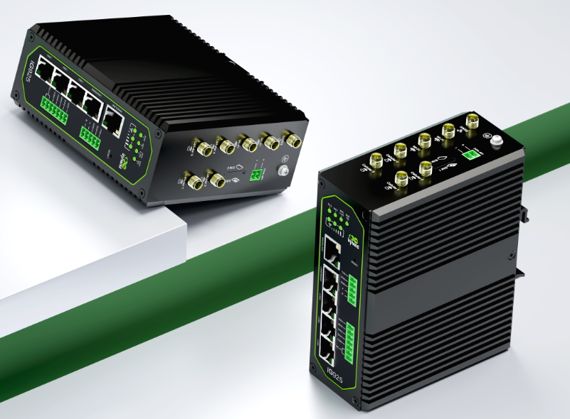

<strong>Figure 1-1 IG925 Edge Computing Gateway Appearance</strong>

| Interface | Quantity | Description |
|-----------|----------|-------------|
| Ethernet port | 5 | 1 × 2.5GbE + 4 × 1GbE RJ45 ports, configurable as WAN or LAN; by default WAN1 is the uplink port and LAN2–LAN5 are used for local access |
| Serial port | 2 | 1 × RS232 + 1 × RS485 for connecting PLCs, meters and other field devices |
| Digital I/O | 4 | 4 DIO channels, each independently configurable as input or output |
| Relay | 1 | 1 relay output, contact rating 2 A @ 30 V DC |
| SIM card slot | 1 | Drawer-type holder supporting dual Nano-SIM cards |
| Antenna connectors | — | Cellular (4 × 5G or 2 × 4G), Wi-Fi (2) and GNSS (1), depending on the model |
| Power connector | 1 | DC 9–48V, 2-pin industrial terminal block with overcurrent and reverse-polarity protection |
| Reset button | 1 | Restores factory settings |

### 1.4 Indicator Description

| Indicator | Status | Description |
|-----------|--------|-------------|
| System status (SYS) | Off | The device is not powered on |
|  | Steady red | The system is starting / working normally |
|  | Blinking red | Firmware upgrade in progress / system error |
| Cellular status (NET) | Blinking green | Cellular connecting |
|  | Steady green | Cellular connected |
| Cellular signal | Off | No cellular connection |
|  | One LED steady green | Poor signal |
|  | Two LEDs steady green | Medium signal |
|  | Three LEDs steady green | Good signal |
| Wi-Fi 2.4G | Off | AP and STA disabled |
|  | Blinking green | 2.4G working normally |
|  | Steady green | Working in STA mode and not associated with an AP |
| Wi-Fi 5G | Off | AP and STA disabled |
|  | Blinking green | 5G working normally |
|  | Steady green | Working in STA mode and not associated with an AP |

> **Note**: The indicators only show the general status of the device and links. A lit cellular signal LED does not mean that the service server is reachable; check the status information on the Web interface to determine whether services are working.

### 1.5 Restoring Factory Settings

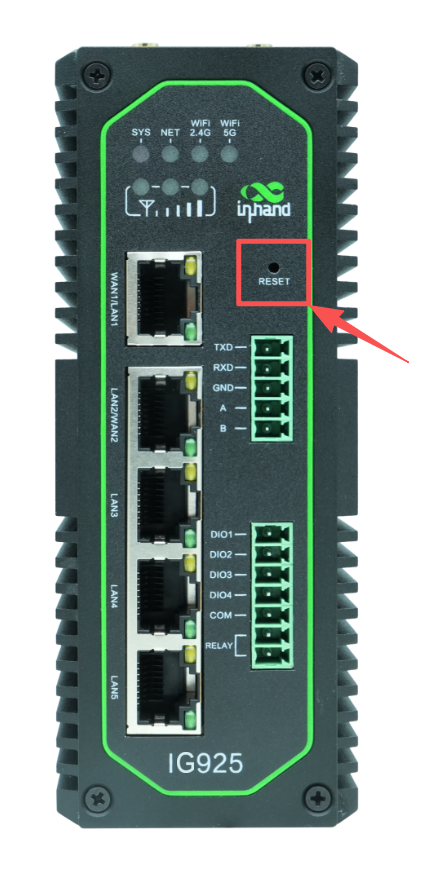

<strong>Figure 1-2 Reset Button Location</strong>

Perform the following steps to restore the device to factory settings:

1. Press and hold the Reset button while powering on the device, keep holding it for 5–10 seconds, then release it. The SYS indicator blinks red slowly. If the SYS indicator does not blink slowly after you release the button, power off the device and try again.
2. While the SYS indicator is blinking slowly (within about 10 seconds), press and hold the Reset button again for about 2 seconds. When the SYS indicator blinks rapidly, release the button. The device starts restoring factory settings.

Factory settings can also be restored in 【System】→【Device Options】 on the Web interface; see [Device Options](#4124-device-options).

> **Note**: Restoring factory settings restores the gateway configuration to the default values and does not delete installed Python Apps, Docker containers or their service data. Because the configuration returns to the defaults, the Python edge computing engine, the Docker manager and each App also return to the default disabled state and must be enabled again afterwards. It is recommended to export the configuration in 【System】→【Configuration Management】 before the operation.

> **Note**: If "Disable the hardware reset button" is enabled in 【System】→【Other Settings】, the Reset button cannot be used to restore factory settings.

### 1.6 Default Settings

| No. | Function | Default Setting |
|-----|----------|-----------------|
| 1 | Local management address | 192.168.2.1/24, Web management interface accessed through HTTPS |
| 2 | Username and password | Printed on the nameplate of the device |
| 3 | Ethernet | WAN1 enabled and obtaining its address through DHCP; LAN2–LAN5 used for local access; DHCP server enabled on the LAN with the address pool 192.168.2.2–192.168.2.254 |
| 4 | Cellular dialing | Enabled, "SIM1 only", dialing parameters selected automatically |
| 5 | Wi-Fi | On WLAN models, the Wi-Fi 2.4G and 5G access points are enabled; the SSIDs are prefixed with IG925- and IG925-5G- followed by the last 6 digits of the wireless MAC |
| 6 | Remote access control | HTTPS, SSH and Ping access through uplink interfaces are disabled; management through local LAN ports is not affected |
| 7 | Cloud management | Enabled, connecting to the DeviceLive platform automatically after Internet access |
| 8 | Edge computing | The latest Python SDK, DeviceSupervisor Agent (DSA) and Docker SDK are preinstalled at the factory; their versions and running status are shown on the 【Edge Computing】 pages |

---

## Chapter 2 Installation and First Use

### 2.1 Before Installation

Before installing the device, confirm the following environment requirements and tools:

| Item | Requirement |
|------|-------------|
| Power supply | DC 9–48V power supply; check the polarity according to the terminal marking |
| Ambient temperature | Operating temperature -40°C to +70°C, storage temperature -40°C to +85°C |
| Installation space | DIN-rail or wall mounting, with space reserved for heat dissipation and cabling; the protection rating is IP30, so prevent water ingress |
| Network | An available cellular, wired or Wi-Fi network |
| SIM card | A carrier Nano-SIM card if the cellular network is used |
| Network cable | Standard Ethernet cables |
| Computer | For accessing the Web management interface; Chrome, Edge or Firefox is recommended |

> **Note**: Do not install the device in an environment with strong electromagnetic interference or close to high-power equipment.

### 2.2 Installation Guide

#### 2.2.1 Mounting the Device

Choose DIN-rail mounting or wall mounting according to the site. After mounting, make sure the device does not shake and the cables do not pull on the terminal blocks.

#### 2.2.2 Antenna Installation and SIM Card Insertion

1. Install the cellular, Wi-Fi and GNSS antennas according to the antenna connector markings (depending on the model).
2. With the power off, take out the SIM card tray, insert the Nano-SIM card and push the tray back.

> **Warning**: Disconnect the power before inserting or removing the SIM card to avoid data loss or device damage.

#### 2.2.3 Power and Network Connection

1. With the power off, connect the DC 9–48V power supply to the power terminal according to the positive and negative markings, and ground the device.
2. Connect the computer to any LAN port (LAN2–LAN5) of the device with a network cable.
3. To use a wired uplink, connect the WAN1 port to the upstream device (such as an optical modem, upper-level switch or router).
4. Power on the device. The device starts.

#### 2.2.4 PC Network Configuration

Set the IP address of the PC to the same subnet as the gateway.

- The LAN ports of the device have the DHCP server enabled by default. Set the PC to "Obtain an IP address automatically", and the PC will obtain an IP address from the IG925. Verify that the address is in the 192.168.2.0 subnet.
- If the PC cannot obtain an IP address through DHCP, manually set the IP address of the PC to any address in 192.168.2.2–192.168.2.254, with the default gateway 192.168.2.1, subnet mask 255.255.255.0, and DNS 8.8.8.8 or the DNS address provided by the carrier.

#### 2.2.5 Access the Web Management Interface

1. Enter https://192.168.2.1 in the address bar of the browser. On the login page, enter the username and password (printed on the nameplate) to access the Web management interface. If the browser shows a security warning, confirm that you are accessing this device, click "Advanced" and select "Proceed".

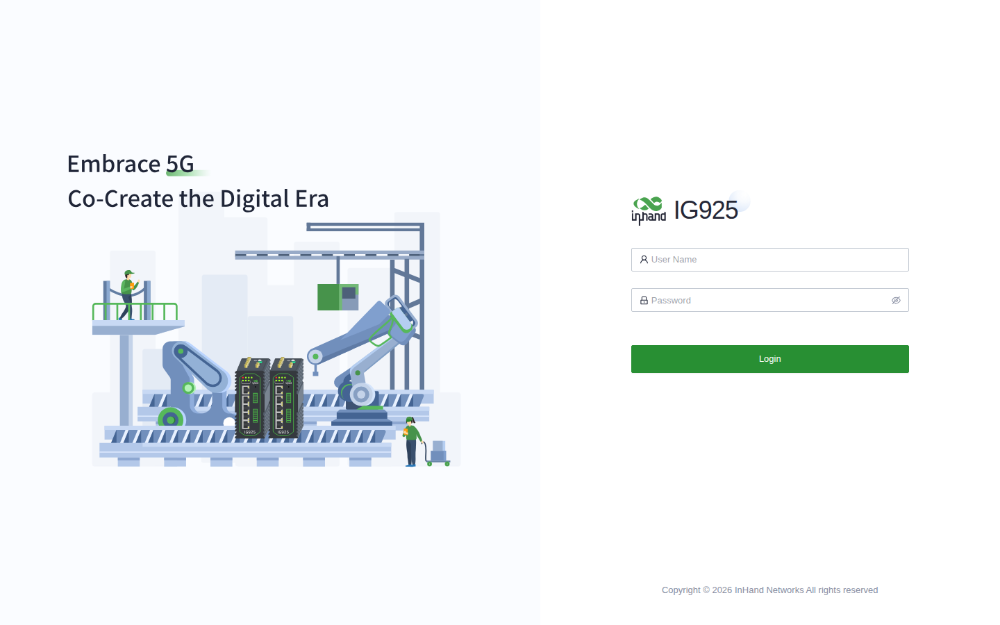

<strong>Figure 2-1 Web Login Interface</strong>

2. After logging in, check the device model, serial number and firmware version on 【Dashboard】 to confirm that you are logged in to the target device.
3. For device security, it is recommended to click the username in the upper right corner after the first login, select "Modify Password" to change the initial password, and keep the new password safe.

### 2.3 Quick Check

After installation, perform the following checks:

- [ ] The device is powered on and the system status indicator is normal
- [ ] The cellular, Wi-Fi and GNSS antennas are installed correctly
- [ ] The SIM card is inserted correctly (if the cellular network is used)
- [ ] The PC is connected to a LAN port with a network cable
- [ ] The PC has obtained an IP address in the 192.168.2.0 subnet
- [ ] The Web management interface can be opened at https://192.168.2.1
- [ ] The model, serial number and firmware version shown on 【Dashboard】 match the nameplate

---

## Chapter 3 Common Scenario Configuration

### Scenario 1: Cellular Networking

**Objective**: Access the Internet through the 5G/4G cellular network.

**Prerequisites**: The SIM card has been inserted with the power off, the cellular antennas are installed, and the device is powered on.

**Estimated Time**: Approx. 5 minutes.

**Operating Steps**:

1. After power-on, the IG925 automatically dials up with SIM1 and accesses the network. No additional configuration is required.
2. If the carrier requires a specific APN, go to 【Internet】, click "Edit" in the "Cellular" row, set "Dialing Parameters" to manual, and enter the APN, authentication, user name and password provided by the carrier.
3. If PIN protection is enabled on the SIM card, enter the correct PIN code on the same page.
4. Click "Save".

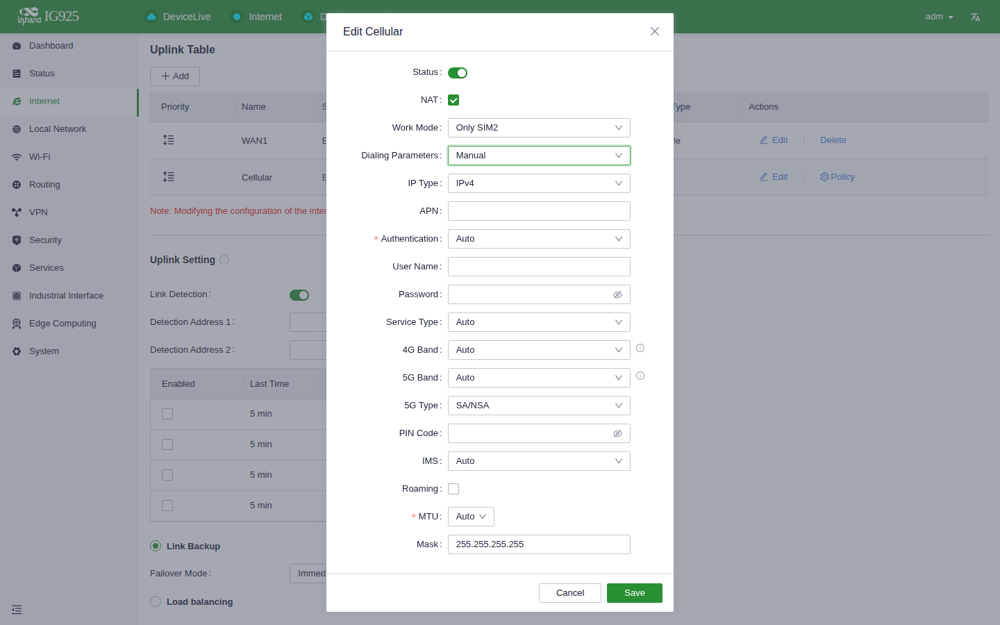

<strong>Figure 3-1 Edit Cellular with a Manual APN</strong>

**Verification Method**:

1. Check that the cellular status indicator is steady green, and check the signal quality on the cellular signal indicators.
2. On 【Dashboard】, check that the Cellular interface has obtained an IP address.
3. In 【System】→【Tools】→【Ping】, select the Cellular interface and ping a known reachable address.

**Common Issues**:

- Dial-up fails: Check that the SIM card was inserted correctly with the power off, that the APN is correct and that the SIM card has credit.
- Weak signal: Check that the antennas are connected firmly, and adjust the position of the device or antennas.
- IoT or private-network SIM cards can only access specified networks: Verify with an address the carrier allows, and change the link detection address in 【Internet】→【Uplink Setting】 if necessary.

### Scenario 2: Wired Networking

**Objective**: Access the Internet through Ethernet.

**Prerequisites**: A network cable is ready, and the upstream device (such as an optical modem, upper-level router or switch) is available.

**Estimated Time**: Approx. 5 minutes.

**Operating Steps**:

1. Connect the WAN1 port of the IG925 to the upstream device. WAN1 obtains its address through DHCP by default, so no configuration is needed if the upstream device provides DHCP.
2. To use a static IP or PPPoE, go to 【Internet】, click "Edit" in the "WAN1" row, select the corresponding "IPv4 Type", enter the parameters provided by the network administrator or carrier, and click "Save".

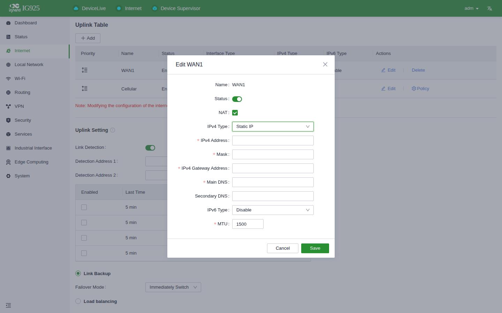

<strong>Figure 3-2 Edit WAN1 with a Static IP</strong>

3. To configure a second wired uplink, make sure the computer is connected to one of LAN3–LAN5, click "Add" in 【Internet】, select WAN and complete the configuration, and then connect the second uplink cable to the LAN2/WAN2 port.

**Verification Method**:

1. On 【Dashboard】, check that the WAN1 interface has obtained an IP address, gateway and DNS.
2. Check the link health in 【Status】→【Link Monitoring】.

**Common Issues**:

- No IP address is obtained: Check the cable connection and confirm that the DHCP service of the upstream device works.
- PPPoE dial-up fails: Check that the user name and password are correct.
- The uplink subnet conflicts with the local subnet: Change the local subnet in 【Local Network】 before connecting to the upstream network.

### Scenario 3: Wi-Fi (STA) Networking

**Objective**: Access the Internet through an on-site wireless access point.

**Prerequisites**: An available Wi-Fi access point (AP) exists on site, and its SSID, security mode and password are known; the computer manages the device through a wired LAN port.

**Estimated Time**: Approx. 5 minutes.

**Operating Steps**:

1. Go to 【Internet】, click "Add" and select "Wi-Fi(STA)".
2. Select the 2.4GHz or 5GHz band, and click the scan button next to SSID to select the on-site AP (enter a hidden SSID manually).
3. Check the security and encryption modes of the AP, enter the password, and usually select DHCP as the IPv4 type.
4. Click "Save". The IG925 connects to the AP.

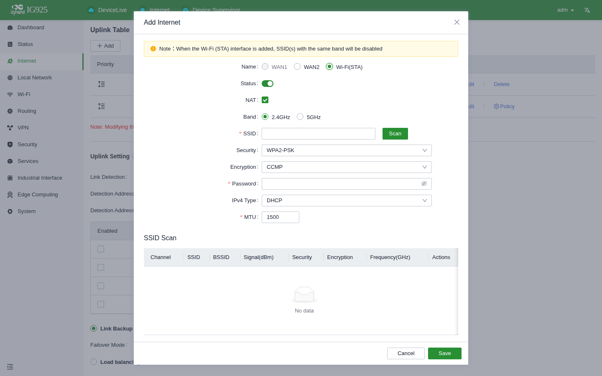

<strong>Figure 3-3 Add a Wi-Fi (STA) Uplink</strong>

> **Note**: After Wi-Fi (STA) is added, the local Wi-Fi access point on the same band is disabled. If the computer is connected to the device through Wi-Fi on that band, the connection is lost after saving, and the device must be managed through a wired connection.

**Verification Method**:

1. On 【Dashboard】, check that the Wi-Fi (STA) interface has obtained an IP address.
2. Check the link health in 【Status】→【Link Monitoring】.

**Common Issues**:

- Cannot connect to the AP: Check the SSID and password, and confirm the signal strength and supported bands of the AP.
- Authentication fails: Check that the authentication and encryption policies of the AP match the IG925 configuration.

### Scenario 4: Serial Data Transparent Transmission

**Objective**: Use the DTU function to transparently transmit data from an RS232/RS485 serial device to a TCP/UDP server, and write the data sent by the server back to the serial port.

**Prerequisites**: The serial device is connected to the RS232 or RS485 port of the IG925 according to the interface definition; the device has network access; the server address and port, and the serial parameters (baud rate, data bits, stop bits and parity) are known.

**Estimated Time**: Approx. 10 minutes.

**Operating Steps**:

1. Go to 【Industrial Interface】, select RS232 or RS485, and set the baud rate, data bits, stop bits, parity and flow control to match the serial device.
2. Enable DTU transparent transmission, select the protocol (TCP or UDP) and connection type, and enter the server address and port.
3. Set the DTU ID, keepalive, packet size/frame interval, reconnect interval and other parameters as required by the server, and click "Save".

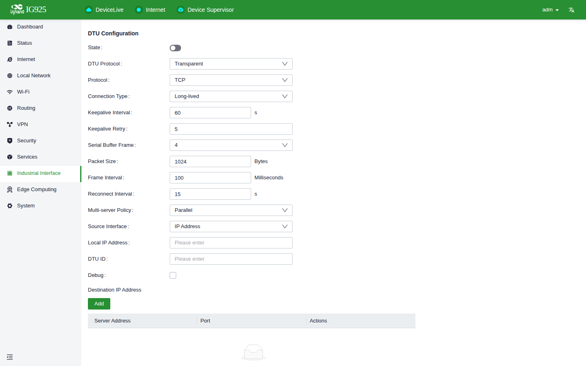

<strong>Figure 3-4 Serial Parameters and DTU Configuration</strong>

**Verification Method**:

1. Check the connection status and data records in 【Status】→【DTU】.
2. Send a piece of data from the serial device and confirm that the server receives the same data; send a piece of data from the server and confirm that the serial device receives it.

**Common Issues**:

- The server receives no data: Check that the serial parameters match the device, that the RS232 TX/RX lines are crossed, and that the RS485 A/B lines are not reversed.
- The connection drops repeatedly: Check that the server address, port, keepalive and reconnect parameters match the server requirements.
- One serial port used by several functions: DTU, GNSS serial forwarding and AT service cannot use the same serial port at the same time.

> **Note**: In transparent transmission mode, only raw data is forwarded between the serial port and the network, and application protocols such as Modbus are not parsed. To convert Modbus TCP requests to serial Modbus RTU, set "DTU Protocol" to "Modbus-Net-Bridge" (see [Industrial Serial Ports](#4101-industrial-serial-ports)). To collect and process data by protocol, use a Python App or DeviceSupervisor Agent.

### Scenario 5: Python Edge Computing

**Objective**: Enable the Python edge computing engine, and sign, install and run a self-developed or vendor-supplied Python App on the IG925.

**Prerequisites**: The App package to deploy is available, and the computer is logged in to the Web interface of the device. The Python SDK is preinstalled at the factory; to upgrade it, obtain the SDK package for the IG925 (such as py3.14.6sdk-V1.0.1_Edge-IG925.zip).

**Estimated Time**: Approx. 15 minutes.

**Operating Steps**:

1. Go to 【Edge Computing】→【Python Edge Computing】 and check "SDK Version". To upgrade the SDK, click "Upgrade SDK", select the SDK package, confirm, and wait for the installation to complete.
2. Turn on "Enable engine" and wait until the engine state shows "Running".
3. If the App package is not yet signed (an inner package you developed and built according to the packaging guide), click "Import File" in "App Signing" at the bottom of the page to select the package, click "Sign", and after success click "Export File" to save the signed App package. Skip this step for signed App packages delivered by a vendor.

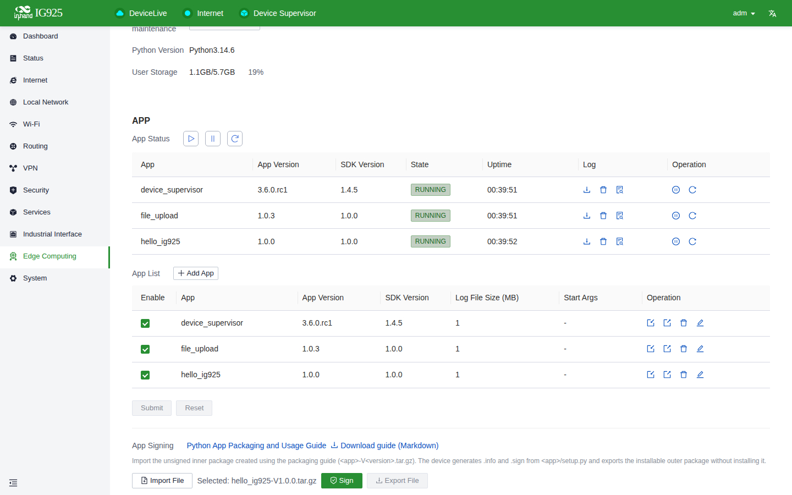

<strong>Figure 3-5 App Signing</strong>

4. In "App List", click "Add App", select the signed App package and confirm the installation.

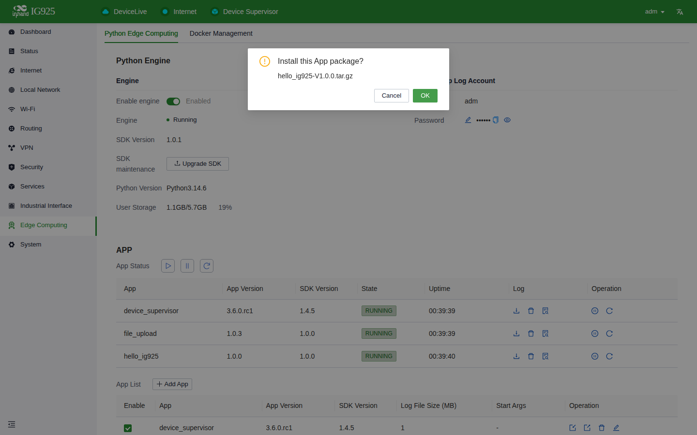

<strong>Figure 3-6 Confirm Installing the App Package</strong>

5. After the installation, select "Enable" for the App, enter "Start Args" if required, and click "Submit".

> **Reference**: The directory structure, packaging and signing requirements of an App can be read online in "Python App Packaging and Usage Guide" in the "App Signing" area, or saved locally with "Download guide (Markdown)".

**Verification Method**:

1. In "App Status", confirm that the App state is "RUNNING".
2. Click the log view button of the App and confirm that the log shows the expected output without errors; the log page uses the "Python App Log Account" on this page.
3. Confirm that the service receiver (such as a server or platform) receives the data reported by the App.

**Common Issues**:

- Installation fails: Confirm that the signed App package is selected and that the Python version of the App matches the SDK (SDK V1.0.1 uses Python 3.14.6).
- The App cannot start: Check the start arguments and App configuration, and check the errors in the App log.
- "Enable" and "Stop": "Enable" determines whether the App runs automatically after the device restarts; "Stop" only pauses the current run.

### Scenario 6: Docker Container Deployment

**Objective**: Enable the Docker manager and Portainer, and deploy containerized applications on the IG925.

**Prerequisites**: The application images support the linux/arm/v7 platform; the device can access the image registry during deployment, or offline image files are prepared. The Docker SDK is preinstalled at the factory; to upgrade it, obtain the Docker SDK package for the IG925 (such as IG925-docker-sdk-V1.0.0.zip).

**Estimated Time**: Approx. 15 minutes.

**Operating Steps**:

1. Go to 【Edge Computing】→【Docker Management】 and check the Docker version. To upgrade, click "Upgrade SDK", select the Docker SDK package, confirm, and wait for the installation to complete.
2. Turn on "Enable manager" of the Docker manager and wait until the state shows "Running"; to use an image accelerator, enter the mirror address in "Registry Mirrors" and save it.
3. Turn on "Enable manager" of the Portainer manager and wait until the state shows "Running".

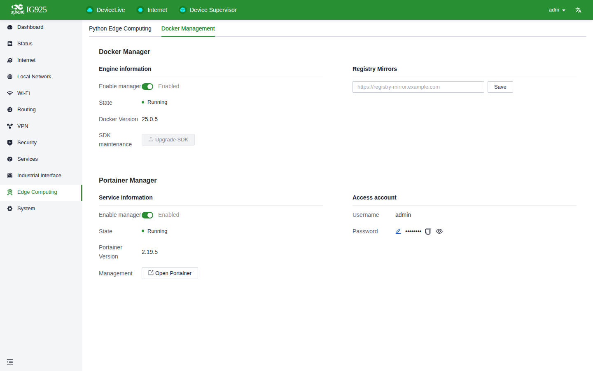

<strong>Figure 3-7 Docker Management</strong>

4. Click "Open Portainer" and log in to Portainer with the username (admin) and password shown in "Access account".
5. In Portainer, deploy the application through "Stacks" or "Containers", and configure port mappings, environment variables, restart policies and data volumes as required by the application.

**Verification Method**:

1. In Portainer, confirm that the container is running.
2. Access the service port published by the container from a computer or terminal, and confirm that the service responds normally.

**Common Issues**:

- Image pull fails: Check the network and DNS of the device, confirm that the registry is reachable, or import the image offline.
- The container cannot run: Confirm that the image architecture is linux/arm/v7; x86 (amd64) and arm64 images cannot run directly on the IG925.
- Cannot log in to Portainer: The Portainer access account is different from the device Web account; use the information shown in "Access account" on the "Docker Management" page.

> **Note**: Ports published by containers provide services externally, so evaluate the access scope before production deployment. Mount service data in containers to data volumes and back it up separately as required by the service.

### Scenario 7: Connect to DeviceLive

**Objective**: Connect the IG925 to the DeviceLive cloud platform for remote monitoring, remote access and batch operation and maintenance.

**Prerequisites**: The device has Internet access, and a DeviceLive account is available.

**Estimated Time**: Approx. 10 minutes.

**Operating Steps**:

1. Open a web browser (Google Chrome recommended) and navigate to https://device.inhandcloud.com to access the DeviceLive login/registration page. Click **Create Now** to create a platform account.

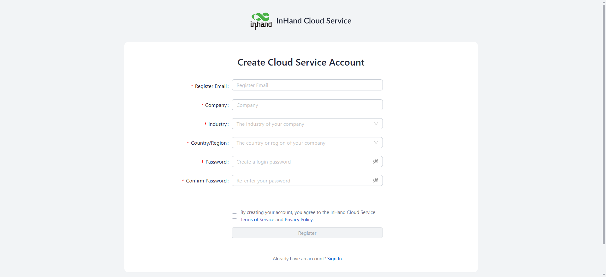

<strong>Figure 3-8 DeviceLive Registration Page</strong>

2. After completing account registration, log in to the InHand Cloud Service Platform with your username and password, then select the **DeviceLive** service.

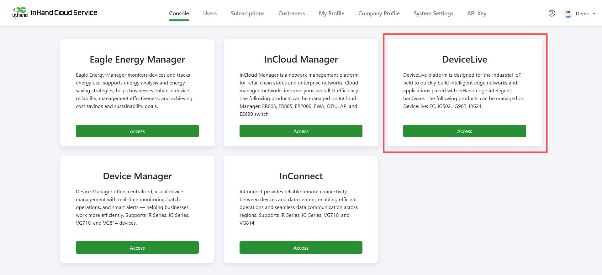

<strong>Figure 3-9 DeviceLive Login Page</strong>

3. In the DeviceLive platform, go to the **Devices** menu, click **Add**, enter the device name, serial number and the other required information (such as the MAC address), and complete the addition. The serial number and MAC address can be found on the nameplate or on 【Dashboard】 of the device Web interface.

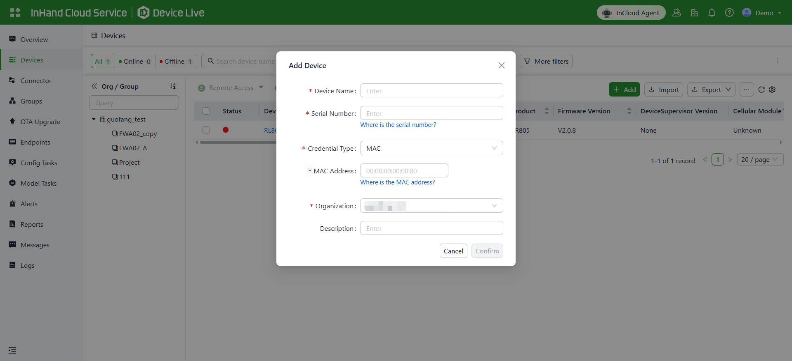

<strong>Figure 3-10 Add a Device in DeviceLive</strong>

4. On the device Web interface, confirm in 【System】→【Cloud Management】 that "Enabled Cloud Service" is on and that "Cloud Platform" matches the platform site you use (device.inhandcloud.com for the global site, device.inhandcloud.cn for the China site).

**Verification Method**:

1. Check whether the device is online in the **Devices** list on the DeviceLive platform.
2. Click the device name to view the device details, or open the device Web interface through the remote access function of the platform.

**Common Issues**:

- The device cannot go online: Check that the device has Internet access, that the serial number and MAC address are correct, and that the cloud platform in 【System】→【Cloud Management】 is correct.
- Advanced functions are unavailable: Some advanced DeviceLive functions require the corresponding license; the license status of the device is shown on 【Dashboard】.

---

## Chapter 4 Function Description and Parameter Reference

This chapter describes the functions and main parameters of each page in the order of the menu on the left side of the device Web interface. In the navigation bar at the top, "DeviceLive" jumps to the DeviceLive platform the device is connected to, "Internet" shows the current Internet status of the device, and "Device Supervisor" opens the page of the installed DeviceSupervisor Agent application. Click the username in the upper right corner to "Modify Password" or "Logout", and click the language icon to switch the Web interface language.

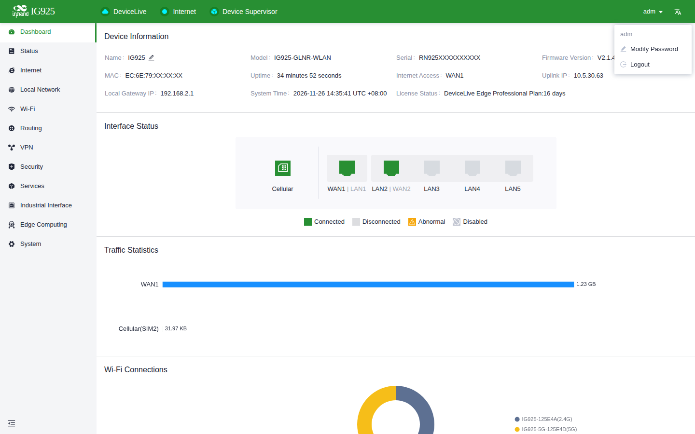

<strong>Figure 4-1 Navigation Bar and User Menu</strong>

### 4.1 Dashboard

【Dashboard】 shows the basic information and running status of the device.

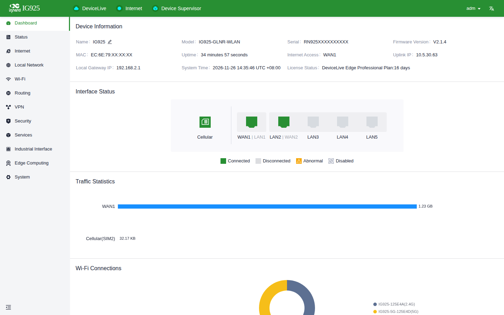

<strong>Figure 4-2 Dashboard</strong>

**Device Information**

- Name: The name of the device, "IG925" by default; click the edit icon to change it.
- Model: The ordering model of the device, which shows whether 5G, Wi-Fi and GNSS are supported.
- Serial: The unique code of the device, used to add the device to the DeviceLive platform.
- Firmware Version: The firmware version currently running on the device.
- MAC: The physical MAC address of the device.
- Uptime: The running time since the device was powered on.
- Internet Access: The uplink interface currently used to access the Internet.
- Uplink IP: The IP address of the current uplink interface.
- Local Gateway IP: The gateway address of the default local network.
- System Time: The time zone and system time of the device.
- License Status: The license information of the device on the DeviceLive platform.

**Interface Status**

Shows the status of the cellular and Ethernet interfaces (Connected, Disconnected, Abnormal, Disabled). Click an interface icon to view its details, such as IP address, gateway, DNS and rate, in the pop-up box on the right.

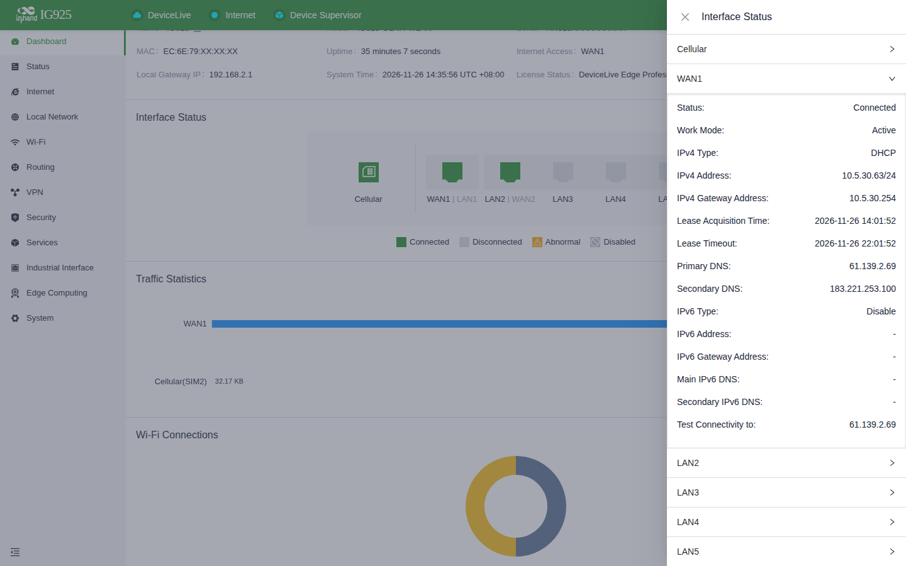

<strong>Figure 4-3 Interface Details</strong>

**Traffic Statistics**

Shows the traffic of each uplink interface since the device was powered on. The statistics are reset after the device restarts.

**Wi-Fi Connections**

Shows the enabled SSIDs and the number of clients connected to each SSID.

### 4.2 Status

The 【Status】 menu summarizes the real-time running status of device functions for daily inspection and troubleshooting.

#### 4.2.1 Link Monitoring

Shows the health status of each uplink, together with the carrier, usage, throughput, latency, loss and signal strength. Latency and loss depend on the link detection function and cannot be viewed after link detection is disabled.

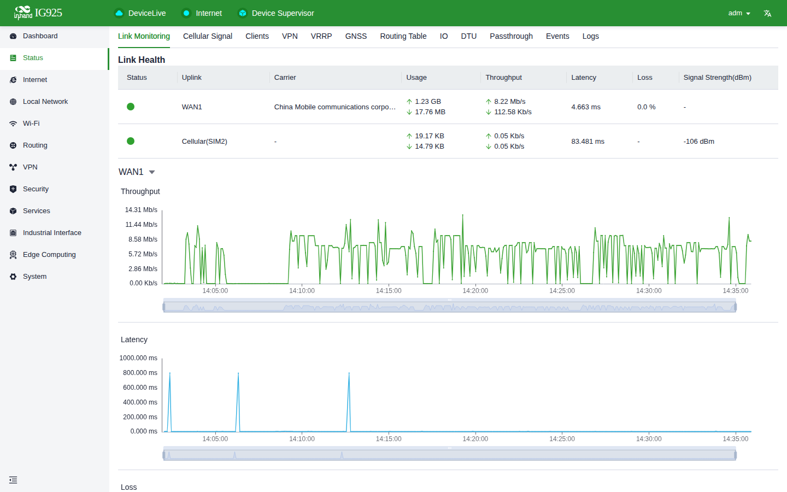

<strong>Figure 4-4 Link Monitoring</strong>

#### 4.2.2 Cellular Signal

Shows curves of the cellular signal strength and of RSSI, RSCP, EC/IO, RSRP, RSRQ and SINR over time. Drag the slider below each chart to view different time periods and determine whether the on-site signal is stable.

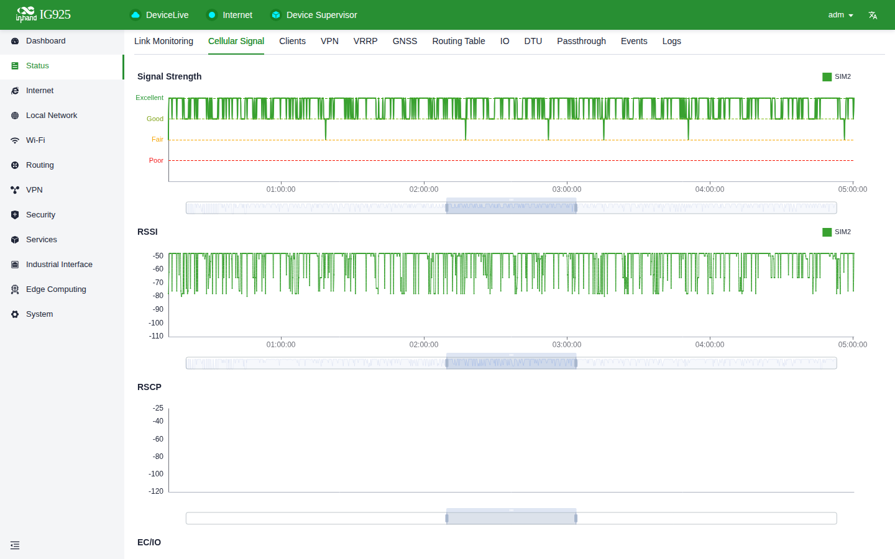

<strong>Figure 4-5 Cellular Signal</strong>

#### 4.2.3 Clients

Shows the name, IP address, MAC address, connection type and uptime of the clients connected to the device.

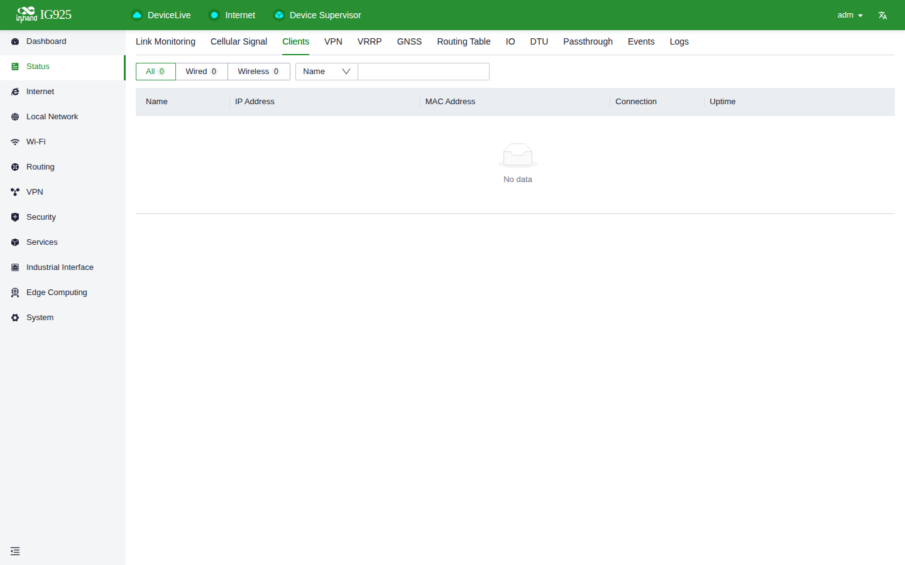

<strong>Figure 4-6 Clients</strong>

#### 4.2.4 VPN

Shows the status, uplink interface, interface address, remote address, available subnets, traffic and last connection time of VPN tunnels by type, such as IPsec and L2TP.

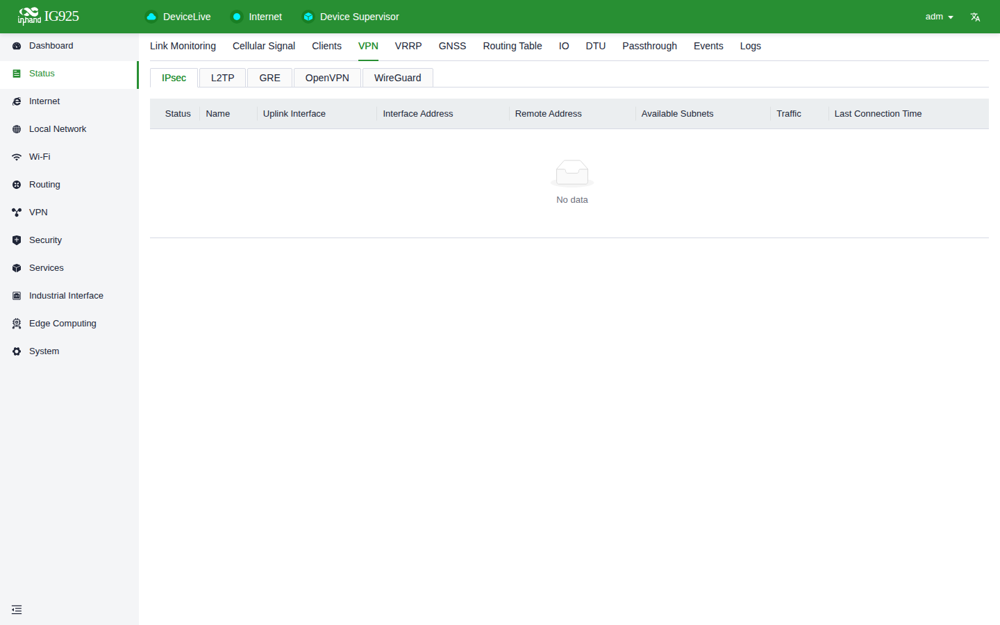

<strong>Figure 4-7 VPN Status</strong>

#### 4.2.5 VRRP

Shows the VRID, status, VRRP version, device role, priority, local network and virtual IP address of VRRP backup groups.

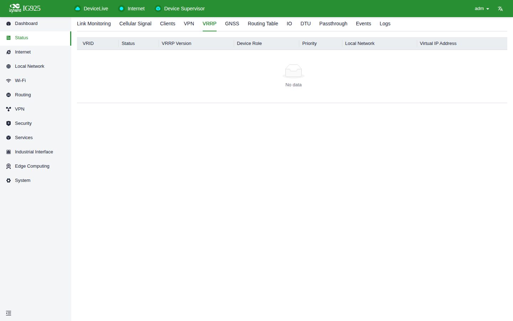

<strong>Figure 4-8 VRRP Status</strong>

#### 4.2.6 GNSS

Shows the GNSS positioning status, longitude and latitude, altitude, speed, number of satellites and positioning time. GNSS must be enabled in 【Services】→【GNSS】 and a GNSS antenna must be installed.

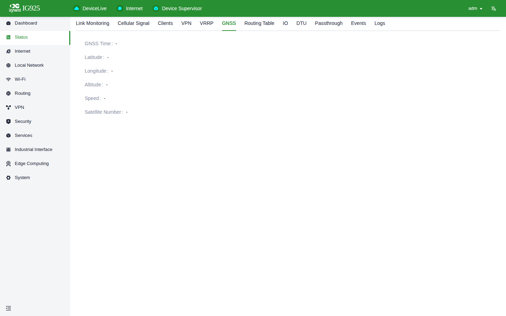

<strong>Figure 4-9 GNSS Status</strong>

#### 4.2.7 Routing Table

Shows the routes currently in effect, including type, destination, netmask, gateway, interface, distance/metric and time.

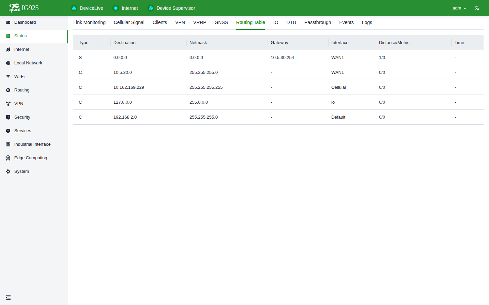

<strong>Figure 4-10 Routing Table</strong>

#### 4.2.8 IO

Shows the current status of the 4 digital inputs/outputs and the relay.

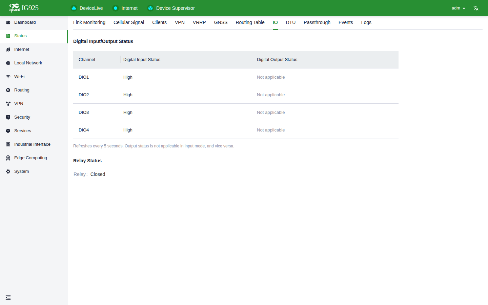

<strong>Figure 4-11 IO Status</strong>

#### 4.2.9 DTU

"DTU Connections" shows the DTU mode, protocol, peer, status and uptime of each serial port; "DTU Traffic" records the direction, length and HEX content of the data exchanged between the serial port and the peer, which can be used to check whether transparently transmitted data is complete.

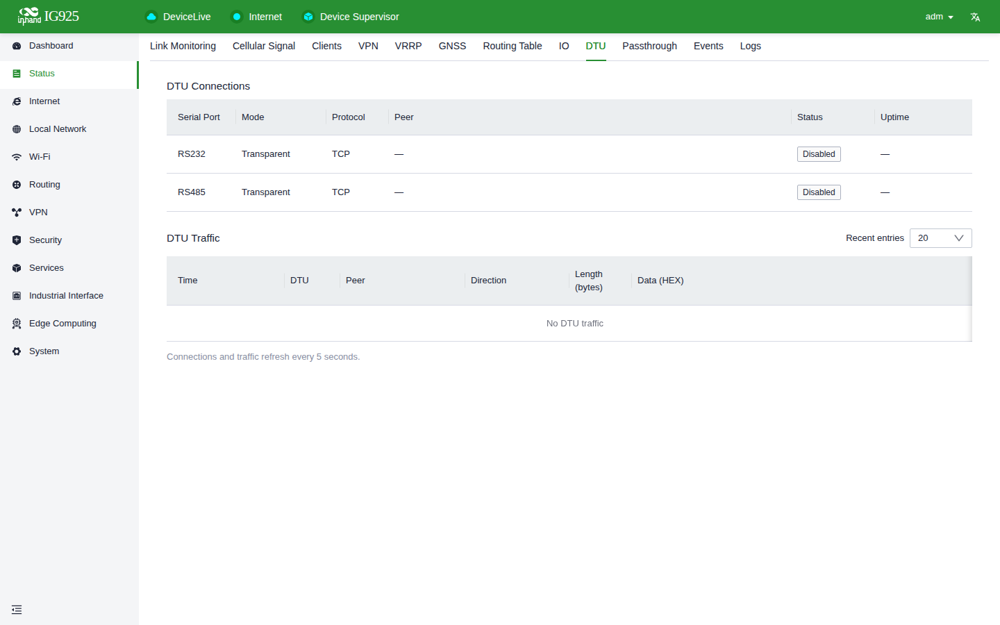

<strong>Figure 4-12 DTU Status</strong>

#### 4.2.10 Passthrough

Shows the working status of IP Passthrough, Passthrough WAN/LAN, the passthrough IP address/mask, gateway address and DNS, the MAC of the device that obtains the passthrough address, the address assignment status and the lease expiry time.

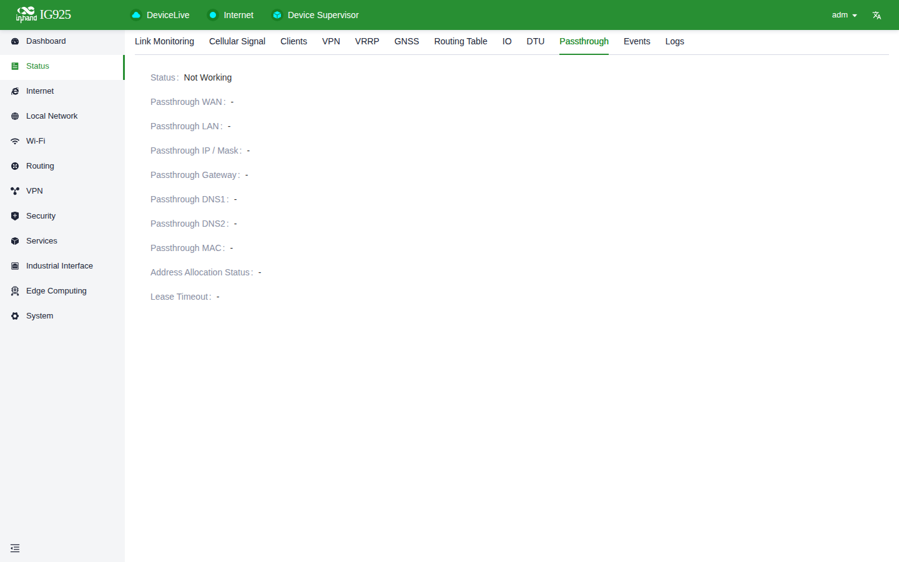

<strong>Figure 4-13 IP Passthrough Status</strong>

#### 4.2.11 Events

Records events such as device logins, configuration changes, uplink status changes and reboots. Events can be filtered by date and type, and can be cleared ("Clear Events") or exported ("Export Events").

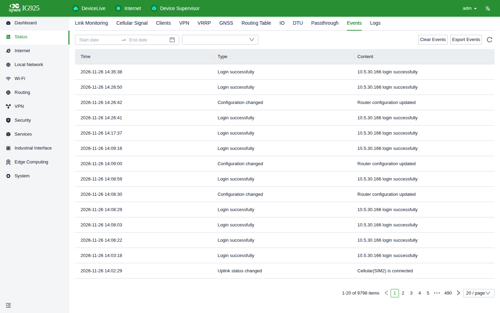

<strong>Figure 4-14 Events</strong>

#### 4.2.12 Logs

Shows the system logs of the device for fault analysis. Logs can be filtered by level and keyword, and the number of displayed lines and manual refresh can be set.

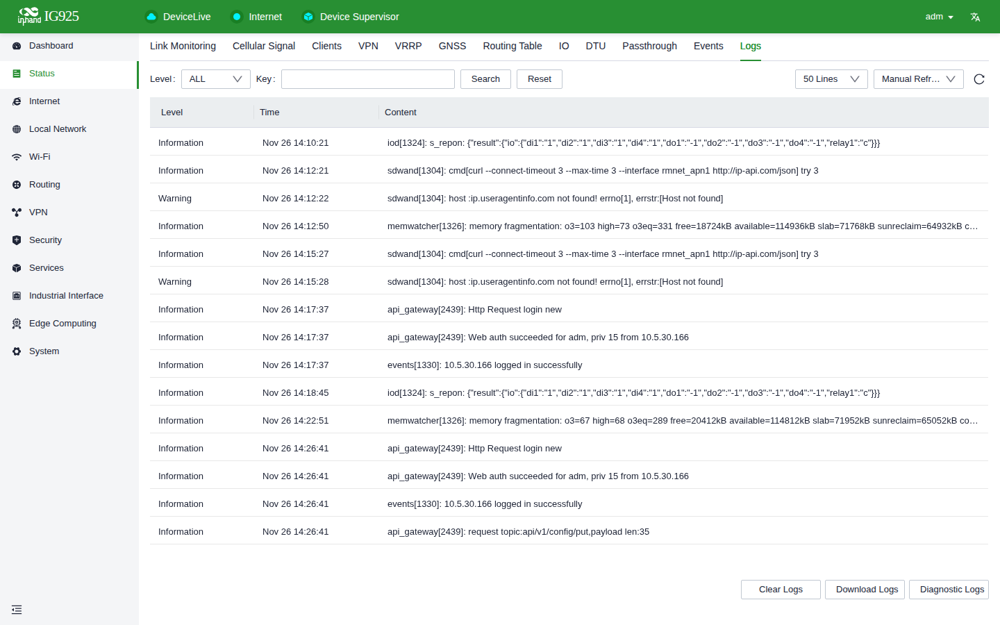

<strong>Figure 4-15 Logs</strong>

### 4.3 Internet

The 【Internet】 menu configures the parameters and working mode of the uplink interfaces. The IG925 supports wired (WAN), cellular (Cellular) and Wi-Fi (STA) uplinks, which work according to their priority in the "Uplink Table".

> **Note**: Changes in the Internet menu may interrupt the Internet connection of the device. Operate with caution.

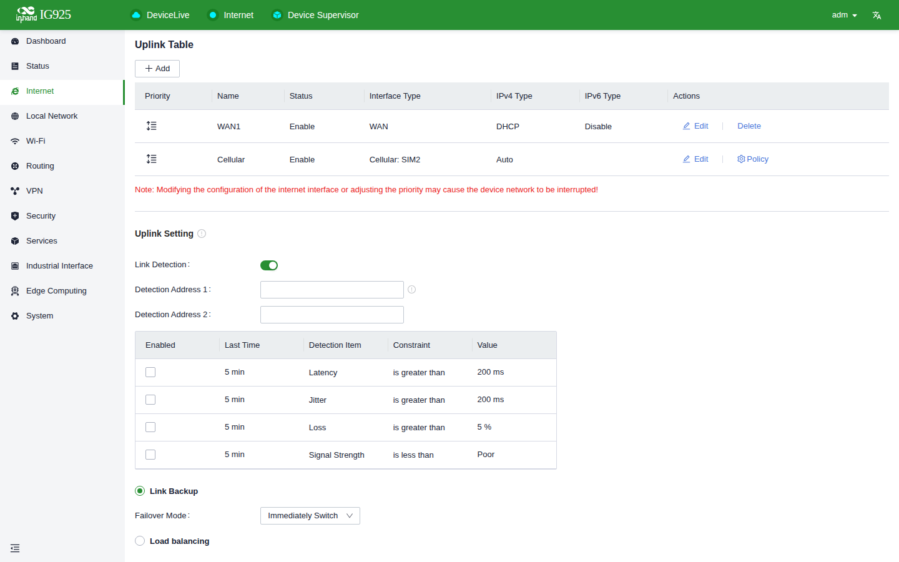

<strong>Figure 4-16 Uplink Table and Uplink Setting</strong>

#### 4.3.1 Wired Connection

WAN1 is enabled by default and obtains its address through DHCP. Click "Edit" in the "WAN1" row to change the connection type.

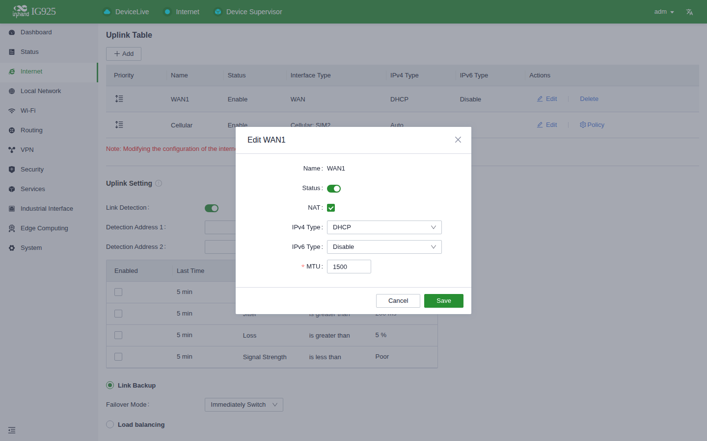

<strong>Figure 4-17 Edit WAN1</strong>

- Name: The name of the uplink interface.
- Status: Enables or disables the uplink interface.
- NAT: Translates the addresses of internal devices accessing external networks through this interface; usually keep it enabled.
- IPv4 Type: DHCP, static IP or PPPoE.
  - DHCP: Obtains the address automatically from the upstream device (such as an optical modem or upper-level router).
  - Static IP: Manually enter the IPv4 address, mask, IPv4 gateway address and main/secondary DNS provided by the network administrator or carrier.
  - PPPoE: Enter the user name and password provided by the carrier; the device accesses the network through PPPoE dial-up.
- IPv6 Type: The IPv6 address acquisition mode of the interface.
- MTU: The maximum transmission unit of the interface; usually keep the default.

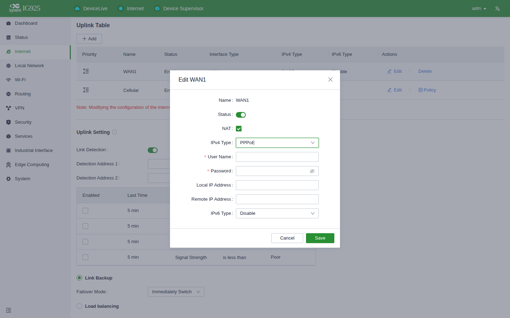

<strong>Figure 4-18 Configure PPPoE Dial-up</strong>

Click "Add" in the uplink table to add a second wired uplink (WAN2).

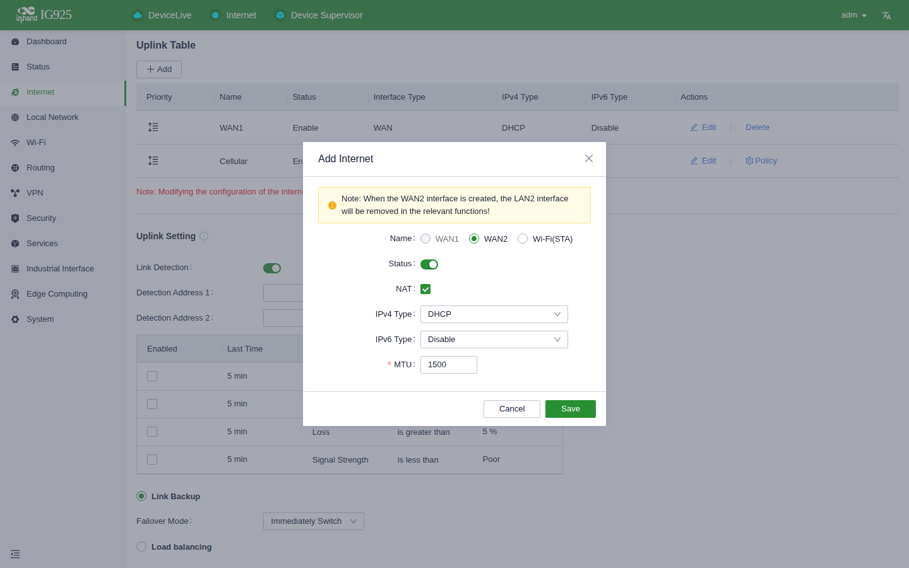

<strong>Figure 4-19 Add an Uplink</strong>

- After WAN2 is added, the role of the original LAN2 interface changes to WAN2; after a WAN interface is deleted, the interface role returns to LAN.
- After a WAN interface is deleted, the static routes, inbound/outbound rules, port forwarding and policy-based routing related to the interface are deleted.

#### 4.3.2 Wireless Connection

The IG925 can connect to an on-site AP as a client. Click "Add" in the uplink table, select "Wi-Fi(STA)" and configure the following parameters (see [Scenario 3](#scenario-3-wi-fi-sta-networking) for an example):

- Band: 2.4GHz or 5GHz.
- SSID: The name of the AP to connect to; click the scan button to select it from the nearby AP list.
- Security/Encryption: Must match the authentication and encryption policies of the AP.
- Password: The connection password of the AP.
- IPv4 Type: Usually DHCP.

> **Note**: After Wi-Fi (STA) is added, the local Wi-Fi access points on the same band are disabled and their status cannot be changed until the Wi-Fi (STA) is deleted. After Wi-Fi (STA) is deleted, the static routes, firewall rules and policy-based routing related to it are deleted.

#### 4.3.3 Cellular Connection

Normally, after the SIM card and cellular antennas are installed, the device dials up automatically after power-on. Click "Edit" in the "Cellular" row to change the cellular parameters.

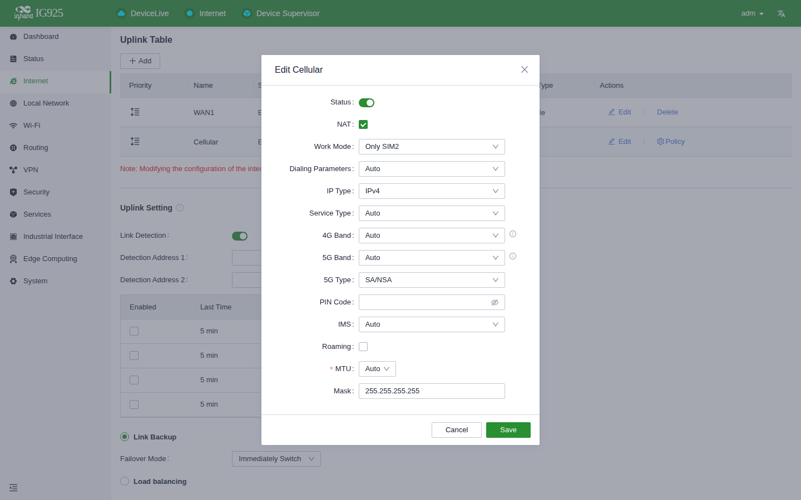

<strong>Figure 4-20 Edit Cellular</strong>

- Status: Enables or disables cellular dial-up.
- NAT: Translates the addresses of internal devices accessing external networks through the cellular interface; usually keep it enabled.
- Work Mode: How the SIM cards are used: Only SIM1, Only SIM2, Only eSIM (models supporting eSIM) or Dual Mode.
- Dialing Parameters: Automatic by default; to specify an APN, select manual and enter the APN, authentication, user name and password (see [Scenario 1](#scenario-1-cellular-networking)).
- IP Type: The IP protocol type used for dial-up.
- Service Type: The network type; usually keep it automatic.
- 4G Band / 5G Band / 5G Type: Specify the cellular bands and 5G networking mode; usually keep the defaults.
- PIN Code: Enter it if PIN protection is enabled on the SIM card.
- IMS, Roaming: Set as required by the carrier.
- MTU, Mask: Usually keep the defaults; some private networks require the subnet mask of the cellular interface to be configured as specified by the carrier.

Click "Policy" in the "Cellular" row to set a monthly traffic policy for each SIM card. When the policy is enabled and the traffic of a SIM card reaches the threshold, the corresponding action is performed; the statistics are reset on the monthly reset day.

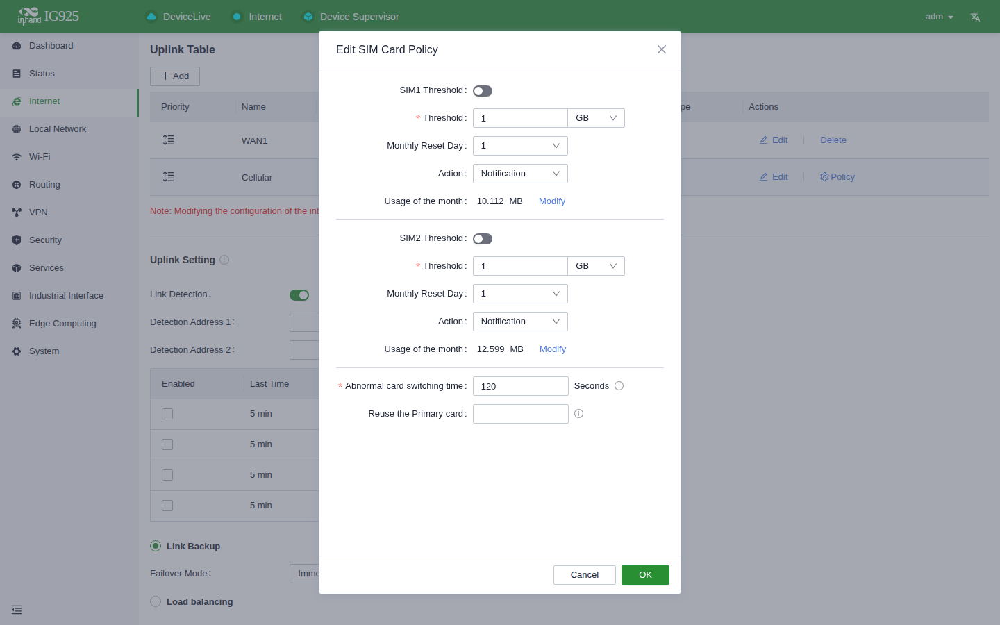

<strong>Figure 4-21 SIM Card Policy</strong>

- Threshold, Monthly Reset Day: The monthly traffic threshold and the statistics reset day.
- Action: The action performed when the traffic reaches the threshold.
  - Notification: Generates a threshold event without stopping service traffic.
  - Cloud management only: Generates an event and forwards only cloud management traffic, no longer forwarding service traffic to the Internet.
  - Switch SIM: Generates an event and switches to the other SIM card for dial-up.
- Usage of the month: The traffic used this month, for operation and maintenance reference only; the carrier's records prevail for billing.
- Abnormal card switching time, Reuse the Primary card: The switching and fallback conditions in dual-SIM scenarios.

> **Note**: Disconnect the power before inserting or removing the SIM card to avoid data loss or device damage. In some private network environments, disable "Link Detection" or change the detection address to avoid repeated cellular redialing caused by failed detection.

#### 4.3.4 Uplink Table

The uplink table lists the priority, name, status, interface type and IPv4/IPv6 type of all uplink interfaces. Drag the icon in the "Priority" column to adjust the link priority; links at the top have higher priority. The Cellular interface can be edited here, and WAN and Wi-Fi (STA) interfaces can be added, edited and deleted.

#### 4.3.5 Uplink Setting

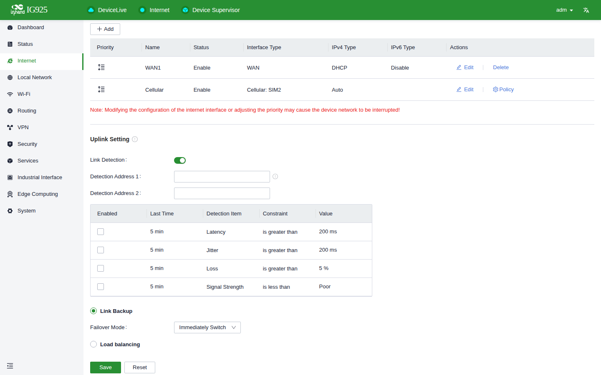

<strong>Figure 4-22 Uplink Setting</strong>

- Link Detection: Enabled by default; the device uses detection to determine whether an uplink is available. After it is disabled, latency, loss and other information cannot be viewed in 【Status】→【Link Monitoring】.
- Detection Address 1/2: The detection target addresses. If empty, the device detects the DNS addresses of the uplink interfaces and backup detection addresses and selects an available one; if filled in, all uplinks only detect the specified addresses, and an unreachable address affects the Internet access of the device.
- Link Backup: Uplinks are used by priority; when the primary link is unavailable, the next available link is used.
  - Failover Mode: Immediately Switch, Delayed Switch or Do not switch.
  - Detection items: Constraints and durations can be set for latency, jitter, loss and signal strength to trigger switching between links and SIM cards (link detection must be enabled and the failover mode must not be "Do not switch").
- Load Balancing: All uplinks that work normally forward service traffic at the same time.

### 4.4 Local Network

【Local Network】 customizes local subnets, including the address range, VLAN and DHCP service. A new local network can be used only after it is bound to a LAN port in 【Services】→【Interface Management】 or to an SSID in 【Wi-Fi】.

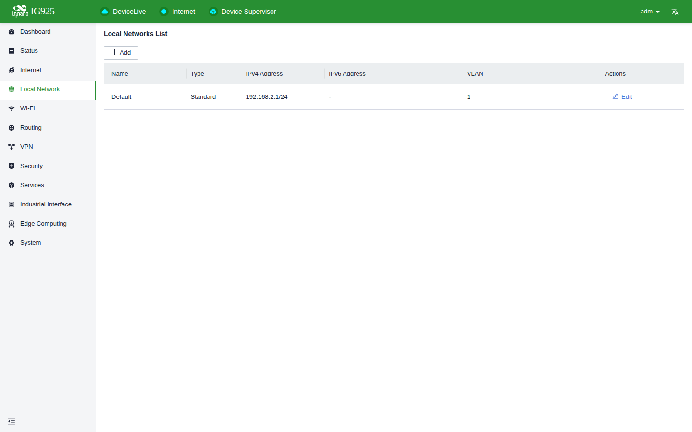

<strong>Figure 4-23 Local Network</strong>

Click "Add" or "Edit" to add a local network or modify an existing one.

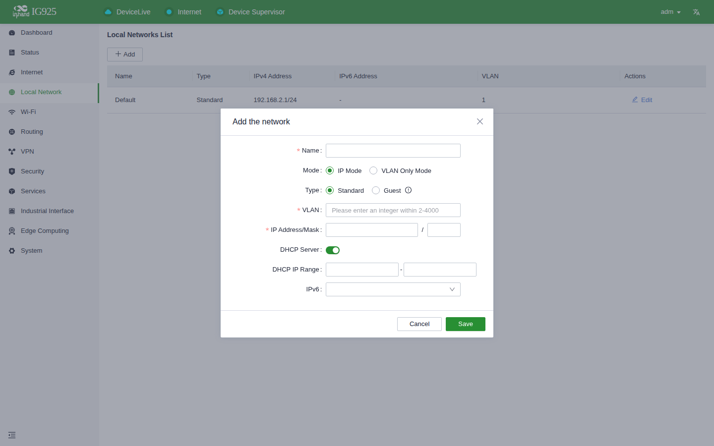

<strong>Figure 4-24 Add a Local Network</strong>

- Name: Identifies the network, which can be selected in "Wi-Fi" and "Interface Management".
- Mode: IP mode (layer 3, the device provides the gateway address) or VLAN Only mode (layer 2 transparent transmission without IP address and DHCP).
- Type: Standard or Guest; clients connected to a guest network can only access the Internet.
- VLAN: Divides the LAN into different virtual networks. By default, all interfaces and Wi-Fi use the Default (VLAN1) network.
- IP Address/Mask: The gateway address of the network; 192.168.2.1/24 for the default network.
- DHCP Server, DHCP IP Range: Automatically assign addresses to clients connected to the network.
- IPv6: The IPv6 parameters of the network.

> **Note**: The default local network cannot be deleted; only its IP address/mask and DHCP settings can be modified. The mode of an added local network cannot be modified. After the address of the current management network is changed, log in again with the new address.

### 4.5 Wi-Fi

The IG925 can act as an AP providing multi-SSID wireless access (WLAN models). By default, the device has two primary SSIDs on 2.4G and 5G; their bands cannot be changed and they cannot be deleted.

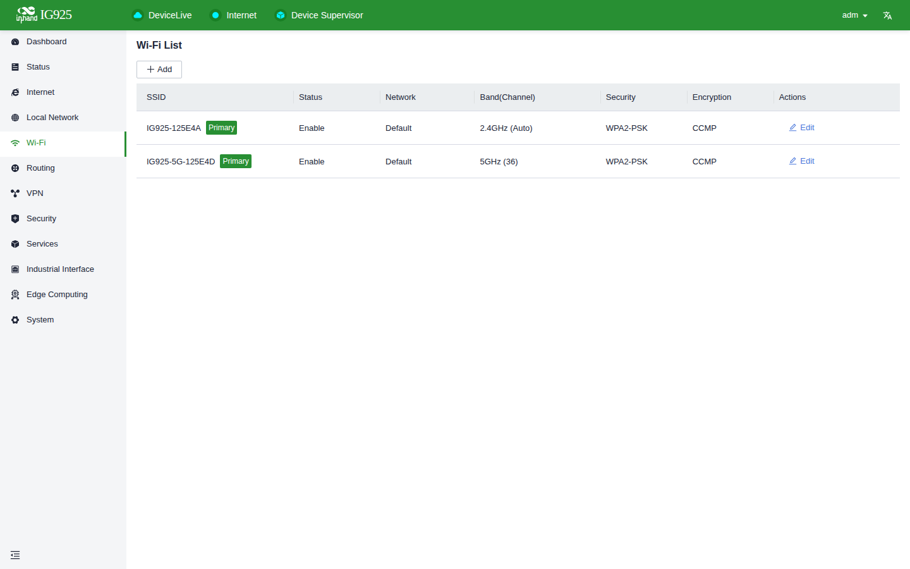

<strong>Figure 4-25 Wi-Fi List</strong>

Click "Add" or "Edit" to add an SSID or modify an existing one.

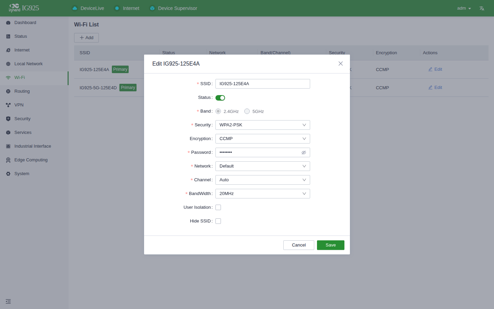

<strong>Figure 4-26 Edit an SSID</strong>

- SSID, Status: The wireless network name and its enable switch.
- Band: 2.4G or 5G; the band of an added SSID cannot be changed.
- Security, Encryption, Password: Wireless authentication and encryption; WPA2-PSK or a higher security level is recommended.
- Network: The local network the SSID belongs to.
- Channel, BandWidth: The wireless channel and channel bandwidth; additional SSIDs automatically use the channel of their primary SSID.
- User Isolation: When enabled, terminals on the same SSID cannot access each other.
- Hide SSID: When enabled, the SSID is not shown when terminals scan.

> **Note**: After a Wi-Fi (STA) interface is created in 【Internet】, SSIDs on the same band cannot be enabled.

### 4.6 Routing

#### 4.6.1 Static Routes

【Routing】→【Static Routes】 configures static route entries manually, so that data is forwarded through the specified next hop or interface. Routes generated automatically by functions such as VPN are not shown in this list; view them in 【Status】→【Routing Table】.

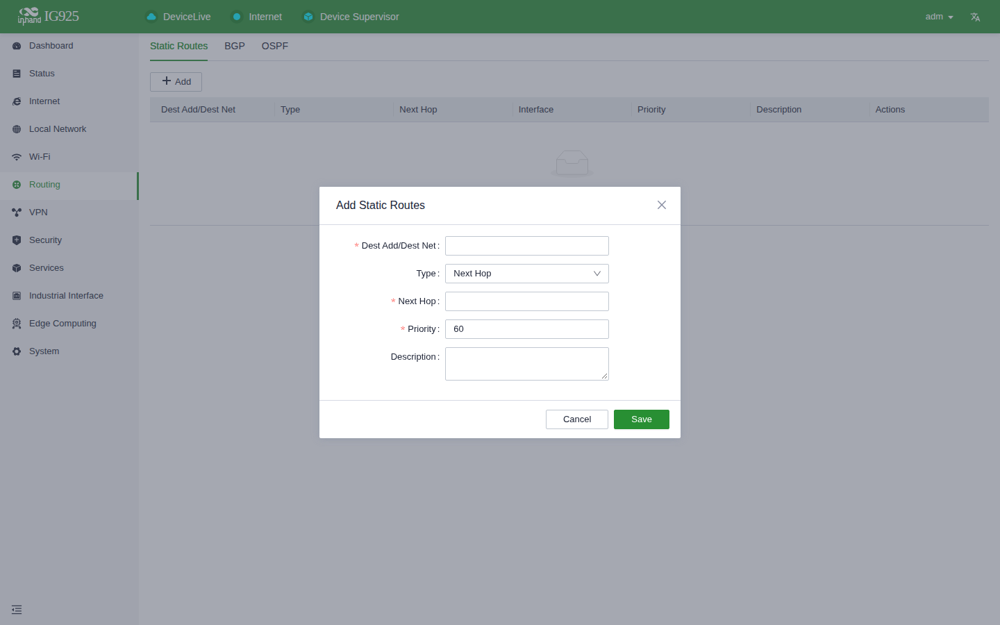

<strong>Figure 4-27 Add a Static Route</strong>

- Dest Add/Dest Net: The destination subnet or host address.
- Type, Next Hop: Forward through a next-hop address or an outgoing interface.
- Priority: The priority when multiple routes exist for the same destination.
- Description: A remark for the route.

> **Note**: Static routes to the same destination cannot have the same next hop, interface or priority. After an interface such as WAN, Wi-Fi (STA) or an L2TP client is deleted, the static routes using it are deleted.

#### 4.6.2 BGP

BGP (Border Gateway Protocol) exchanges routing information between autonomous systems.

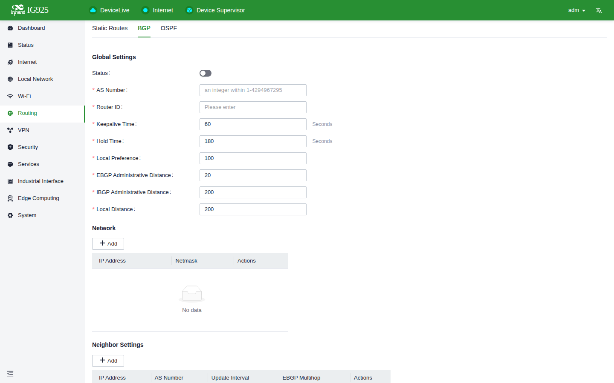

<strong>Figure 4-28 BGP</strong>

- Status, AS Number, Router ID: Enable BGP and set the local autonomous system number and router identifier.
- Keepalive Time, Hold Time: The keepalive and timeout parameters between BGP neighbors.
- Local Preference, EBGP/IBGP Administrative Distance, Local Distance: Route selection parameters.
- Networks: The local subnets advertised through BGP (IP address/netmask).
- Neighbors: The IP address, AS number, update interval and EBGP multihop of BGP neighbors.
- Redistribution: Imports other types of routes into BGP with the redistribution type and metric.

#### 4.6.3 OSPF

OSPF (Open Shortest Path First) is a link-state interior gateway protocol for dynamic routing in enterprise networks.

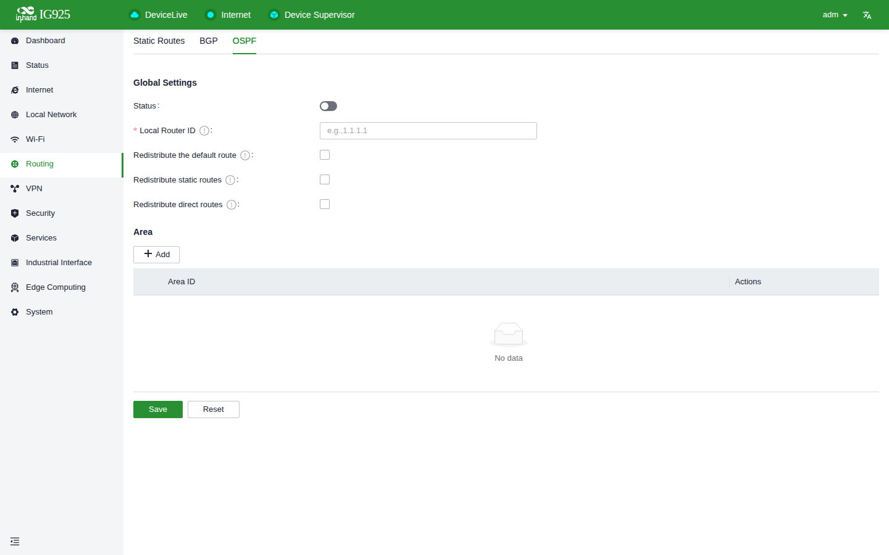

<strong>Figure 4-29 OSPF</strong>

- Status, Local Router ID: Enable OSPF and set the router identifier.
- Redistribute the default route / static routes / direct routes: Import the corresponding routes into OSPF.
- Area: Add OSPF areas (up to 3) with the area ID and the subnets in each area (up to 10 per area).
- Interface settings: Set the Hello interval, Dead interval and authentication of the interfaces participating in OSPF. When an uplink interface (WAN) is selected, the device permits incoming OSPF packets on that interface; if the interface connects to an untrusted network, enabling MD5 authentication is recommended.

### 4.7 VPN

A virtual private network (VPN) establishes an encrypted private communication channel over a public network. The IG925 supports IPsec, L2TP, GRE, OpenVPN and WireGuard; the tunnel status can be viewed in 【Status】→【VPN】.

#### 4.7.1 IPsec VPN

Click "Add" under "VPN" → "IPsec VPN" to add an IPsec VPN. The tunnel is established after both ends are configured consistently.

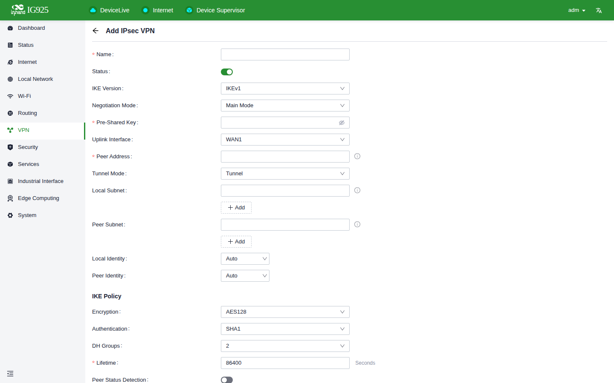

<strong>Figure 4-30 Add an IPsec VPN</strong>

- Name, Status: The tunnel name and its enable switch.
- IKE Version, Negotiation Mode: IKEv1 and IKEv2 are supported; IKEv1 supports main mode and aggressive mode.
- Pre-Shared Key: Both ends must use the same authentication key.
- Uplink Interface: The uplink interface used to establish the tunnel.
- Peer Address: The address of the peer device. Usually the end with a public address acts as the server: set the peer address to 0.0.0.0 on the server side, and enter the public address or domain name of the server on the client side.
- Tunnel Mode: Tunnel mode or transport mode.
- Local Subnet, Peer Subnet: The local and peer subnets communicating through the tunnel.
- Local Identity, Peer Identity: The identities of both ends, which must correspond to the peer configuration.

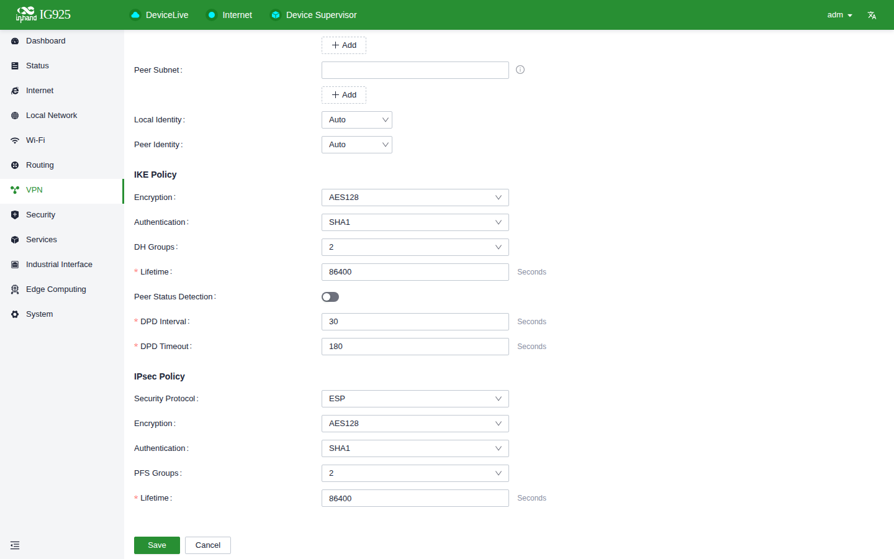

<strong>Figure 4-31 IKE Policy and IPsec Policy</strong>

- IKE policy: Encryption, authentication, DH groups and lifetime, which must match the peer.
- Peer Status Detection (DPD): When enabled, the device checks whether the peer is online according to the DPD interval and timeout, and renegotiates when the peer is lost.
- IPsec policy: Security protocol, encryption, authentication, PFS groups and lifetime, which must match the peer.

#### 4.7.2 L2TP VPN

L2TP (Layer 2 Tunneling Protocol) is commonly used for remote access and branch interconnection.

**Client**: The IG925 acts as an L2TP client and establishes a tunnel with a remote L2TP server. Click "Add" under "L2TP VPN" → "Client" to add a client.

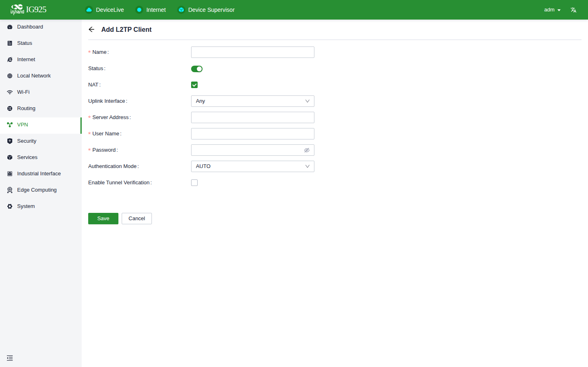

<strong>Figure 4-32 Add an L2TP Client</strong>

- Name, Status: The client name and its enable switch.
- NAT: The address translation switch for forwarding by the client.
- Uplink Interface: The uplink interface used to communicate with the server.
- Server Address: The address of the remote L2TP server.
- User Name/Password, Authentication Mode: Must match the server configuration.
- Enable Tunnel Verification: When enabled, both ends must use the same tunnel verification user name/password.

**Server**: The IG925 acts as an L2TP server providing access for remote clients.

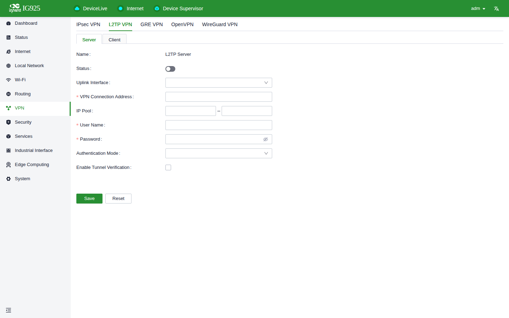

<strong>Figure 4-33 L2TP Server</strong>

- Status: The L2TP server switch, disabled by default.
- Uplink Interface: The uplink interface used by the server.
- VPN Connection Address: The address of the server in the tunnel, used as the gateway of the clients.
- IP Pool: The address range assigned to connected clients.
- User Name/Password, Authentication Mode, Enable Tunnel Verification: Must match the client configuration.

#### 4.7.3 GRE VPN

GRE (Generic Routing Encapsulation) establishes a point-to-point tunnel between two networks and is usually combined with IPsec for encryption.

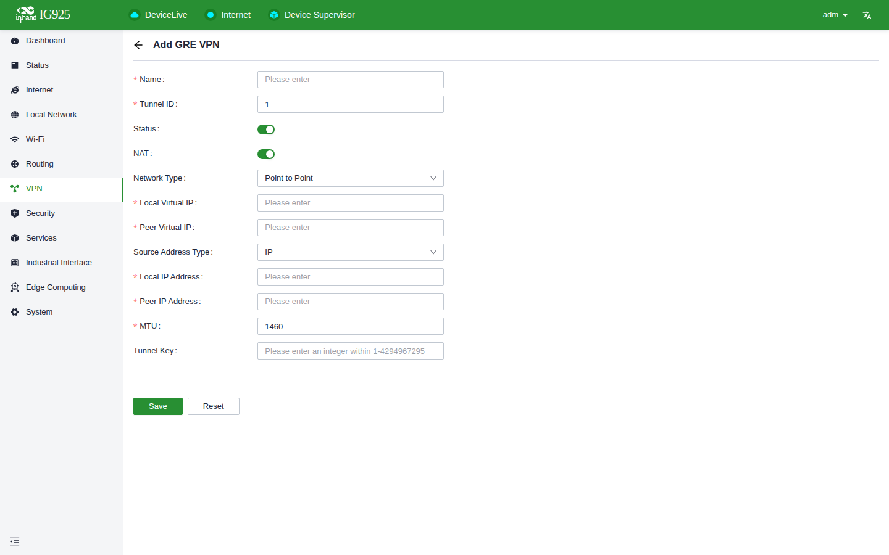

<strong>Figure 4-34 Add a GRE VPN</strong>

- Name, Tunnel ID, Status: The tunnel identification and its enable switch.
- NAT: The address translation switch for tunnel forwarding.
- Network Type: The network type of the tunnel.
- Local Virtual IP, Peer Virtual IP: The virtual addresses of both ends of the tunnel.
- Source Address Type, Local IP Address: The source address or interface used locally to establish the tunnel.
- Peer IP Address: The address of the peer device.
- MTU: The maximum transmission unit of the tunnel.
- Tunnel Key: The tunnel key, which must be the same at both ends.

#### 4.7.4 OpenVPN

**Server**: The IG925 acts as an OpenVPN server providing access for remote clients.

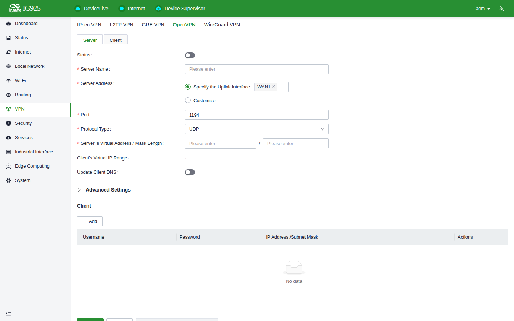

<strong>Figure 4-35 OpenVPN Server</strong>

- Status, Server Name: The server switch and name.
- Server Address, Port, Protocol Type: The address, port and transport protocol (UDP/TCP) used by clients to connect to the server.
- Server's Virtual Address/Mask Length, Client's Virtual IP Range: The address of the server in the tunnel and the address range assigned to clients.
- Update Client DNS: When enabled, DNS is pushed to clients.
- Users: The user name, password and IP address/subnet mask of each client.
- Advanced Settings: "Shared Login Credentials", "Redirect the Client's Gateway", interface type, local subnet, etc.
- Click "Download Client Configuration File" to obtain the configuration for clients to import; to replace the certificates, use "Reset Certificates", after which clients must import the configuration file again.

**Client**: The IG925 acts as an OpenVPN client connecting to a remote server. When adding a client, enter the name and interface type and upload the OpenVPN configuration file.

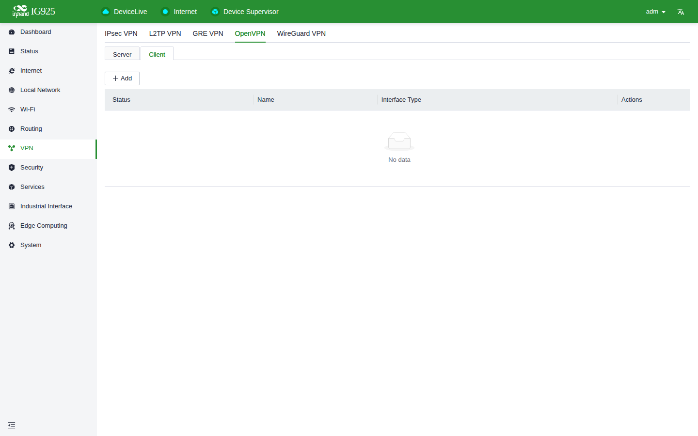

<strong>Figure 4-36 OpenVPN Client</strong>

#### 4.7.5 WireGuard VPN

WireGuard is a VPN protocol with simple configuration and high performance; both ends authenticate with public/private keys.

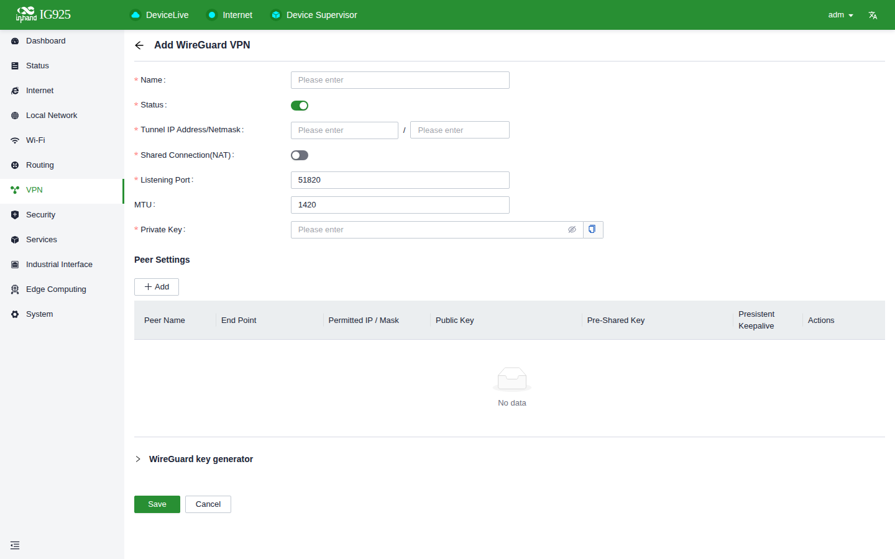

<strong>Figure 4-37 Add a WireGuard VPN</strong>

- Name, Status: The tunnel name and its enable switch.
- Tunnel IP Address/Netmask: The local address in the tunnel.
- Shared Connection (NAT): When enabled, address translation is applied to tunnel traffic.
- Listening Port, MTU: The local listening port and tunnel MTU.
- Private Key: The local private key; use the "WireGuard key generator" to generate a key pair and provide the public key to the peer.
- Peers: The peer name, end point (address and port), permitted IP/mask, public key, pre-shared key and persistent keepalive.

### 4.8 Security

#### 4.8.1 Firewall

The firewall includes inbound rules, outbound rules, port forwarding, NAT, MAC address filtering, domain name filtering and DMZ.

**Inbound Rules/Outbound Rules**

Control the traffic forwarded by the device through uplink interfaces. Inbound rules control traffic from external networks to the internal network through uplink interfaces and deny all by default; outbound rules control traffic from the internal network to external networks and permit all by default. Drag the icon in the "Priority" column to adjust the rule order. Access to the management services of the device itself (HTTPS, SSH, Ping) is controlled by 【System】→【Remote Access Control】 and is not affected by inbound rules.

<strong>Figure 4-38 Add an Inbound Rule</strong>

- Name, Status: The rule name and its enable switch.
- Interface: For inbound rules, the uplink interface where traffic enters; for outbound rules, the uplink interface where traffic leaves.
- Protocol: Any, TCP, UDP, ICMP or custom.
- Source, Destination: The source and destination addresses to match, Any by default.
- Behavior: Permit or deny.

**Port Forwarding**

Maps a port of an uplink interface to an internal device so that external networks can access internal services. For example, after port 1024 of the internal device 192.168.2.10 is mapped to port 1024 of WAN1, the service can be accessed externally through "WAN1 address:1024".

<strong>Figure 4-39 Add Port Forwarding</strong>

- Interface: The uplink interface providing the mapping, which needs an externally reachable address.
- Protocol: TCP, UDP or TCP&UDP.
- Public Port, Local Port: The external access port and the port of the internal device; the two ranges must be consistent.
- Local Address: The address of the internal target device.

**NAT**

Performs source address translation (SNAT) or destination address translation (DNAT) on packets passing through the device.

<strong>Figure 4-40 Add a NAT Rule</strong>

- Type: SNAT (translates the source address) or DNAT (translates the destination address).
- Protocol: Any, TCP, UDP or TCP&UDP.
- Source, Destination: The source and destination addresses of the packets to match.
- Converted Address: The address after translation.

**MAC Address Filtering**

Controls whether LAN devices can access the Internet by MAC address: only devices in the list can access the network (allowlist), or devices in the list are prohibited from accessing the network (blocklist).

<strong>Figure 4-41 MAC Address Filtering</strong>

**Domain Name Filtering**

Allows or prohibits clients from accessing the domain names in the list (allowlist/blocklist).

<strong>Figure 4-42 Domain Name Filtering</strong>

**DMZ**

Forwards all access from external networks to a specified internal host.

<strong>Figure 4-43 DMZ</strong>

- Enable DMZ: The DMZ switch.
- DMZ Host Address: The internal host that receives the forwarded traffic.
- Source Address Range: The external address range allowed to access the DMZ host.
- Interface: The uplink interface on which DMZ is enabled.

> **Note**: After DMZ is enabled, the device management services enabled in 【System】→【Remote Access Control】 (HTTPS, SSH, Ping) are still answered by the device itself and are not forwarded to the DMZ host.

#### 4.8.2 Policy-Based Routing

Assigns different data flows to different outputs according to the source address, destination address and protocol.

<strong>Figure 4-44 Add Policy-Based Routing</strong>

- Name, Status: The rule name and its enable switch.
- Protocol, Source, Destination: The traffic to match; the source and destination cannot both be Any.
- Output: The uplink interface used by the matched traffic.
- Forced forwarding: When enabled, the traffic does not switch to other links even if the specified output is unavailable.

### 4.9 Services

The 【Services】 menu includes Interface Management, DHCP Server, DNS Server, Fixed Address List, Dynamic DNS, GNSS, AT Service, SMS Control, Passthrough Settings, SNMP Configuration and VRRP.

#### 4.9.1 Interface Management

Sets the status, local network and link rate of the LAN ports. A new local network must be bound to a LAN port here.

<strong>Figure 4-45 Edit a LAN Port</strong>

#### 4.9.2 DHCP Server

DHCP servers are generated automatically from the local networks. The status, DHCP IP range, lease and DNS of each network can be modified.

<strong>Figure 4-46 DHCP Server</strong>

> **Note**: After a local network is deleted, its DHCP server is also deleted; networks in VLAN Only mode do not provide DHCP.

#### 4.9.3 DNS Server

Sets the DNS server addresses used by the device. If not set, the DNS addresses obtained by the uplink interfaces are used; if set, they take effect globally without affecting the original link detection and switching logic of the uplink interfaces.

<strong>Figure 4-47 DNS Server</strong>

#### 4.9.4 Fixed Address List

Assigns a fixed IP address according to the MAC address of a connected device, so that the device obtains the same address every time it connects. The assigned address must be within the address range of a local network in IP mode.

<strong>Figure 4-48 Fixed Address List</strong>

#### 4.9.5 Dynamic DNS

Dynamic DNS automatically updates the domain name resolution when the address of the uplink interface changes, so the device can be accessed externally through a fixed domain name.

<strong>Figure 4-49 Dynamic DNS</strong>

- Service Provider: The dynamic DNS provider, or custom with a URL address.
- Hostname, User Name, Password: The information registered with the provider.
- Update Time, Uplink Interface: The update period and the uplink interface used.

#### 4.9.6 GNSS

After GNSS is enabled, the device location can be obtained, and "Update Device Time" can be enabled to synchronize the time with satellite time. GNSS IP forwarding sends positioning data to a specified server through TCP/UDP; GNSS serial forwarding outputs positioning data to a serial device through RS232/RS485.

<strong>Figure 4-50 GNSS</strong>

#### 4.9.7 AT Service

The AT service interacts with the built-in cellular module through AT commands; the serial port used and its parameters can be configured.

<strong>Figure 4-51 AT Service</strong>

> **Note**: Do not send control commands such as changing the network type or disconnecting unless you understand their effect. Use the 【Internet】 menu for daily network configuration.

#### 4.9.8 SMS Control

Allows specified phone numbers to control the device by sending SMS messages with agreed content. The SMS text, action (currently reboot), authorization method, allowed numbers (from all numbers or from up to 10 specified numbers) and reply settings can be set, and up to 100 rules can be added. IMS must be enabled in the cellular configuration to use the SMS function.

<strong>Figure 4-52 SMS Control</strong>

#### 4.9.9 Passthrough Settings

IP Passthrough assigns the address obtained by an uplink interface directly to a specified downstream device, so that the device communicates with the uplink address.

<strong>Figure 4-53 Passthrough Settings</strong>

- IP Passthrough: The function switch.
- Passthrough WAN: The uplink interface providing the address.
- Passthrough LAN: The local network connecting the downstream device.
- Passthrough MAC: The MAC address of the device receiving the passthrough address; if empty, the address is assigned to the first device that requests it.
- Passthrough IP Mask, DHCP Server, Lease: The address parameters assigned to the downstream device.

> **Note**:
> - After IP Passthrough is enabled, only one client can access the Internet, and static routes, VPN, policy-based routing, fixed address assignment and cloud connection do not work.
> - After the uplink address is passed through to the client, inbound rules must permit external access to the client.
> - Passthrough changes the address assignment of the device; make sure the device can be managed in another way before the operation.

#### 4.9.10 SNMP Configuration

SNMP V1&V2c and SNMP V3 are supported for network management systems to query the device status, and the MIB file can be exported with "Export MIB File".

<strong>Figure 4-54 SNMP Configuration</strong>

#### 4.9.11 VRRP

VRRP (Virtual Router Redundancy Protocol) groups multiple devices into a backup group that provides one virtual gateway address. When the master device fails, a backup device takes over.

<strong>Figure 4-55 New VRRP Backup Group</strong>

- VRRP Status, VRID, VRRP Version: The backup group switch, ID and protocol version; devices in the same group must use the same VRID.
- Local Network, Virtual IP Address: The local network of the backup group and the virtual gateway address.
- Priority: The device with the higher priority becomes the master.
- Preempt Mode, Preempt Delay: Whether a device with a higher priority becomes the master again after it recovers, and the waiting time.
- Advertise Interval: The interval at which the master sends advertisements.
- Track Interface: Lowers the priority of this device when the tracked interface fails.

### 4.10 Industrial Interface

#### 4.10.1 Industrial Serial Ports

The IG925 provides one RS232 port and one RS485 port with the same configuration items. Use proper cables to connect the serial port of the device to the target device: cross the TX and RX lines of RS232 and connect the ground; connect the A and B differential signals of RS485 according to the documentation of both ends.

<strong>Figure 4-56 Industrial Serial Port</strong>

**Serial parameters**: The baud rate, data bits (7 or 8), stop bits, parity and software flow control must match the serial device.

**DTU configuration**: Transparently transmits serial data to a TCP/UDP server (see [Scenario 4](#scenario-4-serial-data-transparent-transmission) for an example).

- State: The DTU switch.
- DTU Protocol: Transparent or Modbus-Net-Bridge.
  - Transparent: Forwards raw data between the serial port and the servers; the following parameters apply to this mode.
  - Modbus-Net-Bridge: The device listens as a TCP server on a local port (502 by default for RS232 and 503 for RS485), converts received Modbus TCP requests to Modbus RTU for the serial device and returns the responses to the client; the frame interval and frame response timeout can be set.
- Protocol, Connection Type: TCP or UDP; long or short connection can be selected for TCP.
- Server Address, Port: The data receivers; multiple servers can be added.
- Multi-server Policy: The sending policy among multiple servers.
- Keepalive Interval, Keepalive Retry: Link keepalive parameters.
- Serial Buffer Frame, Packet Size, Frame Interval: The buffering and framing rules of serial data.
- Reconnect Interval: The interval for reconnecting after the connection is lost.
- Source Interface, Local IP Address: The interface and address used to connect to the server.
- DTU ID: The identifier sent to the server after the connection is established; fill it in as required by the server, or leave it empty.
- Debug: When enabled, detailed transmit/receive logs are recorded for troubleshooting.

> **Note**: One serial port cannot be used by DTU, GNSS serial forwarding and AT service at the same time.

#### 4.10.2 IO

The IG925 provides 4 digital I/O channels (DIO1–DIO4) and 1 relay.

<strong>Figure 4-57 IO Setting</strong>

- Operating Mode: Each DIO channel can be set to input or output independently; Quick Settings can set all channels to input or output.
- Output level: The high or low level in output mode; bulk level changes affect output channels only.
- Contact State: The relay contact is closed or open.

Click "Save" to apply the settings, or "Reset" to reload the current device configuration. The wiring must meet the electrical parameters of the interfaces; the relay contact rating is 2 A @ 30 V DC.

### 4.11 Edge Computing

#### 4.11.1 Python Edge Computing

The "Python Edge Computing" page provides the Python secondary development runtime and manages the Python Apps on the device (see [Scenario 5](#scenario-5-python-edge-computing) for an example).

<strong>Figure 4-58 Python Edge Computing</strong>

**Engine**

- Enable engine, Engine: The Python edge computing engine switch and running state.
- SDK Version, SDK maintenance: The current Python SDK version; click "Upgrade SDK" to install or upgrade the SDK.
- Python Version: The Python interpreter version provided by the SDK (Python 3.14.6 for SDK V1.0.1).
- User Storage: The used and total space of the user partition.

<strong>Figure 4-59 Confirm Installing or Upgrading the SDK</strong>

**Python App Log Account**: The username and password used to view App logs online, which are different from the device Web login account.

**App Status**: Shows the version, SDK version, state and uptime of each App. App logs can be downloaded, cleared or viewed, and Apps can be stopped or restarted; the buttons above the table start, stop or restart all Apps.

<strong>Figure 4-60 App Status and App List</strong>

**App List**

- Add App: Select a signed App package to install it; installing an App with the same name upgrades it, and the App keeps its original running or stopped state after the upgrade.
- Enable: When selected, the App runs automatically every time the device starts.
- Log File Size, Start Args: Click the edit button to set the size and number of App log files and the start arguments, then click "Submit".
- Export/Import configuration: Back up or restore the App configuration; restart the App after importing for it to take effect.
- Uninstall: Uninstalls the App.

<strong>Figure 4-61 Edit App Parameters</strong>

**App Signing**: Import the unsigned inner package built according to the packaging guide (<app>-V<version>.tar.gz). The device generates the signature information from <app>/setup.py in the package and exports the installable App package; signing does not install the App. "Python App Packaging and Usage Guide" describes the directory structure and packaging requirements and can be read online or downloaded.

#### 4.11.2 Docker Management

The "Docker Management" page installs the Docker SDK and manages the Docker engine and Portainer (see [Scenario 6](#scenario-6-docker-container-deployment) for an example).

<strong>Figure 4-62 Docker Management Page</strong>

- Engine information: Enable manager, state and Docker version; click "Upgrade SDK" to install or upgrade the Docker SDK.
- Registry Mirrors: Sets the image accelerator address used to pull images after saving.
- Service information: The enable switch, state and version of the Portainer manager; click "Open Portainer" to enter the container management interface.
- Access account: The username and password used to log in to Portainer, which are different from the device Web account.

> **Note**: The IG925 Docker SDK V1.0.0 includes Docker 25.0.5 and Portainer 2.19.5; container images must support the linux/arm/v7 platform.

### 4.12 System

#### 4.12.1 Cloud Management

DeviceLive is InHand's remote device operation and management platform, supporting zero-touch deployment, remote access, batch configuration and OTA upgrades. By default, the device connects to DeviceLive automatically after accessing the Internet; disable it manually if it is not used.

<strong>Figure 4-63 Cloud Management</strong>

- Enabled Cloud Service: The cloud management switch.
- Cloud Platform: The DeviceLive site, device.inhandcloud.cn for the China site or device.inhandcloud.com for the global site; the default site is determined by the factory configuration of the device.
- Connected to the Cloud Platform Interface: The uplink interface used to connect to the platform, Any by default.
- MQTT Keepalive Time: The keepalive interval between the device and the platform.
- Log Reporting: When enabled, device logs are reported to the platform.

#### 4.12.2 Remote Access Control

Sets whether the device management services can be accessed externally through uplink interfaces. Access through LAN ports is not affected, and firewall rules do not restrict remote access.

<strong>Figure 4-64 Remote Access Control</strong>

- HTTPS: When enabled, the device Web interface can be accessed remotely through "uplink interface address:port".
- SSH: When enabled, the device can be logged in to remotely with an SSH tool.
- PING: When enabled, the uplink interface address responds to external ping requests.

> **Note**: Change the initial password of the device and evaluate the network security risks before enabling remote access.

#### 4.12.3 System Clock

Select the time zone of the device and configure NTP servers to synchronize the system time. The NTP client is enabled by default and synchronizes the time after the device accesses the Internet; after the NTP server is enabled, the device can provide time synchronization for internal devices.

<strong>Figure 4-65 System Clock</strong>

#### 4.12.4 Device Options

Reboot the gateway, upgrade the gateway firmware version, upgrade the device module version, and restore the gateway to factory settings.

<strong>Figure 4-66 Device Options</strong>

> **Note**:
> - Use an upgrade package obtained from official channels and applicable to this device model, and do not power off during the upgrade. If the model of an uploaded module package does not match the module of the device, the device rejects the upgrade.
> - Restoring factory settings restores the gateway configuration to the defaults and does not delete installed Python Apps, Docker containers or their service data; the Python engine, Docker manager and Apps return to the default disabled state and must be enabled again. If the device is connected to the cloud platform, the platform may deliver the original configuration to the device again.

#### 4.12.5 Configuration Management

Export the device configuration for local backup, or import a backup configuration to restore the device. Password fields in the exported configuration file are stored encrypted. The device restarts after a configuration is imported.

<strong>Figure 4-67 Configuration Management</strong>

#### 4.12.6 Device Alarms

Select the alarm events of interest and set the email or SMS notification method; the device sends alarms automatically when the events occur.

<strong>Figure 4-68 Device Alarms</strong>

- Alarm Settings: Events such as user login success/failure, configuration changes, high CPU/memory utilization, cellular traffic reaching the threshold, detection status changes, VPN status changes, client status changes, uplink status changes and failover, reboot and upgrade.
- Receive Mail Settings: Configure the mail server address, port, username, password, TLS and receiving email addresses; use "Send a test email to" to check whether the sender mailbox is configured correctly.
- SMS Alarm: When enabled, alarm SMS messages are sent to the configured numbers (a SIM card supporting SMS is required).

<strong>Figure 4-69 Receive Mail Settings and SMS Alarm</strong>

#### 4.12.7 Tools

Provides network diagnostic tools such as Ping, Traceroute, packet capture and Iperf.

<strong>Figure 4-70 Ping, Traceroute and Packet Capture</strong>

- Ping: Checks the connectivity from the device to a target address; the interface, source address, packet size and number of packets can be specified.
- Traceroute: Checks the route path from the device to a target address.
- Packet capture: Captures packets on a specified interface with filter expressions and duration; the results can be displayed or exported.
- Iperf: Tests network bandwidth, with the device acting as the server or client.

<strong>Figure 4-71 Iperf</strong>

#### 4.12.8 Scheduled Reboot

Sets the device to reboot automatically at a fixed time every day, week or month. For a monthly reboot, if the selected day is greater than the number of days in the month, the device reboots on the last day of the month.

<strong>Figure 4-72 Scheduled Reboot</strong>

#### 4.12.9 Log Server

When enabled, the device sends logs to the specified log servers.

<strong>Figure 4-73 Log Server</strong>

#### 4.12.10 Account Management

Manages the usernames, passwords and roles used to log in to the device Web interface; users can be added and the passwords of existing users can be changed.

<strong>Figure 4-74 Account Management</strong>

<strong>Figure 4-75 Add a User</strong>

#### 4.12.11 Other Settings

<strong>Figure 4-76 Other Settings</strong>

- Web login management: Sets the idle time after which the Web login is logged out automatically.
- Automatically Restarts: When enabled, the device restarts automatically if it cannot access the network for a long time, helping restore the on-site network.
- SIP ALG: The SIP application layer gateway switch, enabled by default.
- Disable the hardware reset button: When enabled, the Reset button cannot be used to restore factory settings, preventing misoperation on site.

---

## Chapter 5 Typical Applications

### Case 1: Field Data Acquisition and Remote Operation and Maintenance

**Scenario Description**: At a factory or site, the IG925 connects to PLCs, meters and sensors through Ethernet and RS232/RS485, collects and processes data locally with a Python App or DeviceSupervisor Agent, uploads the data to the service platform through the 5G/4G cellular network, and connects to DeviceLive for remote operation and maintenance.

**Device Role**: The IG925 acts as an edge computing gateway responsible for field device access, data acquisition and protocol conversion, edge computing and secure cloud connection.

**Configuration Steps**:

1. Install and log in to the device according to [Installation and First Use](#chapter-2-installation-and-first-use).
2. Access the network according to [Scenario 1: Cellular Networking](#scenario-1-cellular-networking) or [Scenario 2: Wired Networking](#scenario-2-wired-networking); if a backup link exists, adjust the priorities in 【Internet】.
3. Plan the subnets of the PLCs and other devices in 【Local Network】 and 【Services】→【Interface Management】, and set the serial parameters in 【Industrial Interface】.
4. Deploy the acquisition App according to [Scenario 5: Python Edge Computing](#scenario-5-python-edge-computing); to forward serial data as is, use [Scenario 4: Serial Data Transparent Transmission](#scenario-4-serial-data-transparent-transmission).
5. To transmit data to the enterprise network encrypted, configure a VPN tunnel such as IPsec in 【VPN】.
6. Add the device to the platform according to [Scenario 7: Connect to DeviceLive](#scenario-7-connect-to-devicelive) for remote monitoring and operation and maintenance.

**Reference Sections**:

- [Internet](#43-internet)
- [VPN](#47-vpn)
- [Edge Computing](#411-edge-computing)

---

## Appendix: Troubleshooting

### 1 Network Connection Problems

| Symptom | Possible Cause | Troubleshooting Steps | Reference |
|---------|----------------|-----------------------|-----------|
| Cannot connect to the cellular network | The SIM card is not inserted or has poor contact | 1. Power off and check that the SIM card is inserted correctly 2. Reinsert the SIM card and power on | [Cellular Networking](#scenario-1-cellular-networking) |
| Cannot connect to the cellular network | Incorrect APN | 1. Check the APN parameters 2. Obtain the correct APN from the carrier | [Cellular Connection](#433-cellular-connection) |
| Cannot connect to the cellular network | Weak or no signal | 1. Check that the antennas are connected 2. Adjust the position of the device or antennas | [Cellular Signal](#422-cellular-signal) |
| Cellular redials repeatedly | A private-network SIM card cannot reach the detection address | 1. Change the link detection address to an allowed address 2. Disable link detection if necessary | [Uplink Setting](#435-uplink-setting) |
| Cannot access the network through a wired connection | Cable fault | 1. Check that the cable is plugged in firmly 2. Replace the cable | [Wired Networking](#scenario-2-wired-networking) |
| Cannot access the network through a wired connection | Wrong port role or subnet conflict | 1. Confirm that the uplink cable is connected to the WAN port 2. Confirm that the uplink subnet does not overlap the local subnet | [Wired Connection](#431-wired-connection) |
| Cannot access the network through Wi-Fi (STA) | SSID, password or authentication policy mismatch | 1. Check the SSID and password 2. Check the authentication and encryption policies of the AP | [Wireless Connection](#432-wireless-connection) |

### 2 Web Access Problems

| Symptom | Possible Cause | Troubleshooting Steps | Reference |
|---------|----------------|-----------------------|-----------|
| Cannot open the Web interface | Wrong IP address | 1. Confirm that the computer and device are on the same subnet 2. Check the local gateway IP of the device | [Access the Web Management Interface](#225-access-the-web-management-interface) |
| Cannot open the Web interface | Browser compatibility or cache | 1. Use another browser (Chrome recommended) 2. Clear the browser cache | [Access the Web Management Interface](#225-access-the-web-management-interface) |
| Cannot access the device from an external network | Remote access is not enabled | Enable HTTPS/SSH in 【System】→【Remote Access Control】 | [Remote Access Control](#4122-remote-access-control) |
| Login password forgotten | The changed password was not recorded | 1. Check the nameplate of the device 2. If the password was changed and forgotten, restore factory settings | [Restoring Factory Settings](#15-restoring-factory-settings) |

### 3 VPN Connection Problems

| Symptom | Possible Cause | Troubleshooting Steps | Reference |
|---------|----------------|-----------------------|-----------|
| The IPsec VPN tunnel cannot be established | Inconsistent pre-shared key or IKE/IPsec policies | Check the pre-shared key, encryption, authentication, DH groups and other parameters at both ends | [IPsec VPN](#471-ipsec-vpn) |
| The IPsec VPN tunnel cannot be established | Incorrect peer address | 1. Set 0.0.0.0 on the server side 2. Enter the public address of the server on the client side | [IPsec VPN](#471-ipsec-vpn) |
| The L2TP VPN tunnel cannot be established | Wrong user name/password or unreachable server | 1. Check the user name and password at both ends 2. Check the network connectivity to the server | [L2TP VPN](#472-l2tp-vpn) |

### 4 Edge Computing Problems

| Symptom | Possible Cause | Troubleshooting Steps | Reference |
|---------|----------------|-----------------------|-----------|
| App installation fails | The App package is not signed or the Python version does not match | 1. Sign the package in "App Signing" before installing 2. Confirm that the Python versions of the App and SDK match | [Python Edge Computing](#4111-python-edge-computing) |
| The App state is not RUNNING | Incorrect start arguments or configuration | Check the errors in the App log, fix them and restart the App | [Python Edge Computing](#scenario-5-python-edge-computing) |
| The container cannot run | Image architecture mismatch | Use an image supporting linux/arm/v7 | [Docker Container Deployment](#scenario-6-docker-container-deployment) |
| Image pull fails | The network or registry is unreachable | Check the network, DNS and registry mirror of the device, or import the image offline | [Docker Management](#4112-docker-management) |

### 5 Cloud Platform Connection Problems

| Symptom | Possible Cause | Troubleshooting Steps | Reference |
|---------|----------------|-----------------------|-----------|
| The device cannot go online in DeviceLive | The device has no Internet access | 1. Confirm that the device has accessed the Internet 2. Check the cellular/wired/Wi-Fi connection status | [Connect to DeviceLive](#scenario-7-connect-to-devicelive) |
| The device cannot go online in DeviceLive | Wrong serial number or MAC address | Check that the information entered on the platform matches the nameplate | [Connect to DeviceLive](#scenario-7-connect-to-devicelive) |
| The device cannot go online in DeviceLive | Cloud management disabled or wrong site | Confirm in 【System】→【Cloud Management】 that the cloud service is enabled and the cloud platform is correct | [Cloud Management](#4121-cloud-management) |

---

## Appendix: Safety Precautions

1. Use a DC 9–48V power supply that meets the specifications. Disconnect the power and check the polarity before wiring to avoid device damage caused by a mismatched power supply.
2. Do not install the device in an environment with strong electromagnetic interference or close to high-power equipment. After installation, make sure the device is fixed firmly to avoid damage caused by falling.
3. Make sure the operating environment meets the temperature and humidity requirements in the datasheet. The protection rating of the device is IP30, so prevent water ingress.
4. Check the device cables regularly, including the network, power, serial and I/O cables, and replace damaged cables in time.
5. When cleaning the device, do not spray chemical agents directly on its surface; use a soft cloth.
6. Change the initial password after the first login, and evaluate the network security risks before enabling remote access.
7. Do not disassemble, repair or modify the device without authorization, which causes safety problems and voids the warranty.

---

## FAQ

### Q1: Which edge computing methods does the IG925 support?

The IG925 supports three methods: running Python Apps (including DeviceSupervisor Agent) with Python edge computing, deploying containerized applications with the Docker manager and Portainer, and transparent serial data transmission or Modbus-Net-Bridge conversion with the DTU function of the industrial serial ports.

### Q2: How to confirm the firmware version of the IG925?

Log in to the device Web interface and check "Firmware Version" in "Device Information" on 【Dashboard】. The versions of the Python SDK and Docker SDK are shown in 【Edge Computing】→【Python Edge Computing】 and 【Docker Management】 respectively.

### Q3: What to do if the cellular network cannot dial successfully?

With the power off, confirm that the SIM card is inserted correctly and the antennas are connected firmly. Check the details of the Cellular interface in "Interface Status" on 【Dashboard】, and check the cellular link status and signal strength in 【Status】→【Link Monitoring】. If the carrier requires a specific APN, edit Cellular in 【Internet】 and configure the APN manually. For IoT or private-network SIM cards, also confirm that the link detection address is reachable.

### Q4: What to do if the Web interface login password is forgotten?

If the initial password has not been changed, check the nameplate of the device. If it was changed and forgotten, restore factory settings as described in [Restoring Factory Settings](#15-restoring-factory-settings). The gateway configuration returns to the defaults while installed Apps, containers and service data are kept; reconfigure the network and enable the edge computing functions again afterwards.

### Q5: What environment is required for Python App development?

Install the same Python version as the device SDK on the development computer (Python 3.14 for SDK V1.0.1), organize and package the App according to "Python App Packaging and Usage Guide" in the "App Signing" area, and then sign and install it on the device.

### Q6: How to back up and restore device configurations?

In 【System】→【Configuration Management】, click "Export" to back up the configuration; to restore it, click "Import" and select the backup file, and the device restarts after the import. Python App configurations can be exported/imported separately in the App list, and container data must be backed up separately through data volumes.
