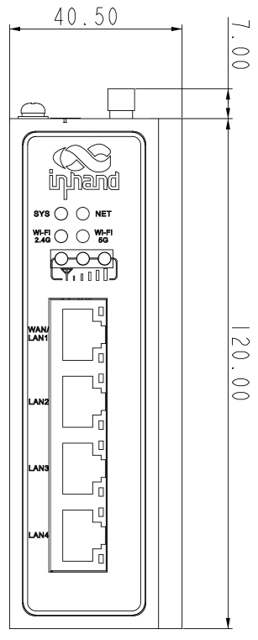
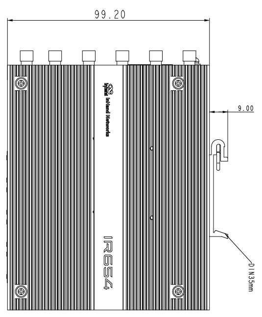
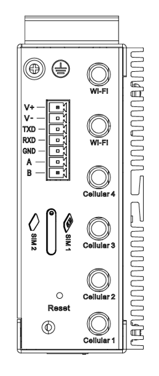

  

    

      
    

    

      Embrace 5G, Co-Create the Digital Era
    

  

  

    

      IR654 Industrial-Grade 5G Router
    

    

      

        
· 5G

        
· Wi-Fi 6

      

      

      
· TPM 2.0

      
· Cloud Management

      

    

  

# 1. Product Overview

The IR654 series is a high-performance 5G industrial-grade router independently developed by InHand Networks for industrial IoT scenarios. It provides high-bandwidth, highly reliable field network access for unattended sites across the power, energy, transportation, manufacturing, and healthcare industries. Integrating 5G cellular, dual-band Wi-Fi 6, and four Ethernet ports (including one 2.5 Gbps port), along with RS232/RS485 industrial serial ports, a single device handles field backhaul, local networking, and industrial device connectivity.

Addressing the two top concerns of field operations — "services must never go down" and "no site visits required" — the IR654 provides a multi-layer self-healing mechanism composed of wired/cellular interface backup, dual-SIM intelligent switchover and failback, Link Quality Monitoring (LQM), and a hardware watchdog. The metal, fanless passive-cooling enclosure operates in the wide temperature range of ‑40 to 70 °C and passes EN 61000-4 series Level 3 EMC immunity tests, making it suitable for harsh industrial environments. The device also incorporates VPN encrypted tunnels, a stateful inspection firewall, granular access control, and O&M auditing capabilities to secure data both over public networks and on local access; it can connect to the DeviceLive device cloud platform for centralized management or be deployed fully standalone for isolated-network environments.

## Key Features

- **Converged Three-Network Architecture**: 5G, Wi-Fi 6, and 2.5G wired multi-link networking capabilities for all-scenario applications.
- **High-Performance Local Access**: 2.5G/1G wired Ethernet and high-speed Wi-Fi 6 wireless for stable on-site terminal access.
- **Always-Connected Assurance**: Dual-SIM switchover, multi-WAN intelligent link switching, heartbeat detection, and hardware watchdog to maintain continuous communication in unattended scenarios.
- **Granular Traffic Management**: QoS priority scheduling to ensure stable transmission of critical industrial services.
- **Secure Encrypted Networking**: Compatible with mainstream VPN protocols, with firewall and access control for encrypted remote transmission of service data.
- **Cloud Management &amp; O&M**: Connects to the InHand DeviceLive cloud platform with batch configuration, remote OTA, fault diagnosis, and alert push for unified management of large-scale distributed sites.
- **Rich Network Protocol Stack**: IPv4/IPv6, IP passthrough, DDNS, and more — flexibly adapting to diverse industrial networking requirements.
- **All-Condition Industrial Design**: IP30 fanless metal enclosure, wide-temperature operation (‑40 to +70 °C), industrial EMC protection, DIN-rail and wall-mount installation.

## Typical Application Scenarios

### Smart Energy

- **Power Industry**: Distribution automation substations, substation edge access, solar PV / wind farm monitoring
- **Oil &amp; Gas Industry**: Pipeline monitoring stations, remote valve station data acquisition and backhaul

### Smart Transportation

- **Smart Highways**: ETC gantry communication, road-side unit (RSU) networking
- **Rail Transit**: Metro PIS systems, signaling equipment monitoring
- **Ports &amp; Terminals / Connected Vehicles**: Terminal equipment networking, onboard video surveillance and fleet dispatch management

### Industrial IoT

- **Smart Manufacturing**: PLC/CNC machine networking, MES data acquisition, AGV dispatch communication
- **Energy Industry**: Power distribution automation, solar PV plant monitoring, oil &amp; gas pipeline monitoring
- **Smart Mining**: Mine safety monitoring data backhaul, remote control of underground equipment

### Smart Healthcare

- **Hospital Networking**: Encrypted HIS/PACS data backhaul, private network interconnection between branch campuses
- **Telemedicine**: HD video transmission for remote consultation and remote surgical guidance
- **Public Health**: CDC data collection and reporting, emergency medical communications

## Product Dimensions

    
    
Front View

  

  

    
    
Side View

  

  

    
    
Top View

  

  

    
<strong>Notices:</strong>

    
1. All dimensions are in millimeters (mm).

    
2. All dimensions are approximate and for reference only.

    
3. Drawings must not be used for manufacturing.

    
4. Dimensions may vary due to component and manufacturing tolerances.

    
5. Specifications are subject to change without notice.

  

# 2. Product Highlights

## Highlight 1: One Device, Multiple Networks — No External Switch or Gateway Required

Field devices come in many types with varied interfaces, often requiring additional switches or protocol gateways. The IR654 integrates Ethernet switching, cellular backhaul, wireless access, and industrial serial ports into a single device, reducing device count, power points, and points of failure.

- **5G Cellular Backhaul**: Supports SA/NSA dual-mode, 3GPP Release 16, Sub-6 GHz. Supports NR/LTE band locking and filtering to lock onto optimal bands in multi-network interference or cross-region roaming scenarios, avoiding service jitter caused by frequent cell reselection. Sites without wired resources can quickly launch services, making it ideal for bandwidth-intensive applications such as HD video backhaul and bulk data synchronization.
- **Wi-Fi 6 Local Access**: 2.4 GHz + 5 GHz dual-band concurrent, combined wireless rate of AX3000, supporting up to 128 client devices — providing on-site access for inspection terminals, PDAs, laptops, wireless cameras, and more.

- **1 × 2.5 Gbps + 3 × 10/100/1000 Mbps Auto-Negotiating Ethernet Ports**: Each port can be independently configured as WAN or LAN, supporting Access/Trunk modes, PVID/VID, and port-based VLAN segmentation, with 1.5 kV network isolation transformer protection. It can serve as multi-WAN uplink (with backup and load balancing) or connect directly to local devices such as PLCs, cameras, and industrial PCs, with different subnets segmented by service.
- **1 × RS232 + 1 × RS485 Industrial Serial Ports**: 15 kV electrostatic discharge (ESD) protection, supporting DTU transparent data transmission (TCP/UDP) and Modbus RTU to Modbus TCP protocol conversion — connect meters, sensors, PLCs, and other serial devices directly without an external protocol converter.
- **Flexible Network Access**: Supports Static IP, DHCP, PPPoE, and multi-APN (up to 4 profiles) configuration, with IPv4/IPv6 dual stack; wired, wireless, and cellular access available as needed.
- **Optional Deployment Modes**: Supports IP Passthrough and bridging modes, allowing the cellular network IP to be assigned directly to downstream devices and simplifying address planning.
- **Remote Debugging Channel**: Supports AT command proxy — send AT commands to the cellular module remotely over the network or serial port for convenient remote troubleshooting of module-side issues.

> Core Value: Routing, switching, wireless, and serial gateway in one device — one fewer device on site means one fewer power point, one fewer cable, and one fewer point of failure.

## Highlight 2: Hardware-Rooted Trust for End-to-End Security

Once industrial devices connect to public networks, they are exposed to unauthorized intrusion, firmware tampering, and data leakage risks. The IR654 features a hardware-rooted trust platform spanning five security domains — hardware root of trust, data transmission encryption, perimeter protection, access control, and O&M auditing — providing a foundation for device trust, data security, and full operation traceability from the hardware layer up.

**Transmission Encryption**:

- **Hardware Encryption**: TPM 2.0 security chip provides a hardware-level root of trust; cryptographic keys are generated and stored inside the chip and are never exported to system memory.
- **Transmission Encryption**: Supports IPSec, L2TP, OpenVPN, and WireGuard VPN tunnels for encrypted interconnection between branch sites and the center; management channels support HTTPS/SSH encryption, and logs and alerts support remote Syslog forwarding and SMTP-TLS encrypted transmission.
- **Perimeter Protection**: Stateful Packet Inspection (SPI) firewall with granular inbound/outbound policies and default policies (allow/deny), SNAT/DNAT and port mapping, IP/port/protocol-based packet filtering, and MAC address and URL domain black/whitelist filtering.
- **Access Control**: 802.1X port-based access authentication; WPA3-PSK / WPA3-Enterprise for Wi-Fi; WAN-side Ping response can be disabled to reduce the device's exposure surface on public networks.
- **Device and O&amp;M Security**: HTTP/HTTPS/SSH/Telnet management services can be independently enabled/disabled with custom ports and trusted source IP binding; SNMP v3 with SHA authentication and AES encryption prevents plaintext leakage of network management protocols; all events — logins, configuration changes, link status changes — are fully recorded and retained, with remote Syslog support for centralized auditing.

> Core Value: Hardware-rooted trust, encrypted data transmission, blocked external intrusions, and fully audited operations — one device helps meet the network security baseline and compliance requirements of industrial sites, including China's MLPS (Multi-Level Protection Scheme).

## Highlight 3: Link Self-Healing for Uninterrupted Services

For unattended sites, the cost of service downtime almost always far exceeds that of insufficient bandwidth. The IR654 builds a self-healing mechanism across three levels — link, SIM card, and the device itself — shortening network interruptions and reducing the need for on-site dispatch.

- **Wired and Cellular Mutual Backup**: The Gigabit wired WAN and 5G cellular link can be configured as primary/backup or mutual backup. Traffic automatically switches to cellular when the wired link fails and fails back to wired when the cellular link recovers, transparently to downstream services. Multi-WAN scenarios support load balancing.
- **Dual-SIM Intelligent Switchover and Failback**: Supports primary/backup SIM priority and dial-up timeout (default 120 seconds) configuration, automatically switching to the backup SIM on dial-up failure or link probe failure. Supports automatic failback to the primary SIM based on three policies — uptime, data usage, or scheduled date — keeping services online while preventing waste of the primary SIM's data plan and overage on the backup SIM.
- **Link Quality Monitoring (LQM)**: Configurable threshold levels and persistence periods for latency, jitter, packet loss, and signal strength, with three probing methods: ICMP, DNS resolution, and TCP connection. The criterion is "whether the service path is actually usable" rather than "whether dial-up succeeded," enabling detection of quality degradation — and proactive switchover or alerting — before the link goes down entirely.
- **Hardware Watchdog (WDT)**: Operates independently of system software; automatically resets the device when it becomes unresponsive, eliminating the need for manual on-site power cycling.
- **Automatic Reconnection**: Heartbeat keep-alive with automatic re-dialing and link re-establishment after a drop.

> Core Value: Automatic link switchover, automatic SIM switchover, and automatic device recovery — reducing fault recovery from "waiting for an on-site engineer" to "rapid automated recovery," while giving you greater control over dual-SIM data usage.

## Highlight 4: Full-Dimensional Environmental Tolerance for Harsh Industrial Environments

Once deployed, field devices often go years without inspection. The IR654 is engineered for industrial field conditions from structure and thermal design to power supply and EMC, designed to minimize on-site maintenance.

- **Structure and Thermal Design**: Metal enclosure with fanless passive cooling; no moving mechanical parts, eliminating fan failure and dust-accumulation downtime risks at the source.
- **Environmental Adaptability**: Operating temperature ‑40 to 70 °C, storage temperature ‑40 to 85 °C, relative humidity 5%–95% (non-condensing) — suitable for low outdoor temperatures in northern climates and high temperatures inside sealed cabinets in summer.
- **Electromagnetic Compatibility**: In accordance with the EN 61000-4 series, immunity tests including electrostatic discharge, radiated RF electromagnetic fields, electrical fast transient/burst (EFT), surge, RF field-conducted disturbances, power-frequency magnetic fields, and oscillatory waves all reach Level 3 or higher (power-frequency magnetic field tested at 400 A/m, horizontal/vertical) — suited to strongly electromagnetically noisy environments such as substations and factory workshops.
- **Mechanical Reliability**: Compliant with IEC 60068-2-6 (vibration), IEC 60068-2-27 (shock), and IEC 60068-2-32 (free fall: 75 cm with packaging, 1 m outer carton).
- **Power and Installation**: DC 9–48 V wide-range input, 2-PIN industrial terminal block, with reverse-polarity and over-current protection to withstand field power fluctuations; IP30 rating, supporting DIN-rail and wall-mount installation.
- **Compact Dimensions**: 127 × 108.2 × 40.5 mm — ideal for dense deployment inside cabinets.

> Core Value: Wide-temperature, fanless, EMI-resistant industrial hardware designed for long-term unattended operation — helping reduce hardware failure rates and on-site maintenance frequency.

## Highlight 5: Dual-Mode Cloud and Local Management for Fewer Site Visits

When devices are spread across hundreds or thousands of sites, O&M cost becomes the largest component of long-term investment. The IR654 supports both centralized cloud O&M and standalone local O&M — one software capability set serves both project types.

- **Centralized O&M**: Connects to the InHand DeviceLive device cloud platform with device status monitoring, batch configuration deployment, remote firmware upgrades, and traffic and signal statistics; device-side MQTT keepalive and cloud-connection egress interface are configurable to accommodate different uplink conditions.
- **Remote Diagnostics**: Remote Ping, Traceroute, packet capture, and Iperf speed testing — network problems can be located and evidence gathered remotely, reducing field trips.
- **Alert Notifications**: Events such as link state changes, signal anomalies, and device reboots can be notified to multiple recipients via SMTP email (TLS-encrypted), with per-SIM monthly data usage threshold alerts supported.
- **Permissions and Auditing**: The cloud platform supports multi-role tiered permission management with full operation log traceability.
- **Standalone Local Deployment**: Fully independent of any cloud platform — complete configuration management via Web (HTTPS) and CLI (SSH/Telnet), meeting project requirements for isolated networks, local data retention, and other scenarios where cloud connectivity is not permitted.

> Core Value: Widely distributed devices are managed in bulk in the cloud; devices that cannot go to the cloud are still manageable locally — turning massive amounts of "must visit on-site" O&M work into remote handling, effectively reducing O&M costs.

# 3. Hardware Specifications

| Item | Specification |
| ------------- | --------------------------------------- |
| **Processor** | Cortex-A53 dual-core @ 1.3 GHz |
| **Memory** | 512 MB DDR3 |
| **Storage** | 128 MB SPI NAND Flash |
| **5G Module** | 5G NR module, 3GPP Release 16 (module model TBD) |
| **SIM Card Slots** | Tray-style slots, 2 × Nano-SIM |
| **Ethernet Ports** | 1 × 2.5 Gbps + 3 × 10/100/1000 Mbps RJ45 independently managed switch ports, WAN/LAN/VLAN support, 1.5 kV network isolation transformer protection; per-port configuration of speed (Auto/10/100/1000/2500), mode (Access/Trunk), PVID/VID |
| **Serial Ports** | 1 × RS232 + 1 × RS485 (15 kV ESD protection) |
| **Wi-Fi** | Wi-Fi 6 (802.11ax), dual-band AX3000 (aggregate rate), 2.4 GHz 20 dBm / 5 GHz 20 dBm (conducted) |
| **Cellular Antennas** | 4 × SMA connectors (5G cellular antennas) |
| **Wi-Fi Antennas** | 2 × RP-SMA connectors |
| **Power Supply** | DC 9–48 V, 2-PIN industrial terminal block, over-current and reverse-polarity protection |
| **Power Consumption** | Standby: 370–480 mA @ 12 V; typical operating: 415–530 mA @ 12 V; peak: 530 mA @ 12 V (varies by configuration and load) |
| **Reset Button** | 1 × pinhole reset button |
| **Grounding Terminal** | Supported |
| **LED Indicators** | SYS (system status) ×1, NET (network status) ×1, 2.4 GHz Wi-Fi ×1, 5 GHz Wi-Fi ×1, signal strength indicators ×3 |
| **Heat Dissipation** | Metal enclosure, fanless passive cooling |
| **Ingress Protection** | IP30 |
| **Enclosure Material** | Metal |
| **Color** | Black |
| **Dimensions (W × D × H)** | 127 × 108.2 × 40.5 mm |
| **Weight** | Approx. 550 g |
| **Mounting** | DIN-rail mount, wall mount |
| **Operating Temperature** | ‑40 to 70 °C |
| **Storage Temperature** | ‑40 to 85 °C |
| **Relative Humidity** | 5%–95% (non-condensing) |

# 4. Network Connectivity

## 4.1 5G/4G Cellular Network

- **Network Standards:**
  - 5G: NR SA/NSA, Sub-6 GHz, 3GPP Release 16
  - 4G: LTE FDD / LTE TDD
  - 3G: WCDMA
- **Advanced Cellular Features:**
  - **5G Mode Selection**: SA/NSA/SA-NSA dual-mode switchover
  - **Band Locking**: Manual locking and filtering of LTE and NR bands
  - **Multi-APN Configuration**: 4 independent APN profiles, each with configurable access point, authentication (auto/PAP/CHAP), and username/password
  - **PDP Type**: IPv4/IPv6 selectable
  - **SIM PIN**: SIM card PIN protection supported
  - **IMS Configuration**: VoLTE IMS enable/disable
  - **Connection Mode**: Always-online
  - **Data Plan Management**: Per-SIM (SIM1/SIM2) monthly data usage threshold alerts (GB-level configurable); over-limit policy supports alert notification

## 4.2 SIM Card Management

- **Dual-SIM Design**: 2 × Nano-SIM tray-style slots
- **Intelligent Switchover:**
  - Automatic switchover on dial-up failure
  - Automatic switchover on link probe failure
  - Configurable switchover policies
- **Dual SIM Backup:**
  - Designatable primary SIM with adjustable primary/backup priority
  - Configurable dial-up timeout (default 120 seconds)
  - **Uptime-Based Failback**: Failback to primary SIM after the backup SIM has been active for a configured duration
  - **Data-Usage-Based Failback**: Failback to primary SIM after the backup SIM has consumed a configured amount of data
  - **Scheduled Failback**: Configurable failback on a daily cycle

## 4.3 Wired Network

- **WAN Ports**: 1 × 2.5 Gbps + 3 × 1 Gbps RJ45, configurable as WAN/LAN; per-port configuration of speed (Auto/10/100/1000/2500), mode (Access/Trunk), PVID/VID
- **VLAN Support**: Port-based VLAN segmentation with Access/Trunk port modes
- **IPv6 Support**: Full IPv6 functionality
- **Multi-WAN Link Management**: Multi-WAN interface backup and load balancing

## 4.4 Wi-Fi 6 Wireless Access

- **Standard**: IEEE 802.11ax (Wi-Fi 6), backward-compatible with 802.11a/b/g/n/ac/ac Wave2
- **Bands**: 2.4 GHz + 5 GHz dual-band concurrent
- **Wireless Class**: AX3000 (2.4 GHz + 5 GHz aggregate rate)
- **Maximum Connected Clients**: 128
- **Operating Modes**: AP / Client, with Wi-Fi Portal support
- **Security**: WPA3-PSK / WPA2-PSK / WPA3-Enterprise / WPA2-Enterprise
- **Roaming**: 802.11k/v/r fast roaming

# 5. Link Management and Backup

## 5.1 Intelligent Link Backup

- **Backup Modes**: Active/standby mode, interface backup
- **Probing**: Heartbeat detection with automatic reconnection on link loss
- **Switchover Policies:**
  - Automatic switchover on link failure
  - Automatic dual-SIM link switchover

## 5.2 Link Quality Monitoring

- **Real-Time Monitoring**: Real-time display of link status, latency, jitter, packet loss, and throughput
- **Cellular Signal Monitoring**: Real-time viewing of key signal metrics including RSRP, RSRQ, RSSI, and SINR
- **Health Check**: Automated link health assessment
- **Alert Notification**: Immediate email alerts on link anomalies
- **Link Quality Monitor (LQM)**: Configurable alert thresholds with email notification on link anomalies
  - **Latency Detection**: Configurable threshold and persistence period
  - **Jitter Detection**: Configurable threshold and persistence period
  - **Packet Loss Detection**: Configurable threshold and persistence period
  - **Signal Strength Detection**: Configurable threshold and persistence period
  - **Detection Modes**: Three link probing modes — ICMP, DNS resolution, and TCP connection

# 6. Security Features

## 6.1 Firewall

- **Stateful Inspection**: Connection-state-based packet inspection
- **Inbound Rules**: Granular inbound access control with default policy (allow/deny)
- **Outbound Rules**: Outbound traffic policy management with default policy (allow/deny)
- **Port Forwarding**: Port mapping and NAT traversal support
- **NAT**: Network Address Translation with SNAT/DNAT support and customizable NAT rules
- **MAC Filtering**: MAC address-based access control (blacklist/whitelist mode)
- **Domain Filtering**: Domain/URL-level access control (blacklist/whitelist mode)
- **Protocol Filtering**: IP/port/protocol-based filtering
- **802.1X**: Port-based network access control

## 6.2 VPN Support

- IPSec VPN
- L2TP VPN
- OpenVPN
- WireGuard VPN

## 6.3 Device Access and O&amp;M Security

- **Management Service Hardening**: HTTP/HTTPS/SSH/Telnet can each be independently enabled/disabled, with customizable ports and trusted source IP binding
- **Attack Surface Reduction**: WAN-side Ping response can be enabled/disabled
- **Network Management Protocol Security**: SNMP v3 with SHA/MD5 authentication and AES/DES encryption
- **O&amp;M Auditing**: Remote Syslog forwarding, SMTP-TLS encrypted email alerts; full recording and retention of events including logins, configuration changes, and link state changes
- **Scheduled Reboot**: Supports never/daily/weekly/monthly reboot policies to proactively mitigate risks of long-running operation

# 7. Local Network Services

## 7.1 Interface Management

- **Interface Configuration**: Port mode switching (WAN/LAN), VLAN configuration
- **Interface Status**: Real-time UP/DOWN status display

## 7.2 WAN Access

- **Access Protocols**: Static IP, DHCP, PPPoE
- **Access Authentication**: APN, VPDN, CHAP/PAP

## 7.3 DHCP Service

- **DHCP Server**: Multiple address pool configuration
- **DHCP Relay**: Cross-subnet DHCP service
- **Lease Management**: Flexible IP lease configuration

## 7.4 DNS Service

- **DNS Proxy**: Local DNS caching and forwarding
- **DDNS**: Dynamic DNS support
- **Custom DNS**: Multiple DNS server configuration

## 7.5 Static Address Assignment

- **IP-MAC Binding**: Static address assignment
- **Conflict Detection**: Automatic IP address conflict detection

## 7.6 Traffic Shaping

- **Bandwidth Limiting**: Interface-level bandwidth control
- **Traffic Shaping**: Queue-based granular traffic management
- **QoS Guarantees**: Priority assurance for critical service traffic

## 7.7 Routing Protocols

- **Static Routing**: Multiple static route entries with flexible route priority settings
- **Dynamic Routing**: BGP and OSPF dynamic routing protocols

## 7.8 Policy Routing

- **Intelligent Traffic Steering**: Policy-based routing by source/destination address, port, and protocol
- **Forced Routing**: Directing specified traffic through a designated egress interface

## 7.9 IP Passthrough

- **Bridge Mode**: Cellular network IP passthrough
- **Flexible Configuration**: Multiple passthrough modes supported

## 7.10 IP Applications

TCP, UDP, IPv4/IPv6, ICMP, NTP, DNS, HTTP/HTTPS, SSL/TLS, PPP, SSH, Telnet

## 7.11 DTU / Protocol Conversion

- **DTU Function**: TCP/UDP transparent transmission
  - Long-connection / short-connection modes, heartbeat keep-alive, and automatic reconnection
  - Concurrent server connections with configurable data buffering and packet framing policies
  - Local IP binding and device identification
- **Protocol Conversion**: Modbus RTU to Modbus TCP conversion for industrial automation device networking
  - Modbus gateway Server/Client modes
  - Configurable local port, transmission interval, and timeout duration

## 7.12 AT Command Proxy (AT Agent)

- **AT Server**: Send AT commands to the cellular module remotely over TCP, with configurable port and idle timeout
- **AT Passthrough**: Send AT commands directly to the cellular module via serial port (RS232/RS485) with configurable serial parameters

## 7.13 Guest Network

- **Dedicated Guest VLAN**: Logically isolated from the main network
- **Uplink Policy**: Guest traffic can be directed to a designated egress interface (any/specified)
- **Access Duration Control**: Configurable guest network access duration

# 8. Cloud Management and O&amp;M

The IR654 is powered by the InHand DeviceLive cloud management platform, enabling remote management across the entire device lifecycle.

## 8.1 Centralized Management Capabilities

- **Device Monitoring**: Real-time device status monitoring, with dashboards presenting device information, interface status, and granular traffic statistics
- **Remote Configuration**: Remote network parameter configuration and batch deployment via the cloud
- **Firmware Upgrade**: Remote batch firmware upgrades, reducing the risk of human error
- **Fault Diagnosis**: Remote execution of diagnostic commands with immediate results
- **Alert Management**: Recording and notification of anomalous events such as link alerts and signal alerts
- **MQTT Connection**: Configurable device-side MQTT keepalive and designated cloud-connection egress interface

## 8.2 Remote Maintenance Tools

- **Status Query**: Dashboard — device information, interface status, granular traffic statistics
- **Link Monitoring**: Monitoring of link latency, jitter, packet loss, and throughput
- **Signal Monitoring**: Real-time viewing of cellular signal strength, RSSI, RSRP, RSRQ, SINR
- **Remote Diagnostics**: Ping, Traceroute, packet capture, speed testing

## 8.3 Email Alerts

- **SMTP Email Alerts**: Configurable SMTP server with TLS-encrypted transmission
- **Multiple Recipients**: Multiple alert recipient email addresses supported
- **Alert Events**: Email notifications for link state changes, signal anomalies, device reboots, and other events

# 9. System Management and Maintenance

## 9.1 Device Management

- **Web Management**: Intuitive Web configuration interface (HTTPS local/remote access)
- **CLI Management**: Command-line configuration (SSH/Telnet remote access)
- **Management Access Control**: HTTP/HTTPS/SSH/Telnet each independently enabled, configurable ports, trusted source IP binding
- **Ping Response Control**: WAN-side Ping response can be enabled/disabled
- **Configuration Import/Export**: Configuration file backup and restoration
- **Factory Reset**: One-touch restore via the reset button
- **Firmware Upgrade**: Multi-mode upgrade via Web / cloud
- **Scheduled Reboot**: Supports never/daily/weekly/monthly reboot policies
- **Web Session Timeout**: Configurable Web management session timeout

## 9.2 Logs and Diagnostics

- **System Logs**: Detailed system operation and diagnostic logs, viewable locally
- **Remote Syslog**: System logs can be sent to remote Syslog servers (2 independent server addresses with port 514 configurable)
- **Event Records**: Recording and querying of device events (login, connection, reboot, etc.)
- **Diagnostic Tools**: Ping, Traceroute, network packet capture, Iperf speed testing

## 9.3 Alert Management

- **Alert Types**: Link alerts, signal alerts, and more
- **Alert Notification**: Email alert notifications

## 9.4 SNMP Network Management

- **SNMP v1/v2c**: Read-only / read-write Community configuration
- **SNMP v3**: User-level authentication and encryption; SHA/MD5 authentication protocols, AES/DES encryption protocols

## 9.5 System Features

- **Operating Modes**: Routing mode and bridge mode switching
- **SFE Fast Forwarding**: Hardware fast-forwarding acceleration engine for improved NAT forwarding performance
- **SIP ALG**: SIP Application Layer Gateway ensuring VoIP voice traffic traverses NAT
- **Loop Detection**: Automatic network loop detection to prevent broadcast storms
- **NTP Service**: NTP time synchronization with multiple configurable NTP server addresses

## 9.6 Reliability Assurance

- **Hardware Watchdog**: Built-in hardware watchdog for automatic self-recovery from runtime faults
- **Dual-SIM Switchover**: Automatic switchover on dual-SIM link failure
- **Interface Backup**: Wired/cellular interface mutual backup
- **Automatic Reconnection**: Heartbeat detection with automatic reconnection after link loss

# 10. Ordering Information

## 10.1 Model Numbering

**Model code:** IR654-\<WMNN\>-\<WLAN/NA\>-\<S/IO\>-\<G/NA\>

- \<WMNN\>: Wireless communication type (see 10.2 Band Description)
- \<WLAN/NA\>: WLAN indicates Wi-Fi 6 (AX3000) support; NA indicates no Wi-Fi
- \<S/IO\>: S indicates serial ports (1 × RS232 + 1 × RS485); IO indicates 4 digital I/O lines
- \<G/NA\>: G indicates GNSS support; NA indicates no GNSS

## 10.2 Band Description

| WMNN | Region | Cellular Standards &amp; Bands | Maximum Data Rates |
| -------- | ----------- | -------------- | -------------- |
| GLNR | Global | 5G SA/NSA: n1/2/3/5/7/8/12/13/14/18/20/25/26/28/29/30/38/40/41/48/66/70/71/75/76/77/78/79 LTE FDD: B1/2/3/4/5/7/8/12/13/14/17/18/19/20/25/26/28/29/30/32/66/71 LTE TDD: B34/38/39/40/41/42/43/48 WCDMA: B1/2/4/5/8/19 | SA: DL 2.4 Gbps / UL 900 Mbps NSA: DL 3.4 Gbps / UL 550 Mbps LTE: DL 1.6 Gbps / UL 200 Mbps |
| EUNR | Europe, APAC, Latin America | 5G SA/NSA: n1/3/5/7/8/20/26/28/38/40/41/71/75*/76*/77/78/79 LTE FDD: B1/3/5/7/8/18/19/20/26/28/32/71 LTE TDD: B38/40/41/42/43 WCDMA: B1/5/8 | SA: DL 4.67 Gbps / UL 1.25 Gbps NSA: DL 5.47 Gbps / UL 825 Mbps LTE: DL 1.6 Gbps / UL 200 Mbps |

> Note: Data rates shown are theoretical peak rates; actual rates depend on carrier network, signal coverage, and service plan. Bands marked with \* are subject to final certification results.

## 10.3 Standard Model List

| Model | Cellular | Wi-Fi | Serial | I/O | GNSS |
| ------------------- | ---- | ----- | ---- | ---- | ---- |
| IR654-GLNR-S        | ✓    | ✓     | ✓    | ✗    | ✗    |
| IR654-GLNR-IO       | ✓    | ✓     | ✗    | ✓    | ✗    |
| IR654-GLNR-WLAN-S   | ✓    | ✓     | ✓    | ✗    | ✗    |
| IR654-GLNR-WLAN-IO  | ✓    | ✓     | ✗    | ✓    | ✗    |
| IR654-GLNR-WLAN-S-G | ✓    | ✓     | ✓    | ✗    | ✓    |
| IR654-EUNR-S        | ✓    | ✓     | ✓    | ✗    | ✗    |
| IR654-EUNR-IO       | ✓    | ✓     | ✗    | ✓    | ✗    |
| IR654-EUNR-WLAN-S   | ✓    | ✓     | ✓    | ✗    | ✗    |
| IR654-EUNR-WLAN-IO  | ✓    | ✓     | ✗    | ✓    | ✗    |
| IR654-EUNR-WLAN-S-G | ✓    | ✓     | ✓    | ✗    | ✓    |

## 10.4 Package Contents

- IR654 Router × 1
- 12 V / 2 A Power Adapter × 1 (plug type configured per target market)
- 1.5 m RJ45 Ethernet Cable × 1
- SIM Eject Pin × 1
- Antennas (included per model)

# 11. Reliability Standards and Certifications

## 11.1 Ingress Protection

- **IP Rating**: IP30

## 11.2 Mechanical Reliability

- **Vibration**: Whole-unit vibration test; compliant with IEC 60068-2-6
- **Shock**: Compliant with IEC 60068-2-27
- **Free Fall**: 75 cm with packaging; 1 m outer carton; compliant with IEC 60068-2-32

## 11.3 EMC — Electromagnetic Compatibility

| Standard | Level | Test Item |
|------|------|----------|
| EN 61000-4-2 | Level 3 | Electrostatic discharge (ESD) immunity |
| EN 61000-4-3 | Level 3 | Radiated RF electromagnetic field immunity |
| EN 61000-4-4 | Level 3 | Electrical fast transient/burst (EFT) immunity |
| EN 61000-4-5 | Level 3 | Surge immunity |
| EN 61000-4-6 | Level 3 | RF field-conducted disturbance immunity |
| EN 61000-4-8 | 400 A/m | Power-frequency magnetic field immunity (horizontal / vertical) |
| EN 61000-4-12 | Level 3 | Oscillatory wave immunity |

## 11.4 Certifications and Compliance

| Certification Type | Specification |
|----------|------|
| **Regulatory Compliance** | FCC\*, IC\*, PTCRB\*, Verizon\*, AT&amp;T\*, T-Mobile\*, CE\*, E-Mark\*, IEC 62443\* |
| **Environmental Compliance** | RoHS / REACH |

Note: \* indicates certification in progress.

# 12. Technical Support

- **Website**: [InHand Networks Official Website](https://www.inhand.com)
- **Copyright**: © InHand Networks. All rights reserved.

