# Declarations

**Copyright**
© InHand Networks. All rights reserved.
No part of this document may be reproduced, transmitted, or distributed in any form or by any means without prior written consent from InHand Networks.

**Disclaimer**
The contents of this document are subject to change without notice due to product updates or other reasons. InHand Networks reserves the right to modify the document contents without any notice or prompt. This manual is intended only as a guide. All statements, information, and recommendations in this document do not constitute any express or implied guarantee.

# GUI Conventions

This manual uses the following formatting to signify GUI elements:

| Symbol | Meaning | Example |
|--------|---------|---------|
| `< >` | Indicates a variable or parameter that needs to be replaced with an actual value. | `<IP Address>` indicates a specific IP must be entered. |
| `" "` | Indicates a text label on the interface. | Click the "Save" button. |
| `→` | Indicates menu hierarchy or operation sequence. | **Gateway Management** → **Alarms** |
| `【 】` | Indicates a menu or page name. | Enter the 【System Management】 page. |
| `>>` | Indicates sub-menu expansion. | Services >> Device Remote Management Platform |

# Technical Support

For technical assistance, please contact InHand Networks Support:
- Email: support@inhandnetworks.com
- Website: [https://www.inhandnetworks.com/](https://www.inhandnetworks.com/)

# How to Use This Manual

**Target Audience:**
- New Users: Recommended to read "About InConnect" → "Registration and Login" → "Connecting a Router to InConnect".
- Existing Users: Can directly refer to "Using the Client" or "Connecting the Router's Downstream Devices".
- Administrators: Should focus on "Network Management", "User Management", and "Billing".

**Quick Task Navigation:**

| Task | Corresponding Chapter | Estimated Time |
|------|-----------------------|----------------|
| Learn about the platform | [1. About InConnect](#1-about-inconnect) | ~5 minutes |
| Register and login | [2. Registration and Login](#2-registration-and-login) | ~5 minutes |
| Connect a router | [3. Connecting a Router to InConnect](#3-connecting-a-router-to-inconnect) | ~10 minutes |
| Install and use the client | [4. Using the Client](#4-using-the-client) | ~10 minutes |
| Connect downstream devices | [5. Connecting the Router's Downstream Devices](#5-connecting-the-routers-downstream-devices) | ~10 minutes |
| Manage networks and VPNs | [6. Network Management](#6-network-management) | ~15 minutes |
| Manage users and permissions | [7. User Management](#7-user-management) | ~5 minutes |
| Manage routers and gateways | [8. Router/Gateway Management](#8-routergateway-management) | ~10 minutes |
| View consumption statistics | [9. Consumption](#9-consumption) | ~5 minutes |
| View or pay bills | [10. Billing](#10-billing) | ~5 minutes |
| Manage service certificates | [11. Service Certificate](#11-service-certificate) | ~5 minutes |

---

# 1. About InConnect

The InHand Connect Service cloud platform (hereinafter referred to as InConnect) can be understood as: a "one-stop" networking service provided for enterprise customers. It features a user-friendly interface and simple operations. InConnect is used together with InHand networking equipment to facilitate quick access to global business outlets anytime, anywhere. It achieves secure and stable interconnection of equipment and data exchange in different regions, promoting enterprise informatization construction and digital transformation.

<strong>Figure 1-1 InConnect Platform Overview</strong>

**How InConnect works:**

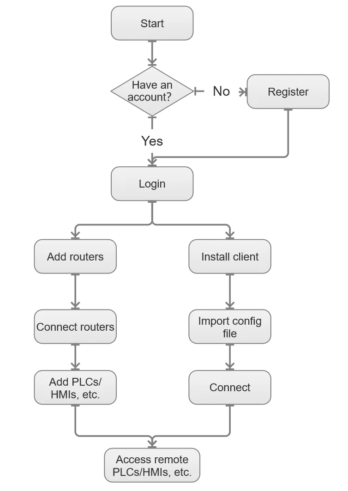

<strong>Figure 1-2 InConnect Architecture and Workflow</strong>

# 2. Registration and Login

## 2.1 Registration

In a browser, navigate to [https://ics.inhandnetworks.com](https://ics.inhandnetworks.com) to access the registration page of InConnect. The Google Chrome browser is recommended.

**| Caution:** If the user or the device is in the European region, please use [https://ics.inhandnetworks.eu/](https://ics.inhandnetworks.eu/).

## 2.2 Login

After successful registration, enter the email account used for registration and the password to log in to InConnect. After the initial login, it is required to **change the password** and **bind a mobile phone number** on the **Settings** page. The bound mobile phone number can be used for subsequent logins.

If access to Device Manager or InConnect via InHand Cloud Service is required, [click here](https://help.inhand.com/portal/en/kb/articles/access-to-device-manager).

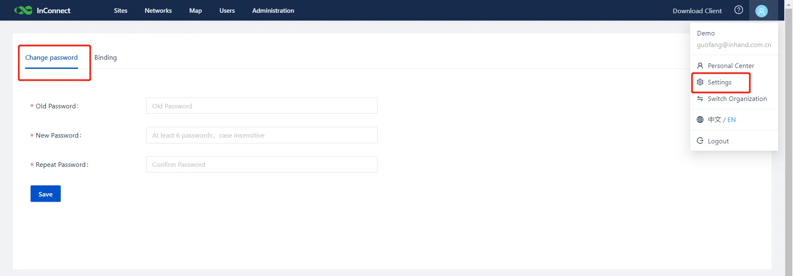

<strong>Figure 2-1 Login Page</strong>

# 3. Connecting a Router to InConnect

After a router is added to InConnect, the platform automatically delivers the running configuration to create a secure network connection. To connect a router to InConnect, perform the following steps:

1. On the **Sites** page of InConnect, add the router.
2. On the web management page of the router, configure the connection to InConnect.
3. Check the connection status between the router and InConnect.

The details are described in the following sections.

## 3.1 Adding the Router to InConnect

Before configuring the router's web page, information about the router must be added to the InConnect platform. This enables the router to automatically connect to InConnect, allowing for remote management of online routers.

1. Navigate to **Sites >> Routers**, and click **Add**.

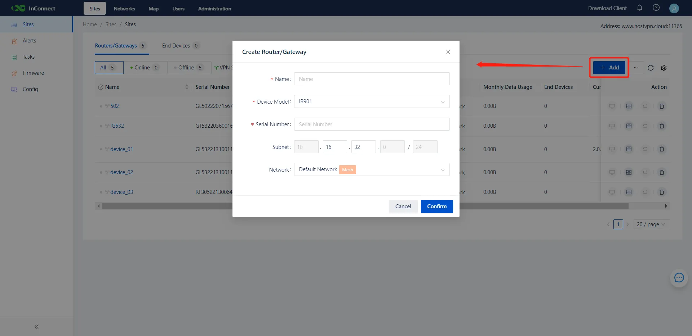

<strong>Figure 3-1 Adding a Router</strong>

2. In the **Create Router** dialog box, enter a customized name and the serial number of the router, select the appropriate router model, and click **OK**.

**| Caution:** The serial number can be viewed on the router's **nameplate** or on the **Web Management** page of the router. The selected router model must be accurate; otherwise, the connection to the router may fail.

3. If the router is displayed on the **Routers** tab page, it has been successfully added.

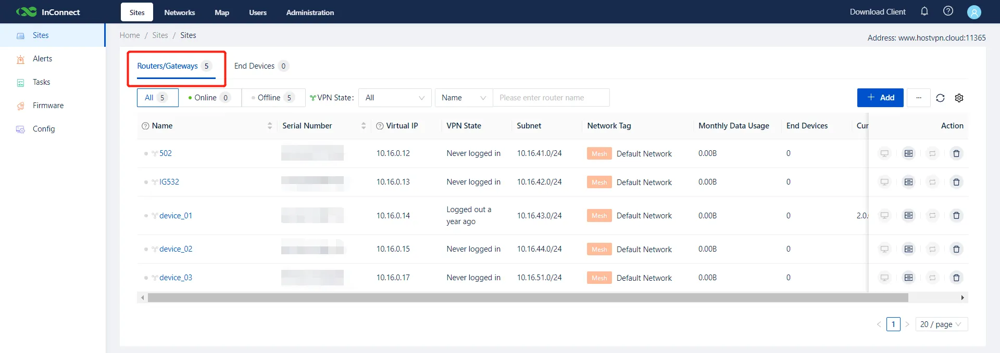

<strong>Figure 3-2 Router Added Successfully</strong>

4. InConnect allocates a virtual IP address for the added router. After the InConnect client is installed and configured, this virtual IP address can be used for remote access to the router. For details about client installation, refer to **4. Using the Client**.

## 3.2 Connecting a Router to InConnect

After adding a router to InConnect, the connection must be configured on the router's web management page. Before proceeding, ensure that the router is already connected to the internet. For details about internet connectivity, see the **Appendix**.

**| Caution:**
1. The configuration method varies depending on the product series. Ensure the correct procedure is followed for the specific equipment being used.
2. The user interface may vary depending on the router's firmware version; the actual interface shall prevail.

### 3.2.1 IR300-Series Routers

1. After connecting the router to a PC, access **192.168.2.1** in a browser.
2. On the login page, enter the initial login credentials. The default login account is **adm** and the password is **123456**.

**| Caution:** To ensure security, it is highly recommended to change the default login password after the initial login and store it securely.

3. On the web page of the router, navigate to **Services >> Device Manager** and configure the following parameters:
   1. Set **Service Type** to **InConnect Service**.
   2. Set **Server** to **ics.inhandnetworks.com**.
   3. In the **Registered Account** text box, enter the email account used to register the InConnect account. If an account does not exist, click **Sign up/Sign in** to register, and specify the **Registered Account** here.

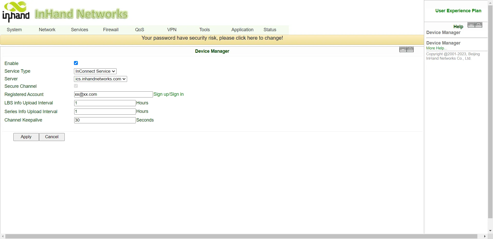

<strong>Figure 3-3 IR300 Device Manager Configuration</strong>

4. Click **Apply**. If the status displayed on the **Services >> Device Manager** page is **Connected**, the router is successfully connected to InConnect. If the status is **Registering**, verify whether the router has been added to the platform correctly.

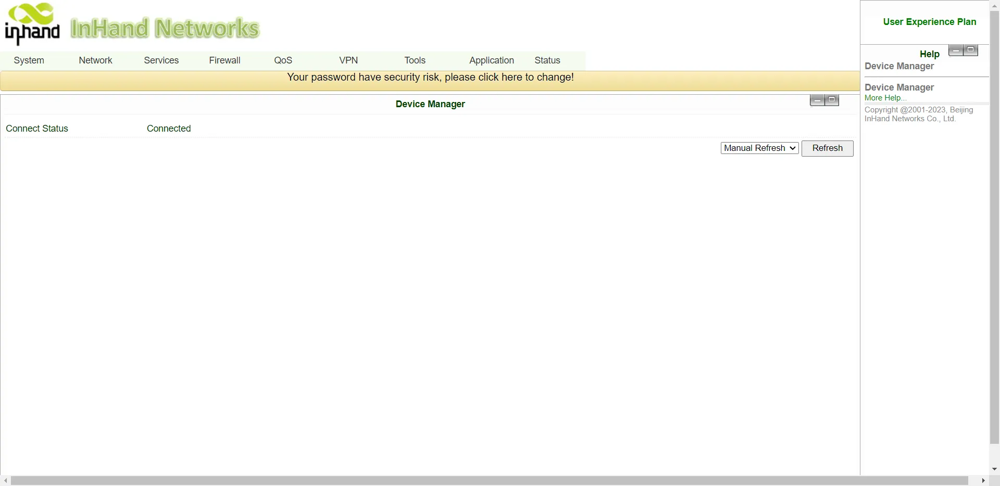

<strong>Figure 3-4 IR300 Connection Status</strong>

### 3.2.2 IR600-Series Routers

1. After connecting the router to a PC, access **192.168.2.1** in a browser.
2. On the login page, enter the initial login credentials. The default login account is **adm** and the password is **123456**.

**| Caution:** To ensure security, it is highly recommended to change the default login password after the initial login and store it securely.

3. On the web page of the router, navigate to **Services >> Device Manager** and configure the following parameters:
   1. Set **Service Type** to **InConnect Service**.
   2. Set **Server** to **ics.inhandnetworks.com**.
   3. In the **Registered Account** text box, enter the email account used to register the InConnect account. If an account does not exist, click **Sign up/Sign in** to register, and specify the **Registered Account** here.

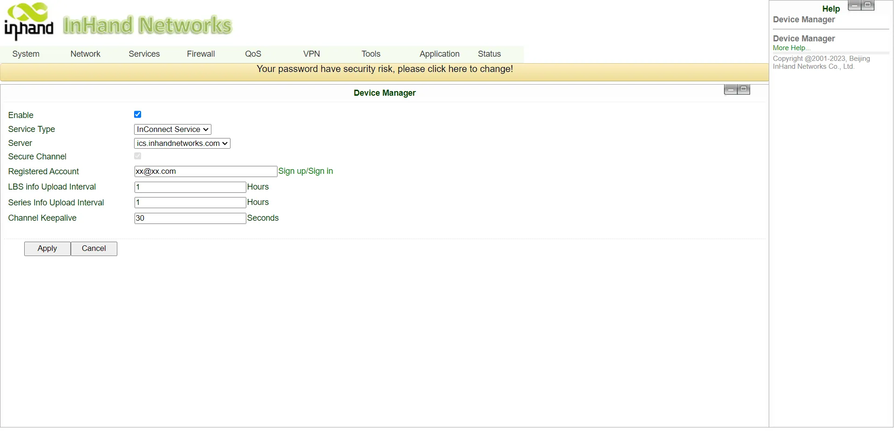

<strong>Figure 3-5 IR600 Device Manager Configuration</strong>

4. Click **Apply**. If the status displayed on the **Services >> Device Manager** page is **Connected**, the router is successfully connected to InConnect. If the status is **Registering**, verify whether the router has been added to the platform correctly.

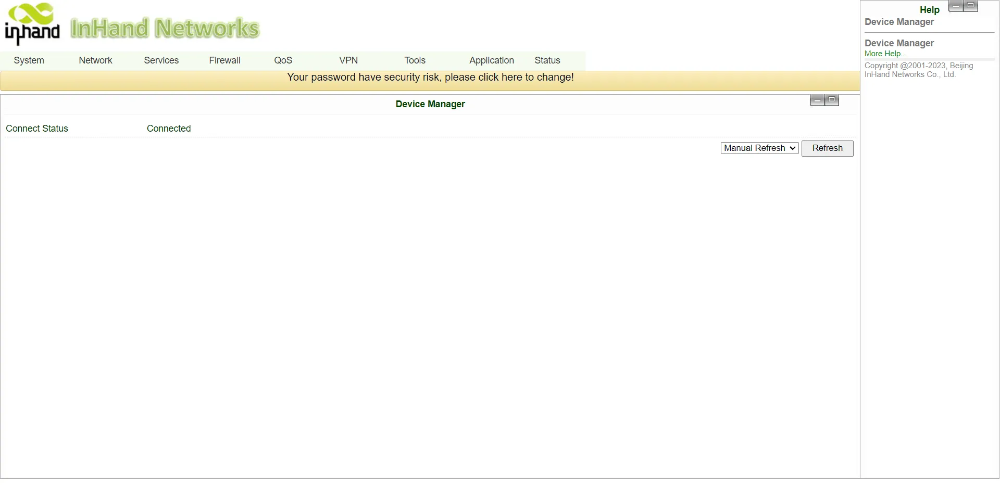

<strong>Figure 3-6 IR600 Connection Status</strong>

### 3.2.3 IR900-Series Routers

1. Use a network cable to connect a PC to the LAN port of the router, and access **192.168.2.1** in a browser.
2. On the login page, enter the initial login credentials. The default login account is **adm** and the password is **123456**.

**| Caution:** To ensure security, it is highly recommended to change the default login password after the initial login and store it securely.

3. On the web page of the router, navigate to **Administration >> Device Manager** and configure the following parameters:
   1. Select **Device Manager Enable**.
   2. Set **Service Type** to **InConnect Service**.
   3. Set **Server Address** to **ics.inhandnetworks.com**.
   4. In the **Registered Account** text box, enter the email account used to register the InConnect account. If an account does not exist, click **Sign up/Sign in** to register, and specify the **Registered Account** here.

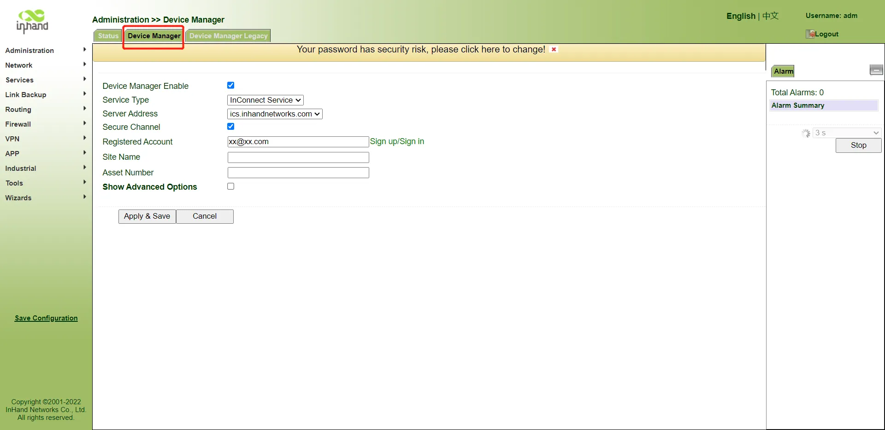

<strong>Figure 3-7 IR900 Device Manager Configuration</strong>

4. Click **Apply & Save**. If the status displayed on the **Status** tab page is **Connected**, the router is successfully connected to InConnect. If the status is **Registering**, verify whether the router has been added to the platform correctly.

<strong>Figure 3-8 IR900 Connection Status</strong>

### 3.2.4 IG500-Series Routers

1. Use a network cable to connect a PC to the FE0/1 port of the router, and access **192.168.1.1** in a browser.
2. On the login page, enter the initial login credentials. The default login account is **adm** and the password is **123456**.

**| Caution:** To ensure security, it is highly recommended to change the default login password after the initial login and store it securely.

3. On the web page of the router, navigate to **System >> InHand Cloud** and configure the following parameters:
   1. On the **InHand Connect Service** tab page, set **Server Address** to **ics.inhandnetworks.com** and **Registered Account** to the email account used to register the InConnect account. If an account does not exist, click **Sign up/Sign in** to register, and specify the **Registered Account** here.
   2. Click **Submit**. The router initiates a connection with InConnect. After the connection is established, the status bar will display: "Status: Connected; State Description: Connection Accepted". If the status is **Registering**, verify whether the router has been added to the platform correctly.

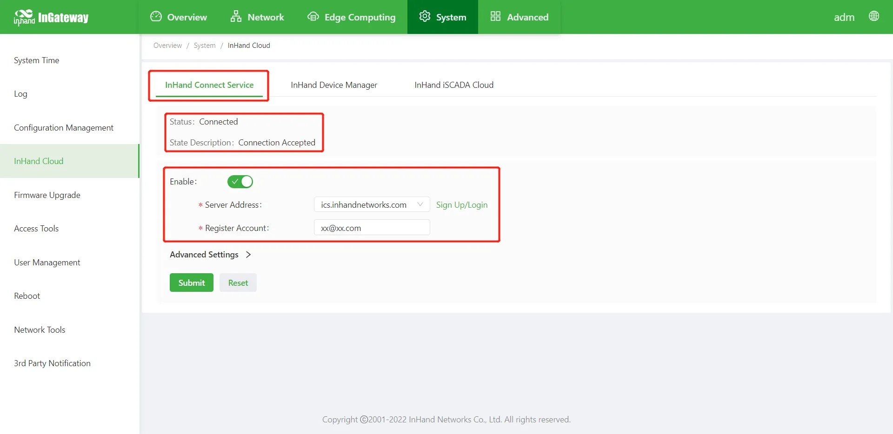

<strong>Figure 3-9 IG500 InHand Cloud Configuration</strong>

### 3.2.5 IG900-Series Routers

1. Use a network cable to connect a PC to the GE0/2 port of the router, and access **192.168.2.1** in a browser.
2. On the login page, enter the initial login credentials. The default login account is **adm** and the password is **123456**.

**| Caution:** To ensure security, it is highly recommended to change the default login password after the initial login and store it securely.

3. On the web page of the router, navigate to **System >> InHand Cloud** and configure the following parameters:
   1. On the **InHand Connect Service** tab page, set **Server Address** to **ics.inhandnetworks.com** and **Registered Account** to the email account used to register the InConnect account. If an account does not exist, click **Sign up/Sign in** to register, and specify the **Registered Account** here.
   2. Click **Submit**. The router initiates a connection with InConnect. After the connection is established, the status bar will display: "Status: Connected; State Description: Connection Accepted".

<strong>Figure 3-10 IG900 InHand Cloud Configuration</strong>

### 3.2.6 VG710-Series Routers

1. After connecting the router to a PC, access **192.168.2.1** in a browser.
2. On the login page, enter the initial login credentials. The default login account is **adm** and the password is **123456**.

**| Caution:** To ensure security, it is highly recommended to change the default login password after the initial login and store it securely.

3. On the web page of the router, navigate to **Administration >> Device Manager** and configure the following parameters:
   1. Select **Device Manager Enable**.
   2. Set **Service Type** to **InConnect Service**.
   3. Set **Server Address** to **ics.inhandnetworks.com**.
   4. In the **Registered Account** text box, enter the email account used to register the InConnect account. If an account does not exist, click **Sign up/Sign in** to register, and specify the **Registered Account** here.

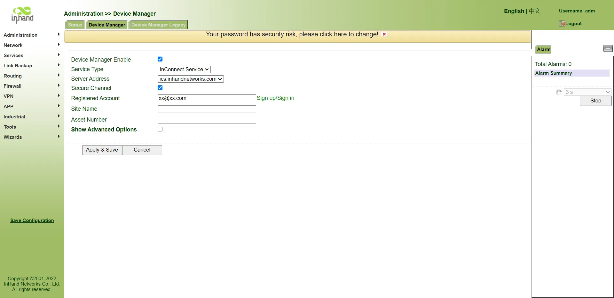

<strong>Figure 3-11 VG710 Device Manager Configuration</strong>

4. Click **Apply & Save**. If the status displayed on the **Status** tab page is **Connected**, the router is successfully connected to InConnect. If the status is **Registering**, verify whether the router has been added to the platform correctly.

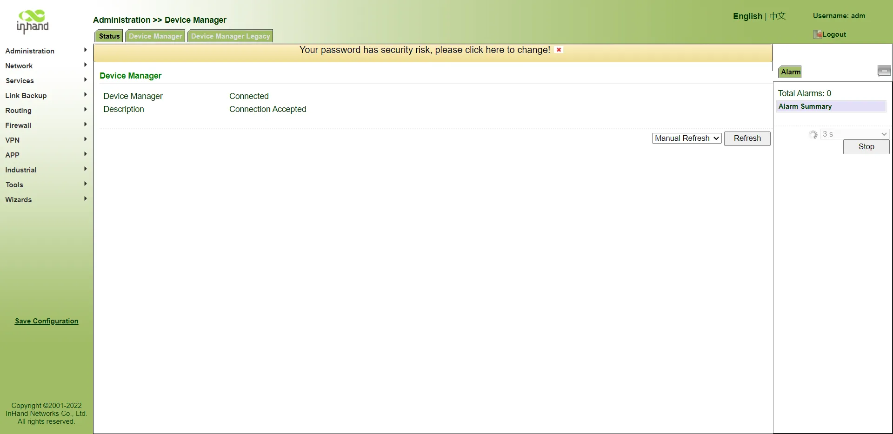

<strong>Figure 3-12 VG710 Connection Status</strong>

## 3.3 Check the connection between the router and InConnect

After the router is added to the platform and InConnect is configured on the router, it is necessary to verify the online and VPN status of the router.

1. Upon successful connection to the platform, the online status indicator of the router is displayed in green.

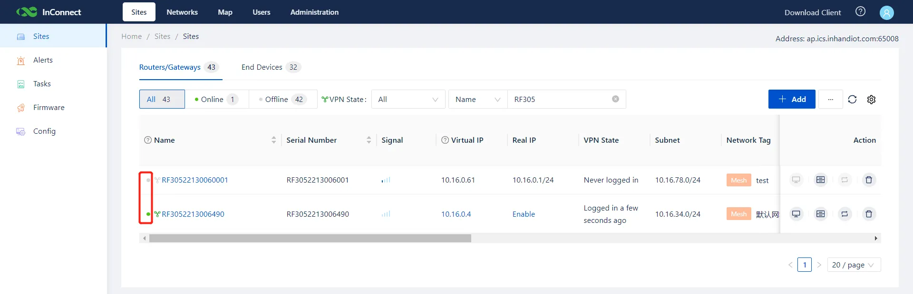

<strong>Figure 3-13 Router Online Status</strong>

2. When the router's VPN tunnel is successfully established, the VPN status indicator is displayed in green. If the device is online but the VPN is offline, a manual reconnect can be triggered. Click **Send running Config** in the operation column of the **Routers/Gateways** page to initiate the connection.

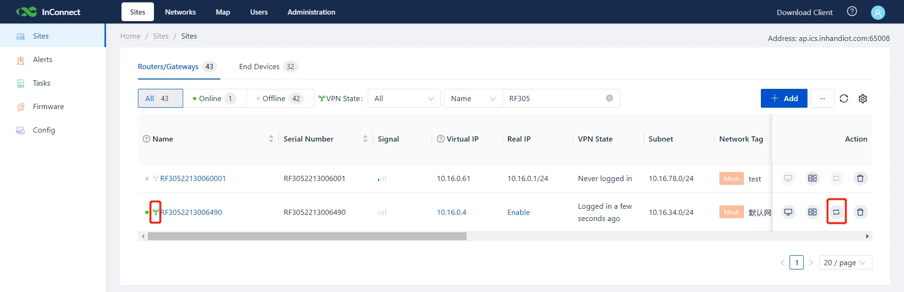

<strong>Figure 3-14 Router VPN Status</strong>

# 4. Using the Client

InConnect automatically establishes a secure connection channel for the integrated router. Users can install and configure the client on a local PC or a mobile device to access this secure channel. The assigned virtual IP address can then be used to remotely access the router and its downstream devices, facilitating remote control of onsite equipment.

## 4.1 Installing and Using OpenVPN in Windows

1. Download the OpenVPN client from InConnect and complete the installation process.

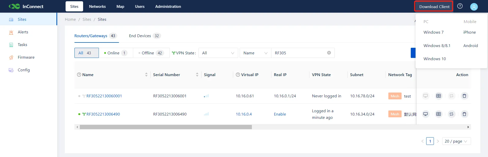

<strong>Figure 4-1 Downloading OpenVPN Client</strong>

2. In the **Users** list of InConnect, download the OpenVPN configuration profile for the intended user.

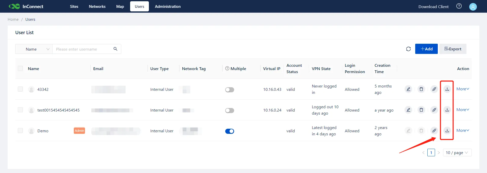

<strong>Figure 4-2 Downloading User Configuration File</strong>

3. Launch the OpenVPN GUI as an administrator. Right-click the OpenVPN icon 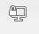 in the system tray, and select **Import file** to import the downloaded configuration file into the client.

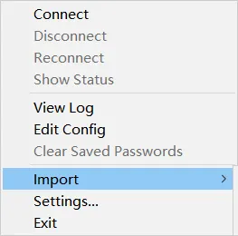

<strong>Figure 4-3 Importing Configuration File</strong>

4. Click **Connect**. When the icon turns green , the current user is successfully connected to the secure connection channel.

5. Verify connectivity by attempting to reach the router's virtual IP address.
   1. Note: The IP address cannot be pinged if Windows Defender Firewall blocks ICMP traffic. It is recommended to temporarily disable the firewall or allow ICMP echo requests.

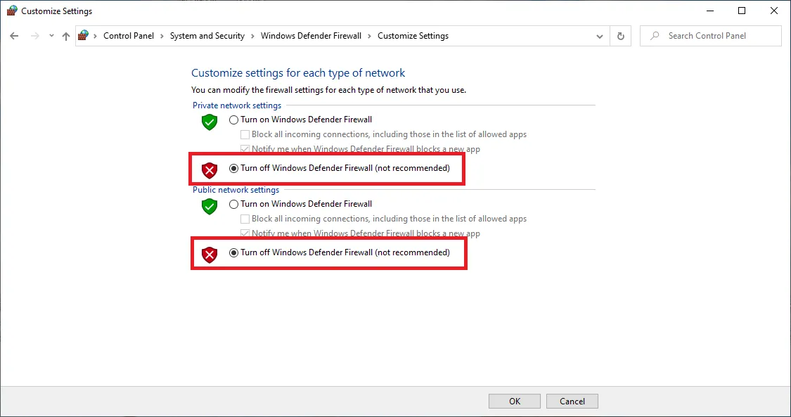

<strong>Figure 4-4 Firewall Settings</strong>

   2. Open the Windows Command Prompt and ping the router’s virtual IP address (e.g., **10.16.0.3**). The virtual IP address can be found by scrolling horizontally on the **Sites** page of InConnect.
   3. If the ping is successful, the user is properly connected to the remote router.

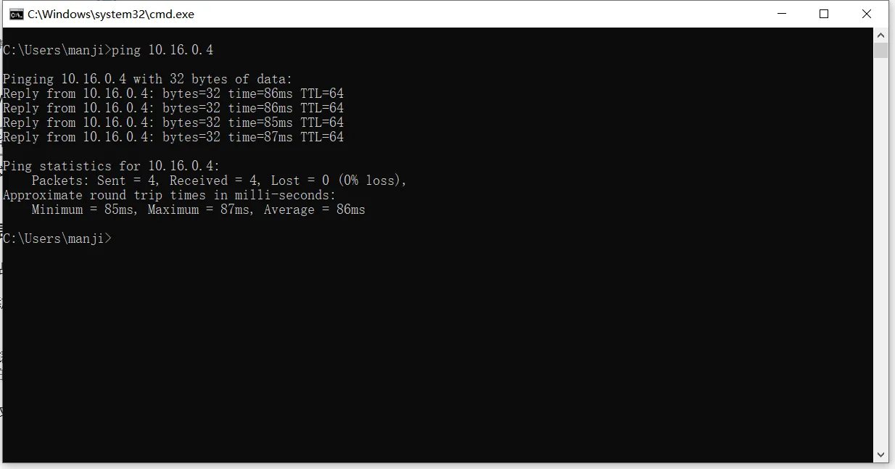

<strong>Figure 4-5 Ping Test Successful</strong>

## 4.2 Installing and Using OpenVPN in Android

1. Scan the QR code provided in InConnect to download the Android version of the OpenVPN client.

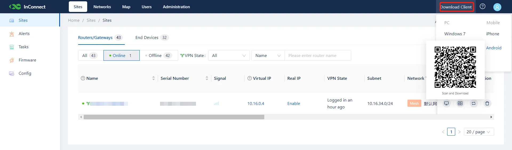

<strong>Figure 4-6 Android OpenVPN QR Code</strong>

2. Install the client application.
3. Download the OpenVPN configuration file from InConnect and transfer it to the mobile device.
4. Within the app, tap **FILE**, select the transferred configuration file, choose **IMPORT >> ADD**, and enable the OpenVPN profile.
5. After the OpenVPN connection is established, utilize a ping utility application on the mobile device to test connectivity to the router’s virtual IP address. A successful ping confirms the remote connection.

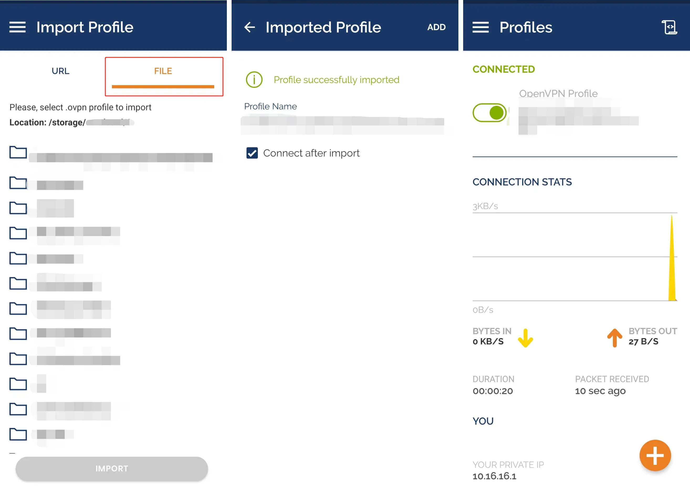

<strong>Figure 4-7 Android OpenVPN Interface</strong>

# 5. Connecting the Router’s Downstream Devices

Downstream devices connected to the router can be added to InConnect for remote access and control. Upon adding a downstream device, InConnect automatically delivers the running configuration to establish a secure network path.

InConnect supports two access methods: Virtual IP access and Real IP access.

## 5.1 Access Through the Virtual IP Address

The Virtual IP access mode can be understood as: a mechanism where InConnect automatically maps an added downstream device (e.g., a PLC) to a unique virtual IP address on the VPN network. This method prevents IP conflicts and is the default, recommended access mode when specific real IP management is not required.

**Method 1:**

1. Navigate to the **Sites** page, and select **End Devices >> Add**.

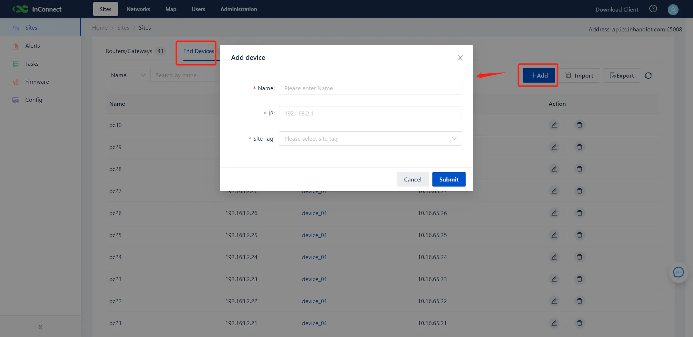

<strong>Figure 5-1 Adding an End Device (Method 1)</strong>

2. Enter the device name and the real IP address of the downstream device. Select the corresponding site (the router) to which the device is physically connected.

3. Click **Submit**. InConnect automatically assigns a virtual IP address to the downstream device. A single router supports a maximum of 254 downstream devices. In the example below, a device with real IP 192.168.2.215 on Site "Device01" is mapped to virtual IP 10.16.46.1.

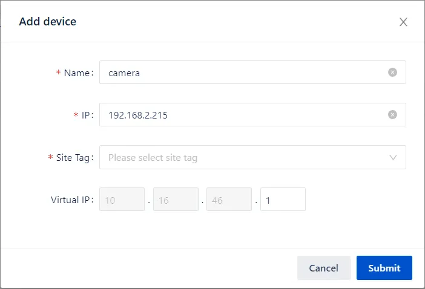

<strong>Figure 5-2 Virtual IP Allocation</strong>

**Method 2:**

1. On the **Sites** page, click the router name associated with the target downstream device to open the device management page.

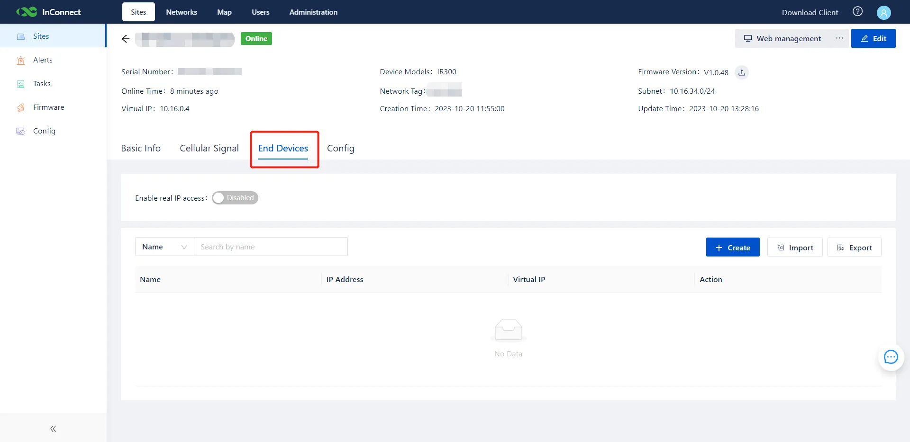

<strong>Figure 5-3 Router Device Management Page</strong>

2. Navigate to **End Devices >> Create**, input the necessary device details, and click **Submit**.

3. InConnect allocates a virtual IP address. For example, 10.16.34.1 is assigned.

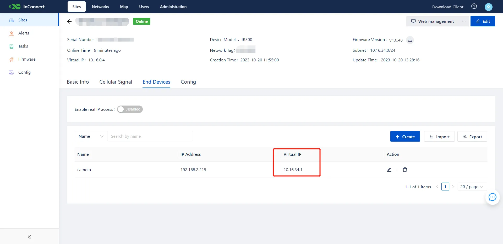

<strong>Figure 5-4 Virtual IP Allocation (Method 2)</strong>

4. Once the VPN client is configured and active on the local PC, ping the virtual IP address of the downstream device. A successful response indicates that remote access via the maintenance channel is operational.

## 5.2 Access Through the Real IP Address

The Real IP access mode can be understood as: an alternative routing mechanism where users access downstream devices using their actual local network IP addresses. This is suitable for environments demanding strict real IP management but requires careful planning to avoid IP conflicts across different sites.

1. Navigate to **Sites >> Routers** and click the target device name to open its management page.
2. Select **Enable real IP access**, and define the network segment of the target downstream device.

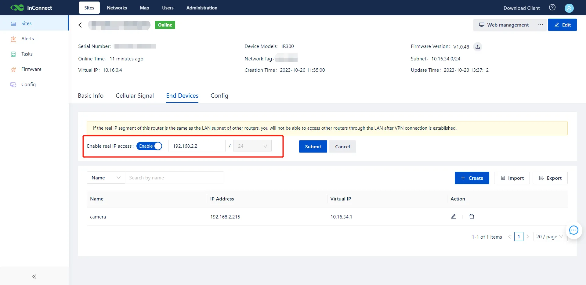

<strong>Figure 5-5 Enabling Real IP Access</strong>

3. Add the downstream device intended for real IP access.
4. Test the network connection using the real IP address.

**| Caution:** In this mode, IP addresses are determined by the local physical network. Identical IP subnets across different sites will cause access conflicts. To mitigate this, utilize the **Networks** module in InConnect to logically separate sites (see **6. Network Management**). When real IP access is enabled, the downstream device remains accessible via both its real and virtual IP addresses.

# 6. Network Management

## 6.1 Configuring a Mesh Network

A Mesh Network can be understood as: a fully interconnected VPN topology used to remotely maintain connections with various devices, such as PLCs, HMIs, and cameras, allowing peer-to-peer communication based on configuration.

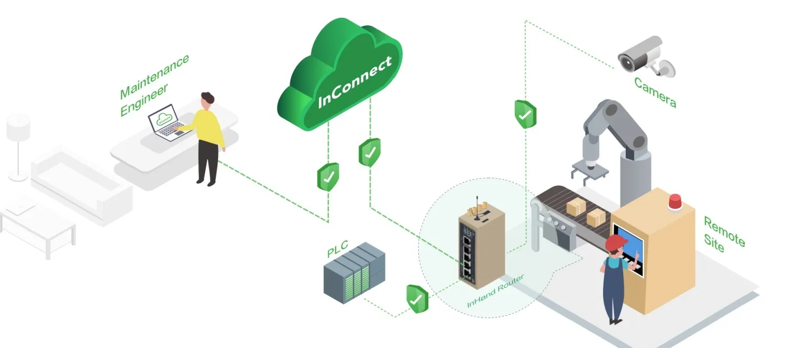

<strong>Figure 6-1 Mesh Network Topology</strong>

By default, all newly added routers are placed in the **Default Network**, which functions as a mesh network. If real IP access is enabled across routers in the same mesh network, IP conflict detection is enforced. To resolve duplicate IP addresses, routers can be placed into separate, newly created mesh networks, or real IP access can be selectively disabled.

The **Networks** module also facilitates access control and permission management.

### 6.1.1 Adding a Mesh Network

1. Navigate to **Networks** and click **+** to create a new network.

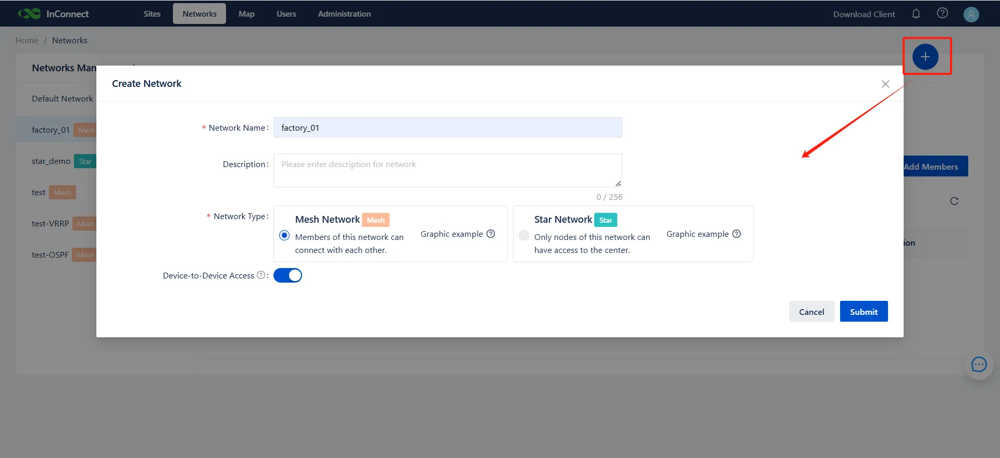

<strong>Figure 6-2 Adding a Network</strong>

2. Input the desired network name, select **Mesh Network** as the type, and click **Submit**.
3. Toggle the **Device-to-Device Access** switch as required.
4. Select the designated network members (users) and sites (routers), then click **Submit**.

**| Device-to-Device Access Switch Description:**
1. Enable this function to permit routers and terminal devices within the network to communicate with each other.
2. Disable this function for stricter security. When disabled, routers cannot access other routers or terminals in the network; however, authorized users in the network retain access to all routers and terminals.
3. The **Default Network** allows mutual access by default, and this setting cannot be modified.

<strong>Figure 6-3 Device-to-Device Access Settings</strong>

4. The newly created network will be visible on the **Network Management** page.

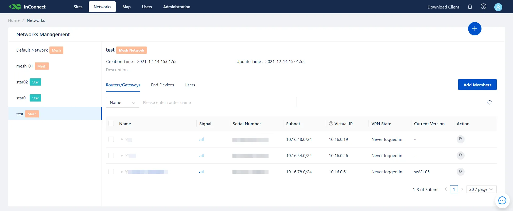

<strong>Figure 6-4 Network Management Page</strong>

**| Caution:**
1. A mesh network isolates network traffic. Users and devices in one mesh network cannot communicate with those in a different mesh network.
2. The **Default Network** is a built-in mesh network. New sites and users are placed here automatically. Only users and route sites in **Default Network** support mutual access.
3. Configuration of multiple mesh networks can prevent conflicts of real IP addresses. When a user needs to use the real IP address to access multiple terminals with the same real IP address, use either of the following management methods:
   - The user and all terminals are in the same mesh network. When necessary, the user enables the real IP address of a site on demand to avoid the IP conflict.
   - Add the terminals with the same real IP address to different mesh networks. When necessary, add the user to the corresponding mesh network to obtain the access permission, which avoids the IP conflict.

### 6.1.2 Adding a Site or User to a Mesh Network

1. Select the intended mesh network and click **Add Members**.

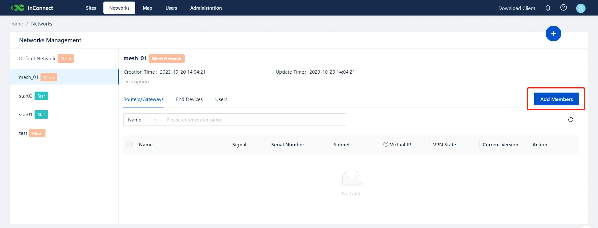

<strong>Figure 6-5 Adding Members to a Network</strong>

2. Choose the relevant user names and site names, then click **Submit**. If a real IP conflict exists between a router being added and an existing router in the mesh network, the addition will be blocked.

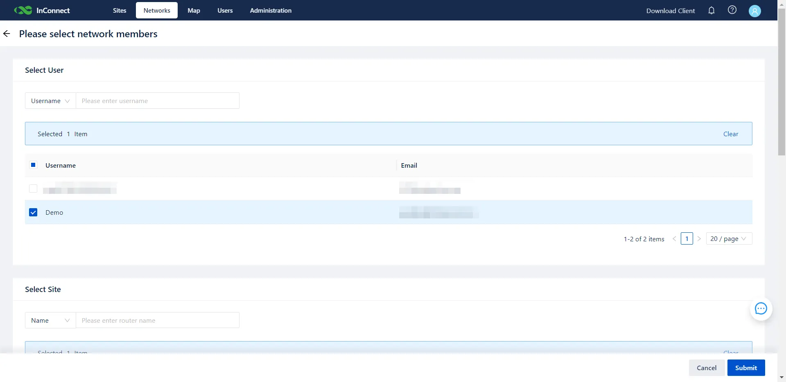

<strong>Figure 6-6 Selecting Users and Sites</strong>

3. To view all sites within the mesh network, select the **Sites** tab.

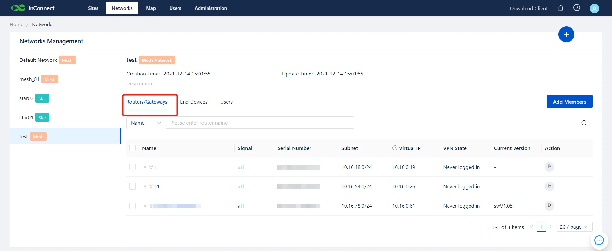

<strong>Figure 6-7 Network Sites List</strong>

4. To view all authorized users within the mesh network, select the **Users** tab.

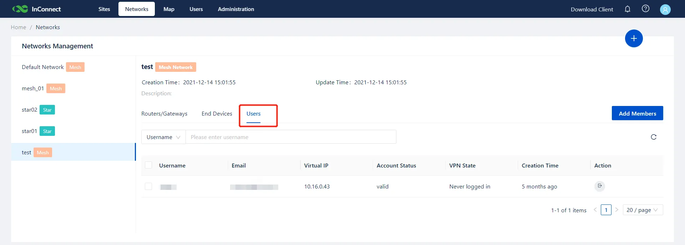

<strong>Figure 6-8 Network Users List</strong>

**| Caution:**
1. If an IP conflict occurs between the real IP-enabled router and any other routers in the mesh network, this router cannot be added to the mesh network.
2. For example, if 192.168.2.0 already exists in the mesh network and the IP address of the device to be added is also 192.168.2.0, an IP conflict occurs, and therefore this device cannot be added to the mesh network.

### 6.1.3 Move Sites/Users

1. **Move Sites**: On the Network Management page, navigate to **Routers/Gateways >> Move Site**. Select the destination network and confirm the action.

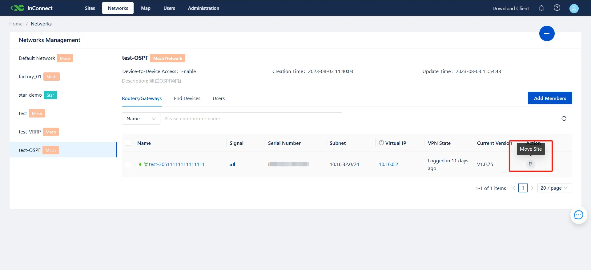

<strong>Figure 6-9 Moving a Site</strong>

2. **Move Users**: Navigate to **Users >> Move User**. Select the destination network and confirm the action.

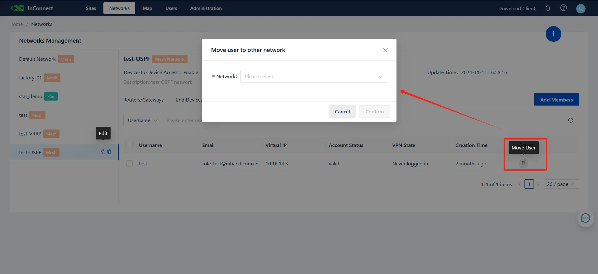

<strong>Figure 6-10 Moving a User</strong>

**| Caution:**
1. If an IP conflict occurs between the real IP-enabled router and any other routers in the **Default Network**, this router cannot be removed from the existing mesh network. For example, 192.168.2.0 already exists in the **Default Network**. If the IP address of the router to be deleted is also 192.168.2.0, an IP conflict occurs and therefore this router cannot be removed from its existing mesh network.
2. When multiple VPN servers exist within an organization, moving users between networks may require downloading and utilizing new OpenVPN configuration profiles. Proper network planning is advised.

### 6.1.4 Deleting a Mesh Network

1. A mesh network can only be deleted if it contains no users or sites. Remove all members first.
2. Locate the target mesh network, and click the **Delete** icon to remove it.

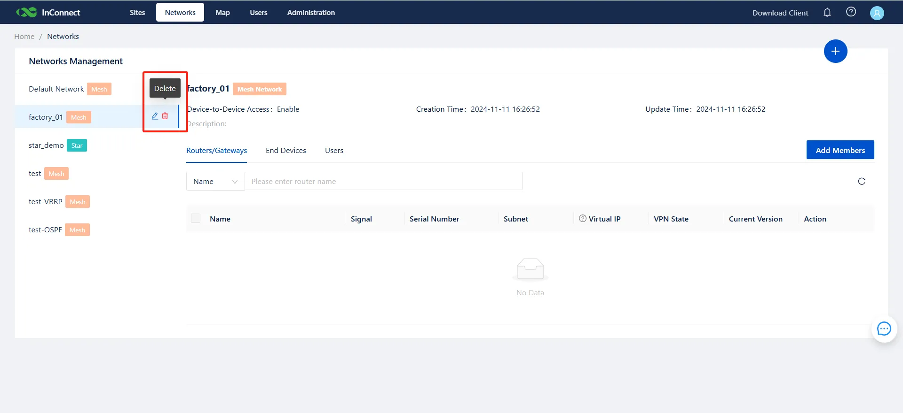

<strong>Figure 6-11 Deleting a Mesh Network</strong>

## 6.2 Configuring a Star Network

A Star Network can be understood as: a hub-and-spoke VPN topology designed primarily for telecommuting. It allows remote users to securely access corporate intranet servers via the InConnect channel.

The star network is explicitly intended for telecommuting scenarios. To remotely access distributed onsite devices (like PLCs), a **Mesh Network** is required.

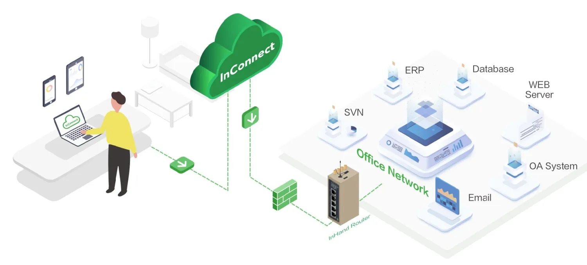

<strong>Figure 6-12 Star Network Topology</strong>

### 6.2.1 Adding a Star Network

1. Navigate to **Networks**, click **+**, specify a network name, select **Star Network**, input the designated center IP address, and click **Submit**.

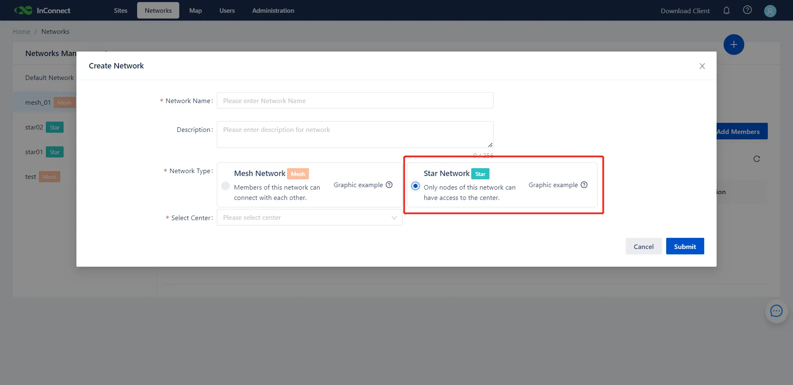

<strong>Figure 6-13 Creating a Star Network</strong>

2. Select the users and the central site to be included, and click **Submit**.
3. Verify the details of the newly created star network.

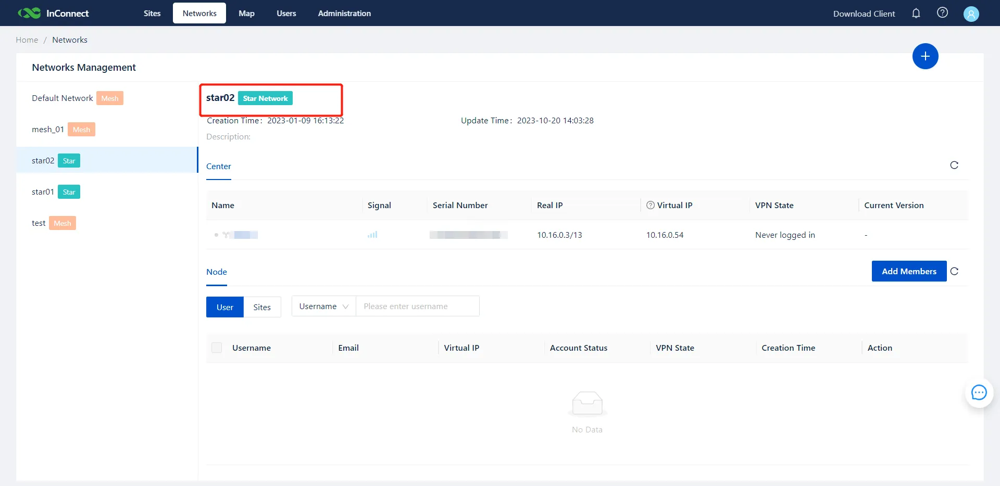

<strong>Figure 6-14 Star Network Details</strong>

4. The WAN port of the central router is typically used to bridge the network. Confirm the network parameters obtained on the WAN interface.
5. Users utilize the OpenVPN client to access the network segment defined behind the router's WAN port. Ensure the OpenVPN connection is active .

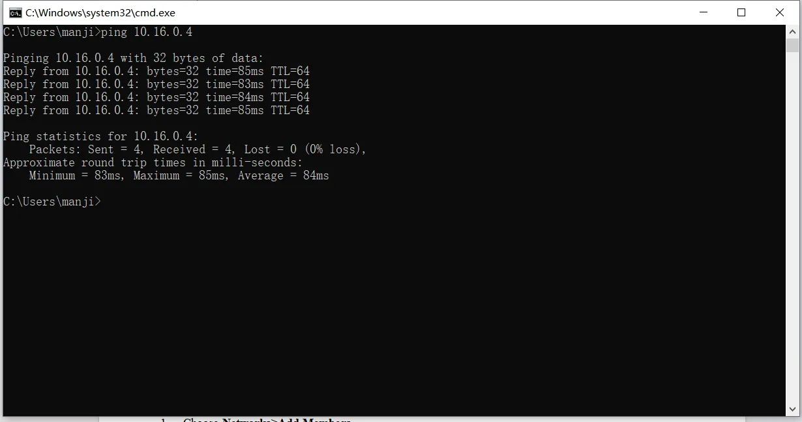

<strong>Figure 6-15 Star Network Access via OpenVPN</strong>

### 6.2.2 Adding a Site or User to a Star Network

1. Navigate to **Networks >> Add Members** within the specific star network view.

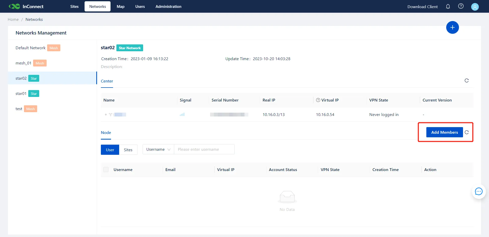

<strong>Figure 6-16 Adding Members to Star Network</strong>

2. Select the required users or sites and click **Submit**.
3. Verify the updated member list.

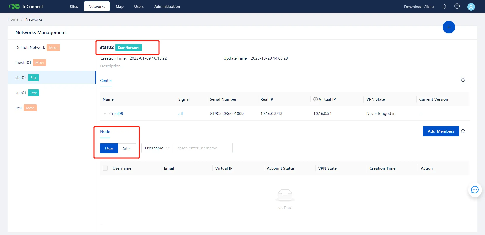

<strong>Figure 6-17 Star Network Members</strong>

### 6.2.3 Deleting a Star Network

1. Navigate to **Networks** and select the target star network.
2. Under the **Sites** tab, click the **Remove site** icon 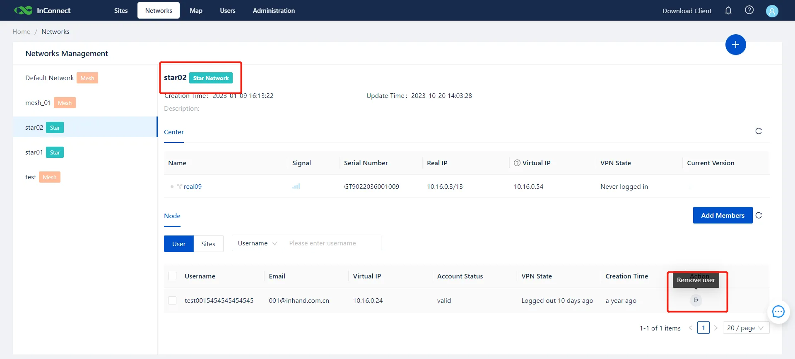 to clear the network.
3. Return to the network list and click the **Delete** icon to remove the star network entirely.

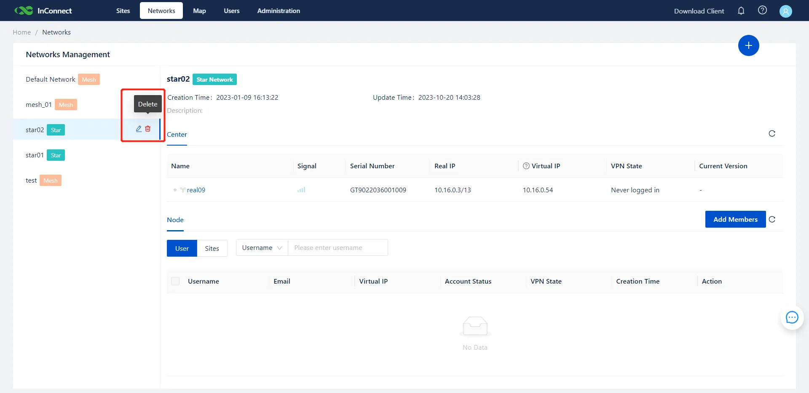

<strong>Figure 6-18 Deleting a Star Network</strong>

# 7. User Management

## 7.1 Adding a user

1. Navigate to the **Users** menu and click **Add** to create a new system account.

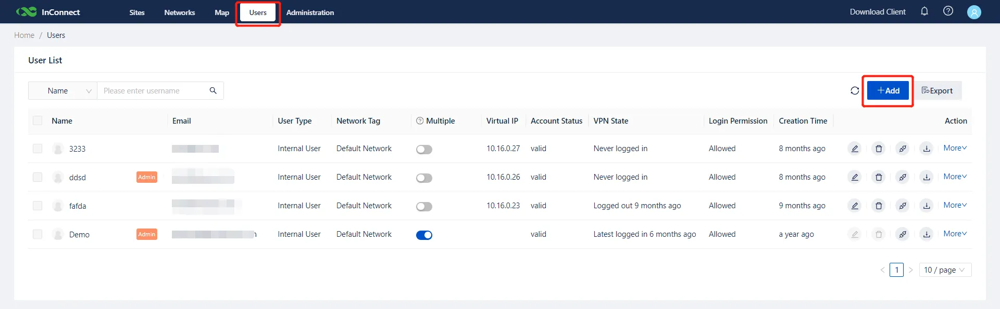

<strong>Figure 7-1 Adding a New User</strong>

2. Populate the required user information fields.

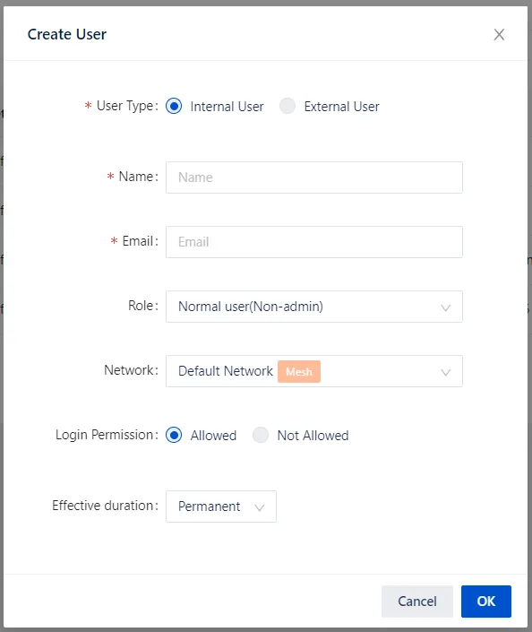

<strong>Figure 7-2 User Information Form</strong>

**| Caution:**
The **Login Permission** setting determines whether the user is authorized to access the InConnect web portal. If set to **Allowed**, the system sends an email containing login credentials. To create a VPN-only account that cannot access the web portal, set **Login Permission** to **Not Allowed**.

## 7.2 External User

External support personnel or enterprise users with existing InConnect email accounts can be invited to join an organization using the **External User** function.

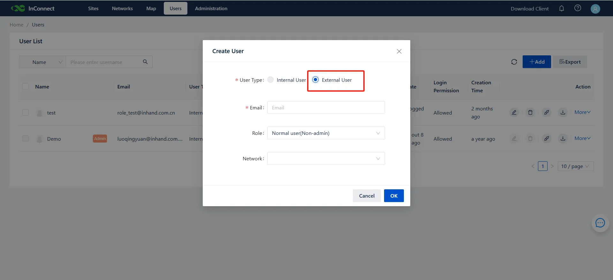

<strong>Figure 7-3 External User Interface</strong>

When adding a user, select **External User** as the User Type, enter their email address, and click **OK**. An invitation email is dispatched immediately.

Upon accepting the invitation, the external user is added to the organization and can seamlessly switch between multiple organizations via their personal center.

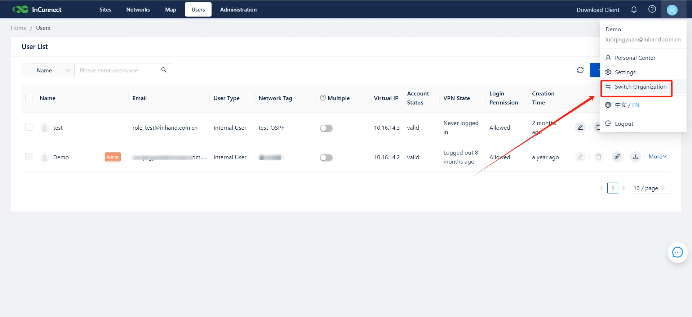

<strong>Figure 7-4 Switching Organizations</strong>

## 7.3 Role description

InConnect utilizes a role-based access control system:
1. **Administrator**: Possesses full read/write permissions for all data and comprehensive network management capabilities.
2. **Common User**: Restricted to basic operations on devices within their specifically assigned networks.

## 7.4 Multi-terminal description

1. Enabling the **Multiple** option allows a single user account to establish secure connections from multiple terminal devices simultaneously.
2. Because each terminal receives a unique virtual IP address, the **Virtual IP** column is hidden on the web interface when the **Multiple** setting is enabled.

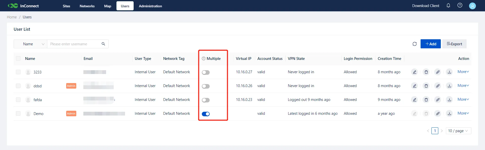

<strong>Figure 7-5 Multi-terminal Setting</strong>

# 8. Router/Gateway Management

## 8.1 Router List

The Router List interface supports custom column fields to facilitate device tagging (e.g., assigning customer ownership labels).

1. Click **Custom Fields** located in the upper-right corner of the list.

<strong>Figure 8-1 Custom Fields Button</strong>

2. Define the desired field (e.g., "customer") and click **Submit**.

<strong>Figure 8-2 Defining a Custom Field</strong>

Custom data can now be entered when adding, importing, or editing devices. These custom fields also serve as searchable parameters.

<strong>Figure 8-3 Custom Field Integration</strong>

## 8.2 Router Details

1. Navigate to **Sites** and select a specific router name on the **Routers** page to view detailed information.
2. The details page provides access to operations for online routers, including remote web management, configuration delivery, forced offline actions, and firmware upgrades.

<strong>Figure 8-4 Router Details Page</strong>

## 8.3 Remote Web Management

1. The router’s local web management page can be accessed remotely through the InConnect platform.
2. Click the remote access icon  to open the router’s interface and execute administrative tasks as if connected locally.

<strong>Figure 8-5 Initiating Remote Web Management</strong>

<strong>Figure 8-6 Remote Web Interface</strong>

## 8.4 Delivering the Connection Configuration

1. When a router or downstream device is added, InConnect automatically dispatches the running configuration to establish the VPN tunnel.
2. If a router is shown as online but the VPN status is disconnected, the configuration can be pushed manually. Click the **Send running Config** button to re-establish the connection.

<strong>Figure 8-7 Delivering Configuration</strong>

## 8.5 Remotely Updating the Router Configuration

This function permits batch updates of configurations across multiple routers connected to InConnect.

1. **Adding a configuration template**:
   - Navigate to **Config** and click **+**. Select an existing configuration file or manually input the configuration content.
   - Alternatively, download the original configuration from a router's local management page, modify it, and upload it to InConnect for batch deployment.

<strong>Figure 8-8 Uploading Configuration</strong>

2. Select the target routers and initiate the update command.
   - Online routers process the configuration update immediately.
   - Offline routers cache the command and process the update upon reconnecting to the platform.

<strong>Figure 8-9 Deploying Configuration to Routers</strong>

3. The configuration details page displays real-time progress and status for all targeted routers.

<strong>Figure 8-10 Configuration Update Progress</strong>

4. The **Configuration List** page provides management tools to view, delete, or re-deploy configuration files.

<strong>Figure 8-11 Configuration List</strong>

## 8.6 Remotely Upgrading the Router Firmware

Firmware for connected routers can be upgraded in batches via the InConnect platform.

1. **Adding the firmware**:
   - Navigate to **Firmware** and click **+**. Select the firmware binary and click **OK** to upload it to InConnect.

<strong>Figure 8-12 Uploading Firmware</strong>

2. Select the target routers from the list and click **OK** to dispatch the upgrade command.
   - Online routers initiate the firmware upgrade immediately.
   - Offline routers will commence the upgrade process once they regain connectivity.

<strong>Figure 8-13 Deploying Firmware</strong>

3. The firmware details page provides monitoring capabilities for the upgrade progress of all targeted devices.

<strong>Figure 8-14 Firmware Upgrade Progress</strong>

4. The **Firmware List** allows administrators to manage uploaded firmware files and execute batch upgrades.

<strong>Figure 8-15 Firmware List</strong>

## 8.7 Tasks

The **Tasks** page logs all automated commands (configurations, firmware upgrades) dispatched by InConnect. Administrators can monitor task statuses, re-trigger failed tasks, or cancel pending operations.

<strong>Figure 8-16 Task Management Page</strong>

# 9. Consumption

1. The **Consumption** page details the VPN data traffic utilized by specific routers or user accounts.
2. Total connection duration and aggregated traffic statistics are updated hourly. Detailed, granular usage data is refreshed every minute.

<strong>Figure 9-1 Consumption Dashboard</strong>

# 10. Billing

1. The InConnect service operates on a usage-based billing model, calculated from the VPN traffic generated between clients, users, and devices.
2. The **Billing** page facilitates account recharging. Agreement to the Payment Terms is required prior to processing transactions.

**| Caution:** InConnect provides an initial 10-GB traffic allowance to ensure uninterrupted initial service. If the account is not recharged upon depletion of this allowance, VPN services are suspended. Services are restored immediately upon successful account recharge.

3. Detailed transaction records are accessible on the **Charges** tab, and official receipts can be downloaded for accounting purposes.
4. Consumption logs on the **Billing** page are updated periodically.
5. An automated monthly invoice detailing the previous month's traffic consumption and billing activity is sent via email on the first day of each month.

<strong>Figure 10-1 Billing Interface</strong>

# 11. Service Certificate

Upon organization registration, InConnect provisions a service certificate valid for 30 years, securing all OpenVPN communications.

System notifications are issued when a certificate nears expiration. The renewal process involves the following steps:

1. Log in to InConnect and navigate to the **Certificate Update** page via the notification prompt.

<strong>Figure 11-1 Certificate Update Notification</strong>

2. Select all applicable users and click **Update Certificates**. Once updated, new OpenVPN profiles become available for download.

**| Caution:** Following the certificate update, previously issued OpenVPN configuration files are rendered invalid. Users must deploy the newly downloaded profiles.

<strong>Figure 11-2 Updating User Certificates</strong>

3. Click **Update Certificate and Deploy** and allow the deployment process to finish. Administrators may also schedule this update for a designated maintenance window.

<strong>Figure 11-3 Deploying Server Certificate</strong>

4. Once the server update concludes, distribute the OpenVPN configuration files (downloaded in Step 2) to users to restore remote access.

**| Caution:**
- It is advisable to download the new OpenVPN configurations immediately after updating user certificates (Step 2) to prepare for the transition.
- The new OpenVPN profiles only become active after the server certificate is updated and deployed (Step 3). The legacy profiles remain functional until the server deployment occurs.
- Only administrators possess the authorization to execute the **Update Server Certificate and Deploy** operation.

# FAQ

- **Q1: How many user accounts and routers can be added to a single InConnect account?**
  - **A1:** An account supports a maximum of 4,000 users and routers. Each router can accommodate up to 254 downstream devices. For assistance with device additions or IP allocation issues, contact support at [ics-service@inhand.com](mailto:ics-service@inhand.com).

- **Q2: How is the InConnect service billed?**
  - **A2:** Billing is based on data traffic transmitted through the VPN tunnel between routers, end devices, and users. The current rate is US$ 2.5 per GB.

- **Q3: What is the baseline monthly traffic for an idle router maintaining an active VPN connection?**
  - **A3:** An idle router consumes approximately 30-40 MB of data per month to maintain network heartbeats and management overhead.

- **Q4: Where is the InConnect server infrastructure deployed?**
  - **A4:** To ensure optimal performance and compliance, infrastructure is deployed globally: Amazon Web Services (AWS) in China for domestic users, AWS in the U.S. for international users, and localized deployments within Europe.

- **Q5: How can Device Manager and InConnect be accessed via InHand Cloud Service?**
  - **A5:** Detailed instructions are available at: [https://help.inhand.com/portal/en/kb/articles/access-to-device-manager](https://help.inhand.com/portal/en/kb/articles/access-to-device-manager).

# Appendix: Router Networking

## Method 1: Access the network through dial-up or SIM card

The following procedure uses the IR915 as an example. For other models, refer to the respective hardware user manual or visit [https://www.inhandnetworks.com/](https://www.inhandnetworks.com/).

1. Insert the SIM card into Slot 1 and secure the 4G LTE antenna to the ANT terminal.

<strong>Figure A-1 Inserting the SIM Card</strong>

**| Caution:** To prevent data loss or hardware damage, the device must be powered off before inserting or removing a SIM card.

2. Access the router's web management interface (see **Method 2: Ethernet**).
3. Navigate to **Network >> Cellular >> Enable**. Wait for the network status to display **Connected** and verify IP address allocation. If a specialized private network APN is required, input the appropriate dial-up parameters.

<strong>Figure A-2 Cellular Configuration</strong>

4. If utilizing dual SIM functionality, enable the **Dual SIM Enable** option.

## Method 2: Ethernet

The following procedure uses the IR915 as an example. For details about networking of other devices, see the hardware user manual or visit [https://www.inhandnetworks.com/](https://www.inhandnetworks.com/).

**| Caution:** When utilizing an Ethernet WAN connection without an active SIM card, disable the cellular interface to prevent continuous dial-up attempts that may interfere with network stability.

<strong>Figure A-3 Disabling Cellular Interface</strong>

1. Connect a PC to the LAN port (FE 1/1 or GE1/1) and connect the WAN port to an active internet source.

<strong>Figure A-4 Ethernet Connections</strong>

2. Ensure the PC and router reside on the same network segment.
   - **Method 1 (Recommended):** Configure the PC to obtain an IP address automatically via DHCP.
   - **Method 2 (Static):** Manually assign a static IP address to the PC within the 192.168.2.x subnet (e.g., 192.168.2.2). Set the subnet mask to 255.255.255.0 and the default gateway to 192.168.2.1.

<strong>Figure A-5 IP Configuration Settings</strong>

3. Access **192.168.2.1** in a web browser to reach the login page.
4. Authenticate using the appropriate credentials and click **Sign In**.

<strong>Figure A-6 Router Login Page</strong>

5. Navigate to **Wizards >> New WAN** to configure the WAN port for internet access.

<strong>Figure A-7 WAN Configuration Wizard</strong>

6. Select **Dynamic Address (DHCP)** if connecting to a standard network. If connecting to a specific infrastructure, select **Static IP Address** and manually input the required network parameters.

<strong>Figure A-8 DHCP vs Static IP Configuration</strong>

7. Navigate to **Tools >> Ping**. Enter a known public domain (e.g., a common website) to verify internet connectivity. A successful ping indicates functional internet access.

<strong>Figure A-9 Ping Diagnostic Tool</strong>

## Method 3: Wi-Fi

The following procedure uses the IR915 as an example. For details about networking of other devices, see the hardware user manual or visit [https://www.inhandnetworks.com/](https://www.inhandnetworks.com/).

**| Caution:** When utilizing Wi-Fi as the primary WAN connection without an active SIM card, disable the cellular interface to prevent connectivity interference.

1. Connect the PC to the gateway's LAN port and attach the Wi-Fi antennas to the WLAN1/2 terminals.

<strong>Figure A-10 Wi-Fi Antenna Connection</strong>

2. Ensure the PC and router reside on the same network segment (refer to **Method 2: Ethernet**).
3. Access the web management interface.
4. Navigate to **Network >> WLAN**. Set the **Interface Type** to **Client**, input the local Wi-Fi SSID and security parameters, and click **Apply & Save**. Verify on the **Status** tab that the connection is active.
5. Proceed to **Wizards >> New WAN** and configure the appropriate parameters to bind the WAN to the wireless interface.
6. Navigate to **Firewall >> Network Address Translation (NAT)**. The presence of a connection labeled `dot11radio 1` confirms the Wi-Fi routing is operational.

<strong>Figure A-11 NAT Verification for Wi-Fi</strong>

