# Overview
## Product Overview
The MDT600 is a high-performance embedded development platform based on the Rockchip RK3576 processor. This product adopts an 8nm process technology, integrating a powerful computing core with rich interface resources. It is specifically designed for edge computing, industrial automation, AI applications, and multimedia processing scenarios. Default system is **Android 14.**

Core Processor: The RK3576 uses an octa-core 64-bit ARM architecture, including 4 high-performance Cortex-A72 cores and 4 high-efficiency Cortex-A53 cores, supporting dynamic power management to balance high performance and low power requirements.

AI Acceleration Capability: Features a built-in independent NPU (Neural Processing Unit) with computing power up to 6 TOPS. It supports various precision calculations (INT4/INT8/INT16/FP16) and can efficiently run AI models based on frameworks like TensorFlow and PyTorch.

Multimedia Capability: Supports 8K@30fps video decoding (H.264/H.265/AV1, etc.) and 4K@60fps encoding. Integrates a high-performance ISP (Image Signal Processor), supporting 16MP camera input and HDR processing.

Interface Richness: Provides a variety of industrial-grade peripheral interfaces, including RS485, RS232, CAN-FD, SATA, Gigabit Ethernet, GPIO (DI/DO), USB 3.0/2.0, Fingerprint, NFC, TFCARD, AHD video input etc., meeting the needs for complex device connection and control.

This product is suitable for intelligent gateways, machine vision, security surveillance, intelligent retail, and other scenarios requiring high-performance computing, AI inference, and multi-peripheral integration.

## Appearance and Interface Definitions
### Appearance
<!-- 这是一张图片，ocr 内容为： -->
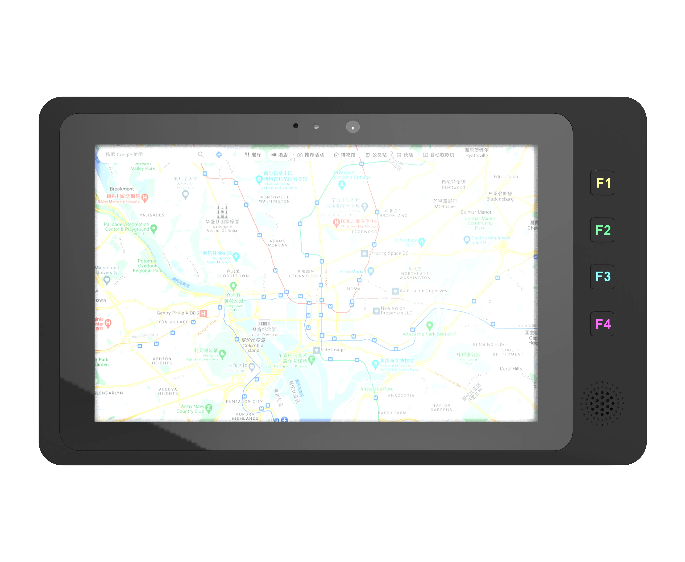

<!-- 这是一张图片，ocr 内容为： -->
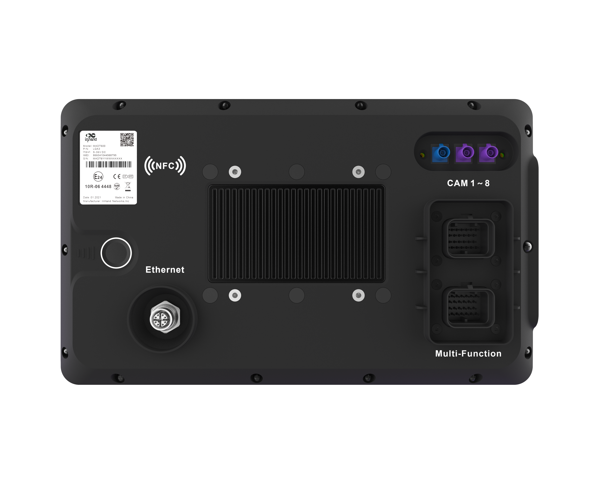

<font style="color:#333333;">All models are equipped with blue GNSS FAKRA C-coded male connectors. Purple Celluar FAKRA D- Coded male only MDT600-XXXX-ANT external antenna model for use.</font>

<!-- 这是一张图片，ocr 内容为： -->
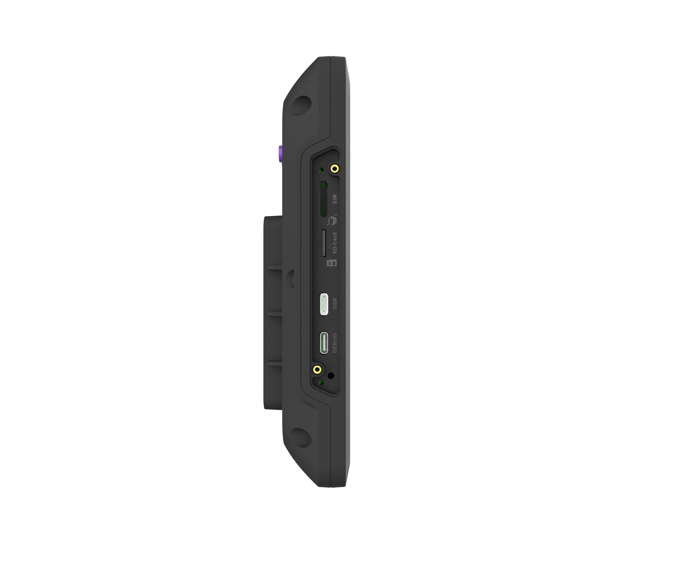

### Multi-function Interface
The multi-function interface is shown in the figure below:

<!-- 这是一张图片，ocr 内容为： -->
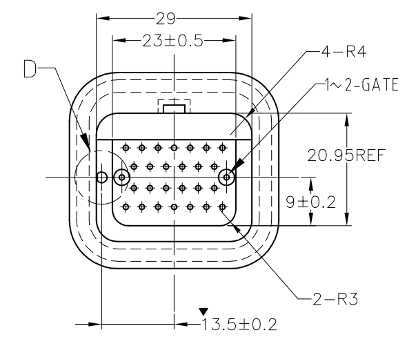

Uses Amphenol connector ECON250001 ATS15-26PA-BM01.

PIN definition, PIN numbers in order from left to right, top to bottom:

| PIN | 1 | 2 | 3 | 4 | 5 | 6 | 7 |
| --- | --- | --- | --- | --- | --- | --- | --- |
| 1 | VIN+ | IGT | HI_IN2 | LI_IN3 | CI_IN4 | CI_IN5 | CI_IN6 |
| PIN | 8 | 9 | 10 | 11 | 12 | 13 |  |
| 2 | VIN- | LO_OUT1 | LO_OUT2 | GND | RS485_A | RS485_B /RS232_TX |  |
| PIN | 14 | 15 | 16 | 17 | 18 | 19 |  |
| 3 | RS232_RX | CAN1-H | CAN1-L | CAN-H | CAN-L | GND |  |
| PIN | 20 | 21 | 22 | 23 | 24 | 25 | 26 |
| 4 | LO_OUT3 | LO_OUT4 | GND | Left Channel Audio Output | Right Channel Audio Output | GND | MIC |


+ <font style="color:rgb(15, 17, 21);">The figure above shows the pinout for version MB V1.4. For version MB V1.3, PIN13 is RS485B, and PIN15 is RS232_TX.</font>

The hardware design schematic diagram is as follows:

<!-- 这是一张图片，ocr 内容为： -->
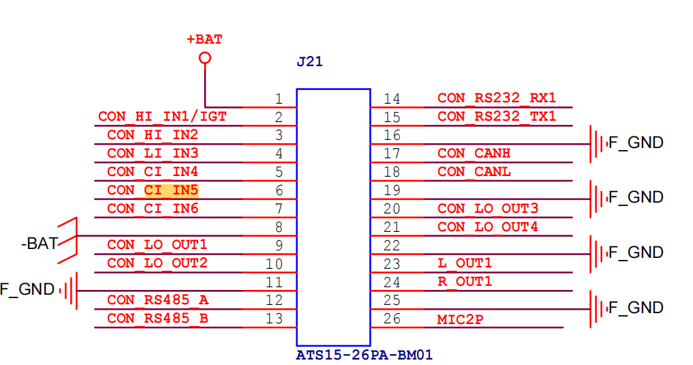

### Video Interface
<!-- 这是一张图片，ocr 内容为： -->


| PIN | 1 | 2 | 3 | 4 | 5 | 6 | 7 |
| --- | --- | --- | --- | --- | --- | --- | --- |
| | GND | VIN1 | VDD1 | GND | VIN2 | VDD2 | - |
| PIN | 8 | 9 | 10 | 11 | 12 | 13 |  |
| | GND | VIN3 | VDD3 | GND | VIN4 | VDD4 | |
| PIN | 14 | 15 | 16 | 17 | 18 | 19 | |
| | GND | AHD5 | VCC5 | GND | AHD6 | VCC6 | |
| PIN | 20 | 21 | 22 | 23 | 24 | 25 | 26 |
| | GND | AHD7 | VCC7 | GND | AHD8 | VCC8 | GND |


	The corresponding schematic diagram is shown below:

<!-- 这是一张图片，ocr 内容为： -->
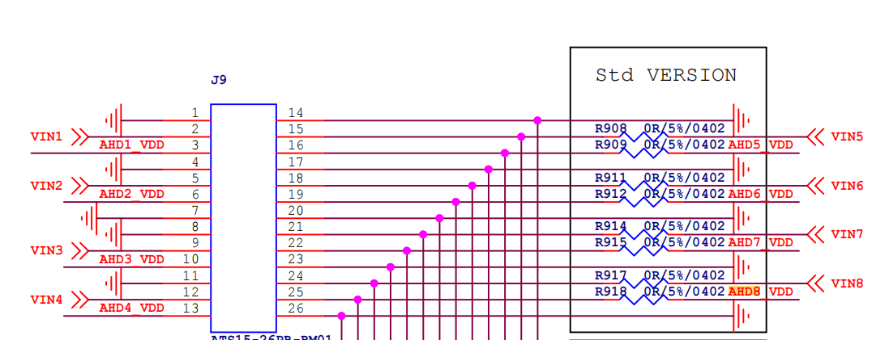

# Development Environment Preparation
## Driver Installation
Please use [DriverAssitant_v5.13.zip](https://inhandnetworks.yuque.com/attachments/yuque/0/2026/zip/23194738/1775726744530-fecd978b-585e-4a68-b138-6b349d0b794e.zip)DriverAssitant_v5.13.zip to install the necessary drivers on Windows (Win11 recommended).

## Enabling USB ADB Environment
### Physical Connection
Connect one end of the Type-C cable to the PC and the other end to the debug port of the MDT600, as shown below:

<!-- 这是一张图片，ocr 内容为： -->
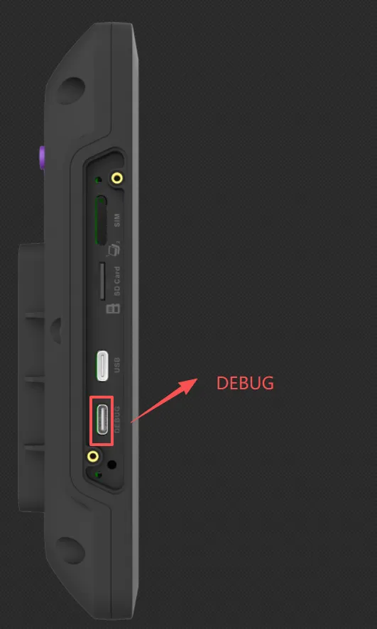

### Entering Developer Mode
1. Click on System Settings.

<!-- 这是一张图片，ocr 内容为： -->
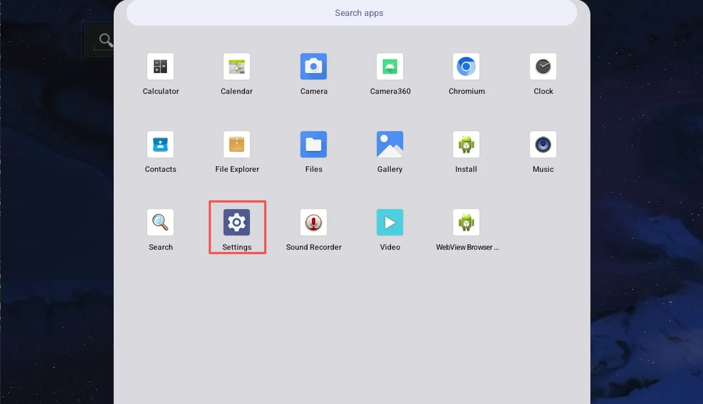

2. Click "About tablet", then repeatedly tap "Build number".

<!-- 这是一张图片，ocr 内容为： -->
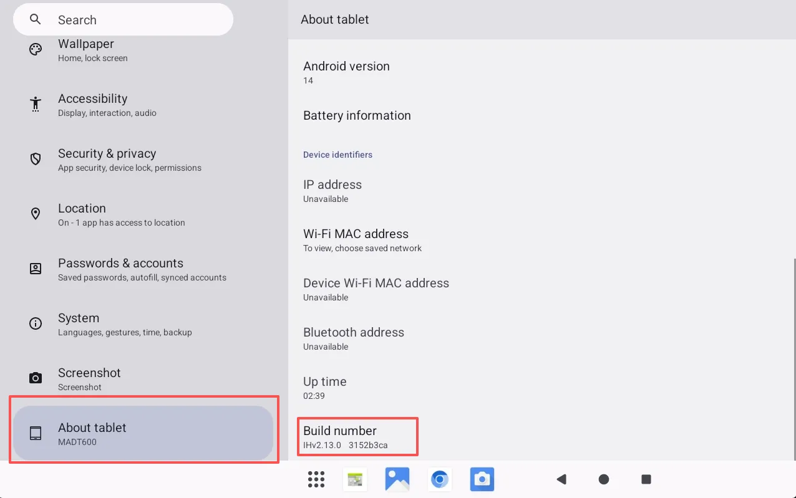

3. Continue until "No need, you are already a developer" appears.

<!-- 这是一张图片，ocr 内容为： -->
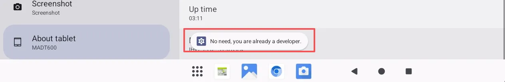

4. Then click "System", find "Developer options".

<!-- 这是一张图片，ocr 内容为： -->
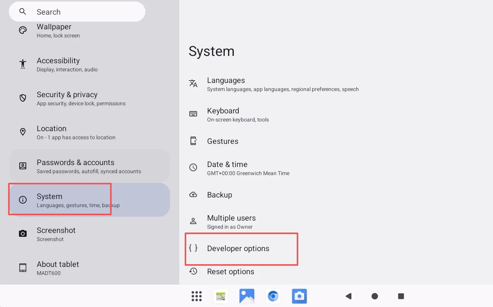

### Enabling USB Debugging
In the Debugging section, turn on "USB debugging".

<!-- 这是一张图片，ocr 内容为： -->
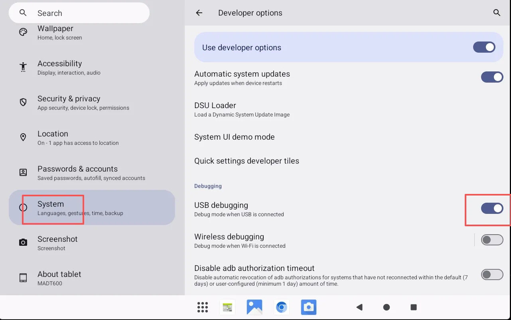

### Downloading ADB Software
Download the ADB software. Please refer to the following link to download Android's platform-tools: 

```bash
https://developer.android.com/tools/releases/platform-tools
```

### Executing adb shell
Execute the adb shell command. If successful, it indicates the ADB environment has been set up correctly, as shown below:

<!-- 这是一张图片，ocr 内容为： -->


For ADB usage, please refer to the following link: 

```bash
https://adbshell.com/
```

Note: ADB uses the debug port, but the debug port and the USB port are mutually exclusive because they share the same host controller. When using the debug function, the USB acts as a device. When using the USB port, e.g., for external USB drives or mice, the USB acts as a host. The following figure shows the USB port:

<!-- 这是一张图片，ocr 内容为： -->
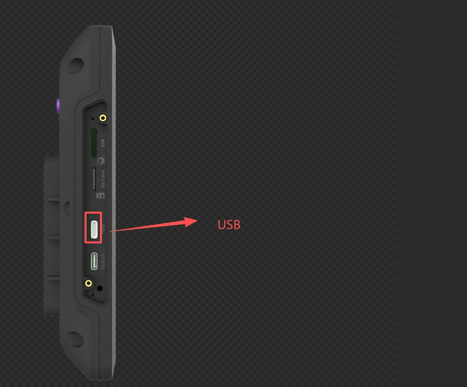

## Enabling Network ADB
On the MDT600 device, using Network ADB is recommended over USB ADB because USB ADB may cause the cellular network and USB port to be unavailable, as the cellular modem and the USB port use the same USB host controller.

### Connecting to WiFi
Connect both the MDT600 and the computer to the same local area network via WiFi.

### Enabling Wireless Debugging
#### Enter Developer Options
Open Developer Options, please refer to section 2.2.2.

#### Enable "Wireless debugging"
<!-- 这是一张图片，ocr 内容为： -->
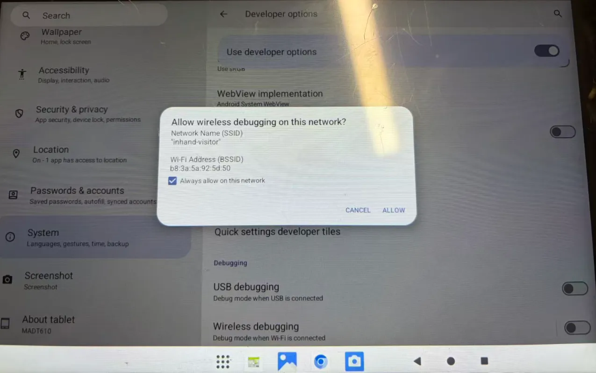

### Connecting to Device via Network ADB
#### Obtain the device's Wireless network IP address.
<!-- 这是一张图片，ocr 内容为： -->
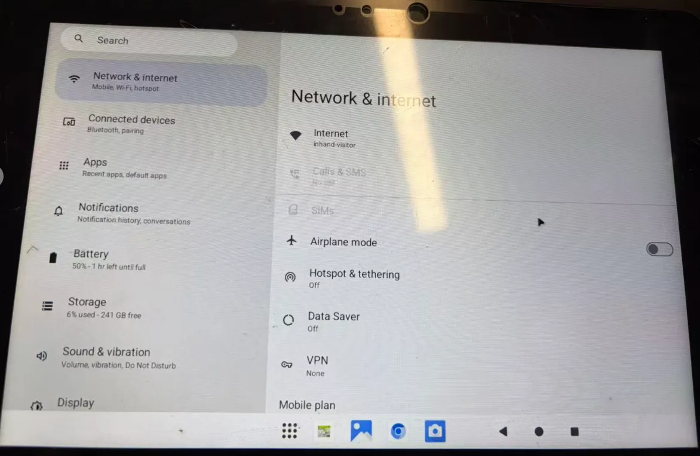<!-- 这是一张图片，ocr 内容为： -->
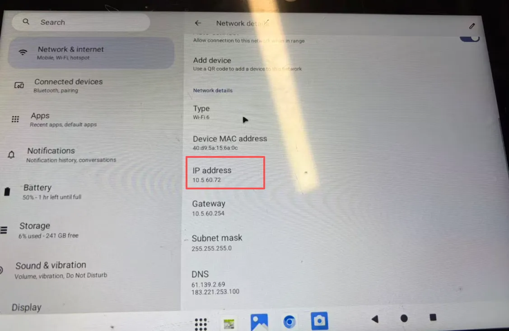

#### Connect to the device
```bash
adb connect 10.5.60.72
#Command returns result：connected to 10.5.60.72:5555

adb devices
#List of devices attached
#10.5.60.72:5555 device
```

# Firmware Flashing and OTA Upgrade
If the device cannot boot normally, you can try to recover the device by flashing the firmware. The steps for firmware flashing are as follows.

## Firmware Flashing
### Extract the flashing tool
Extract the flashing tool [RKDevTool_v3.30_for_window.zip](https://inhandnetworks.yuque.com/attachments/yuque/0/2026/zip/23194738/1775727029699-a4a22861-5485-4f66-8566-c196f594744f.zip).

### Modify Configuration
Open config.ini with a text editor and set Selected to 2 (1-Chinese, 2-English).

<!-- 这是一张图片，ocr 内容为： -->
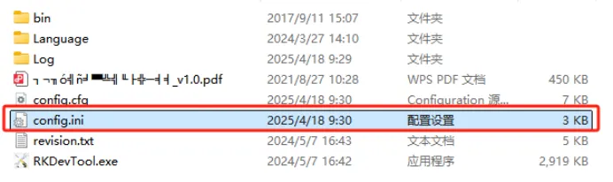

### Browse Firmware
Run RKDevTool.exe, then select "Upgrade Firmware", click "Firmware" to browse to the firmware file, e.g., MADT600_std_fw_2.13.0_20251114.1752.img.

<!-- 这是一张图片，ocr 内容为： -->
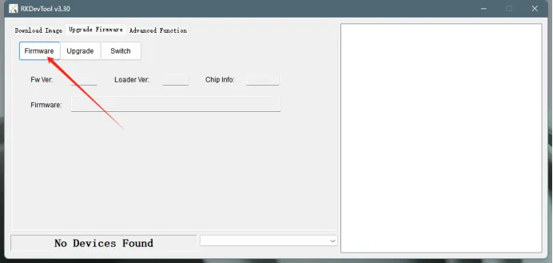

### Device Entering Download Mode
Connect one end of the Type-C cable to the PC and the other end to the MDT600's debug port. Press and hold the F3 button while powering on the device. The device will enter recovery mode. Then execute the command adb shell reboot loader. After the device restarts, RKDevTool will discover a loader device, as shown below:

<!-- 这是一张图片，ocr 内容为： -->
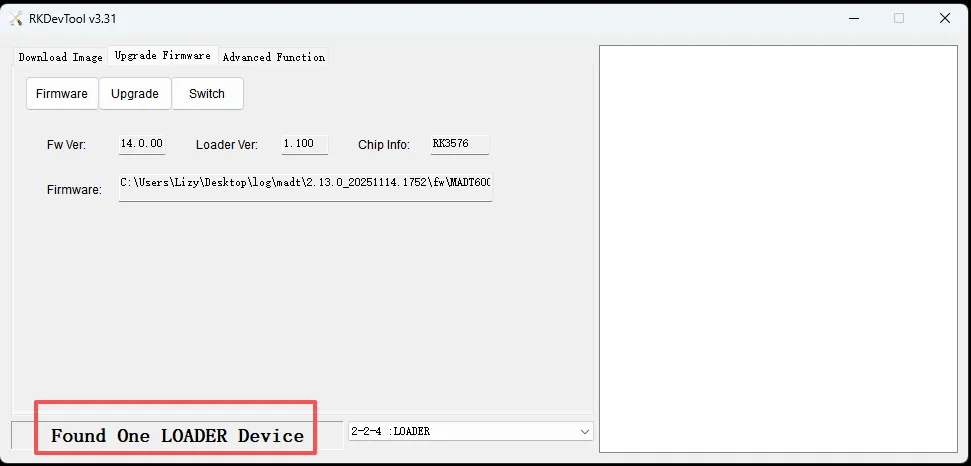

### Flashing
Click "Upgrade" and wait until the flashing is complete.

<!-- 这是一张图片，ocr 内容为： -->
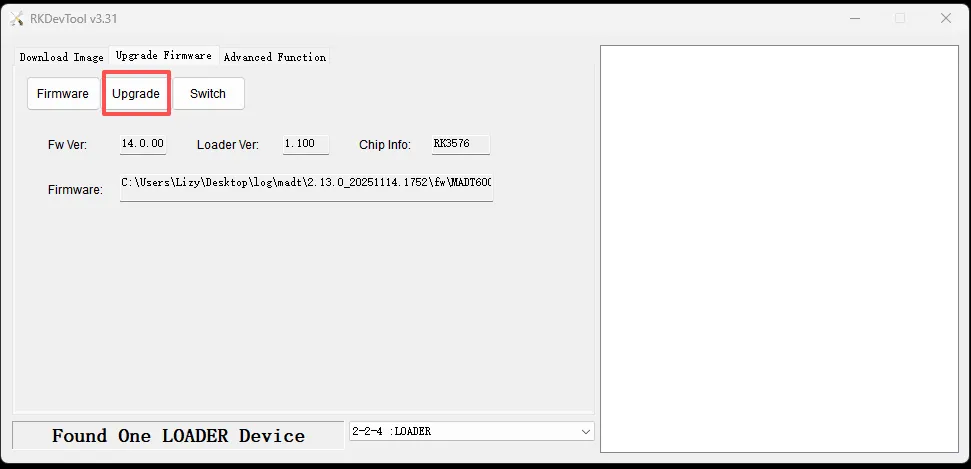<!-- 这是一张图片，ocr 内容为： -->
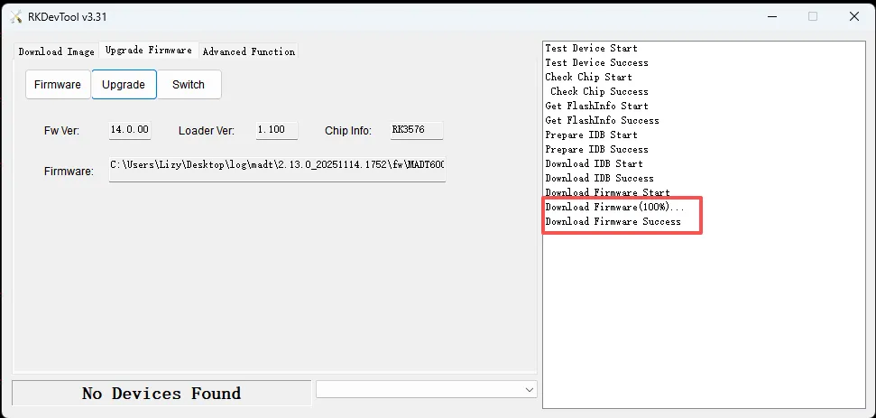

## OTA Upgrade
### USB Drive Upgrade
#### Copy OTA package to USB drive
Copy the OTA upgrade package, e.g., MADT600-ota-2.13.0-20251114.1752.zip, to the root directory of the USB drive and rename it to update.zip.

#### Disable USB Debug on the device
Turn off USB Debug mode in Developer Options. Disconnect the PC from the debug port because the debug port and USB port are mutually exclusive.

#### Upgrade
Insert the USB drive into the MDT600, as shown below:

<!-- 这是一张图片，ocr 内容为： -->
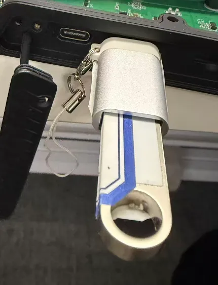

Then click "Settings" -> "System" -> "Udisk system updates", as shown below:

<!-- 这是一张图片，ocr 内容为： -->
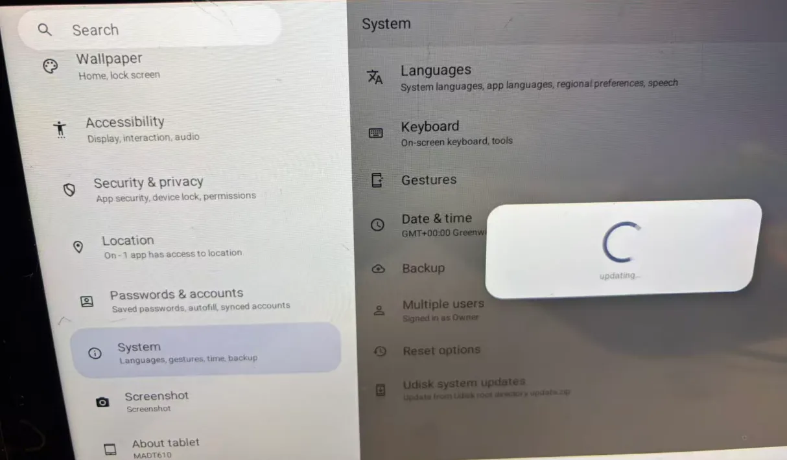

### Command Line Upgrade
#### Push OTA package to the device
Push the OTA upgrade package to the device and rename it to update.zip.

```bash
#example
adb push .\MADT600-ota-2.13.0-20251114.1752.zip /sdcard/update.zip
```

#### Execute the upgrade command
Execute the upgrade instruction:

```bash
am broadcast -a com.ubox.upgraderom --include-stopped-packages
```

# Android Peripheral Interface Development Guide
## Ethernet
Ethernet can be configured as a WAN interface or a LAN interface. As a LAN interface, only the IP address and subnet mask need to be configured for this network interface. If configured as a WAN port, the IP address, subnet mask, gateway address, DNS address, etc., need to be configured.

### WAN Interface
When used as a WAN interface, it can obtain an IP address via DHCP or use a static IP configuration.

#### DHCP
The figure below shows the DHCP networking method.

<!-- 这是一张图片，ocr 内容为： -->
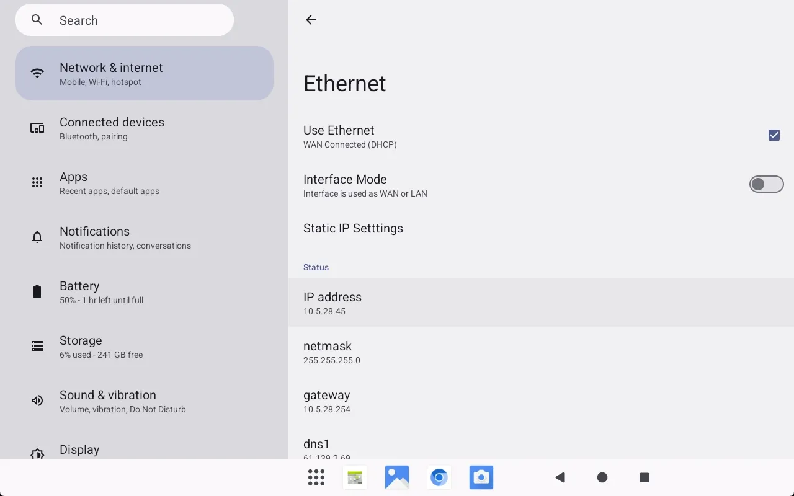

#### STATIC IP
The figure below shows the operation method for setting a static IP.

First, click on Static IP Settings.

<!-- 这是一张图片，ocr 内容为： -->
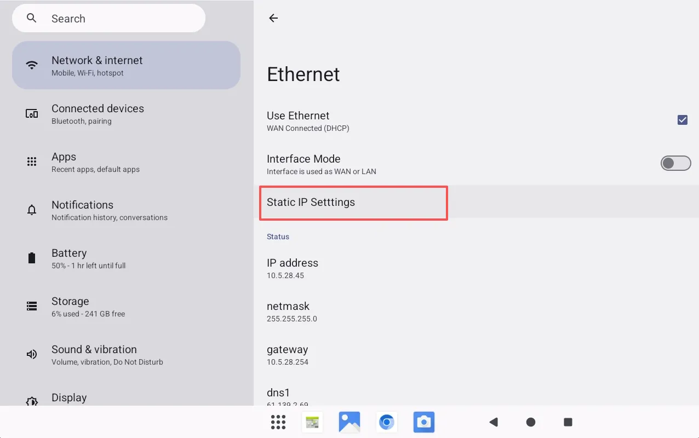

Check the box to use a static IP.

<!-- 这是一张图片，ocr 内容为： -->
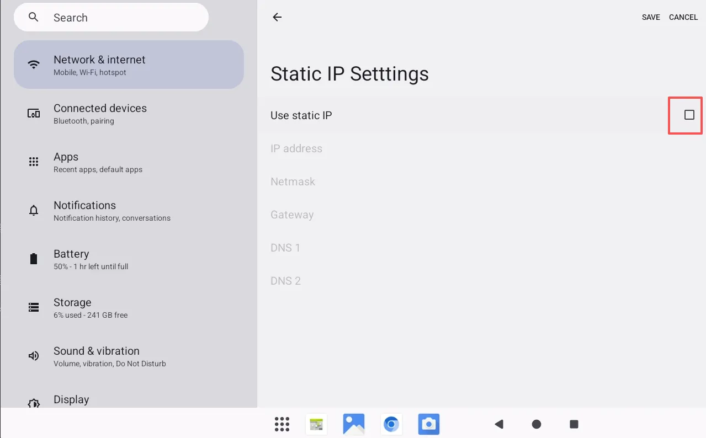

Fill in the IP address, Netmask, Gateway, DNS1, DNS2 respectively. Then click SAVE.<!-- 这是一张图片，ocr 内容为： -->
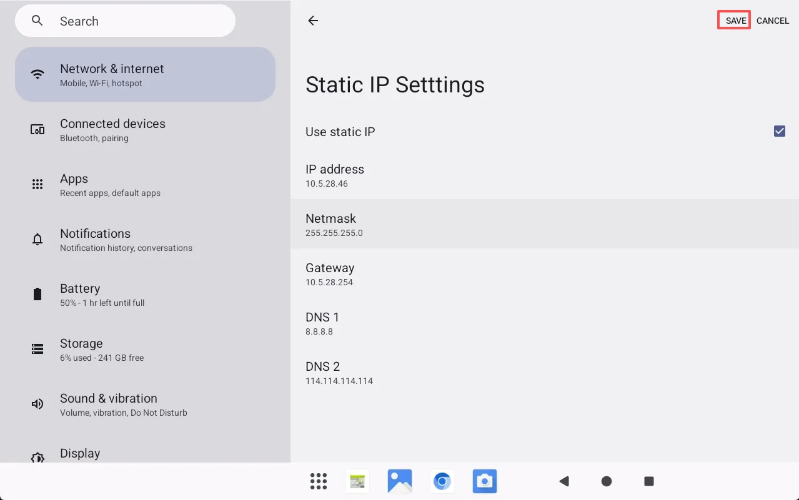<!-- 这是一张图片，ocr 内容为： -->
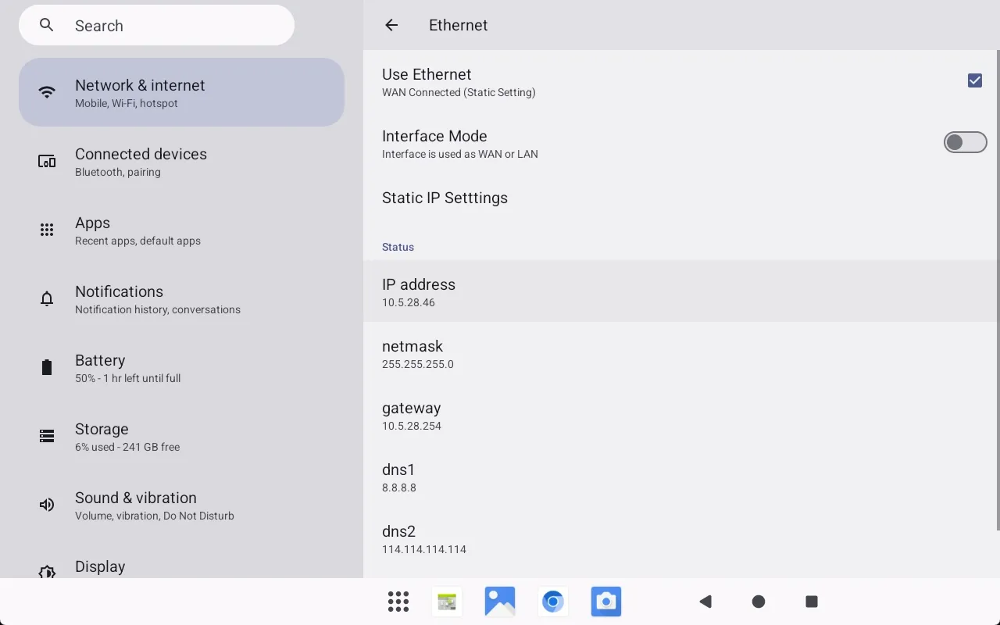

### LAN
Switch between WAN or LAN mode by clicking the interface mode, as shown below:<!-- 这是一张图片，ocr 内容为： -->
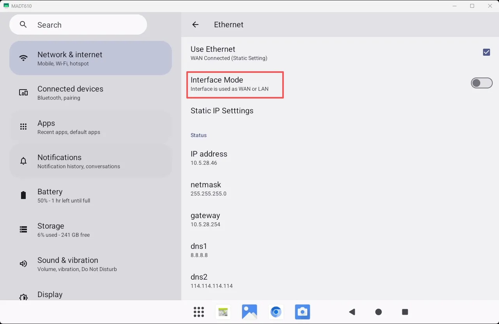<!-- 这是一张图片，ocr 内容为： -->
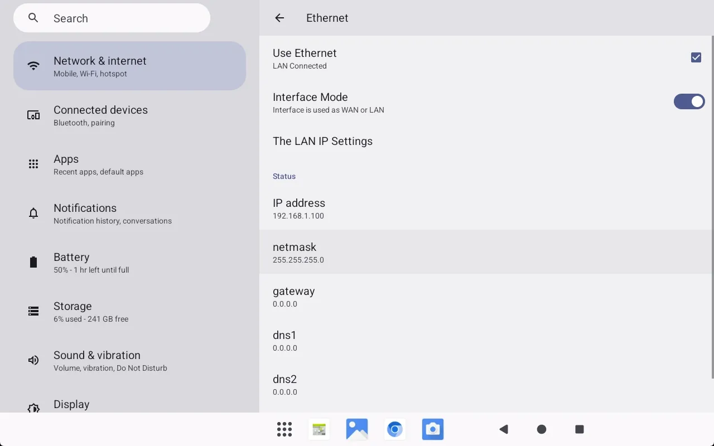

After switching to LAN mode, the default IP address and subnet mask are 192.168.1.100 and 255.255.255.0, respectively.

## Audio
### Audio Playback
The MDT600 has a built-in SPEAKER and also supports analog audio output on PIN-23 and PIN-24 of the Multi-Function interface.

For volume adjustment, please refer to the following image:

<!-- 这是一张图片，ocr 内容为： -->
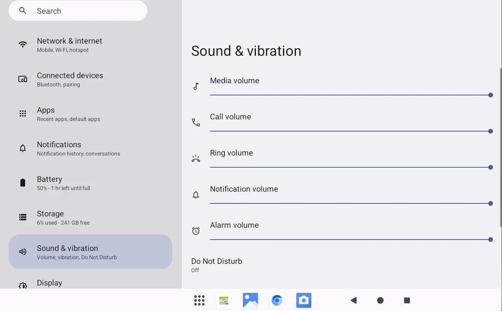

### Audio Recording
#### Description
The MDT600 has a built-in MIC and also supports analog audio signal input (Headset), connected via PIN26 of the Multi-Function interface.

#### Demo Project
app_test_audio.zip

[app_test_audio.zip](https://inhandnetworks.yuque.com/attachments/yuque/0/2026/zip/23194738/1775727339091-c4ca3b8d-214b-44f1-9d71-a6ab79a3db32.zip)

The demo project includes source code and an APK. The APK can be installed directly via the adb install command.

The testing steps for the demo project are as follows:<!-- 这是一张图片，ocr 内容为： -->


When clicking MIC Record, speak towards the MIC. The recording will last for 10 seconds and then stop automatically, displaying the save path. Then click Play to play the recorded sound. Clicking Headset works similarly.

## Camera
The MDT600 supports connecting up to 4 AHD cameras simultaneously. The system camera only displays the feed from the first camera. We have implemented an app that can preview multiple Camera feeds simultaneously.

[app_test_locamera.zip](https://inhandnetworks.yuque.com/attachments/yuque/0/2026/zip/23194738/1775728954009-9606eba4-e241-4b11-8ba3-d72baed8e05f.zip) contains the APK and source code.

First, install the APK file.

```bash
adb install app_test_locamera.apk
```

Click START to begin preview, as shown below:

<!-- 这是一张图片，ocr 内容为： -->
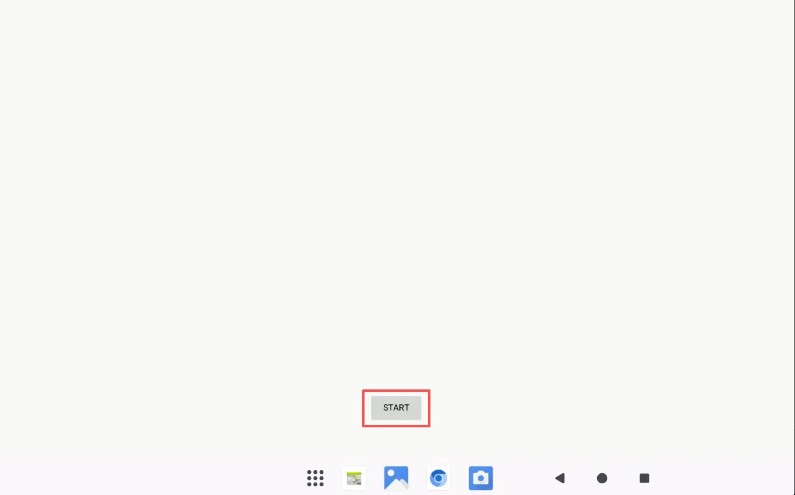

After starting the preview, the effect is as follows:

<!-- 这是一张图片，ocr 内容为： -->
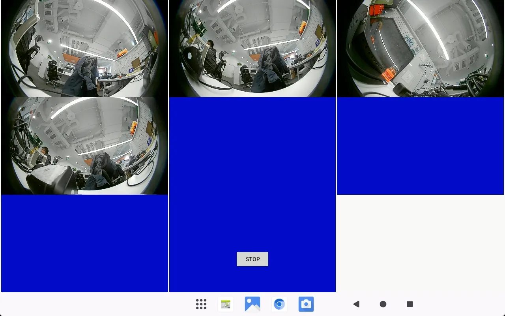

## CAN
[app_test_can.zip](https://inhandnetworks.yuque.com/attachments/yuque/0/2026/zip/23194738/1775727818108-12a309a8-6e30-47f6-8766-1bc77e6feb75.zip) contains the test APK and source code.

The test APK is located in the apk directory as IhCANDemo_debug.apk. Install it directly via the adb command.

```bash
adb install IhCANDemo_debug.apk
```

Note: The internal CAN bus parameter settings in IhCANDemo_debug.apk are as follows:

```bash
ip link set can0 down
ip link set can0 type can bitrate 500000 sample-point 0.8 dbitrate 2000000 sample-point 0.8 fd on
ip link set can0 up
```

Open the app. The app can receive data sent by the other party and can also input data to be sent, then click "Send" to transmit.

As shown below:

<!-- 这是一张图片，ocr 内容为： -->
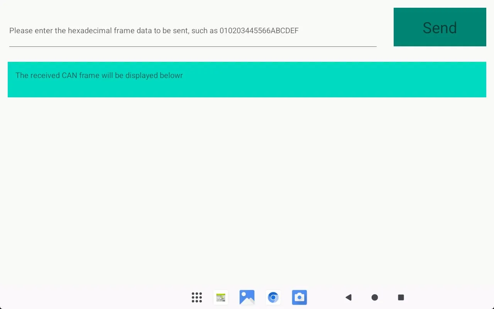

## NFC
[app_test_nfc.zip](https://inhandnetworks.yuque.com/attachments/yuque/0/2026/zip/23194738/1775727866900-8254582b-21eb-4020-b9ae-dff639fe02c7.zip) contains the APK and source code.

The APK is located in the apk directory within app_test_nfc.zip. The APK installation command is as follows:

```bash
adb install app_test_nfc.apk
```

After opening the APK, click "Enable NFC", then tap an NFC card on the NFC area on the back of the MDT600 to get the card ID. As shown below:<!-- 这是一张图片，ocr 内容为： -->
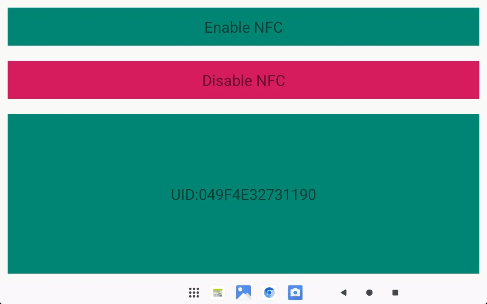

## RS232/RS485
The corresponding serial port device for RS232 is /dev/ttyS8.

The corresponding serial port device for RS485 is /dev/ttyS1.

Using RS232 as an example, extract [SerialPortUtility_r2.1.1.zip](https://inhandnetworks.yuque.com/attachments/yuque/0/2026/zip/23194738/1775727902938-a148c43f-aac2-4648-9c7d-2c921a78be44.zip), then install the serial port tool via the adb command. The command is as follows:

```bash
adb install SerialPortUtility_r2.1.1.apk
```

Connect the RS232 and the peer device properly. Here, we use a USB-to-RS232 adapter connected to a PC. Then open the SerialPortUtility App. As shown below:<!-- 这是一张图片，ocr 内容为： -->
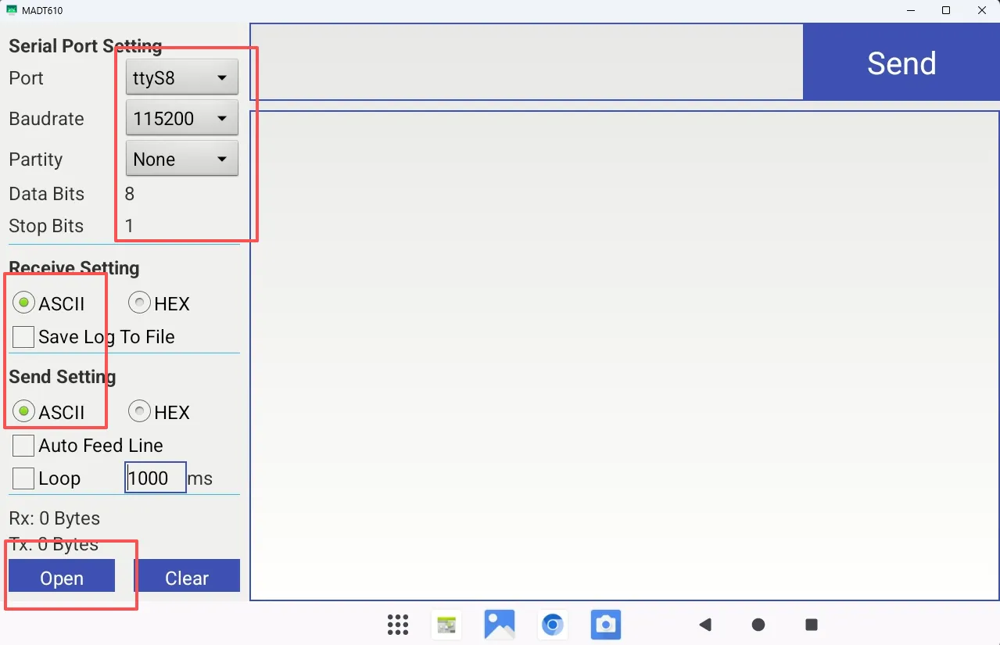

Input the data to be sent, for example: "MDT600 Send RS232 Test Data". As shown below:<!-- 这是一张图片，ocr 内容为： -->
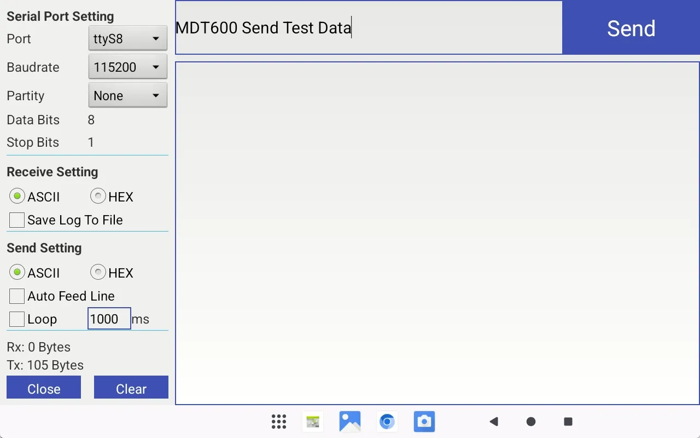

The PC end receives the data, as shown below:<!-- 这是一张图片，ocr 内容为： -->
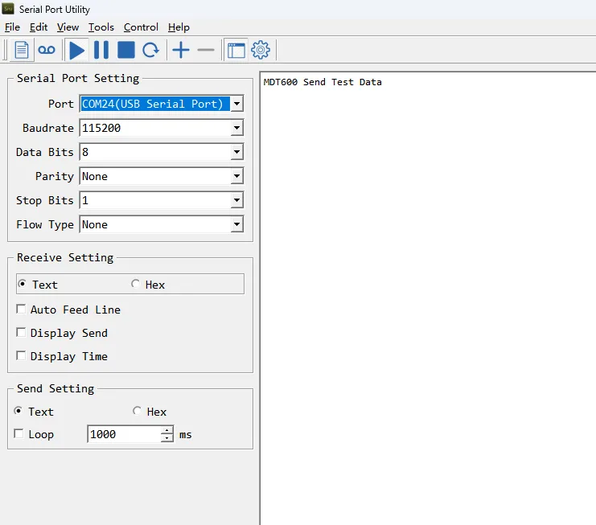

Similarly, when the PC sends data to the MDT600, as shown below:<!-- 这是一张图片，ocr 内容为： -->


The MDT600 receives the data, as shown below:<!-- 这是一张图片，ocr 内容为： -->
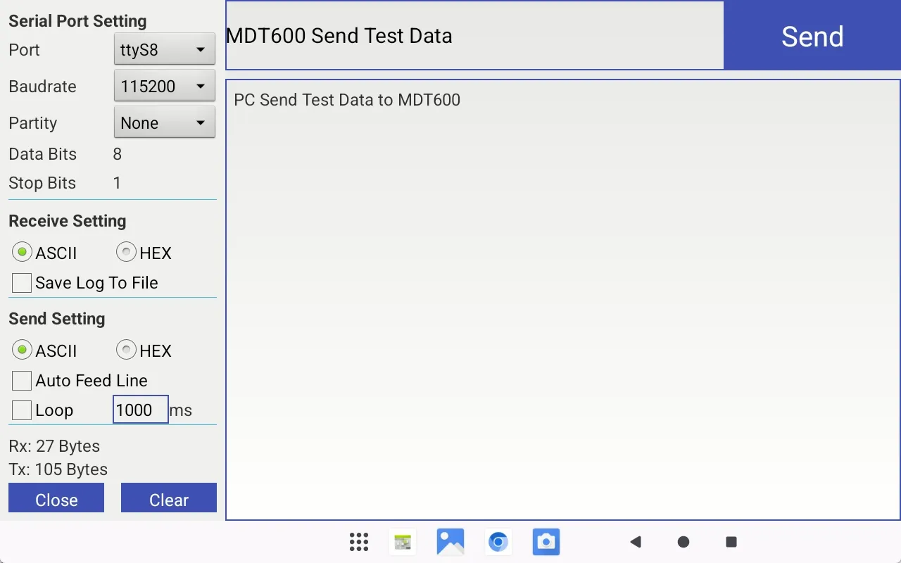

The testing method for RS485 is the same as for RS232.

## Display
### Setting System Full Screen
To set the system to full screen, you need to enable "Settings" -> "Display" -> "Full Screen". Note that enabling or disabling full-screen display requires a restart to take effect. As shown below:<!-- 这是一张图片，ocr 内容为： -->
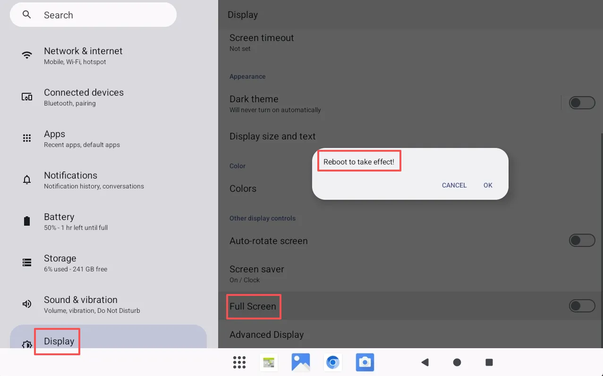

## GNSS
The version number of the GNSS module can be viewed via ADB commands, as shown below:

```bash
#通过属性服务获取GNSS的版本号
getprop vendor.lc29h.firmware.version
#输出内容如下：
#LC29HCANR11A07S_DSA4
```

After extracting [gps_test.zip](https://inhandnetworks.yuque.com/attachments/yuque/0/2026/zip/23194738/1775728098086-5eec7fdf-f008-4024-800e-32e9e1a7de90.zip), you get gps_test.apk. Then install it via the adb command.

```bash
adb install gps_test.apk
```

<!-- 这是一张图片，ocr 内容为： -->
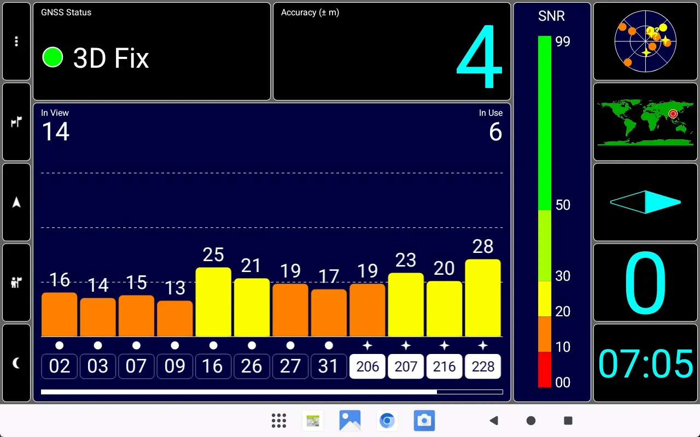

## Fingerprint
The fingerprint module includes fingerprint enrollment and fingerprint verification.

The [app_test_finger.zip](https://inhandnetworks.yuque.com/attachments/yuque/0/2026/zip/23194738/1775728126554-d45071b0-ddce-46fc-8217-d55ff68efbcf.zip) contains the APK and source code. Install app_test_finger-release.apk.

```bash
adb install app_test_finger-release.apk
```

### Fingerprint Enrollment
Click ENROLL in the APP to perform fingerprint enrollment, as shown below:<!-- 这是一张图片，ocr 内容为： -->
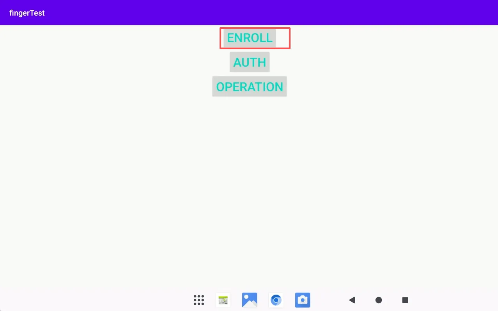

Place your finger on the fingerprint module. The enrollment progress will be displayed. If enrollment is successful, it will show 100%.<!-- 这是一张图片，ocr 内容为： -->


### Fingerprint Verification
Click AUTH to verify the enrolled fingerprint. Then touch the fingerprint module. If verification is successful, it will display as follows:<!-- 这是一张图片，ocr 内容为： -->
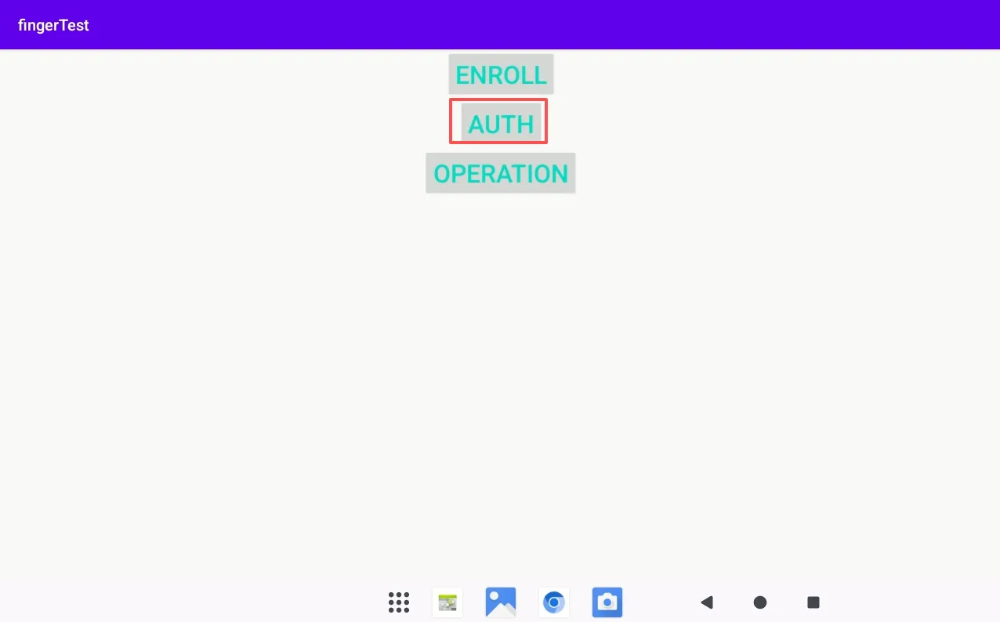<!-- 这是一张图片，ocr 内容为： -->
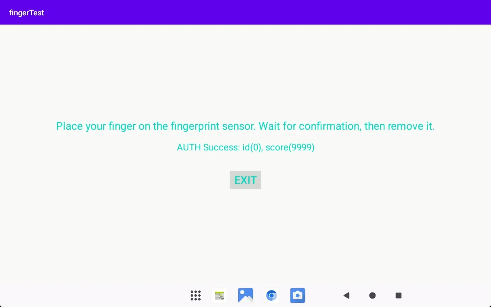

## SATA
### Partitioning and Formatting (Optional Operation)
Partitioning and formatting operations are mainly for replacing a new SATA disk or wanting to re-partition and format the SATA disk. Otherwise, proceed with caution to avoid data loss.

#### Confirm Device File
Confirm the SATA device file with the following operation:

```bash
ls -l /sys/class/block | grep sata
#lrwxrwxrwx 1 root root 0 2025-11-25 08:03 sde -> ../../devices/platform/2a240000.sata/ata1/host1/target1:0:0/1:0:0:0/block/sde
```

Confirm via the command that the SATA device is /dev/block/sde.

#### Partition the SATA disk
The disk partitioning operation is as follows:

```bash
#1. Clear the partition table
sgdisk --zap-all /dev/block/sde

# 2. Create a GPT Partition Table
sgdisk --clear /dev/block/sde

# 3. Create Partition
sgdisk --new=0:0:0 --typecode=0:EBD0A0A2-B9E5-4433-87C0-68B6B72699C7 --change-name=0:"disk" /dev/block/sde
```

#### Format the SATA disk
##### ext4 filesystem
If the system has already mounted it, you need to perform an umount operation, as follows:

```bash
mount |grep vold
#/dev/block/vold/public:8,65 on /mnt/media_rw/disk type ext4 (rw,dirsync,seclabel,nosuid,nodev,noatime)
#/dev/block/vold/public:8,65 on /mnt/pass_through/0/501b31dc-db21-4681-afcf-cc581e723022 type ext4 (rw,dirsync,seclabel,nosuid,nodev,noatime)

umount /mnt/pass_through/0/501b31dc-db21-4681-afcf-cc581e723022
umount /mnt/media_rw/disk	
```

Perform the formatting operation:

```bash
mkfs.ext4 /dev/block/sde1
#mke2fs 1.46.6 (1-Feb-2023)
#/dev/block/sde1 contains a ext4 file system
#        last mounted on /storage/501b31dc-db21-4681-afcf-cc581e723022 on Tue Nov 25 10:14:41 2025
#Proceed anyway? (y,N) y
#Discarding device blocks: done
#Creating filesystem with 62514513 4k blocks and 15630336 inodes
#Filesystem UUID: f2c757db-aaee-4633-82e5-434ab49d432a
#Superblock backups stored on blocks:
#        32768, 98304, 163840, 229376, 294912, 819200, 884736, 1605632, 2654208,
#        4096000, 7962624, 11239424, 20480000, 23887872

#Allocating group tables: done
#Writing inode tables: done
#Creating journal (262144 blocks): done
#Writing superblocks and filesystem accounting information: done

#重启设备
reboot
```

Then restart the device. sde1 will be mounted under the /mnt/media_rw/disk directory. However, the ext4 filesystem cannot specify uid and gid when mounting, so to ensure the app can access it normally, you need to modify the permissions.

```bash
chmod 777 /mnt/media_rw/disk
```

##### exfat filesystem
Similarly, perform the umount operation first.

```bash
 mount | grep vold
/dev/block/vold/public:8,65 on /mnt/media_rw/disk type ext4 (rw,dirsync,seclabel,nosuid,nodev,noatime)
/dev/block/vold/public:8,65 on /mnt/pass_through/0/f2c757db-aaee-4633-82e5-434ab49d432a type ext4 (rw,dirsync,seclabel,nosuid,nodev,noatime)

#执行umount操作
umount /mnt/pass_through/0/f2c757db-aaee-4633-82e5-434ab49d432a
umount /mnt/media_rw/disk
```

Perform the formatting operation:

```bash
mkfs.exfat /dev/block/sde1
#exfatprogs version : 1.1.1
#Creating exFAT filesystem(/dev/block/sde1, cluster size=131072)

#Writing volume boot record: done
#Writing backup volume boot record: done
#Fat table creation: done
#Allocation bitmap creation: done
#Upcase table creation: done
#Writing root directory entry: done
#Synchronizing...

#exFAT format complete!

#重启设备
reboot
```

### Mount Location and Read/Write
The SATA hard drive is mounted at `/mnt/media_rw/disk`. You can read and write to this directory through a file manager.<!-- 这是一张图片，ocr 内容为： -->
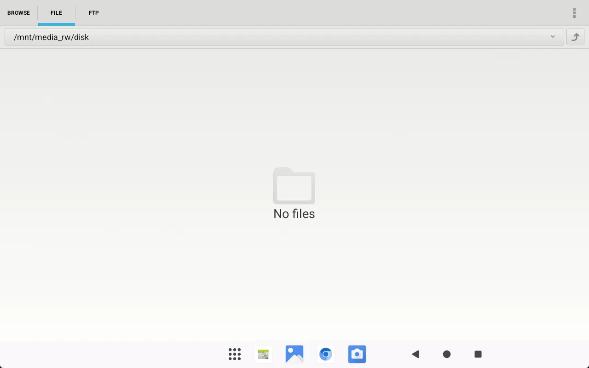

## IMU
The IMU module uses the LSM6DSOW module, which integrates a 3-axis digital accelerometer and a 3-axis digital gyroscope.

[app_test_sensor.zip](https://inhandnetworks.yuque.com/attachments/yuque/0/2026/zip/23194738/1775728167656-64469068-aa43-419e-bace-c7fd4b1c4fd9.zip) contains the APK and source code. After extraction, the APK file can be found in the apk/release directory. Then install it via adb.

```bash
adb install app_test_sensor-release.apk
```

Then open the app, and you will get the following display:<!-- 这是一张图片，ocr 内容为： -->
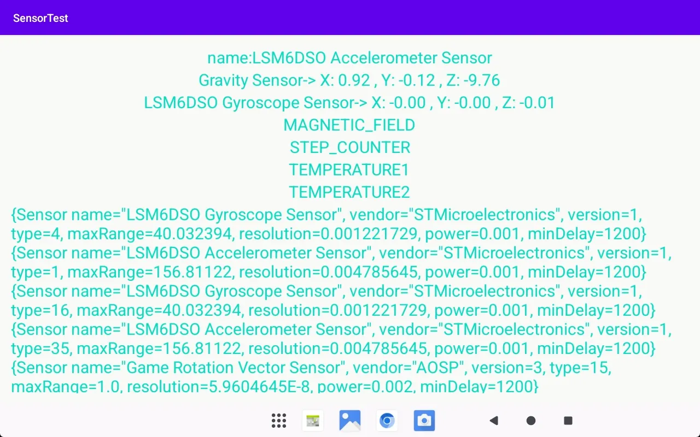

## **EEPROM**
### **Device Node**
The read/write device node for the EEPROM is located at /sys/bus/nvmem/devices/5-00501/nvmem.

### Read Operation
```bash
android:/sys/bus/nvmem/devices/5-00501 # xxd nvmem
#00000000: ffff ffff ffff ffff ffff ffff ffff ffff  ................
#00000010: ffff ffff ffff ffff ffff ffff ffff ffff  ................
#00000020: ffff ffff ffff ffff ffff ffff ffff ffff  ................
#00000030: ffff ffff ffff ffff ffff ffff ffff ffff  ................
#00000040: ffff ffff ffff ffff ffff ffff ffff ffff  ................
#00000050: ffff ffff ffff ffff ffff ffff ffff ffff  ................
#00000060: ffff ffff ffff ffff ffff ffff ffff ffff  ................
#00000070: ffff ffff ffff ffff ffff ffff ffff ffff  ................
#00000080: ffff ffff ffff ffff ffff ffff ffff ffff  ................
#00000090: ffff ffff ffff ffff ffff ffff ffff ffff  ................
#000000a0: ffff ffff ffff ffff ffff ffff ffff ffff  ................
#000000b0: ffff ffff ffff ffff ffff ffff ffff ffff  ................
#000000c0: ffff ffff ffff ffff ffff ffff ffff ffff  ................
#000000d0: ffff ffff ffff ffff ffff ffff ffff ffff  ................
#000000e0: ffff ffff ffff ffff ffff ffff ffff ffff  ................
#000000f0: ffff ffff ffff ffff ffff ffff ffff ffff  ................
```

### Write Operation
```bash
echo -n -e "\x12\x34\x56\x78\x87\x65\x43\x21" > nvmem
xxd nvmem
#00000000: 1234 5678 8765 4321 ffff ffff ffff ffff  .4Vx.eC!........
#00000010: ffff ffff ffff ffff ffff ffff ffff ffff  ................
#00000020: ffff ffff ffff ffff ffff ffff ffff ffff  ................
#00000030: ffff ffff ffff ffff ffff ffff ffff ffff  ................
#00000040: ffff ffff ffff ffff ffff ffff ffff ffff  ................
#00000050: ffff ffff ffff ffff ffff ffff ffff ffff  ................
#00000060: ffff ffff ffff ffff ffff ffff ffff ffff  ................
#00000070: ffff ffff ffff ffff ffff ffff ffff ffff  ................
#00000080: ffff ffff ffff ffff ffff ffff ffff ffff  ................
#00000090: ffff ffff ffff ffff ffff ffff ffff ffff  ................
#000000a0: ffff ffff ffff ffff ffff ffff ffff ffff  ................
#000000b0: ffff ffff ffff ffff ffff ffff ffff ffff  ................
#000000c0: ffff ffff ffff ffff ffff ffff ffff ffff  ................
#000000d0: ffff ffff ffff ffff ffff ffff ffff ffff  ................
#000000e0: ffff ffff ffff ffff ffff ffff ffff ffff  ................
#000000f0: ffff ffff ffff ffff ffff ffff ffff ffff  ................
```

## Buttons
### F3
The F3 button is mapped to the key value KEY_F12.

```bash
getevent -l -d /dev/input/event6

#EV_KEY       KEY_F12              DOWN
#EV_SYN       SYN_REPORT           00000000
#EV_KEY       KEY_F12              UP
#EV_SYN       SYN_REPORT           00000000
```

Simultaneously, the Android framework layer will map this key value to a broadcast:

```bash
#Broadcast action
android.intent.action.ENG_MODE_SWITCH

#The data carried by the broadcast
#key -- state
#value --- type int, 1/0
```

### F4
The F4 button is mapped to the key value KEY_POWER.

```bash
getevent -l -d /dev/input/event6
#EV_KEY       KEY_POWER            DOWN
#EV_SYN       SYN_REPORT           00000000
#EV_KEY       KEY_POWER            UP
#EV_SYN       SYN_REPORT           00000000
```

# MCU
The MCU can control the background lights of buttons F1 and F2, read F1 and F2 button events, and also read DI (Digital Input) and output DO (Digital Output).

The Android firmware comes with a built-in mcu command tool to read/write MCU registers to get/control the corresponding peripheral information.

[serial-mcu-master.zip](https://inhandnetworks.yuque.com/attachments/yuque/0/2026/zip/23194738/1775728358056-101599a0-f120-455a-8632-c2abe48a5844.zip) contains the source code for the mcu command. It can be integrated into your own programs.

MCU Register Information: [MADT MCU Registers](https://inhandnetworks.yuque.com/gmgm6g/cnqvbk/wt9plr7c550rz0g9)

MCU Register Protocol: [MDT MCU Protocol](https://inhandnetworks.yuque.com/gmgm6g/cnqvbk/wt9plr7c550rz0g9#pvAg)

## Register Read/Write
```bash
139|android:/ # mcu
base is mcu
open device /dev/ttyS10 for operation(fd:3), baudrate:115200, databits:8, stopbit:1, xonoff:0
(MCU)# help
Usage:
        read <count> <reg>
        write <count> <reg> [byte1 byte2 ...]
(MCU)#
```

Before writing to a register, you need to execute the unlock write protection, otherwise writing to the register will fail.

```bash
(MCU)# write "01 19 FE"
02 A1 01 19 FE 47 03
(MCU)# 02 A1 01 19 FE 47 03
```

## MCU firmware version number
<!-- 这是一张图片，ocr 内容为： -->
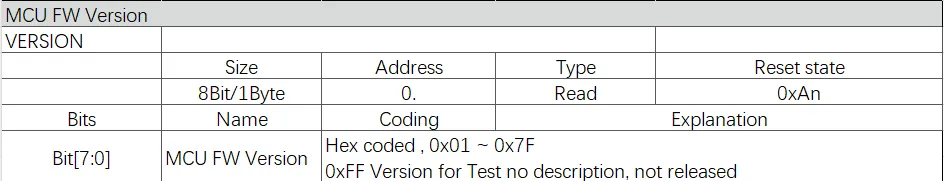

Read the firmware version number:

```bash
(MCU)# read "01 00"
02 A2 01 00 A3 03
(MCU)# 02 A2 01 00 03 A0 03
```

The firmware version number can be seen from the returned result as 0x03.

## Button Reading
<!-- 这是一张图片，ocr 内容为： -->
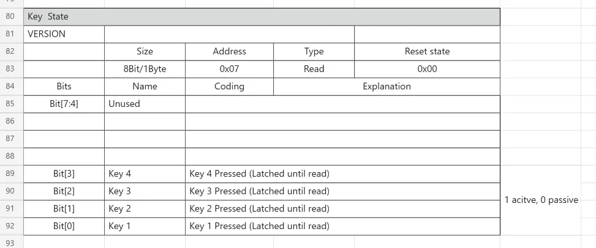

| Name | Description |
| --- | --- |
| Key1(F1) | When a key is pressed, the corresponding bit is set to 1. After a successful read, the next read will set it to 0. |
| Key2(F2) | |


In the current device, only Key1 (F1) and Key2 (F2) events can be read.

The following shows reading an F1 button event.

```bash
(MCU)# read "01 07"
02 A2 01 07 A4 03
(MCU)# 02 A2 01 07 01 A5 03
```

The following shows reading an F2 button event.

```bash
(MCU)# read "01 07"
02 A2 01 07 A4 03
(MCU)# 02 A2 01 07 02 A6 03
```

## LED Control
### LED Color
<!-- 这是一张图片，ocr 内容为： -->
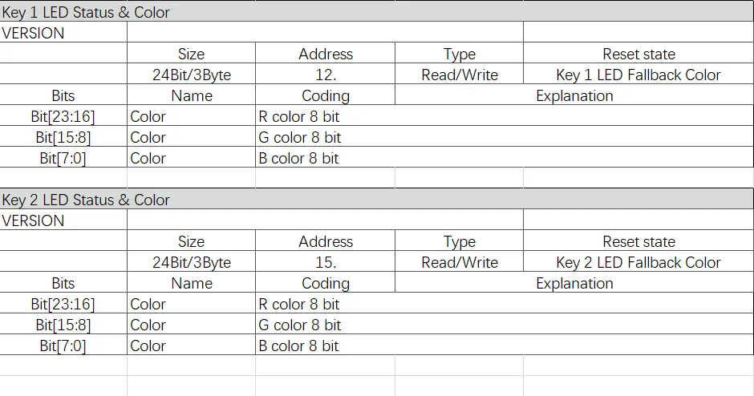<!-- 这是一张图片，ocr 内容为： -->
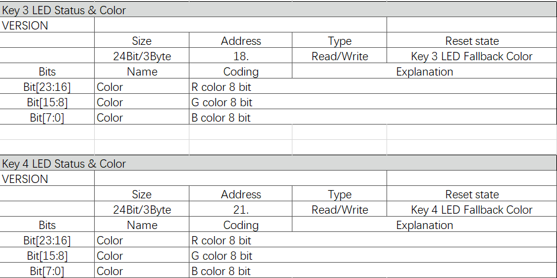

Key[1-4] Led Status & Color is used to view and set the button color (BGR format).

The following shows viewing the Key1 (F1) button's background light.

```bash
read "03 0c"
02 A2 03 0C AD 03
(MCU)# 02 A2 03 0C FF FF FF 52 03
```

The read value is FF(B) FF(G) FF(R), indicating white.

Below we set the Key1 (F1) button's background light to red.

```bash
write "03 0C 00 00 FF"
02 A1 03 0C 00 00 FF 51 03
(MCU)# 02 A1 03 0C 00 00 FF 51 03
```

The display effect is as follows:<!-- 这是一张图片，ocr 内容为： -->


### LED Status
<!-- 这是一张图片，ocr 内容为： -->


The following shows viewing the status of the four LEDs.

```bash
(MCU)# read "01 0b"
02 A2 01 0B A8 03
(MCU)# 02 A2 01 0B 55 FD 03
```

The following sets the four LEDs to blink.

```bash
(MCU)# write "01 0b ff"
02 A1 01 0B FF 54 03
(MCU)# 02 A1 01 0B FF 54 03
```

### LED Brightness
The brightness of the LEDs of the 4 groups of keys is uniformly controlled by a register.

<!-- 这是一张图片，ocr 内容为： -->


Query brightness：

```bash
(MCU)# read "01 0A"
02 A2 01 0A A9 03
(MCU)# 02 A2 01 0A 7F D6 03
```

Set the brightness and set it to the maximum value:

```bash
(MCU)# write "01 0A FF"
02 A1 01 0A FF 55 03
(MCU)# 02 A1 01 0A FF 55 03
```

## Input/Output
### Input
<!-- 这是一张图片，ocr 内容为： -->


| Name | Description |
| --- | --- |
| IN1-IN6 | DI Input |
| WD_stop | The CPU will periodically (15s) toggle a GPIO connected to the MCU. If the MCU does not detect the GPIO toggling continuously for 3 minutes, it will reset the CPU. Here, WD_stop instructs the MCU not to perform this check. This function is mainly used during firmware flashing when the CPU cannot perform the signal toggling (feed the dog) operation, thus avoiding a reset. |


The following shows reading the DI register information:

```bash
(MCU)# read "01 08"
02 A2 01 08 AB 03
(MCU)# 02 A2 01 08 41 EA 03
```

The returned value is 41, indicating that the ignition signal IN1/IGT was read, and WD_stop was also read.

### Output
<!-- 这是一张图片，ocr 内容为： -->
<!-- 这是一张图片，ocr 内容为： -->


#### Input Active Level Control
| Name | Description |
| --- | --- |
| FPG_C_IN4 | Controls the active level of the DI input. If 0, it means active low; if 1, it means active high. |
| FPG_C_IN5 | |
| FPG_C_IN4 | |


#### Output
| Name | Description |
| --- | --- |
| FPG_OUT1_L_N | DO output. If the value is 1, it outputs low; otherwise, it outputs high impedance. |
| FPG_OUT2_L_N | |
| FPG_OUT3_L_N | |
| FPG_OUT4_L_N | |
| FPG_POWER_HOLD | When the IGT signal value is 0, whether to continue supplying power to the CPU. If this value is 0, power will be cut off immediately; if this value is 1, it will continue to supply power to the CPU. |
| CAN_PWR_EN | After cutting power to the CPU, whether to supply power to the CAN module. If this value is 1, it means power will be supplied to the CAN module. When the CAN module receives a wake-up signal frame, it will send an interrupt to the MCU, and the MCU will then supply power to the CPU. |
| PWR_EN | Controls whether to supply power to the CPU. This value should be 1. |


The following shows a register read operation.

```bash
read "01 2f"
02 A2 01 2F 8C 03
(MCU)# 02 A2 01 2F 1F 93 03
read "01 30"
02 A2 01 30 93 03
(MCU)# 02 A2 01 30 03 90 03
```

Register 2f returns a value of 1F, indicating that FPG_OUT1_L_N and FPG_OUT2_L_N are outputting low; CAN_PWR_EN is 1; PWR_EN is 1; FPG_POWER_HOLD is 1.

The following sets IN4-IN6 to active high input.

```bash
(MCU)# write "01 2f ff"
02 A1 01 2F FF 70 03
(MCU)# 02 A1 01 2F FF 70 03

(MCU)# read "01 2f"
02 A2 01 2F 8C 03
(MCU)# 02 A2 01 2F FF 73 03
```

### Temperature
<!-- 这是一张图片，ocr 内容为： -->


Read the temperature：

```bash
(MCU)# read "01 09"
02 A2 01 09 AA 03
(MCU)# 02 A2 01 09 25 8F 03
```

"(MCU)# 02 A2 01 09 <font style="color:#DF2A3F;">25</font> 8F 03, where 25 indicates a temperature of 25 degrees Celsius."

# Other
## Startup script
After the system starts up, it will check if the file /sdcard/setup.shexists. If it exists, the system will execute this script.

Prepare the script and use the following command to place the file at /sdcard/setup.sh:

```bash
adb push setup.sh /sdcard/
```

Then, check and test if the `setup.sh`script has any issues:

```bash
adb shell
sh /data/media/0/setup.sh
```

If there are no errors, it indicates that the script executed successfully. You can use the following command to view the execution logs of the script.

```bash
logcat -s setupsh
#Below is the execution result of the command.
--------- beginning of main
02-05 05:26:08.258  1457  1457 V setupsh : setup.sh start...
02-05 05:26:08.312  1459  1459 V setupsh : setup.sh  end...
```

	If you encounter the following error, run the dos2unix command.

```bash
adb shell
sh /sdcard/setup.sh
: inaccessible or not found
: inaccessible or not found
: inaccessible or not found
: inaccessible or not found
```

	dos2unix指令如下：

```bash
adb shell
dos2unix /sdcard/setup.sh
```

	Below is the example code for [setup.sh](https://inhandnetworks.yuque.com/attachments/yuque/0/2026/sh/23194738/1775724759676-90b279aa-2eff-4d81-ad46-2cf4b8290dba.sh)

```bash
#!/system/bin/sh

export PATH=/system/bin:/system/xbin:$PATH
TAG="setupsh"

log -p v -t ${TAG} "setup.sh start..."

ip rule add from all lookup main

log -p v -t ${TAG} "setup.sh  end..."

```

<font style="color:#DF2A3F;">Note:Please note that only versions after February 5, 2026, support automatically executing </font>`<font style="color:#DF2A3F;">/sdcard/setup.sh</font>`<font style="color:#DF2A3F;">.</font>

