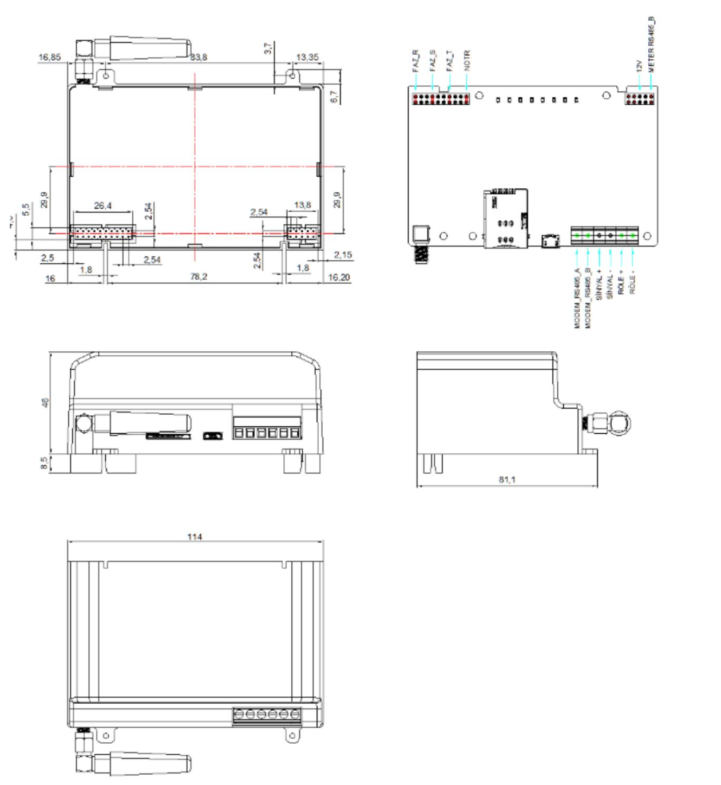

  

Enabling power meter reading applications

  

MG301-M Series Modular MASS Modem

    
· LTE CAT 1

    
· MASS Protocol

    
· IEC62056-21

    
· DLMS/COSEM

    
· Li-ion Battery

  

# 1. Product Overview

MG301 is a wireless modem designed according to the requirements of the Automatic Meter Reading System (OSOS) for communication via cellular networks, and MG301-M is the modular model that will operate with modular meter. MG301-M enables the server to access the connected metering devices via the cellular network, allowing the server to obtain the operational parameters of the meters at any time and record detailed traceability information. MG301-M is equipped with various hardware interfaces such as serial port, digital input, relay output, etc., enabling it to connect to various devices on-site and achieve multiple applications.

## Key Technical Specifications

| Specification | Details |
| --- | --- |
| Cellular | 2G/4G (LTE CAT 1) |
| Hardware Platform | 2.5MB RAM; 32MB Flash |
| Metering Protocols | IEC62056-21 Mode-C; DLMS/COSEM |
| Platform Access | MQTT/MQTTS/VIKO/MASS/TeleMetriX Head-End |
| Interfaces | 2 × RS485; 1 × USB2.0 Type-C; 1 × digital input; 1 × relay output |
| Power | 12V DC ± 10%; 6W (MAX) |
| Dimensions | 114 × 74.4 × 45 mm |
| Operating Environment | -30 to 70 °C; 0–93% ambient humidity |
| Protection | IP40 |

# 2. Features and Advantages

<table style="table-layout: fixed; width: 100%;">
  <colgroup><col style="width: 184.6000px;" /><col /></colgroup>
  <thead>
    <tr><th>Feature</th><th>Description</th></tr>
  </thead>
  <tbody>
    <tr><td>Performance and Platform</td><td>2.5MB RAM; 32MB Flash</td></tr>
    <tr><td>Rich Interfaces</td><td>2 × RS-485; 1 × USB2.0; 1 × digital input; 1 × relay output</td></tr>
    <tr><td>Stable Communication</td><td>2G/4G (LTE CAT 1); independent hardware and software watchdog; multilevel link detection, communication self-healing</td></tr>
    <tr><td>Industrial-grade, Ready for Harsh Industrial Environments</td><td>Operating temperatures up to -30 ~ 70 °C; protection rating IP40; Li-ion battery</td></tr>
    <tr><td>Multiple Acquisition Protocol</td><td>IEC62056-21; DLMS/COSEM; MASS; MQTT/MQTTS; VIKO; TeleMetriX Head-End</td></tr>
  </tbody>
</table>

# 3. Product Dimensions

  

Dimensions: 114 × 74.4 × 45 mm.

# 4. Product Interfaces

| Interface | Description |
| --- | --- |
| Cellular | 2G/4G (LTE CAT 1) |
| USB | 1 × USB2.0, Type-C |
| Serial Port | 2 × RS485; RS485: Data+, Data-, GND |
| SIM Card | Mini SIM-2FF card, supports 1.8/3V SIM/UIM card |
| Antenna Connector | 1 × Cellular Antenna |
| Button | 1 × System reset button |
| Digital Input | 1 × digital input; dry contact: Logic 0, Open; Logic 1, Close |
| Relay Output | 1 × relay output: 240VAC/5A, latching relay |

## LED Indicators

<table style="table-layout: fixed; width: 100%;">
  <colgroup><col style="width: 128.8000px;" /><col /></colgroup>
  <thead><tr><th>LED</th><th>Status Description</th></tr></thead>
  <tbody>
    <tr><td>PWR</td><td>Steady on: The power supply is normal Off: No external power supply is available</td></tr>
    <tr><td>IP</td><td>Steady on: The device obtains an IP address for network communication Off: The device does not obtain an IP address for network communication</td></tr>
    <tr><td>RS485-1</td><td>Blinking: Data is being exchanged through serial port 1 Off: No data is being exchanged over serial port 1</td></tr>
    <tr><td>RS485-2</td><td>Blinking: Data is being exchanged through serial port 2 Off: No data is being exchanged over serial port 2</td></tr>
    <tr><td>Relay</td><td>Steady on: Closing Off: Open</td></tr>
    <tr><td>2G/4G</td><td>Blinking: 2G Steady on: 4G Off: No Communication</td></tr>
    <tr><td>3 × CSQ</td><td>Signal quality indicator</td></tr>
  </tbody>
</table>

# 5. Hardware Specifications

| Category / Parameter | MG301-M |
| --- | --- |
| **Hardware Platform** | |
| RAM | 2.5MB |
| FLASH | 32MB |
| **Interfaces** | |
| Cellular | 2G/4G (LTE CAT 1) |
| USB | 1 × USB2.0, Type-C |
| Serial Port | 2 × RS485; RS485: Data+, Data-, GND |
| SIM Card | Mini SIM-2FF card, supports 1.8/3V SIM/UIM card |
| Antenna Connector | 1 × Cellular Antenna |
| Button | 1 × System reset button |
| Digital I/O | 1 × digital input: Dry contact: Logic 0, Open; Logic 1, Close; 1 × relay output: 240VAC/5A, Latching Relay |
| **Other Hardware** | |
| RTC | Real time clock operated from on-board coin-cell battery |
| Punctuality Accuracy | 0.5S / day |
| Battery | Li-ion Battery, 300mAh, rechargeable and replaceable. |
| **Power** | |
| Power Supply | 12V DC ± 10% |
| Power Consumption | 6W (MAX) |
| **Mechanical Characteristics** | |
| Mounting | Plug to the modem socket of the modular meters |
| Enclosure Material | Plastic |
| Dimensions | 114 × 74.4 × 45 mm |
| Protection | IP40 |
| **Ambient Temperature and Humidity** | |
| Operation Temperature | -30 ~ 70℃ |
| Ambient Humidity | 0–93% |
| Declared Degree of Contamination | 3 |
| Overvoltage Category | CAT III |
| Electrical Protection Class | II |
| **LED** | |
| System | 1 × Power, 3 × CSQ, 1 × IP, 1 × 2G/4G, 2 × RS485, 1 × Relay |
| **Safety & EMC** | |
| Safety & EMC | IEC 62368-1; EN 55032, Class B; EN 55035, Level 2 |
| **Other Standards** | |
| Others | EN 60068-2-30; EN 60068-2-31; EN 60068-2-1; EN 60068-2-2; EN 62262; IEC 60529; IEC 60695-11-10 standard V-0 class |

# 6. Software Specifications

<table style="table-layout: fixed; width: 100%;">
  <colgroup><col style="width: 182.0000px;" /><col /></colgroup>
  <thead>
    <tr><th>Parameter</th><th>Specification</th></tr>
  </thead>
  <tbody>
    <tr><td><strong>Operating System</strong></td><td></td></tr>
    <tr><td>OS</td><td>RTOS</td></tr>
    <tr><td><strong>Internet</strong></td><td></td></tr>
    <tr><td>Access Authentication</td><td>APN, VPDN</td></tr>
    <tr><td>Internet Access</td><td>CHAP, PAP</td></tr>
    <tr><td>Network Format</td><td>2G/4G (LTE CAT 1)</td></tr>
    <tr><td>eSIM</td><td>Support eSIM (LPA)</td></tr>
    <tr><td><strong>Network Protocol</strong></td><td></td></tr>
    <tr><td>IP Application</td><td>ICMP, DNS, TCP/UDP, TCP Server, DHCP, NTP</td></tr>
    <tr><td><strong>Reliability</strong></td><td></td></tr>
    <tr><td>Power Failure Alarm</td><td>Detecting an external power failure</td></tr>
    <tr><td>Link Detection</td><td>Sends heartbeat packets to detect, auto redials when disconnected</td></tr>
    <tr><td>Embedded Watchdog</td><td>Device runs self-detection, auto recovers from malfunctions</td></tr>
    <tr><td>Temperature Detection</td><td>The CPU temperature can be detected and recorded in logs</td></tr>
    <tr><td><strong>Communication Protocol</strong></td><td></td></tr>
    <tr><td>Acquisition Protocol</td><td>IEC62056-21 Mode-C; DLMS/COSEM</td></tr>
    <tr><td>Access Platform</td><td>MQTT/MQTTS/VIKO/MASS/TeleMetriX Head-End</td></tr>
    <tr><td><strong>Security</strong></td><td></td></tr>
    <tr><td>Encryption</td><td>AES-128 and ECDHE</td></tr>
    <tr><td>Authentication</td><td>In cases where configuration changes, software updates, or connection to the control center are made via the modem&#39;s serial ports, authentication will be performed between the modem and the device attempting to connect to it. A log will be kept for these operations.</td></tr>
    <tr><td><strong>Network Management</strong></td><td></td></tr>
    <tr><td>Configuration</td><td>Web Via USB</td></tr>
    <tr><td>Upgrade</td><td>Local Via USB, Remote Via FTP/InHand DM platform (Coming soon)</td></tr>
    <tr><td>Log</td><td>Support local system log and important log power-off autosave</td></tr>
  </tbody>
</table>

# 7. Ordering Information

## Model Code

**Model:** MG301-M-FQ53

## Product Models

<table style="font-size:10px; width:100%;">
<thead><tr><th>Model</th><th>Cellular Type &amp; Frequency Band</th><th>Serial Port</th><th>USB</th><th>I/O</th></tr></thead>
<tbody>
<tr><td>MG301-M-FQ53</td><td>EMEA CAT1 FDD: B1/B3/B7/B8/B20/B28 TDD: B38/B40/B41 GSM: B2/B3/B5/B8</td><td>2 × RS485</td><td>1 × USB2.0</td><td>1 × Digital Input 1 × Relay Output</td></tr>
</tbody></table>

# 8. Contact Us

- **Website:** [InHand Networks](https://www.inhand.com)
- **Copyright:** © InHand Networks. All rights reserved.
