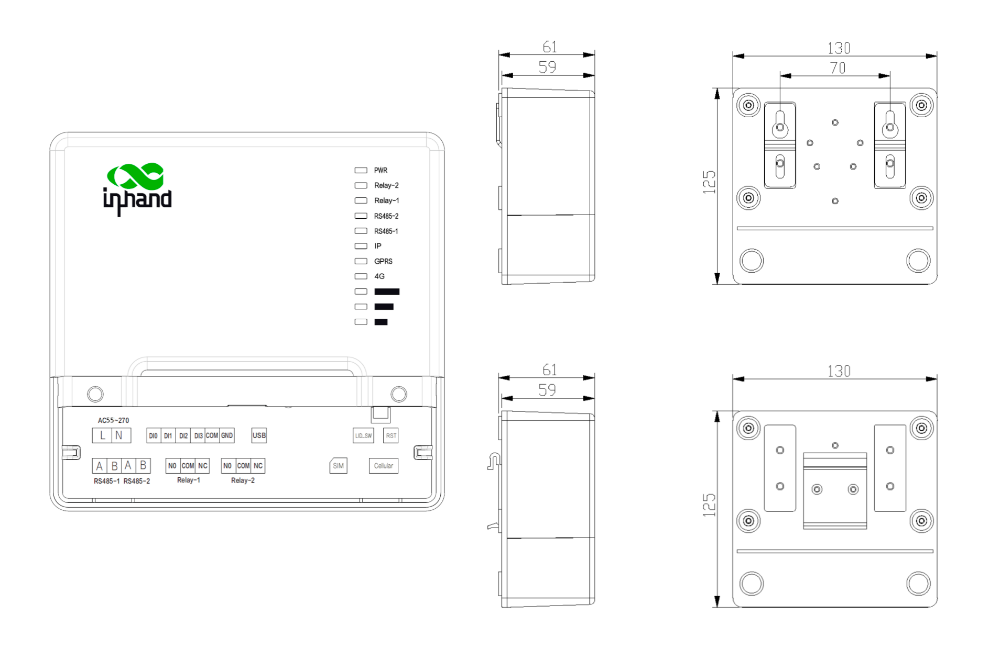
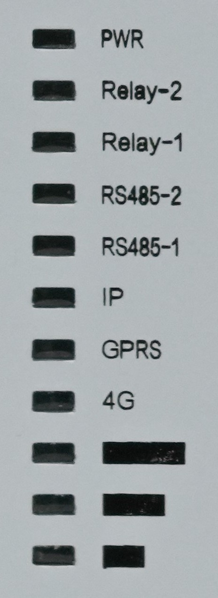

  

Enabling Power Meter Reading Applications

  

MG301 Series Metering Gateway

    
· LTE CAT 1/4

    
· Rich Interfaces

    
· IEC62056-21

    
· DLMS/COSEM

    
· Li-ion Battery

  

# 1. Product Overview

MG301 is a wireless metering gateway designed according to the requirements of the Automatic Meter Reading System for communication via cellular networks. MG301 enables the server to access the connected metering devices via the cellular network, allowing the server to obtain the operational parameters of the meters at any time and record detailed traceability information. MG301 is equipped with various hardware interfaces such as Ethernet port, serial port, digital input, relay output, etc., enabling it to connect to various meters on-site and achieve multiple applications.

## Key Technical Specifications

| Specification | Details |
| --- | --- |
| Cellular | 4G cellular module, CAT1/CAT4 |
| Hardware Platform | MIPS24KEc (575/580 MHz); 128MB RAM; 64MB Flash |
| Metering Protocols | IEC62056-21 Mode-C; DLMS/COSEM; Modbus RTU |
| Platform Access | MQTT/MQTTS/MASS/TeleMetriX Head-End |
| Interfaces | 2 × isolated RS485; 1 × USB2.0 Type-C; 4 × DI; 2 × DO; 2 × latching relay outputs (optional); 1 × 100Mbps Ethernet (optional) |
| Power | 55–270 VAC, nominal 230 V; 20 VA (max.) |
| Dimensions | 130 × 125 × 61 mm |
| Operating Environment | -30 to 70 °C; 0–93% ambient humidity |
| Protection | IP40 |

# 2. Features and Advantages

<table style="table-layout: fixed; width: 100%;">
  <colgroup><col style="width: 187.6000px;" /><col /></colgroup>
  <thead>
    <tr><th>Feature</th><th>Description</th></tr>
  </thead>
  <tbody>
    <tr><td>Stable Communication</td><td>2G/4G (LTE CAT 1)/NB-IoT (optional); independent hardware and software watchdog; multilevel link detection and communication self-healing</td></tr>
    <tr><td>Rich Interfaces</td><td>2 × RS-485; 1 × USB2.0; 2 × latching relay outputs; 4 × DI + 2 × DO; 1 × 10/100Mbps Ethernet (optional)</td></tr>
    <tr><td>Performance and Platform</td><td>MIPS24KEc (575/580 MHz); 128MB RAM; 64MB Flash</td></tr>
    <tr><td>Multiple Protocols</td><td>IEC62056-21; DLMS/COSEM; Modbus RTU; MQTT/MQTTS; MASS; TeleMetriX Head-End; FTP</td></tr>
    <tr><td>Industrial-grade Design</td><td>Operating temperature -30 to 70 °C; +55 to 270 VAC power input; IP40; Li-ion battery or supercapacitor</td></tr>
  </tbody>
</table>

# 3. Product Dimensions

  

Dimensions: 130 × 125 × 61 mm.

# 4. Product Interfaces

<table style="table-layout: fixed; width: 100%;">
  <colgroup><col style="width: 180.6000px;" /><col /></colgroup>
  <thead>
    <tr><th>Interface</th><th>Description</th></tr>
  </thead>
  <tbody>
    <tr><td>Ethernet</td><td>1 × 100Mbps Ethernet port, RJ45 connector (optional)</td></tr>
    <tr><td>Cellular</td><td>4G cellular module, CAT1/CAT4</td></tr>
    <tr><td>USB</td><td>1 × USB2.0, Type-C</td></tr>
    <tr><td>Serial Port</td><td>2 × RS485, isolated, terminal-block connector; RS485: Data+, Data-, GND</td></tr>
    <tr><td>SIM Card</td><td>Mini SIM-2FF card, supports 1.8/3V SIM/UIM card; eSIM</td></tr>
    <tr><td>Antenna Connector</td><td>1 × Cellular Antenna</td></tr>
    <tr><td>Button</td><td>1 × System reset button</td></tr>
    <tr><td>Open Lid Detection</td><td>1 × Open Cover Inspection key</td></tr>
    <tr><td>Relay Outputs</td><td>2 × relay outputs: 240VAC/5A, latching relay output (optional)</td></tr>
    <tr><td>Digital Inputs</td><td>4 × digital inputs; isolation voltage: 3500 V; dry contact: Logic 1, Open; Logic 0, Close to ground; wet contact: VIH(max.) = 30 VDC, VIH(min.) = 5 VDC, VIL(max.) = 2 VDC</td></tr>
    <tr><td>Digital Outputs</td><td>2 × digital outputs; isolation voltage: 3500 V; supply voltage: 20 V max.; sink current: 0.5 A max.</td></tr>
  </tbody>
</table>

## LED Indicators

  

    
  

  

    <table style="width: 100%; height: 100%; margin: 0; table-layout: fixed; border-collapse: collapse; box-sizing: border-box; font-size: 13px; line-height: 1.45;">
      <colgroup><col style="width: 96px;" /><col /></colgroup>
      <thead>
        <tr><th style="width: 96px; box-sizing: border-box; padding: 8px 10px; white-space: nowrap; word-break: normal; overflow-wrap: normal; text-align: left;">LED</th><th style="padding: 8px 10px; text-align: left;">Status Description</th></tr>
      </thead>
      <tbody>
        <tr><td style="padding: 8px 10px; white-space: nowrap; word-break: normal; overflow-wrap: normal; vertical-align: middle;">PWR</td><td style="padding: 8px 10px; word-break: normal; overflow-wrap: break-word; vertical-align: middle;">Steady on: The power supply is normal Off: No external power supply is available</td></tr>
        <tr><td style="padding: 8px 10px; white-space: nowrap; word-break: normal; overflow-wrap: normal; vertical-align: middle;">Relay-2</td><td style="padding: 8px 10px; word-break: normal; overflow-wrap: break-word; vertical-align: middle;">Steady on: Closing</td></tr>
        <tr><td style="padding: 8px 10px; white-space: nowrap; word-break: normal; overflow-wrap: normal; vertical-align: middle;">Relay-1</td><td style="padding: 8px 10px; word-break: normal; overflow-wrap: break-word; vertical-align: middle;">Steady on: Closing</td></tr>
        <tr><td style="padding: 8px 10px; white-space: nowrap; word-break: normal; overflow-wrap: normal; vertical-align: middle;">RS485-2</td><td style="padding: 8px 10px; word-break: normal; overflow-wrap: break-word; vertical-align: middle;">Blinking: Data is being exchanged through serial port 2 Off: No data is being exchanged over serial port 2</td></tr>
        <tr><td style="padding: 8px 10px; white-space: nowrap; word-break: normal; overflow-wrap: normal; vertical-align: middle;">RS485-1</td><td style="padding: 8px 10px; word-break: normal; overflow-wrap: break-word; vertical-align: middle;">Blinking: Data is being exchanged through serial port 1 Off: No data is being exchanged over serial port 1</td></tr>
        <tr><td style="padding: 8px 10px; white-space: nowrap; word-break: normal; overflow-wrap: normal; vertical-align: middle;">IP</td><td style="padding: 8px 10px; word-break: normal; overflow-wrap: break-word; vertical-align: middle;">Steady on: The device obtains an IP address for network communication Off: The device does not obtain an IP address for network communication</td></tr>
        <tr><td style="padding: 8px 10px; white-space: nowrap; word-break: normal; overflow-wrap: normal; vertical-align: middle;">GPRS</td><td style="padding: 8px 10px; word-break: normal; overflow-wrap: break-word; vertical-align: middle;">Steady on: 2G Off: Not 2G</td></tr>
        <tr><td style="padding: 8px 10px; white-space: nowrap; word-break: normal; overflow-wrap: normal; vertical-align: middle;">4G</td><td style="padding: 8px 10px; word-break: normal; overflow-wrap: break-word; vertical-align: middle;">Steady on: 4G Off: Not 4G</td></tr>
      </tbody>
    </table>
  

# 5. Hardware Specifications

| Category / Parameter | MG301 |
| --- | --- |
| **Hardware Platform** | |
| CPU | MIPS24KEc (575/580 MHz) |
| RAM | 128MB |
| FLASH | 64MB |
| **Interfaces** | |
| Ethernet Port | 1 × 100Mbps Ethernet port, RJ45 connector (optional) |
| Cellular | 4G cellular module, CAT1/CAT4 |
| USB | 1 × USB2.0, Type-C |
| Serial Port | 2 × RS485, isolated, terminal-block connector; RS485: Data+, Data-, GND |
| SIM Card | Mini SIM-2FF, supports 1.8/3V SIM/UIM card; eSIM |
| Antenna Connector | 1 × Cellular Antenna |
| Button | 1 × System reset button |
| Open Lid Detection Device | 1 × Open Cover Inspection key |
| Relay Outputs | 2 × relay outputs: 240VAC/5A, latching relay output (optional) |
| Digital Inputs | 4 × digital inputs; isolation voltage: 3500 V; dry contact: Logic 1, Open; Logic 0, Close to ground; wet contact: VIH(max.) = 30 VDC, VIH(min.) = 5 VDC, VIL(max.) = 2 VDC |
| Digital Outputs | 2 × digital outputs; isolation voltage: 3500 V; supply voltage: 20 V max.; sink current: 0.5 A max. |
| **Other Hardware** | |
| RTC | Real time clock operated from on-board coin-cell battery |
| Punctuality Accuracy | 0.5 S/day |
| Battery | Li-ion battery (500mAh) or supercapacitor (Li-ion battery default) |
| **Power** | |
| Power Supply | AC input: unregulated 55V to 270 VAC, nominal 230V, instantaneous voltage protection of 6KV; reverse voltage protection |
| Power Consumption | 20VA (max.) |
| **Mechanical Characteristics** | |
| Mounting | DIN rail / mounting ear (default) |
| Enclosure Material | Plastic |
| Dimensions | 130 × 125 × 61 mm |
| Protection | IP40 |
| **Ambient Temperature and Humidity** | |
| Operating Temperature | -30 to 70 °C |
| Ambient Humidity | 0–93% |
| Declared Pollution Degree | 3 |
| Overvoltage Category | CAT III |
| **LED** | |
| System | 1 × Power, 3 × CSQ, 1 × IP, 1 × 4G, 1 × GPRS, 2 × RS485, 2 × Relay |
| **Safety & EMC** | |
| Safety & EMC | IEC 62368-1; EN 55032 Class B; EN 55035 Level 3 |
| **Other Standards** | |
| Others | EN 60068-2-30; EN 60068-2-31; EN 60068-2-1; EN 60068-2-2; EN 62262; IEC 60529; IEC 60695-11-10 standard V-0 class |

# 6. Software Specifications

| Parameter | Specification |
| --- | --- |
| **Operating System** | |
| OS | Linux |
| **Internet** | |
| Access Authentication | APN, VPDN |
| Internet Access | CHAP, PAP |
| Network Format | LTE CAT 1 |
| **Network Protocol** | |
| IP Application | ICMP, DNS, TCP/UDP, TCP Server, DHCP, NTP |
| IP Routing | Static routing |
| **Reliability** | |
| Cover Opening Alarm | Detection lid is opened |
| Power Failure Alarm | Detecting an external power failure |
| Link Detection | Sends heartbeat packets to detect, auto redials when disconnected |
| Embedded Watchdog | Device runs self-detection, auto recovers from malfunctions |
| Temperature Detection | The CPU temperature can be detected and recorded in logs |
| **Communication Protocol** | |
| Acquisition Protocol | IEC62056-21 Mode-C; DLMS/COSEM; Modbus RTU |
| Access Platform | MQTT/MQTTS/MASS/TeleMetriX Head-End |
| **Network Management** | |
| Configuration | Web via USB/ETH |
| Upgrade | Local via USB/ETH; remote via FTP/InHand DM platform |
| Log | Support local system log and important log power-off autosave |

# 7. Ordering Information

## Model Code

**Model:** MG301-FQ53 / MG301-FQ33 / MG301-FQ68

## Product Models

<table style="font-size:10px; width:100%;">
<thead><tr><th>Model</th><th>Cellular Type &amp; Frequency Band</th><th>Serial Port</th><th>USB</th><th>I/O</th><th>Ethernet (Optional)</th></tr></thead>
<tbody>
<tr><td>MG301-FQ53</td><td>EMEA, LTE CAT1 FDD: B1/B3/B5/B7/B8/B20/B28 TDD: B38/B40/B41 GSM: B2/B3/B5/B8</td><td>2 × RS485</td><td>1 × USB2.0</td><td>2 × relay outputs, 4 × DI, 2 × DO</td><td>1 × 100Mbps Ethernet</td></tr>
<tr><td>MG301-FQ33</td><td>North America, LTE CAT1 FDD: B2/B4/B5/B12/B13/B25/B26 WCDMA: B2/B4/B6</td><td>2 × RS485</td><td>1 × USB2.0</td><td>2 × relay outputs, 4 × DI, 2 × DO</td><td>1 × 100Mbps Ethernet</td></tr>
<tr><td>MG301-FQ68</td><td>LATAM, LTE CAT4 FDD: B1/B2/B3/B4/B5/B7/B8/B28 TDD: B40 WCDMA: B1/B2/B5/B8 GSM: B2/B3/B5/B8</td><td>2 × RS485</td><td>1 × USB2.0</td><td>2 × relay outputs, 4 × DI, 2 × DO</td><td>1 × 100Mbps Ethernet</td></tr>
</tbody></table>

# 8. Contact Us

- **Website:** [InHand Networks](https://www.inhand.com)
- **Copyright:** © InHand Networks. All rights reserved.
