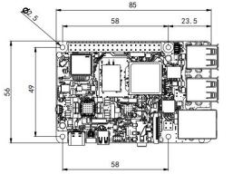
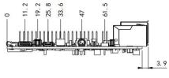
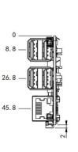

  

    

      
    

    

      Embrace Edge AI, Empower Intelligent Vision
    

  

  

    

      Mo 62A AI Single Board Computer
    

    

      

        
· Open SDK

        
· Linux Distribution

      

      

        
· HAT Expansion

        
· Edge AI

      

    

  

# 1. Product Overview

**The Mo 62A is a 2 TOPS edge AI single-board computer based on the TI AM62A74 SoC, with a form factor compatible with standard SBCs, designed for AI vision and edge inference terminals.**

**Product Features:**
- **AI Acceleration:** Integrated C7x DSP and deep-learning accelerator, 2 TOPS on-device AI inference
- **SBC Compatibility:** Standard SBC form factor, compatible with HAT accessories and mainstream enclosures
- **Rich Interfaces:** Gigabit Ethernet, 4 × USB 2.0, Micro HDMI, MIPI CSI-2
- **Security and Stability:** Secure Boot, TrustZone, OP-TEE, hardware crypto accelerator
- **Open-source Ecosystem:** Debian 13 Linux, open SDK, support for TFLite / ONNX models

## Core Technical Specifications

| Technical Indicator | Specification |
|---|---|
| AI Inference | 2 TOPS (C7x DSP + DLA) |
| Operating System | Debian 13.2 (Linux 6.12) |
| Wi-Fi | Wi-Fi 5 (802.11ac), dual-band 2.4/5 GHz |
| Bluetooth | BLE 4.2 |
| AI Framework | TI TIDL, supports TFLite / ONNX |
| Camera | 1 × 4-lane MIPI CSI-2 |
| Dimensions | 85 × 56 mm |
| Weight | 47 g |
| Power | USB Type-C 5V/5A DC |
| Power Consumption | 25W (MAX) |
| Operating Temperature | 0 ~ 50 °C |
| Memory | LPDDR4 2GB (default) / 4GB |

# 2. Product Dimensions

  

    
    
Front View

  

  

    
    
Side View

  

    

    
    
Interface View

  

  

    
Note:

    
1. All dimensions are in millimeters (mm).

    
2. All dimensions are approximate values for reference only.

    
3. The dimensions shown shall not be used for production or processing.

    
4. Dimensions shall comply with part and manufacturing tolerance requirements.

    
5. Dimensions are subject to change without notice.

  

# 3. Hardware Specifications

| Category / Parameter | Specification |
|--------------------------|------|
| **Hardware Platform** | |
| CPU | TI AM62A74, 4 × Cortex-A53 @ 1.4 GHz |
| AI Accelerator | C7x DSP + Deep Learning Accelerator, 2 TOPS |
| ISP / Vision | On-chip ISP + VPAC (RGB-IR, WDR, LDC) |
| Memory | LPDDR4 2GB (default) / 4GB |
| **Interfaces and Connectivity** | |
| Ethernet | 1 × Gigabit Ethernet |
| USB | 4 × USB 2.0 Type-A |
| Display | 1 × Micro HDMI |
| Camera | 1 × 4-lane MIPI CSI-2 |
| Audio | 3.5 mm jack + PCM via 40-pin connector |
| 40-pin Connector | GPIO / I²C / SPI / UART / PCM, HAT-compatible |
| Storage | Micro SD |
| Debug UART | 1 × TTL UART |
| Fan Connector | 1 × 4-pin fan connector |
| Button | 1 × Power button |
| LED | PWR, USER |
| **Wireless** | |
| Wi-Fi | Wi-Fi 5 (802.11ac), dual-band 2.4/5 GHz |
| Bluetooth | BLE 4.2 |
| Antenna Connector | Wi-Fi / BLE: on-board snap-on antenna |
| **Security** | |
| Secure Boot | Support (ARM TrustZone + OP-TEE) |
| **Power** | |
| Power Input | USB Type-C 5V/5A DC |
| Power Consumption | 25W (MAX) |
| **Mechanical** | |
| Dimensions | 85 × 56 mm |
| Weight | 47 g |
| Housing | PCB |
| Cooling | Active fan (optional) |
| **Others** | |
| RTC | Support (battery backup) |
| Watchdog | Hardware watchdog |
| **Environmental** | |
| Operating Temperature | 0 ~ 50 °C |
| Storage Temperature | -20 ~ 70 °C |

# 4. Software Specifications

| Category / Parameter | Specification |
|--------------------------|------|
| **Operating System** | |
| OS | Debian 13.2 Trixie |
| Kernel | Linux Kernel 6.12 |
| **AI & Vision** | |
| AI Runtime | TI TIDL, supports TFLite / ONNX |
| Vision SDK | TI EdgeAI SDK |
| Camera Framework | V4L2 |
| Display Framework | DRM / KMS |
| **Network Protocol** | |
| IP Application | TCP/UDP, ICMP, DNS, DHCP |
| IP Routing | Static routing |
| **Security** | |
| Secure Boot | Support |
| TrustZone | Support |
| OP-TEE | Support |
| Crypto Accelerator | Hardware AES-256 |
| **Development** | |
| Languages | Python, C/C++ |
| Libraries | OpenCV, GStreamer, NumPy |
| Package Manager | apt (Debian) |
| Open SDK | Supports custom system build by customer |
| **System Management** | |
| Remote Access | SSH |
| Firmware Upgrade | SD card flash |
| Debug | UART console |

# 5. Ordering Information

## Model Code Rule

**Model code:** MO62A-\<DRAM\>

MO62A: Base Model

\<-DRAM\>: Memory

## Product Models

| Model | Memory |
|---------|-----------|
| MO62A-2G | 2GB |
| MO62A-4G | 4GB |

**Example** 
Model: MO62A-2G 
Mo 62A board with 2GB memory.

# 6. Contact Us

- **Official Website:** [InHand Networks](https://www.inhand.com)
- **Copyright Notice:** © InHand Networks. All rights reserved.
