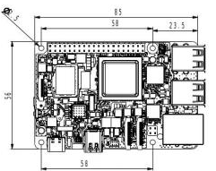
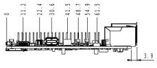
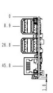

  

    

      
    

    

      Embrace Edge AI, Empower Intelligent Vision
    

  

  

    

      Mo 68A AI Single Board Computer
    

    

      

        
· Open SDK

        
· Linux Distribution

      

      

        
· HAT Expansion

        
· Edge AI

      

    

  

# 1. Product Overview

**The Mo 68A is an 8 TOPS edge AI single-board computer based on the TI AM68A SoC, with a form factor compatible with standard SBCs, designed for AI vision boxes, intelligent cameras, and edge AI inference terminals.**

**Product Features:**
- **Edge AI:** 8 TOPS on-device AI acceleration, TI TIDL supports TFLite / ONNX
- **Vision Processing:** Dual 4-lane MIPI CSI-2, VPAC / DMPAC, 4K@60fps codec
- **Rich Interfaces:** Gigabit Ethernet, PCIe 3.0, 4 × USB 3.0, mini DP
- **SBC Compatibility:** Standard form factor, 40-pin HAT compatibility, support for mainstream enclosures and accessories
- **High Security:** Secure Boot, TrustZone, OP-TEE, hardware crypto acceleration

## Core Technical Specifications

| Technical Indicator      | Specification                                       |
|---------------|--------------------------------------------|
| AI Inference       | 8 TOPS, TI TIDL supports TFLite / ONNX models      |
| Vision Processing      | Dual 4-lane MIPI CSI-2 RX, VPAC / DMPAC, 4K@60fps H.265 / H.264 hardware codec |
| Operating System      | Debian 13 Trixie, Linux 6.12               |
| Network          | 1 × Gigabit Ethernet                             |
| Security          | Secure Boot, TrustZone, OP-TEE, AES-256       |
| Development          | Python / C / C++, OpenCV, Open SDK         |
| CPU           | 2 × Cortex-A72 @ 2.0 GHz                   |
| Memory          | LPDDR4 4 GB / 8 GB (default)                 |
| Storage          | Micro SD                                   |
| Power          | USB Type-C 5 V / 5 A DC,  25 W (MAX) |
| Dimensions          | 85 × 56 mm                                 |
| Operating Temperature      | 0 ~ 50 °C                                   |

# 2. Product Dimensions

  

    
    
Front View

  

  

    
    
Side View

  

  

    
    
Interface View

  

  

    
Note:

    
1. All dimensions are in millimeters (mm).

    
2. All dimensions are approximate values for reference only.

    
3. The dimensions shown shall not be used for production or processing.

    
4. Dimensions shall comply with part and manufacturing tolerance requirements.

    
5. Dimensions are subject to change without notice.

  

# 3. Hardware Specifications

| Category / Parameter | Specification |
|--------------------------|------|
| **Hardware Platform** | |
| CPU | TI AM68A, 2 × Cortex-A72 @ 2.0 GHz |
| AI Accelerator | 2 × C7x DSP + Deep Learning Accelerator, 8 TOPS |
| ISP / Vision | On-chip ISP + VPAC (RGB-IR, WDR, LDC) |
| RAM | LPDDR4 4 GB / 8 GB (default) |
| **Interfaces** | |
| Ethernet | 1 × Gigabit Ethernet |
| USB | 4 × USB 3.0 Type-A |
| PCIe | 1 × PCIe 3.0 |
| Display | 1 × mini DP, up to 2 × 4-lane MIPI DSI |
| Camera | up to 2 × 4-lane MIPI CSI-2 |
| Audio | I2S via 40-pin connector |
| 40-pin Connector | GPIO / I2C / I2S / SPI / UART / PCM, HAT-compatible |
| Fan Connector | 1 × 4-pin fan connector (5 V, PWM, GND, TACH) |
| Button | 1 × Reset button |
| Storage | Micro SD |
| Debug UART | 1 × TTL UART |
| LED | PWR, STATUS |
| **Security** | |
| Secure Boot | Support (ARM TrustZone + OP-TEE) |
| **Power** | |
| Power Input | USB Type-C 5 V / 5 A DC |
| Power Consumption | 25 W (MAX) |
| **Mechanical** | |
| Dimensions | 85 × 56 mm |
| Weight | 53 g |
| Housing | PCB |
| Cooling | Active fan (optional) |
| **Others** | |
| RTC | Support (battery backup) |
| Watchdog | Hardware watchdog supported |
| **Environmental** | |
| Operating Temperature | 0 ~ 50 °C |
| Storage Temperature | -20 ~ 70 °C |

# 4. Software Specifications

| Category / Parameter | Specification |
|--------------------------|------|
| **Operating System** | |
| OS | Debian 13 Trixie |
| Kernel | Linux Kernel 6.12 |
| **AI & Vision** | |
| AI Runtime | TI TIDL, supports TFLite / ONNX |
| Vision SDK | TI EdgeAI SDK |
| Camera Framework | V4L2 |
| Display Framework | DRM / KMS |
| **Network Features** | |
| IP Application | TCP / UDP, ICMP, DNS, DHCP |
| IP Routing | Static routing |
| **Security** | |
| Secure Boot | Support |
| TrustZone | Support |
| OP-TEE | Support |
| Crypto Accelerator | Hardware AES-256 |
| **Development** | |
| Languages | Python, C / C++ |
| Libraries | OpenCV, GStreamer, NumPy |
| Package Manager | apt (Debian) |
| Open SDK | Supports custom system build by customer |
| **System Management** | |
| Remote Access | SSH |
| Firmware Upgrade | SD card flash |
| Debug | UART console |

# 5. Ordering Information

## Model Code Rule

**Model code:** Mo68A-\<x\>-\<y\>

Mo68A: Base Model

\<-x\>: Memory

\<-y\>: MIPI configuration

## Product Models

| Base Model | -x | Memory | -y | MIPI Configuration |
|---------|-------|-----------|-------|-----------|
| Mo68A | 4G | 4 GB | DC | DSI on MIPI0, CSI on MIPI1 |
| Mo68A | 8G | 8 GB | DC | DSI on MIPI0, CSI on MIPI1 |

**Example** 
Model: Mo68A-8G-DC 
"Mo68A" means Base Model. 
"-8G" means 8 GB memory. 
"-DC" means DSI on MIPI0, CSI on MIPI1.

# 6. Contact Us

- **Official Website:** [InHand Networks](https://www.inhand.com)
- **Copyright Notice:** © InHand Networks. All rights reserved.
