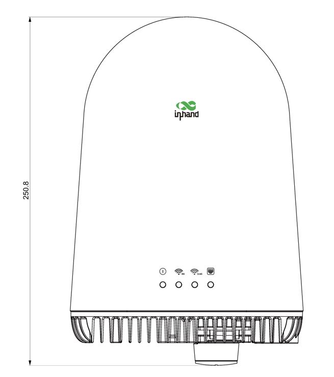
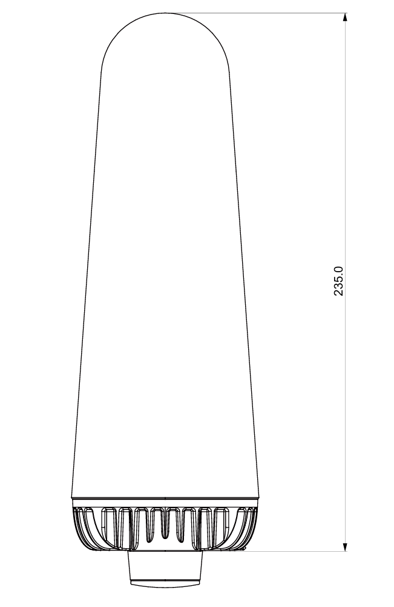
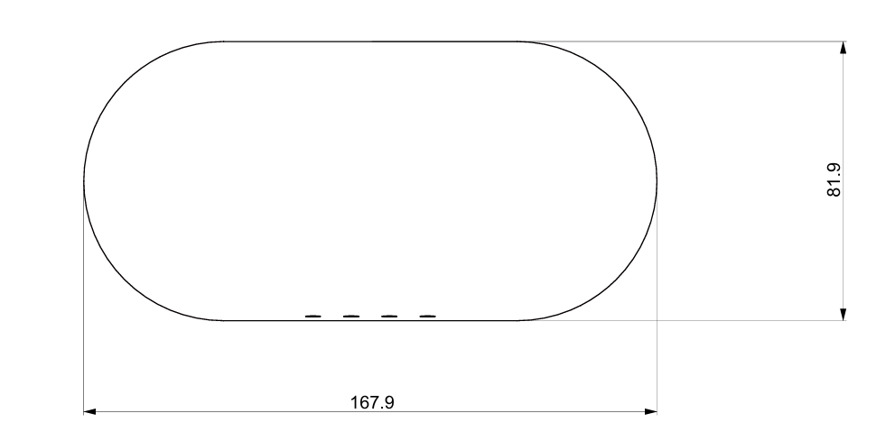

  

    

      
    

    

      Smart Wi-Fi 7 Outdoor Connectivity at Blazing-Fast Speeds
    

  

  

    

      OAP700 Outdoor Access Point
    

    

      

        
· Wi-Fi 7

        
· 2 x 2.5GE

      

      

        
· IP67

        
· Dual Antenna Modes

      

      

        
· AI-Native

        
· Cloud-Managed

      

    

  

# 1. Product Overview

The OAP700 is an enterprise-grade Wi-Fi 7 access point designed for outdoor deployments. Built on a high-performance Wi-Fi 7 platform, it combines BE5000 dual-band concurrent connectivity, dual 2.5 GbE ports, a switchable directional/omni antenna RF design, and AI Agent-powered intelligent operations — all housed in an IP67-rated enclosure. It targets wide-area outdoor coverage in scenic areas, outdoor campuses, transportation hubs, open-air sports venues, solar power plants, and similar scenarios. With IEEE 802.3at PoE single-cable deployment and multi-SSID service isolation, it enables segmented access for guest, surveillance, and business networks while balancing coverage and deployment efficiency.

The OAP700 overcomes the single-pattern coverage limitation of conventional outdoor APs. An onboard RF switch toggles seamlessly between directional and omnidirectional coverage, allowing a single SKU to serve linear corridors, open plazas, and other outdoor topologies — without replacing antennas or adding extra devices in the field.

The OAP700 is also an AI-native outdoor AP. Powered by the InCloud Manager cloud platform and its AI Agent, it provides remote fault diagnosis through natural-language interaction, shifting outdoor network operations from "dispatching technicians on site" to "conversational remote O&M."

## Key Features

- **BE5000 Wi-Fi 7 Dual-Band:** IEEE 802.11be; 5 GHz 3×3 + 2.4 GHz 2×2 spatial streams; PHY data rate up to ~5 Gbps
- **Dual 2.5 GbE Ports:** Two 2.5 Gigabit Ethernet ports
- **Switchable Directional/Omni Antenna:** Five built-in antennas with an RF switch to toggle between directional and omnidirectional coverage — one AP fits multiple outdoor topologies
- **Full Wi-Fi 7 Feature Set:** DL/UL MU-MIMO, DL/UL OFDMA, 4K-QAM, BSS Color, and TWT
- **High-Density Capacity:** Up to 300+ associated clients and 100+ concurrent active clients, with a guaranteed ≥ 20 Mbps per user
- **Seamless Roaming:** 802.11k/v/r fast roaming keeps voice and video sessions uninterrupted
- **Multi-SSID Broadcast:** Multiple independent SSIDs to segregate guest, security, and business access networks
- **Outdoor-Grade Reliability:** IP67 protection, −30 °C to +70 °C operating temperature, die-cast aluminum passive cooling, and UV-stabilized polymer housing
- **Single-Cable PoE Deployment:** IEEE 802.3at PoE powered; one Ethernet cable carries both power and data
- **AI Agent O&M:** The cloud-based AI Agent in InCloud Manager delivers remote fault diagnosis and parameter optimization

## Typical Applications

### Scenic & Tourism Areas

**Ancient towns, pedestrian streets, resorts:** Wide-area outdoor Wi-Fi coverage for guest internet access and smart tourism guiding

**Cruises, harbors, islands:** Reliable connectivity in wide-temperature, high-humidity, high-salt-spray environments

### Outdoor Campuses

**Industrial parks, office campuses:** Outdoor public-area coverage for plazas, walkways, and parking lots

**Factories & logistics parks:** Connectivity for outdoor work zones, AGV dispatching, and surveillance networks

### Transportation Hubs

**High-speed rail stations, airport plazas, bus terminals:** High-density concurrent access under heavy passenger loads

**Highway service areas, toll stations:** Linear coverage along roads and corridors

### Open-Air Venues

**Stadiums, open-air theaters:** High-density concurrent access, with BSS Color mitigating co-channel interference

**Campsites, ski resorts:** Wide-temperature reliable operation with cold boot-down to −30 °C

### Commercial Outdoor Areas

**Pedestrian streets, outdoor dining areas, glamping sites**

**Open-air markets and pop-up events**

### Smart Agriculture & Farming Sites

**Greenhouses, field operations:** IoT sensors and surveillance video backhaul

**Large-scale livestock farms:** Environmental monitoring and on-site device coordination

## Product Dimensions

  

    

      
    

    
Front View

  

  

    

      
    

    
Side View

  

  

    

      
    

    
Bottom View

  

  
<strong>Notes:</strong>

  
1. All dimensions are in millimeters (mm); values in parentheses are in inches (in).

  
2. All dimensions are approximate and for reference only.

  
3. Drawings must not be used for manufacturing.

  
4. Dimensions are subject to component and manufacturing tolerances.

  
5. Specifications are subject to change without notice.

# 2. Product Highlights

## Highlight 1: Switchable Directional/Omni Antenna Coverage

The AP integrates five antennas and an RF switch to flexibly toggle between two coverage patterns:

- Antenna configuration: 2 dual-band omnidirectional + 2 dual-band directional + 1 5 GHz omnidirectional antenna, all built in
- Directional mode: ideal for roads, corridors, and shorelines — long-range linear coverage
- Omnidirectional mode: ideal for plazas and venues — uniform 360° coverage
- One-click switching via the web UI or cloud platform, with no field antenna swap required
- A differentiator among mainstream commercial outdoor APs: a single SKU covers two network topologies, reducing selection, stocking, and inventory costs

## Highlight 2: AI Agent-Powered O&M

With the AI Agent in InCloud Manager, the OAP700 brings conversational intelligent O&M to distributed outdoor sites:

- Automatic cloud fault diagnosis: identifies disconnections, weak coverage, RF interference, and other common issues
- AI adaptive tuning: recommends optimal channels, transmit power, and antenna mode based on live spectrum and client data
- Agent CLI / API for intent-based automated O&M orchestration
- Dramatically fewer site visits — raising the operational efficiency of widely distributed outdoor sites by an order of magnitude

## Highlight 3: High-Performance Wi-Fi 7 Platform

A quad-core Cortex-A73 processor fully unleashes Wi-Fi 7 capabilities:

- PHY data rate up to ~5 Gbps (5 GHz: 4324 Mbps + 2.4 GHz: 688 Mbps)
- 5 GHz supports 160 MHz channel bandwidth and 4096-QAM high-order modulation
- Full radio feature set: DL/UL MU-MIMO, DL/UL OFDMA, BSS Color, and TWT
- Supports 300+ associated clients and 100+ concurrent active clients, guaranteeing ≥ 20 Mbps per user

## Highlight 4: Rugged Outdoor Build & Simplified Deployment

The enclosure balances long-term field reliability with installation convenience:

- Die-cast aluminum monolithic body serves as both structural frame and passive heatsink
- Fanless design eliminates moving-part failure points while maintaining IP67 protection in a compact form factor
- UV-stabilized polymer housing resists chalking and yellowing in prolonged sun exposure, withstanding heat, salt spray, and other harsh outdoor conditions
- IEEE 802.3at PoE powered, backward compatible with 802.3af — a single Ethernet cable carries both power and data

# 3. Hardware Specifications

| Item | Specification |
| ------------- | --------------------------------------- |
| **Processor** | Quad-core Cortex-A73 |
| **Memory** | 512 MB DDR4 |
| **Storage** | 128 MB SPI NAND Flash |
| **Wi-Fi Standard** | IEEE 802.11be (Wi-Fi 7), 2.4 GHz + 5 GHz dual-band concurrent |
| **Spatial Streams** | 5 GHz 3×3 : 3SS; 2.4 GHz 2×2 : 2SS |
| **Channel Bandwidth** | 5 GHz: 20/40/80/160 MHz; 2.4 GHz: 20/40 MHz |
| **Modulation** | Up to 4096-QAM (5 GHz); up to 1024-QAM (2.4 GHz) |
| **Peak Wi-Fi Data Rate** | ~5 Gbps (5 GHz 4324 Mbps + 2.4 GHz 688 Mbps) |
| **WAN Port** | 1 × 2.5 Gbps RJ45, PoE-powered |
| **LAN Port** | 1 × 2.5 Gbps RJ45, data-dedicated |
| **Antennas** | 5 built-in: 2 dual-band omni + 2 dual-band directional + 1 5 GHz omni; RF switch toggles directional/omni mode |
| **Power Supply** | IEEE 802.3at (Type 2, PoE+) powered, backward compatible with IEEE 802.3af |
| **Power Consumption** | ≤ 15 W |
| **Reset** | 1 × Reset button |
| **Indicators** | 1 system LED, 1 2.4 GHz Wi-Fi LED, 1 5 GHz Wi-Fi LED, 1 Ethernet port LED |
| **Watchdog** | Supported |
| **Cooling** | Structure-integrated passive cooling, fanless design |
| **Ingress Protection** | IP67 |
| **Housing** | UV-stabilized polymer housing with integrated die-cast aluminum heatsink |
| **Color** | White |
| **Operating Temperature** | −30 °C to +70 °C |
| **Storage Temperature** | −40 °C to +85 °C |
| **Relative Humidity** | 5% to 95%, non-condensing |
| **Dimensions** | 235 mm × 167.93 mm × 81.93 mm |
| **Weight** | Approx. 1.5 kg (reference value) |
| **Mounting** | Wall, pole, and rooftop mounting |

# 4. Network Connectivity

## 4.1 Wireless

- **Standard & Specs:** IEEE 802.11be (Wi-Fi 7), BE5000, 2.4 GHz + 5 GHz dual-band concurrent
- **Spatial Streams:** 5 GHz 3×3 : 3SS + 2.4 GHz 2×2 : 2SS
- **Channel Bandwidth:** 5 GHz: 20/40/80/160 MHz; 2.4 GHz: 20/40 MHz
- **Modulation:** Up to 4096-QAM (5 GHz); up to 1024-QAM (2.4 GHz)
- **Max Associated Clients:** 300+
- **Max Concurrent Active Clients:** 100+, with a guaranteed ≥ 20 Mbps per user
- **Coverage Range:** Up to 150 m radius in ideal line-of-sight (LOS) conditions; actual range depends on environment, interference, and client capabilities
- **Multi-SSID:** Up to 16 independently configured SSIDs (independent SSID and encryption per SSID)
- **Wireless Security:** WPA3-Personal / WPA3-Enterprise (802.1X + RADIUS), with WPA2-PSK fallback

### Wi-Fi 7 Features

- **MU-MIMO (DL + UL):** Multi-user simultaneous transmit/receive for higher concurrent capacity
- **OFDMA (DL + UL):** Multi-user frequency-division multiplexing for lower multi-access latency
- **4K-QAM (4096-QAM):** Higher data rates in high-SNR conditions
- **BSS Color:** Spatial reuse in dense multi-AP deployments to reduce co-channel interference
- **TWT (Target Wake Time):** Client power-saving scheduling to extend battery life

### Antenna Modes

- **Directional Mode:** Primary coverage via dual-band directional antennas — ideal for linear scenarios such as roads, corridors, and shorelines
- **Omnidirectional Mode:** 360° coverage via dual-band omnidirectional antennas — ideal for area coverage such as plazas and venues
- **Switching:** One-click switching via web UI or cloud platform (hardware RF switch) — no antenna replacement or field retrofit required

### Fast Roaming

- **802.11k Neighbor Report:** Helps clients quickly discover neighboring APs
- **802.11v BSS Transition Management:** The AP actively steers clients to a better AP
- **802.11r Fast BSS Transition:** Supports Over-the-DS and Over-the-Air; keeps voice and video sessions uninterrupted during roaming

## 4.2 Wired

- **WAN Port:** 1 × 2.5 Gbps RJ45 with DHCP / static IP, MTU configuration, and PoE-powered input
- **LAN Port:** 1 × 2.5 Gbps RJ45, data-dedicated
- **Port Throughput:** 2.5 Gbps wire-speed forwarding
- **Operating Mode:** Routing mode (FAT-Routing) / Bridge mode (FAT-Bridge), switchable
- **Local Networks:** Primary network + guest network (independent IP subnet and DHCP, isolated from the primary network)
- **Static Routing:** Supported in routing mode

# 5. Access Authentication & Portal

## 5.1 Local Portal Authentication

- **Built-in Authentication Page:** Splash page, logo, language, and color scheme are customizable
- **Authentication Methods:** Click-through (passthrough) and user authentication
- **Bypass Methods:** Voucher-based access and MAC whitelist
- **SSID Binding:** Portal can be bound to specific SSIDs

## 5.2 External Portal Integration

- **URL Redirection:** Redirects to third-party portal servers
- **RADIUS Integration:** External RADIUS user authentication supported
- **Note:** Cloud portal is not supported; integration is limited to third-party portal servers

## 5.3 Encryption & Authentication Protocols

- **WPA3-Personal (SAE)**
- **WPA2-PSK**
- **WPA3-Enterprise (802.1X + RADIUS)**

# 6. Security Features

## 6.1 Device Security Design

- **Secure Boot:** Hardware-assisted secure boot with a signed bootloader chain
- **Signed Firmware:** Firmware must pass signature verification before flashing
- **No Default Password:** Each unit ships with a unique factory password (pre-printed on the label); changing it is enforced at first login
- **Encrypted Transport:** WPA3 (Wi-Fi) / HTTPS (management plane) / TLS 1.3 (cloud communication)
- **Access Control:** Management-plane IP allowlist, service port (HTTPS/SSH) control, and web login timeout

## 6.2 Network Security

- **Network Isolation:** Guest network isolated from the primary network (independent IP subnet + independent DHCP)
- **SSID Isolation:** Up to 16 independently configured SSIDs for segmenting access domains by service

# 7. Network Services

## 7.1 Web Management Interface (Dashboard)

- **Device Information:** Name / model / serial number / firmware version / MAC / operating mode / upstream IP / system time / license status
- **Interface Status:** Visualized WAN / LAN link state (connected / disconnected / abnormal / disabled)
- **Traffic Statistics:** Upstream and downstream rate charts
- **Wi-Fi Connections:** Client distribution grouped by SSID
- **Client Management:** Name / IP / MAC / VLAN / SSID / RSSI / channel / Wi-Fi standard, with search and filtering
- **Events & Logs:** Centralized view of device events and system logs

## 7.2 Interface & Network Configuration

- **WAN Configuration:** Access type (DHCP / static IP), MTU configuration
- **Local Network:** LAN IP / IPv4 subnet mask / DHCP server / address pool range
- **Guest Network:** Independent IP subnet + independent DHCP server + independent address pool, isolated from the primary network
- **Operating Mode:** One-click switching between routing mode and bridge mode (FAT)

## 7.3 Wi-Fi Configuration

- **SSID Management:** Dual-band SSIDs (2.4 GHz + 5 GHz), up to 16 independently configured SSIDs
- **Radio Settings:** Unified configuration of channel, bandwidth, and transmit power for 2.4 GHz / 5 GHz
- **Antenna Mode:** Directional / omnidirectional switching (Antenna Mode)

## 7.4 System Management

- **Cloud Management:** InCloud cloud connectivity
- **Account Management:** Administrator account management
- **Country Code & Clock:** Country code, NTP, and time zone configuration
- **Device Operations:** AP reboot, factory reset, firmware upgrade (upload + verification + upgrade + reboot)
- **Configuration Management:** Configuration import / export
- **Device Alarms:** Alarm rules and alarm events
- **Diagnostic Tools:** Ping, traceroute, packet capture (pcap)
- **Scheduled Tasks:** Scheduled reboot
- **Log Server:** Remote syslog server
- **Other Settings:** Web login timeout, etc.

## 7.5 Agent CLI & Engineering Mode

- **Agent CLI:** Control interface for the AI Agent (CLI / API entry point)
- **Engineering Mode:** Engineering debug entry

# 8. Cloud Management & Intelligent O&M

The OAP700 is powered by the InCloud Manager AI cloud management platform. Through the AI network assistant, users manage the complete device lifecycle using natural language — no specialized networking expertise required. This is especially well suited to outdoor networks with widely dispersed sites where on-site maintenance costs are high.

## 8.1 Cloud Platform Management

- **Fast Onboarding:** Device connects to the InCloud platform with first-time onboarding in under 60 seconds
- **Device Monitoring:** Real-time view of device status, traffic, and clients
- **Bulk Operations:** Unified cross-site configuration push and firmware upgrades
- **Alarm Notifications:** Instant alerts on device anomalies

## 8.2 AI Agent Intelligent O&M

- **Device Monitoring:** Natural-language queries; the AI retrieves and returns results automatically
- **Fault Diagnosis:** The AI performs multi-step diagnostics and provides a complete analysis with remediation suggestions
- **Configuration Management:** Read or modify configuration in natural language; replicate configurations to other devices by simply asking
- **Firmware Upgrade:** The AI manages the entire process from version selection to completion, reducing the risk of human error
- **Remote Terminal:** Launched via natural language for direct access
- **Bulk Operations:** Issued in natural language in batch — no need to execute device by device

# 9. Ordering Information

## 9.1 Product Model

<table style="width:100%; table-layout:fixed; font-size:15px;">
  <colgroup>
    <col style="width:50%;">
    <col style="width:50%;">
  </colgroup>
  <tr><th>Model</th><th>Region</th></tr>
  <tr><td style="white-space: nowrap;">OAP700-Plus</td><td>Global</td></tr>
</table>

## 9.2 Package Contents

**Standard Accessories:**

- OAP700 × 1
- 1 m RJ45 Ethernet cable × 1
- Mounting kit (wall/pole/rooftop) × 1
- Quick Start Guide (QSG) × 1

**Optional Accessories:**

- IEEE 802.3at PoE power injector

# 10. Reliability Standards & Certifications

## 10.1 Ingress Protection

- **IP Rating:** IP67
- **Salt Spray Test:** 48 hours, in accordance with IEC 60068-2-52

## 10.2 Mechanical Reliability

- **Vibration:** Swept sine 1.0 / 4.0 / 100.0 / 200.0 Hz; in accordance with IEC 60068-2-6
- **Shock:** In accordance with IEC 60068-2-27
- **Drop:** Bare unit 75 cm; packaged unit 1 m; in accordance with IEC 60068-2-32
- **Temperature Cycling:** In accordance with IEC 60068-2-14
- **Damp Heat Cycling:** In accordance with IEC 60068-2-30

## 10.3 Electrical Reliability

- **Surge Protection:** Network port common-mode 2 kV (CM); power common-mode 2 kV (CM) / differential-mode 1 kV (DM); in accordance with IEC 61000-4-5 Level 3
- **ESD:** Contact 6 kV / air 8 kV; in accordance with IEC 61000-4-2 Level 3
- **Operating Environment:** −30 °C to +70 °C; 5% to 95% relative humidity, non-condensing
- **Storage Environment:** −40 °C to +85 °C; 5% to 95% relative humidity, non-condensing
- **MTBF:** ≥ 100,000 h @ 25 °C

## 10.4 Certifications

- **Certifications & Compliance:** FCC\*, IC\*, CE\*, CTA\*, SRRC\*
- **Environmental Certifications:** RoHS / REACH

Note: Items marked with \* are currently under certification application.

# 11. Contact Us

- **Website:** [InHand Networks](https://www.inhand.com)
- **Copyright:** © InHand Networks. All rights reserved.
