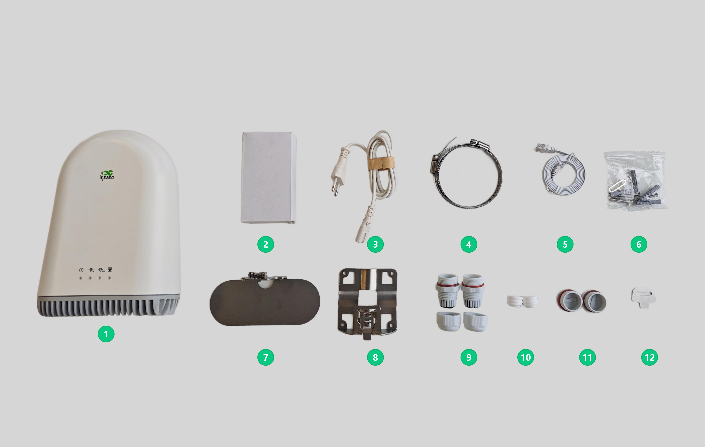
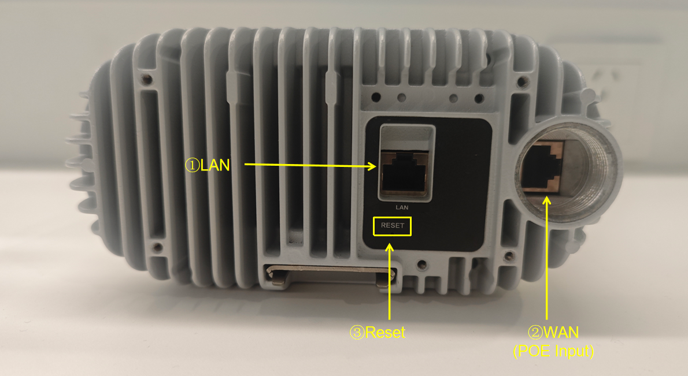
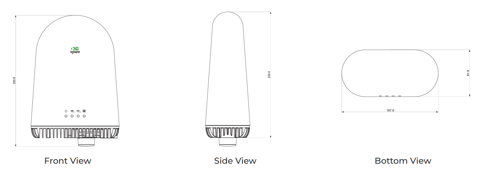
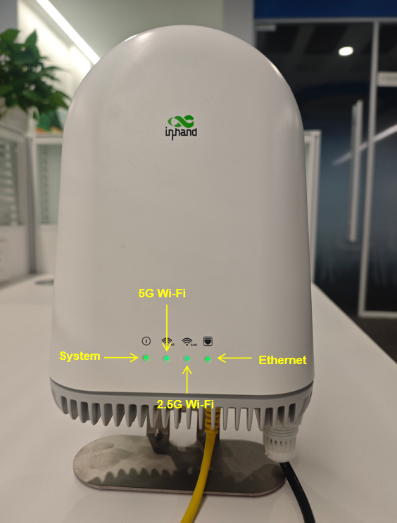
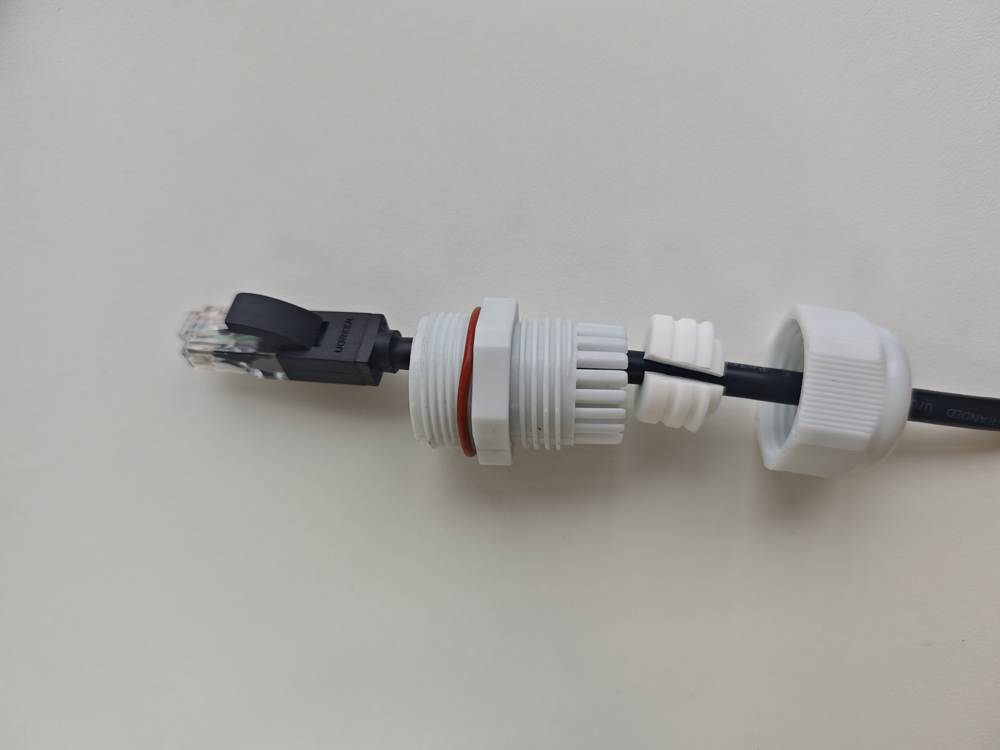
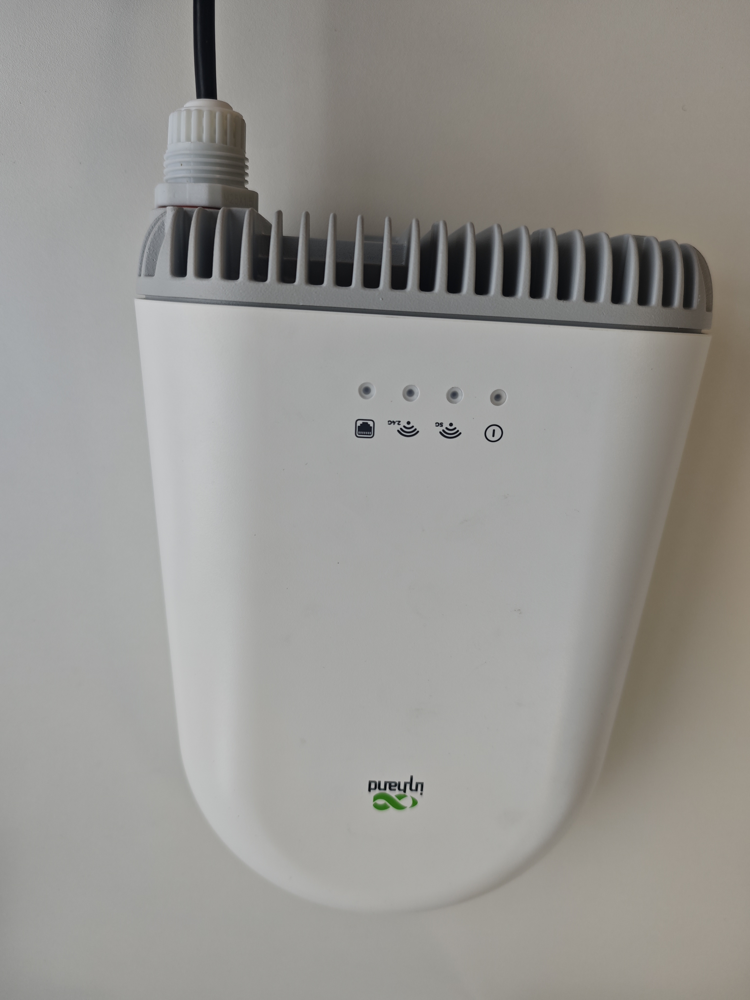
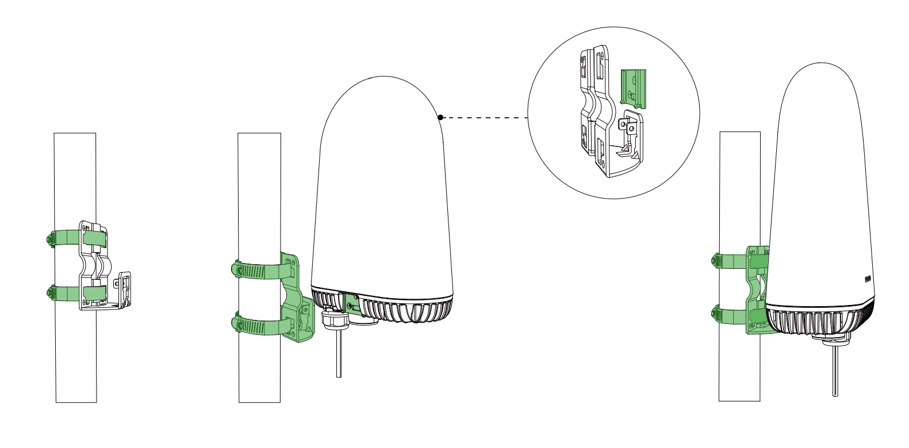
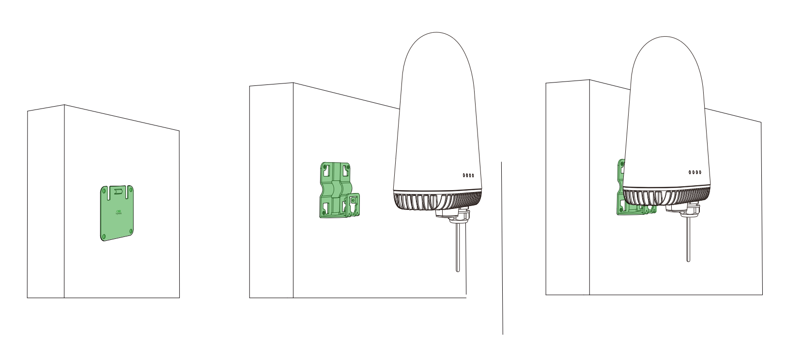
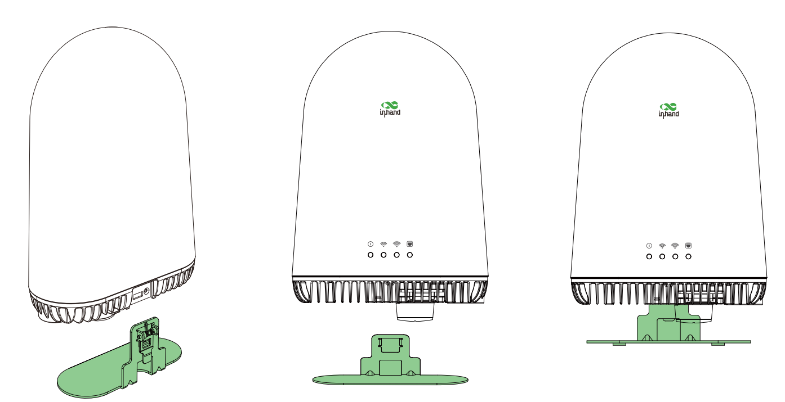
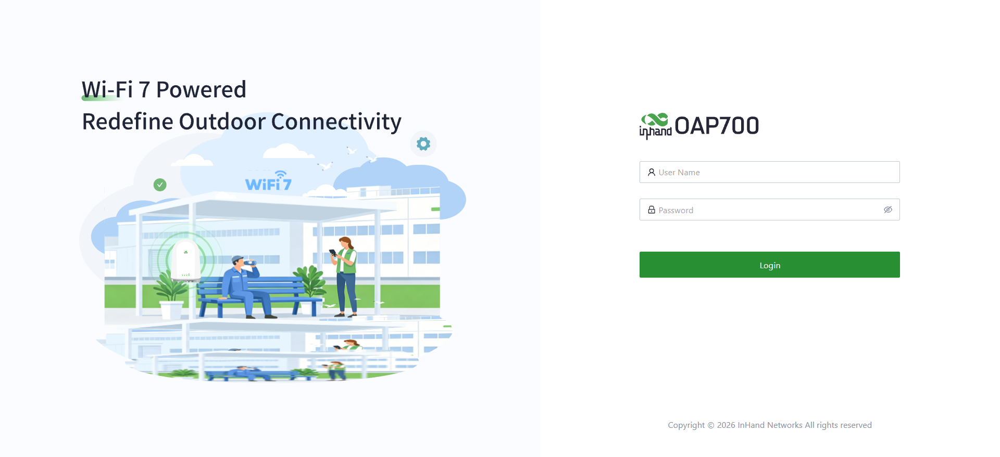

# 1. Package Contents

After unpacking, check the items one by one against Table 1. If anything is missing, stop the installation and contact after-sales service.

<strong>Figure 1 Accessories List</strong>

**Table 1 Package Contents**

| No. | Item | Qty. | Remarks |
|---|---|---|---|
| 1 | OAP700 | 1 | OAP700 whole unit |
| 2 | PoE power supply box | 1 | Power over Ethernet (PoE) adapter |
| 3 | Power cord | 1 | 1 m power cord |
| 4 | Pole mounting rings | 2 | Pole mounting assembly |
| 5 | Ethernet cable | 1 | 1 m Ethernet cable |
| 6 | Screws + pin | 4 | 4 sets of screws, 1 pin |
| 7 | Base | 1 | Desktop mounting part |
| 8 | Back clip assembly | 1 | Wall mounting part |
| 9 | Waterproof connectors | 2 | Waterproof connector + waterproof connector cap, for sealing the cable against water |
| 10 | Waterproof connector rubber plugs | 2 | For sealing the cable against water |
| 11 | Waterproof covers | 2 | For sealing the interface compartment against water |
| 12 | Plug installation tool | 1 | Used when installing the waterproof cover or the pole mounting rings |

---

# 2. Appearance and Interfaces

The numbers in Table 2 correspond one to one with the numbers in Figure 2. Identify the interfaces by number during installation.

**Table 2 Interface and Component Description**

| No. | Name | Description |
|---|---|---|
| 1 | LAN port | 1 × 2.5 Gbps RJ45, dedicated to data. Located inside the interface cover of the bottom shell |
| 2 | WAN port (PoE-powered input) | 1 × 2.5 Gbps RJ45. Power supply: IEEE 802.3at (Type 2, PoE+) powered, backward compatible with IEEE 802.3af|
| 3 | Reset button (RESET) | Recessed button, press it with the SIM ejector pin; press and hold for 10 seconds to restore factory settings |

<strong>Figure 2 Interface Diagram</strong>

<strong>Figure 3 Overall Appearance</strong>

---

# 3. Indicator Status

After power-up, refer to Table 3 to determine the device status.

<strong>Figure 4 Indicator Description</strong>

**Table 3 Indicator Status Description**

| Indicator | Status | Meaning |
|--------|------|------|
| System status LED | Off | Device is not powered |
|  | Solid red | System is starting |
|  | Solid green | System is operating normally |
|  | Flashing red | System error |
|  | Flashing blue | System is upgrading |
| Wi-Fi 2.4G | Off | AP function disabled / Radio off |
|  | Solid green | Operating normally as an AP |
| Wi-Fi 5G | Off | AP function disabled / Radio off |
|  | Solid green | Operating normally as an AP |
| Ethernet indicator | Off | Neither WAN nor LAN is working |
|  | Solid green | Only LAN/WAN is connected |
|  | Solid blue | Both WAN and LAN are connected |

---

# 4. Pre-Installation Preparation

## 4.1 Tool List

Prepare all tools in Table 4 before starting work.

**Table 4 Tool List**

| No. | Tool | Purpose |
|---|---|---|
| 1 | Ethernet cables | 2 RJ45 Ethernet cables |
| 2 | Phillips screwdriver | For installing the screws of the base, back clip assembly and pole mounting rings |
| 3 | Power drill and drill bits | For drilling expansion bolt holes during wall mounting |
| 4 | Wrench | For tightening nuts and expansion bolts |
| 5 | Spirit level | For confirming that the device is installed level |

## 4.2 Environmental Requirements

1. Please confirm the power supply condition: IEEE 802.3at (Type 2, PoE+) powered, backward compatible with IEEE 802.3af.
2. Please confirm that the Ethernet cable supports 1000 Mbps transmission; the Ethernet cable supplied in the package is 1 m long. If the length exceeds 1 m, please prepare another Ethernet cable separately.
3. Please install and operate the device in an environment with an operating temperature of −30 ℃ ~ 70 ℃ and relative humidity ≤ 95% (non-condensing).
4. Please confirm that the ingress protection rating of the installation location meets IP67, and that the interface compartment cover is kept closed when no wiring is in progress.
5. Please confirm that the mounting surface can bear the load: the device weighs approximately 1.5 kg.
6. Please confirm that the pole diameter is within the range of Ø0 mm ~ Ø100 mm (for pole mounting).
7. Please confirm that the wall for wall mounting is a concrete or solid brick wall (for wall mounting).

## 4.3 Safety Notices

**WARNING**: The device is powered over Ethernet (PoE). Do not plug or unplug the WAN (PoE-powered input) Ethernet cable while it is energized, to avoid electric shock or port damage.

**WARNING**: Please use the supplied PoE power supply box and power cord for power. Do not use power supplies of other models; an output voltage exceeding DC 50 V may damage the device or even cause a fire.

**CAUTION**: When the WAN and LAN ports are not in use, please keep the waterproof covers and the interface cover of the bottom shell closed and tightened to prevent water ingress and device damage.

---

# 5. Hardware Installation Steps

## 5.1 Unpacking and Inspection

1. Open the packaging box and take out all items.
2. Check the items one by one against Table 1, and confirm that all 12 items are complete and undamaged.
3. Inspect the appearance of the device, and confirm that the enclosure has no cracks and the interfaces are not deformed.
4. If the items do not match, stop the installation and contact after-sales service (see Chapter 9).

## 5.2 Antenna Connection

This product has 5 built-in antennas: 2 dual-band omnidirectional antennas + 2 dual-band directional antennas + 1 5 GHz omnidirectional antenna.

## 5.3 Cable Connection

**WARNING**: Before connecting the Ethernet cable, please confirm that the PoE power supply box is not yet energized. Hot-plugging is strictly prohibited.

**CAUTION**: If the waterproof connector and waterproof cover are not tightened, water will ingress.

1. Thread the waterproof connector cap onto the Ethernet cable.
2. Break open the waterproof connector rubber plug along the cut and wrap it around the Ethernet cable.
3. Thread the waterproof connector onto the Ethernet cable, and insert the waterproof connector rubber plug into the connector.

<strong>Figure 5 Waterproof Connector Installation</strong>

4. Insert the end of the Ethernet cable fitted with the waterproof connector into the WAN (PoE power) port of the device, and listen for a "click" to confirm that it is fully seated.
5. Tighten the waterproof connector, and align and tighten the waterproof connector cap with the waterproof connector.
6. Connect the other end of the Ethernet cable to the PoE port of the PoE power supply box.

<strong>Figure 6 WAN Port Ethernet Cable Connection</strong>

7. If a terminal device needs to be connected, first remove the interface cover of the bottom shell and place it in a dry place. Connect one end of the Ethernet cable to the terminal device and the other end to the LAN port of the device (note the installation of the waterproof connector). After the connection is complete, reinstall the interface cover of the bottom shell and secure the screws. If no terminal device needs to be connected, skip this step.
8. Install the waterproof cover on the unused interface and screw it tight; the use of the plug installation tool is recommended.

## 5.4 Mounting and Securing

Select one of 5.4.1, 5.4.2 or 5.4.3 according to the on-site mounting method; only one section needs to be performed.

### 5.4.1 Pole Mounting (secured with pole mounting rings)

**CAUTION**: Before installation, please confirm that the pole diameter is within the range of Ø0 mm ~ Ø100 mm. If it is outside this range, the pole mounting rings must not be used for installation.

1. Thread the 2 pole mounting rings through the back clip assembly.
2. Hold the back clip close to the pole so that the pole mounting rings surround the pole, and adjust the tightness of the pole mounting rings until the back clip does not wobble.
3. Use a spirit level to check that the device is level; if there is any deviation, loosen the pole mounting rings and adjust.
4. Hang the device onto the back clip assembly; a "click" indicates that the device has been secured.

<strong>Figure 7 Pole Mounting</strong>

### 5.4.2 Wall Mounting (secured to the wall)

**WARNING**: Before drilling, please confirm that there are no power lines, gas pipes or water pipes inside the wall. If the location of the lines is unknown, stop the work and contact a professional.

1. Take out the back clip assembly and mark 4 drilling positions on the wall.
2. Drill 4 holes at the marked positions.
3. Hammer in 4 expansion bolts.
4. Align the back clip assembly with the expansion bolts and hang it in place.
5. Install the nuts and tighten them until the back clip assembly does not wobble.
6. Hang the device onto the back clip assembly and lock the securing position; a "click" indicates that the device has been secured.
7. Use a spirit level to check that the device is level; if there is any deviation, adjust it and tighten again.

<strong>Figure 8 Wall Mounting</strong>

### 5.4.3 Desktop Mounting (secured with the base)

1. Place the base flat on a dry and level desktop.
2. Align the mounting position on the bottom of the device with the slot of the base.
3. Press the device down until the base is fully snapped in, and confirm that there is no looseness.

<strong>Figure 9 Desktop Mounting</strong>

## 5.5 Power-Up

**WARNING**: Please confirm that the rating of the power socket meets the requirements and that the socket is properly grounded.

1. Insert one end of the supplied power cord (1 m) into the power input of the PoE power supply box.
2. Insert the other end of the power cord into the power socket.
3. Observe the indicator panel and confirm that the system status LED is solid green.
4. Wait 60 seconds, observe the indicator status, and refer to Table 3 for judgment.
5. If the system indicator does not light up, please check the connections at both ends of the power cord and the power supply of the socket.

---

# 6. First-Time Internet Configuration

## 6.1 Preparation Before Configuration

1. Use an Ethernet cable to connect the computer to the LAN port of the device.
2. Open the browser on the computer and enter the management address `https://192.168.2.1`.
3. Enter the account and password on the login page. For the account and password used at first login, please check the nameplate on the back of the device.

 

<strong>Figure 10 OAP700 Login Page</strong>

## 6.2 Wired Internet Access

**Procedures**

1. Use an Ethernet cable to connect the computer to the LAN port of the device.
2. Access `https://192.168.2.1` in the browser and log in.
3. Go to the "Config >> WAN" page and set the connection type of the WAN port to Dynamic IP (DHCP).
4. Save the settings.
5. Confirm that the Ethernet indicator is solid (refer to Table 3).

**Verification Method**

1. Enter `ipconfig` (Windows) or `ifconfig` (macOS/Linux) at the command line of the computer, and confirm that the local machine has obtained an IP address.
2. Enter `ping 223.5.5.5` at the command line, and receive 4 replies with a packet loss rate of 0%.
3. Open the browser and access `http://www.baidu.com`; the page is displayed normally.
4. If all 3 items above are satisfied, the configuration is successful; if any one is not satisfied, please troubleshoot according to Chapter 7.

## 6.3 Restoring Factory Settings

1. Confirm that the device is powered on and the system indicator is solid green.
2. Take the supplied SIM ejector pin and insert it into the reset button hole.
3. Press and hold the reset button for 10 seconds, and release it after the system indicator turns solid blue.
4. Wait for the device to restart automatically; this takes about 60 seconds.
5. Access `https://192.168.2.1` again and confirm that the login page has returned to its default state.
6. Log in again with the default account and password on the device nameplate, and configure the Internet access again as in 6.2.

**CAUTION**: Restoring factory settings clears all configured content, including Internet access parameters and customized settings. Before performing this operation, please confirm that you can provide the default account and password on the nameplate.

---

# 7. Quick Troubleshooting

**Table 5 Quick Troubleshooting Table**

| No. | Symptom | Possible Cause | Remedy |
|---|---|---|---|
| 1 | System indicator does not light up | Power cord not fully plugged in; no power at the socket; PoE power supply box failure | Re-plug both ends of the power cord; try another socket known to have power; replace the PoE power supply box and retry; if it still does not light up, contact after-sales service |
| 2 | Ethernet indicator is solid green but no Internet access | Ethernet cable not fully inserted; no output from the LAN port of the upstream optical modem; damaged Ethernet cable | Re-plug the Ethernet cable on the WAN end until a "click"; connect the same Ethernet cable directly between the optical modem and the computer to verify; replace the Ethernet cable |
| 3 | Ethernet indicator is solid but no Internet access | WAN is not set to Dynamic IP; the upstream network is not passing traffic | Set it to Dynamic IP again as in step 3 of 6.2; connect the computer directly to the optical modem to verify the upstream network |
| 4 | The computer cannot obtain an IP address | Ethernet cable is connected to the LAN port; the device has not finished starting | Move the Ethernet cable to the LAN port; wait 60 seconds and obtain the address again |
| 5 | Cannot access `192.168.2.1` | The computer has not obtained an address in the 192.168.2.x subnet; the browser is using a proxy | Enter `ipconfig` at the command line to confirm the local IP; disable the browser proxy and retry; restore factory settings as in 6.3 and retry |
| 6 | All indicators go out while the device is running | Mains power failure; over-temperature protection of the device; power cord loosened | Check the mains power and the socket; confirm the operating temperature; re-plug both ends of the power cord |
| 7 | Water marks inside the interface compartment | The interface cover of the bottom shell or the waterproof cover is not tightened; the waterproof connector is installed backwards | Disconnect the power immediately; wipe dry and reinstall the interface cover of the bottom shell, the waterproof cover and the waterproof connector; if water still enters, contact after-sales service |

---

# 8. Safety and Compliance Notices

**WARNING**

1. Do not disassemble or modify this device yourself. Disassembly by non-professionals may cause electric shock and will void the warranty.
2. Do not install or use this device in an environment containing flammable or explosive gases or dust.
3. Do not expose the device directly to water; disconnect the power before cleaning, then wipe with a dry cloth.
4. The operating voltage of the device is DC 50 V, 0.66 A. Do not use a power supply other than the one supplied in the package.
5. Do not carry out installation work on poles or walls during thunderstorms.

**CAUTION**

1. Do not drop, strike or overload the device; the device weighs 1.5 kg, and the mounting bracket must be secured according to Chapter 5.
2. Do not block the heat-dissipation structure of the device enclosure.
3. When the device is out of use for a long time, please disconnect the power and keep the interface cover of the bottom shell and the waterproof covers closed.
4. Please dispose of the discarded device and packaging in accordance with local regulations, and do not discard them with household waste.

**Certification and Compliance Information**

| Item | Information |
|---|---|
| Model | OAP700 |
| Operating temperature | −30 ℃ ~ 70 ℃ |
| Storage temperature | −40 ℃ ~ 85 ℃ |
| Relative humidity | 5% ~ 95%, non-condensing |
| Dimensions | 235 mm × 167.93 mm × 81.93 mm |
| Weight | 1.5 kg |

---

# 9. After-Sales and Technical Support Information

Email: support@inhandnetworks.com

URL: www.inhand.com
