# OAP700 Product User Manual

### Declaration

Thank you for choosing this product. Before use, read this user manual carefully. Compliance with the following statements helps maintain intellectual property rights and legal compliance, and ensures that the user experience aligns with the latest product information. For any questions or written permission requests, contact the technical support team.

- **Copyright Statement**

  This user manual contains copyrighted content, and the copyright belongs to InHand Networks Technology Co., Ltd. and its licensors. Without written permission, no organization or individual may excerpt, copy any part of the content of this manual, or distribute it in any form.

- **Disclaimer**

  Due to ongoing updates in product technology and specifications, the company cannot guarantee that the information in this user manual is entirely consistent with the actual product. Therefore, no disputes arising from any discrepancies between the actual technical parameters and the user manual are accepted. Any changes to the product will not be notified in advance, and the company reserves the right to make the final changes and interpretations.

- **Copyright Information**

  The content of this user manual is protected by copyright laws, and the copyright belongs to InHand Networks and its licensors, reserving all rights. Without written permission, the content of this manual may not be used, copied, or distributed without authorization.

## Technical Support
Email: support@inhandnetworks.com

URL: www.inhand.com

## 1 Safety Information

### 1.1 Warnings

**WARNING**

1. The device is powered by IEEE 802.3at PoE. Before installing or removing an Ethernet cable, or before performing any maintenance, you must first disconnect the output of the PoE switch / power injector. Never hot-plug the equipment.
2. This is an outdoor product, and is normally mounted at height on a wall, pole, or rooftop. Work at height must be performed only by **trained and qualified professionals**, who must wear a safety harness, use a compliant ladder or lifting platform, and comply with local work-at-height safety regulations.
3. **Outdoor installation work is prohibited** during thunderstorms, high winds, icing, and other severe weather. The device installation must comply with local lightning protection and grounding codes, to prevent lightning surges from being conducted indoors through the Ethernet cable.
4. Keep the installation location away from heavy-current lines, high-voltage lines, transformers, and other strong sources of electromagnetic interference. Do not run the Ethernet cable in the same conduit as power cables.
5. Do not use this device in a flammable or explosive environment (this product is not explosion-proof equipment).

**CAUTION**

1. Use power supply equipment that complies with IEEE 802.3at (Type 2, PoE+). This product is backward compatible with IEEE 802.3af. Total power consumption of the unit is ≤ 15 W.
2. The device operates from −30 °C to +70 °C, at 5% to 95% relative humidity (non-condensing). Use outside this range may damage the device or shorten its service life.
3. Do not obstruct or wrap the heat-dissipation structure of the device enclosure. This product uses fanless passive cooling that relies on the integrated die-cast aluminum body; leave sufficient clearance for heat dissipation during installation.
4. After installation, you must tighten all cable-entry seals and waterproof connectors. Otherwise the IP67 ingress protection rating will be compromised and water may enter and damage the device.
5. Do not disassemble the device enclosure yourself. Self-disassembly invalidates the IP67 rating and may void the warranty.
6. Do not use non-original or uncertified Ethernet cables, PoE power supplies, or mounting accessories.
7. Keep the device nameplate information legible. Never tear off or alter the serial number and initial management credential labels.

**NOTE**

- The device supports IEEE 802.11be (Wi-Fi 7) wireless communication and is a radio transmitting device. Use it only in areas that comply with local radio management regulations (country code).
- After the device is put into service, it is recommended that you change the default management password immediately and disable management services that are not in use (such as Telnet).

---

## 2 Product Introduction

### 2.1 Product Overview

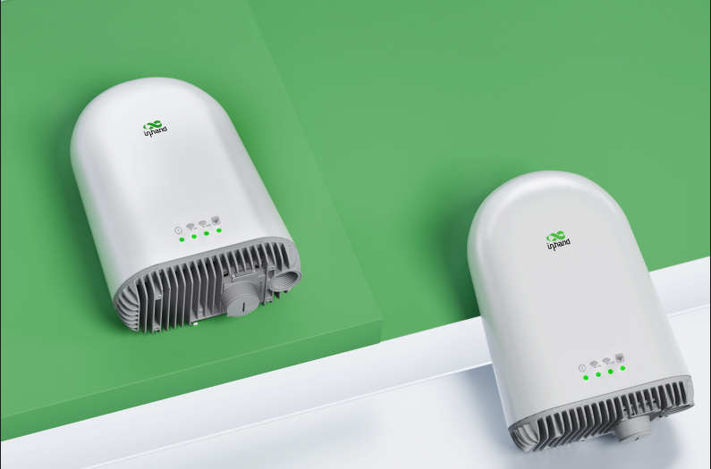

The OAP700 is an enterprise-grade Wi-Fi 7 access point designed for outdoor scenarios. It combines BE5000 dual-band concurrent connectivity, dual 2.5GE wired ports, a switchable directional/omnidirectional antenna hardware design, and AI Agent intelligent O&M capabilities, all housed in an IP67-rated enclosure. It is designed for wide-area outdoor coverage in scenic areas, outdoor campuses, transportation hubs, open-air sports venues, solar power plants, and similar scenarios. It supports IEEE 802.3at PoE single-cable deployment and provides multi-SSID service isolation, enabling segmented access for guest, surveillance, and business networks while balancing coverage and deployment efficiency.

The OAP700 breaks through the single-pattern coverage limitation of conventional outdoor APs. An onboard hardware RF switch toggles flexibly between directional and omnidirectional coverage, so a single device can serve a variety of outdoor topologies — corridor-style, plaza-style, and others — without replacing antennas or adding extra devices in the field.

The OAP700 is also an AI-native outdoor AP. Relying on the InCloud Manager cloud management platform and its AI Agent for remote fault diagnosis, it turns outdoor network O&M from "dispatching technicians on site" into "conversational remote O&M."

### 2.2 Key Features

| Feature | Description |
| --- | --- |
| BE5000 Wi-Fi 7 dual-band | IEEE 802.11be, 5 GHz 3×3 + 2.4 GHz 2×2 spatial streams, PHY peak data rate of about 5 Gbps |
| 2.5G wired ports | Dual 2.5G Ethernet ports (WAN supports PoE-powered input and carries data; LAN is data-dedicated), 2.5 Gbps wire-speed forwarding |
| Directional/omnidirectional antenna switching | Five built-in antennas; a hardware RF switch selects directional or omnidirectional coverage, so one device fits a variety of outdoor topologies |
| Full Wi-Fi 7 feature set | DL/UL MU-MIMO, DL/UL OFDMA, 4K-QAM, BSS Color, TWT |
| High-capacity access | Up to 300+ associated clients, 100+ concurrently active (guaranteed ≥ 20 Mbps per user) |
| Seamless roaming | 802.11k/v/r fast roaming keeps voice and video sessions uninterrupted |
| Independent multi-SSID broadcast | Up to 16 independently configured SSIDs to separate guest, security, and business access networks |
| Outdoor-grade reliability | IP67 protection, −30 °C to +70 °C wide-temperature operation, integrated die-cast aluminum passive cooling, UV-stabilized polymer housing |
| Single-cable PoE deployment | IEEE 802.3at PoE powered; one Ethernet cable carries both power and data |
| AI Agent intelligent O&M | The cloud-based AI Agent in InCloud Manager delivers remote fault diagnosis and parameter optimization |

### 2.3 Typical Application Scenarios

| Scenario | Typical Applications |
| --- | --- |
| Scenic & Tourism Areas | Wide-area Wi-Fi coverage for ancient towns, pedestrian streets, and resorts; access in wide-temperature, high-humidity, high-salt-spray environments such as cruise ships, harbors, and islands |
| Outdoor Campuses | Coverage of plazas, walkways, and parking lots in industrial and office campuses; outdoor work zones, AGV dispatching, and surveillance networks in factory logistics parks |
| Transportation Hubs | High-density concurrent access at high-speed rail stations, airport plazas, and bus terminals; coverage along highway service areas and toll stations |
| Open-Air Venues | High-density concurrent access in stadiums and open-air theaters, with BSS Color mitigating co-channel interference; wide-temperature operation at campsites and ski resorts |
| Commercial Outdoor Areas | Pedestrian streets, outdoor dining areas, campsites, open-air markets, and pop-up events |
| Smart Agriculture | Agricultural IoT terminals and surveillance video backhaul in greenhouses and field operation areas; environmental monitoring and device coordination in large-scale livestock farms |

### 2.4 Appearance and Interfaces

#### 2.4.1 Product Outline

| Front View | Side View | Top View |
| :---: | :---: | :---: |
| 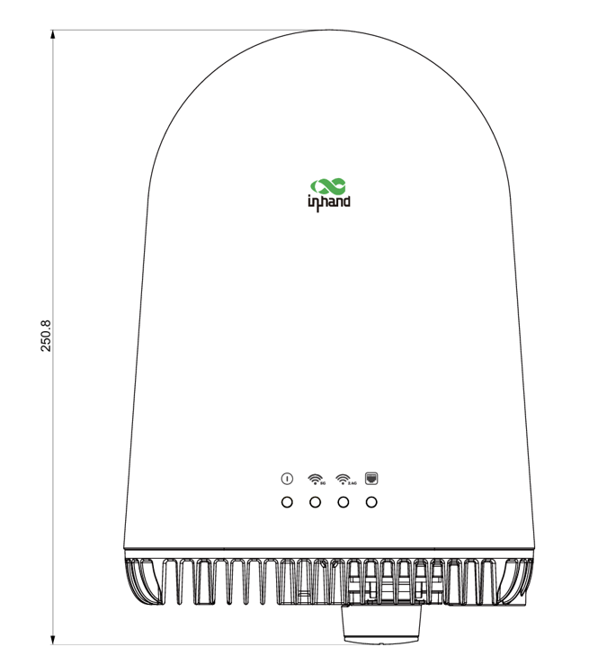 | 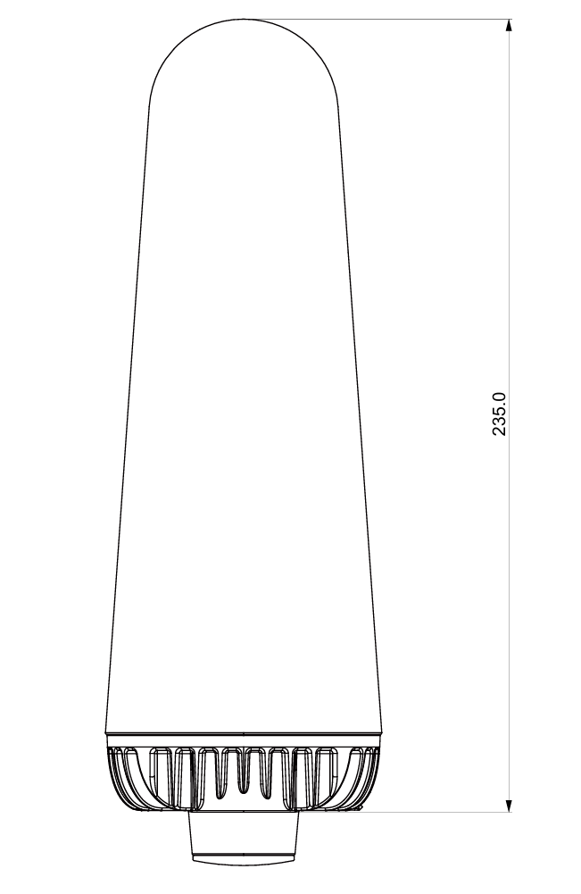 | 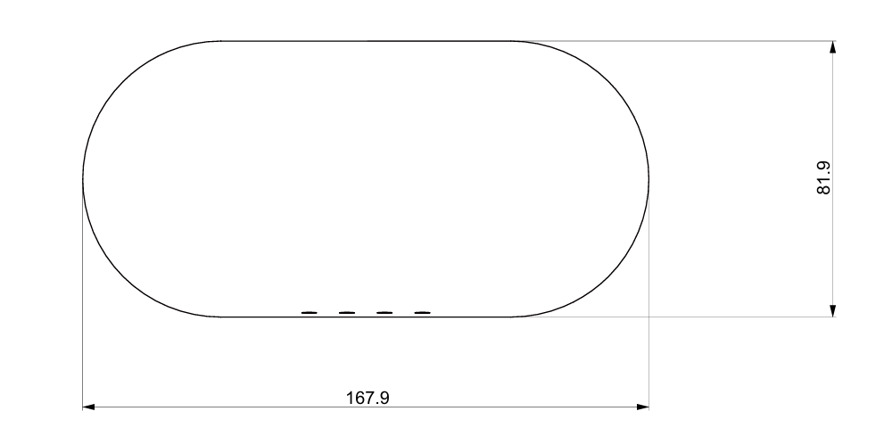 |

> **NOTE**
> 1. All dimensions are in millimeters (mm); values in parentheses are in inches (in).
> 2. All dimensions are approximate and for reference only.
> 3. The drawings must not be used for manufacturing.
> 4. Dimensions are subject to component and manufacturing tolerances.
> 5. Specifications are subject to change without notice.

#### 2.4.2 Indicators

The device panel has four indicators, arranged from left to right as follows:

| Indicator | State | Meaning |
|--------|------|------|
| System status LED | Off | Device is not powered |
|  | Solid red | System is starting up |
|  | Solid green | System is operating normally |
|  | Flashing red | System error |
|  | Flashing blue | System upgrade in progress |
| Wi-Fi 2.4G | Off | AP function disabled / radio off |
|  | Solid green | Operating normally as an AP |
| Wi-Fi 5G | Off | AP function disabled / radio off |
|  | Solid green | Operating normally as an AP |
| Ethernet LED | Off | Neither WAN nor LAN is active |
|  | Solid green | Only LAN/WAN is connected |
|  | Solid blue | Both WAN and LAN are connected |


#### 2.4.3 Interfaces and Buttons

| Name | Type | Description |
| --- | --- | --- |
| WAN port (PoE WAN) | 1 × 2.5 Gbps RJ45 | Uplink interface; supports PoE-powered input and carries data at the same time; supports DHCP/static IP and MTU configuration |
| LAN port | 1 × 2.5 Gbps RJ45 | Data-dedicated downlink interface, 2.5 Gbps wire-speed forwarding |
| Reset button | 1 | Restores the device to its factory state; see the silkscreen marking on the unit and the supplied QSG for the exact press method and duration |
| Antennas | 5 built-in | 2 dual-band omni + 2 dual-band directional + 1 5 GHz omni; switched between directional/omnidirectional mode by a hardware RF switch |

### 2.5 Package Contents

After unpacking, check that the following items are present. If anything is missing or damaged, contact your dealer immediately.

| Category | Item | Quantity |
| --- | --- | --- |
| Standard | OAP700 unit | 1 |
| Standard | 1 m RJ45 Ethernet cable | 1 |
| Standard | Mounting kit (wall/pole/rooftop) | 1 |
| Standard | Quick Start Guide | 1 |
| Optional | IEEE 802.3at PoE power adapter / PoE switch | As required |

---

## 3 Installation and Connection

### 3.1 Installation Environment Requirements

| Item | Requirement |
| --- | --- |
| Operating temperature | −30 °C to +70 °C |
| Storage temperature | −40 °C to +85 °C |
| Relative humidity | 5% to 95%, non-condensing |
| Ingress protection | IP67 (cable-entry seals must be tightened after installation) |
| Power supply | IEEE 802.3at (Type 2, PoE+), backward compatible with 802.3af; power consumption ≤ 15 W |
| Mounting surface | A wall, pole, or rooftop structure strong enough to bear the weight of the unit (about 1.5 kg) and the wind load |
| Heat dissipation | Leave clearance around the unit; do not obstruct the heat-dissipation structure of the enclosure |
| Coverage reference | Maximum coverage radius of about 150 m in an ideal line-of-sight (LOS) environment; the actual distance depends on the environment, interference, and client capabilities |

### 3.2 Mounting Methods

The OAP700 supports three mounting methods: **wall, pole, and rooftop**. The corresponding mounting accessories are supplied with the unit.

**General installation steps**

1. **Choose the installation location**: Determine the location according to the coverage objective (choose directional mode for linear scenarios, omnidirectional mode for area scenarios). Avoid obstructions, and make sure there is no large metal structure in front of the antennas.
2. **Secure the bracket**: Use the supplied mounting accessories and expansion bolts / pole clamps to fix the bracket firmly to the wall, pole, or rooftop base.
3. **Mount the device**: Hang the device on the bracket and tighten the anti-drop screws. Confirm that the device is level, firm, and not loose.
4. **Run the Ethernet cable**: Connect one end of a Category 5e or higher Ethernet cable to the device **WAN (PoE)** port, and the other end to the powered-device port of the PoE switch / PoE injector. If you need to attach a wired downstream device, run another Ethernet cable from the **LAN** port.
5. **Waterproof the entries**: Arrange the incoming cables, and use the supplied waterproof connector / sealing ring to clamp the cables and cable outlet tightly, so that the IP67 rating of the whole unit remains intact. Leave a **drip loop** in the Ethernet cable to prevent rainwater from running along the cable into the connector.
6. **Power up and self-test**: Apply PoE power, and observe the system LED, Ethernet LED, and Wi-Fi indicators. After the device has finished starting up, go to Section 4.1 to log in to the management interface and configure it.

**NOTE**
- For detailed installation steps, bracket assembly drawings, and torque requirements, refer to the *Quick Start Guide* supplied with the unit.
- For pole mounting, confirm that the pole diameter is within the range allowed by the mounting accessories.

### 3.3 Network Topologies

The OAP700 supports two operating modes, which can be switched in **System > System Setting** on the Web interface:

| Mode | Name | Description |
| --- | --- | --- |
| FAT-Routing | Routing mode | The device operates as a gateway. The WAN port connects to the upstream network, and the device itself provides NAT, DHCP, routing, and wireless access. Static routing and guest network isolation are supported. |
| FAT-Bridge | Bridge mode | The device operates as a Layer 2 bridging access point. Wired and wireless clients belong to the upstream network, and the upstream device handles the gateway and DHCP. |


### 3.4 Initial Checks After Power-Up

1. The system indicator lights up normally, indicating that the device is powered and has begun to start up.
2. The Ethernet port indicator lights up, indicating that the link between the WAN port and the PoE switch has been established.
3. Use a wired or wireless client that can reach the device network (the default wired subnet is `192.168.2.0/24`, and the device management address is `192.168.2.1`).
4. Open a browser and go to `https://192.168.2.1`. If the login page is displayed, the installation and power supply are correct.

---

## 4 Device Software Functions

This chapter describes the software functions of the OAP700 Web management interface. All configuration operations and status queries for the device are performed through the Web management interface. The default management address is `https://192.168.2.1`, and no client software needs to be installed.

**NOTE**: The device can also be managed remotely and centrally through a cloud platform. See Chapter 5.

### 4.1 Logging In to the Web Management Interface

Logging in is a prerequisite for using the device management functions. This section explains how to establish a management connection to the device from a client, complete authentication, and enter the management interface, as well as how to change the administrator password and set an automatic session timeout.

**Terminology**

| Term | Definition |
| --- | --- |
| HTTPS | An HTTP protocol based on TLS encryption, used to prevent management passwords and configuration content from being eavesdropped on or tampered with during transmission. |
| Session | The period from a successful login until logout or timeout. All configuration operations performed during this period belong to the account that is currently logged in. |

#### 4.1.1 Connection Methods

| Method | Operation |
| --- | --- |
| Wired | Connect the client's Ethernet cable to the OAP700 LAN port (in routing mode the device assigns the address via its DHCP server), or to the upstream network |
| Wireless | Have the client search for and connect to the device's SSID (the factory-default SSID is on the unit label) |
| Management address | Enter `https://192.168.2.1` in the browser (HTTP is automatically redirected to HTTPS) |
| Management account | The initial username and password are on the unit label (each device has a unique factory password) |

**CAUTION**: Always use HTTPS to access the management interface. If the browser reports that the certificate is not trusted, this is the normal warning for the self-signed certificate used by the device; click "Continue" to proceed.

#### 4.1.2 Login Procedure

1. Open a browser, enter `https://192.168.2.1` in the address bar, and press Enter to open the login page.

   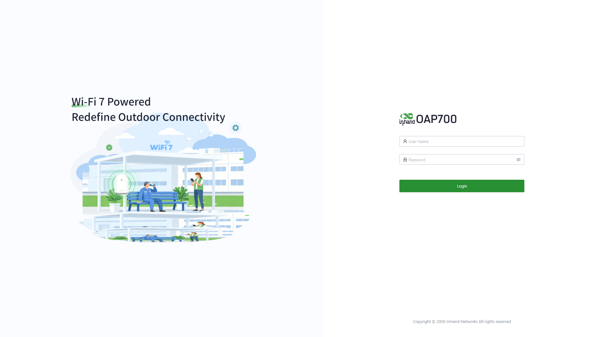

   **Figure 4-1 OAP700 Web Management Login Page**

2. Enter the **User Name** and **Password**.
3. Click the **Login** button to enter the **Dashboard** page.

**CAUTION**
- Factory devices do not have a common default password; the initial password is pre-printed on the unit label. Do not use any password that appears in example documentation.
- After your first login, change the password immediately via **System > Account Management**.
- Consecutive failed login attempts are recorded under **Status > Events**, which facilitates security auditing.

#### 4.1.3 Interface Overview

After logging in, the interface is divided into three areas:

| Area | Location | Content |
| --- | --- | --- |
| Top bar | Top of the page | Product identity, the InCloud Manager cloud platform entry, Internet connectivity status and current account|
| Left navigation | Left side of the page | Five main menus: Dashboard, Status, Config, Wi-Fi, and System (the button at the bottom left collapses the navigation bar) |
| Content area | Right side of the page | Configuration forms, lists, and charts for each function page |

#### 4.1.4 Changing the Administrator Password

1. Go to **System > Account Management**.
2. Enter the **Username**, **New Password**, and **Confirm Password**.
3. Click **Save**.

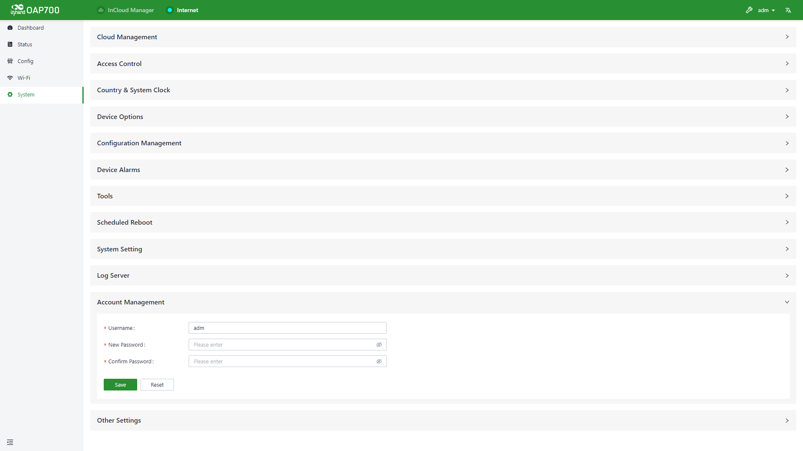

**Figure 4-2 Account Management**

**CAUTION**: After changing the password, log in again immediately with the new password and keep it safe. If you forget the password, the only way to recover the device is to use the Reset button to restore the factory settings (this clears all configuration).

#### 4.1.5 Logging Out and Automatic Session Timeout

- Click the account name in the upper-right corner to log out.
- In **System > Other Settings** you can set the Web login timeout. When the timeout expires, the session ends automatically, reducing the risk of an unattended terminal being misused.

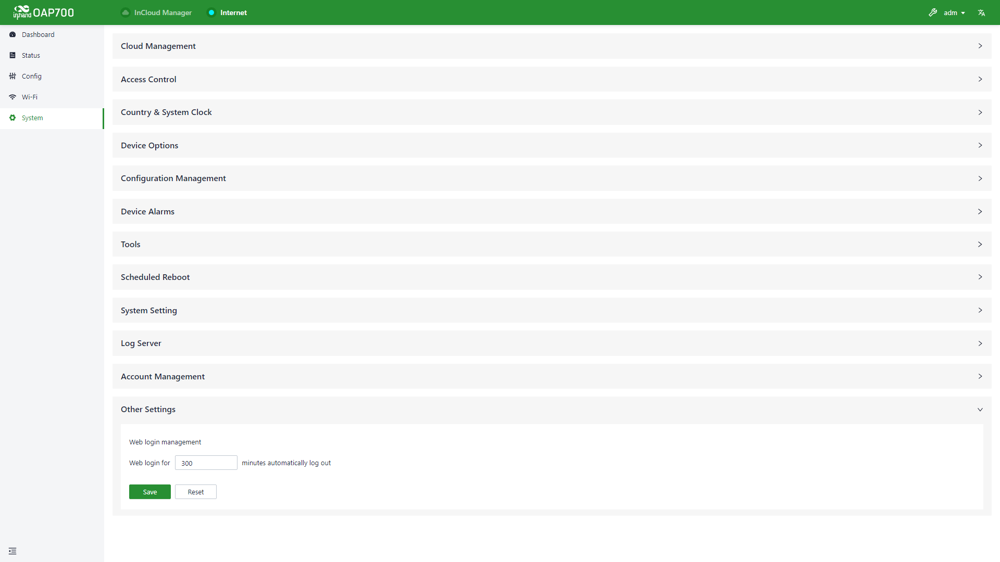

**Figure 4-3 Web Login Timeout Setting**

### 4.2 Dashboard

The Dashboard presents the device's identity information, interface link status, traffic statistics, and wireless access load in one place. It is used to determine, on a single page, whether the device is operating normally and whether the uplink is online, making it the preferred page for routine inspection.

**Terminology**

| Term | Definition |
| --- | --- |
| Uplink interface (WAN) | The interface that connects to the upstream network. In routing mode the device obtains its Internet address through this interface, and it also receives PoE power through this interface. |
| Link status | Whether a physical connection has been established between the port and the device at the other end. |
| License status | The software license obtained by the device; when unlicensed, some cloud platform functions are restricted. |

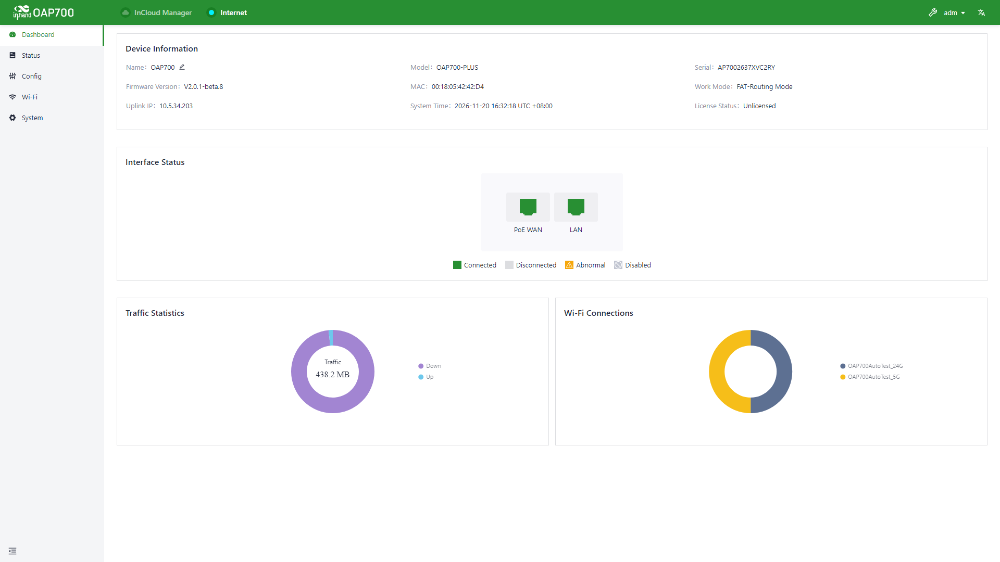

**Figure 4-4 Dashboard**

| Block | Content | Description |
| --- | --- | --- |
| Device Information | Name, model, serial number, firmware version, MAC address, operating mode, uplink interface address, system time, license status | The pencil icon next to the name allows you to edit the device name directly |
| Interface Status | Link status diagrams for PoE WAN and LAN | Legend: **Connected** (green) / **Disconnected** (gray) / **Abnormal** (yellow exclamation mark) / **Disabled** (hatched) |
| Traffic Statistics | Ring charts for total traffic, downstream traffic, and upstream traffic | Used to observe the overall upstream and downstream traffic volume |
| Wi-Fi Connections | Distribution of client counts grouped by SSID | Used to check whether the load of each SSID is balanced |

**NOTE**: The uplink interface address shows the IP address obtained on the WAN side. If the device is in routing mode with DHCP and no address has been obtained, check the upstream network; see Section 6.3.

### 4.3 Status Monitoring

The **Status** menu reflects the current condition of the device from three dimensions: clients, recorded activity, and system operation. It is used to confirm access status, trace configuration and security events, and locate operating abnormalities.

**Terminology**

| Term | Definition |
| --- | --- |
| Client | A terminal device connected to this device by wired or wireless means. |
| Event | A structured record that the device generates for important operations and state changes (login, configuration change, reboot, connectivity change, and so on). Events are stored in chronological order and can be exported for auditing. |
| Log | A continuous text record produced while the device is running. Logs contain more information than event records and can be used for in-depth fault analysis. |
| RSSI | Received Signal Strength Indicator; reflects the strength of the wireless signal between the client and the device. The larger the value, the stronger the signal. |
| MAC address | The unique hardware identifier address of the client's network interface. |
| VLAN | Virtual Local Area Network; used to divide mutually isolated logical networks on the same physical network. |

The **Status** menu contains three tabs: **Clients**, **Events**, and **Logs**.

#### 4.3.1 Clients

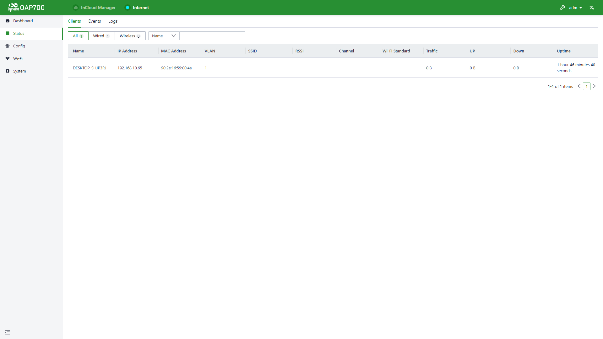

**Figure 4-5 Client List**

At the top of the page, clients are counted by access type: **All / Wired / Wireless**. Keyword search is also provided.

Field descriptions:

| Field | Description |
| --- | --- |
| Name | The client's host name or device name |
| IP Address | The IPv4 address obtained by the client |
| MAC Address | The physical address of the client's network interface |
| VLAN | The VLAN the client belongs to (Default/1 by default) |
| SSID | The wireless network name the client is connected to ("-" is shown for wired clients) |
| RSSI | Wireless signal strength |
| Channel | The current operating channel |
| Wi-Fi Standard | The wireless standard negotiated with the client (for example 802.11be) |
| Traffic / UP / Down | The cumulative and current traffic of the client |
| Uptime | How long the client has been online |

**Purpose**: Identify abnormal clients, confirm whether guest and business networks are isolated, and check whether clients with weak signals require a change of AP position or antenna mode.

#### 4.3.2 Events

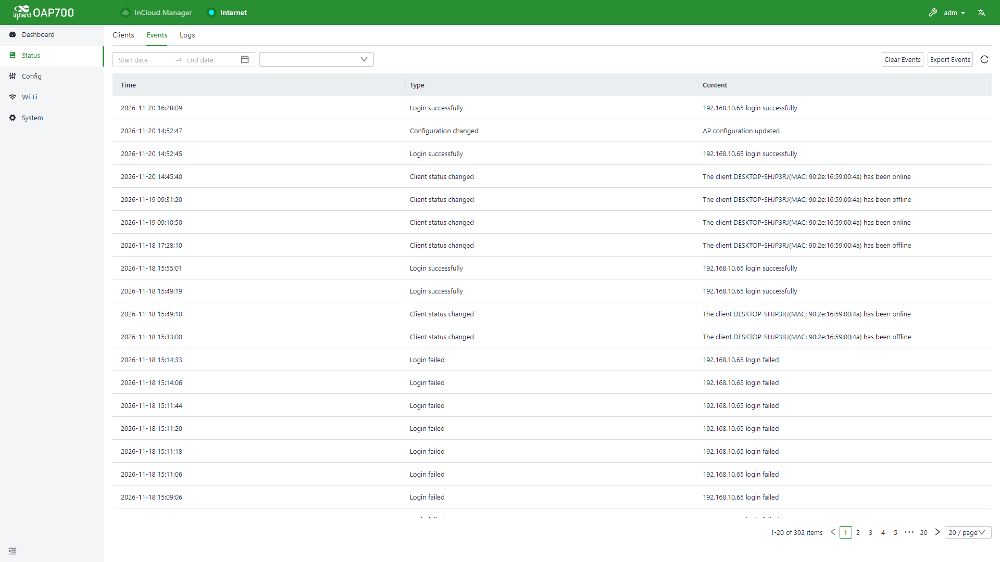

**Figure 4-6 Event Records**

- Fields: **Time, Type, Content**.
- Common event types: Login successfully, Login failed, Client status changed, Configuration changed, Reboot, Upgrade, Network state changed, and so on.
- **Clear Events** and **Export Events** are supported (the exported file can be used for fault analysis and compliance auditing).
- The list supports paging and adjustment of the number of entries per page.

#### 4.3.3 Logs

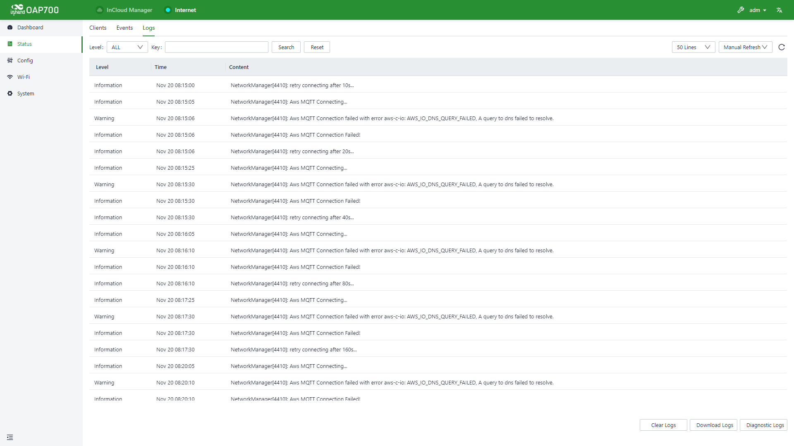

**Figure 4-7 System Logs**

| Function | Description |
| --- | --- |
| Level filter | Filter logs by log level (ALL / Information / Warning, and so on) |
| Keyword search | Enter a keyword and click **Search** to locate the log; **Reset** clears the criteria |
| Lines displayed | Choose how many lines are displayed at once (for example 50 lines) |
| Manual refresh | Fetch the latest logs manually |
| Clear logs | Clear the local log buffer |
| Download logs | Export the log file |
| Diagnostic logs | Generate / download diagnostic logs for technical support |

**NOTE**: Messages such as `AWS_IO_DNS_QUERY_FAILED` and `MQTT Connection failed` in the logs usually mean that the device cannot resolve the cloud platform domain name (DNS is unavailable or the Internet is unreachable). Check the WAN configuration and DNS settings first.

### 4.4 Network Configuration

The **Config** menu defines the wired network structure of the device, including the access parameters of the uplink port and the address plan of the local network. The content of this section determines whether the device can reach the upstream network, and whether downstream clients can obtain usable addresses.

**Terminology**

| Term | Definition |
| --- | --- |
| WAN (Wide Area Network port) | The uplink interface that connects to the upstream network. The device also receives PoE power through this interface. |
| LAN (Local Area Network) | The internal network below the device, through which clients obtain addresses and communicate with each other. |
| DHCP | Dynamic Host Configuration Protocol. The device automatically assigns IP addresses, subnet masks, and gateways to clients, eliminating the need to configure each one by hand. |
| Subnet mask | Used together with an IP address to mark the boundary between the network portion and the host portion of the address, which determines the address range the network can hold. |
| Gateway | The address that forwards data when a client accesses other networks; normally the LAN address of the device on that network. |
| DNS | Domain Name Server, responsible for resolving domain names into IP addresses. |
| MTU | Maximum Transmission Unit; the maximum number of bytes a single network packet may contain. It needs to be adjusted only in special topologies where it must match the requirements of an upstream device. |
| Guest network | A separate network whose addresses are isolated from the main network, used to restrict external clients from accessing internal business resources. |

The **Config** menu contains two tabs: **WAN** and **Local Network**.

#### 4.4.1 WAN Configuration


**Figure 4-8 WAN Configuration**

| Parameter | Options / Description |
| --- | --- |
| Type | `DHCP` (obtain automatically) / `Static IP` |
| IP Address | The WAN address of this device in static IP mode |
| Mask | Subnet mask |
| Gateway Address | The upstream gateway IP |
| Main DNS / Secondary DNS | Domain name servers; in DHCP mode these are normally assigned automatically by the upstream network |
| MTU | Maximum Transmission Unit; adjust only in special topologies (such as PPPoE or tunnels) |

Operation: after making your changes, click **Save** to apply them; click **Reset** to restore the values from before the current edits.

**NOTE**: The WAN port is also the PoE-powered input. Configuring network parameters does not affect power delivery.

#### 4.4.2 Local Network

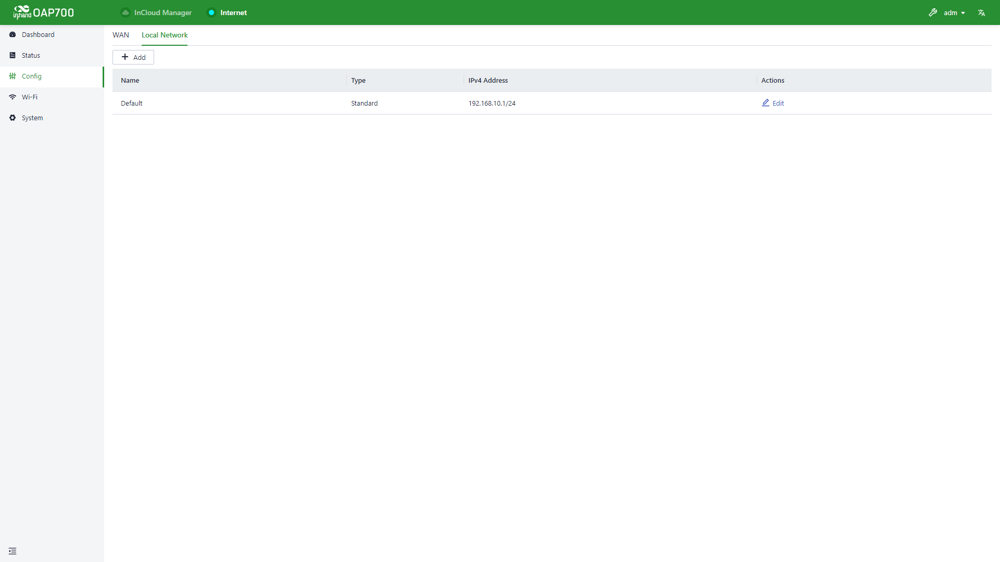

**Figure 4-9 Local Network**

List fields: **Name, Type, IPv4 Address, Actions (Edit)**. Click **Add** in the upper-right corner to create a new network.

Clicking **Add** opens the "Add the network" dialog:

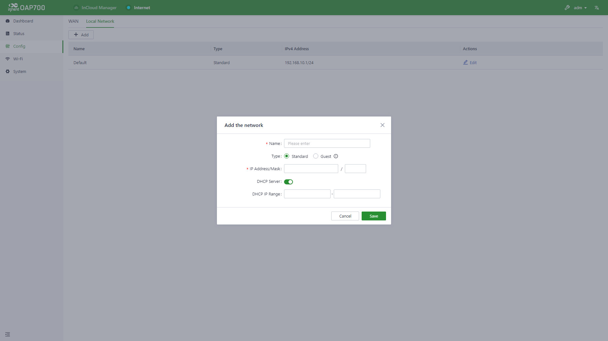

**Figure 4-10 Add Network (including guest network)**

| Parameter | Description |
| --- | --- |
| Name | The network name |
| Type | `Standard` (main network) / `Guest` |
| IP Address/Mask | The subnet address of this network, for example `192.168.10.1/24` |
| DHCP Server | Whether to enable the DHCP server for this network |
| DHCP IP Range | The range of IP addresses assigned automatically |

**CAUTION**: A guest network uses an **independent IP subnet and an independent DHCP address pool**, isolated from the main network, which prevents guest clients from reaching the internal business network. Binding a guest SSID to a guest network gives you service segmentation (see VLAN binding in Section 4.5.1).

### 4.5 Wireless Network Configuration

The **Wi-Fi** menu is used to set up wireless access services, including creating wireless network names and configuring security, adjusting radio parameters and antenna coverage patterns, and configuring the guest authentication page. Binding an SSID to a specified network allows different services to be accessed in isolation.

**Terminology**

| Term | Definition |
| --- | --- |
| SSID | Service Set Identifier, that is, the wireless network name that clients search for. This device supports up to 16 independently configured SSIDs. |
| Radio | The hardware unit responsible for transmitting and receiving wireless signals. This device contains two radios: 2.4 GHz and 5 GHz. |
| Channel | The numbered frequency band occupied by a radio. Devices on adjacent sites that use the same channel will interfere with each other. |
| Bandwidth | The width of the frequency occupied by a single channel. A wider bandwidth can carry a higher data rate, but interference immunity decreases correspondingly. |
| Transmit Power | The signal transmission strength of the radio; it affects coverage distance and the degree of interference caused to neighboring devices. |
| Directional antenna / Omni antenna | A directional antenna concentrates energy in a single direction and suits linear scenarios such as roads and corridors. An omnidirectional antenna radiates evenly in the horizontal plane and suits area scenarios such as plazas and venues. |
| VLAN binding | Associating an SSID with a specified network so that clients under that SSID can only obtain addresses allocated by that network. |
| User Isolation | When enabled, wireless clients on the same SSID cannot communicate directly with each other; commonly used for guest access. |
| Portal authentication | A network admission method in which a client is redirected to an authentication page the first time it accesses the network, and may go online only after completing the required action. |
| RADIUS | A centralized authentication server used to verify user accounts and passwords. |

The **Wi-Fi** menu contains three tabs: **SSIDs**, **Radio**, and **Portal**.

#### 4.5.1 SSID Management

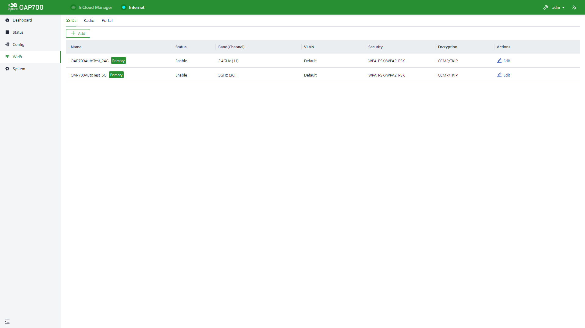

**Figure 4-11 SSID List**

| Field | Description |
| --- | --- |
| Name | The SSID name; the one carrying the "Primary" tag is the primary SSID for that band |
| Status | Enable / Disable |
| Band (Channel) | 2.4 GHz or 5 GHz, plus the current channel |
| VLAN | The VLAN / network the SSID is bound to |
| Security | The encryption and authentication method |
| Encryption | CCMP, CCMP/TKIP, and so on |
| Actions | Edit |

The OAP700 supports up to **16 independently configured SSIDs**, which can be used separately for guest access, security surveillance, and production business access.

##### Adding an SSID

Click **Add** and fill in the "Add Wi-Fi" dialog:

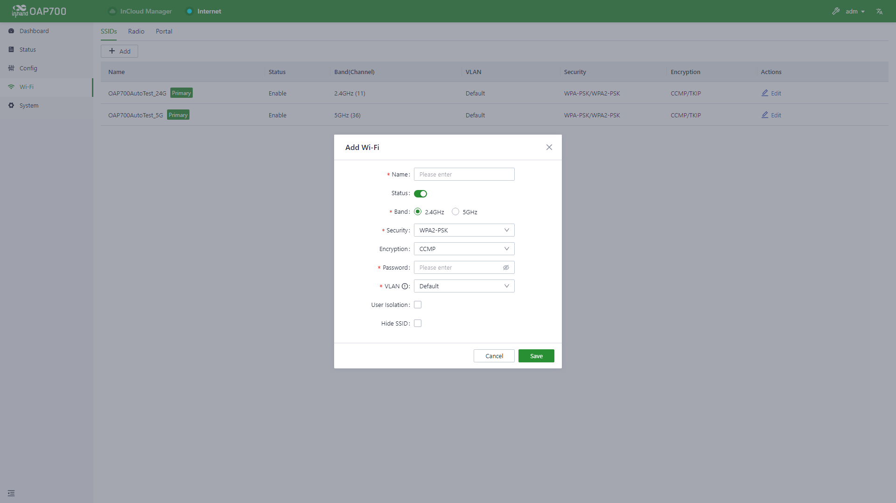

**Figure 4-12 Add Wi-Fi**

| Parameter | Description |
| --- | --- |
| Name | The SSID name (required) |
| Status | Enable or disable this SSID |
| Band | `2.4GHz` / `5GHz` (required, single choice) |
| Security | `OPEN` (no authentication), `WPA2-PSK`, `WPA3-PSK`, `WPA-PSK/WPA2-PSK`, `WPA2-PSK/WPA3-PSK`, and so on (required) |
| Encryption | For example `CCMP`, `CCMP/TKIP` |
| Password | The pre-shared key (required for everything except OPEN) |
| VLAN | The network / VLAN this SSID is bound to; `Default` by default (required) |
| User Isolation | When enabled, wireless clients on the same SSID are isolated from each other |
| Hide SSID | When enabled, the SSID name is not broadcast, and clients must enter the name manually to connect |

##### Editing an SSID

Click **Edit** on the target SSID in the list to modify all of the parameters above.

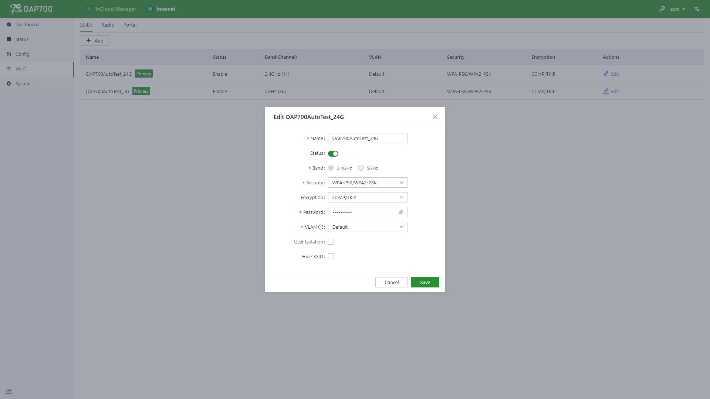

**Figure 4-13 Edit SSID**

**CAUTION**
- With **User Isolation** enabled on an SSID, clients cannot reach each other directly, which suits guest networks. If clients must be able to communicate with each other (for wireless screen mirroring, printer sharing, and the like), disable this option.
- For security, prefer **WPA3-PSK** or **WPA2-PSK/WPA3-PSK**. Fall back to WPA2 or WPA only when legacy clients are unable to connect.

#### 4.5.2 Radio Parameters and Antenna Mode


**Figure 4-14 Radio Parameters and Antenna Mode**

| Group | Parameter | Options |
| --- | --- | --- |
| 2.4GHz Radio | Bandwidth (MHz) | `20`, `40` |
| 2.4GHz Radio | Channel | `Auto`, or specify manually (within the range permitted by the country code, for example 3~11) |
| 2.4GHz Radio | Transmit Power | `Auto`, `Height`, `Medium`, `Low`, `Custom` |
| 5GHz Radio | Bandwidth (MHz) | `20`, `40`, `80`, `160` |
| 5GHz Radio | Channel | `Auto`, or specify manually (within the range permitted by the country code) |
| 5GHz Radio | Transmit Power | `Auto`, `Height`, `Medium`, `Low`, `Custom` |
| Antenna Mode | Coverage pattern | `Omni` / `Directional` |

**Antenna mode selection guide**

| Mode | Suitable Scenarios | Coverage Characteristics |
| --- | --- | --- |
| Directional | Roads, corridors, passages, shorelines, and other linear scenarios | Long-range linear coverage |
| Omni | Plazas, venues, campuses, and other area scenarios | Uniform 360° coverage |

**NOTE**
- The antenna mode is switched by a hardware RF switch and can be toggled with one click in the Web interface or the cloud platform, **with no need to replace antennas in the field**.
- Radio parameter changes take effect after you click **Save**; already-connected clients may reconnect briefly.
- Keep the channel and power set to `Auto` so the device can avoid interference. Specify them manually only when there is a fixed co-channel interference source.

> In the English interface, the "High" transmit power option is labeled **Height**, as shown above.

#### 4.5.3 Portal Authentication

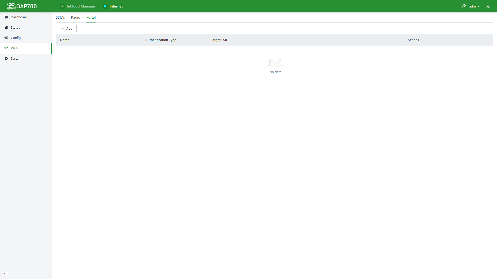

**Figure 4-15 Portal List**

List fields: **Name, Authentication Type, Target SSID, Actions**. Click **Add** to create a Portal:

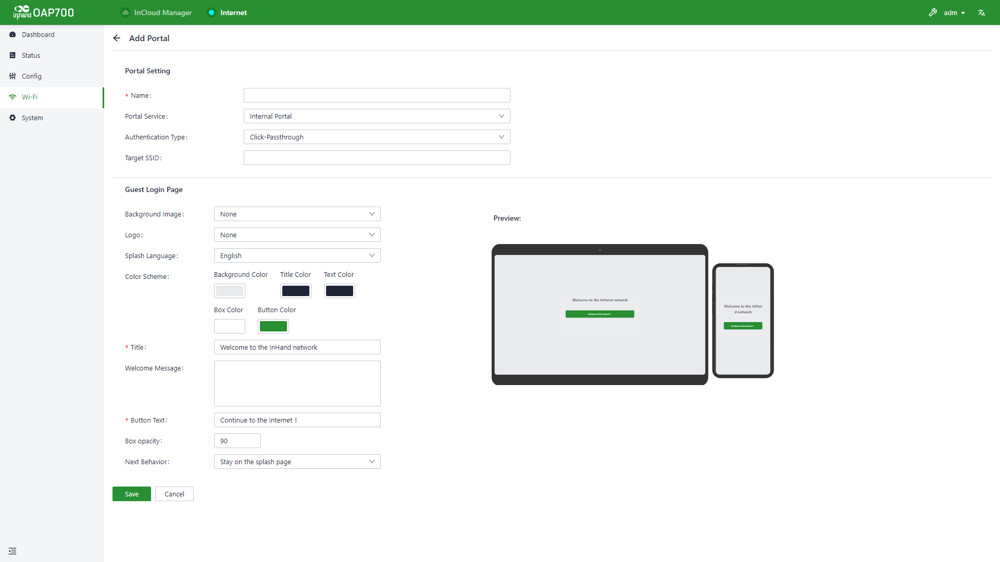

**Figure 4-16 Add Portal**

| Group | Parameter | Description |
| --- | --- | --- |
| Portal Setting | Name | The Portal configuration name |
| Portal Setting | Portal Service | `Internal Portal` (local authentication page) |
| Portal Setting | Authentication Type | `Click-Passthrough` (pass on click) / User Authentication |
| Portal Setting | Target SSID | The SSID to which this Portal is bound and on which it takes effect |
| Guest Login Page | Background Image / Logo | Custom images can be uploaded; `None` is supported |
| Guest Login Page | Splash Language | For example `English` |
| Guest Login Page | Color Scheme | Background Color, Title Color, Text Color, Box Color, Button Color |
| Guest Login Page | Text | Title, Welcome Message, Button Text |
| Guest Login Page | Box opacity | Transparency of the dialog box |
| Guest Login Page | Preview | Real-time preview of the authentication page as guests see it |
| Next Behavior | After authentication | `Stay on the splash page`, and so on |

**NOTE**
- This product supports a **local Portal** (built-in splash page), integration with **third-party Portal servers** (URL redirection), and **external RADIUS** user authentication; **cloud Portal is not supported**.
- Bypass methods include **vouchers** and **MAC whitelists**.
- For detailed parameters of bypass and external authentication, see Chapter 5 of the *OAP700 Datasheet* or contact technical support.

### 4.6 System Management

The **System** menu provides operating and maintenance functions for the device itself, covering cloud access, management-plane access security, time and country code, firmware upgrade and factory reset, configuration backup, alarm notification, network diagnostics, scheduled reboot, operating mode, remote logging, accounts, and login policies. The settings in this section directly determine the manageability, security, and maintainability of the device.

**Terminology**

| Term | Definition |
| --- | --- |
| Firmware | The system software the device runs. Upgrading the firmware provides feature enhancements and defect fixes. |
| Country code | The identifier of the country or region, which determines the available wireless channels and the maximum transmit power. It must match the radio management regulations of the deployment location. |
| NTP | Network Time Protocol, used to synchronize the system clock from a time server. The system clock is the basis of log timestamps and certificate validity. |
| syslog | The system logging protocol, which can forward the device's local logs to a central server for centralized storage. |
| SMTP | Simple Mail Transfer Protocol, which the device uses to send alarm notifications to a specified mailbox. |
| Source address | The range of source networks allowed to access a specified management service; equivalent to an address allowlist for the management plane. |
| Watchdog | A hardware timer monitoring circuit. If the system does not respond for a long time, it automatically triggers a restart to keep the device available. |

The **System** page uses grouped collapsible panels. Click a group to expand its configuration area. **Device Alarms** and **Tools** are separate pages.

#### 4.6.1 Cloud Management

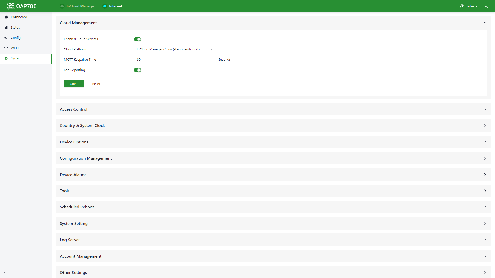

**Figure 4-17 Cloud Management**

| Parameter | Description |
| --- | --- |
| Enabled Cloud Service | Switch that connects the device to the cloud platform |
| Cloud Platform | `InCloud Manager Global (star.inhandcloud.com)` |
| MQTT Keepalive Time | The MQTT keepalive interval with the cloud platform (seconds) |
| Log Reporting | Whether to report device logs to the cloud platform |

**NOTE**: After the device connects to the InCloud Manager platform, the first-time onboarding is usually less than 60 s. For the connection procedure, see Chapter 5.

#### 4.6.2 Access Control

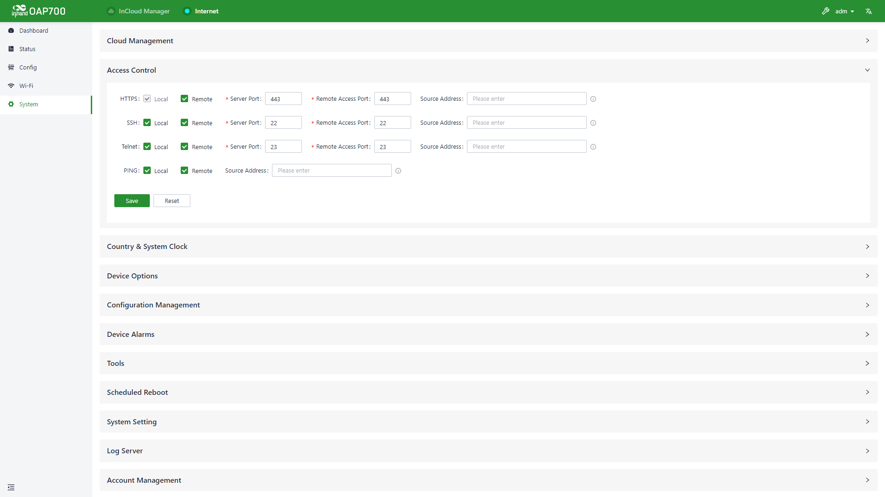

**Figure 4-18 Access Control**

For each management-plane service you can set the **Local** and **Remote** access switches, ports, and source-address restrictions:

| Service | Default Local Port | Description |
| --- | --- | --- |
| HTTPS | 443 | Web management interface (recommended to keep local access enabled; disable remote access as needed) |
| SSH | 22 | Command-line management |
| Telnet | 23 | Plaintext command-line management; **disable it** |
| PING | — | Network connectivity probing; the source address can be restricted |

- **Source Address**: leave it blank for no restriction; or enter the subnets that are allowed to connect, to implement a management-plane IP allowlist.
- Click **Save** after making changes to apply them.

**CAUTION**: Telnet is a plaintext protocol, and passwords and contents may be eavesdropped on. Except for debugging purposes, clear the "Local/Remote" checkbox for Telnet and save.

#### 4.6.3 Country & System Clock

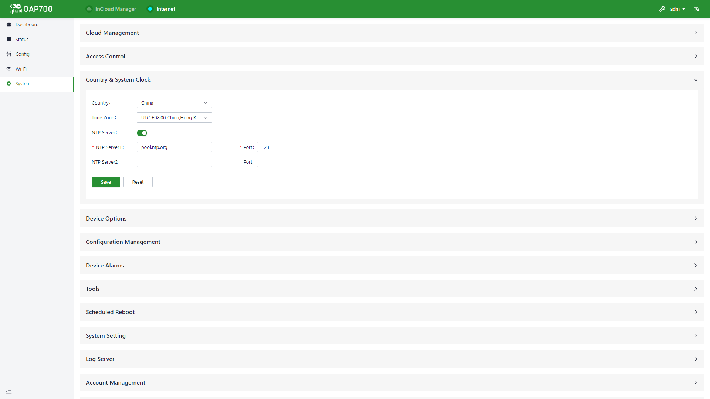

**Figure 4-19 Country and System Clock**

| Parameter | Description |
| --- | --- |
| Country | Determines the radio compliance parameters such as available channels and maximum transmit power |
| Time Zone | For example `UTC -04:00` |
| NTP Server1 / 2 | The address and port of the time synchronization server |

**CAUTION**: Be sure to set the correct country code; otherwise the wireless channels / transmit power may exceed the range permitted by local regulations. The system clock affects event and log timestamps and certificate validity, so configure a working NTP server.

#### 4.6.4 Device Options

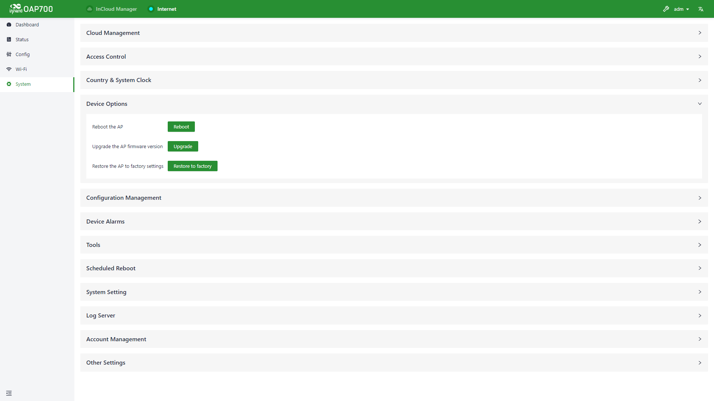

**Figure 4-20 Device Options (reboot / upgrade / factory reset)**

| Operation | Button | Description |
| --- | --- | --- |
| Reboot the AP | Reboot | Restarts the device; the configuration is retained |
| Upgrade the AP firmware version | Upgrade | Upload firmware → verify → upgrade → restart automatically |
| Restore the AP to factory settings | Restore to factory | Clears all configuration and restores the factory defaults |

**WARNING**: Never remove power during an upgrade; otherwise the device may fail to start. A factory reset discards all custom configuration, so export a backup from Configuration Management before performing one.

#### 4.6.5 Configuration Management

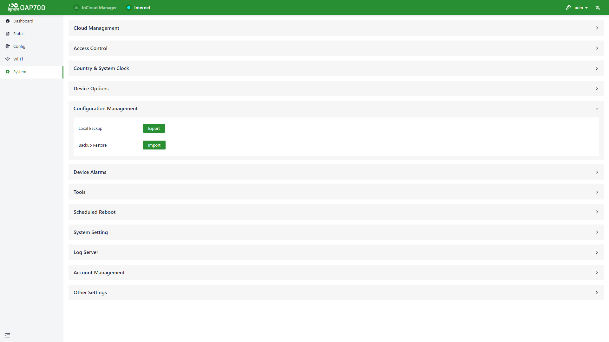

**Figure 4-21 Configuration Management**

| Operation | Button | Description |
| --- | --- | --- |
| Local Backup | Export | Exports the current configuration as a backup file and saves it locally |
| Backup Restore | Import | Uploads a previously exported configuration file to restore the device configuration |

**NOTE**: It is recommended to export a configuration backup after each important configuration change and again before a firmware upgrade.

#### 4.6.6 Device Alarms

Path: **System > Device Alarms** (separate page)

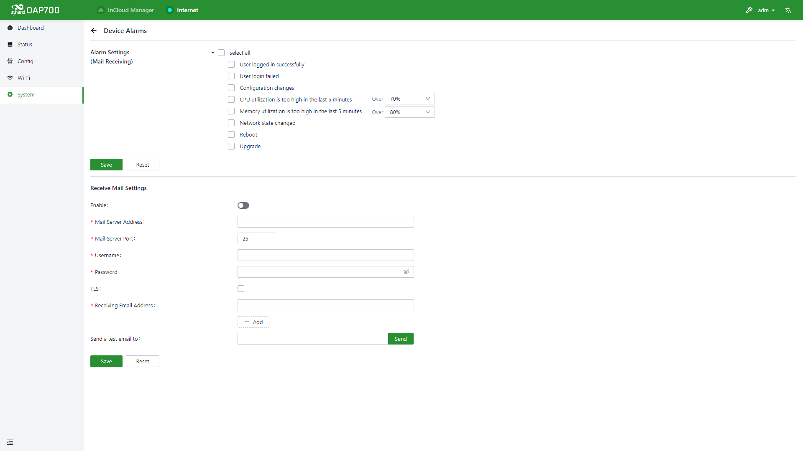

**Figure 4-22 Device Alarms and Mail Settings**

**Alarm Settings (Mail Receiving)** — selectable alarm items:

- User logged in successfully, User login failed, Configuration changes
- CPU utilization is too high in the last 5 minutes (over 70%)
- Memory utilization is too high in the last 80% (over 80%)
- Network state changed, Reboot, Upgrade

**Receive Mail Settings**: Enable, Mail Server Address, Mail Server Port, Username, Password, TLS, Receiving Email Address (multiple addresses can be **Add**ed), and Send a test email (**Send**). Click **Save** after completing the configuration.

**NOTE**: Click "Send a test email" first to verify that SMTP works. This avoids missing alarms caused by an incorrectly configured mail server.

#### 4.6.7 Tools (Diagnostic Tools)

Path: **System > Tools** (separate page)

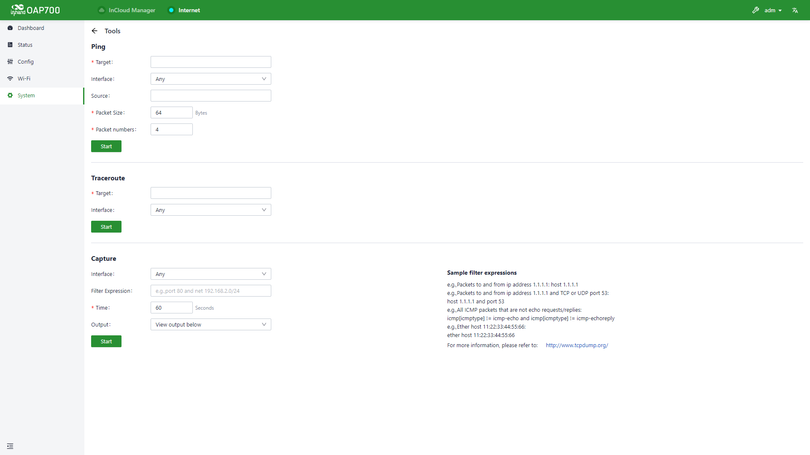

**Figure 4-23 Ping / Traceroute / Capture**

| Tool | Parameters | Description |
| --- | --- | --- |
| Ping | Target, Interface (Any), Source, Packet Size (Bytes), Packet numbers | Tests network connectivity, packet loss, and latency |
| Traceroute | Target, Interface (Any) | Traces the routing path to locate the faulty network segment |
| Capture | Interface (Any), Filter Expression, Time (Seconds), Output (displayed below) | Captures packets using tcpdump syntax |

**Common filter expression examples (built-in samples in the interface)**

```
host 1.1.1.1                                    # packets for host 1.1.1.1
host 1.1.1.1 and port 53                        # host 1.1.1.1 and TCP/UDP port 53
icmp[icmptype] != icmp-echo and icmp[icmptype] != icmp-echoreply   # other than Echo request/reply
ether host 11:22:33:44:55:66                     # MAC address 11:22:33:44:55:66
```

For more syntax, see: http://www.tcpdump.org/

**NOTE**: When troubleshooting a problem such as "can join the WLAN but web pages do not open", first Ping the gateway → then Ping a public IP address (for example `114.114.114.114`) → then Ping a domain name (for example `www.baidu.com`). This tells you whether the fault is in the link, the IP layer, or DNS.

#### 4.6.8 Scheduled Reboot

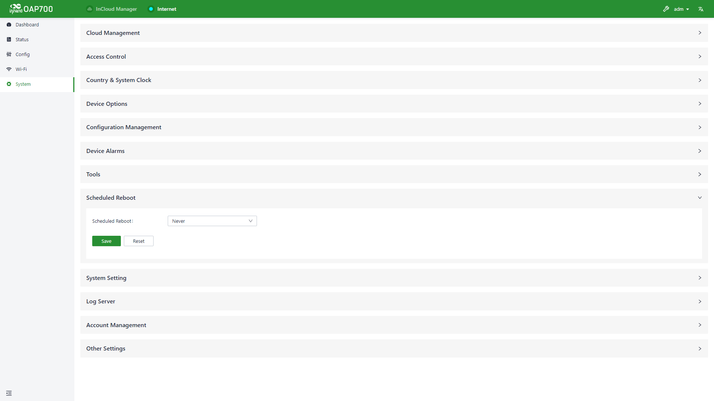

**Figure 4-24 Scheduled Reboot**

You can set a periodic automatic reboot schedule (`Never` by default). Click **Save** to apply it.

**NOTE**: The device has a built-in hardware watchdog, so a scheduled reboot is generally not needed to maintain stability. If you do set one, avoid peak business hours.

#### 4.6.9 System Setting (Operating Mode)

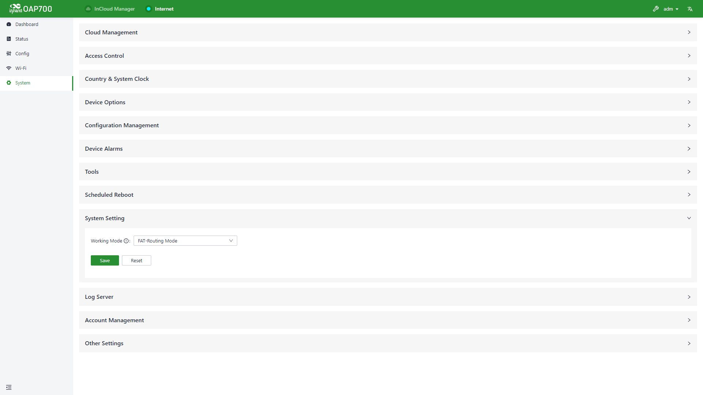

**Figure 4-25 Operating Mode Switching**

| Options | Description |
| --- | --- |
| FAT-Routing Mode | Operates as a gateway, providing NAT / DHCP / routing |
| FAT-Bridge Mode | Operates as a Layer 2 bridging AP; the network is managed by the upstream device |

**CAUTION**: Switching the operating mode changes the device management address and the network structure. After saving, you must reconnect and log in again.

#### 4.6.10 Log Server

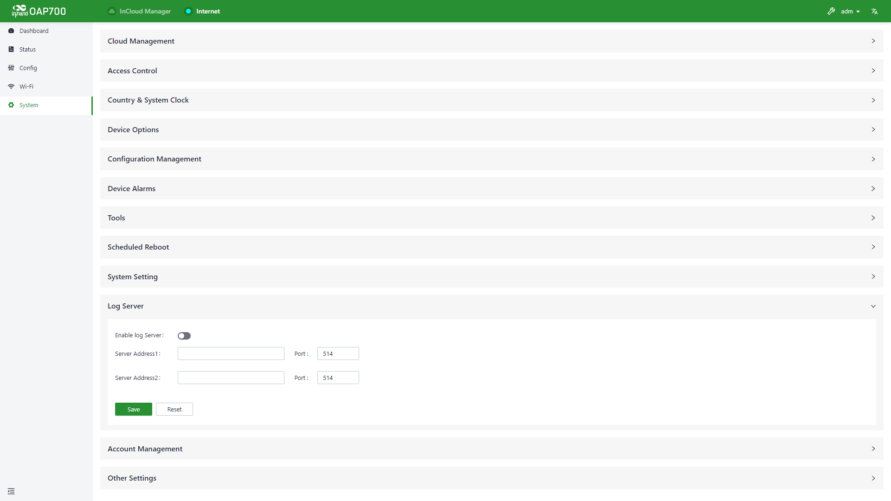

**Figure 4-26 Remote Log Server**

| Parameter | Description |
| --- | --- |
| Enable log Server | Switch for remote log reporting |
| Server Address1 / Port | Primary syslog server |
| Server Address2 / Port | Secondary syslog server |

**NOTE**: The device's local log storage is limited. It is recommended to send logs centrally to a syslog server for long-term retention, which makes unified auditing across multiple sites easier.

#### 4.6.11 Account Management

See [4.1.4 Changing the Administrator Password](#414-changing-the-administrator-password). Fields: **Username, New Password, Confirm Password**.

#### 4.6.12 Other Settings (Web Login Management)

See [4.1.5 Logging Out and Automatic Session Timeout](#415-logging-out-and-automatic-session-timeout). You can set how many minutes of inactivity after a Web login will automatically end the session.

### 4.7 Engineer Mode

Engineer Mode allows an InHand technical support engineer, with the user's authorization, to establish a temporary remote assistance session so that a fault can be located when it cannot be handled on site. This function is disabled by default, the session is temporary, and it should be closed as soon as troubleshooting is finished.

**Terminology**

| Term | Definition |
| --- | --- |
| Config Code | An authorization code provided by technical support, used to start Engineer Mode. It is valid only for this session. |
| Session code | A one-time identifier generated after the local script is run; technical support uses it to join this assistance session. |


**Figure 4-27 Engineer Mode**

**Procedure**

1. Contact technical support to obtain a **Config Code**.
2. Paste the Config Code into the input box and click **Start Engineer Mode**.
3. Download the generated `engineer-mode.ps1` script.
4. Double-click the script to run it on Windows, and tell the engineer the **session code** output by the script.
5. When troubleshooting is finished, click **Back to local page** to close the session.

**CAUTION**: Use this function only when official technical support personnel have contacted you and you are aware of and have authorized it. After the session ends, confirm that the status has returned to "Not Started".

## 5 Cloud Management and AI Intelligent O&M

### 5.1 Cloud Platform Management

The OAP700 is managed in the cloud by InCloud Manager (https://star.inhandcloud.com). The "InCloud Manager" label in the top bar is the entry point to the cloud platform.

| Capability | Description |
| --- | --- |
| Fast onboarding | First-time onboarding is under 60 s after the device connects to the platform |
| Device monitoring | Real-time view of device status, traffic, and clients |
| Bulk operations | Unified cross-site configuration push and firmware upgrades |
| Alarm notifications | Instant alerts on device anomalies |

**Connection steps**

1. In **System > Cloud Management**, turn on **Enabled Cloud Service** and select the cloud platform (China / Global), then save.
2. Confirm that the device WAN can reach the Internet and that DNS works (otherwise MQTT / DNS resolution failure alarms will appear in the logs).
3. Log in to the cloud platform, bind the device to the appropriate site, and its status will be available for viewing.

### 5.2 AI Agent Intelligent O&M

Through the AI network assistant, the complete device lifecycle can be managed in **natural language**. This is especially suitable for outdoor networks with widely dispersed sites where the cost of sending technicians on site is high:

| Capability | Description |
| --- | --- |
| Device monitoring | Natural-language queries; the AI retrieves and returns results automatically |
| Fault diagnosis | The AI performs multi-step diagnostics and provides a complete analysis with remediation suggestions (identifying disconnections, weak coverage, RF interference, and similar issues) |
| Configuration management | Read or modify configuration in natural language, or copy a configuration to other devices |
| Adaptive tuning | Recommends the optimal channels, transmit power, antenna mode, and other settings based on the live spectrum and client data |
| Firmware upgrade | The AI manages the entire process from version selection to completion, reducing the risk of human error |
| Remote terminal | Launched via natural language for direct access to the device |
| Bulk operations | Issued in natural language in batch, with no need to execute device by device |

**NOTE**: On the device side, an **Agent CLI / API** is provided as the control entry point for the AI Agent, for intent-based automated O&M orchestration. This function does not provide a Web UI configuration item.

---

## 6 Troubleshooting

### 6.1 Indicators and Startup Abnormalities

| Symptom | Possible Cause | Suggested Action |
| --- | --- | --- |
| No indicators light up | Not powered / PoE port not enabled / faulty Ethernet cable | Confirm that power delivery is enabled on the PoE switch port; replace the Ethernet cable; try another port |
| System indicator abnormal | Startup failure or abnormal configuration | Power cycle once; if still abnormal, press Reset to restore factory settings |
| Ethernet indicator off | Link not established | Check the Ethernet cable, the port at the other end, and the quality of the RJ45 crimp |
| Wi-Fi indicator off | The corresponding radio is disabled | Check the Radio configuration and SSID status |

### 6.2 Unable to Log In to the Management Interface

| Symptom | Suggested Action |
| --- | --- |
| The browser cannot open the page | Confirm that the client is on the same subnet as the device (use `https://192.168.2.1`); check the Ethernet indicator status |
| The page opens but reports an untrusted certificate | A self-signed certificate is normal; choose "Continue" |
| The account or password is reported as incorrect | Use the initial credentials on the unit label; check whether Caps Lock is on; confirm whether someone else has changed it |
| Access is denied after Access Control was configured | Check whether the corresponding service in **System > Access Control** restricts the source address or has local access disabled |
| Logged out shortly after logging in | Check the Web login timeout in **System > Other Settings** |
| Management password forgotten | Use the Reset button to restore factory settings (this clears all configuration) |

### 6.3 Unable to Access the Internet

Narrow the problem down step by step in the following order:

1. **Check the interface status on the Dashboard**: whether PoE WAN shows "Connected". If not connected → check the Ethernet cable and the upstream port.
2. **Check the uplink interface address**: in routing mode with DHCP an address should have been obtained. If it is empty → check the upstream DHCP server, or switch to a static IP.
3. **Ping test** (System > Tools): first Ping the gateway → then Ping a public IP address (for example `114.114.114.114`) → finally Ping a domain name.
   - If the gateway is unreachable: check whether the WAN subnet, mask, and gateway address are configured incorrectly.
   - If a public IP works but a domain name does not: check the Main / Secondary DNS settings.
4. **Check the MTU**: adjust the MTU only when a specific topology produces "can Ping but web pages do not open".
5. **Traceroute / Capture**: locate the network segment with packet loss, and submit the capture file to technical support.

### 6.4 Wireless Problems

| Symptom | Suggested Action |
| --- | --- |
| Cannot find the SSID | Confirm that the SSID status is "Enable"; turn off "Hide SSID" and test; confirm that the radio for the corresponding band is working; confirm that the client supports that band and country code |
| Cannot connect / repeatedly disconnects | Check the password and security method; try falling back to `WPA-PSK/WPA2-PSK`; turn off "User Isolation" and test; confirm that the VLAN binding is correct |
| Client connects but cannot access anything | Check whether the network bound to the SSID has DHCP and an address pool configured; check whether it is isolated by a guest network; check whether the Portal requires authentication to be completed first |
| Slow speed / high latency | Check whether the channel is congested (change the channel in Radio, or set it to Auto); reduce bandwidth to limit mutual interference; adjust the transmit power; confirm that the antenna mode matches the scenario (linear → Directional, area → Omni); check whether the RSSI in "Clients" is too low |
| Severe co-channel interference in multi-AP deployments | Use BSS Color and 802.11k/v/r roaming; offset the channels of adjacent APs; lower the transmit power if necessary |
| Drops during roaming | Confirm that the client supports 802.11k/v/r; verify overlapping coverage between multiple APs |

### 6.5 Cloud Platform and Alarm Problems

| Log / Symptom | Meaning | Suggested Action |
| --- | --- | --- |
| `MQTT Connecting...` retrying repeatedly | Cloud connection not established | Check whether Cloud Management is enabled and whether the cloud platform region is selected correctly |
| `AWS_IO_DNS_QUERY_FAILED` | The cloud platform domain name cannot be resolved | Check the WAN and DNS configuration and use working Main / Secondary DNS servers |
| No alarm e-mail received | Incorrect SMTP configuration | Check the mail server address / port / TLS / credentials; verify with "Send a test email" |
| Abnormal timestamps | Time not synchronized | Configure a working NTP server and the correct time zone |

### 6.6 Restoring Factory Settings

Try the following methods in order (from top to bottom, impact increases):

1. **Software reset**: System > Device Options > **Restore the AP to factory settings**.
2. **Hardware reset**: press and hold the **Reset** button on the unit for 10 seconds, and release it after the system indicator stays solid blue. A flashing blue indicator means the device has started the factory reset.

**WARNING**: A factory reset clears all configuration, including SSIDs, security settings, network parameters, and account passwords. Export a configuration backup and record the necessary information before performing one.

---

## 7 Maintenance

| Interval | Maintenance Content |
| --- | --- |
| Monthly (or after every heavy rain / high wind) | Check that the device is securely mounted and that the pole clamps / screws are not loose or corroded; check that the cable-entry seals and waterproof connectors are intact; check the indicators and connectivity status |
| Quarterly | Clean dust and obstructions from the enclosure surface (use a neutral cleaner and a soft cloth; do not use corrosive solvents); verify the system time against NTP; check that the heat-dissipation area is not blocked by foreign objects |
| Ongoing | Keep the firmware at the latest stable version; export configuration backups regularly; enable device alarms and the remote log server; watch for anomalies and alarms in **Status > Logs** |
| As needed | Run Ping / Traceroute / Capture in **System > Tools** to produce a routine inspection record |

**CAUTION**

1. For long-term outdoor operation, watch for chalking or yellowing of the enclosure and for aging of the sealing rings. If any damage appears, contact after-sales service promptly for replacement, otherwise the IP67 rating may fail and water may enter.
2. In salt-spray and high-humidity environments (harbors, islands), shorten the inspection interval.
3. Before a firmware upgrade, be sure to export a configuration backup and choose a stable version.

---

## 8 Technical Specifications

### 8.1 Hardware Specifications

| Item | Specification |
| --- | --- |
| Processor | Quad-core Cortex-A73 |
| Memory | 512 MB DDR4 |
| Storage | 128 MB SPI NAND Flash |
| Wi-Fi standard | IEEE 802.11be (Wi-Fi 7), 2.4 GHz + 5 GHz dual-band concurrent |
| Spatial streams | 5 GHz 3×3 : 3SS; 2.4 GHz 2×2 : 2SS |
| Channel bandwidth | 5 GHz: 20/40/80/160 MHz; 2.4 GHz: 20/40 MHz |
| Modulation | Up to 4096-QAM (5 GHz); up to 1024-QAM (2.4 GHz) |
| Peak Wi-Fi data rate | About 5 Gbps (5 GHz 4324 Mbps + 2.4 GHz 688 Mbps) |
| WAN port | 1 × 2.5 Gbps RJ45, PoE-powered |
| LAN port | 1 × 2.5 Gbps RJ45, data-dedicated |
| Antennas | 5 built-in: 2 dual-band omni + 2 dual-band directional + 1 5 GHz omni; RF switch toggles directional/omni mode |
| Power supply | IEEE 802.3at (Type 2, PoE+) powered, backward compatible with IEEE 802.3af |
| Power consumption | ≤ 15 W |
| Reset button | 1 × Reset button |
| Indicators | 1 system LED, 1 2.4 GHz Wi-Fi LED, 1 5 GHz Wi-Fi LED, 1 Ethernet port LED |
| Watchdog | Supported |
| Cooling | Structure-integrated passive cooling, fanless design |
| Ingress protection | IP67 |
| Housing | UV-stabilized polymer housing with integrated die-cast aluminum heatsink |
| Color | White |
| Operating temperature | −30 °C to +70 °C |
| Storage temperature | −40 °C to +85 °C |
| Relative humidity | 5% to 95%, non-condensing |
| Dimensions | 235 mm × 167.93 mm × 81.93 mm |
| Weight | Approx. 1.5 kg (reference value) |
| Mounting | Wall, pole, and rooftop mounting |

### 8.2 Wireless Specifications

| Item | Specification |
| --- | --- |
| Standard & specs | IEEE 802.11be (Wi-Fi 7), BE5000, 2.4 GHz + 5 GHz dual-band concurrent |
| Spatial streams | 5 GHz 3×3 : 3SS + 2.4 GHz 2×2 : 2SS |
| Channel bandwidth | 5 GHz: 20/40/80/160 MHz; 2.4 GHz: 20/40 MHz |
| Modulation | Up to 4096-QAM (5 GHz); up to 1024-QAM (2.4 GHz) |
| Max associated clients | 300+ |
| Max concurrent active clients | 100+, with a guaranteed ≥ 20 Mbps per user |
| Coverage range | Up to 150 m radius in ideal line-of-sight (LOS) conditions; actual range depends on environment, interference, and client capabilities |
| Multi-SSID | Up to 16 independently configured SSIDs (independent SSID and encryption per SSID) |
| Wireless security | WPA3-Personal (SAE) / WPA3-Enterprise (802.1X + RADIUS), with WPA2-PSK fallback |
| Wi-Fi 7 features | MU-MIMO (DL + UL), OFDMA (DL + UL), 4K-QAM (4096-QAM), BSS Color, TWT (Target Wake Time) |
| Antenna modes | Directional mode (linear scenarios) / Omnidirectional mode (360° area scenarios), switched with one click via the Web interface or cloud platform |
| Fast roaming | 802.11k Neighbor Report, 802.11v BSS Transition Management, 802.11r Fast BSS Transition (Over-the-DS and Over-the-Air) |

### 8.3 Wired and Network Services

| Item | Specification |
| --- | --- |
| WAN port | 1 × 2.5 Gbps RJ45 with DHCP / static IP, MTU configuration, and PoE-powered input |
| LAN port | 1 × 2.5 Gbps RJ45, data-dedicated |
| Port throughput | 2.5 Gbps wire-speed forwarding |
| Operating mode | Routing mode (FAT-Routing) / Bridge mode (FAT-Bridge), switchable |
| Local networks | Primary network + guest network (independent IP subnet and DHCP, isolated from the primary network) |
| Static routing | Supported in routing mode |
| Local portal | Splash page / logo / language / color scheme are customizable; click-through and user authentication; voucher and MAC whitelist bypass; can be bound to specified SSIDs |
| External integration | Supports URL redirection to third-party portal servers and external RADIUS user authentication (cloud portal is not supported) |
| Diagnostic tools | Ping, Traceroute, packet capture (pcap) |
| Logs | Local logs, remote syslog server, event export |

### 8.4 Security Features

| Category | Feature |
| --- | --- |
| Device security | Secure Boot (hardware-assisted secure boot with a signed bootloader chain), signed firmware (must pass verification before flashing) |
| Account security | Unique factory password per device (pre-printed on the label); no common default password |
| Transport encryption | WPA3 (Wi-Fi) / HTTPS (management plane) / TLS 1.3 (cloud communication) |
| Access control | Management-plane IP allowlist, local and remote control of service ports (HTTPS/SSH/Telnet/PING), Web login timeout |
| Network isolation | Guest network isolated from the primary network (independent IP subnet + independent DHCP); up to 16 independently configured SSIDs to segment access domains by service |

### 8.5 Reliability and Certifications

| Category | Item | Specification |
| --- | --- | --- |
| Ingress protection | IP rating | IP67 |
| Ingress protection | Salt spray test | 48 hours, in accordance with IEC 60068-2-52 |
| Mechanical reliability | Vibration | Swept sine 1.0 / 4.0 / 100.0 / 200.0 Hz; in accordance with IEC 60068-2-6 |
| Mechanical reliability | Shock | In accordance with IEC 60068-2-27 |
| Mechanical reliability | Drop | Bare unit 75 cm; packaged unit 1 m; in accordance with IEC 60068-2-32 |
| Mechanical reliability | Temperature cycling | In accordance with IEC 60068-2-14 |
| Mechanical reliability | Damp heat cycling | In accordance with IEC 60068-2-30 |
| Electrical reliability | Surge protection | Network port common-mode 2 kV (CM); power common-mode 2 kV (CM) / differential-mode 1 kV (DM); in accordance with IEC 61000-4-5 Level 3 |
| Electrical reliability | ESD | Contact 6 kV / air 8 kV; in accordance with IEC 61000-4-2 Level 3 |
| Electrical reliability | Operating environment | −30 °C to +70 °C; 5% to 95% relative humidity, non-condensing |
| Electrical reliability | Storage environment | −40 °C to +85 °C; 5% to 95% relative humidity, non-condensing |
| Electrical reliability | MTBF | ≥ 100,000 h @ 25 °C |
| Certification | Radio & EMC | FCC\*, IC\*, CE\*, CTA\*, SRRC\* |
| Certification | Environmental | RoHS / REACH |

> \* Items marked with \* are currently under certification application.

---

## Appendix A Default Parameters and Abbreviations

### A.1 Default Parameter Quick Reference

| Item | Default Value |
| --- | --- |
| Management protocol | HTTPS (HTTP is automatically redirected to HTTPS) |
| Default management address | `192.168.2.1` (LAN Default subnet `192.168.2.0/24`) |
| Default username | see the unit label |
| Initial password | Unique per device at the factory; see the unit label |
| WAN access type | DHCP (can be changed to static IP) |
| Operating mode | FAT-Routing Mode |
| 2.4 GHz radio | Bandwidth options 20/40 MHz; transmit power options Auto / Height / Medium / Low / Custom |
| 5 GHz radio | Bandwidth options 20/40/80/160 MHz; transmit power options Auto / Height / Medium / Low / Custom |
| Antenna mode | Omni / Directional (choose according to the scenario) |
| HTTPS / SSH / Telnet ports | 443 / 22 / 23 |
| Cloud platform | InCloud Manager  (star.inhandcloud.com) |
| License status | See "License Status" on the Dashboard (some cloud functions are restricted when unlicensed) |

> Interface screenshots are taken from a test unit. The specific values above (channels, IPs, SSID names, and so on) are subject to what the device actually displays.

### A.2 Abbreviations

| Abbreviation | Full Form | Meaning |
| --- | --- | --- |
| AP | Access Point | Wireless access point |
| BSS | Basic Service Set | Basic service set |
| DHCP | Dynamic Host Configuration Protocol | Dynamic Host Configuration Protocol |
| ESD | Electrostatic Discharge | Electrostatic discharge |
| FAT | Fat AP (standalone operating mode) | A standalone, independently managed access point |
| IP | Internet Protocol | Internet Protocol |
| MU-MIMO | Multi-User Multiple-Input Multiple-Output | Multi-user multiple-input multiple-output |
| MTBF | Mean Time Between Failures | Mean time between failures |
| MTU | Maximum Transmission Unit | Maximum Transmission Unit |
| NTP | Network Time Protocol | Network Time Protocol |
| OFDMA | Orthogonal Frequency Division Multiple Access | Orthogonal frequency division multiple access |
| PoE | Power over Ethernet | Power over Ethernet |
| QAM | Quadrature Amplitude Modulation | Quadrature amplitude modulation |
| RADIUS | Remote Authentication Dial-In User Service | Remote Authentication Dial-In User Service |
| RF | Radio Frequency | Radio frequency |
| RSSI | Received Signal Strength Indicator | Received Signal Strength Indicator |
| SAE | Simultaneous Authentication of Equals | Simultaneous Authentication of Equals (the WPA3 handshake) |
| SN | Serial Number | Serial number |
| SSID | Service Set Identifier | Service Set Identifier (wireless network name) |
| syslog | System Logging Protocol | System Logging Protocol |
| TWT | Target Wake Time | Target Wake Time |
| VLAN | Virtual Local Area Network | Virtual Local Area Network |
| WAN | Wide Area Network | Wide Area Network (uplink port) |

---
