# 5G ODU2002 Quick Installation Guide

## Part 1: Quick Setup (Illustrated Workflow)

> **First:** Unbox → Mount the device (wall or pole) → Connect grounding, Ethernet and PoE power → (Power **OFF**) insert the SIM card and attach antennas → Power on and check the LEDs → Connect PC or InCloud APP.  
> **Then:** Scroll down to **Part 2** for full details on the packing list, LEDs, mounting, cabling, internet access, and factory reset.

### Before You Begin (Read First)

| Item | Requirement |
|------|-------------|
| Power | The ODU2002 is powered by the **802.3af standard (50V/0.3A)** — pay attention to the power voltage level. |
| SIM card | **Insert the SIM card when the device is powered off.** The device supports dual nano SIM cards; buy a SIM from an operator that supports the local network. |
| Environment | Working temperature: **-30 ℃ ~ 70 ℃**; storage temperature: **-40 ℃ ~ 85 ℃**. |
| Mounting site | Avoid direct sunlight, away from heat sources or strong electromagnetic interference. Confirm the installation position is strong enough to support the weight of the equipment and its installation accessories. |

### Step 1: Check the Package and Panel Layout

Confirm the product model and accessories in the package against the packing list. Locate the ports and antenna connectors on the panel. If anything is missing or damaged, contact InHand sales personnel in time.

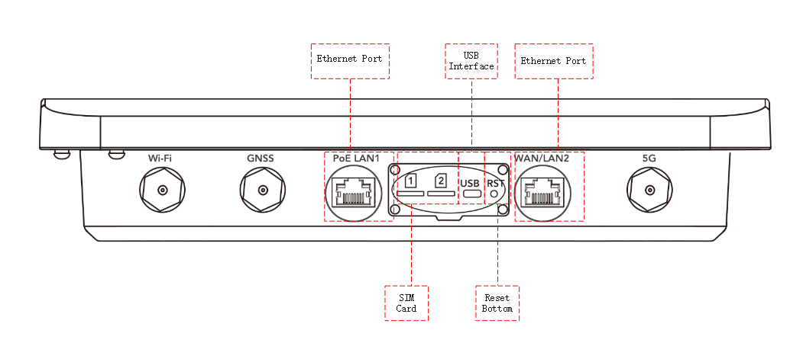

> Full packing list see §2.1; product overview see §2.2.

### Step 2: Mount the Device (Wall or Pole)

1. Attach the mounting plate to the ODU2002 using screws, making sure the **top side faces upwards**.

   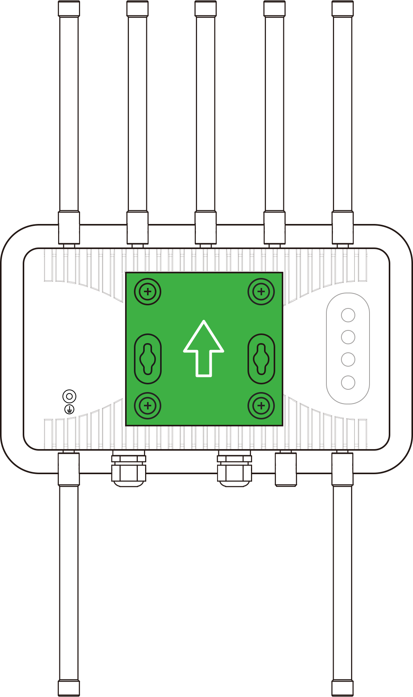

2. Install the adjustable bracket on the wall or pole at the desired angle and position, then attach the mounted ODU2002 to the bracket and tighten the mounting bolts to lock it in place.

> Wall-mounted and pole-mounted steps with figures are in §2.4.2 / §2.4.3.

### Step 3: Connect Grounding, Ethernet and Power

1. Connect the device's grounding hole to the ground through the grounding wire with the OT terminal.
2. Route the Ethernet cable through the bracket and the waterproof PG head, insert it into the network port, and tighten the waterproof head in order **B → C → D → E**.
3. Connect one end of the Ethernet cable to the **PoE 2.5G LAN1** port and plug the other end into the **802.3af (50V/0.3A)** PoE adapter or a router/switch with an 802.3af port.

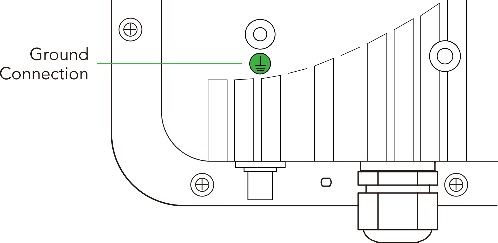

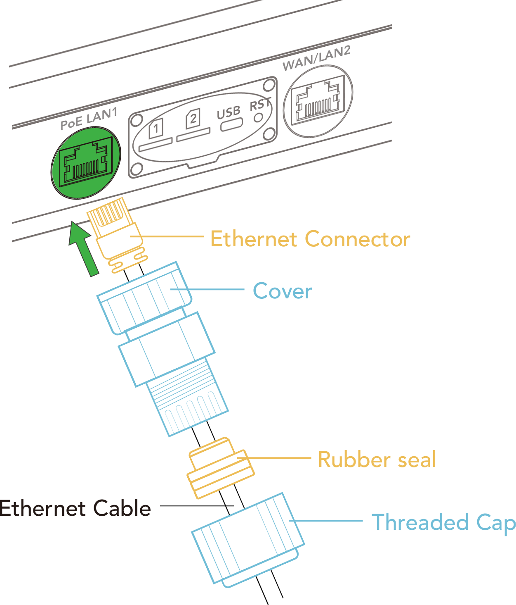

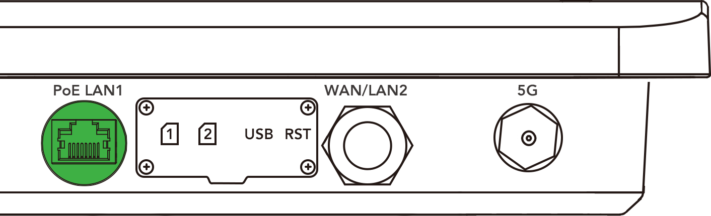

> Grounding details see §2.5.3; Ethernet and waterproof gland instructions see §2.5.4; PoE connection see §2.5.5.

### Step 4: (Cellular) Power Off, Insert the SIM Card, and Attach Antennas

1. With the device **powered off**, unscrew the SIM card cover and insert the dual nano SIM card(s) as shown below; put the cover back and make sure the **waterproof gasket is properly assembled to prevent leakage**.

   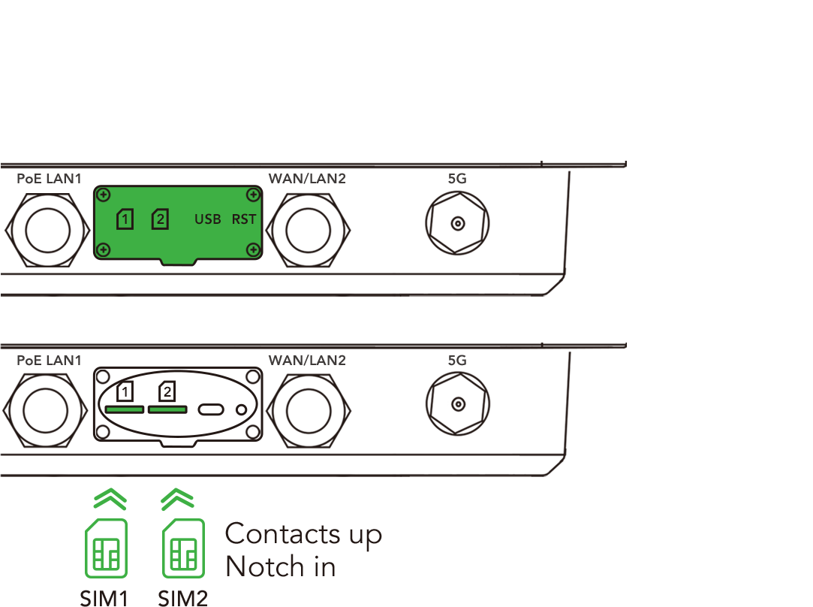

2. Attach the eight antennas to the TNC connectors marked **5G / 5G MIMO / Wi-Fi and GNSS**.

   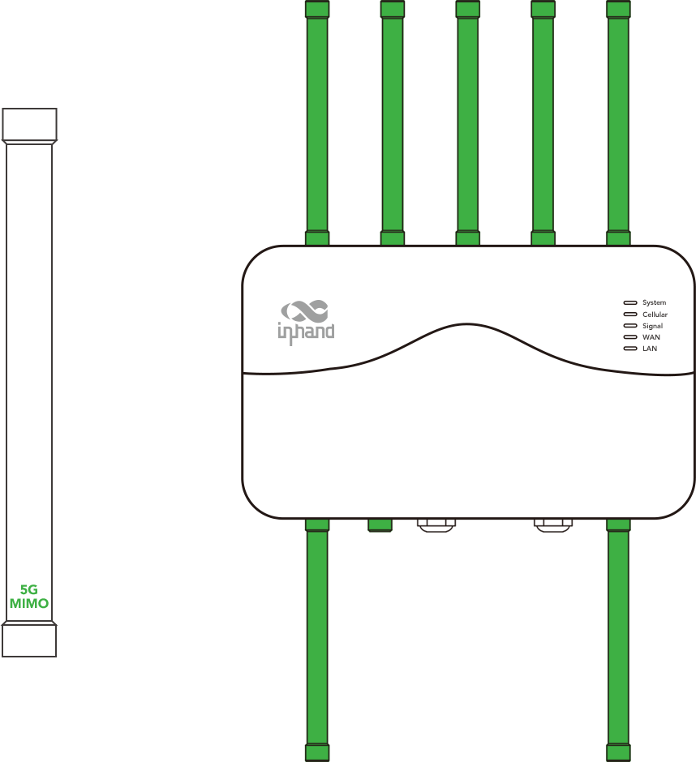

> SIM installation details see §2.5.1; antenna details see §2.5.2.

### Step 5: Power On and Confirm the Device Is Ready

1. Confirm the device is fully secured to prevent falling, cables are bundled correctly (fix the Ethernet cable on the bracket to avoid dragging), and the power cord is in good contact.
2. Turn on the power. Check the LEDs: **System steady green** = system working; **Cellular steady green** = 5G dialled up; **Signal steady green** = signal level ≥ 20.

> Full LED table see §2.3; post-installation inspection checklist see §2.4.4.

### Step 6: Connect PC or APP and Log In

**Via PC:**

1. Connect the ODU2002 and PC with an Ethernet cable (LAN1 port).
2. Open a browser and enter the device's default address in the address bar; log in with the username and password **printed on the product nameplate**. If the page prompts that the webpage is not secure, open the hidden or advanced options and select "Proceed to website".

| Item | Value |
| :---: | :---: |
| Default Web address | **192.168.1.1** |
| Username / password | See the product nameplate |

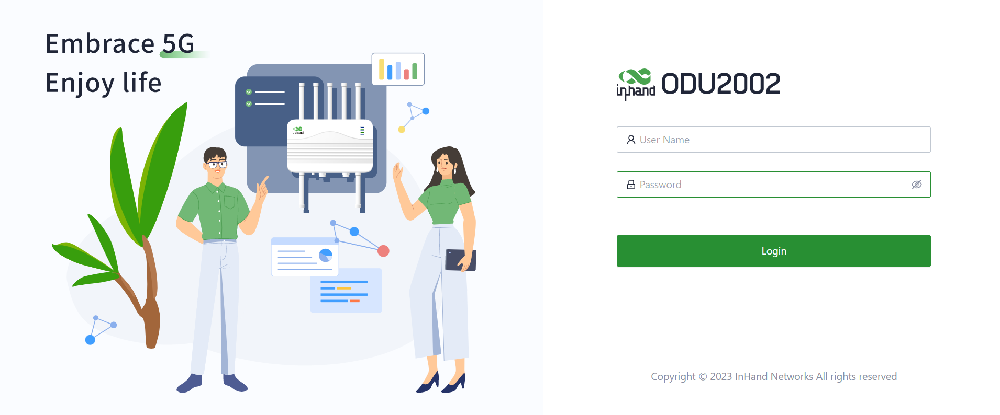

**Via InCloud APP:**

1. Power on the device and log into the InCloud APP.
2. Tap "Device" in the bottom bar to open the [Device] page, tap the menu button in the upper right corner, and select [Add Device]. Scan the QR code on the ODU2002 to add it.

> Full login and network configuration steps (cellular dial-up / wired DHCP-Static-PPPoE) are in §2.7; InCloud cloud platform registration is in §2.8.

### Post-Installation Checklist

- ☐ The device is fully secured (wall or pole bracket bolts tightened, mounting plate top side facing up).
- ☐ Grounding wire connected to the ground; Ethernet cable routed through the bracket and waterproof PG head tightened in order B → C → D → E.
- ☐ SIM card(s) inserted with the device powered off; waterproof gasket properly assembled.
- ☐ All eight antennas attached to the TNC connectors marked 5G/5G MIMO/Wi-Fi/GNSS.
- ☐ Power cord in good contact; **System LED steady green**; cellular connected (**Cellular LED steady green** for 5G).
- ☐ Browser opens the Web management page at **192.168.1.1**, or the InCloud APP has added the device.

> If the device cannot go online, check the SIM dial-up status in **Dashboard > Interface Status** (§2.7.2), or the WAN configuration (§2.7.4). If problems persist, restore to default settings (§2.9).

---

## Part 2: Detailed Instructions

### 2.1 Packing List

Every ODU2002 product shipped from the factory includes common accessories. After you receive our product, please check it carefully. If you find any missing or damaged, please contact InHand sales personnel in time.

| Part Name | Quantity | Description |
|-----------|----------|-------------|
| ODU2002 | 1 | ODU2002 5G outdoor unit |
| Ethernet cable | 1 | 1m Ethernet cable |
| Power adapter + AC | 1 | 50V/0.3A PoE power adapter, supports IEEE 802.3af standard |
| 5G antenna | 2 | 5G antenna × 2 |
| 5G MIMO antenna | 4 | 5G MIMO antenna × 4 |
| Wi-Fi antenna | 1 | Wi-Fi antenna × 1 |
| GNSS antenna | 1 | GNSS antenna × 1 |
| QSG | 1 | Quick Installation Guide |
| Mounting bracket | 1 | Adjustable bracket |
| Mounting plate | 1 | Mounting plate |
| Stainless steel pipe clamp | 2 | Supports pole-mounted installation |
| Grounding wire | 1 | Ground connection |

### 2.2 Product Overview and Panel Introduction

This manual is for the installation and operation of the ODU2002 5G outdoor unit of InHand Networks. Before installation, please confirm the product model and accessories in the package and purchase a SIM card from the operator that supports the local network. Please refer to the actual product for specific operations.

#### Panel Introduction

### 2.3 LED Status Reference

| Indicator | LED status and definition |
|-----------|---------------------------|
| System | Off — Power off Steady red — System starting Blinking red — System error Steady green — System working Blinking blue — System upgrading |
| Cellular | Off — Cellular disabled Steady blue — 4G dialled up Steady green — 5G dialled up Blinking red — Connection error |
| Signal | Off — Connection error Steady red — Signal value ≤ 9 Steady blue — 10 ≤ Signal level ≤ 19 Steady green — Signal level ≥ 20 |
| LAN | Off — Connection error Steady green — LAN port connected Blinking green — LAN port data transmitting |
| WAN | Off — Connection error Steady green — WAN port connected Blinking green — WAN port data transmitting |

### 2.4 Mechanical Installation

#### 2.4.1 Installation Precautions

- **Power supply:** The ODU2002 is powered by the 802.3af standard (50V/0.3A); pay attention to the power voltage level.
- **Environmental requirements:** working temperature: -30 ℃ ~ 70 ℃, storage temperature: -40 ℃ ~ 85 ℃.
- Supports mounting with the bracket. Avoid direct sunlight, away from heat sources or strong electromagnetic interference. Confirm that the installation position is strong enough to support the weight of the equipment and its installation accessories.
- Check for cables and antennas required for installation.

#### 2.4.2 Install the Mounting Plate and Wall-Mounted Installation

1. Attach the mounting plate to the ODU2002 using screws. Please make sure the **top side is facing upwards**.

   

2. Install the adjustable base on the wall at the desired angle and position.

   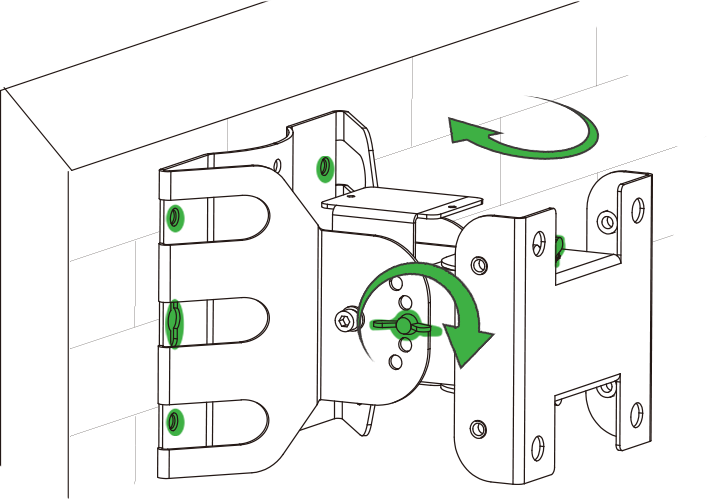

3. Attach the mounted ODU2002 to the base. Tighten the mounting bolts to lock the ODU2002 in place.

   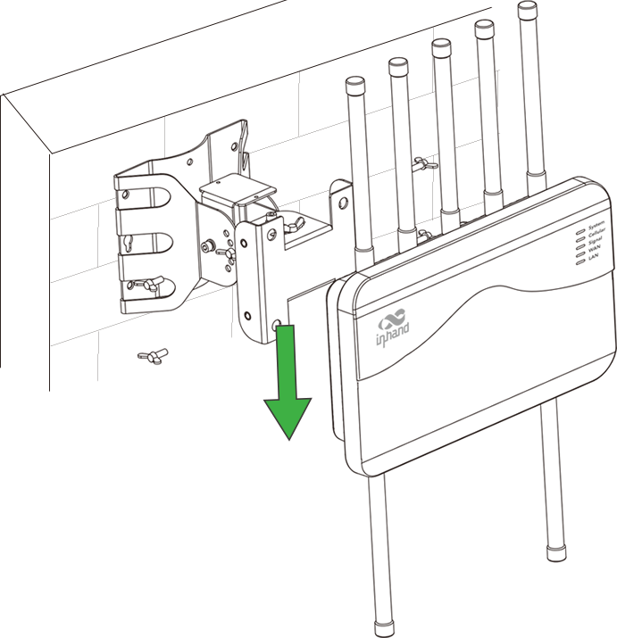

#### 2.4.3 Pole-Mounted Installation

1. Install the adjustable base on the pole at the desired angle and position.

   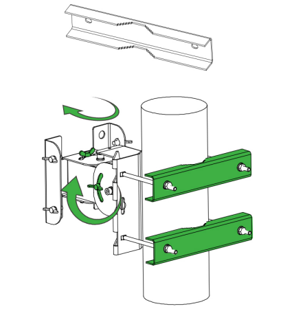

2. Attach the mounted ODU2002 to the base. Tighten the mounting bolts to lock the ODU2002 in place.

   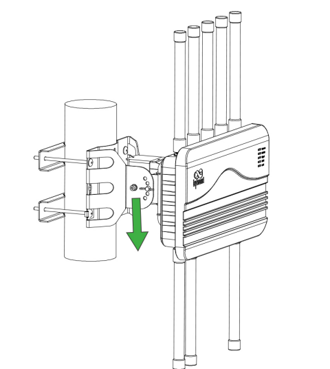

#### 2.4.4 Inspection after Installation

**Check the device installation:** Confirm the device is fully secured to prevent falling.

**Check the cable connection:** Make sure the cables are bundled correctly. To avoid dragging and damaging the device, it is recommended to fix the Ethernet cable on the bracket.

**Check the power supply:** Confirm that the power cord is in good contact and meets safety requirements. Turn on the power to supply power to the device and confirm the device can work normally.

### 2.5 Connections and Cabling

#### 2.5.1 SIM Card

- The ODU2002 supports dual nano SIM cards.
- **Insert the SIM card when the device is powered off.**
- Unscrew the SIM card cover of the ODU2002, then insert the SIM card(s) as shown below.

  

- Put the SIM card cover back in place, and make sure the **waterproof gasket is properly assembled to prevent leakage**.

#### 2.5.2 Antennas

Attach eight antennas to the TNC connectors marked **5G / 5G MIMO / Wi-Fi and GNSS**.

#### 2.5.3 Grounding

Connect the grounding hole of the device to the ground through the grounding wire with the OT terminal, and cut the grounding wire into a certain length according to the field situation to avoid waste.

#### 2.5.4 Ethernet Cable

> **Notice**
>
> - Please make sure that the Ethernet cable is inserted into the device in a standardized way. If not, the crystal head may be damaged when installing the waterproof PG head.
> - When removing the Ethernet cable, the waterproof PG head must be removed first, and then the crystal head connected to the device must be removed.
> - Please confirm the diameter of the Ethernet cable is between **4.8 mm to 6.5 mm**.
> - Please ensure the cable glands are properly assembled to prevent leaks.
> - Cut the Ethernet cable to the appropriate length according to the distance from the ODU to the power supply and pass it through the bracket.
> - Use the Ethernet cable after the crystal head is processed and pass it through the waterproof PG head in the order shown in the figure below (schematic diagram of patch cable passing through the waterproof head).
> - Insert the Ethernet cable into the network port of the device, and tighten the waterproof head in the order of **B, C, D, and E** to complete the installation.

#### 2.5.5 PoE Power Adapter

Connect one end of the Ethernet cable to the **PoE 2.5G LAN1** port and plug the other end into the **802.3af (50V/0.3A)** PoE adapter or a router/switch with an 802.3af port.

### 2.6 Power and Environment (Quick Reference)

| Item | Specification |
|------|---------------|
| Power supply | 802.3af standard (50V/0.3A), 50V/0.3A PoE power adapter (supports IEEE 802.3af) |
| Working temperature | -30 ℃ ~ 70 ℃ |
| Storage temperature | -40 ℃ ~ 85 ℃ |

### 2.7 Internet Access and First-Time Login

The ODU2002 supports two ways of accessing the Internet: **cellular** and **wired**. Wi-Fi is only used for configuration.

#### 2.7.1 Cellular (SIM Card Dial-up): Connect via APP

1. Insert the SIM card when the device is powered off, connect the 5G antenna to the device, and log in to the InCloud APP.

   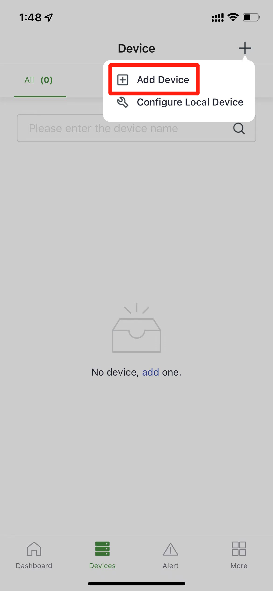 

2. Click the "Device" directory below to enter the [Device] page, click the menu button in the upper right corner, and select [Add Device]. Scan the QR code on the ODU2002 to add a device.

   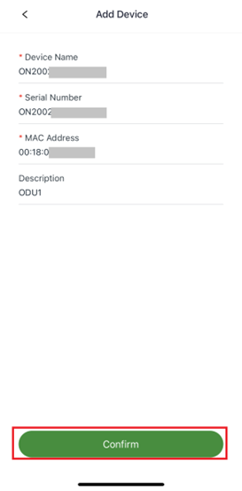

3. After scanning the code successfully, configure the name, serial number, and description information of the device.
4. After adding the device, if the device fails to connect to the network, you can click "Configure local device" to configure the device to connect to the cloud. The ODU2002 enables the HTTP access and Wi-Fi AP function by default.
5. Scan the QR code on the ODU2002, and then the APP will automatically connect to the device via Wi-Fi.

   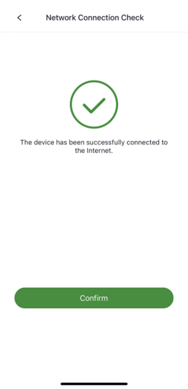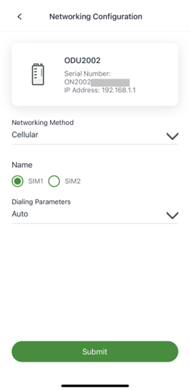

6. After the connection succeeds, the APP will automatically log in to the device and enter the networking configuration interface; confirm the information and submit.

#### 2.7.2 Cellular (SIM Card Dial-up): Connect via PC

**Step 1:** Power off the device, insert the SIM card into the card slot, connect the 5G antenna to the device, and connect the ODU2002 and PC with an Ethernet cable.

**Step 2:** Open a browser and enter the device's default address **192.168.1.1** in the browser address bar. After entering the username and password (please check the product nameplate to obtain it), enter the device's WEB management interface. If the page prompts that the webpage is not secure, open the hidden or advanced options and select "Proceed to website".

**Step 3:** Click "Internet" on the left navigation bar, and click the edit button behind the "Cellular" button to set up the dial-up parameters. The device enables the dial-up function by default; wait a few minutes to go online, and re-enable the dial-up if it does not dial.

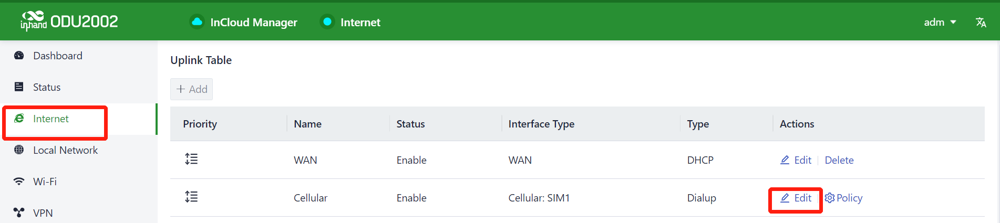

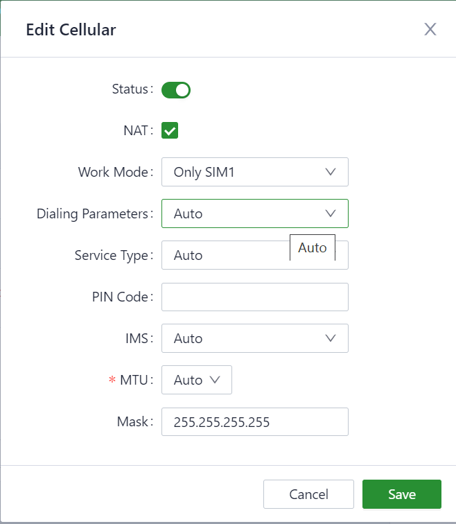

**Step 4:** Check the dial-up status in the "Interface Status" of the "Dashboard". The device connects to the Internet successfully if the "Cellular" icon turns green. Click the "Cellular" icon to view information such as signal strength, IP address, and traffic consumption.

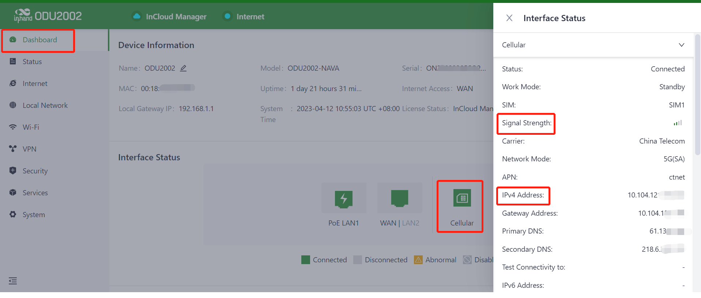

#### 2.7.3 Wired Networking: Connect via APP

 

**Step 1:** Click the "Device" directory below to enter the [Device] page, click the menu button in the upper right corner, and select [Add Device]. Scan the QR code on the ODU2002 to add a device.

After scanning the code successfully, configure the name, serial number, and description information of the device.

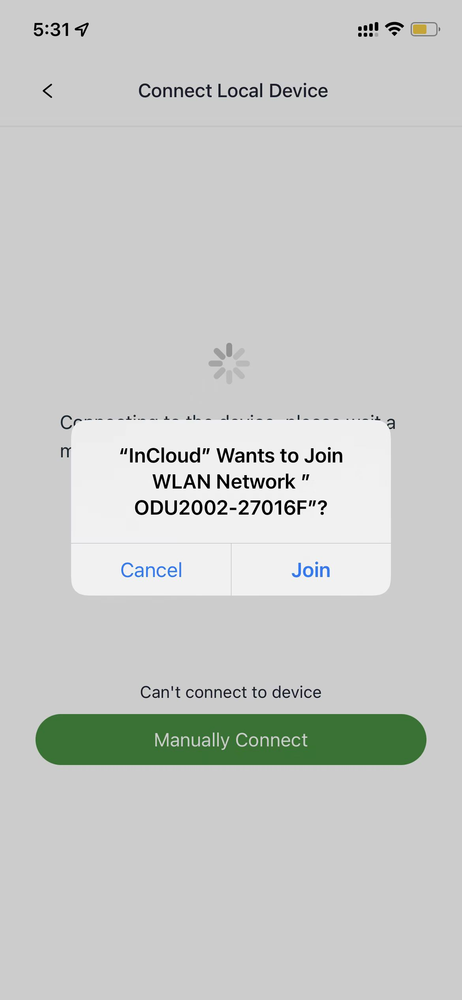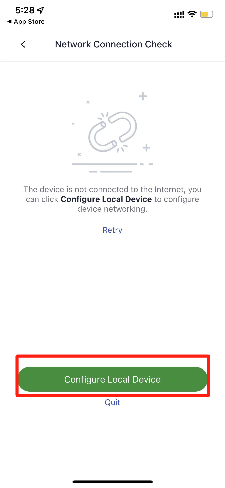

After adding the device, if the device fails to connect to the network, you can click "Configure local device" to configure the device to connect to the cloud. The ODU2002 enables the HTTP access and Wi-Fi AP function by default.

Scan the QR code on the nameplate of the unit, then the APP will automatically connect to the ODU via Wi-Fi.

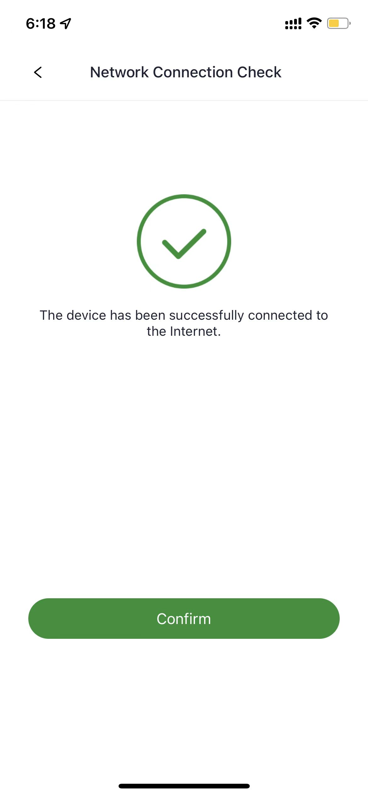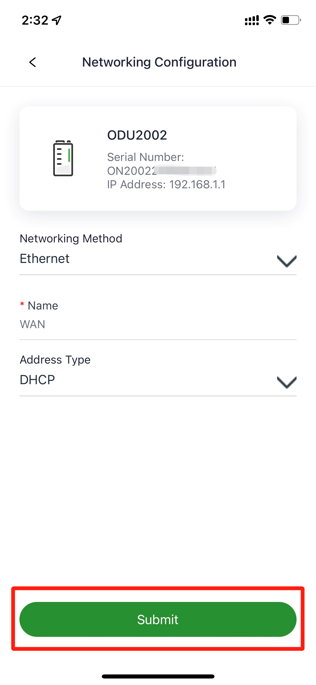

After the connection succeeds, the APP will automatically log in to the device and enter the networking configuration interface; confirm the information then submit.

#### 2.7.4 Wired Networking: Configure via PC

**Step 1:** Connect the LAN1 port to the PC.

**Step 2:** Set the IP of the PC and the gateway device to be in the same network segment — DHCP automatic address acquisition (**recommended**) or a fixed IP address. The DHCP server function is enabled by default on the LAN port of the device, and the PC and the device must be in the same segment. On the PC side, the IP address needs to be configured as any address in **192.168.1.2 ~ 192.168.1.254**, the gateway is set to **192.168.1.1**, the subnet mask is **255.255.255.0**, and the DNS configuration is **8.8.8.8** / operator DNS server address.

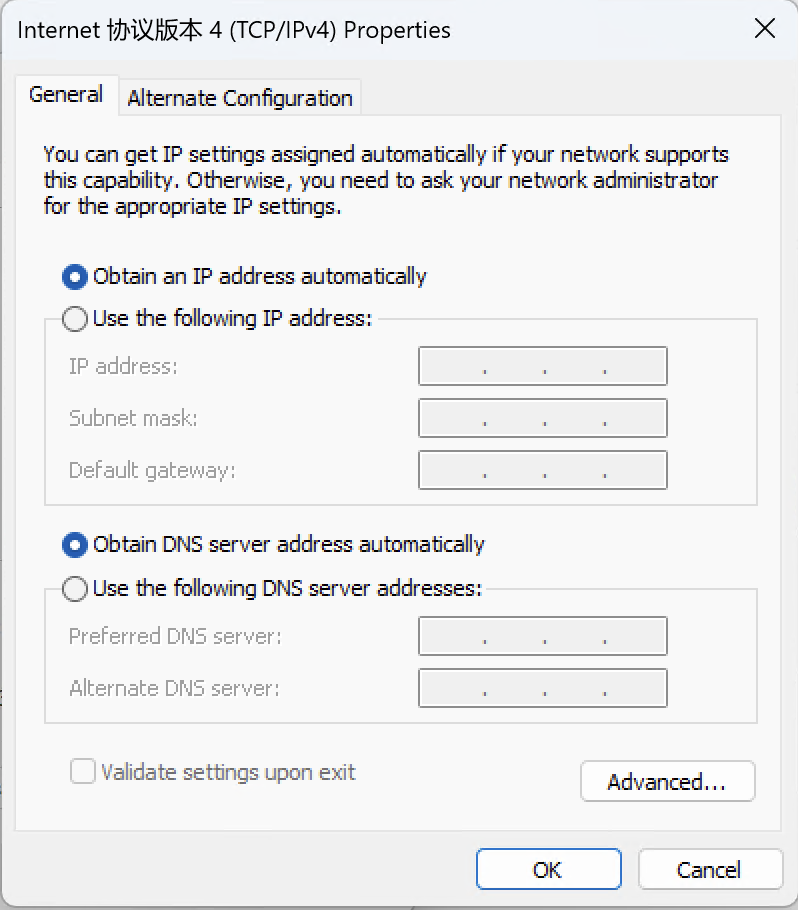

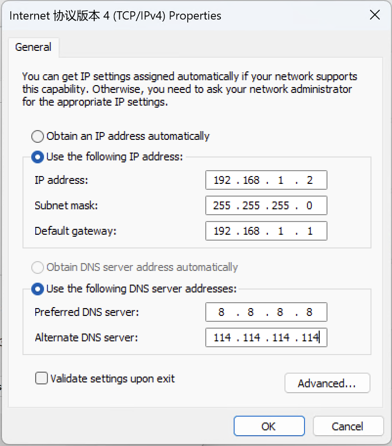

**Step 3:** Enter the device default address **192.168.1.1** in the browser address bar, enter the user name and password (please check the product nameplate to obtain it), and enter the device WEB management interface. If the page prompts that the webpage is not safe, turn on Hidden or Advanced, and choose to continue.

**Step 4:** Click "Internet" on the left navigation bar to view the device interface status. The ODU2002 enables WAN1 with DHCP mode by default. The ODU2002 supports three methods to allocate the WAN address: dynamic DHCP (**recommended**), static IP and PPPoE. Click the Edit button next to WAN to modify the WAN port.

- **DHCP:** The DHCP service is enabled by default on the WAN interface of the device, and the ODU can be connected to the network by connecting the WAN interface to the Internet with an Ethernet cable.
- **Static IP:** You can manually configure the address assigned by the operator or the upstream device. After the configuration is completed, the router will access the network through the specified static IP.
- **PPPoE:** You can configure broadband dial-up. After the configuration is completed, the router will access the network through broadband dial-up.

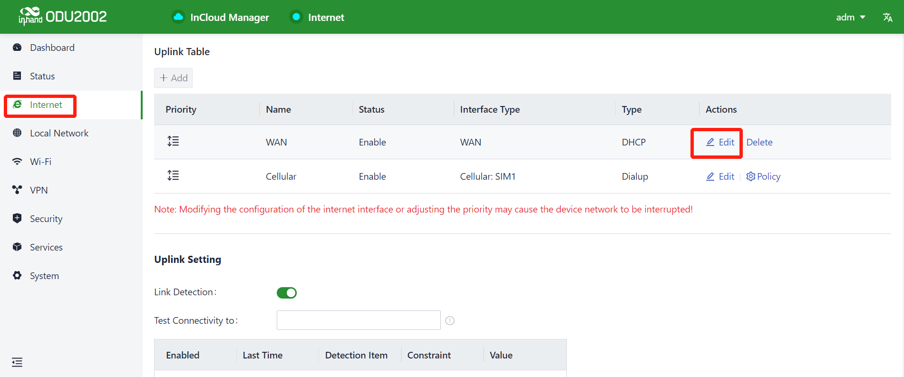

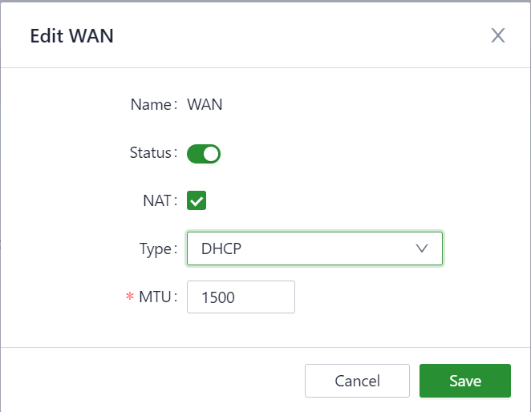

**Step 5:** Verify network connectivity via the Ping tool on the **System > Tools** page.

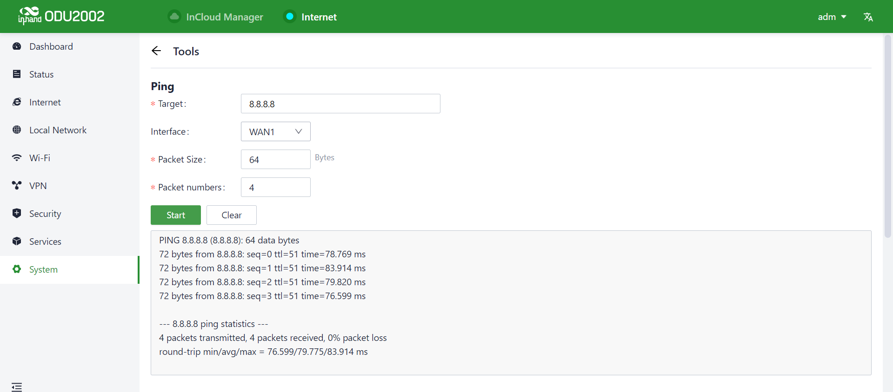

### 2.8 Remote Management Platform (InCloud)

#### 2.8.1 Register / Log in to the Platform

Use a browser to visit InCloud at the address <https://star.inhandcloud.com/> to enter the InCloud registration and login page. (Chrome is recommended.)

After registration, log in to the cloud platform with the registered email. Enter the "Security Settings" page to change your password and bind your mobile phone number; after binding your mobile phone number, you can use your mobile phone number to log in to the cloud platform next time.

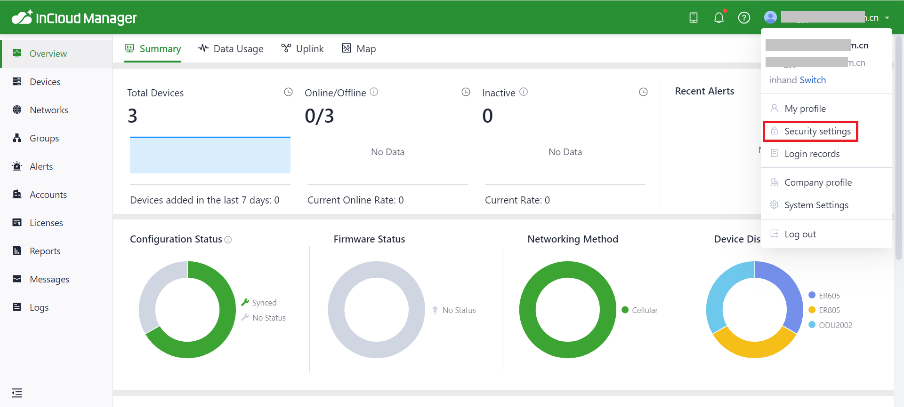

#### 2.8.2 Adding Devices to the Platform

Log in to the InCloud Manager platform, click "Device >> Add" in the navigation menu to add your device by filling in the device's serial number.

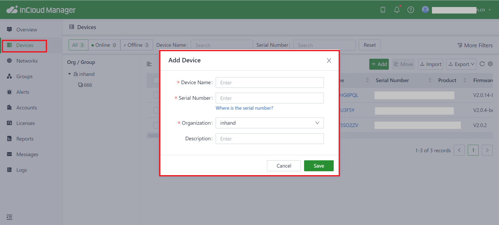

### 2.9 Factory Reset and Log/Diagnostic Data

#### 2.9.1 Reset/Restore Remotely

Log in to the InCloud Manager platform, click "Device >> Command" in the navigation bar, click the "Restore to Factory" button and after confirmation, the device will reboot and restore to default settings.

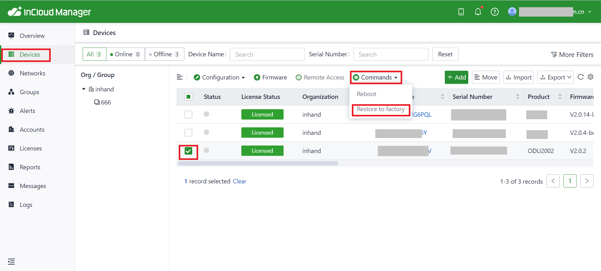

#### 2.9.2 Hardware Restore

To restore to default settings by the reset button, please perform the following steps:

1. When the unit is powered ON, press and hold the reset button for **5–10 seconds**.
2. When the System LED is steady on blue, release the RESET button; the system LED will blink in blue, and press the RESET button again.
3. When the System LED is steady on blue, release the RESET button. The unit has been restored to default settings and will start up normally later.

#### 2.9.3 Log and Diagnostic Data

Log in to InCloud Manager, click the "Device >> Device Details >> Tools" menu in the navigation bar and click the corresponding button to complete the download of logs and diagnostic data.

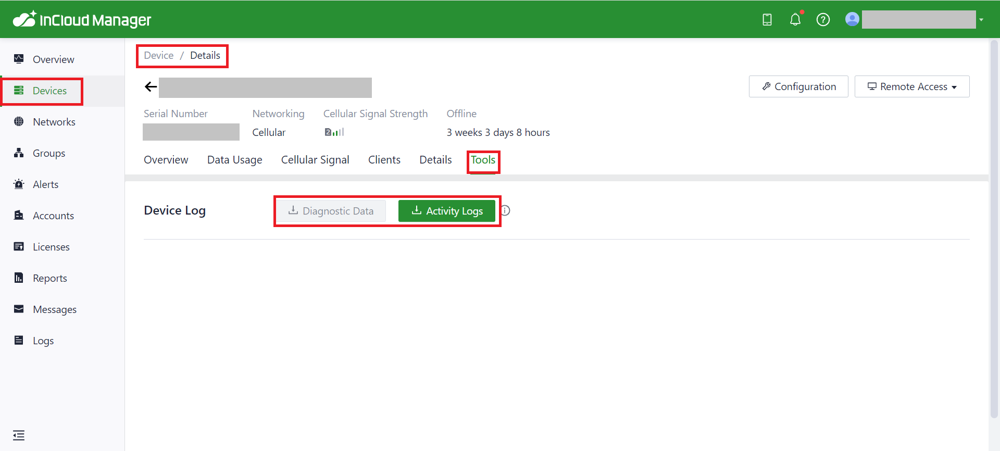

### 2.10 Related Documents

| Need | Where to Go |
|------|-------------|
| Original version of this guide (English) | [5G ODU2002 Product Quick Guide](https://help.inhand.com/portal/en/kb/articles/odu2002-product-quick-guide) |
