# Vehicle Router VR624 Product User Manual

## Front Matter

### Declaration

Thank you for choosing InHand Networks' product! Before use, read this user manual carefully. Complying with the following statements helps maintain intellectual property rights and legal compliance, and ensures that the user experience aligns with the latest product information. For any questions or written permission requests, contact the technical support team.

- **Copyright Statement**

This user manual contains copyrighted content, and the copyright belongs to InHand Networks and its licensors. Without written permission, no organization or individual may excerpt or copy any part of the content of this manual, or distribute it in any form.

- **Disclaimer**

Due to ongoing updates in product technology and specifications, the company cannot guarantee that the information in the user manual is entirely consistent with the actual product. Therefore, no disputes arising from any discrepancies between the actual technical parameters and the user manual are accepted. Any changes to the product will not be notified in advance, and the company reserves the right to make the final changes and interpretations.

- **Copyright Information**

The content of this user manual is protected by copyright law, and the copyright belongs to InHand Networks and its licensors. All rights reserved. Without written permission, the content of this manual may not be used, copied, or distributed.

### Conventions

| Symbol | Meaning | Example |
|--------|---------|---------|
| `< >` | Denotes a variable or parameter that must be replaced with an actual value | `<IP address>` means the actual IP address needs to be filled in |
| `" "` | Denotes text labels on the interface | Click the "Save" button |
| `→` | Denotes menu hierarchy or operation order | [Internet] → [Cellular] |
| `[ ]` | Denotes a menu or page name | Go to the [Status] page |

> **NOTE**: Supplementary information or tips for an operation.
>
> **CAUTION**: Information that requires special attention. Ignoring it may cause device malfunction or data loss.

### Technical Support

**InHand Networks, Inc.**

Address: 3650 Concorde Pkwy, Suite 200, Chantilly, VA 20151, USA

E-mail: support@inhandnetworks.com

Tel: +1 (703) 348-2988

URL: [www.inhand.com](http://www.inhandnetworks.com/)

### How to Use This Manual

**Reading guide:**

- First-time users: read "1 Getting to Know the Device" → "2 Installation and First-Time Use" → "3 Common Configuration Scenarios" → "4 Function Description and Parameter Reference" in order.
- Users with the device already in service: go directly to "4 Function Description and Parameter Reference" or "Appendix A Troubleshooting".
- Cloud management users: refer to "Scenario 4: Device Management via DeviceLive" in Chapter 3 and "4.12.1 Cloud Management".

**Quick task navigation:**

| Task | Section | Estimated Time |
|------|---------|----------------|
| Install the device and log in to the web UI | [2 Installation and First-Time Use](#2-installation-and-first-time-use) | About 15 minutes |
| Access the internet via 5G/4G cellular | [Scenario 1: Cellular Internet Access](#scenario-1-cellular-internet-access) | About 5 minutes |
| Access the internet via a wired WAN | [Scenario 2: Wired Internet Access](#scenario-2-wired-internet-access) | About 5 minutes |
| Access the internet via Wi-Fi (STA) | [Scenario 3: Wi-Fi STA Internet Access](#scenario-3-wi-fi-sta-internet-access) | About 5 minutes |
| Manage the device via the DeviceLive platform | [Scenario 4: Device Management via DeviceLive](#scenario-4-device-management-via-devicelive) | About 5 minutes |
| Configure VPN tunnels | [4.7 VPN](#47-vpn) | As required |
| Configure Wi-Fi AP and SSIDs | [4.5 Wi-Fi](#45-wi-fi) | As required |
| Configure static/dynamic routing | [4.6 Routing](#46-routing) | As required |
| Monitor device status | [4.1 Dashboard](#41-dashboard) / [4.2 Status](#42-status) | As required |
| Restore the device to factory defaults | [1.5 Restore to Factory Defaults](#15-restore-to-factory-defaults) | About 1 minute |
| Troubleshoot faults | [Appendix A Troubleshooting](#appendix-a-troubleshooting) | As required |

## 1 Getting to Know the Device

### 1.1 Overview

The InVehicle Router 624 (VR624) series is an industrial-grade mobile network access solution, suitable for multi-field transportation scenarios, covering special vehicles, heavy machinery, law enforcement vehicles, emergency vehicles, engineering fleets and ambulances, providing stable support for device networking and data interaction.

VR624 supports high-speed 5G, enabling high-speed and low-latency transmission. It is also integrated with high-speed Wi-Fi 6 to realize secure access for multiple devices. The integrated Global Positioning System (GPS) allows for real-time and precise positioning of vehicles, which is crucial for fleet dispatching, route optimization, and location-based monitoring, significantly enhancing vehicle operation and management efficiency.

The hardware adopts an industrial-grade design. The M12 connector is anti-vibration and anti-corrosion, and can work in a wide temperature environment of -30℃ to +70℃, making it suitable for harsh conditions. Paired with the InHand DeviceLive platform, it can monitor device status in real time, diagnose faults, support remote operation and maintenance, and improve fleet management efficiency. Its integrated design provides a reliable network for in-vehicle systems and helps promote the digital transformation of the transportation field.

### 1.2 Packing List

The original document does not contain a packing list. For the actual contents of the package, refer to the packing list enclosed with the product.

### 1.3 Appearance and Interfaces

The connector labels on the VR624 are shown in the figure below.

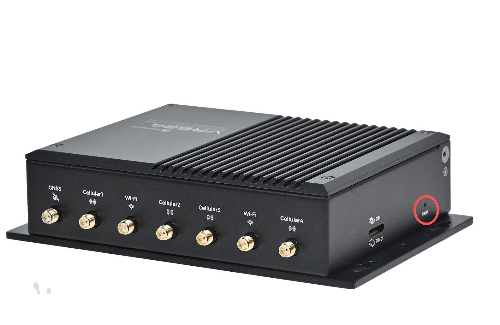

<strong>Figure 1-1 VR624 connector labels</strong>

The device provides GNSS, CELLULAR (CELLULAR1 to CELLULAR4), WI-FI antenna connectors and CSIM2 (SIM card 2) slot as shown above. The device also provides LAN ports for local network connections and an M12 power connector. For detailed electrical specifications and pin definitions, refer to the product datasheet.

A detailed interface table with position and description for each interface is not provided in the original document.

### 1.4 LED Indicators

| LED | Status | Description |
|-----|--------|-------------|
| System | Off | Power off |
|  | Steady in red | Device starting |
|  | Blink in red | System error |
|  | Blink in green | Working properly |
|  | Blink in yellow | Firmware updating |
| Cellular | Blink in green | Cellular connection in progress |
|  | Steady in green | Cellular connection established |
| Signal | Steady in red | Poor cellular signal |
|  | Steady in yellow | Medium cellular signal |
|  | Steady in green | Good cellular signal |
| Wi-Fi 2.4G | Off | AP&STA is disabled |
|  | Blink in green | Working properly |
|  | Steady in green | Working as STA and AP is not associated |
| Wi-Fi 5G | Off | AP&STA is disabled |
|  | Blink in yellow | Working properly |
|  | Steady in yellow | Working as STA and AP is not associated |

### 1.5 Restore to Factory Defaults

Press and hold the Reset button for 10 seconds to restore the factory settings. The Reset button location is shown in Figure 1-1.

> **CAUTION**: When a device is connected to the cloud platform, the platform will synchronize the previous configuration to the device again due to cloud-based configuration synchronization. The device will only clear historical data during the factory reset.

### 1.6 Default Settings

| No. | Function | Default Settings |
|-----|----------|------------------|
| 1 | Cellular Dialing | Default dialing is set to "SIM1" |
| 2 | Wi-Fi | 1. Wi-Fi 2.4G access point enabled, SSID: Prefixed with "VR624-", followed by the last 6 digits of the wireless MAC address. 2. Wi-Fi 5G access point enabled, SSID: Prefixed with "VR624-5G-", followed by the last 6 digits of the wireless MAC address. 3. The authentication method is WPA2-PSK. 4. The password for both is the last 8 digits of the serial number. |
| 3 | Ethernet | 1. Enable all LAN ports. 2. IP Address: 192.168.2.1 Subnet Mask: 255.255.255.0 3. DHCP server enabled, with an address pool from 192.168.2.2 to 192.168.2.254 for automatic IP address assignment to connected devices. |
| 4 | Network Access Control | Local HTTP and HTTPS are enabled with port numbers 80 and 443 respectively. Access from the cellular network is disabled. |
| 5 | Username/Password | Refer to the nameplate at the bottom of the device for login credentials |

## 2 Installation and First-Time Use

### 2.1 Before You Begin

> **CAUTION**:
>
> 1. Use the original power adapter to avoid damaging the device due to mismatched power adapters.
> 2. Avoid installing the device in an environment with strong electromagnetic interference, and keep it at a safe distance from high-power equipment. After installation, ensure that the device is stable to prevent accidental drops and potential damage.
> 3. Ensure that the device's operating environment meets the temperature and humidity requirements. The device operates in a temperature range of -30℃ to +70℃.

Prepare the following items before installation:

- 4G/5G antennas, Wi-Fi antennas and a SIM card (for cellular access)
- Power cable and Ethernet cables
- A PC with a web browser

### 2.2 Installation Steps

**Step 1**: Install the 4G/5G and Wi-Fi antennas and insert the SIM card.

**Step 2**: Connect the power cable and an Ethernet cable; connect any LAN port to your PC.

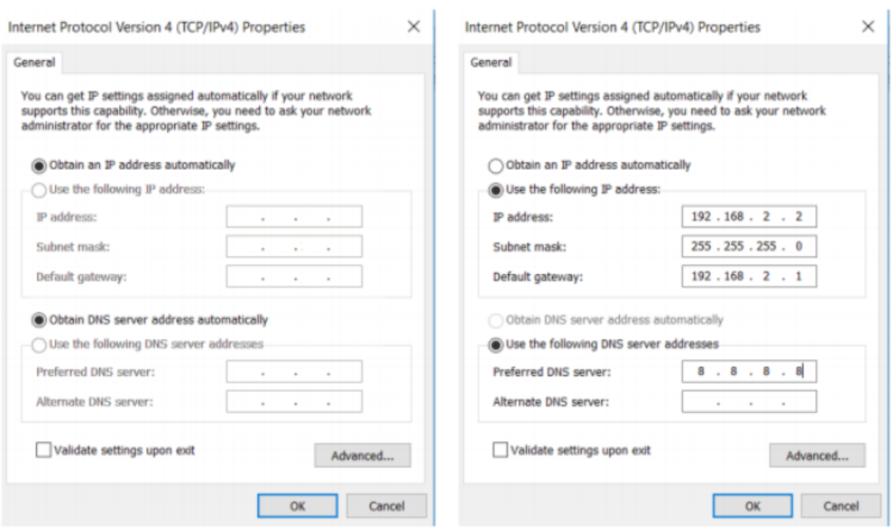

<strong>Figure 2-1 Connection diagram</strong>

**Step 3**: Set the PC's IP address to be on the same subnet as the router.

The device's LAN port has DHCP server functionality enabled by default. Once the PC has automatically obtained an IP address, ensure that the PC and the router are in the same address range. If the PC fails to obtain an IP address automatically, configure it with a static IP address and the following parameters:

- IP Address: 192.168.2.x (choose an available address within the range of 192.168.2.2 to 192.168.2.254)
- Subnet Mask: 255.255.255.0
- Default Gateway: 192.168.2.1
- DNS Servers: 8.8.8.8 (or the ISP's DNS server address)

**Step 4**: Enter the default device address 192.168.2.1 in the browser's address bar. After entering the username and password (refer to the nameplate at the bottom of the device for login credentials), the device's web management interface opens. If the page shows a security warning, click "Hide" or "Advanced" and select "Proceed" to continue.

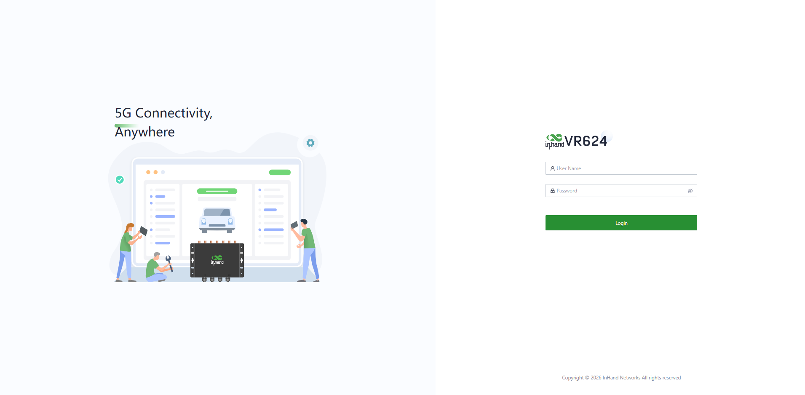

<strong>Figure 2-2 Web login page</strong>

### 2.3 Quick Checklist

After installation, verify the following items:

| No. | Check Item | Expected Result | Reference |
|-----|-----------|-----------------|-----------|
| 1 | Power connection | System LED is blinking in green (working properly) | [1.4 LED Indicators](#14-led-indicators) |
| 2 | Antennas and SIM card | Antennas installed firmly; SIM card inserted correctly | [2.2 Installation Steps](#22-installation-steps) |
| 3 | PC and device connectivity | PC obtains an IP address in the 192.168.2.x range | [2.2 Installation Steps](#22-installation-steps) |
| 4 | Web UI login | Web management interface opens at 192.168.2.1 | [2.2 Installation Steps](#22-installation-steps) |
| 5 | Uplink status | The [Dashboard] page shows a valid upstream interface for internet access | [4.1 Dashboard](#41-dashboard) |

## 3 Common Configuration Scenarios

### Scenario 1: Cellular Internet Access

**Objective**: Access the internet through the 5G/4G cellular network.

**Prerequisites**: The SIM card is inserted and the cellular antennas are installed; the device is powered on; APN parameters are available from the carrier (if a custom APN is required).

**Estimated time**: About 5 minutes.

**Procedure**:
1. Insert the SIM card and install the cellular antennas. When inserting or removing a SIM card, disconnect the power first to prevent data loss or damage to the device.
2. Power on the device and wait for it to start. In the usual scenario, upon inserting the SIM card and connecting the antennas, the VR624 router automatically establishes a dial-up connection and connects to the network when powered on.
3. If the carrier requires custom APN (Access Point Name, the "door number" of the carrier's network) parameters, go to [Internet], select the "Cellular" interface, and click the "Edit" button to open the APN parameter configuration page.
4. Configure the APN parameters and click "Save".
5. Wait for the connection to be established.

**Verification**:
1. Check the LEDs: the Cellular LED is steady in green (cellular connection established) and the Signal LED indicates the current signal quality.
2. Go to [Status] → [Cellular Signal] and check the signal strength parameters such as RSSI, SINR, and RSRP.
3. Use [System] → [Tools] → [Ping] to test connectivity to a public address.

**Common issues**:
- Cellular connection fails: check whether the SIM card is inserted correctly and whether the APN parameters match the carrier's requirements.
- Poor signal: check whether the antennas are installed and adjust the antenna position; the Signal LED steady in red indicates a poor cellular signal.
- Dedicated network scenarios: it may be necessary to manually disable the "Link Detection" function under the [Internet] menu to prevent cellular connectivity issues caused by unsuccessful detection. In some cases, manual configuration of the subnet mask for the cellular interface may be required to ensure the proper functioning of the ARP (Address Resolution Protocol) feature.

### Scenario 2: Wired Internet Access

**Objective**: Access the internet through a wired broadband connection on the WAN interface.

**Prerequisites**: The device is powered on; an Ethernet cable from the upstream network (modem, optical terminal, or upstream router) is available.

**Estimated time**: About 5 minutes.

**Procedure**:
1. Connect the upstream network to the WAN interface of the device with an Ethernet cable.
2. The device's WAN interface has DHCP mode enabled by default. Connect the WAN interface to the internet using an Ethernet cable, and the connection is established automatically.

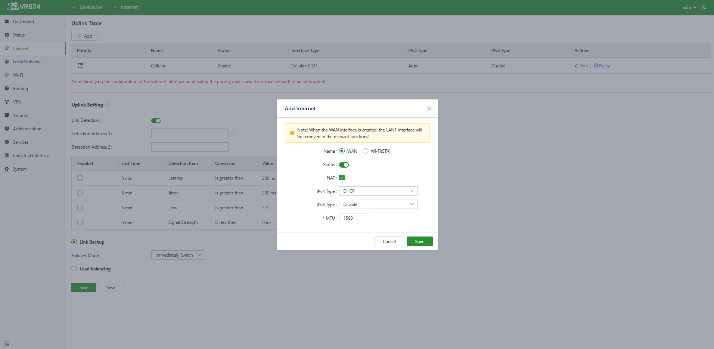

<strong>Figure 3-1 WAN configuration</strong>

3. If a static IP is required: go to [Internet], select the WAN interface, click "Edit", choose the "Static IP" mode, and enter the address obtained from the internet service provider or an address within the same network segment as the upstream device.
4. If broadband dial-up is required: choose the "PPPoE" mode and configure the broadband account. Once the configuration is complete, the router establishes an internet connection through broadband dial-up.
5. Click "Save".

**Verification**:
1. Go to [Dashboard] and check the "Internet Access" field to see the upstream interface in use.
2. Go to [Status] → [Link Monitor] and check the health status of the WAN link, including throughput, latency, and packet loss.
3. Use [System] → [Tools] → [Ping] to test connectivity to a public address.

**Common issues**:
- No connection after plugging in the cable: confirm that the upstream device provides service on the cable and that the connection mode (DHCP/Static IP/PPPoE) matches the carrier's requirement.
- PPPoE dial-up fails: verify the broadband account and password.

### Scenario 3: Wi-Fi STA Internet Access

**Objective**: Connect the device as a client (STA) to an on-site Wi-Fi AP's network and use it as the uplink.

**Prerequisites**: The device is powered on; the SSID and password of the on-site AP are available.

**Estimated time**: About 5 minutes.

**Procedure**:
1. Go to [Internet] and click the "Add" button.
2. Select "Wi-Fi (STA)".
3. Fill in the required parameters, including the SSID name and password.
4. Click "Save" and wait for the connection to be established.

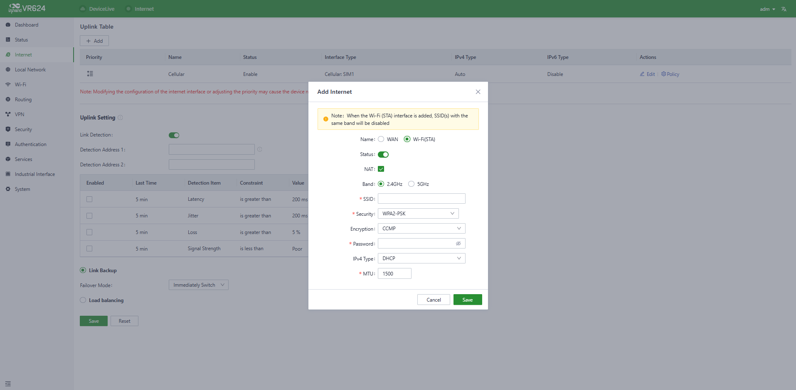

<strong>Figure 3-2 Add Wi-Fi (STA)</strong>

**Verification**:
1. Go to [Dashboard] → [Interface Status] and check the status of the Wi-Fi (STA) interface.
2. Go to [Status] → [Link Monitor] and check the health status of the Wi-Fi (STA) link.

**Common issues**:
- The SSID of the same frequency band is disabled: upon adding Wi-Fi (STA), the VR624 automatically disables SSIDs in the same frequency band within the Wi-Fi settings, and the status field for those SSIDs cannot be modified. After removing Wi-Fi (STA), the "Status" field and SSIDs in the same frequency band can be modified again.
- Configuration of the Wi-Fi (STA) interface is lost: when Wi-Fi (STA) is deleted, all configuration associated with the Wi-Fi (STA) interface, including static routes, inbound/outbound rules, port forwarding, policy routing, and traffic shaping settings, is removed.

### Scenario 4: Device Management via DeviceLive

**Objective**: Manage the device remotely through the InHand DeviceLive platform (device.inhandcloud.com), including remote management, batch configuration, and traffic monitoring.

**Prerequisites**: The device has established an internet connection; a DeviceLive account is available.

**Estimated time**: About 5 minutes.

**Procedure**:
1. Connect the device to the internet (see Scenario 1, 2, or 3).
2. The VR624 automatically connects to DeviceLive after establishing an internet connection by default. No manual configuration is required.
3. Log in to DeviceLive (device.inhandcloud.com) and add the device to the account using the device serial number.
4. If the cloud management function is not needed, disable it manually in [System] → [Cloud Management].

**Verification**:
1. On the DeviceLive platform, confirm that the device appears online.
2. Go to [Dashboard] on the local web UI and check the "License Status" and "Serial" fields, which can be used for adding the device to a platform account.

**Common issues**:
- Device does not appear on the platform: confirm that the device can access the internet and that the cloud management function is not disabled in [System] → [Cloud Management].

## 4 Function Description and Parameter Reference

### 4.1 Dashboard

#### 4.1.1 Device Information

In the [Dashboard] interface, basic device information is displayed at the top, including the device name, device model, device serial number, MAC address, online duration, and upstream interface address.

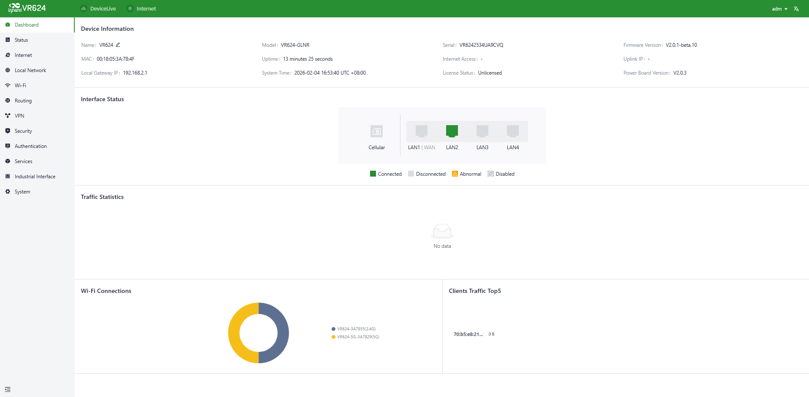

<strong>Figure 4-1 Device information</strong>

1. **Name**: Identifies the device's name, which is initially set to "VR624" but can be customized.
2. **MAC Address**: Identifies the device's physical MAC address.
3. **Local Gateway Address**: The default gateway address of the device's subnet.
4. **Model**: Specifies the device's specific model, which can help determine if it supports cellular and WLAN features.
5. **Uptime**: Reflects the device's running time since it was powered on.
6. **System Time**: Displays the device's time zone and system time.
7. **Serial**: A unique code that serves as an identifier for the device and can be used for indexing or adding the device to a platform account.
8. **Internet Access**: The upstream interface used by the device for internet connectivity.
9. **License Status**: Information about the applied license on the device, distinguishing between Small Star Cloud Manager Basic and Small Star Cloud Manager Professional.
10. **Firmware Version**: Shows the device's current software version.
11. **Uplink IP**: The IP address of the upstream interface used for device internet connectivity.
12. **Power Board Version**: Displays the current power board version.

#### 4.1.2 Interface Status

In the [Dashboard] → [Interface Status] feature, the operational status of each interface can be inspected visually. By clicking the interface icon, detailed information for each interface appears in a pop-up box on the right-hand side of the interface.

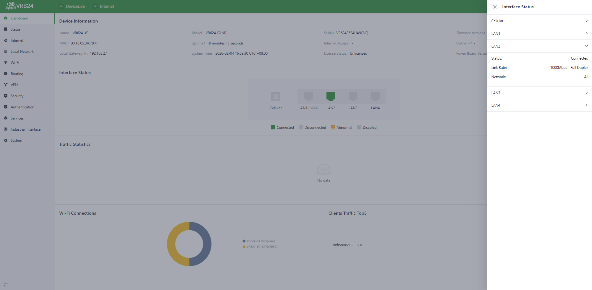

<strong>Figure 4-2 Interface status</strong>

#### 4.1.3 Traffic Statistics

Users can monitor the usage of traffic on each upstream interface since the router was powered on through the [Dashboard] → [Traffic Statistics] feature. The data in traffic statistics resets after the device is rebooted. To review historical traffic records, access the device's details page within InCloud Manager.

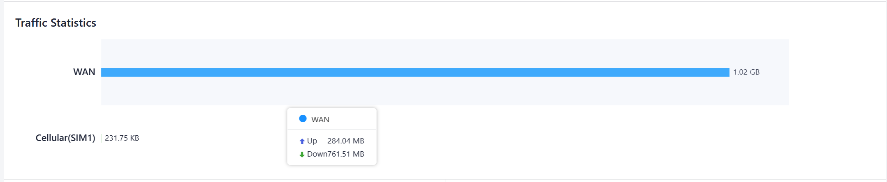

<strong>Figure 4-3 Traffic statistics</strong>

#### 4.1.4 Wi-Fi Connections

In the [Dashboard] → [Wi-Fi Client Count] feature, users can check the number of active SSIDs on the VR624 and the number of connected clients under each SSID.

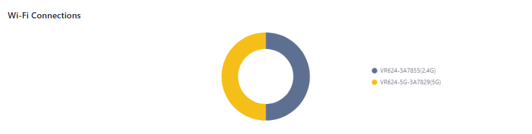

<strong>Figure 4-4 Wi-Fi connections</strong>

#### 4.1.5 Clients Traffic Top5

In the [Dashboard] → [Top 5 Client Traffic] feature, users can view the current ranking of client traffic usage for devices connected to the router. It displays up to 5 records, and when a client disconnects, its statistical data is cleared.

<strong>Figure 4-5 Clients traffic Top 5</strong>

### 4.2 Status

Under the [Status] function, the uplink status of the device, device operation logs, events, and more can be viewed, which helps to grasp the device operation status more accurately.

#### 4.2.1 Link Monitor

The [Status] → [Link Monitoring] feature displays the health status of each upstream link and provides information about throughput, latency, packet loss, signal strength, and more for each interface.

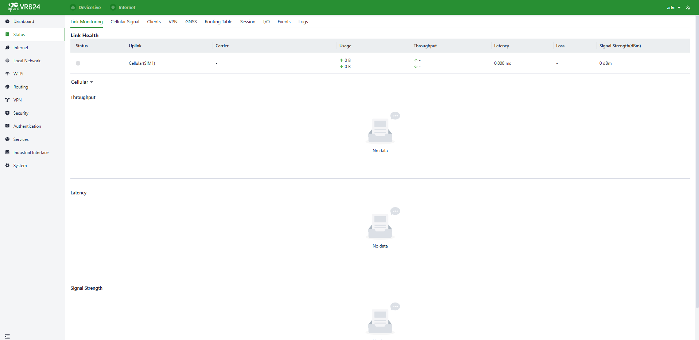

<strong>Figure 4-6 Link monitor</strong>

#### 4.2.2 Cellular Signal

The [Status] → [Cellular Signal] feature displays the signal strength of SIM cards under the cellular interface, along with parameters such as RSSI, SINR, RSRP, and more.

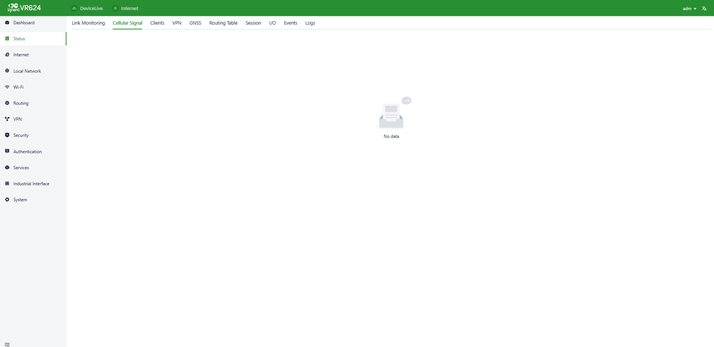

<strong>Figure 4-7 Cellular signal</strong>

#### 4.2.3 Clients

Through the [Status] → [Clients] feature, users can view detailed information about both wired and wireless clients connected to the router. This includes details such as names, addresses, MAC addresses, VLANs, connected subnets, traffic usage, online duration, and more.

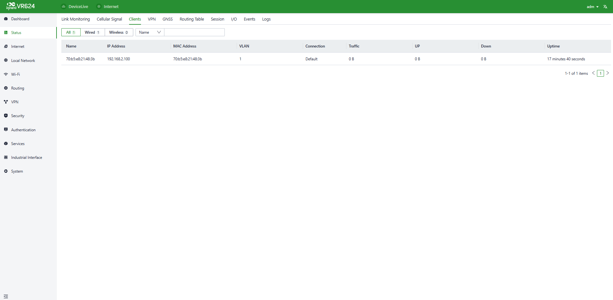

<strong>Figure 4-8 Clients</strong>

#### 4.2.4 VPN

The [Status] → [VPN] feature displays information about IPSec VPN, L2TP VPN, and OpenVPN, including their status, traffic, and the duration of the most recent connection.

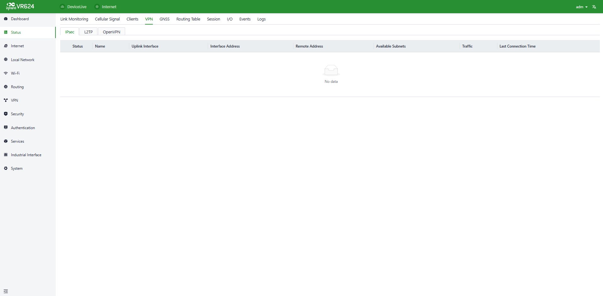

<strong>Figure 4-9 VPN status</strong>

#### 4.2.5 GNSS

The [Status] → [GNSS] feature displays the GNSS information.

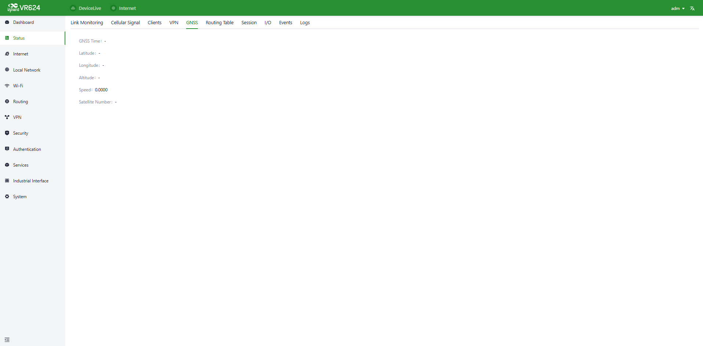

<strong>Figure 4-10 GNSS status</strong>

#### 4.2.6 Routing Table

The [Status] → [Routing Table] feature displays routing information related to the device's operation, helping users understand the device's operational status.

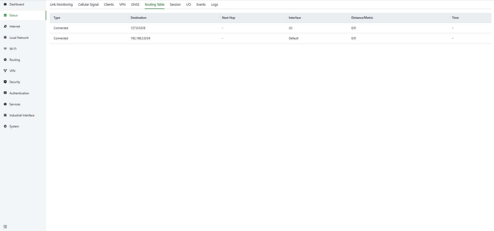

<strong>Figure 4-11 Routing table</strong>

#### 4.2.7 Session

The Session page provides real-time monitoring of all active network connections and historical session records on the device. It helps users understand the network communication status of the device and troubleshoot connection anomalies.

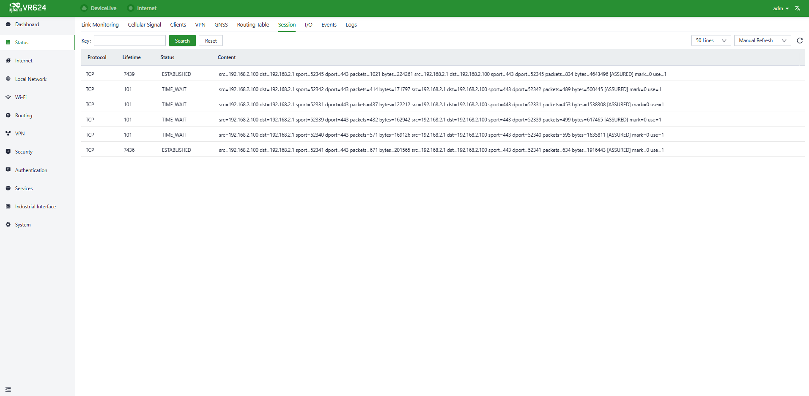

<strong>Figure 4-12 Session</strong>

#### 4.2.8 I/O

The [Status] → [I/O] feature displays the I/O status information.

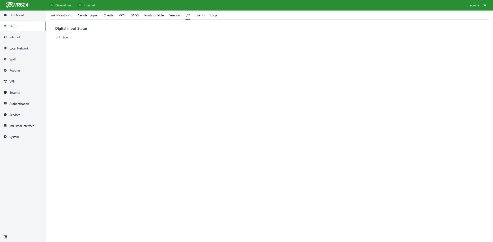

<strong>Figure 4-13 I/O status</strong>

#### 4.2.9 Events

The [Status] → [Events] feature displays event information related to the device's operation, helping users understand the device's operational status.

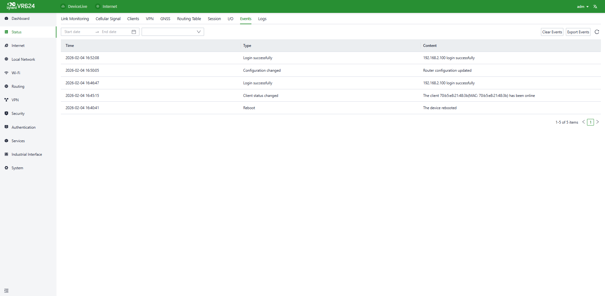

<strong>Figure 4-14 Events</strong>

Currently supported event types:

1. Successful/failed user logins.
2. High CPU utilization in the last 5 minutes.
3. High memory utilization in the last 5 minutes.
4. Cellular traffic reaches threshold.
5. VPN status changes.
6. Uplink status changes.
7. Uplink switching.
8. WAN2/LAN1 switching.
9. Reboot.
10. Upgrade.

#### 4.2.10 Logs

Through the [Status] → [Logs] feature, users can examine the system logs, which contain information about the device's operational history. When the device encounters issues, technical personnel can use these logs for troubleshooting and diagnosis.

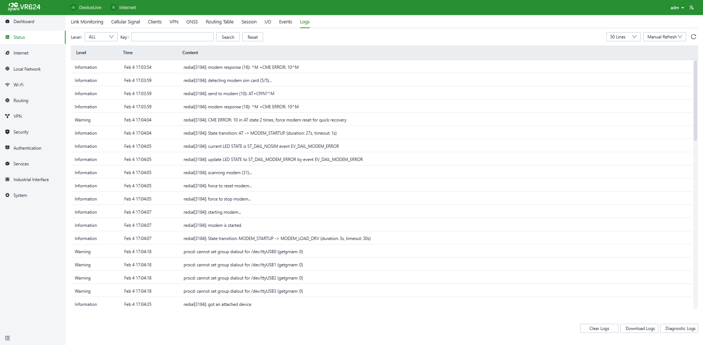

<strong>Figure 4-15 Logs</strong>

1. **Download Logs**: Download the device's operational logs.
2. **Download Diagnostic Logs**: Download the device's diagnostic logs, which include system operation logs, device information, and device configurations.
3. **Clear Logs**: Clear the device's operational logs; this does not clear the device's diagnostic logs.

### 4.3 Internet

The parameters and operational modes of each upstream interface can be configured under the [Internet] feature. The VR624 supports three access network modes, including wired, cellular, and Wi-Fi. The device comes with two non-removable upstream links by default: WAN1 and Cellular. It can support up to four upstream links, including WAN, Cellular, and Wi-Fi (STA). Wi-Fi (STA) interfaces need to be manually added and can be removed as needed.

#### 4.3.1 Wired Connection

The WAN and Wi-Fi (STA) interfaces need to be manually added and can be deleted as needed; the cellular upstream link cannot be deleted.

**DHCP**: The device's WAN interface has DHCP mode enabled by default. Connect the WAN interface to the internet using an Ethernet cable, and the internet connection is established automatically.

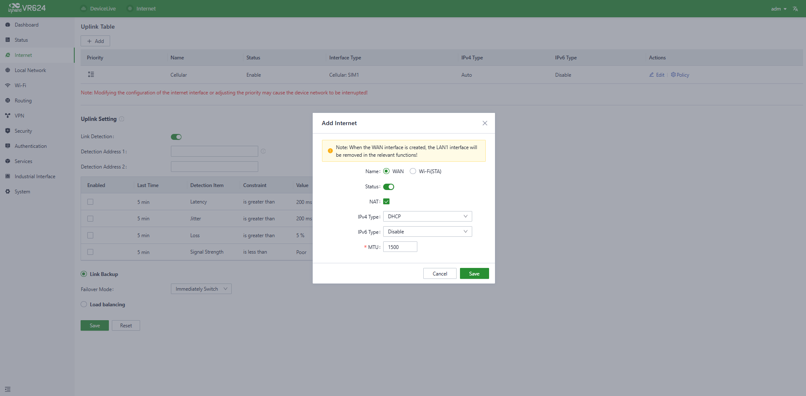

<strong>Figure 4-16 WAN DHCP mode</strong>

**Static IP**: Users have the option to manually configure an address either obtained from their internet service provider or one that is within the same network segment as their upstream device. Once the configuration is complete, the router accesses the network via the specified static IP address.

<strong>Figure 4-17 WAN static IP mode</strong>

**PPPoE**: Users have the option to configure broadband dial-up. Once the configuration is complete, the router establishes an internet connection through the broadband dial-up.

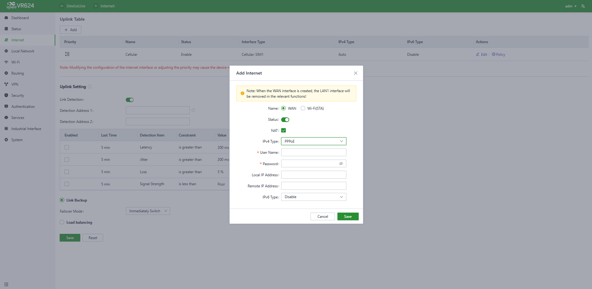

<strong>Figure 4-18 WAN PPPoE mode</strong>

#### 4.3.2 Wireless Connection

The VR624 supports connecting as a client to an on-site AP's network. To do this, click the "Add" button as shown in the illustration, select "Wi-Fi (STA)", and fill in the required parameters, including the SSID name and password.

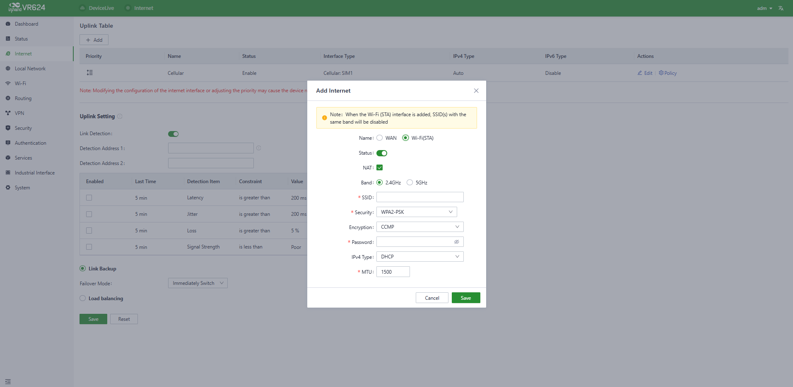

<strong>Figure 4-19 Wi-Fi (STA) connection</strong>

> **CAUTION**:
>
> 1. Upon adding Wi-Fi (STA), the VR624 automatically disables SSIDs in the same frequency band within the Wi-Fi settings, and the status field for those SSIDs cannot be modified.
> 2. After removing Wi-Fi (STA), the "Status" field and SSIDs in the same frequency band within the Wi-Fi settings can be modified.
> 3. When Wi-Fi (STA) is deleted, all configuration associated with the Wi-Fi (STA) interface, including static routes, inbound/outbound rules, port forwarding, policy routing, and traffic shaping settings, is removed.

#### 4.3.3 5G/4G Connection

In the usual scenario, as per the instructions, upon inserting the SIM card and connecting the antennas, the VR624 router automatically establishes a dial-up connection and connects to the network when powered on.

To configure APN (Access Point Name) parameters, select the "Cellular" interface in the [Internet] menu and click the "Edit" button to access the APN parameter configuration interface.

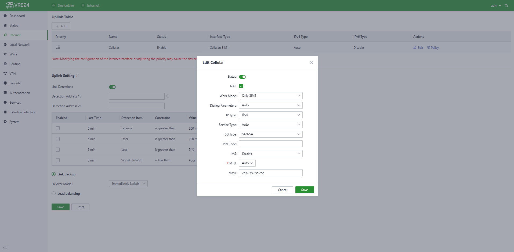

<strong>Figure 4-20 Cellular APN configuration</strong>

In addition to supporting cellular internet access, the VR624 includes a traffic policy feature. Once the policy is enabled, the SIM card takes specific actions when the traffic reaches a threshold. Traffic usage statistics reset at the beginning of the next month.

Select the "Cellular" interface in the [Internet] menu and click the "Policy" button to access the SIM card's policy parameter configuration interface.

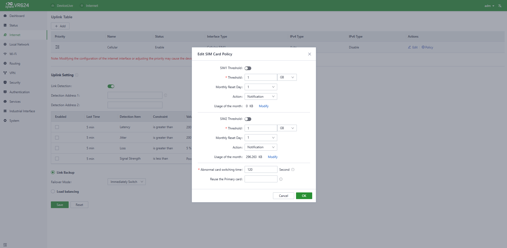

<strong>Figure 4-21 Cellular traffic policy</strong>

1. **Actions**: These are the actions triggered when SIM card traffic reaches a threshold.
   1. **Notification**: Generates an event when traffic reaches the threshold but does not stop forwarding regular business traffic.
   2. **Cloud Management Only**: Generates an event when traffic reaches the threshold, allowing only the forwarding of cloud-based management traffic while blocking access to the internet for regular business traffic.
   3. **Switch the SIM card**: Generates an event when traffic reaches the threshold and switches to another SIM card for internet access.

> **CAUTION**:
>
> 1. In certain dedicated network scenarios, it may be necessary to manually disable the "Link Detection" function under the [Internet] menu to prevent cellular connectivity issues caused by unsuccessful detection.
> 2. In some cases, manual configuration of the subnet mask for the cellular interface may be required to ensure the proper functioning of the ARP (Address Resolution Protocol) feature.
> 3. When inserting or removing a SIM card, it is essential to disconnect the power to prevent data loss or damage to the device.

#### 4.3.4 Uplink Table

WAN and Wi-Fi (STA) interfaces can be added, edited, or removed in the [Internet] → [Uplink Table]. The priority of each interface can be adjusted by dragging the "Priority" icon. Interfaces are arranged from top to bottom based on their priority, with higher-priority interfaces taking precedence in determining the current upstream interface for device operation.

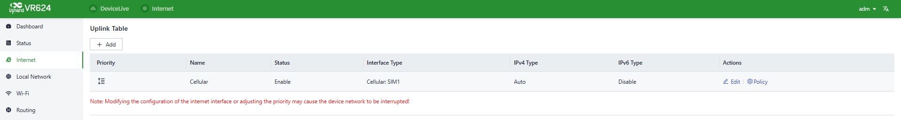

<strong>Figure 4-22 Uplink table</strong>

#### 4.3.5 Uplink Settings

Link detection settings and collaboration modes between different upstream interfaces can be configured through the [Internet] → [Uplink Settings] feature.

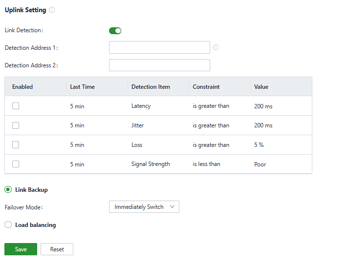

<strong>Figure 4-23 Uplink settings</strong>

**Link Detection Switch**: The device has link detection functionality enabled by default. However, in certain specialized network environments where external communication is not possible, link detection may need to be manually disabled. When link detection is turned off, latency, jitter, packet loss, signal strength, and other information for upstream interfaces will not be visible in the [Status] menu.

> **NOTE**:
>
> 1. Modifying settings in the Internet menu can potentially lead to a disruption in device connectivity. Exercise caution when making changes.
> 2. When the link detection address is left empty, the default behavior is to detect the DNS address via the upstream interface. If a detection address is specified, all upstream interfaces will only detect the address provided.
> 3. In the router's link backup mode, detection parameters can be customized, and the device will switch links based on the enabled detection items. When detection items are not enabled, upstream link switching occurs only based on priority and link connectivity.
> 4. In the device's load balancing mode, all operational upstream links forward business traffic, provided they are functioning correctly.

### 4.4 Local Network

In the [Local Network] feature, users have the flexibility to define their local subnets. This includes configuring the address range, VLAN ID, DHCP services, and other related parameters for the local LAN. Once the configuration is complete, these settings need to be further applied to the device's LAN port through [Interface Management], or applied to the desired SSID in the Wi-Fi settings. This series of operations ensures that client devices can connect to the local network according to the planned network addresses.

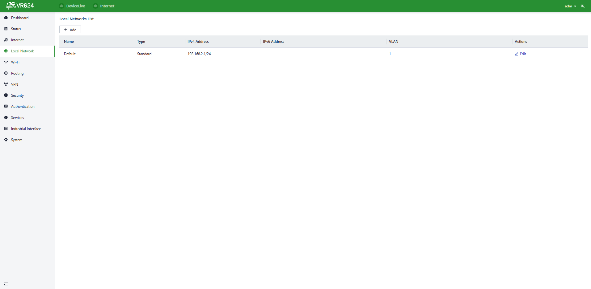

<strong>Figure 4-24 Local network list</strong>

Click the "Add/Edit" button to add a new local network or edit an existing one.

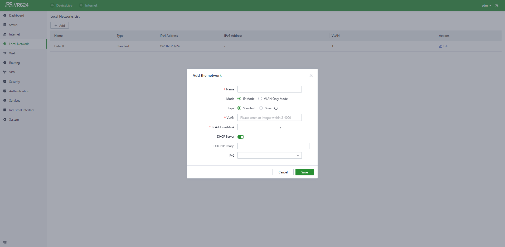

<strong>Figure 4-25 Add/Edit local network</strong>

**Name**: Used to identify the network. Users can select this name to apply the network in both [Wi-Fi] and [Interface Management].

**Mode**: Choose whether the current subnet operates in 2-layer transparent mode or 3-layer IP mode. The default is "IP mode".

**VLAN**: This allows for the division of the local network into different virtual logical networks. The default VLAN for all interfaces and Wi-Fi is "default (VLAN1)".

**IP Address/Subnet Mask**: This is the gateway address for accessing the router through the LAN port or Wi-Fi. The default is "192.168.2.1".

**DHCP Server**: Clients connecting to the router can obtain IP addresses through this function. It is enabled by default, and the address range is generated based on the "IP Address/Subnet Mask".

> **NOTE**:
>
> 1. The default local network cannot be deleted, and only the IP address/subnet mask and DHCP server settings can be modified.
> 2. Once a local network is added, its mode cannot be changed.
> 3. The VLAN Only mode is designed for 2-layer transparent operation and does not require configuration of IP address/subnet mask or DHCP server settings.

### 4.5 Wi-Fi

Wi-Fi is a widely used wireless communication technology that enables computers, smartphones, tablets, and other devices to connect to the internet or a local network. Wi-Fi technology allows devices to transmit data over a certain range through wireless signals, providing network access without the need for physical connections.

#### 4.5.1 SSIDs

The VR624 can function as an Access Point (AP) to provide multiple SSID wireless network access. Users have the flexibility to customize different SSIDs for various purposes and configurations.

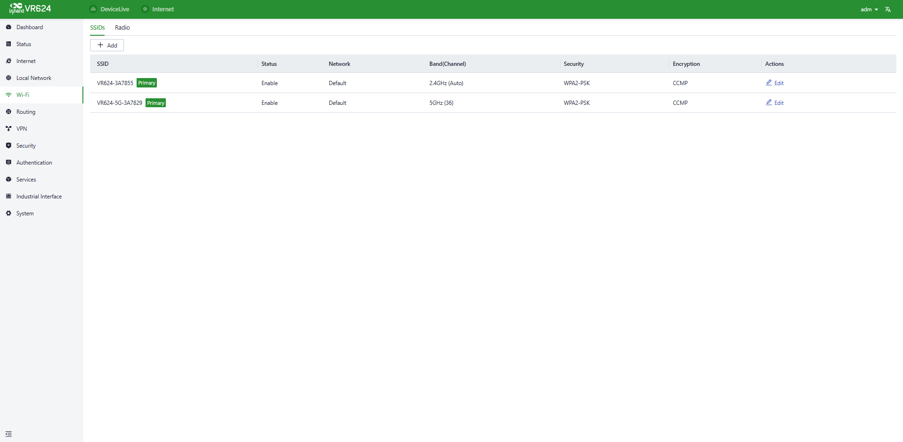

<strong>Figure 4-26 Wi-Fi list</strong>

By clicking the "Add/Edit" button under [Wi-Fi] → [Wi-Fi List], a new SSID can be added or an existing one edited.

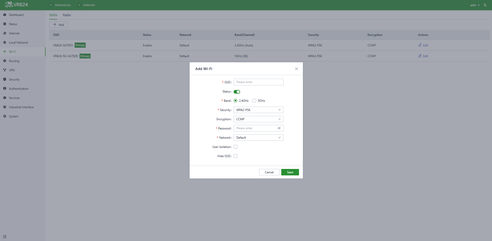

<strong>Figure 4-27 Add/Edit SSID</strong>

> **NOTE**:
>
> 1. The device comes with default 2.4GHz and 5GHz main SSIDs. The frequency bands of these main SSIDs cannot be modified and they cannot be deleted.
> 2. Once an SSID is added, its frequency band cannot be changed, and it automatically uses the same channel as its corresponding main SSID.
> 3. If a Wi-Fi (STA) interface is created in the [Internet] menu with the same frequency band as an existing SSID, that SSID cannot be enabled until the Wi-Fi (STA) interface is deleted.

#### 4.5.2 Radio

The [Radio] configuration page allows users to set the physical layer parameters for the router's 2.4 GHz and 5 GHz wireless radios, which directly affect Wi-Fi coverage, stability, and throughput.

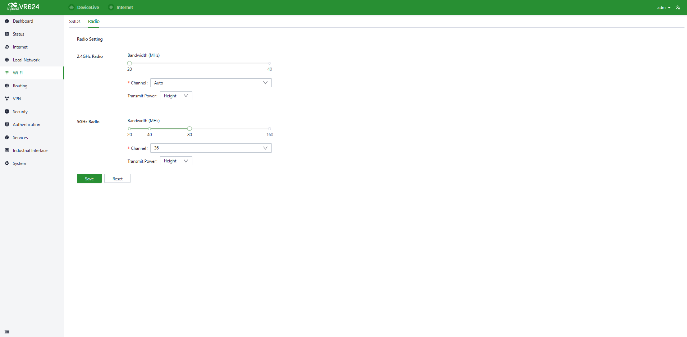

<strong>Figure 4-28 Radio configuration</strong>

### 4.6 Routing

The VR624 supports Static Route, BGP, and OSPF. Users can configure the required routing entries via the [Routing] → [Static Route/BGP/OSPF] menu.

#### 4.6.1 Static Routes

Users can independently configure static route entries via the [Routing] → [Static Routes] feature, enabling data to be forwarded through specified paths and interfaces. All entries in the static routing table are manually created by users; route entries automatically generated by other services (e.g., the VPN function) are not displayed in this table.

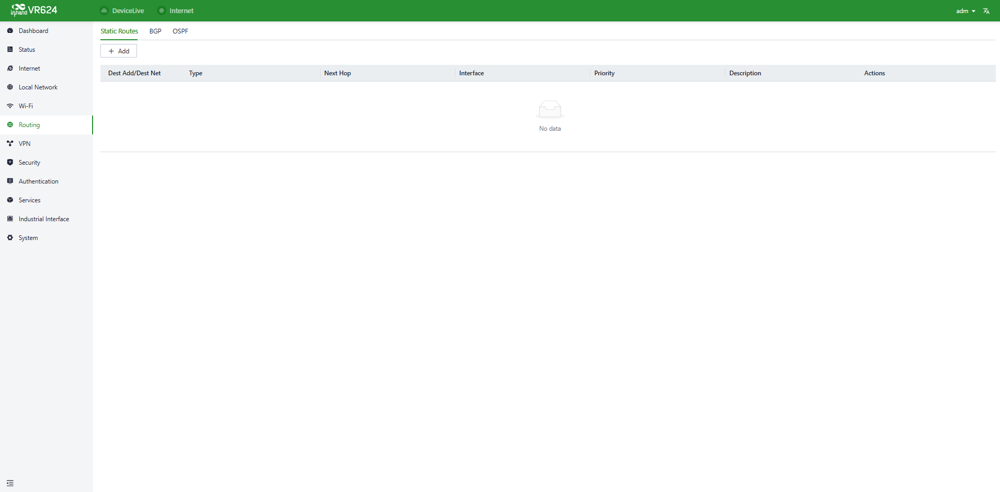

<strong>Figure 4-29 Static routes list</strong>

> **NOTE**:
>
> - For static routes with the same destination network segment/address, the next-hop address, interface, or priority must not be identical; otherwise, the routes become invalid.
> - When a WAN, Wi-Fi (STA), or L2TP Client VPN is deleted, the static routes using the corresponding interface are also removed automatically.

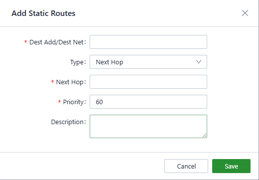

<strong>Figure 4-30 Add static route</strong>

**Operation steps**:

1. On the Static Routes list page, click **+ Add** to open the pop-up.
2. Fill in the required fields (Destination Address/Network, Next Hop, Priority).
3. Click **Save** to store the route entry; the entry appears in the static routing table.
4. Created routes support **Edit** (modify) and **Delete** (remove) operations.

**Configuration item explanation**:

| Configuration Item | Description | Function |
| --- | --- | --- |
| **Dest Addr/Dest Net** | Destination Address/Destination Network | Enter the target IP address (e.g., `1.1.1.1/32`) or network segment (e.g., `192.168.1.0/24`) for which data needs to be forwarded; this is the forwarding target of the static route. |
| **Type** | Route Type | Defaults to "Next Hop" (next-hop type), meaning data is forwarded via the specified next-hop address (some devices also support the "Interface" type, which directly specifies the outgoing interface). |
| **Next Hop** | Next-Hop Address | Enter the IP of the next device to which data should be forwarded (e.g., gateway address `2.2.2.2`); this is the core path parameter for static route forwarding. |
| **Priority** | Route Priority | A smaller value indicates higher priority (default: `60`). It is used to select the path when multiple routes exist for the same target. |
| **Description** | Description | Optional: Enter a note for the route (e.g., "Route to DeviceLive Platform") for easier subsequent management. |

#### 4.6.2 BGP

The BGP configuration interface is used to set BGP protocol parameters, advertise network segments, establish neighbor relationships, and import routes from other protocols. It is the core configuration entry for interconnection across autonomous systems. The interface includes 4 functional modules: Global Settings, Network, Neighbor Settings, and Redistribution.

Access path: [Routing] → [BGP]

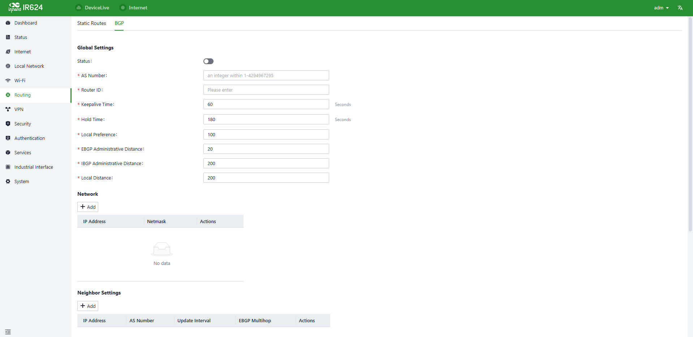

<strong>Figure 4-31 BGP configuration</strong>

##### 4.6.2.1 Global Settings

This section configures basic BGP parameters, which are required to enable the BGP function.

| Configuration Item | Description | Configuration Recommendation |
| --- | --- | --- |
| **Status** | Toggle to enable/disable the BGP protocol | Switch to "On" to activate BGP |
| **AS Number** | Autonomous System number (required) | Enter the AS number assigned to the router (range: 1-4294967295) |
| **Router ID** | Unique identifier for the router | Enter the router's Loopback IP or physical IP (IPv4 format) |
| **Keepalive Time** | Interval for sending keepalive messages | Keep the default value (60 seconds) to maintain neighbor connections |
| **Hold Time** | Neighbor timeout period | Keep the default value (180 seconds, 3x Keepalive Time); the neighbor connection is dropped if no keepalive is received |
| **Local Preference** | Route priority within the autonomous system | Keep the default value (100); higher values indicate higher priority |
| **EBGP Administrative Distance** | Administrative distance for EBGP routes | Keep the default value (20); used to prioritize routes from different protocols |
| **IBGP Administrative Distance** | Administrative distance for IBGP routes | Keep the default value (200); lower priority than EBGP |
| **Local Distance** | Administrative distance for local BGP routes | Keep the default value (200) |

##### 4.6.2.2 Network

Configure network segments to be advertised via BGP, so that other BGP devices can learn routes to these segments.

**Operation steps**:

1. Click the **+ Add** button to expand the configuration row.
2. Enter the **IP Address** (network segment to advertise) and **Netmask** (subnet mask).
3. Repeat to add multiple network segments.

**Scenario example**: To advertise the device management segment `192.168.100.0` to BGP neighbors, enter `IP Address: 192.168.100.0` and `Netmask: 255.255.255.0`.

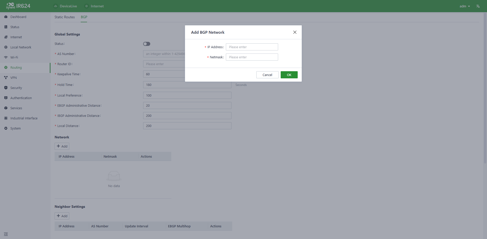

<strong>Figure 4-32 BGP network advertisement</strong>

##### 4.6.2.3 Neighbor Settings

Configure BGP neighbor relationships to exchange routes with other BGP devices.

**Operation steps**:

1. In the **Neighbor Settings** section of the BGP interface, click **+ Add** to open the "Add BGP Neighbor" pop-up.
2. Fill in all mandatory fields (`Neighbor IP Address`, `AS Number`, `Update Interval`).
3. (Optional) Configure `EBGP Multihop` if the neighbor is not directly connected.
4. (Optional) Enable **Advanced Option** to customize `Keepalive Time`/`Hold Time` (global values are used by default).
5. Click **OK** to save the neighbor configuration; click **Cancel** to discard changes.

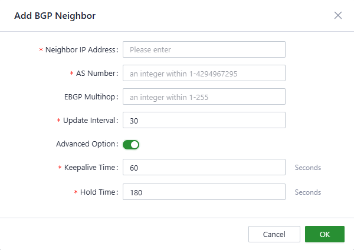

<strong>Figure 4-33 Add BGP neighbor</strong>

| Field | Description | Configuration Guidelines |
| --- | --- | --- |
| **Neighbor IP Address** | IP address of the peer BGP device (e.g., carrier gateway, router in another AS) | Enter the valid IPv4 address of the target neighbor (e.g., `10.100.1.1`) |
| **AS Number** | Autonomous System number of the neighbor device | Enter the neighbor's AS number (range: 1–4294967295; distinguishes EBGP/IBGP neighbors) |
| **EBGP Multihop** | Maximum number of hops allowed for EBGP neighbor connections (only valid for EBGP) | Enter a value (1–255) if the neighbor is not on a directly connected segment (e.g., `2` for a 2-hop EBGP neighbor); leave blank for directly connected neighbors |
| **Update Interval** | Interval (in seconds) for sending route update messages to the neighbor | Keep the default value `30` (avoids frequent updates that consume bandwidth) |
| **Advanced Option** | Toggle to show/hide advanced parameters (Keepalive Time, Hold Time) | Enable to configure custom keepalive/timeout settings (disabled by default, uses global BGP values) |
| **Keepalive Time** | Interval (in seconds) for sending keepalive messages to the neighbor | Only editable if _Advanced Option_ is enabled; keep the default `60` (matches global setting) |
| **Hold Time** | Timeout period (in seconds) for the neighbor connection (if no keepalive is received) | Only editable if _Advanced Option_ is enabled; keep the default `180` (3× Keepalive Time, matches global setting) |

##### 4.6.2.4 Redistribution

**Operation steps**:

1. In the **Redistribution** section of the BGP interface, click **+ Add** to open the "Add Redistribution" pop-up.
2. Select the **Redistribution Type** (e.g., `Connected` to import directly connected routes).
3. Enter a valid **Metric** value.
4. Click **OK** to save the configuration; click **Cancel** to discard changes.

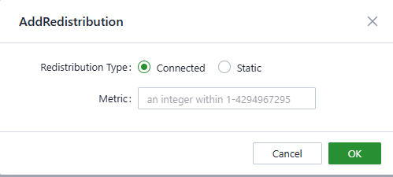

<strong>Figure 4-34 Add BGP redistribution</strong>

| Field | Description | Configuration Guidelines |
| --- | --- | --- |
| **Redistribution Type** | The protocol type of the routes to be imported into BGP | Two options: - `Connected`: Import the router's **directly connected network segment routes** (e.g., the router's own physical interface segments) - `Static`: Import **manually configured static routes** |
| **Metric** | The metric value assigned to the redistributed routes (affects BGP route priority) | Enter an integer (range: 1–4294967295); a moderate value (e.g., `100`) is recommended to avoid unintended route prioritization |

#### 4.6.3 OSPF

OSPF is a link-state dynamic routing protocol used to automatically calculate and maintain routing tables in large IP networks, enabling fast convergence when the network topology changes. This configuration page is used to enable and manage the router's OSPF functionality.

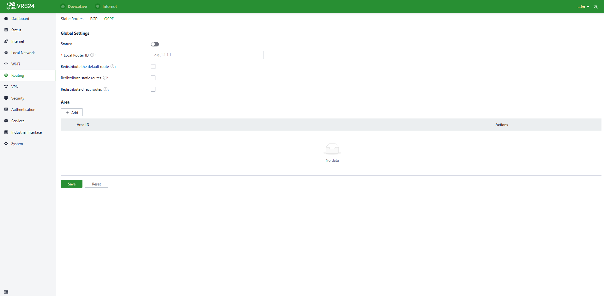

<strong>Figure 4-35 OSPF configuration</strong>

##### 4.6.3.1 Global Settings

| Item | Description |
| :--- | :--- |
| **Status** | The master switch for the OSPF function. When enabled, the router runs the OSPF protocol. |
| **Local Router ID** | A unique identifier for the local router, typically configured as a 32-bit IP address (e.g., 1.1.1.1), used to identify the device within the OSPF network. |
| **Redistribute the default route** | When enabled, injects the default route into the OSPF domain, allowing other OSPF routers to learn this default route. |
| **Redistribute static routes** | When enabled, injects locally configured static routes into the OSPF domain, integrating static and dynamic routing. |
| **Redistribute direct routes** | When enabled, injects routes of the router's directly connected network segments into the OSPF domain, allowing other devices to discover these segments via OSPF. |

##### 4.6.3.2 Area Configuration

1. Purpose of areas

OSPF divides the network into different **Areas** to optimize routing information distribution, reduce LSA flooding scope, and improve network stability. Each area is uniquely identified by an **Area ID**, often in the format of an IP address (e.g., 0.0.0.0 represents the backbone area, Area 0).

2. Add OSPF area

| Item | Description |
| :--- | :--- |
| **Area ID** | The unique identifier for the OSPF area (required). The backbone area (Area 0) is the core of all OSPF networks, and all other areas must connect to Area 0. |
| **Network** | Specifies the network segments within this area that participate in OSPF (formatted as `Network Address/Subnet Mask`, e.g., 192.168.2.1/24). The router enables OSPF on interfaces in this segment and sends/receives OSPF protocol packets. |

3. Operation buttons

| Button | Function |
| :--- | :--- |
| **Add** | Opens the "Add OSPF Area" dialog box for creating a new OSPF area. |
| **Save** | Saves all current OSPF configurations and applies them. |
| **Reset** | Clears all unsaved configurations and restores the last saved state. |
| **Cancel** | Cancels the current "Add OSPF Area" configuration and closes the dialog box. |

### 4.7 VPN

A Virtual Private Network (VPN) is an encryption technology used to establish a secure, private network connection over the public internet. It enables secure access to private network resources over the internet from anywhere. VPNs achieve this by encrypting communication data, ensuring the confidentiality and security of the communication and preventing unauthorized access. VPNs have a wide range of applications in the corporate, personal, and mobile device sectors as a tool for safeguarding privacy and data security.

#### 4.7.1 IPSec VPN

IPsec (Internet Protocol Security) VPN is a protocol suite designed to enhance network communication security by encrypting and authenticating data transmission. It is widely used for establishing secure remote access, site-to-site connections, and Virtual Private Networks (VPNs). IPsec VPN ensures data protection and security through encryption and authentication methods.

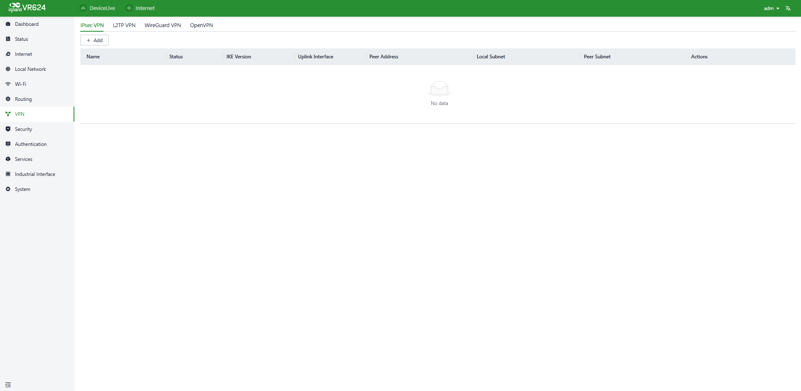

<strong>Figure 4-36 IPSec VPN list</strong>

Click the "Add" button under [VPN] → [IPSec VPN] to add a new IPSec VPN.

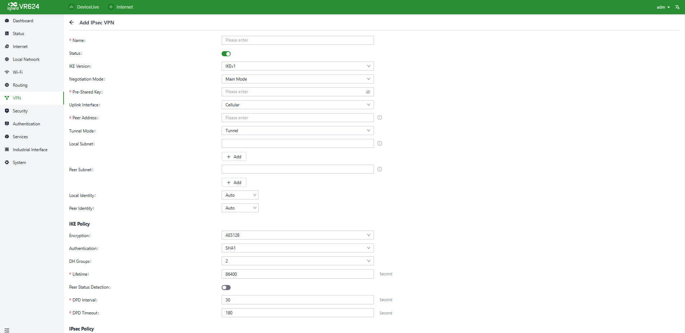

<strong>Figure 4-37 Add IPSec VPN</strong>

Once configurations are completed at both ends, the tunnel can be established. The tunnel establishment status can be checked in the [Status] → [VPN] menu.

1. **Name**: The user-assigned name for the IPSec VPN to identify it for local management purposes.
2. **IKE Version**: Sets the version of the Internet Key Exchange (IKE) protocol to be used. Both IKEv1 and IKEv2 are supported.
3. **Pre-Shared Key**: A secret shared key that must be configured the same on both devices for authentication during IKE negotiation.
4. **Internet Interface**: The upstream interface used to establish the IPSec VPN locally.
5. **Tunnel Mode**: Sets the encapsulation mode for IPSec on IP packets. Both tunnel mode and transport mode are supported.
6. **Peer Address**: The address of the remote endpoint with which the VR624 establishes the IPSec tunnel.

> **NOTE**: This setup allows the device with the public IP address to act as the server, and client devices connect to it using the server's public IP address.

7. **Local Subnet**: Specifies the subnet addresses that need to communicate through the VR624 IPSec VPN tunnel.
8. **Remote Subnet**: Specifies the subnet address on the other end of the tunnel that needs to communicate through the IPSec VPN tunnel.
9. **IKE Policy**: Supports configuring the IKE protocol.
10. **Encryption Method**: Sets the encryption algorithm used by IKE.
    1. **Options**: DES, 3DES, AES128, AES192, AES256 (default: AES128)
11. **Authentication Method**: Sets the authentication algorithm used by IKE.
    1. **Options**: MD5, SHA1, SHA2-256, SHA2-384, SHA2-512 (default: SHA1)
12. **DH Group**: Configures the DH exchange parameters used during the IKE phase key negotiation.
    1. **Options**: 1, 2, 5, 14, 15, 16, 19, 20
13. **Timeout**: Sets the IKE SA (Security Association) lifetime, defaulting to 86400 seconds.
14. **IPSec Policy**: Allows configuring IPSec parameters.
15. **Security Protocol**: Sets the security protocol used by the ESP protocol.
    1. **Options**: DES, 3DES, AES128, AES192, AES256 (default: AES128)
16. **Encryption Method**: Sets the encryption algorithm used by the ESP protocol.
    1. **Options**: MD5, SHA1, SHA2-256, SHA2-384, SHA2-512 (default: SHA1)
17. **PFS Group**: In IPSec, during the negotiation of a security policy, an additional key exchange is performed in Phase 2 to enhance communication security.
    1. **Options**: 1, 2, 5, 14, 15, 16, 19, 20
18. **Lifetime**: Sets the IPSec SA aging time; the default is 86400 seconds.

#### 4.7.2 L2TP VPN

The Layer 2 Tunneling Protocol (L2TP) is a Layer 2 VPN protocol designed to establish secure point-to-point or site-to-site Virtual Private Network (VPN) connections. It is commonly used for remote access and branch office connectivity, creating secure communication channels for users or networks to protect the privacy and integrity of data transmission.

##### 4.7.2.1 Work as Client

The VR624 can act as an L2TP client and establish a tunnel with a remote L2TP server. Click the [L2TP VPN] menu, then navigate to "Client", and use the "Add" button to configure an L2TP client.

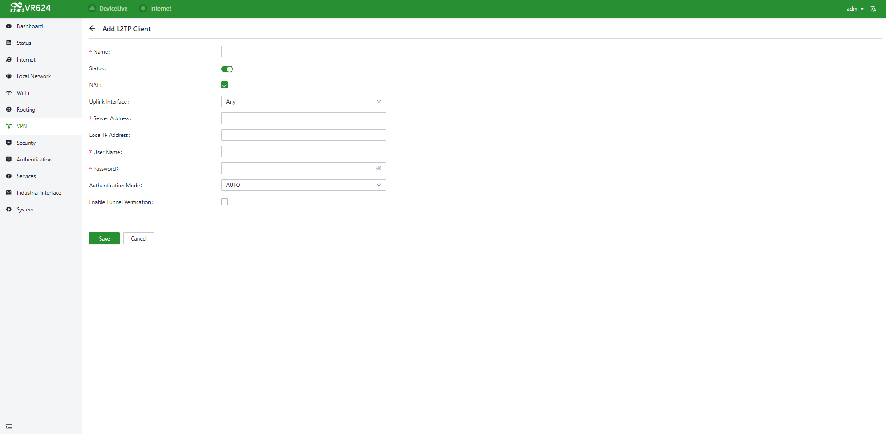

<strong>Figure 4-38 Add L2TP client</strong>

1. **Name**: The name of the L2TP client for local identification.
2. **Status**: The switch to enable or disable the L2TP client tunnel.
3. **NAT**: The switch for NAT functionality when forwarding with the L2TP client.
4. **Upstream Interface**: The upstream interface used for communication between the L2TP client and the server.
5. **Server Address**: The communication address of the remote L2TP server.
6. **Username/Password**: Usernames and passwords that need to be configured the same on both ends during L2TP negotiation.
7. **Authentication Mode**: Sets the L2TP authentication mode.
8. **Enable Tunnel Authentication**: When enabled, both ends need to configure the same username and password for tunnel authentication.

##### 4.7.2.2 Work as Server

A typical L2TP server is usually deployed at the headquarters of an enterprise, serving as a remote access server for mobile office or branch offices. To configure the L2TP server settings, click [VPN] → [L2TP VPN] → [Server] to access the L2TP server editing page.

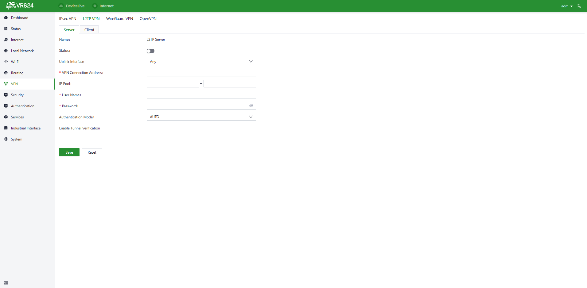

<strong>Figure 4-39 L2TP server configuration</strong>

1. **Name**: The name of the L2TP server; not editable.
2. **Status**: The on/off switch for the L2TP server function; default is off.
3. **Upstream Interface**: The upstream interface used by the L2TP server.
4. **VPN Communication Address**: The gateway address for L2TP clients, which can be assigned to devices within the IP address pool.
5. **Address Pool**: The IP address pool used for communication when L2TP clients connect.
6. **Username/Password**: Usernames and passwords that need to be the same on both ends for L2TP negotiation.
7. **Authentication Mode**: Sets the L2TP authentication mode.
8. **Enable Tunnel Verification Function**: When enabled, the usernames/passwords for tunnel verification on both ends need to be the same.

#### 4.7.3 WireGuard VPN

WireGuard is a lightweight, high-performance VPN protocol optimized for low-latency, secure communication in industrial IoT scenarios.

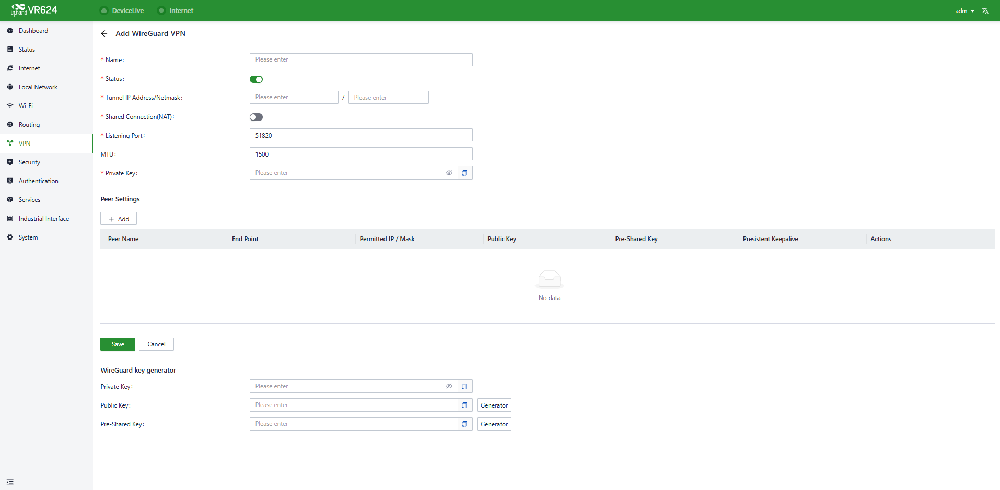

<strong>Figure 4-40 WireGuard VPN configuration</strong>

1. **Core configuration items**

| Field | Description | Configuration Guidelines |
| --- | --- | --- |
| **Name** | User-defined name for the WireGuard tunnel | Enter a descriptive name (e.g., `Factory-Site-VPN`) to identify the tunnel for management purposes. |
| **Status** | Toggle to enable/disable the WireGuard tunnel | Defaults to **Enabled** (green) to activate the tunnel once configured. |
| **Tunnel IP Address/Netmask** | Virtual IP address and subnet mask for the local tunnel interface | Enter an IP (e.g., `10.0.0.1`) and netmask (e.g., `255.255.255.0`) to define the tunnel's internal network segment. |
| **Shared Connection(NAT)** | Toggle to enable NAT for shared tunnel access | Disable for point-to-point industrial connections; enable if multiple devices need to share the tunnel. |
| **Listening Port** | UDP port on which the router listens for WireGuard connections | Defaults to `51820` (standard WireGuard port); keep unless conflicting with other services. |
| **MTU** | Maximum Transmission Unit for the tunnel | Defaults to `1500`; reduce to `1420` if encountering fragmentation over public networks. |
| **Private Key** | Local private key for WireGuard encryption | Generate using the **WireGuard key generator** at the bottom of the page, then paste here. |

2. **Peer settings**

This section configures remote peers (other devices connecting to this WireGuard tunnel).

| Field | Description |
| --- | --- |
| **Peer Name** | Descriptive name for the remote peer (e.g., `Remote-Sensor-Gateway`). |
| **End Point** | Public IP address and port of the remote peer (e.g., `203.0.113.5:51820`). |
| **Permitted IP / Mask** | IP segments allowed to communicate through the peer (e.g., `192.168.2.0/24` for a remote factory subnet). |
| **Public Key** | Public key of the remote peer (provided by the peer device). |
| **Pre-Shared Key** | Optional additional encryption key for enhanced security (generate via the key generator). |
| **Persistent Keepalive** | Interval (seconds) for sending keepalive packets (e.g., `25` to maintain NAT traversal). |

3. **WireGuard key generator**

Built-in tool to generate secure keys for the tunnel:

- **Private Key**: Local device's private key (keep confidential).
- **Public Key**: Corresponding public key (share with peers).
- **Pre-Shared Key**: Optional per-peer key for extra security.

Click **Generator** to create a new key, then copy it to the corresponding field.

4. **Operation steps**

1. Enter a **Name** and configure the **Tunnel IP Address/Netmask**.
2. Generate a **Private Key** using the key generator and paste it into the field.
3. (Optional) Enable **Shared Connection(NAT)** if needed.
4. Add peers by clicking **+ Add** and filling in their details (End Point, Public Key, etc.).
5. Click **Save** to apply the configuration.

#### 4.7.4 OpenVPN

OpenVPN is an open-source, flexible VPN protocol that establishes secure point-to-point or site-to-site connections over public networks via encrypted tunnels, and is widely used in industrial remote operation and maintenance as well as cross-network data transmission.

##### 4.7.4.1 Work as Server

The Server mode is used to accept VPN connection requests from clients.

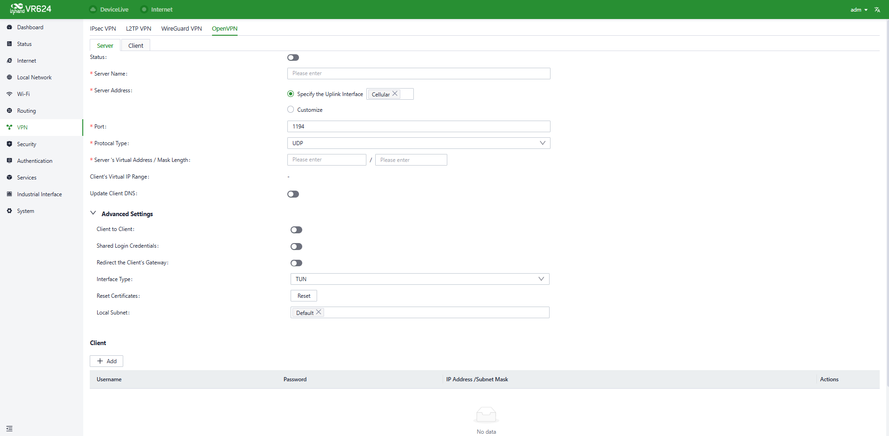

<strong>Figure 4-41 OpenVPN server configuration</strong>

Key configuration items:

| Configuration Item | Description | Configuration Recommendation |
| --- | --- | --- |
| **Status** | Toggle to enable/disable the OpenVPN Server | Disabled by default; enable after completing configuration. |
| **Server Name** | Custom identifier for the server | Enter a descriptive name (e.g., `Factory-OpenVPN-Server`) for easier management. |
| **Server Address** | Public address the server uses to accept connections | Two options: 1. `Specify the Uplink Interface`: Select an existing interface (e.g., `Cellular`) to automatically use its public IP. 2. `Customize`: Manually enter a public IP or domain name. |
| **Port** | Listening port for OpenVPN connections | Defaults to `1194` (standard port); keep unless conflicting with other services. |
| **Protocol Type** | Transport protocol | Defaults to `UDP` (lower latency, ideal for industrial scenarios); select `TCP` if firewall traversal is needed. |
| **Server's Virtual Address / Mask Length** | Virtual IP of the server within the VPN tunnel | Enter a network segment (e.g., `10.8.0.1/24`) for communication between tunneled devices. |
| **Client's Virtual IP Range** | Pool of virtual IPs assigned to connecting clients | Enter a range within the same subnet as the server (e.g., `10.8.0.10-20`). |
| **Update Client DNS** | Whether to push DNS server addresses to clients | Enable in industrial scenarios to ensure proper resolution of internal domain names. |

Advanced settings:

| Configuration Item | Description |
| --- | --- |
| **Client to Client** | Allow VPN clients to communicate with each other |
| **Shared Login Credentials** | Allow multiple clients to log in with the same account |
| **Redirect the Client's Gateway** | Force all client traffic to pass through the VPN tunnel |
| **Interface Type** | Virtual interface type for the VPN tunnel |
| **Reset Certificates** | Regenerate encryption certificates for the server and clients |
| **Local Subnet** | Local network segments accessible to clients |

Client settings:

| Configuration Item | Description |
| --- | --- |
| **Username** | Unique identifier for the VPN client, used for authentication. |
| **Password** | Secure password for the client account, must be kept confidential and shared only with authorized users. |
| **IP Address/Subnet Mask** | Fill in the subnet of the client network. |

##### 4.7.4.2 Work as Client

The Client mode is used to connect to a remote OpenVPN Server, configured via the "Add OpenVPN Client" pop-up:

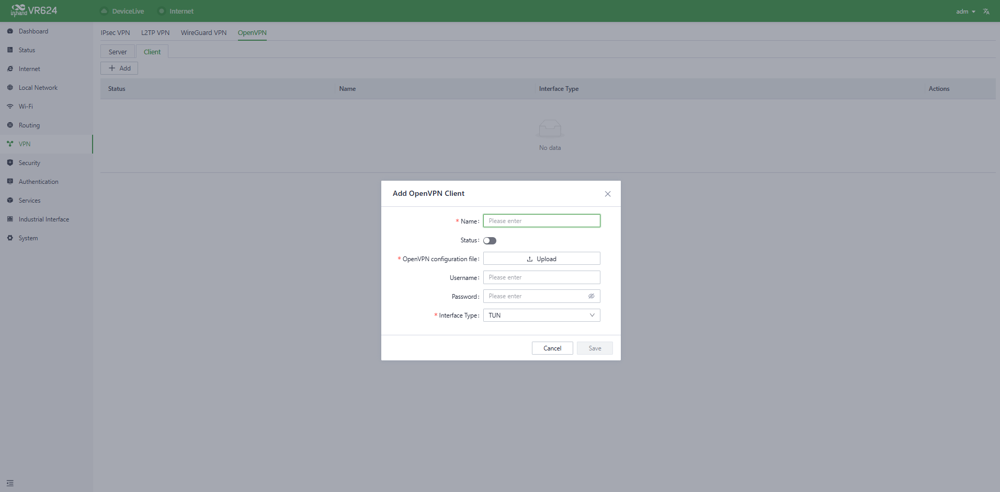

<strong>Figure 4-42 Add OpenVPN client</strong>

| Configuration Item | Description | Configuration Recommendation |
| --- | --- | --- |
| **Name** | Custom identifier for the client | Enter a descriptive name (e.g., `Connect-to-HQ-OpenVPN`). |
| **Status** | Toggle to enable/disable the OpenVPN Client | Disabled by default; enable after completing configuration. |
| **OpenVPN configuration file** | Import the `.ovpn` configuration file provided by the server | Click `Upload` to avoid manual parameter entry errors. |
| **Username / Password** | Credentials for server authentication | Provided by the server administrator for identity verification. |
| **Interface Type** | Virtual interface type | Must match the server setting (default: `TUN`). |

### 4.8 Security

In the [Security] menu, users can configure advanced features related to firewalls, policy routing, and traffic shaping.

#### 4.8.1 Firewall

The firewall currently includes functions such as inbound rules, outbound rules, port forwarding, MAC address filtering, and more.

##### 4.8.1.1 Inbound/Outbound Rules

Traffic in/out control based on interfaces can be implemented through the [Security] → [Firewall] → [Outbound Rules/Inbound Rules] feature. For example, if a user is subjected to a significant amount of attacks from a specific source IP address, inbound firewall rules can be used to restrict traffic from that IP address.

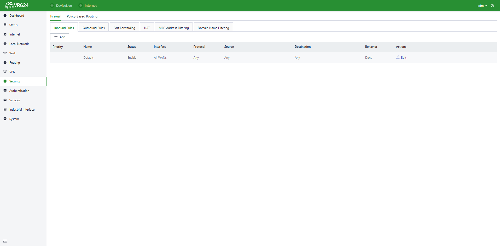

<strong>Figure 4-43 Inbound/Outbound rules</strong>

Furthermore, IT personnel can utilize outbound firewall rules to restrict certain users' access to external networks. Inbound and outbound rules share the same configurable content, with the only distinction being the default rules.

1. **Name**: Sets the name of the inbound/outbound rule for local identification.
2. **Status**: Rule function switch.
3. **Interface**: For outbound rules, it specifies the upstream interface where traffic leaves the router. For inbound rules, it specifies the upstream interface where traffic enters the router.
4. **Protocol**: Matches traffic based on the protocol type, with options like Any, TCP, UDP, ICMP, or custom.
5. **Source**: Matches the source address for traffic, supporting custom, with the default as Any.
6. **Destination**: Matches the destination address for traffic, supporting custom, with the default as Any.
7. **Action**: Action taken for matching traffic in inbound/outbound rules, supporting allow and deny.
8. **Inbound Rules**: Traffic management rules for the external network accessing the router, with the default as deny all.
9. **Outbound Rules**: Traffic management rules for traffic going out through the router, with the default allowing all.
10. Adjustment of the priority of inbound and outbound rules is supported.

##### 4.8.1.2 Port Forwarding

Port forwarding, also known as port mapping or port redirection, is used to redirect network packets from one network port (or address) to another network port or address. Users can configure port forwarding rules under [Security] → [Firewall] → [Port Forwarding]. When external traffic accesses a specific port on the router, the device forwards the data to the corresponding port of an internal client, enabling external access to services inside the router.

For example, when a user needs to access the service on port 1024 of the internal client at 192.168.2.10 from the external network, this client's port can be mapped to port 1024 under the WAN1 interface. External users only need to enter "https://WAN address:1024" in their browser to access the target device's data, where the "WAN address" is the IP address of the WAN interface.

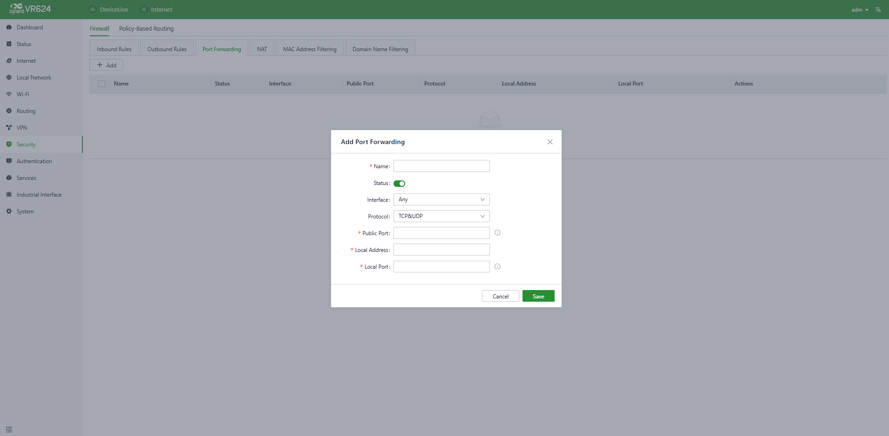

<strong>Figure 4-44 Port forwarding</strong>

1. **Name**: The name of the port forwarding rule, used for local identification.
2. **Status**: The on/off switch for the port forwarding rule.
3. **Interface**: The upstream interface that provides mapping functionality for internal clients. The upstream interface needs public IP address support.
4. **Protocol**: The protocol type of the traffic for port mapping; supports TCP, UDP, and TCP & UDP.
5. **Public Port**: The port number on the upstream interface that provides mapping.
6. **Local Address**: The address of the target device located under the router that the external network needs to access.
7. **Local Port**: The port of the target device that the external network needs to access. It needs to be consistent with the public port input range.

##### 4.8.1.3 MAC Address Filter

MAC address filtering involves allowing or disallowing devices in a MAC address list to access the internet, which means controlling LAN devices' internet access requests through MAC address filtering on the router. Users can configure MAC address filtering rules in [Security] → [Firewall] → [MAC Address Filtering].

Multiple MAC addresses can be created in the list, address descriptions can be added, and the list can be set to allow only the listed MAC addresses to access the network (whitelist), or to block the listed MAC addresses from accessing the network (blacklist).

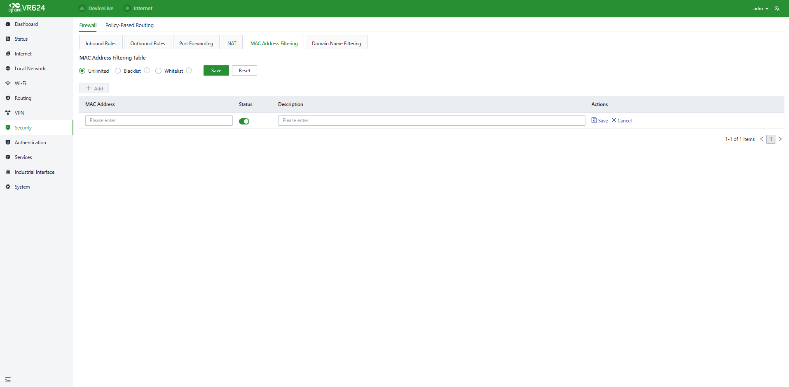

<strong>Figure 4-45 MAC address filter</strong>

##### 4.8.1.4 NAT

NAT (Network Address Translator) is a technology used to use a private address in a local network and switch to a global IP address when connecting to the internet. Source or destination address translation can be set as needed in [Security] → [Firewall] → [NAT].

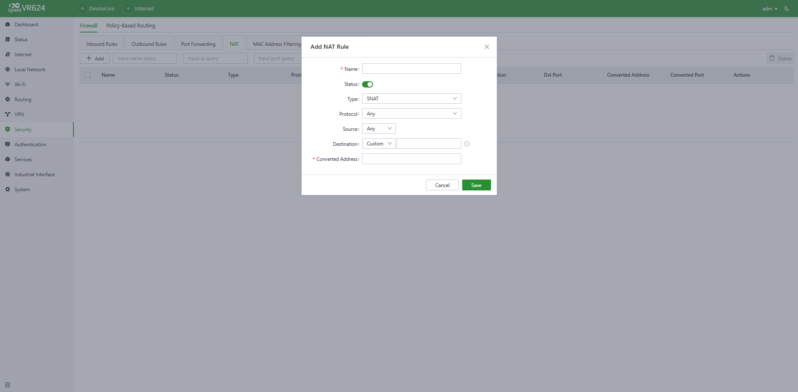

<strong>Figure 4-46 NAT configuration</strong>

1. **Name**: The user sets a name for the rule.
2. **Type**: The type of this rule.
   1. **SNAT**: Translate the source IP address.
   2. **DNAT**: Translate the destination IP address.
3. **Protocol**: The scope of the rule.
   1. **Any**: This rule is effective for all protocols.
   2. **TCP**: This rule takes effect only for the TCP protocol.
   3. **UDP**: This rule takes effect only for the UDP protocol.
   4. **TCP&UDP**: This rule takes effect only for TCP and UDP protocols.
4. **Source**: The source IP address that needs to be translated.
5. **Destination**: The destination IP address that needs to be translated.
6. **Converted Address**: The translated address.

##### 4.8.1.5 Domain Name Filtering

Domain names that can be accessed by clients can be allowed or disallowed (white/black list) as needed.

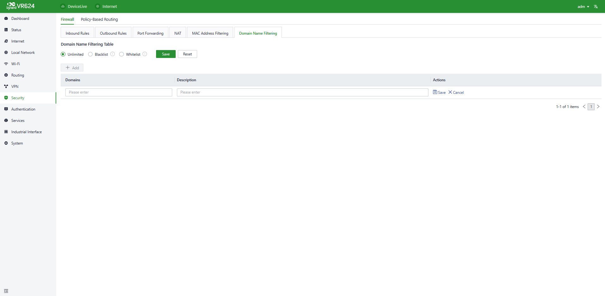

<strong>Figure 4-47 Domain name filtering</strong>

#### 4.8.2 Policy-Based Routing

Policy routing is a feature that allows users to create policies based on their specific needs, enabling them to route different data flows through different links. This improves the flexibility and control of routing decisions, enhances link utilization efficiency, and reduces enterprise costs. Click the "Add" button under [Security] → [Policy Routing] to create a new policy routing rule.

<strong>Figure 4-48 Policy-based routing</strong>

> **CAUTION**:
>
> 1. The source address and destination address in a policy routing rule cannot both be set as "Any".

### 4.9 Authentication

The VR624 supports the following network access authentication methods:

- **802.1X**: Configures IEEE 802.1X port-level authentication. It authenticates devices based on network ports, ensuring only authenticated devices are granted network access permissions.

802.1X authentication ensures that only devices with valid credentials (authenticated via the RADIUS server) can access the network. This is critical for industrial environments where unauthorized device access could disrupt operations or compromise sensitive data.

<strong>Figure 4-49 802.1X configuration</strong>

**Configuration item explanation**:

| Field | Description | Default Value / Recommendation |
| --- | --- | --- |
| **Enable 802.1X** | Toggle to activate 802.1X authentication globally | Disabled by default. |
| **Port** | Network ports to which 802.1X applies | Default: `All` (all ports); specify individual ports for granular control |
| **Server** | IP address or domain of the RADIUS authentication server | Enter the address of the enterprise RADIUS server |
| **Authentication Port** | UDP port for RADIUS authentication | Default: `1812` (standard RADIUS port) |
| **Billing Port** | UDP port for RADIUS accounting (optional) | Default: `1813`; leave blank if accounting is not required |
| **Key** | Shared secret key for communication with the RADIUS server | Must match the key configured on the RADIUS server |

### 4.10 Service

#### 4.10.1 Interface Management

Local networks allowed through a specific interface and the interface's speed can be configured in the [Services] → [Interface Management] function.

<strong>Figure 4-50 Interface management</strong>

#### 4.10.2 DHCP Server

The DHCP (Dynamic Host Configuration Protocol) service operates in a client/server communication mode, where clients request IP addresses from servers, and servers respond to these requests by assigning IP addresses dynamically to clients. The DHCP server's IP address pool can be configured using the [Services] → [DHCP Server] feature.

<strong>Figure 4-51 DHCP server</strong>

> **NOTE**:
>
> 1. The device's DHCP service is generated based on the network information in the local network. If a local subnet is removed from the "Local Network List", the DHCP Server for that local subnet is also deleted.
> 2. Local network entries need to be set in "IP" mode for the DHCP server function to take effect. Networks in "VLAN Only" mode are not within the selectable range.

#### 4.10.3 DHCP Snooping

DHCP Snooping is a security feature designed to defend against attacks from malicious DHCP servers in the local area network (LAN). By listening to and filtering DHCP packets, it only trusts legitimate DHCP servers, ensuring clients receive authentic and secure IP address configurations and preventing network address spoofing and man-in-the-middle attacks.

<strong>Figure 4-52 DHCP snooping</strong>

#### 4.10.4 DNS Server

DNS (Domain Name System) servers are a crucial network component responsible for translating human-readable domain names (e.g., www.example.com) into computer-understandable IP addresses (e.g., 192.168.1.1). DNS servers act as the address book of the internet, helping computers and devices find the locations of other devices and ensuring that information can be correctly delivered across the network.

When DNS server addresses are not set in [Services] → [DNS Server], the DNS addresses obtained from the device's upstream interface are used for domain name resolution. When DNS server addresses are configured, the configured DNS addresses are used for domain name resolution.

<strong>Figure 4-53 DNS server</strong>

#### 4.10.5 Fixed Address List

The [Services] → [Fixed Address List] function can be used to allocate a fixed IP address to a device based on its MAC address. This means that the device consistently receives the same IP address every time it connects to the VR624.

<strong>Figure 4-54 Fixed address list</strong>

> **CAUTION**:
>
> 1. The available addresses for allocation must fall within the address range of the local network in IP mode, or the configuration does not take effect.
> 2. When the local network is deleted, all fixed address allocation rules within the local network's address range are removed.

#### 4.10.6 Dynamic DNS

Dynamic DNS (Dynamic Domain Name System) is used to automatically update the name server content in the domain system. According to internet domain rules, domain names are typically associated with fixed IP addresses. Dynamic DNS technology allows users with dynamic IP addresses to have a fixed name server. This enables external users to connect to the URL of users with dynamic IP addresses through regular updates.

The Dynamic DNS server address can be manually configured under the [Services] → [Dynamic DNS] feature.

<strong>Figure 4-55 Dynamic DNS</strong>

1. **Service Provider**: Provided by the Dynamic DNS service operator; can be chosen from dyndns, 3322, oray, no-ip, or a custom option (requires a URL).
2. **Hostname**: Register for a hostname by clicking the URL below the service provider.
3. **Username**: Register for a username by clicking the URL below the service provider.
4. **Password**: The password set by the user during registration.

#### 4.10.7 SMS Control

The VR624 supports remote device control through SMS messages. This feature can be configured via the [Services] → [SMS Control] menu.

<strong>Figure 4-56 SMS control</strong>

#### 4.10.8 AT Service

The VR624 offers two AT command control methods: one via serial port interaction, and the other via internet interaction.

<strong>Figure 4-57 AT service via serial port</strong>

<strong>Figure 4-58 AT service via internet</strong>

#### 4.10.9 GNSS

The GNSS (Global Navigation Satellite System) feature supports forwarding satellite positioning data (in NMEA format) to local or remote devices via Serial Forwarding and IP Network Forwarding, suitable for vehicle tracking, asset positioning, and field device monitoring scenarios.

<strong>Figure 4-59 GNSS basic settings</strong>

1. **Basic settings**

| Item | Description |
| --- | --- |
| **GNSS Status** | Check to enable the entire GNSS feature. All forwarding sub-functions are inactive if this is not checked. |
| **Update Device Time** | Check to allow the router to automatically calibrate its system time using GNSS signals, ideal for offline scenarios without network time synchronization. |
| **Debug Model** | When enabled, the router outputs detailed GNSS debugging logs, which are used for troubleshooting and performance analysis of the GNSS function. It is recommended to disable this in normal use. |

2. **GNSS IP forwarding**

This function forwards GNSS positioning data over an IP network, supporting **Client** and **Server** modes.

a. Client mode

| Item | Description |
| :--- | :--- |
| **Transmission Protocol** | Select the transmission protocol as needed. Uses TCP protocol by default to ensure reliable data transmission. |
| **Connection Type** | Select the connection type as needed. Uses long-lived connection by default to maintain a stable communication link. |
| **Keepalive Interval** | Sends a keepalive packet every 100 seconds to monitor connection status. |
| **Keepalive Retry** | Retries up to 10 times if the connection fails, then triggers a reconnection. |
| **Reconnect Interval** | Minimum reconnection interval is 15 seconds, maximum is 180 seconds to avoid frequent retries. |
| **Source Interface** | Specifies the network interface used to send GNSS data. |
| **Report Interval** | Reports positioning data to the server every 30 seconds. |
| **Server Address/Port** | Configures the server address and port that receive GNSS data. |
| **Include NMEA RMC/GSA/GGA/GSV** | Selects which standard NMEA positioning sentences to forward, including Recommended Minimum, DOP and Active Satellites, Fix Data, and Satellites in View. |

In the **Server Settings** section, users can configure one or more remote server addresses and ports to receive GNSS data. After configuration, the settings can be saved to take effect.

<strong>Figure 4-60 GNSS IP forwarding - client mode</strong>

b. Server mode

| Item | Description |
| :--- | :--- |
| **Local Port** | Listens on port 10001 by default to receive GNSS data requests from clients. |
| **Connection & Keepalive** | Same as client mode, ensuring the server remains online stably. |
| **Report Interval** | Actively pushes positioning data every 30 seconds. |
| **Include NMEA RMC/GSA/GGA/GSV** | Selects which standard NMEA positioning sentences to push. |

<strong>Figure 4-61 GNSS IP forwarding - server mode</strong>

3. **GNSS serial forwarding**

This function outputs GNSS positioning data through a physical serial port, used to connect local serial devices (e.g., vehicle terminals, industrial controllers).

| Item | Description |
| :--- | :--- |
| **Status** | Enables or disables the serial forwarding function. |
| **Serial Type** | Supports RS232 and RS485 interfaces. |
| **Baudrate** | Default is 115200, adjustable based on device requirements. |
| **Data Bits/Parity/Stop Bit** | Default configuration is 8 data bits, no parity, 1 stop bit, and can be customized. |
| **Software Flow Control** | Can be enabled to prevent data loss during high-speed transmission. |
| **Include NMEA RMC/GSA/GGA/GSV** | Selects which standard NMEA positioning sentences to output. |

<strong>Figure 4-62 GNSS serial forwarding</strong>

#### 4.10.10 SNMP Configuration

The VR624 is compatible with the SNMP protocol, and users can export the MIB file by clicking the <Export MIB File> option.

<strong>Figure 4-63 SNMP configuration</strong>

#### 4.10.11 Power Management

The [Power Management] page configures the router's low-voltage protection and ignition control parameters, which are especially critical for vehicle or industrial power environments. These settings ensure the device operates safely, prevent damage from unstable power, and extend its service life.

<strong>Figure 4-64 Power management</strong>

| Item | Description |
| :--- | :--- |
| **Sleep Voltage** | The voltage threshold (in 100mV units) that triggers the router to enter low-power sleep mode. When the input voltage drops to this level (e.g., 90 = 9.0V), the router reduces power consumption to protect itself and critical systems. |
| **Power-on Voltage** | The voltage threshold (in 100mV units) that triggers the router to wake up and resume normal operation. When the input voltage rises above this level (e.g., 105 = 10.5V), the router exits sleep mode and restarts services. |
| **Low Voltage Shutdown Delay** | The delay time (in seconds) before the router shuts down completely after detecting a low-voltage condition. This prevents immediate shutdowns due to transient voltage dips (e.g., 30 seconds). |
| **Ignition Shutdown Delay** | The delay time (in seconds) before the router shuts down after the ignition signal is lost. This is primarily used in vehicle applications to allow time for the system to safely save data and close connections (e.g., 15 seconds). |
| **ITxPT** | When enabled, the router supports the ITxPT (Information Technology for Public Transport) protocol, which provides standardized power and data management for in-vehicle and industrial IoT devices. |

#### 4.10.12 Loop Detection

Loop Detection is a network protection mechanism that actively monitors and identifies Layer 2 network loops in the local area network (LAN). It prevents broadcast storms and avoids network outages or severe performance degradation caused by loops.

<strong>Figure 4-65 Loop detection</strong>

#### 4.10.13 IGMP Snooping

IGMP (Internet Group Management Protocol) Snooping is a Layer 2 network technology that maintains multicast group membership by listening to IGMP messages between hosts and routers. This optimizes multicast traffic forwarding in the LAN, preventing unnecessary flooding of multicast packets across the entire network and thus saving bandwidth.

<strong>Figure 4-66 IGMP snooping</strong>

### 4.11 Industrial Interface

The VR624 supports the RS232 industrial serial port and I/O, which can be used for PLCs, industrial equipment, etc. to access the VR624 and send data back.

<strong>Figure 4-67 Industrial interface - serial port</strong>

<strong>Figure 4-68 Industrial interface - I/O</strong>

### 4.12 System

In the [System] menu, users can configure settings related to cloud management, remote access control, clock settings, device options, configuration management, device alerts, tools, and log servers, among other functions.

#### 4.12.1 Cloud Management

The DeviceLive (device.inhandcloud.com) is a cloud platform developed by InHand Networks to address the challenges faced by industrial networks, such as slow deployment, complex operations, and poor user experiences. This platform is designed with a focus on user needs and integrates features like zero-touch deployment, intelligent operations and maintenance, security protection, and excellent user experience capabilities. Once devices are connected to the cloud platform, users can perform remote management, batch configuration, traffic monitoring, and other operations through the platform, making network device management more convenient and efficient.

The VR624 automatically connects to DeviceLive after establishing an internet connection by default. If the cloud management function is not needed, it can be disabled manually in the [System] → [Cloud Management] function.

<strong>Figure 4-69 Cloud management</strong>

#### 4.12.2 Access Control

Whether to allow external access to the router's web configuration interface from the internet can be configured through the [System] → [Access Control] function. The service port for this purpose can also be set.

<strong>Figure 4-70 Access control</strong>

| Protocol | Description |
| :--- | :--- |
| **HTTPS** | The secure web management interface. - **Local**: Allows access from the local network. - **Remote**: Allows access from the public network (use with caution). - **Server Port**: The local listening port for HTTPS (default: 443). - **Remote Access Port**: The port used for remote HTTPS access (default: 443). - **Source Address**: Restricts access to a specific IP address or subnet (e.g., 192.168.1.0/24). |
| **SSH** | The secure command-line management interface. - **Local**: Allows access from the local network. - **Remote**: Allows access from the public network (use with caution). - **Server Port**: The local listening port for SSH (default: 22). - **Remote Access Port**: The port used for remote SSH access (default: 22). - **Source Address**: Restricts access to a specific IP address or subnet. |
| **Telnet** | The unsecure command-line management interface (not recommended for production environments). - **Local**: Allows access from the local network. - **Remote**: Allows access from the public network (strongly discouraged). - **Server Port**: The local listening port for Telnet (default: 23). - **Remote Access Port**: The port used for remote Telnet access (default: 23). - **Source Address**: Restricts access to a specific IP address or subnet. |
| **PING** | The network diagnostic tool for checking connectivity. - **Local**: Allows PING requests from the local network. - **Remote**: Allows PING requests from the public network (disable for enhanced security). - **Source Address**: Restricts PING requests to a specific IP address or subnet. |

#### 4.12.3 Country & System Clock

The [Country & System Clock] page is used to configure the router's regional settings and time synchronization parameters. Accurate timekeeping is essential for log management, certificate validation, and the proper functioning of time-sensitive network protocols.

<strong>Figure 4-71 Country & system clock</strong>

| Item | Description |
| :--- | :--- |
| **Country** | Selects the country/region where the router is deployed. This setting optimizes wireless frequency bands and power levels to comply with local regulatory requirements (e.g., China, USA, EU). |
| **Time Zone** | Sets the local time zone (e.g., `UTC+08:00 China, Hong Kong`). This ensures the router's system time and logs are displayed in the correct local time. |
| **NTP Server** | The master switch for Network Time Protocol (NTP) synchronization. When enabled, the router automatically synchronizes its system clock with an NTP server for high accuracy. |
| **NTP Server 1 / NTP Server 2** | Primary and secondary NTP server addresses (e.g., `pool.ntp.org`). Configuring a secondary server provides redundancy if the primary server becomes unavailable. |
| **Port** | The UDP port used for NTP communication (default: 123). This port is a standard for NTP and should generally not be changed. |

#### 4.12.4 Device Option

In the [System] → [Device Options] section, users can perform various device operations such as rebooting, upgrading firmware, and restoring factory settings.

<strong>Figure 4-72 Device options</strong>

> **CAUTION**:
>
> 1. When performing a local firmware upgrade, it is essential to ensure that the firmware is obtained from a legitimate source to avoid rendering the device inoperable due to incorrect firmware imports.
> 2. When a device is connected to the cloud platform, the platform will synchronize the previous configuration to the device again due to cloud-based configuration synchronization. The device will only clear historical data during the factory reset.

#### 4.12.5 Configuration Management

Configuration backups and backup recovery are critical tasks in network management and maintenance. They involve saving the configuration information of network devices so that it can be quickly restored or transferred when needed.

Users can export device configurations to local storage in the [System] → [Configuration Management] menu. This backup can be imported into the device in case of configuration loss or when the existing configuration needs to be overwritten.

<strong>Figure 4-73 Configuration management</strong>

#### 4.12.6 Device Alarms

Users can choose to focus on specific events that may occur on the device by selecting the corresponding alarm events and configuring the email address for receiving alerts. When an alarm event occurs, the device automatically sends an email notification. It is important to note that even if certain alarm options are not selected, related alarm events are still recorded in the device's local logs.

Alarm event types and email addresses for alarm notifications can be configured in the [System] → [Device Alarms] menu.

<strong>Figure 4-74 Device alarms</strong>

After configuring the outgoing email server address, port, username, and password, the device uses this email account to send alarm notifications. The "Send Test Email" option can be used to verify whether the outgoing email configuration is correct. This test email helps ensure that the device can successfully send alarm notifications to the specified email address.

<strong>Figure 4-75 Outgoing email server</strong>

#### 4.12.7 Tools

##### 4.12.7.1 Ping

ICMP (Internet Control Message Protocol) can be used to check the device's external network connectivity. In the "Target" field, enter any domain name or IP address to test the device's connectivity to, and then click "Start" to check the connectivity status between the device and the specified target. This helps determine whether the device can reach the target over the internet.

A network ping test on a target can be performed by going to [System] → [Tools] → [Ping]. This sends ICMP echo requests to the specified target IP address or domain name and receives ICMP echo replies to check network connectivity and latency to that target.

<strong>Figure 4-76 Ping tool</strong>

##### 4.12.7.2 Traceroute

Traceroute is a network diagnostic tool used to determine the network path that data packets take from the source to the destination, as well as the intermediate routers or hops along that path. The target host's IP address can be entered in [System] → [Tools] → [Traceroute], the outgoing interface for the traffic can be chosen, and by clicking "Start", the device's connectivity to the target IP can be checked by tracing the route.

##### 4.12.7.3 Capture

Packet capturing is a network monitoring and analysis technique used to capture and record data packets transmitted over a computer network. Packet capture tools are typically used for network troubleshooting, network performance analysis, security auditing, and protocol analysis, among other purposes.

Users can capture packets passing through a specific interface in [System] → [Tools] → [Capture]. By selecting the "Output" option, users can choose to display the captured data within the interface or export it locally for further analysis.

##### 4.12.7.4 Iperf

Users can perform traffic testing via [System] → [Tools] → [Iperf].

#### 4.12.8 Scheduled Reboot

Scheduled reboot is a network device management strategy that allows administrators to automatically restart a device at a specific time or under certain conditions to ensure the device's normal operation and performance.

In practice, users can set up scheduled reboots in the [System] → [Scheduled Reboot] function based on their business requirements. The device supports scheduled reboots at fixed times daily, weekly, or monthly.

In the case of monthly reboots, if the selected reboot day exceeds the actual number of days in the month, the device reboots on the last day of the month. For example, if rebooting on the 31st of every month is chosen, the device reboots on the 30th in a month with only 30 days.

<strong>Figure 4-77 Scheduled reboot</strong>

#### 4.12.9 Log Server

A log server is a dedicated server or software application used to collect, store, and manage log information generated by network devices, applications, and operating systems. These log records include events, warnings, errors, activities, and other relevant information and are crucial for monitoring, troubleshooting, and performance optimization.

When the log file server function is enabled in the [System] → [Log Server] feature, the device periodically uploads log files to the specified log server.

<strong>Figure 4-78 Log server</strong>

#### 4.12.10 Account Management

The username and password for logging in to the web page of the device can be changed in [System] → [Account Management].

<strong>Figure 4-79 Account management</strong>

#### 4.12.11 Other Settings

<strong>Figure 4-80 Other settings</strong>

##### 4.12.11.1 Web Login Management

When a user logs in to the local interface of the device through the web and the session remains active for a certain period, it automatically logs out or disconnects to protect the user's privacy and security.

The logout time can be configured in [System] → [Other Settings] → [Web Login Management]. If the online time during a single login session on the device's web page exceeds the configured time, the system automatically logs the user out, and the user needs to log in again to continue operations.

##### 4.12.11.2 Fast Forward

This feature can be used to quickly forward packets, improving network performance. By default, it is turned off. When users enable this feature in [System] → [Other Settings] → [Fast Forward], the device's data forwarding rate increases significantly.

##### 4.12.11.3 SIP ALG

SIP ALG (Session Initiation Protocol Application Layer Gateway) is a network feature that helps manage VoIP (Voice over IP) calls traversing NAT (Network Address Translation). It ensures that SIP signaling and RTP media streams are correctly translated and forwarded, allowing VoIP calls to establish and maintain connectivity across the router.

## Appendix A Troubleshooting

### 1 Power and Startup Issues

| Symptom | Possible Cause | Troubleshooting Steps | Reference Section |
|---------|----------------|----------------------|-------------------|
| System LED is off | Power not connected or adapter mismatch | 1. Check the power cable connection 2. Use the original power adapter | [2.1 Before You Begin](#21-before-you-begin) |
| System LED blinks in red | System error | 1. Reboot the device in [System] → [Device Options] 2. If the issue persists, restore the device to factory defaults 3. Contact technical support | [4.12.4 Device Option](#4124-device-option) |

### 2 Web Access Issues

| Symptom | Possible Cause | Troubleshooting Steps | Reference Section |
|---------|----------------|----------------------|-------------------|
| Cannot open the web page at 192.168.2.1 | PC and device are not in the same subnet | 1. Confirm the PC obtains an IP address automatically in the 192.168.2.x range 2. If not, configure a static IP (e.g., 192.168.2.100, mask 255.255.255.0, gateway 192.168.2.1) | [2.2 Installation Steps](#22-installation-steps) |
| Browser shows a security warning | HTTPS certificate is not trusted by the browser | 1. Click "Hide" or "Advanced" 2. Select "Proceed" to continue | [2.2 Installation Steps](#22-installation-steps) |
| Login credentials unknown | Credentials are device-specific | 1. Check the nameplate at the bottom of the device for login credentials 2. If the password was changed and forgotten, restore factory defaults and log in with the nameplate credentials | [1.6 Default Settings](#16-default-settings) |
| Automatically logged out of the web page | Web login timeout is exceeded | 1. Log in again to continue operations 2. Adjust the logout time in [System] → [Other Settings] → [Web Login Management] if needed | [4.12.11.1 Web Login Management](#412111-web-login-management) |

### 3 Cellular Network Issues

| Symptom | Possible Cause | Troubleshooting Steps | Reference Section |
|---------|----------------|----------------------|-------------------|
| Cellular LED never becomes steady in green | SIM card not inserted or in poor contact | 1. Power off the device before inserting or removing the SIM card 2. Re-insert the SIM card | [4.3.3 5G/4G Connection](#433-5g4g-connection) |
| Cellular LED never becomes steady in green | APN parameters incorrect | 1. Go to [Internet], select "Cellular", click "Edit" 2. Configure the APN parameters provided by the carrier | [4.3.3 5G/4G Connection](#433-5g4g-connection) |
| Signal LED steady in red | Poor cellular signal | 1. Check whether the cellular antennas are installed 2. Adjust the antenna position 3. Check signal parameters (RSSI, SINR, RSRP) in [Status] → [Cellular Signal] | [4.2.2 Cellular Signal](#422-cellular-signal) |
| Cellular connection fails in a dedicated network | Link detection unsuccessful | 1. Go to [Internet] → [Uplink Settings] 2. Disable the "Link Detection" function 3. If needed, manually configure the subnet mask of the cellular interface for ARP to work properly | [4.3.5 Uplink Settings](#435-uplink-settings) |
| Business traffic blocked but device still online | Cellular traffic policy triggered | 1. Check the traffic policy in [Internet], select "Cellular", click "Policy" 2. Adjust the threshold or action (Notification / Cloud Management Only / Switch the SIM card) as required | [4.3.3 5G/4G Connection](#433-5g4g-connection) |

### 4 Wired and Uplink Issues

| Symptom | Possible Cause | Troubleshooting Steps | Reference Section |
|---------|----------------|----------------------|-------------------|
| No internet access through the WAN interface | Connection mode does not match the upstream network | 1. Confirm the physical connection of the WAN interface 2. Check whether the mode (DHCP / Static IP / PPPoE) matches the carrier's requirement 3. Verify the static IP parameters or PPPoE account | [4.3.1 Wired Connection](#431-wired-connection) |
| Wrong uplink interface in use | Interface priority order | 1. Check the interface priority in [Internet] → [Uplink Table] 2. Drag the "Priority" icon to adjust the order | [4.3.4 Uplink Table](#434-uplink-table) |
| Uplink status cannot be viewed in [Status] | Link detection is disabled | 1. When link detection is off, latency, jitter, packet loss, and signal strength are not displayed 2. Enable link detection in [Internet] → [Uplink Settings] if this information is required | [4.3.5 Uplink Settings](#435-uplink-settings) |

### 5 Wi-Fi Issues

| Symptom | Possible Cause | Troubleshooting Steps | Reference Section |
|---------|----------------|----------------------|-------------------|
| SSID cannot be enabled | A Wi-Fi (STA) interface of the same frequency band exists | 1. Check the Wi-Fi (STA) interface in [Internet] 2. Delete the Wi-Fi (STA) interface if it is no longer needed; then the SSID of the same band can be enabled | [4.3.2 Wireless Connection](#432-wireless-connection) |
| Client cannot find the default SSID or connect | SSID or password mismatch | 1. The default SSIDs are prefixed with "VR624-" (2.4G) and "VR624-5G-" (5G), followed by the last 6 digits of the wireless MAC address 2. The default password (WPA2-PSK) is the last 8 digits of the serial number | [1.6 Default Settings](#16-default-settings) |
| Client cannot obtain an IP address via Wi-Fi | DHCP server not effective | 1. Confirm the SSID is bound to a local network in "IP" mode 2. Check the DHCP server settings of that local network | [4.10.2 DHCP Server](#4102-dhcp-server) |

### 6 Cloud Platform Issues

| Symptom | Possible Cause | Troubleshooting Steps | Reference Section |
|---------|----------------|----------------------|-------------------|
| Device does not appear online on DeviceLive | Device has no internet access | 1. Check the uplink status in [Dashboard] → [Interface Status] 2. Use [System] → [Tools] → [Ping] to test internet connectivity | [4.1.2 Interface Status](#412-interface-status) |
| Device does not appear online on DeviceLive | Cloud management is disabled | 1. Go to [System] → [Cloud Management] 2. Enable cloud management and save | [4.12.1 Cloud Management](#4121-cloud-management) |

## Appendix B Safety Precautions

1. Use the original power adapter to avoid damaging the device due to mismatched power adapters.
2. When installing the device, avoid placing it in an environment with strong electromagnetic interference, and keep it at a safe distance from high-power equipment. After installation, ensure that the device is stable to prevent accidental drops and potential damage.
3. Ensure that the device's operating environment meets the temperature and humidity requirements specified in the user manual.
4. Regularly inspect the device's cables, including Ethernet cables and power adapter connections. Keep the cables clean, and replace them if any damage is detected.
5. When cleaning the device, avoid spraying chemical agents directly on the device's surface to prevent damage to the housing or internal components. Use a soft cloth for cleaning.
6. Do not attempt to disassemble or modify the device on your own, as this can pose safety risks and may void the device's warranty.

> **WARNING**: Disconnect the power before inserting or removing the SIM card to prevent data loss or damage to the device.
