# Device Manager用户手册

## 前置信息

### 声明

首先非常感谢您选择本公司产品！在使用前，请您仔细阅读本用户手册，遵守以下声明，将有助于维护知识产权和法律合规性，以确保您的使用体验与产品的最新信息相一致。如有任何疑问或需要获取书面许可，请随时联系我们的技术支持团队。

- 版权声明

本用户手册包含受版权保护的内容，版权归北京映翰通网络技术股份有限公司及其许可者所有。未经书面许可，任何单位和个人不得擅自摘抄、复制本手册的部分或全部内容，且不得以任何形式传播。

- 免责声明

由于产品技术和规格不断更新，本公司不能承诺用户手册中的资料与实际产品完全一致。因此，不承担由于实际技术参数与用户手册不符而引起的任何争议。任何关于产品的改动恕不提前通知，本公司保留最终更改权和解释权

- 版权信息

本用户手册内容受版权法律保护，版权归北京映翰通网络技术股份有限公司及其许可者所有，保留一切权利。未经书面许可，不得擅自使用、复制或传播本手册的内容。

### 图形界面约定

| 符号 | 含义 | 示例 |
|------|------|------|
| `< >` | 表示变量或参数，需替换为实际值 | `<IP地址>` 表示需填入具体IP |
| `" "` | 表示界面上的文字标签 | 点击"保存"按钮 |
| `→` | 表示菜单层级或操作顺序 | 【设备管理】→【设备列表】 |
| `【 】` | 表示菜单或页面名称 | 进入【系统设置】页面 |
| `>>` | 表示页面内的导航路径 | 【网关管理】>>【告警】 |

### 技术支持

**北京映翰通网络技术股份有限公司（总部）**

电话：010-8417 0010

地址：北京市朝阳区紫月路18号院3号楼5层

**成都办事处**

电话：028-8679 8244

地址：四川省成都市武侯区天府大道北段1777号中国太平金融大厦14层

**广州办事处**

电话：020-8562 9571

地址：广州市天河区棠东东路5号远洋新三板创意园B-130单元

**武汉办事处**

电话：027-8716 3566

地址：湖北省武汉市洪山区珞瑜东路2号巴黎豪庭11栋2001室

**上海办事处**

电话：021-5480 8501

地址：上海市普陀区顺义路18号1103室

### 如何使用本手册

**对号入座**

- 首次使用用户：建议按顺序阅读「产品简介」→「快速上手指南」→「登录与账号体系」→「设备接入与联网」
- 已有账号用户：可直接查阅「核心功能详解」或「附录 故障处理」
- 管理员用户：可重点查阅「登录与账号体系」中的组织与账号管理、权限角色说明

**按任务快速跳转**

| 任务 | 对应章节 | 预计用时 |
|------|----------|----------|
| 注册并登录DM平台 | [快速上手指南](#第2章-快速上手指南) | 约5分钟 |
| 将设备接入DM平台 | [设备接入与联网](#第4章-设备接入与联网) | 约10分钟 |
| 配置告警监控规则 | [告警管理](#58-告警管理) | 约10分钟 |
| 批量更新设备配置 | [配置任务](#57-配置任务) | 约15分钟 |
| 批量升级设备固件 | [OTA升级](#55-ota升级) | 约15分钟 |
| 部署边缘计算应用 | [边缘计算](#511-边缘计算) | 约20分钟 |
| 排查接入故障 | [附录 故障处理](#附录-故障处理) | 按需 |

---

## 第1章 产品简介

### 1.1 产品概述与定位

Device Manager（以下简称DM平台）是由映翰通自主研发、自主运营的物联网设备管理云平台。DM平台通过可视化的用户界面和标准化的使用流程，实现映翰通路由器及网关等硬件设备的统一管理与监控，支持设备快速集成、海量设备集中管理。该平台采用云端部署架构，满足即用即走的访问需求，适用于需要远程管理分散在各地的工业网关设备的场景。

### 1.2 核心功能与应用场景

DM平台核心功能及应用场景如下：

| 核心功能 | 应用场景 |
|----------|----------|
| 设备集中管理 | 统一管理分布在不同区域的数百台工业网关，查看设备运行状态、在线情况、流量使用等 |
| 远程运维 | 无需抵达现场，通过浏览器远程访问设备Web管理页面，执行配置修改和故障排查 |
| 批量操作 | 对大量设备同时下发配置或升级固件，降低分散部署场景的运维成本 |
| 告警监控 | 设备异常事件（掉线、流量超限、电源切换等）自动推送短信或邮件通知 |
| 边缘计算管理 | 在支持边缘计算的网关上远程部署Python应用和SDK，实现边缘侧数据处理 |
| 数据集成 | 将设备状态数据推送到第三方MQTT/Kafka服务，与企业现有系统对接 |

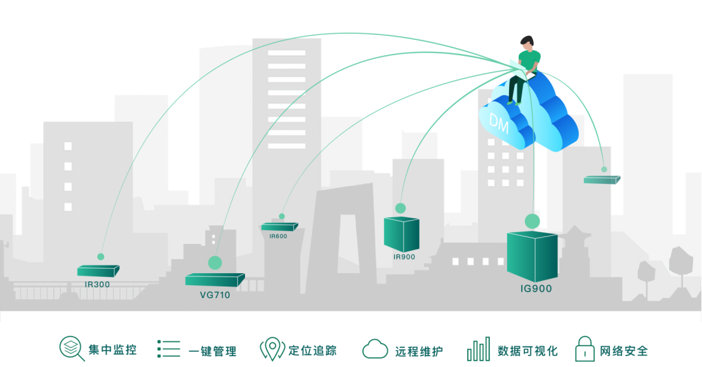

<strong>图 1-1 DM平台界面概览</strong>

### 1.3 名词解释

| 术语 | 通俗解释 | 适用场景 |
|------|----------|----------|
| DM平台 | Device Manager的简称，即本文档所述的物联网设备管理云平台 | 用户登录并使用平台进行设备管理 |
| 网关 | 指映翰通工业路由器或边缘网关设备，是DM平台的管理对象 | 用户需要将物理设备接入平台进行监控 |
| 远程管理平台 | 设备本地Web页面中用于配置与云端平台连接的功能模块 | 用户在设备端配置接入DM平台时使用 |
| 边缘计算 | 在网关设备本地运行用户自定义程序，就近处理数据 | 用户需要在设备侧运行Python脚本或数据处理应用 |
| OTA升级 | Over-The-Air，通过无线网络远程更新设备固件 | 用户需要批量更新分散设备的系统版本 |
| SN码 | 设备序列号，用于在平台中唯一标识一台设备 | 用户手动添加设备或查询设备信息时 |
| 权限组 | 将用户与设备进行关联分组，控制用户可见的设备范围 | 多用户场景下划分管理范围 |
| 告警规则 | 定义什么事件触发告警、通知给谁的配置 | 用户需要接收设备异常通知时 |

---

## 第2章 快速上手指南

### 2.1 前置条件

| 准备项 | 要求 | 说明 |
|--------|------|------|
| 浏览器 | Chrome / Edge / Firefox 最新版 | 确保兼容性 |
| 邮箱地址 | 有效且可接收邮件的邮箱 | 用于账号注册与验证 |
| 网络环境 | 可访问互联网 | 确保能访问 `iot.inhand.com.cn` |
| 设备 | 映翰通支持系列的网关设备 | 设备需已联网 |

> **注意**：注册过程需验证邮箱真实性，请确保邮箱可正常接收验证邮件。

### 2.2 三步快速入门流程

#### 第一步：注册并登录平台

1. 打开浏览器，输入平台地址 `https://iot.inhand.com.cn/`；
2. 点击"注册账户"，输入邮箱账号及相关信息，提交注册；
3. 根据系统发送的验证邮件激活账号；
4. 使用注册邮箱及密码登录平台。

**验证**：成功进入平台首页，显示总览看板。

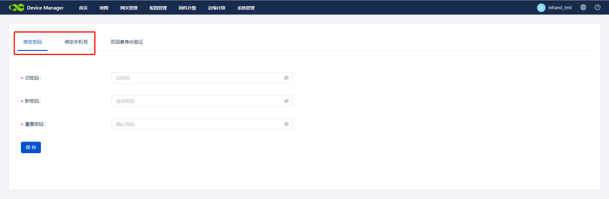

<strong>图 2-1 登录页面</strong>

#### 第二步：添加网关设备

**方式A：设备自动接入**

1. 在设备本地Web管理页面配置远程管理平台（服务器地址：`iot.inhand.com.cn`）；
2. 设备自动注册到DM平台，在【网关】列表中显示。

**方式B：手动添加**

1. 登录DM平台，点击【网关管理】>>【+】；
2. 输入"网关名称"和设备"序列号"（序列号在设备Web管理首页或机身铭牌上查看）；
3. 点击"确定"。

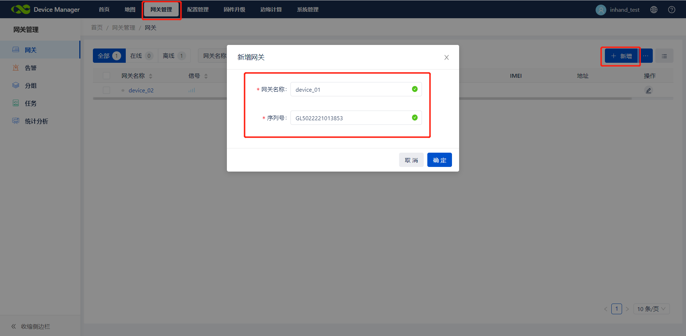

<strong>图 2-2 单台添加网关</strong>

**验证**：设备出现在网关列表中，状态显示为"在线"。

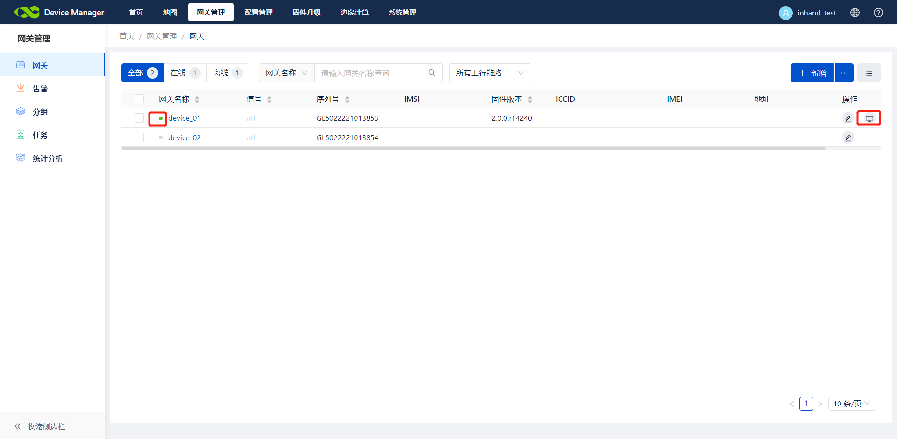

<strong>图 2-3 网关列表</strong>

#### 第三步：查看设备状态

1. 在网关列表中，点击网关名称进入详情页；
2. 查看设备基础信息（机型、序列号、IP地址、RSSI、IMSI等）；
3. 查看运行信息（流量统计、在线统计等）。

**验证**：可正常查看设备各项状态数据。

### 2.3 常见入门问题排查

| 问题 | 可能原因 | 解决方法 |
|------|----------|----------|
| 收不到验证邮件 | 邮箱填写错误或邮件被拦截 | 1. 检查邮箱地址是否正确 2. 查看邮箱垃圾箱 3. 更换邮箱重新注册 |
| 设备显示离线 | 设备未联网或配置错误 | 1. 检查设备网络连接 2. 确认设备远程管理平台服务器地址为 `iot.inhand.com.cn` 3. 尝试重启设备 |
| 设备未出现在列表 | 未手动添加且自动注册失败 | 1. 在设备Web页面检查连接状态 2. 手动添加设备序列号到DM平台 |

---

## 第3章 登录与账号体系

### 3.1 登录平台

#### 3.1.1 注册与登录

1. 使用浏览器访问DM平台地址 `https://iot.inhand.com.cn/`；
2. 点击"注册账户"，输入邮箱账号及相关信息，提交注册；
3. 根据系统发送的验证邮件激活账号；
4. 使用注册邮箱及密码登录平台。

登录后可在【个人中心】>>【设置】修改登录密码和绑定手机号码。绑定手机后，可使用"手机号+验证码"或"手机号+密码"登录，也可使用手机号找回登录密码。

#### 3.1.2 映翰通云服务账号关联

映翰通云服务（包含小星云管家、DeviceLive、白鹰能源管家、ISCada、InLink）采用统一账号体系，用户可使用同一组账号密码在各平台间切换，无需重复登录。

此外，映翰通提供独立的Device Manager及InConnect设备管理平台。通过配置，可将现有映翰通云服务账号与Device Manager平台进行关联，实现一键快速登录和平台间无缝切换。

**前置条件**：

- 已拥有映翰通云服务系统账号；
- 已拥有Device Manager账号。

**配置步骤**：

1. 登录到Device Manager平台；
2. 进入【设置】>>【映翰通云服务】页面；
3. 开启"允许通过映翰通云服务登入"。

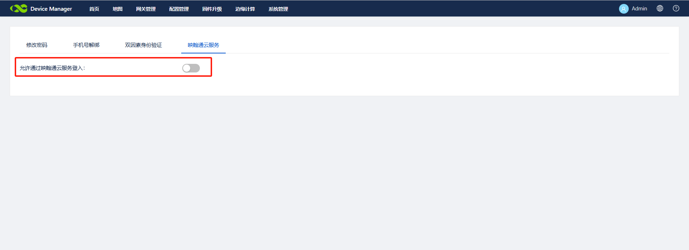

<strong>图 3-1 映翰通云服务账号关联设置</strong>

**验证结果**：

- **方式一**：通过映翰通云服务直接访问Device Manager
  1. 登录到映翰通云服务；
  2. 进入【控制台】；
  3. 点击【访问】Device Manager。

- **方式二**：在Device Manager登录页面使用映翰通云服务账号登录
  1. 进入Device Manager登录页面；
  2. 点击"使用映翰通云服务登录"；
  3. 输入映翰通云服务的登录账号及密码，点击"登录"。

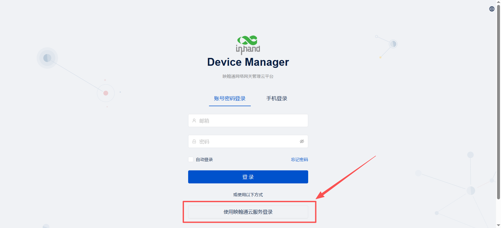

<strong>图 3-2 映翰通云服务登录</strong>

### 3.2 组织与账号管理

#### 3.2.1 添加用户

当需要多个用户对设备进行管理时，可在【系统管理】>>【用户】中新增多个账号，并为不同账号赋予不同角色，以达到权限安全控制的目的。点击"新增用户"，系统会自动向新增用户邮箱发送初始密码。

#### 3.2.2 用户维护

- **删除用户**：从系统中移除该用户账号；
- **重置密码**：为用户重置登录密码，新密码以邮件形式发送至被重置用户的登录邮箱；
- **锁定用户**：锁定后，被锁定用户无法登录DM平台。

#### 3.2.3 外部用户与机构切换

当需要外部用户加入机构提供技术支持时，如该外部用户在DM已注册邮箱账号，可通过添加"外部用户"的方式邀请其加入当前机构。

1. 在【系统管理】>>【用户】中添加用户，"用户类型"选择"外部用户"；
2. 填写外部用户邮箱，点击"确定"发送邀请邮件；
3. 外部用户接受邀请后即可加入当前机构。

外部用户接受邀请后，在个人中心可在多个机构间切换管理。可为外部用户设置用户角色和添加网关权限。

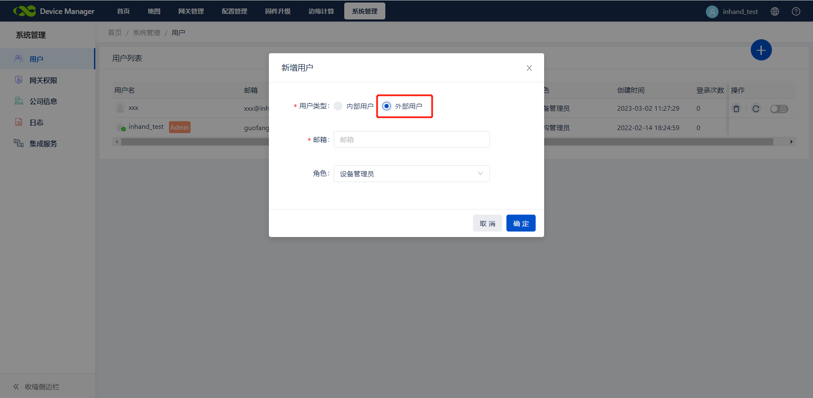

<strong>图 3-3 外部用户邀请</strong>

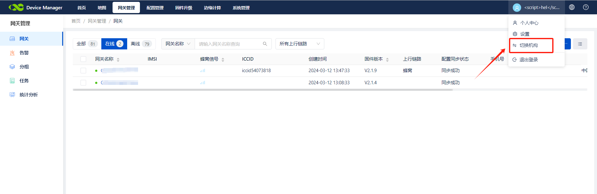

<strong>图 3-4 机构切换</strong>

### 3.3 账号权限与角色

系统预设三种角色，权限如下：

| 角色 | 可执行操作 | 不可执行操作 | 适用人员 |
|------|------------|--------------|----------|
| 机构管理员 | 所有功能模块的操作权限，包括用户管理、网关权限分配、系统配置 | 无 | 系统管理员、企业负责人 |
| 设备管理员 | 查看和管理网关设备、配置告警规则、执行批量配置和固件升级、管理分组 | 无法添加/删除用户、无法修改网关权限、无法操作边缘计算 | 日常运维人员 |
| 设备监视员 | 查看网关设备、查看告警记录、查看地图和统计分析 | 无法执行配置下发、固件升级、无法管理分组和告警规则 | 监控值班人员 |

**网关权限分组规则**：

1. 新增的非admin用户默认分组到"未分配"，默认可查看所有未分组设备；
2. 新增的设备默认分组到"未分配"，默认所有用户均可查看；
3. "未分配"内的用户能查看所有"未分配"的设备；
4. 某个自建组内的用户可以查看到当前组内设备和"未分配"组内的设备；
5. 机构管理员（admin用户）不参与权限分组，可查看所有设备数据；
6. 一个用户可以划分到多个分组；
7. 一台设备只能划分到一个分组。

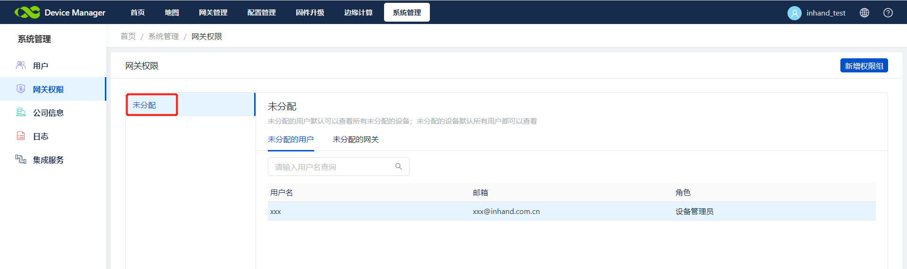

<strong>图 3-5 网关权限管理</strong>

### 3.4 个人信息与系统设置

1. 登录DM平台后，点击右上角头像进入【个人中心】；
2. 在【设置】中可修改登录密码；
3. 可绑定手机号码，绑定后支持手机号登录及找回密码；
4. 如为外部用户且属于多个机构，可在个人中心切换当前管理的机构。

---

## 第4章 设备接入与联网

### 4.1 设备联网方式说明

DM平台管理对象为映翰通工业网关设备，设备需先接入互联网，方可与平台建立连接。常见联网方式如下：

| 联网方式 | 适用场景 | 所需配件 | 特点 |
|----------|----------|----------|------|
| 蜂窝网络（4G/5G） | 户外、移动场景、无固定宽带 | SIM卡、蜂窝天线 | 即插即用，部署灵活 |
| 以太网 | 固定机房、有宽带接入的场景 | 网线 | 连接稳定，带宽高 |
| Wi-Fi客户端 | 已有Wi-Fi覆盖的室内场景 | Wi-Fi天线 | 无需布线，依赖现有无线网络 |

> **注意**：不使用SIM卡方式上网时，需禁用设备"拨号接口"，否则设备会循环拨号干扰网络。

### 4.2 设备添加与上线流程

#### 4.2.1 设备端配置（以IR300系列为例）

1. 路由器和PC连接后，使用浏览器访问设备默认地址（通常为 `192.168.2.1`，IG500系列为 `192.168.1.1`）；
2. 输入初始登录信息（出厂默认账号：adm，密码：123456）；

> **注意**：出于安全考虑，建议在首次登录后修改默认登录密码，并妥善保管。

3. 进入【服务】>>【设备远程管理平台】；
4. "服务类型"选择"设备管理"；
5. "服务器"选择"iot.inhand.com.cn"；
6. "注册账户"输入DM平台注册邮箱账号；
7. 点击"应用"。

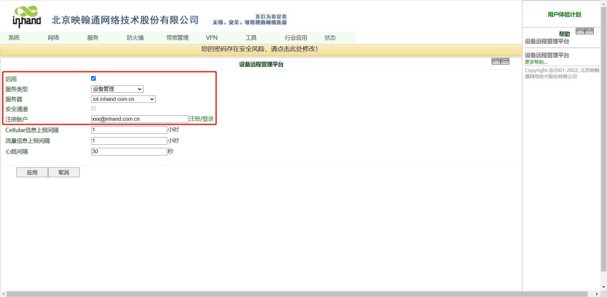

<strong>图 4-1 IR300设备远程管理平台配置</strong>

**各系列设备配置入口对照**：

| 设备系列 | 配置入口路径 | 服务器地址配置项 |
|----------|-------------|-----------------|
| IR300 | 【服务】>>【设备远程管理平台】 | 服务器 |
| IR600 | 【服务】>>【设备远程管理平台】 | 服务器 |
| IR900 | 【管理】>>【设备远程管理平台】 | 服务器地址 |
| IG500 | 【系统管理】>>【设备云平台】>> InHand Device Manager标签页 | 服务器地址 |
| IG900 | 【系统管理】>>【设备云平台】>> InHand Device Manager标签页 | 服务器地址 |
| VG710 | 【管理】>>【设备远程管理平台】 | 服务器地址 |

配置完成后，在设备状态页面查看连接状态：

- 状态显示为"已连接"或"连接成功"，表示设备已正常接入DM平台；
- 若状态为"正在注册"或"注册中"，需确认平台是否已添加该设备。

#### 4.2.2 平台侧添加设备

**单台添加**：

1. 点击【网关管理】>>【+】；
2. "网关名称"自定义填写；
3. "序列号"查看网关Web管理首页>>系统>>状态，或查看网关铭牌S/N；
4. 点击"确定"。

<strong>图 4-2 DM平台单台添加网关</strong>

**批量添加**：

1. 点击【网关】>>【导入】>>【序列号文件模板下载】，填写网关信息后保存模板；
2. 点击"选择文件"，选择刚保存的模板文件；
3. 点击"确定"。导入时支持覆盖导入或将序列号文件中的网关导入到某个分组。

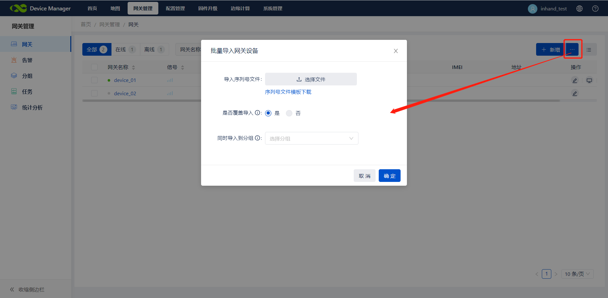

<strong>图 4-3 DM平台批量导入网关</strong>

### 4.3 设备状态说明与排查

| 状态 | 含义 | 排查方法 |
|------|------|----------|
| 在线 | 设备与平台连接正常，可进行远程管理和监控 | 无需排查 |
| 离线 | 设备与平台连接断开，无法执行远程操作 | 1. 检查设备是否通电 2. 检查设备网络连接是否正常 3. 确认设备远程管理平台服务器地址配置正确 4. 尝试重启设备 |
| 注册中 | 设备正在尝试向平台注册，但尚未完成 | 1. 确认平台侧已添加该设备序列号 2. 检查设备端"注册账户"是否为正确的DM平台邮箱 3. 等待1-2分钟后刷新列表 |

#### 终端设备联网详细步骤

**蜂窝网络上网**：

1. 插入SIM卡到卡槽，并拧紧蜂窝天线到ANT接线柱；

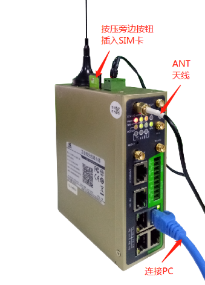

<strong>图 4-4 SIM卡安装</strong>

> **注意**：插拔SIM卡操作时，必须拔掉电源，以免造成数据丢失或设备损坏。

2. 登录设备Web管理页面；
3. 点击【网络】>>【拨号接口】>>【启用】，待网络连接状态显示为"已连接"并显示已分配IP地址时，说明SIM卡已成功上网。专网卡还需填写"拨号参数集"。

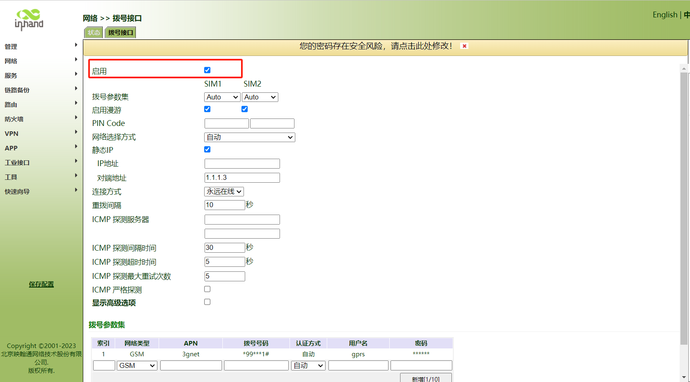

<strong>图 4-5 拨号接口配置</strong>

**以太网上网**：

1. LAN口连接PC，WAN口连接外网；

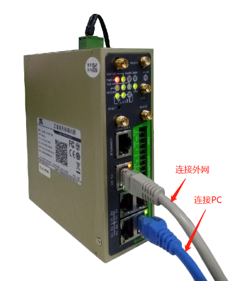

<strong>图 4-6 以太网物理连接</strong>

2. 设置PC与路由器设备IP地址在同一网段（自动获取或手动配置）；
3. 在浏览器地址栏输入网关默认地址（通常为 `192.168.2.1`），进入Web登录页面；
4. 输入初始登录信息（账号：adm，密码：123456）；
5. 点击【网络】>>【新建WAN】，配置WAN口IP地址，推荐使用"动态地址（DHCP）"。

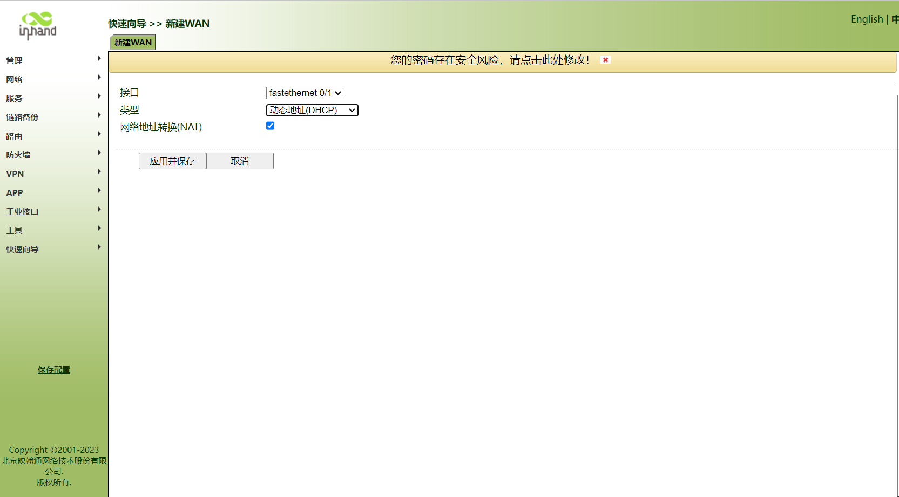

<strong>图 4-7 WAN口动态地址配置</strong>

6. 点击【工具】>>【PING探测】，填入常用网址测试路由器是否成功接入互联网。

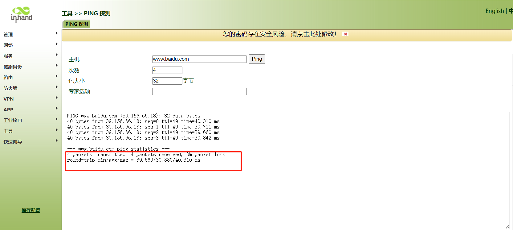

<strong>图 4-8 PING探测验证</strong>

**Wi-Fi上网**：

1. 用网线连接PC和网关LAN口，Wi-Fi天线与WLAN口连接；
2. 设置PC的IP地址，使PC与路由器在同一网段；
3. 登录设备Web管理页面；
4. 点击【网络】>>【WLAN接口】，接口类型选择"客户端"，填写Wi-Fi网络参数，点击"应用并保存"。

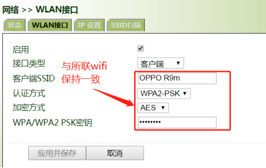

<strong>图 4-9 WLAN接口客户端配置</strong>

---

## 第5章 核心功能详解

### 5.1 总览看板

**功能概述**：总览看板用于集中展示所有接入网关的核心状态信息，帮助用户快速掌握全局设备运行情况。

**适用场景**：

- 需要同时监控大量设备运行状态
- 需要快速发现异常设备或告警信息
- 需要了解整体流量使用趋势

**操作步骤**：

1. 登录DM平台后，首页即为总览看板；
2. 查看顶部统计卡片：设备总数、在线设备数、离线设备数；
3. 查看各类图表，了解设备近期的运行情况和系统设备情况；
4. 点击统计数字可下钻到对应设备列表。

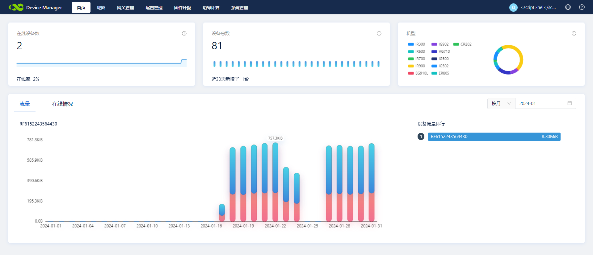

<strong>图 5-1 总览看板</strong>

**注意事项**：

- 看板数据由设备定时上报，如需要最新数据可刷新页面。

### 5.2 设备管理

**功能概述**：设备管理用于查看网关详细信息、执行远程Web访问、下发配置更新、升级固件及强制下线等操作。

**适用场景**：

- 需要查看单台设备的详细运行参数
- 需要远程登录设备本地Web页面进行深度配置
- 需要更新设备配置或系统版本

**操作步骤**：

1. 在【网关管理】>>【网关】列表中，点击网关名称进入详情页；
2. 查看基础信息（机型、序列号、IP地址、RSSI、IMSI等）、运行信息（流量统计、在线统计等）、控制信息（任务列表等）。

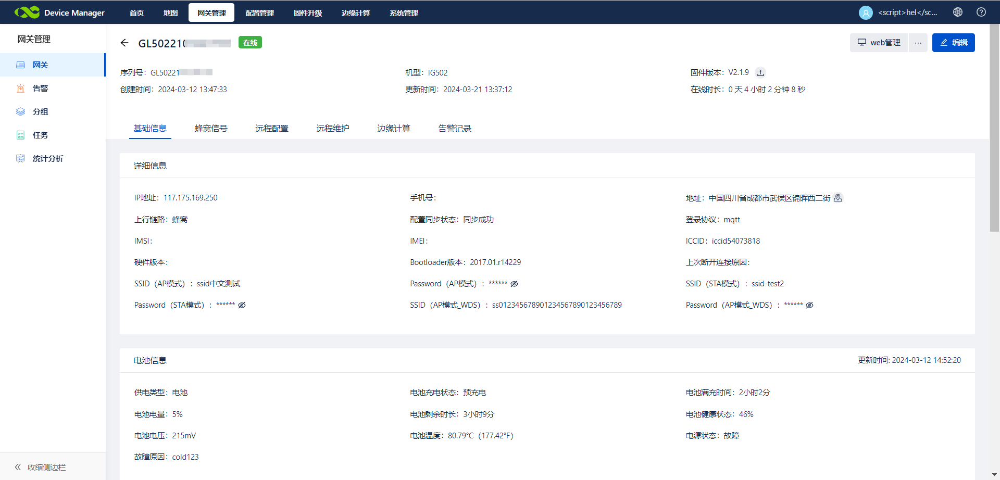

<strong>图 5-2 网关详情页</strong>

3. 点击远程Web访问图标，输入设备用户名和密码后进入网关Web管理页面。此功能仅在线设备支持。

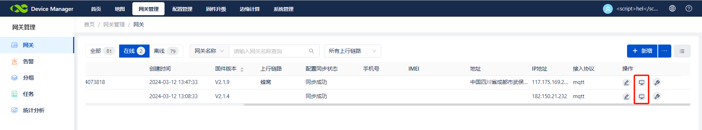

<strong>图 5-3 远程Web访问入口</strong>

4. 点击"远程配置"，对设备配置进行更新编辑后点击"下发"，即可远程更新设备配置。

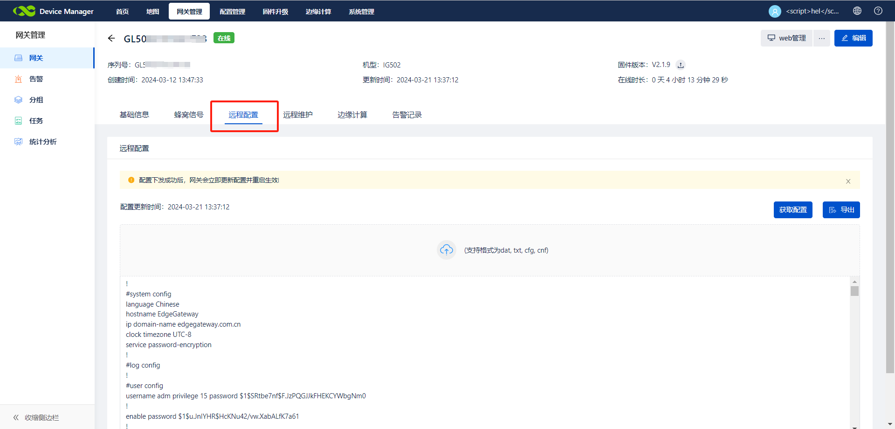

<strong>图 5-4 远程配置下发</strong>

5. 点击固件版本后的上传按钮，上传固件文件后执行升级。在线设备立即执行，离线设备在上线后执行。

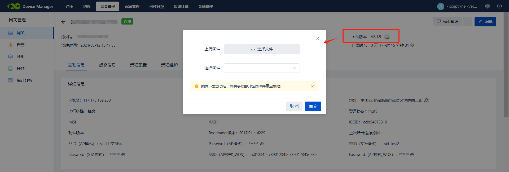

<strong>图 5-5 固件升级</strong>

6. 当出现下发配置和固件升级多次失败时，可尝试使用"强制下线"功能使网关强制离线再重新连接至平台。

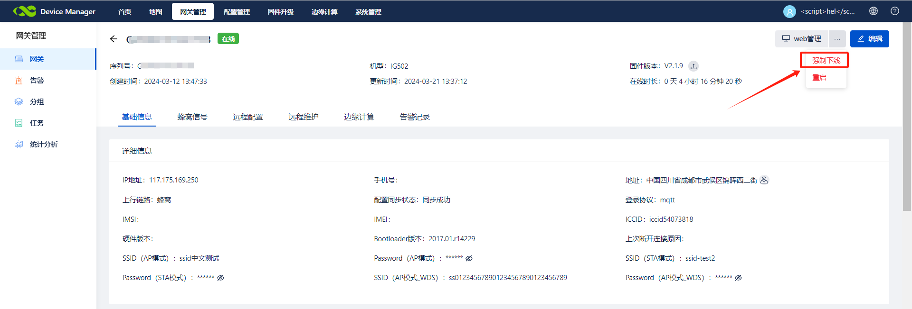

<strong>图 5-6 强制下线</strong>

**注意事项**：

- 远程配置和固件升级功能仅在线设备可正常使用；
- 固件升级过程中需确保设备网络稳定，避免升级中断；
- 配置下发后可在详情页"任务列表"查看执行状态。

### 5.3 远程访问

**功能概述**：远程访问功能使用户无需抵达设备现场，即可通过DM平台直接打开网关的本地Web管理页面。

**适用场景**：

- 设备部署在偏远地区，现场维护成本高
- 需要临时查看或修改设备的本地配置参数
- 需要远程执行设备诊断命令

**操作步骤**：

1. 在网关列表或设备详情页面，点击远程Web访问图标；
2. 输入设备本地Web管理用户名和密码；
3. 进入网关Web管理页面，执行所需操作。

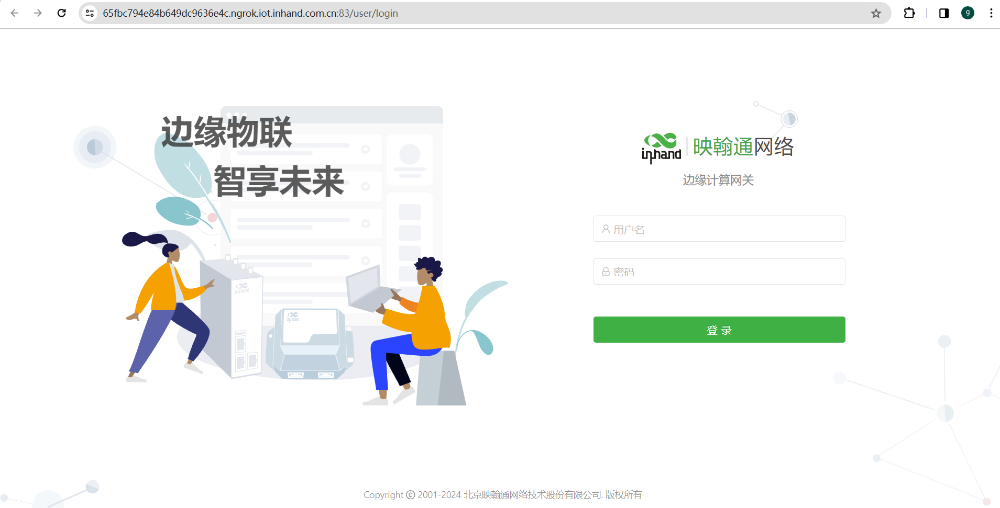

<strong>图 5-7 远程Web设备登录</strong>

**注意事项**：

- 此功能仅在线设备支持，离线设备无法正常使用；
- 远程访问依赖设备与平台之间的通道，网络质量会影响访问体验。

### 5.4 分组管理

**功能概述**：分组管理用于将大量设备按区域、业务类型或管理责任进行分类，便于分权查看和集中运维。

**适用场景**：

- 企业在全国多地有分支机构，需要按地区划分设备
- 需要将异常设备临时归类，集中处理
- 需要为不同运维团队划分各自管理的设备范围

**操作步骤**：

1. 进入【网关管理】>>【分组】，点击"新建分组"；
2. 输入分组名称等信息，点击确定；

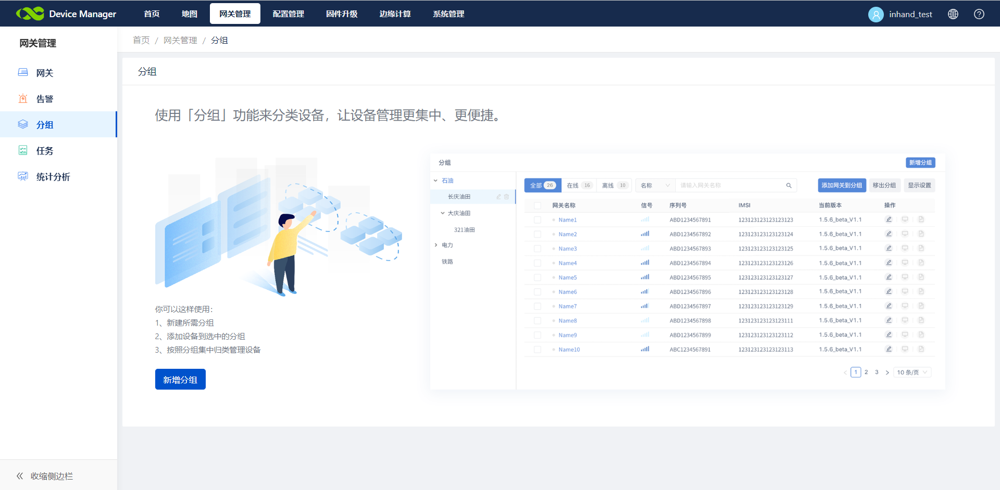

<strong>图 5-8 设备分组管理</strong>

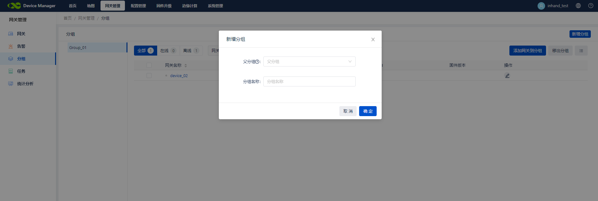

<strong>图 5-9 新建分组</strong>

3. 分组建立成功后，点击"加入设备"，选择要加入该分组的设备；

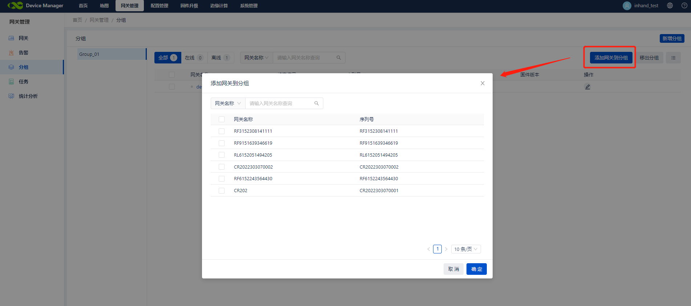

<strong>图 5-10 加入设备到分组</strong>

4. 选中设备后可将其移出当前分组；
5. 可建立多级分组，实现设备分级管理。

**注意事项**：

- 一台设备只能归属一个分组；
- 分组与权限组配合使用，可实现用户对设备的精细化管控。

### 5.5 OTA升级

**功能概述**：OTA升级用于远程更新网关设备的系统固件，支持单台升级和批量升级两种模式。

**适用场景**：

- 需要修复设备已知问题或安全漏洞
- 需要为设备添加新功能支持
- 需要对大量分散设备统一升级版本

**操作步骤**：

1. 单台升级：在设备详情页面，点击固件版本后的上传按钮，选择固件文件后执行升级；
2. 批量升级：
   - 点击【固件升级】>>【+】>>【选择网关固件】，上传固件文件；
   - 勾选要升级固件的设备，点击"确定"；
   - 返回固件列表，点击"查看详情"查看升级进度及状态。

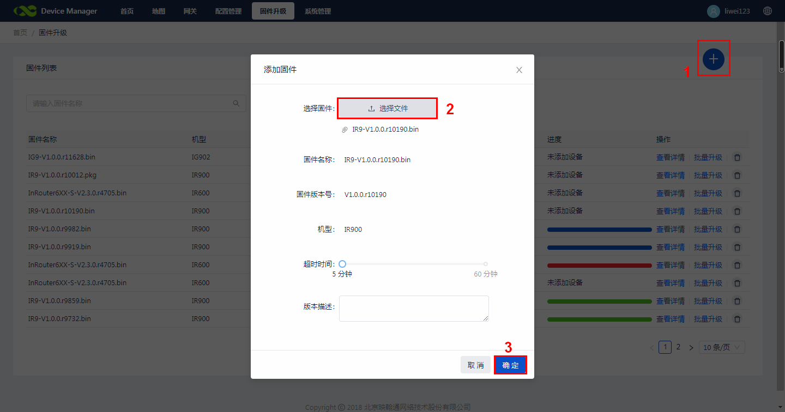

<strong>图 5-11 批量固件上传</strong>

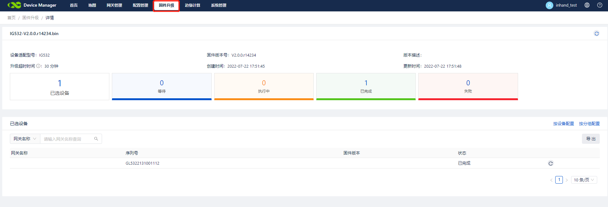

<strong>图 5-12 批量固件升级进度</strong>

**注意事项**：

- 升级文件必须与设备机型匹配，错误的固件可能导致设备异常；
- 升级过程中避免设备断电或断网；
- 离线设备将在上线后自动执行排队中的升级任务。

### 5.6 位置跟踪

**功能概述**：位置跟踪在地图上展示网关设备的实时位置和在线情况，便于直观了解设备地理分布。

**适用场景**：

- 管理分布在不同地理位置的大量设备
- 需要快速定位某台设备的安装位置
- 结合告警信息定位故障设备所在区域

**操作步骤**：

1. 点击导航栏【地图】进入位置跟踪页面；
2. 地图上会展示所有接入网关的位置标记，不同颜色表示不同在线状态；
3. 点击设备图标，显示设备基本信息；
4. 继续点击网关名称，可查看设备详情。

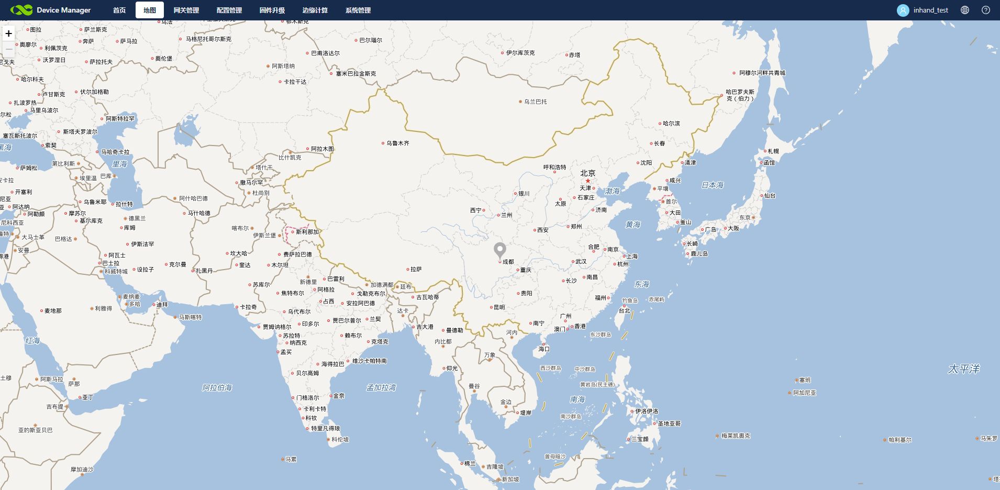

<strong>图 5-13 位置跟踪地图</strong>

**注意事项**：

- 设备位置信息由设备上报的基站定位数据或GPS数据决定；
- 如设备位置显示不准确，需检查设备本地定位配置。

### 5.7 配置任务

**功能概述**：配置任务用于对大量设备批量下发配置文件，实现统一参数管理。

**适用场景**：

- 新部署一批设备，需要统一配置网络参数
- 业务变更时需要修改大量设备的相同配置项
- 需要定期备份和恢复设备配置

**操作步骤**：

1. 点击【配置管理】>>【+】>>【选择文件】，选择配置文件；
2. "模板名称"自定义输入，"机型"必须与配置模板匹配，点击"确定"；
3. 勾选要下发配置的设备，点击"确定"；
4. 返回配置列表，点击"查看详情"查看配置更新进度及状态。

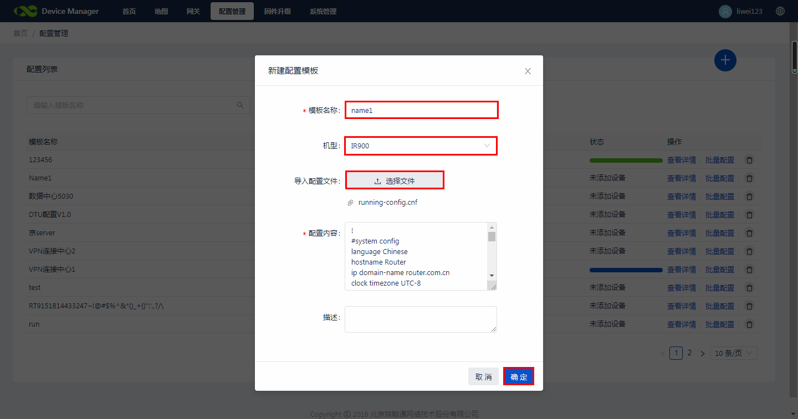

<strong>图 5-14 批量配置上传</strong>

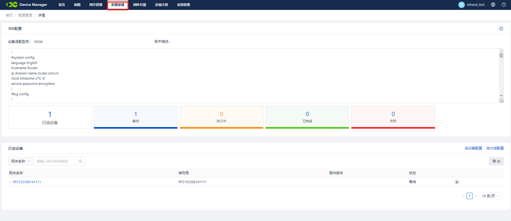

<strong>图 5-15 批量配置进度</strong>

**注意事项**：

- 配置文件可在网关设备Web管理页面导出修改后再使用；
- 配置模板机型必须与目标设备机型匹配，否则下发会失败；
- 配置下发属于敏感操作，建议在维护窗口期执行。

### 5.8 告警管理

**功能概述**：告警管理用于配置设备异常事件的监控规则，并在事件发生时向指定人员发送通知。

**适用场景**：

- 设备掉线时需要及时获知
- 设备流量使用超过阈值时需要预警
- 设备发生电源切换、端口状态变化时需要记录

**操作步骤**：

1. 访问【网关管理】>>【告警】>>【告警规则】，点击"新建规则"；
2. 在表单中建立告警触发条件和通知规则；
3. 点击"保存"，规则即刻生效；
4. 告警事件在【告警记录】中留存，同时发送邮件和短信给指定用户。

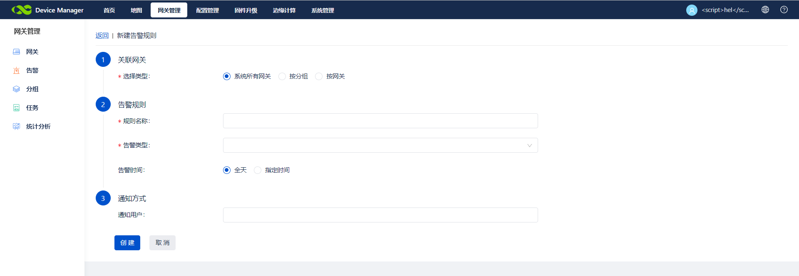

<strong>图 5-16 告警规则配置</strong>

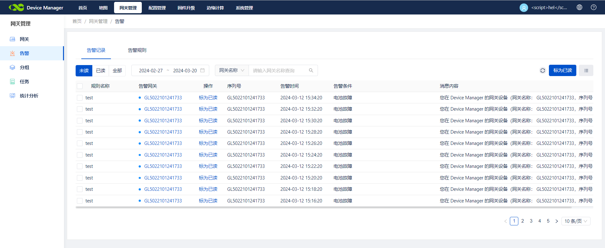

<strong>图 5-17 告警记录</strong>

5. 部分告警类型需先在设备端开启告警上报。以IR600为例：在设备Web管理页面，访问【服务】>>【告警设置】，勾选指定告警类型，"告警输出"选择"远程管理平台"，点击"应用"。

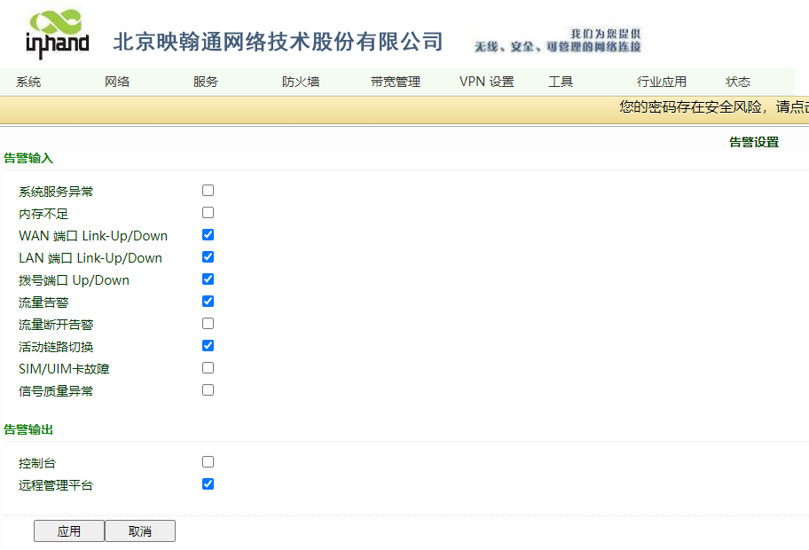

<strong>图 5-18 设备本地告警设置</strong>

**DM平台与设备本地告警类型对应关系**：

| DM平台 | 设备Web | 说明 |
|--------|---------|------|
| 网关上线/下线 | 为Device Manager平台监控项，设备本地无此告警类型 | 触发条件：设备与平台建立连接/断开连接 |
| 小时流量告警/日流量告警/月流量告警 | 流量告警 | 需在设备本地"服务->流量管理"定义流量告警阈值，按小时、24小时（天）、月阈值设置后，达到指定阈值平台发送告警消息 |
| 双SIM卡切换 | 活动链路切换 | - |
| 链路备份 | 活动链路切换 | - |
| 端口状态 | 拨号端口Up/Down、LAN端口Link-Up/Down、WAN端口Link-Up/Down | - |
| 供电类型切换 | 电源切换 | 触发条件：1.设备只使用电池供电，然后插上电源适配器，触发"切换到适配器供电"告警；2.设备已使用电源适配器供电，然后拔掉适配器，触发"切换到电池供电"告警 |
| 电池故障 | 电源故障 | 触发条件：设备电池无法正常使用/供电 |
| 电池故障恢复 | 电源故障恢复 | 触发条件：电池故障已解除 |

**注意事项**：

- 流量告警需同时在设备端"服务->流量管理"中设置阈值；
- 告警通知方式（短信/邮件）需确保接收人联系方式正确；
- 告警规则过多可能导致通知频繁，建议按需配置关键告警。

### 5.9 报表管理

**功能概述**：报表管理用于统计和导出设备的在线情况及流量使用数据，便于进行运维分析和成本核算。

**适用场景**：

- 需要定期统计设备在线率
- 需要分析各设备的流量消耗情况
- 需要导出数据用于内部汇报或审计

**操作步骤**：

1. 进入【网关管理】>>【统计分析】；
2. 查看设备在线统计，可导出设备在线列表；
3. 查看流量使用情况，可导出设备流量使用列表；
4. 点击设备，弹出该设备在线情况条形图。

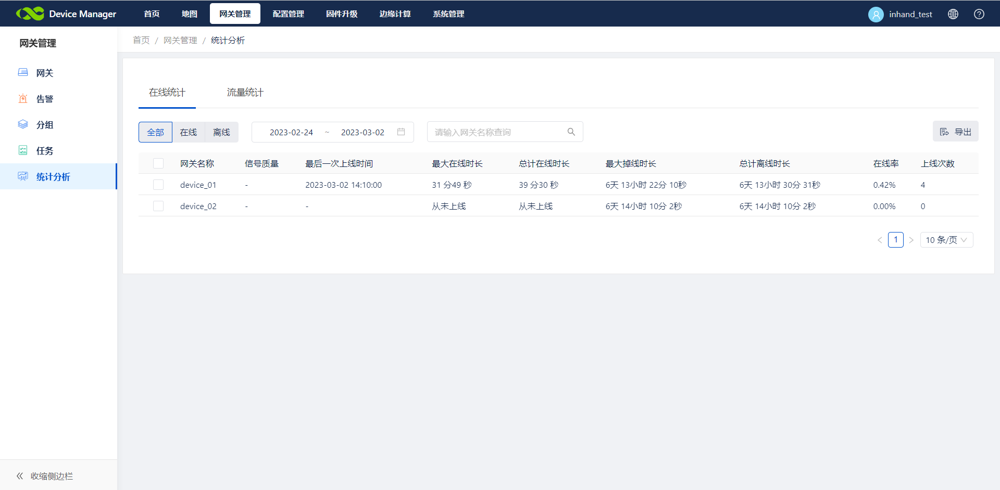

<strong>图 5-19 在线统计</strong>

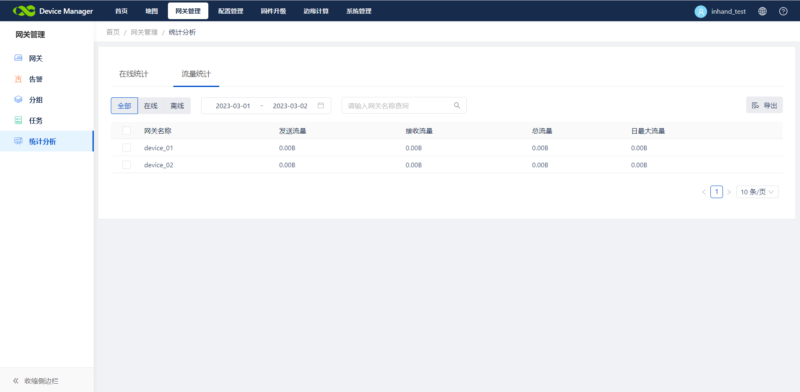

<strong>图 5-20 流量统计</strong>

5. 查看设备在线详情条形图：
   - 在线：设备连接至平台；
   - 离线：设备与平台连接断开；
   - 异常：统计时间小于三天时，2小时内状态变化三次以上为异常；统计时间大于三天时，一天内状态变化三次以上为异常。

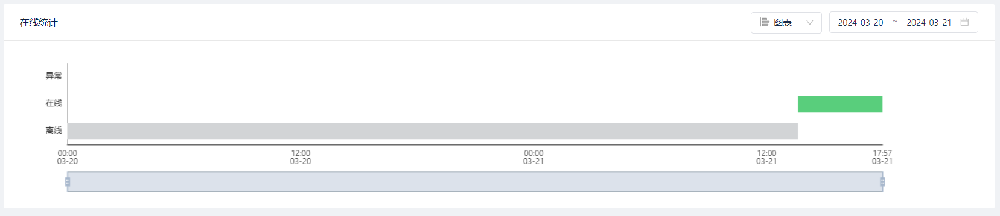

<strong>图 5-21 设备在线详情</strong>

**注意事项**：

- 统计数据由设备定时上报，历史数据可供回溯分析；
- 导出文件格式以平台实际支持为准。

### 5.10 集成服务

**功能概述**：集成服务用于将设备上报的流量、位置等信息推送到第三方服务（如MQTT服务器、Kafka服务器），实现与企业现有系统的数据对接。

**适用场景**：

- 需要将设备状态数据接入企业自有监控系统
- 需要将设备位置信息接入业务管理系统
- 需要对接第三方数据分析平台

**操作步骤**：

1. 进入【系统管理】>>【集成服务】，点击"新增集成服务"；

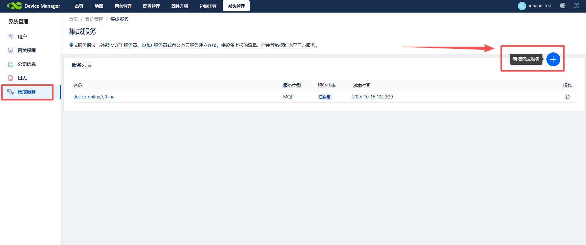

<strong>图 5-22 集成服务新增</strong>

2. 选择服务类型（如MQTT），填写服务器地址、端口、用户名、密码等信息；
3. 选择需要接收的事件类型与自定义主题；
4. 使用MQTT客户端工具（如MQTTX）连接到MQTT服务，订阅对应Topic，验证消息接收。

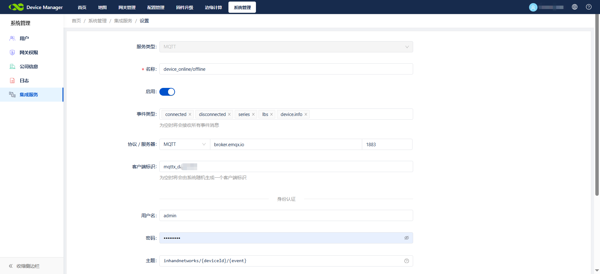

<strong>图 5-23 MQTT集成配置</strong>

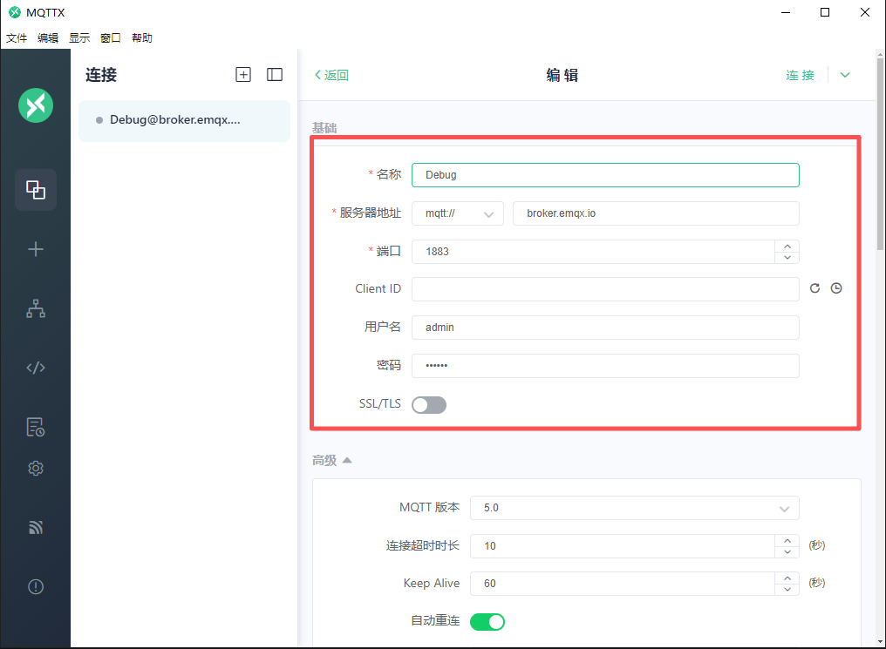

<strong>图 5-24 MQTTX连接配置</strong>

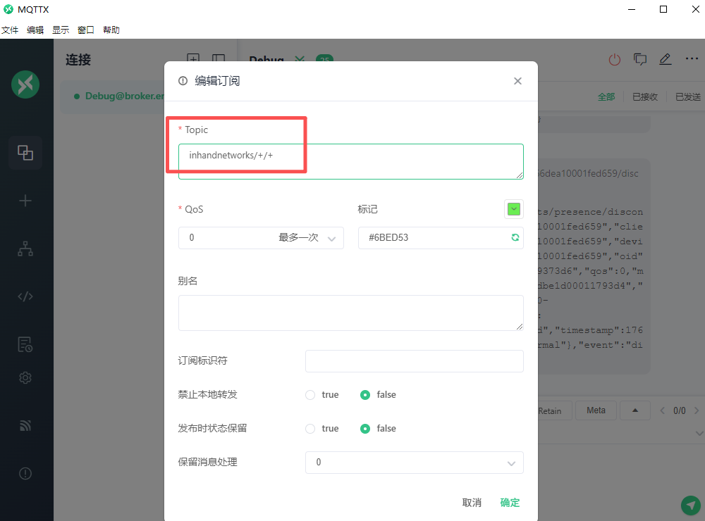

<strong>图 5-25 MQTTX订阅Topic</strong>

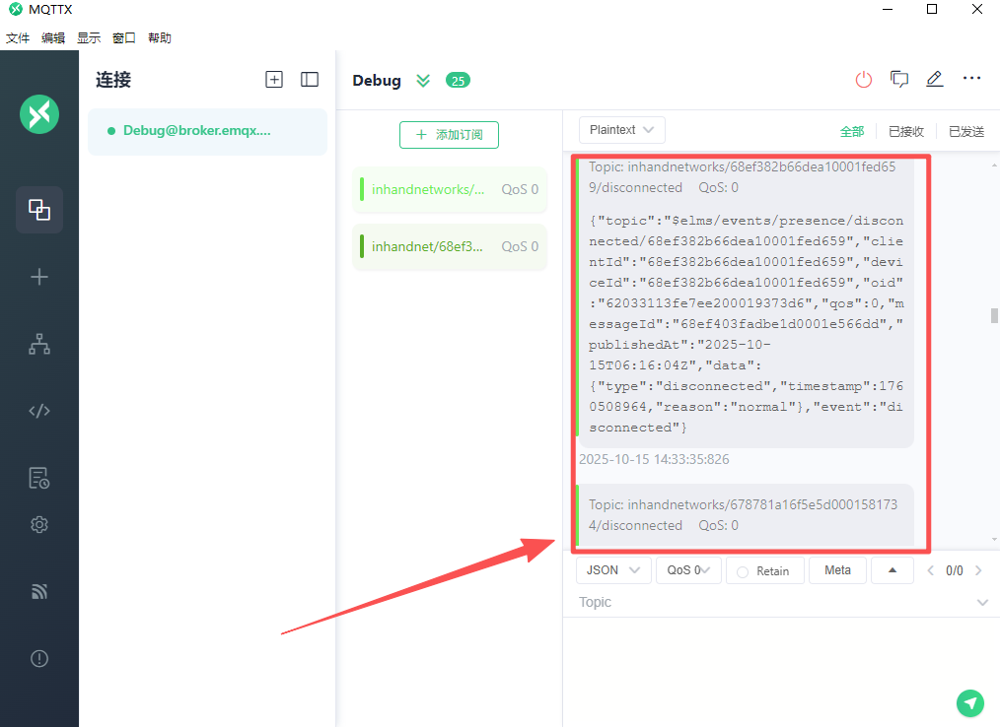

<strong>图 5-26 MQTT消息接收</strong>

**集成服务事件类型说明**：

| 事件类型 | 说明 | 触发时间 |
|----------|------|----------|
| connected | 设备与Device Manager建立连接 | 立即触发 |
| disconnected | 设备与Device Manager断开连接 | 立即触发 |
| device.series | 设备的流量使用等时序数据 | 触发时间由设备本地配置决定，一般默认为1小时上报一次 |
| lbs | 蜂窝基站信息，如MNC、MCC、LAC、CID | 触发时间由设备本地配置决定 |
| device.info | 设备的基础信息，如序列号、MAC地址、网口、IP等 | 设备在平台上线时触发上报 |

**注意事项**：

- 外部服务器信息需与第三方服务实际配置保持一致；
- Topic订阅规则需与配置的自定义主题匹配；
- 集成服务涉及数据外发，需评估数据安全合规性。

### 5.11 边缘计算

**功能概述**：边缘计算功能用于在支持边缘计算特性的网关设备上部署边缘引擎SDK和边缘应用程序，实现边缘侧数据处理和业务逻辑执行。

**适用场景**：

- 需要在设备本地运行Python脚本处理传感器数据
- 需要降低云端数据处理延迟
- 需要在断网情况下保持本地业务连续性

**操作步骤**：

1. 点击"新增边缘引擎"，选择映翰通提供的边缘引擎SDK文件包；
2. 新增完毕，点击"SDK版本"查看SDK详情，点击"批量安装"，选择适用于当前SDK的机型网关进行安装；
3. SDK安装展示进度状态，包括"等待安装"、"正在安装"、"安装完成"、"安装失败"几种状态；

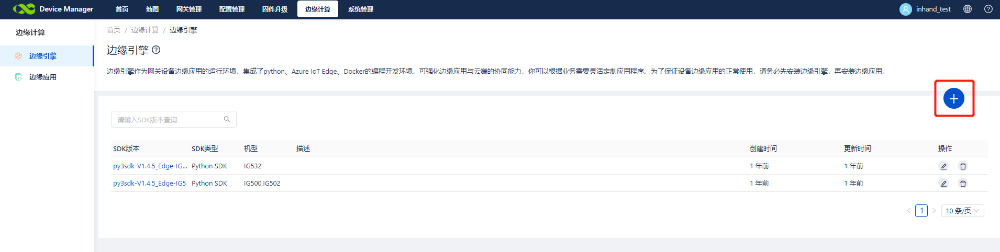

<strong>图 5-27 边缘引擎新增</strong>

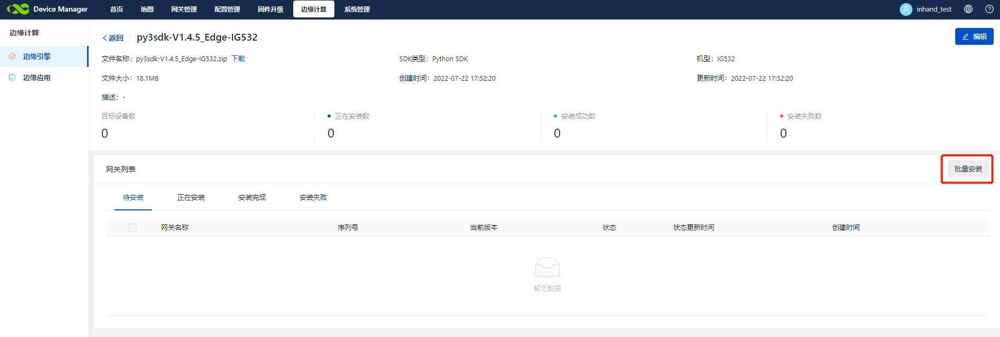

<strong>图 5-28 边缘引擎批量安装</strong>

4. 点击"新增应用"，导入需要安装的边缘APP文件包；
5. 点击"应用配置"，给网关下发APP的配置环境；
6. 点击"应用安装"，选择"批量安装"，选择目标设备提交。

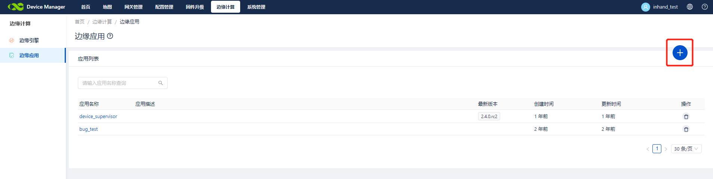

<strong>图 5-29 边缘应用新增</strong>

7. 在具有边缘特性网关的详情中，可查看到该设备详细的SDK和APP安装历史及现状。

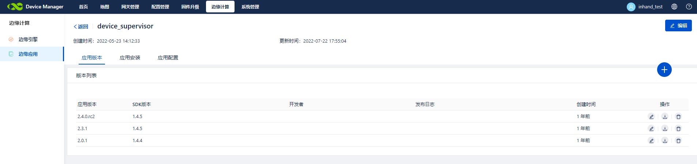

<strong>图 5-30 边缘应用详情</strong>

**注意事项**：

- 边缘计算功能仅适用于IG500、IG900、VG710等支持边缘计算的网关设备；
- 必须先安装边缘引擎SDK，再安装边缘应用；
- SDK和APP需与设备机型兼容，安装失败时可在列表中查看原因。

---

## 第6章 系统管理

### 6.1 日志查询与审计

**功能概述**：系统日志用于记录用户在平台上的操作行为，便于审计和问题追溯。

**适用场景**：

- 需要追溯某次配置变更的执行人
- 需要排查异常操作导致的问题
- 需要进行安全审计和合规检查

**操作步骤**：

1. 进入【系统管理】>>【日志】；
2. 可查看用户登录、操作设备、固件升级等平台的系统记录；
3. 可根据时间范围、操作类型等条件筛选日志记录。

### 6.2 许可证管理

（原稿未详，待补充）

---

## 附录 故障处理

### 1 登录问题

| 现象 | 可能原因 | 排查步骤 | 对应章节 |
|------|----------|----------|----------|
| 无法登录DM平台 | 账号或密码错误 | 1. 确认输入的邮箱和密码正确 2. 使用"忘记密码"功能重置密码 | [登录平台](#31-登录平台) |
| 无法登录DM平台 | 账号被锁定 | 1. 联系机构管理员解锁账号 | [用户维护](#322-用户维护) |
| 映翰通云服务跳转Device Manager失败 | DM平台未开启云服务登录 | 1. 登录DM平台 2. 进入【设置】>>【映翰通云服务】 3. 开启"允许通过映翰通云服务登入" | [映翰通云服务账号关联](#312-映翰通云服务账号关联) |
| 映翰通云服务跳转Device Manager失败 | 邮箱未在DM平台注册 | 1. 确认使用的邮箱已在DM平台完成注册 | [注册与登录](#311-注册与登录) |

### 2 设备接入问题

| 现象 | 可能原因 | 排查步骤 | 对应章节 |
|------|----------|----------|----------|
| 设备状态显示"注册中" | DM平台未添加该设备 | 1. 在DM平台【网关】列表确认设备序列号已添加 2. 如未添加，执行手动添加或批量导入 | [平台侧添加设备](#422-平台侧添加设备) |
| 设备状态显示"离线" | 设备未联网 | 1. 检查设备网络连接 2. 确认SIM卡/网线/Wi-Fi配置正确 3. 尝试PING探测验证网络连通性 | [设备联网方式](#41-设备联网方式说明) |
| 设备状态显示"离线" | 服务器地址配置错误 | 1. 登录设备Web页面 2. 检查远程管理平台服务器地址是否为iot.inhand.com.cn | [设备端配置](#421-设备端配置以ir300系列为例) |
| 远程Web访问失败 | 设备已离线 | 1. 确认设备在线状态为绿色 2. 如离线，先排查网络问题 | [远程访问](#53-远程访问) |

### 3 告警通知问题

| 现象 | 可能原因 | 排查步骤 | 对应章节 |
|------|----------|----------|----------|
| 未收到告警邮件/短信 | 告警规则未保存 | 1. 检查【告警规则】中规则状态为生效 2. 确认通知联系方式正确 | [告警管理](#58-告警管理) |
| 未收到告警邮件/短信 | 设备端未开启告警上报 | 1. 登录设备Web页面 2. 进入【服务】>>【告警设置】 3. 勾选对应告警类型，"告警输出"选择"远程管理平台" | [告警类型对应关系](#58-告警管理) |
| 流量告警未触发 | 设备端未设置流量阈值 | 1. 登录设备Web页面 2. 进入【服务】>>【流量管理】 3. 配置流量告警阈值 | [告警类型对应关系](#58-告警管理) |

### 4 平台操作问题

| 现象 | 可能原因 | 排查步骤 | 对应章节 |
|------|----------|----------|----------|
| 无法查看某些网关 | 用户无权限 | 1. 联系机构管理员确认该用户所在权限组 2. 确认目标网关已分配到该权限组 | [账号权限与角色](#33-账号权限与角色) |
| 配置下发失败 | 设备网络不稳定 | 1. 检查设备在线状态 2. 尝试使用"强制下线"功能后重新下发 | [强制下线](#52-设备管理) |
| 批量操作部分设备失败 | 机型不匹配 | 1. 确认配置模板或固件文件与目标设备机型匹配 | [配置任务](#57-配置任务) |
| 边缘应用安装失败 | SDK未安装 | 1. 确认边缘引擎SDK已正确安装 2. 确认SDK版本与APP版本兼容 | [边缘计算](#511-边缘计算) |

---

## 附录 安全注意事项

1. 账号密码需定期更换，避免使用简单密码。
2. 设备默认密码需在首次登录后修改，防止未授权访问。
3. 外部用户邀请需谨慎，按需分配最小权限。
4. 配置变更和固件升级操作前，建议备份当前配置。
5. 插拔SIM卡操作时，必须拔掉电源，以免造成数据丢失或设备损坏。
6. 离开工位时应退出平台登录状态，防止他人误操作。
7. 不要将机构管理员账号密码告知无关人员。

> **警告**：管理员账号具有最高权限，请妥善保管。

---

## FAQ 常见问题解答

### 登录类问题

**问题1：忘记密码怎么办？**

1. 在登录页面点击"忘记密码"。
2. 输入注册邮箱。
3. 按提示完成验证，设置新密码。

**问题2：映翰通云服务账号无法登录Device Manager？**

1. 检查在映翰通云服务的邮箱账号是否在Device Manager注册过。如未注册，需先到Device Manager注册。
2. 检查Device Manager平台是否已开启"允许通过映翰通云服务登入"。

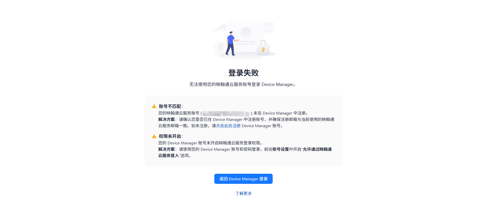

<strong>图 7-1 映翰通云服务登录设置</strong>

**问题3：管理员已开启"允许通过映翰通云服务登入"，个人账号能直接通过映翰通云服务登录吗？**

不可以。开启"允许通过映翰通云服务登入"属于个人账号维度的设置，需要每个账号单独配置。

### 设备接入类问题

**问题4：设备一直显示离线？**

1. 检查设备是否已通电并联网。
2. 检查设备远程管理平台服务器地址是否为 `iot.inhand.com.cn`。
3. 确认设备所在网络可访问平台服务器。
4. 尝试重启设备后重新连接。

**问题5：设备未出现在网关列表中？**

1. 确认设备端远程管理平台配置正确且状态为"已连接"。
2. 在DM平台手动添加设备序列号。
3. 检查序列号是否输入正确，无多余空格。

### 账号权限类问题

**问题6：为什么看不到某些设备？**

1. 联系机构管理员确认自己所在的权限组。
2. 确认目标设备已分配到该权限组。
3. 如设备在"未分配"中，权限组用户默认可查看未分配设备。

**问题7：Device Manager的设备数据会同步到映翰通云服务吗？**

不会。Device Manager与映翰通云服务的设备数据互相隔离。

**问题8：映翰通云服务的用户账号会同步到Device Manager平台吗？**

Device Manager与映翰通云服务的用户账号互相隔离。在映翰通云服务创建账号后，该账号不会同步在Device Manager平台创建。如需该账号访问Device Manager，需到Device Manager用户列表进行添加。如需经常同时在两个平台上添加用户，可反馈至 <incloud@inhand.com.cn>。

### 功能操作类问题

**问题9：远程Web访问页面打不开？**

1. 确认设备在线状态为绿色。
2. 检查浏览器兼容性，推荐使用Chrome浏览器。
3. 清除浏览器缓存后重试。
4. 尝试使用强制下线功能后重新连接。

**问题10：批量导入网关失败？**

1. 检查模板文件格式是否符合要求。
2. 确认序列号填写正确，无空格或特殊字符。
3. 确认导入的网关机型与模板要求一致。
4. 尝试减少单次导入数量后重试。

**问题11：OTA升级后设备异常？**

1. 确认升级的固件文件与设备机型完全匹配。
2. 检查升级过程中设备是否断电或断网。
3. 如设备无法恢复，联系技术支持获取帮助。
