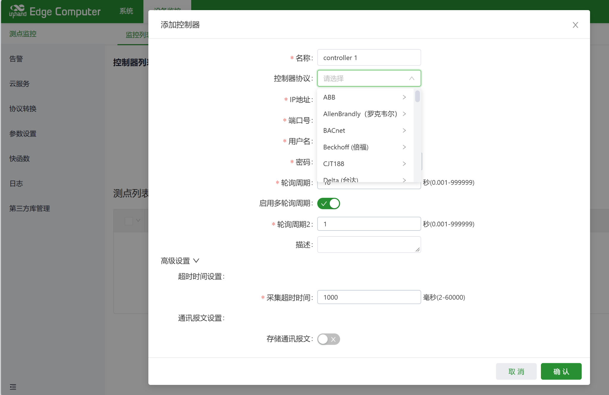

<div style="width: 100%;height: 100%;background: url(img/DSA规格书封面.jpg); background-size: 100% 100%;">
  <div style="height:60%;">
    <div style="width:35%; padding: 40px 40px">
      
    </div>
    <div style="font-size: 28px; font-weight: bold; color:#000;text-align: center; margin-top: 130px;">
      软件定义采集，智能驱动边缘
    </div>
  </div>
  <div style="padding-left: 40px; padding-top: 90px;">
    <div style="font-size: 40px; font-weight: bold; color:#000;margin-bottom: 30px;">
      DeviceSupervisor™ Agent 工业边缘代理软件
    </div>
    <div style="text-align: center;">
      <div style="display: flex; flex-wrap: wrap; gap: 16px; ">
        <div style="width: 200px;background-color: #4CAF50; color: white; padding: 8px 8px; border-radius: 6px; font-size: 18px;">· 80+ 采集协议</div>
        <div style="width: 200px;background-color: #4CAF50; color: white; padding: 8px 8px; border-radius: 6px; font-size: 18px;">· 多云对接</div>
      </div>
      <div style="display: flex; flex-wrap: wrap; gap: 16px;margin-top:16px">
        <div style="width: 200px;background-color: #4CAF50; color: white; padding: 8px 8px; border-radius: 6px; font-size: 18px;">· Python 边缘智能</div>
        <div style="width: 200px;background-color: #4CAF50; color: white; padding: 8px 8px; border-radius: 6px; font-size: 18px; ">· 零代码/低代码</div>
      </div>
    </div>
  </div>
</div>

<div style="page-break-after: always;"></div>

# DeviceSupervisor™ Agent (DSA)
## 工业边缘代理软件 · 产品规格书

**版本**：V1.0
**基于软件版本**：DSA V3.1.10
**发布日期**：2026年9月
**厂商**：InHand Networks 映翰通网络

---

## 1. 产品概述

**DeviceSupervisor™ Agent（简称 DSA）** 是映翰通自主研发的**工业边缘代理软件**，专为映翰通 IG 系列工业网关和 EC 系列边缘计算机而设计。DSA 通过 **"零代码/低代码"** 的方式，帮助客户在工业现场快速实现：

- **南向数据采集**：一站式对接近百种工业设备协议
- **北向协议转换**：将采集数据以标准工业协议对外提供
- **云平台对接**：将数据实时上报至主流工业物联网云平台
- **边缘智能处理**：通过 Python 脚本实现边缘侧数据过滤、聚合、告警和智能分析

DSA 提供**低延迟数据接入管理**和**智能分析服务**，帮助客户快速洞察业务趋势、提升运营效率与可持续性。

### 1.1 产品定位

> "**运行在工业级网关内、深度支持中国工业协议、零代码/低代码交付的一体化边缘代理软件**"

### 1.2 目标市场

| 行业 | 典型应用场景 |
|---|---|
| **智能电力** | 变电站遥测遥控、电表抄读、DTU/FTU、光伏/储能监控 |
| **智慧能源** | BMS 电池管理、微网协同、EMS 能源管理 |
| **智能制造** | PLC 数据采集、CNC 联网、设备 OEE 分析、工业上云 |
| **楼宇自动化** | BACnet/Modbus 采集、HVAC 联动、电力监测 |
| **智慧环保** | HJ212 环保数采、污染源监测、水务遥测 |
| **智慧水务** | 水表采集、SL651 水利遥测、泵站远程运维 |
| **智慧交通** | 隧道监控、路侧设备联网、充电桩管理 |
| **石油化工** | Modbus/OPC UA 罐区监测、油田数据采集 |

---

## 2. 核心特性

### 2.1 十大产品优势

| # | 特性 | 描述 |
|---|---|---|
| 1 | **丰富的南向采集协议** | 支持 **80+ 种工业协议**，覆盖 PLC、CNC、机器人、SCADA、智能仪表、传感器等 |
| 2 | **多样的北向协议转换** | 支持 **10+ 种北向协议服务端**（Modbus/OPC UA/IEC 104/BACnet/DNP3/SNMP 等），避免上位机对接多种设备协议的复杂性 |
| 3 | **多云并发对接** | 同时支持 **AWS IoT、Azure IoT、AliCloud IoT、Siemens Insights Hub、映翰通 iSCADA/XEnergy**，一台网关多云并发上报 |
| 4 | **轻量灵活部署** | 以 **APP/插件**形式在 EC 系列产品上安装/卸载，低内存占用，便于运维管理 |
| 5 | **Python 边缘智能** | 通过 **QuickFunction** 添加 Python 脚本，实现边缘数据过滤、格式转换、智能分析、云端下行控制 |
| 6 | **100ms 高频采集** | 支持针对不同控制器、不同数据点单独设定轮询周期，关键数据最高 **100ms** 毫秒级采集 |
| 7 | **海量数据点接入** | 单网关最高支持 **19 万数据点**（EC942 硬件），并发多设备采集 |
| 8 | **Excel 批量组态** | 支持 CSV/Excel 批量导入导出设备与数据点，配合**设备模板**功能实现快速部署 |
| 9 | **本地历史存储 + 告警引擎** | 内置 SQLite 时序数据库，**5 级告警**（提示/警告/一般/重要/严重）+ 断电续传 |
| 10 | **实时通讯报文诊断** | 南向控制器支持在线查看/下载通讯报文，运维人员快速定位现场采集问题 |

---

## 3. 系统架构

DSA 采用**分层模块化架构**，由五大模块组成：

```
┌──────────────────────────────────────────────────────────────┐
│                    映翰通 IG / EC 硬件平台                    │
├──────────────────────────────────────────────────────────────┤
│  ┌─────────────────────────────────────────────────────────┐ │
│  │  ⑤ 北向云服务模块                                        │ │
│  │  MQTT / Sparkplug B / AliCloud / AWS IoT /              │ │
│  │  Azure IoT / iSCADA / XEnergy / Insights Hub            │ │
│  └───────────────▲─────────────────────────────────────────┘ │
│                  │                                            │
│  ┌───────────────┼─────────────────────────────────────────┐ │
│  │  ④ 北向协议转换模块                                       │ │
│  │  Modbus TCP/RTU Slave, OPC UA Server, IEC 104 Server,   │ │
│  │  IEC 101 Server, IEC 61850 Server, BACnet Server,       │ │
│  │  DNP3 Outstation, SNMP Agent, SL651, HJ212 Client       │ │
│  └───────────────▲─────────────────────────────────────────┘ │
│                  │                                            │
│  ┌───────────────┼─────────────────────────────────────────┐ │
│  │  ③ QuickFunction 快速函数处理模块（Python）              │ │
│  │  • 周期触发    • 消息触发     • 启动触发                  │ │
│  │  • 发布脚本    • 订阅脚本     • 自定义快速函数            │ │
│  └───────────────▲─────────────────────────────────────────┘ │
│                  │                                            │
│  ┌───────────────┼─────────────────────────────────────────┐ │
│  │  ② DataHub 数据处理中心（内部 MQTT 消息总线）             │ │
│  │  • 数据映射与运算  • 分组管理  • 历史存储  • 告警规则     │ │
│  │  • 实时监控        • Event Bus                            │ │
│  └───────────────▲─────────────────────────────────────────┘ │
│                  │                                            │
│  ┌───────────────┼─────────────────────────────────────────┐ │
│  │  ① 南向数据采集模块（80+ 协议驱动）                       │ │
│  │  Ethernet / Serial / USB / GPIO                          │ │
│  └───────────────▲─────────────────────────────────────────┘ │
└──────────────────┼───────────────────────────────────────────┘
                   │
        ┌──────────┴──────────┐
        │   现场工业设备       │
        │   PLC / CNC / 电表 / │
        │   传感器 / 机器人    │
        └─────────────────────┘
```

### 3.1 模块说明

| 模块 | 功能 |
|---|---|
| **① 南向采集** | 80+ 协议驱动，支持 Ethernet / RS485 / RS232，多设备并发轮询 |
| **② DataHub** | 内部 MQTT 消息总线，负责数据映射、运算、分组、历史存储、告警 |
| **③ QuickFunction** | Python 脚本引擎，支持周期/消息/启动三种触发方式 |
| **④ 北向协议转换** | 10+ 种北向服务端协议，同时提供多协议输出 |
| **⑤ 北向云服务** | 支持多云并发上报，含标准 MQTT、Sparkplug B、AliCloud、AWS、Azure 等 |

---

## 4. 南向采集协议清单（80+）

### 4.1 PLC 协议（40+）

| 品牌 | 支持协议 |
|---|---|
| **Rockwell / Allen-Bradley** | EtherNet/IP (CompactLogix/Micro/MicroLogix/Unconnected), SLC Net |
| **Siemens** | ISO on TCP (S200/S200 Smart/S1200/S1500), PPI, PPI over TCP, Fetch/Write |
| **Mitsubishi** | FX Links (Serial/TCP), FX Serial over TCP, MC 1E/3E/3C, MC 3C over TCP, MC R, MITSUBISHI Programming Port |
| **Omron** | C-Mode (Serial/TCP), EtherNet/IP CompactLogix, FINS TCP/UDP, HostLink (Serial/TCP) |
| **Beckhoff** | ADS |
| **Delta** | Delta TCP, Delta Serial, Delta Serial ASCII, Delta Serial over TCP |
| **FATEK** | FATEK Programming Port (Serial/TCP) |
| **Fuji** | SPB (Serial/TCP), SPH Net |
| **General Electric** | SRTP |
| **Inovance / 汇川** | INOVANCE Serial, INOVANCE TCP, INOVANCE Serial over TCP |
| **KEBA** | KEBA Socket |
| **Keyence** | KEYENCE MC 3E |
| **Panasonic** | Mewtocol (Serial/TCP), Panasonic MC 3E, Nano (Serial/TCP) |
| **VIGOR** | VIGOR Serial, VIGOR Serial over TCP |
| **XINJE / 信捷** | XINJE TCP (Dedicated), XINJE TCP (Modbus), XINJE Serial, XINJE Serial over TCP |
| **Yokogawa** | Link TCP |
| **通用** | Modbus RTU / ASCII / TCP / RTU over TCP / RTU Slave, OPC DA, OPC UA, OPC UA PubSub, Euromap-63 (注塑机), WebApi |

### 4.2 电力协议（Chinese Power）
- **DLT645-1997**（中国电表标准）
- **DLT645-2007**（中国电表标准）
- **DLT645-2007 over TCP**
- **DLT698**（新一代电表）
- **DNP3 TCP / UDP / RTU**（北美主流）
- **IEC 101**（串口遥测遥控）
- **IEC 103**（NR Electric 版本）
- **IEC 104**（网口遥测遥控）
- **IEC 61850**（数字化变电站 MMS 报文）

### 4.3 楼宇自动化协议
- **BACnet IP**
- **BACnet MS/TP**

### 4.4 CNC 机床与机器人
- **ABB Robot**
- **EFORT Robot**（埃夫特机器人）
- **FANUC Robot**
- **FANUC CNC 0i**

### 4.5 环保与水务
- **HJ212-2005 Serial**（中国环保标准）
- **HJ212-2017 Serial**（中国环保标准）

### 4.6 水表与仪表
- **CJT188-2004**（中国水表标准）

### 4.7 自定义协议
- **Easy COM**（串口自定义协议采集）
- **Easy TCP**（网口自定义协议采集）
- **Virtual Controller**（虚拟控制器，供脚本/第三方应用赋值）

---

## 5. 北向协议转换清单（10+）

支持将南向采集的数据通过标准工业协议对外提供，供上位机 / SCADA / DCS 系统读取：

| 北向协议 | 接口类型 | 说明 |
|---|---|---|
| **Modbus TCP Slave** | TCP | 提供标准 Modbus TCP 从站协议供主站数据采集 |
| **Modbus RTU Slave** | RS232/485 | 提供标准 Modbus RTU 从站协议 |
| **OPC UA Server** | TCP | 提供标准 OPC UA 协议供主站数据采集 |
| **IEC 104 Server** | TCP | 支持 TCP 客户端和服务端两种模式 |
| **IEC 101 Server** | RS232/485, TCP | 提供 RS232/RS485/TCP 透明传输 |
| **IEC 61850 Server** | TCP | 提供 IEC61850 MMS 协议、上报功能 |
| **BACnet IP Server** | UDP | 提供 BACnet IP 协议供外部数据采集 |
| **BACnet MS/TP Server** | RS232/485 | 提供 BACnet MS/TP 协议 |
| **DNP3 Outstation** | TCP/UDP | 支持 TCP 和 UDP 两种通讯方式 |
| **SNMP Agent** | UDP | 提供 SNMP 协议供外部读取数据 |
| **SL651-2014** | TCP | 中国水利部标准，数据可转发多个中心站 |
| **HJ212 Client** | TCP | 使用 HJ212-2017 协议转发数据到多个中心站 |

---

## 6. 北向云服务清单

| 云平台 | 支持类型 | 说明 |
|---|---|---|
| **Standard MQTT** | 通用 | 对接任意标准 MQTT Broker |
| **MQTT Sparkplug B** | 标准 | 基于 MQTT 3.1.1 的工业物联网数据传输规范 |
| **InHand iSCADA Cloud** | 映翰通 | 深度对接映翰通 iSCADA 云 |
| **InHand XEnergy** | 映翰通 | 深度对接映翰通 XEnergy 能源云 |
| **InHand XEnergy (IEC104)** | 映翰通 | 通过 IEC104 对接 XEnergy |
| **AliCloud IoT** | 阿里云 | 对接阿里云 IoT 平台 |
| **AWS IoT** | 亚马逊 | 对接 AWS IoT Core 平台 |
| **Azure IoT** | 微软 | 对接 Azure IoT Hub 平台 |
| **Siemens MindSphere (Insights Hub)** | 西门子 | 对接 Siemens MindSphere / Insights Hub 平台 |

---

## 7. 边缘计算能力（QuickFunction）

### 7.1 三大触发模式

| 触发模式 | 用途 |
|---|---|
| **周期触发** | 按固定周期（秒/分/时）执行脚本，适合定时数据处理、聚合、上报 |
| **本地订阅消息触发** | 订阅内部 MQTT 消息总线，收到消息即触发，适合事件驱动业务 |
| **启动触发** | DSA 启动时执行一次，适合初始化任务 |

### 7.2 QuickFunction API 参考

| API 类别 | 主要函数 |
|---|---|
| **数据发布** | 发布测量点/告警/自定义数据到云端（publish QuickFunction） |
| **数据写入** | 更新控制器的测量点值（write） |
| **数据召回** | 召回控制器的测量点数据（recall） |
| **全局参数** | 读取全局参数、控制器连接状态、云连接状态、全局配置 |
| **文件操作** | 脚本内读写文件 |
| **时序数据库** | LwTSDB 通用 API：insert / find / delete |
| **Sparkplug B** | 发布 NBIRTH / NDATA、订阅 NCMD |

### 7.3 内部 MQTT 消息总线

| 参数 | EC 系列 | IG 系列 |
|---|---|---|
| MQTT Broker 地址 | 127.0.0.1 | 127.0.0.1 |
| 端口号 | (Docker network) | 9009 |
| 南向读值 Topic | `ds2/eventbus/south/read/{driverServiceId}` | 同左 |

---

## 8. 数据管理能力

### 8.1 数据点组态



| 功能 | 描述 |
|---|---|
| **控制器管理** | 添加/编辑/复制/删除/禁用/启用控制器 |
| **数据点管理** | 添加/导入/导出/删除数据点，支持 Excel 批量组态 |
| **设备模板** | 保存常见设备配置为模板，一键添加相同型号设备 |
| **数据映射与运算** | 支持数据类型转换、字节序调整、四则运算、值映射 |
| **数据分组** | 按业务/场景对数据点分组管理，便于上报和查询 |
| **实时通讯报文** | 在线查看/下载南向控制器实时报文，运维快速定位问题 |

### 8.2 数据类型支持

| 类型 | 字节序 |
|---|---|
| 16 Bit Int | AB, BA（默认 AB） |
| 32 Bit Int | ABCD, CDAB, DCBA, BADC（默认 ABCD） |
| 32 Bit Float | ABCD, CDAB, DCBA, BADC（默认 ABCD） |
| 64 Bit Int | ABCDEFGH, GHEFCDAB, HGEFDCBA, BADCFEHG（默认 ABCDEFGH） |
| 64 Bit Float | ABCDEFGH, GHEFCDAB, HGEFDCBA, BADCFEHG（默认 ABCDEFGH） |

### 8.3 历史数据

- 内置 **SQLite3 时序数据库**，按分组存储历史数据
- 支持按数据点频率单独设置存储周期
- 支持历史数据导出（CSV）

### 8.4 告警引擎

| 参数 | 说明 |
|---|---|
| **告警等级** | 5 级：提示 / 警告 / 一般 / 重要 / 严重 |
| **判断条件** | `=`, `!=`, `>`, `≥`, `<`, `≤` |
| **逻辑关系** | 无逻辑 / && (与) / || (或) |
| **告警标签** | 分组管理告警项，MQTT 上报可按标签选择 |
| **告警历史** | 历史告警记录，含触发/恢复时间与数值 |
| **CSV 导入导出** | 告警规则批量管理 |

---

## 9. 数据存储与断电续传

### 9.1 存储配置

| 项 | 参数 | 默认值 |
|---|---|---|
| 日志等级 | DEBUG / INFO / WARNING / ERROR | INFO |
| 历史告警上限 | 单告警最大条数 | 2000 |
| 离线数据存储 | USB / SD 卡 / 网关存储 | 网关存储 |
| 离线数据上限 | 最大条数 | 10000 |
| 离线数据上报周期 | ms | 200 |
| 离线数据上报超时 | ms | 1000 |
| 离线数据上报策略 | 离线优先 / 实时优先 | 离线优先 |
| 离线数据重传策略 | 持续重试 / 达上限丢弃 | 持续重试 |
| 最大重试次数 | 达上限丢弃时生效 | 3 |
| 通讯报文存储 | USB / SD 卡 / 网关存储 | 网关存储 |
| 最大通讯报文条数 | | 2000 |

### 9.2 自定义参数

支持定义**全局参数**，可在云服务配置、快速函数脚本中使用：

- 内置参数：`SN`（设备序列号）、`MAC`（设备 MAC）
- 支持添加/导入/导出 自定义参数
- 使用方式：`${参数名}`（可作为通配符）

---

## 10. 性能规格

以下为 DSA 在映翰通不同硬件平台的实测性能（单协议、单控制器、连续测点）：

### 10.1 IG502（入门级工业网关）

| 协议 | 轮询周期 | 报文间隔 | 数据点数 | CPU |
|---|---|---|---|---|
| Modbus TCP | 1s | 0ms | 6,000 | 100% |
| Modbus TCP | 10s | 10ms | 40,000 | 100% |
| Modbus RTU | 10s | 10ms | 40,000 | 100% |
| OPC UA | 10s | - | 38,000 | 85% |

### 10.2 IG902（主流工业网关）

| 协议 | 轮询周期 | 数据点数 | CPU |
|---|---|---|---|
| Modbus TCP | 10s | 50,000 | 100% |
| Modbus RTU | 10s | 50,000 | 40-50% |
| OPC UA | 10s | 80,000 | 85% |

### 10.3 IG532（高端工业网关）

| 协议 | 轮询周期 | 数据点数 | CPU |
|---|---|---|---|
| Modbus TCP | 10s | 48,000 | 100% |
| Modbus RTU | 10s | 48,000 | 65-75% |
| OPC UA | 10s | 45,000 | 70% |

### 10.4 EC312（入门级边缘计算机）

| 协议 | 轮询周期 | 数据点数 | CPU |
|---|---|---|---|
| Modbus TCP | 10s | 45,000 | 65-85% |
| Modbus RTU | 10s | 45,000 | 40-50% |
| OPC UA | 10s | 42,400 | 100% |

### 10.5 EC942（旗舰级边缘计算机）

| 协议 | 轮询周期 | 数据点数 | CPU |
|---|---|---|---|
| Modbus TCP | 10s | **190,000** | 60% |
| Modbus RTU | 10s | **190,000** | 24-30% |
| OPC UA | 10s | 80,000 | 30% |

> **性能对比**：EC942 单台设备可支撑近 20 万数据点采集，覆盖大型变电站/工厂全站需求。

---

## 11. 硬件兼容性

DSA 已预装或可通过 APP 形式安装于以下映翰通硬件平台：

### 11.1 IG 系列工业网关（内置 DSA）

| 型号 | 定位 | CPU | 内存 | 典型场景 |
|---|---|---|---|---|
| **IG502** | 入门 4G/5G 工业网关 | ARM Cortex-A7 | 512MB | 中小设备联网 |
| **IG902** | 主流 4G/5G 工业网关 | ARM Cortex-A7 | 512MB-1GB | PLC 采集、协议转换 |
| **IG532** | 高端 4G/5G 工业网关 | ARM Cortex-A55 | 1GB | 电力/环保数采 |

### 11.2 EC 系列边缘计算机（APP 形式安装）

| 型号 | 定位 | CPU | 内存 | 典型场景 |
|---|---|---|---|---|
| **EC312** | 入门边缘计算机 | ARM Cortex-A55 | 1-2GB | 楼宇/水务 |
| **EC942** | 旗舰边缘计算机 | ARM Cortex-A72/A53 | 4-8GB | 大型工厂/变电站边缘 |

---

## 12. 系统要求

| 项 | 要求 |
|---|---|
| **操作系统** | 映翰通定制 Linux（基于内核 5.x） |
| **CPU 架构** | ARM Cortex-A7 / A53 / A55 / A72 |
| **最小 RAM** | 256MB（IG 系列） / 512MB（EC 系列） |
| **最小存储** | 512MB Flash |
| **网络** | Ethernet / 4G / 5G / Wi-Fi（依硬件而定） |
| **Web 组态浏览器** | Chrome 90+ / Edge 90+ / Firefox 88+ |

---

## 13. 部署与运维

### 13.1 EC 系列 APP 安装流程
1. 登录 EC 网关 Web 界面
2. 进入"应用管理" → "上传应用"
3. 选择 DSA 安装包（`.tar.gz` 格式）
4. 点击"安装" → 自动配置资源
5. 启动后自动加载配置文件

### 13.2 IG 系列内置运行流程
1. IG 系列出厂预装 DSA
2. 登录 IG 网关 Web 界面
3. 进入"边缘计算" → "DeviceSupervisor"
4. 直接配置控制器、数据点、云服务

### 13.3 配置更新
- 支持在线更新 DSA 配置文件（JSON 格式）
- 支持 Web 界面版本升级
- 支持批量下发（配合映翰通 iSCADA 云平台）

### 13.4 日志诊断
- 支持在线查看/下载运行日志
- 日志等级：DEBUG / INFO / WARNING / ERROR 可配置
- 支持关键日志断电保存

---

## 14. 授权与订购

### 14.1 授权方式

| 授权模式 | 说明 |
|---|---|
| **硬件内置** | 购买 IG 系列即自带 DSA 完整功能，无需单独授权 |
| **EC 系列 APP** | EC 系列产品可通过 APP 形式安装，需订购对应授权 |
| **企业订阅** | 大批量部署可选择企业年度订阅，含技术支持与云端管理 |

### 14.2 服务与支持

| 服务项 | 内容 |
|---|---|
| **技术文档** | 用户手册、API 参考、协议对接指南 |
| **在线知识库** | help.inhand.com 24/7 访问 |
| **技术支持** | 邮件 / 电话 / 远程支持 |
| **软件升级** | 免费大版本升级（授权有效期内） |
| **协议扩展** | 可根据客户需求定制新增协议 |

### 14.3 订购信息

请联系映翰通销售团队获取报价与订购信息：
- **中国区**：sales@inhand.com.cn
- **海外**：sales@inhand.com
- **官网**：www.inhand.com

---

## 15. 关于映翰通

映翰通网络（InHand Networks）成立于 2001 年，是全球领先的工业物联网解决方案提供商，致力于推动各行业数字化转型。业务覆盖**智能网联、工业与楼宇物联网、数字化能源、智慧商业、智慧交通**等领域，产品和服务遍布全球 60+ 国家，客户包括中国、美国、法国、德国、英国、意大利等地。

**总部**：北京
**海外办公室**：美国、英国、德国、法国、意大利
**网站**：www.inhand.com

---

## 附录 A：与竞品差异化对比速览

| 能力 | **DSA** | 主要竞品优势 |
|---|:---:|:---:|
| 中国电力协议（DLT645/IEC61850）| ✅ 原生 | Kepware ✅ |
| 中国环保协议（HJ212）| ✅ **业界独有** | 无 |
| 100ms 高频采集 | ✅ | Kepware/Litmus ✅ |
| Python 脚本 | ✅ | Robustel/EdgeLink ✅ |
| Excel 批量组态 | ✅ | EdgeLink ✅ |
| 硬件内置零集成 | ✅ | Robustel/Advantech ✅ |
| 5 级告警引擎 | ✅ | Advantech ✅ |
| 多云并发上报 | ✅ | Litmus ✅ |
| 数据点规模（EC942）| **19 万** | 视硬件而定 |

---

## 附录 B：修订记录

| 版本 | 日期 | 修订内容 |
|---|---|---|
| V1.0 | 2026-09 | 首版发布，基于 DSA V3.1.10 |

---

*© 2026 映翰通网络 版权所有。DeviceSupervisor™ 为映翰通商标。*
*本文档中提及的其他商标或注册商标归各自权利人所有。*
*技术规格如有变更，恕不另行通知。*
