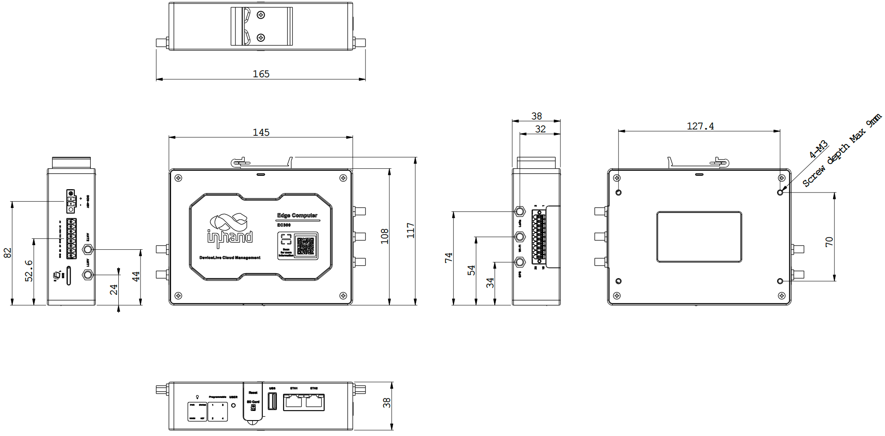
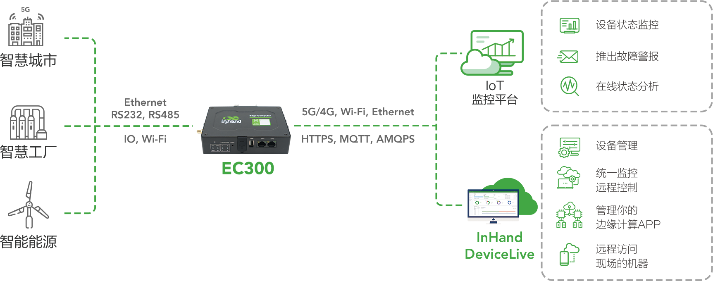
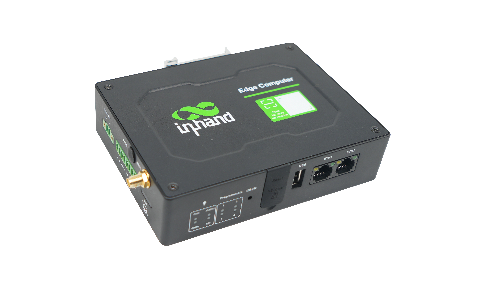

 **拥抱边缘计算，为工业数字化赋能**

 **EC312 系列基础型边缘计算机**

· 高安全性

· 高可靠性

· DeviceLive 云管理

· 可扩展

# 1. 产品概述

**EC312 系列是面向轻量级工业边缘应用开发的基础型边缘计算机，具备通信冗余、开放平台和高安全能力。**

**产品特点：**

- **通信可靠:** 有线/蜂窝/Wi-Fi 互备，双SIM切换与链路自愈
- **接口丰富:** FE、RS232/RS485、USB、Micro SD，并支持多种扩展
- **开放平台:** Debian 11 + Docker，支持 C/C++/Python 应用开发
- **安全加固:** Secure Boot、TPM2.0、TrustZone、防火墙与VPN
- **云端运维:** 支持 DeviceLive 远程批量管理设备、容器与应用

## 核心技术指标

|技术指标|规格|
|---|---|
|蜂窝网络|5G SA/NSA（中国）、LTE Cat6（北美）、LTE Cat1|
|网络特性|APN、VPDN、CHAP/PAP，支持 Web/SSH 配置与远程管理|
|云管理|DeviceLive 云平台远程管理|
|二次开发|支持 C/C++/Python 开发，支持 Docker |
|电力协议|DLT645、IEC101/104、DNP3.0|
|其他协议|BACnet、CNC|
|处理器与内存|ARM Cortex-A53 @ 1.4GHz，1GB DDR4|
|存储|8GB eMMC|
|以太网接口|2 × 10/100Mbps|
|供电|9~48V DC|
|工作温度|-20 ~ 70 ℃|
|防护等级|IP30|

# 2. 产品尺寸

正视图

侧视图

接口图

注意：

1.所有尺寸单位为毫米（mm）。

2.所有尺寸均为近似值，**仅供参考**。

3.图示尺寸**不得用于生产加工**。

4.尺寸需符合零件及制造公差要求。

5.尺寸如有变更，恕不另行通知。

# 3. 硬件规格

| 类别/参数       | 规格                                                                                                                                                                                                    |
| ----------- | ----------------------------------------------------------------------------------------------------------------------------------------------------------------------------------------------------- |
| **硬件平台**    |                                                                                                                                                                                                       |
| CPU         | ARM Cortex-A53 @ 1.4GHz                                                                                                                                                                               |
| RAM         | 1GB DDR4（1G SDRAM）                                                                                                                                                                                    |
| FLASH       | 8GB eMMC                                                                                                                                                                                              |
| **LoRaWAN** |                                                                                                                                                                                                       |
| LoRaWAN     | 仅中国使用需与映翰通 LT310 产品配套                                                                                                                                                                                 |
| 频段          | 470MHz - 510MHz                                                                                                                                                                                       |
| 通信距离        | 室内/市区通信距离 1km；户外/视距通信距离 5km                                                                                                                                                                           |
| 发射功率        | -9dBm - 22dBm                                                                                                                                                                                         |
| 通信理论速率      | 0.15Kbps - 46.8Kbps                                                                                                                                                                                   |
| 灵敏度         | -140dBm                                                                                                                                                                                               |
| 信道          | 80                                                                                                                                                                                                    |
| **连接与接口**   |                                                                                                                                                                                                       |
| 以太网端口       | 2 × 10/100Mbps                                                                                                                                                                                        |
| 串口          | 1 × RS-232/485 + 1 × RS-485（带隔离）                                                                                                                                                                      |
| CAN         | 最高支持 CAN FD（扩展）                                                                                                                                                                                       |
| 按键          | 针孔式复位按键 × 1；可编程按键 × 1                                                                                                                                                                                 |
| SIM卡座       | 抽屉式卡座 × 1，2 × NANO SIM                                                                                                                                                                                |
| 天线接头        | 4G：SMA × 1、Wi-Fi：SMA × 1、GPS：SMA × 1、LoRa：SMA × 1；注：北美产品型号 4G 天线：SMA × 2                                                                                                                              |
| LED指示灯      | PWR, STATUS, WARN, NET，USER * 4                                                                                                                                                                       |
| 扩展接口        | LoRa 最高支持 2 × RS232/RS485/4-20mA/CAN FD（带隔离） 最高支持 4 × DI + 4 × DO（带隔离，扩展）                                                                                                                             |
| 蓝牙          | BLE 4.2                                                                                                                                                                                               |
| USB         | USB 2.0，1 × Type A                                                                                                                                                                                    |
| TF          | 支持 Micro SD，最高可扩展 32GB                                                                                                                                                                                |
| WiFi（可选）    | Wi-Fi STA，802.11ac/a/b/g/n，2.4G/5G 双频                                                                                                                                                                 |
| GNSS（可选）    | 卫星定位GPS                                                                                                                                                                                               |
| **电源与功耗**   |                                                                                                                                                                                                       |
| 输入电压        | 9~48V DC                                                                                                                                                                                              |
| 典型值（OS 空闲态） | 电源功耗 6W                                                                                                                                                                                               |
| 掉电保护        | 超级电容设计，断电后保持 20s（安全关机）                                                                                                                                                                                |
| 掉电告警        | 掉电后可发送掉电告警                                                                                                                                                                                            |
| **机械规格**    |                                                                                                                                                                                                       |
| 产品尺寸        | 145 × 106 × 36 mm                                                                                                                                                                                     |
| 产品重量        | 339 g                                                                                                                                                                                                 |
| 安装方式        | 挂耳、导轨                                                                                                                                                                                                 |
| 防护等级        | IP30                                                                                                                                                                                                  |
| 外壳与散热       | 金属+塑料，无风扇散热                                                                                                                                                                                           |
| RTC         | 纽扣电池备份 RTC                                                                                                                                                                                            |
| 硬件看门狗       | 支持                                                                                                                                                                                                    |
| 安全芯片（选配）    | TPM2.0 / SE 芯片可选                                                                                                                                                                                      |
| **环境与认证**   |                                                                                                                                                                                                       |
| 存储温度        | -40 ~ 85 ℃                                                                                                                                                                                            |
| 工作温度        | -20 ~ 70 ℃                                                                                                                                                                                            |
| 环境湿度        | 5~95%（无凝霜）                                                                                                                                                                                            |
| 物理特性        | 防震 IEC60068-2-27 振动 IEC60068-2-6 跌落 IEC60068-2-32                                                                                                                                                     |
| EMC指标       | EN61000-4-2，level 3，静电 EN61000-4-3，level 3，辐射电场 EN61000-4-4，level 3，脉冲电场 EN61000-4-5，level 3，浪涌 EN61000-4-6，level 3，传导骚扰抗扰度 EN61000-4-8，>level 2，工频磁场抗扰度，水平方向/垂直方向 400A/m EN61000-4-12，level 3，震荡波抗扰度 |
| 认证          | CE、FCC、IC、PTCRB、Verizon、AT&T                                                                                                                                                                          |

# 4. 软件规格

| 类别/参数                 | 规格                                                                                                                                                                           |
| --------------------- | ---------------------------------------------------------------------------------------------------------------------------------------------------------------------------- |
| **操作系统**              |                                                                                                                                                                              |
| 操作系统                  | Debian 11（Kernel 5.10.168）                                                                                                                                                   |
| **网络特性**              |                                                                                                                                                                              |
| 网络接入                  | APN、VPDN                                                                                                                                                                     |
| 接入认证                  | CHAP/PAP                                                                                                                                                                     |
| 网络制式                  | 5G SA/NSA（中国）、LTE Cat6（北美）、LTE Cat1                                                                                                                                          |
| WAN协议                 | 静态 IP、DHCP                                                                                                                                                                   |
| LAN协议                 | ARP、Ethernet                                                                                                                                                                 |
| IP应用                  | ICMP、DNS、TCP/UDP、TCP Server、DHCP                                                                                                                                             |
| IP路由                  | 静态路由                                                                                                                                                                         |
| **安全性**               |                                                                                                                                                                              |
| Secure Boot           | 支持                                                                                                                                                                           |
| Trust Zone            | 支持                                                                                                                                                                           |
| 网络安全                  | 支持防火墙功能                                                                                                                                                                      |
| 用户管理                  | 支持多级管理权限                                                                                                                                                                     |
| 数据安全                  | 支持VPN功能                                                                                                                                                                      |
| **可靠性**               |                                                                                                                                                                              |
| 链路探测                  | 发送心跳包检测，断线自动连接                                                                                                                                                               |
| 内置看门狗                 | 设备运行自检技术，设备运行故障自修复                                                                                                                                                           |
| 备份机制                  | 有线、蜂窝、Wi-Fi 互备份                                                                                                                                                              |
| 双卡切换                  | 支持双 SIM 链路切换                                                                                                                                                                 |
| **开放式平台与数据采集协议（DSA）** |                                                                                                                                                                              |
| Python二次开发            | 支持 C/C++/Pyhon 等多种编程语言                                                                                                                                                       |
| 云平台                   | 支持 AWS、Azure、阿里等云平台                                                                                                                                                          |
| 工业协议                  | Modbus RTU Master/Slave, Modbus TCP Master/Slave, EtherNet/IP, ISO on TCP, OPC UA Client/Server, Mitsubishi MC 3C/3E/3C OverTCP, Mitsubishi CPU Port, FINSUDP, HostLink, PPI |
| 电力协议                  | DLT645-2007, IEC101/104, DNP3.0                                                                                                                                              |
| 其他协议                  | BACnet, CNC                                                                                                                                                                  |
| Docker                | 支持                                                                                                                                                                           |
| **网络管理**              |                                                                                                                                                                              |
| 配置方式                  | Web、SSH                                                                                                                                                                      |
| 升级方式                  | 支持 web 升级、DeviceLive 远程升级                                                                                                                                                    |
| 日志功能                  | 支持本地系统日志、远程日志，重要日志掉电保存                                                                                                                                                       |
| 配置备份                  | 支持配置文件的导入和导出                                                                                                                                                                 |
| 远程管理                  | 支持 InHand DeviceLive 云平台                                                                                                                                                     |
| 平台功能                  | 支持设备远程访问、设备远程批量管理、边缘应用远程批量管理、容器远程管理；支持基于云的参数配置、容器管理、应用和固件管理                                                                                                                  |

# 5. 订购信息

## 型号规则

**Model code:** EC312-B/H-WMNN-[XXXX](扩展模块选项（可选）)-[X](操作系统选项（可选）)

B/H: GNSS/Wi-Fi/BT/TPM能力（B为无，H为支持）  
WMNN: 无线通讯类型 & 模块  
[XXXX](扩展模块选项（可选）): 扩展模块选项（可选）  
[X](操作系统选项（可选）): 操作系统选项（可选）

## 产品型号

| 型号           | 区域      |            | & 模块                                                                                                                        | [XXXX] | [X]    |
| ------------ | ------- | ---------- | --------------------------------------------------------------------------------------------------------------------------- | ------ | ------ |
| EC312-B-NRQ1 | 中国      | 无          | 5G NR NSA: n78/n79 5G NR SA: n1/n3/n5/n8/n28/n41/n77/n78/n79 LTE-FDD: B1/B3/B5/B8 LTE-TDD: B34/B38/B39/B40/B41 WCDMA: B1/B8 | 可选     | 默认IEOS |
| EC312-H-NRQ1 | 中国      | 支持         | 5G NR NSA: n78/n79 5G NR SA: n1/n3/n5/n8/n28/n41/n77/n78/n79 LTE-FDD: B1/B3/B5/B8 LTE-TDD: B34/B38/B39/B40/B41 WCDMA: B1/B8 | 可选     | 默认IEOS |
| EC312-B-LQA3 | 中国      | 无          | LTE-FDD: B1/B3/B5/B8 LTE-TDD: B34/B38/B39/B40/B41                                                                           | 可选     | 默认IEOS |
| EC312-H-LQA3 | 中国      | 支持         | LTE-FDD: B1/B3/B5/B8 LTE-TDD: B34/B38/B39/B40/B41                                                                           | 可选     | 默认IEOS |
| EC312-B-FQ53 | EMEA    | 无          | CAT1 FDD: B1/B3/B7/B8/B20/B28 TDD: B38/B40/B41 GSM: B2/B3/B5/B8                                                             | 可选     | 默认IEOS |
| EC312-H-FQ53 | EMEA    | 支持         | CAT1 FDD: B1/B3/B7/B8/B20/B28 TDD: B38/B40/B41 GSM: B2/B3/B5/B8                                                             | 可选     | 默认IEOS |
| EC312-H-FQ33 | 北美      | 支持         | CAT1 FDD: B2/B4/B5/B12/B13/B25/B26 WCDMA: B2/B4/B5                                                                          | 可选     | 默认IEOS |
| EC312-H-FQ73 | 澳洲及拉丁美洲 | 支持         | CAT1 FDD: B1/B2/B3/B4/B5/B7/B8/B28/B66 TDD: B38/B40/B41 GSM: B2/B3/B5/B8                                                    | 可选     | 默认IEOS |
| EC312-H-EN00 | 全球无蜂窝   | 支持（不含GNSS） | 无蜂窝                                                                                                                         | 可选     | 默认IEOS |

## 扩展模块选项（可选）

| [XXXX](扩展模块选项（可选）) PN码 | 特性                        |
| ---------------------- | ------------------------- |
| NAAD                   | 2×4-20mA AI + 4×DI + 4×DO |
| N44C                   | 2×RS-485 + 1×CAN FD       |
| N4CC                   | 1×RS-485 + 2×CAN FD       |
| N44D                   | 2×RS-485 + 4×DI + 4×DO    |
| —                      | 无                         |

## 操作系统选项（可选）

| [X](操作系统选项（可选）) PN码 | 特性              |
| ------------------- | --------------- |
| —                   | IEOS（默认）        |
| D                   | Debian Linux OS |

• IEOS（ InHand Edge Operating System ）：映翰通面向物联网ARM平台边缘计算机的基于发行版Linux构建的操作系统，帮助客户实现安全、
稳定的工业边缘智能应用。IEOS包含web配置、拨号、路由、防火墙、VPN、云管理等映翰通开发的边缘应用。
  
• Debian Linux OS：不包含映翰通边缘应用的Debian OS。

# 6. 联系我们

- **官网：** [映翰通官网](https://www.inhand.com.cn)
- **版权声明：** ©映翰通网络 保留所有权利
