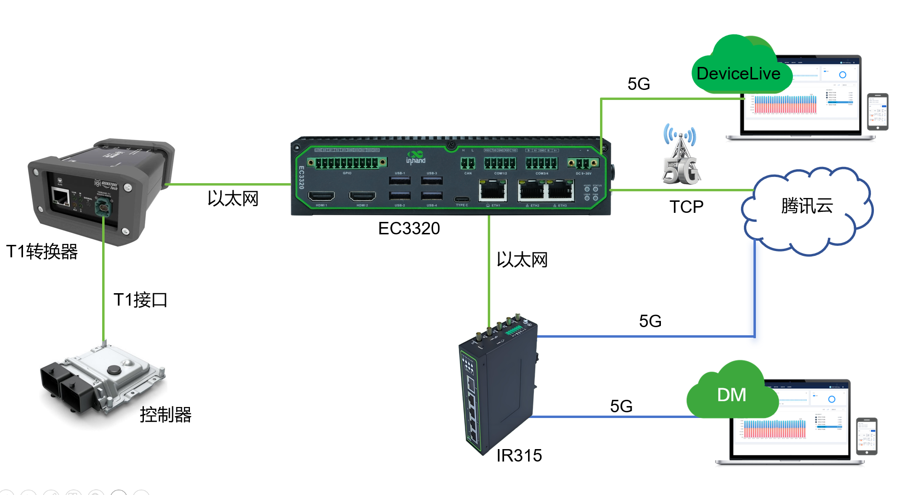

# 智能驾驶数据上云解决方案

## 一、方案概述

### 1.1 项目背景

某汽车集团推进智能驾驶数据采集与上云，是其落实科技转型战略、向科技型企业转型的关键举措。该项目旨在构建一个以数据为核心驱动的智能驾驶研发闭环：通过大规模采集真实路况数据并上传云端，与华为、腾讯、中国电信等伙伴共建"车-路-云"一体化平台和强大的算力基础设施，从而加速自动驾驶算法的训练与迭代。

其直接目标是攻克高阶自动驾驶技术，并已将成果凝结为规模达 400TB 的"真实道路驾驶多模态数据集"；长远来看，此举意在将海量数据转化为核心资产，支撑该集团在未来的智能化出行竞争中建立技术优势。

### 1.2 建设目标

- 攻克高阶自动驾驶技术，加速自动驾驶算法的训练与迭代
- 构建覆盖数据采集、处理、模型训练、仿真测试到 OTA 升级的完整闭环系统
- 积累规模达 400TB 的真实道路驾驶多模态数据集
- 建设统一的"集团一朵云"，实现云、边、端协同计算
- 推动集团从传统制造企业向科技型企业转型

### 1.3 适用场景

- 智能驾驶真实路况数据采集与上云
- 自动驾驶算法训练与迭代
- 无人小巴、物流车、清扫车等多元商业场景

## 二、需求分析

### 2.1 设备现状

- 设备类型：车辆控制器、T1 转以太网转换器、EC3320 边缘计算机、IR315 工业路由器
- 通信接口：T1 接口、5G 蜂窝网络、千兆以太网
- 通信协议：TCP
- 部署环境：车载环境、高带宽移动数据采集场景

### 2.2 核心需求

1. **海量高质量数据采集**：获取海量且高质量的真实道路驾驶数据，支撑自动驾驶算法的训练和迭代；高效解决长尾场景覆盖不足、实车路测成本高等问题

2. **完整研发闭环**：构建覆盖数据采集、处理、模型训练、仿真测试到 OTA 升级的完整闭环系统，在云端完成算法的快速验证与优化

3. **边缘计算机核心要求**：

   - 基本配置：标配 4GB 内存与 64GB 存储，支持存储容量扩展
   - 数据完整性：内置断点续传机制，网络波动或中断时数据不丢失
   - 开放可编程：提供二次开发环境或 SDK，允许自定义数据采集规则及云端上传策略
   - 高速通信：集成高速 5G 通信模组，支持海量数据的高效实时上传

4. **战略与业务扩展**：积累乘用车数据优势，借助生成式 AI 等技术手段，将能力快速复制到无人小巴、物流车、清扫车等多元商业场景

5. **基础架构与合规**：建设统一"集团一朵云"整合分散数据中心，实现云、边、端协同计算；所有数据采集须获得用户明确授权并完成严格脱敏处理，符合国家数据安全法规与隐私保护要求

## 三、总体架构设计

本方案采用 EC3320 边缘计算机作为核心数据采集与上云设备，IR315 工业路由器提供冗余网络通道，通过腾讯云平台完成数据的汇聚与算力支撑。EC3320 通过 T1 转以太网转换器接入车辆控制器，运行自研 APP 采集车辆数据，经内置 5G 蜂窝模组以 TCP 协议上传至腾讯云，实现"车-路-云"一体化数据闭环。

### 3.1 四层架构

1. **感知层**：车辆控制器，通过 T1 接口输出实时路况与车辆运行数据
2. **网络层**：T1 转以太网转换器、EC3320 边缘计算机（内置 5G）、IR315 工业路由器（5G 冗余通道）
3. **平台层**：腾讯云平台、映翰通 DeviceLive 平台、Device Manager 平台
4. **应用层**：自动驾驶算法训练与迭代、仿真测试、OTA 升级、设备统一运维

### 3.2 数据流

车辆控制器 → T1 转以太网转换器 → EC3320（自研 APP 采集，TCP 上传）→ 5G → 腾讯云

网络冗余：IR315（5G 联网）→ 以太网 → EC3320 的 ETH1 接口，形成双路并发/备份传输机制

## 四、网络与接入方案

### 4.1 联网方式选型

采用 5G/4G 蜂窝网络作为主用接入方式，支持双 SIM 卡备份；同时提供 3 路千兆以太网口及 Wi-Fi 5，满足多种现场组网需求。通过 IR315 工业路由器以 5G 联网并经以太网接入 EC3320，形成双路并发/备份传输机制，显著提升数据上云的可靠性与带宽能力。

### 4.2 边缘网关选型要点

**EC3320 边缘计算机特性**：

- 高性能 AI 计算能力：基于瑞芯微 RK3588 平台，内置算力达 6 TOPS 的 NPU，支持主流 AI 框架，可选配 Hailo-8 模块扩展至 26 TOPS
- 灵活网络接入：支持 5G/4G 蜂窝网络（双 SIM 卡备份）、千兆以太网（3 口）及 Wi-Fi 5
- 丰富工业接口：提供 RS-232/485 串口、CAN 总线、数字量输入输出（DI/DO）、USB 3.0 及 HDMI 2.0
- 边缘数据处理与协议采集：内置 DeviceSupervisor Agent，支持 Modbus、OPC UA、EtherNet/IP 等 80 余种工业协议，可在本地完成数据过滤、聚合和实时响应
- 云端集中管理：支持接入 InHand DeviceLive 云平台，实现远程监控、批量升级、应用容器管理及故障诊断
- 工业级可靠设计：无风扇被动散热，工作温度 -20℃ 至 60℃，宽压输入 9~36V DC，防护等级 IP40，内置硬件及软件看门狗确保 7×24 小时稳定运行
- 灵活扩展能力：内置 M.2 插槽，可扩展 SSD 存储或额外 AI 加速模块
- 系统与安全保障：运行标准 Linux 系统，支持安全启动（Secure Boot）及可选 TPM 2.0 硬件加密模块

## 五、协议与数据采集方案

### 5.1 支持协议

- **工业协议**：Modbus、OPC UA、EtherNet/IP 等 80 余种工业协议
- **传输协议**：TCP 协议上传至腾讯云
- **网络协议**：5G/4G 蜂窝网络、千兆以太网、Wi-Fi 5

### 5.2 北向协议支持

- 支持以 TCP 协议将数据上传至腾讯云
- 支持接入映翰通 DeviceLive 平台，对分散部署的 EC3320 进行统一管理，支持批量远程升级、流量查询等运维操作
- 支持接入 Device Manager 平台，对 IR315 路由器进行集中管控，实现版本升级、流量监控、远程故障诊断与维护

## 六、方案亮点总结

1. **边缘计算能力**：基于 RK3588 平台内置 6 TOPS NPU，支持主流 AI 框架，可选配 Hailo-8 模块扩展至 26 TOPS，满足边缘 AI 推理需求

2. **数据可靠性**：内置断点续传机制，网络波动或中断时数据不丢失，恢复后自动续传；支持存储容量扩展以适配未来数据增长

3. **开放可编程**：提供二次开发环境或 SDK，允许自定义数据采集规则及云端上传策略

4. **高速通信**：集成高速 5G 通信模组，支持双 SIM 卡备份，支持海量数据的高效实时上传

5. **网络冗余**：EC3320 与 IR315 协同形成双路并发/备份传输机制，显著提升数据上云的可靠性与带宽能力

6. **协议兼容性**：内置 DeviceSupervisor Agent，支持 80 余种工业协议，可在本地完成数据过滤、聚合和实时响应

7. **云端集中管理**：支持 DeviceLive 与 Device Manager 双平台统一运维，实现远程监控、批量升级与故障诊断

8. **工业级可靠性**：无风扇被动散热，工作温度 -20℃ 至 60℃，宽压 9~36V DC，防护等级 IP40，内置看门狗确保 7×24 小时稳定运行

9. **灵活扩展能力**：内置 M.2 插槽，可扩展 SSD 存储或额外 AI 加速模块，适应未来算力升级需求

10. **系统与安全**：运行标准 Linux 系统，支持安全启动及可选 TPM 2.0 硬件加密模块，增强设备安全性
