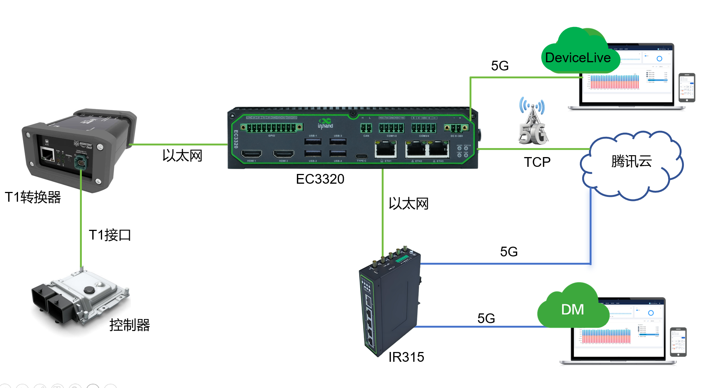
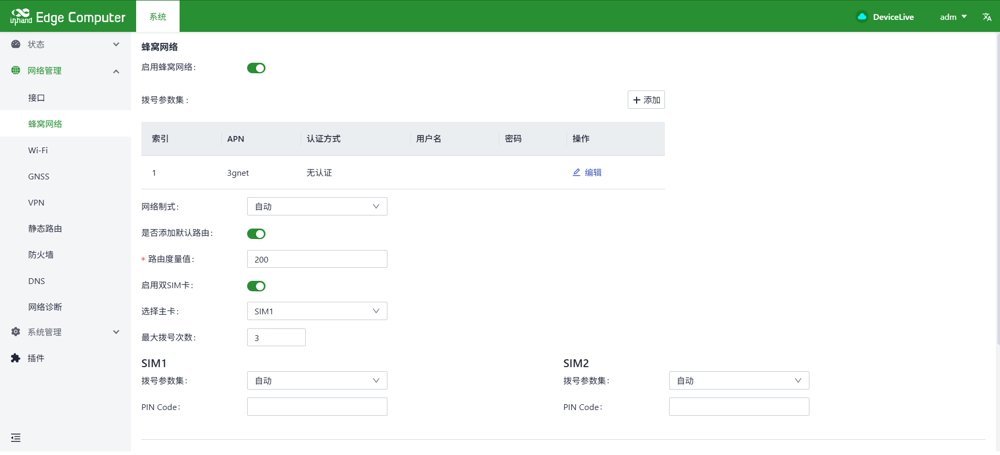
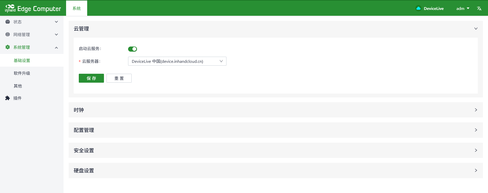
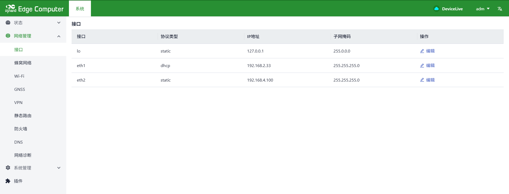
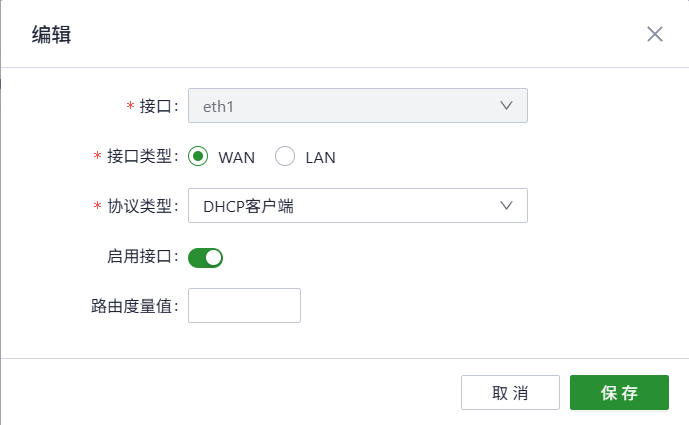
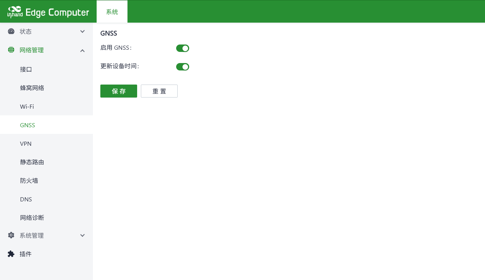
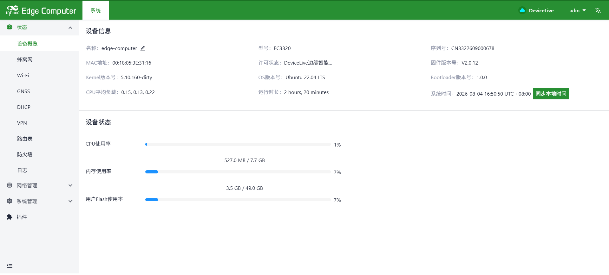
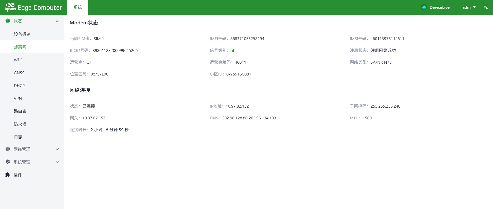
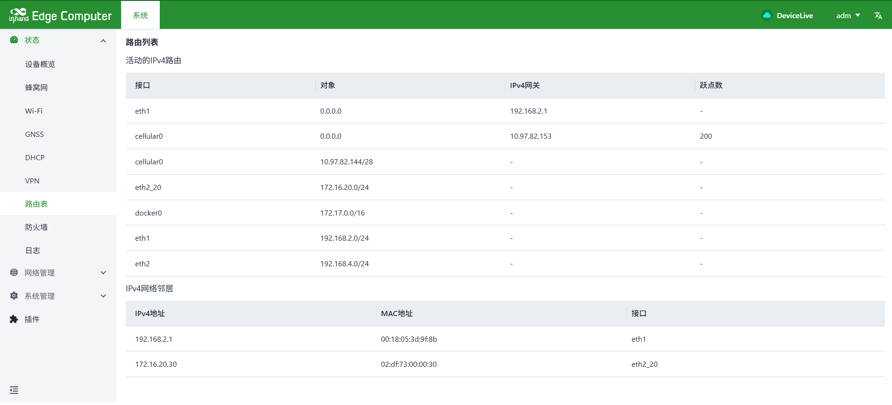
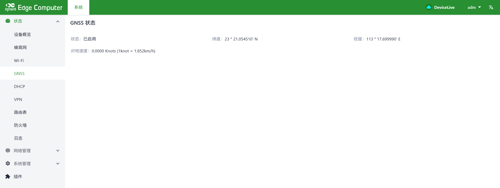

# 智能驾驶数据上云方案EC3320配置指导手册

## 一、文档信息

- 文档名称：配置手册
- 产品型号：EC3320
- 固件版本：V2.0.12
- 适用场景：设备联网、数据采集、上传
- 编写日期：2026年08月20日

## 二、边缘计算机概述

### 2.1 产品简介

EC3320是一款ARM架构的AI加速型边缘计算机，采用瑞芯微 RK3588 新一代旗舰级八核 64 位处理器，芯片自带 6TOPS 算力 NPU，搭载标准Linux 系统。EC3320接口包括3个千兆以太网端口、2HDMI、4DI、4DO、2RS-232、 2RS-485、4USB 3.0、1CAN 、Wi-Fi/BT、GPS。EC3320具有高度的可扩展性，可扩展支持LTE/5G、Hailo-8 AI 算力棒、SSD存储等。EC3320支持映翰通DeviceLive云管理。

### 2.2 主要功能

- 5G上网
- 远程配置、远程诊断、远程升级、数据采集
- 宽温工业级设计

### 2.3 典型应用拓扑

车载控制器 → T1转换器 → EC3320 → 5G/有线 →腾讯云

## 三、硬件说明

### 3.1 外观与接口

- 电源接口：DC 9–36V
- 网口：3路以太网接口
- 无线：5G
- 指示灯：Power、status、5G、User
- 按键：Power、Reset

### 3.2 接线说明

#### 3.2.1 电源接线

- 正极：+
- 负极：-
- 注意：防反接、防雷、接地

#### 3.2.2 以太网接线

直连 / 交叉自适应，建议超五类及以上网线。

## 四、出厂默认参数

- ETH2：192.168.4.100
- 子网掩码：255.255.255.0
- ETH2_20：172.16.20.30
- ETH1：192.168.2.10（DHCP获取）
- Web 用户名：adm
- Web 密码：123456
- SSH用户名：edge
- SSH密码：security@edge

## 五、前期准备

- 电脑设置与网关同网段 IP
- 网线连接电脑与网关 LAN 口
- 路由器上电，等待 Power 灯常亮
- 浏览器输入设备 IP 进入配置页面

## 六、网络配置

### 6.1 本地网络配置

- 插入5G SIM 卡。
- 开启移动网络，配置启用双卡模式

- 开启DeviceLive。

- LAN口配置。

- DHCP功能配置。

## 七、配置GNSS。

## 八、配置备份与恢复

- 导出配置文件
- 恢复出厂配置

## 九、状态监控与诊断

### 9.1 运行状态

- 设备在线状态

- 网络流量、信号强度

- 路由状态

- GNSS状态

### 9.2 日志查看

- 系统日志

## 十、常见问题与排查

- 无法打开 Web
  - 检查网段、网线、IP 是否冲突
  - 复位网关重试

## 十一、安全注意事项

- 工业现场可靠接地
- LAN口地址要修改成本地子网的网关
- 配置完成后备份
- 远程密码定期修改
- 禁止非授权人员操作
