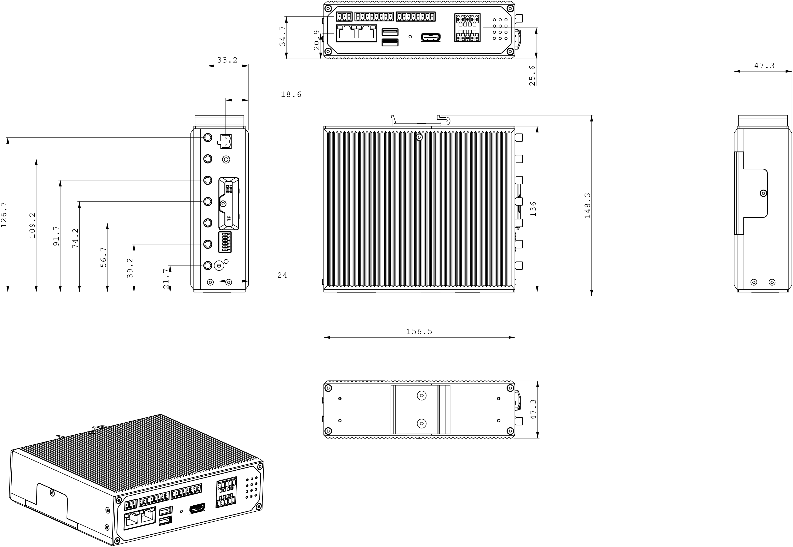
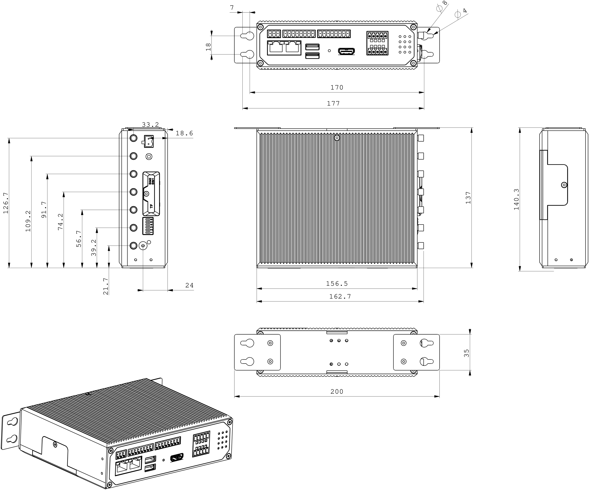
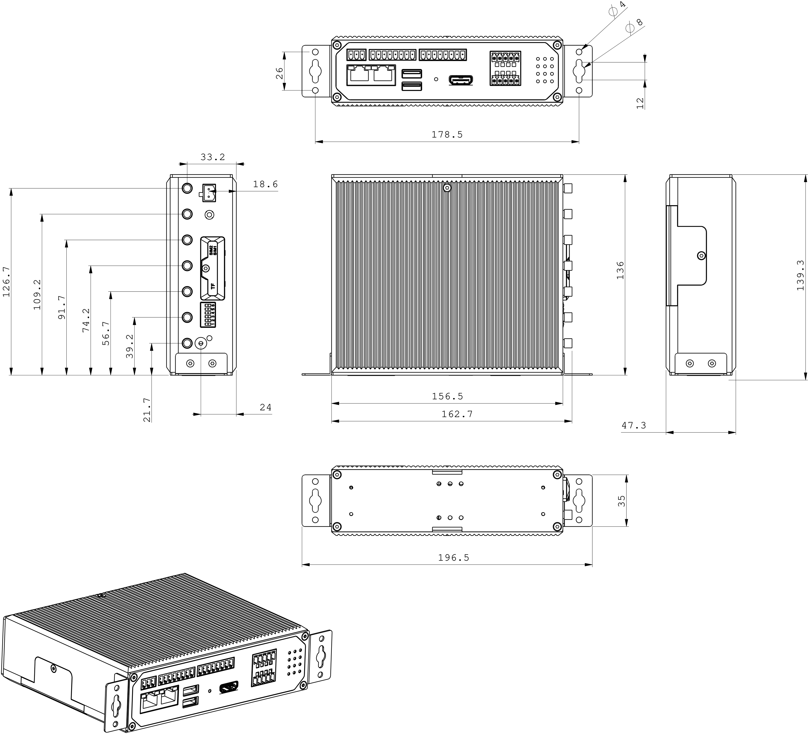
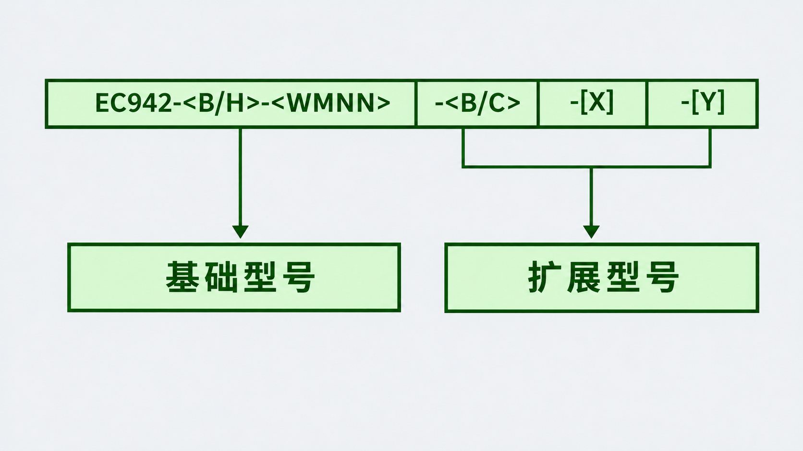

  

    

      
    

    

      EC942 系列轻量级 AI 边缘计算机
    

    

      拥抱边缘智能，赋能工业数字化
    

  

  

    

      

        
· 强大算力

        
· 高安全性

      

      

        
· 高可靠性

        
· 云化管理

      

    

  

# 1. 产品概述

**EC942 系列边缘计算机是映翰通面向工业物联网推出的轻量级 AI 加速边缘计算机。产品搭载 ARM Cortex-A55@2.0GHz 四核处理器，标配 4GB 内存和 16GB eMMC，提供强大的计算平台。产品采用 Linux 发行版系统，为用户提供灵活多样的二次开发环境。支持 Secure Boot、TPM2.0 等安全特性，保障软件与数据安全。内置 Device-Supervisor™ Agent（DSA）服务，轻松实现数据采集、处理与上云，并支持 DeviceLive 云端管理。**

**核心特性：**
- **性能平台：** 四核 Cortex-A55@2.0GHz，集成 Mali-G52 与 RKNN
- **工业级安全：** Secure Boot、TPM2.0、防火墙及 VPN
- **丰富接口：** 千兆以太网、串口、CAN、USB、HDMI、mSATA、DI/DO
- **可靠联网：** 5G/4G/Wi-Fi/千兆以太网备份，双 SIM 卡 failover，看门狗
- **云端运维：** DeviceLive 远程监控与边缘应用/容器管理

## 核心技术规格

| 技术指标 | 规格 |
|------|---------------|
| 开放平台 | Yocto/Linux（Debian 10，内核 4.19），Debian 软件包管理器 |
| CPU/GPU | 四核 Cortex-A55@2.0GHz / Mali-G52 2EE |
| NPU | RKNN，1 TOPS |
| 内存/存储 (可拓展)| 4GB / 16GB eMMC |
| 数据采集 | Modbus RTU/TCP、EtherNet/IP、OPC UA、DNP3.0、BACnet、CNC |
| 接口 | 2×GE、2×RS-232/485/422（端子排）、USB2.0、HDMI2.0、mSATA、microSD |
| 安全性（TPM2.0 可选） | Secure Boot、TPM2.0、防火墙、VPN |
| 云端管理 | DeviceLive，HTTP/HTTPS/SSH 远程管理 |
| 蜂窝网络 | 5G、LTE Cat.4/Cat.6（视型号而定） |
| 网络功能 | APN/VPDN、CHAP/PAP、ARP/以太网、静态 IP/DHCP |
| 电源输入 | DC 12~48V（8W） |
| 外形尺寸（宽 × 深 × 高） | 47.3 × 162.7 × 148.3 mm（1.86 × 6.41 × 5.84 in） |
| 防护等级 | IP30 |

# 2. 产品尺寸

  

    
    
尺寸图

  

  

    
  

  

    
  

  
注意：1. 所有尺寸单位为毫米（mm）。 2. 所有尺寸均为近似值，仅供参考。 3. 图示尺寸不得用于生产加工。 4. 尺寸需符合零件及制造公差要求。 5. 规格如有变更，恕不另行通知。

# 3. 硬件规格

| 类别/参数 | 规格 |
|--------------------------|------|
| **硬件平台** |  |
| CPU | 四核 Cortex-A55@2.0GHz |
| GPU | Mali-G52 2EE |
| NPU | RKNN，1 TOPS |
| 内存 | 4GB |
| FLASH | 16GB eMMC |
| **通信与接口** |  |
| 以太网口 | 2×10/100/1000 Mbps 千兆以太网 |
| I/O 接口（可选） | 4×DI + 4×DO |
| 串口 | 2×RS-232/485/422，端子排 |
| CAN（可选） | 1×CAN 2.0A/B |
| 按键 | 针孔式复位按钮 |
| SIM 卡座 | 2×MicroSIM |
| LED 指示灯 | 4G/5G、信号强度（L1、L2、L3）、SIM1、SIM2、User1、User2、PWR、STATUS、WARN、ERR |
| USB | USB2.0（2×Type-A + 1×Type-C） |
| microSD | 支持最大 32GB microSD 卡（推荐最大容量） |
| 扩展接口 | 1×mSATA，支持 mSATA SSD |
| HDMI | HDMI2.0 |
| Wi-Fi（可选） | AP&STA，802.11ac/a/b/g/n，2.4G/5G 双频 |
| 蓝牙（可选） | BLE4.2 |
| GPS（可选） | GPS/北斗/GLONASS |
| **电源与功耗** |  |
| 输入电压 | DC 12~48V，具备反接保护 |
| 电源接口 | 工业端子排 |
| 最大值（满负载） | 8W |
| **机械规格** |  |
| 产品尺寸 | 47.3 × 162.7 × 148.3 mm（1.86 × 6.41 × 5.84 in） |
| 产品重量 | 810 g（1.79 lb） |
| 安装方式 | DIN 导轨 / 壁挂安装 |
| 防护等级 | IP30 |
| 外壳与散热 | 金属外壳，无风扇设计 |
| TPM（可选） | TPM2.0 |
| **环境与认证** |  |
| 存储温度 | -40 °C ~ 85 °C（-40 °F ~ 185 °F） |
| 工作温度 | -20 °C ~ 70 °C（-4 °F ~ 158 °F） |
| 环境湿度 | 5~95% RH（无凝露） |
| 物理特性 | IEC60068-2-27 抗冲击 IEC60068-2-6 抗振动 IEC60068-2-32 抗跌落 |
| EMC 标准 | EN61000-4-2，等级 3，静电 EN61000-4-3，等级 3，辐射电场 EN61000-4-4，等级 3，脉冲电场 EN61000-4-5，等级 3，浪涌 EN61000-4-6，等级 3，传导骚扰抗扰度 EN61000-4-8，工频磁场抗扰度，水平 / 垂直 400A/m（>等级 2） EN61000-4-12，等级 3，振荡波抗扰度 |
| 认证 | CE、FCC、PTCRB、Verizon Wireless、AT&T、T-Mobile |

  
*TPM：EC942 在配备端子排串口（-T）且为高配型号（-H）时支持 TPM。

# 4. 软件规格

| 类别/参数 | 规格 |
|--------------------------|------|
| **操作系统** |  |
| 操作系统 | Yocto/Linux，Debian 10（内核 4.19） |
| 文件系统 | Debian 核心根文件系统 |
| 软件包管理器 | Debian 软件包管理器 |
| **网络功能** |  |
| 网络接入 | 5G / LTE Cat.4 / LTE Cat.6（视型号而定）、以太网 |
| 接入认证 | APN、VPDN、CHAP/PAP |
| WAN 协议 | 静态 IP、DHCP |
| LAN 协议 | ARP、以太网 |
| **安全** |  |
| 安全启动 | 支持 |
| **可靠性** |  |
| 链路检测 | 多级链路检测与自动重拨 |
| 内置看门狗 | 设备自诊断，运行故障自动恢复 |
| 备份机制 | 双 SIM 卡备份 |
| **数据采集协议（DSA）** |  |
| 工业协议 | Modbus RTU 主/从、Modbus TCP 主/从、EtherNet/IP、ISO on TCP、OPC UA 客户端/服务器、三菱 MC 3C/3E/3C OverTCP、三菱 CPU 端口、FINSUDP、HostLink、PPI |
| 电力协议 | DLT645-2007、IEC101/104、DNP3.0 |
| 其他协议 | BACnet、CNC |
| **网络管理** |  |
| 升级方式 | 支持专利升级机制，支持本地或远程固件升级 |
| 日志功能 | 支持本地系统日志、远程日志及重要日志断电保存 |
| 远程管理 | DeviceLive / HTTP / HTTPS / SSH 远程管理 |
| DeviceLive 云平台 | 支持云端参数配置、容器管理、应用与固件管理 |

  
*DSA：DeviceSupervisor Agent（DSA）是映翰通自主研发的智能软件，运行于边缘计算机产品上。它帮助客户以"零代码/低代码"方式快速实现数据采集、处理、协议转换与上云。如需在 EdgeComputer 产品上部署 DSA 应用，请联系我们获取 DSA 软件包。

# 5. 订购信息

## 型号代码

EC942-\<B/H\>-\<WMNN\>-\<B/C\>-[X]-[Y]

  

    
  

## 基本型号

\<B/H\>：Wi-Fi/GPS/CAN/TPM 及 I/O 能力（B=无，H=有）  
\<WMNN\>：蜂窝网络类型及频段

**基本型号列表**

<table style="width:100%; table-layout:fixed; font-size:11px;">
  <colgroup>
    <col style="width:19%;">
    <col style="width:12%;">
    <col style="width:8%;">
    <col style="width:33%;">
    <col style="width:18%;">
    <col style="width:10%;">
  </colgroup>
  <tr><th>型号</th><th>区域</th><th>&lt;B/H&gt;</th><th>&lt;WMNN&gt;</th><th>Wi-Fi/GPS/CAN</th><th>I/O</th></tr>
  <tr><td style="white-space: nowrap;">EC942-B-LQA8</td><td>中国</td><td>无</td><td>LTE Cat.4：LTE-FDD B1/B3/B5/B8；LTE-TDD B34/B38/B39/B40/B41；WCDMA B1/B8；TD-SCDMA B34/B39；CDMA BC0；GSM 900/1800MHz</td><td>无</td><td>无</td></tr>
  <tr><td style="white-space: nowrap;">EC942-H-LQA8</td><td>中国</td><td>有</td><td>LTE Cat.4：LTE-FDD B1/B3/B5/B8；LTE-TDD B34/B38/B39/B40/B41；WCDMA B1/B8；TD-SCDMA B34/B39；CDMA BC0；GSM 900/1800MHz</td><td>有</td><td>有</td></tr>
  <tr><td style="white-space: nowrap;">EC942-H-NRQ1</td><td>中国</td><td>有</td><td>5G NR NSA：n78/n79；5G NR SA：n1/3/5/8/28/41/77/78/79；LTE-FDD B1/B3/B5/B8；LTE-TDD B34/B38/B39/B40/B41；WCDMA B1/B8</td><td>有</td><td>有</td></tr>
  <tr><td style="white-space: nowrap;">EC942-H-NRQ3</td><td>全球（中国除外）</td><td>有</td><td>5G NR NSA：n1/n2/n3/n5/n7/n8/n12/n20/n25/n28/n38/n40/n41/n48/n66/n71/n77/n78/n79；5G NR SA：n1/n2/n3/n5/n7/n8/n12/n20/n25/n28/n38/n40/n41/n48/n66/n71/n77/n78/n79；LTE FDD：B1/B2/B3/B5/B7/B8/B12(B17)/B13/B14/B18/B19/B20/B25/B26/B28/B29/B30/B32/B66/B71；LTE TDD：B34/B38/B39/B40/B41/B42/B48；LAA：B46；WCDMA 频段：B1/B2/B3/B4/B5/B6/B8/B19</td><td>有</td><td>有</td></tr>
  <tr><td style="white-space: nowrap;">EC942-B-FQ58</td><td>欧洲、中东及非洲（EMEA）</td><td>无</td><td>LTE Cat.4：LTE-FDD Band1/3/7/8/20/28A；LTE-TDD Band38/40/41；WCDMA Band1/8；GSM Band3/8</td><td>无</td><td>无</td></tr>
  <tr><td style="white-space: nowrap;">EC942-H-FQ58</td><td>欧洲、中东及非洲（EMEA）</td><td>有</td><td>LTE Cat.4：LTE-FDD Band1/3/7/8/20/28A；LTE-TDD Band38/40/41；WCDMA Band1/8；GSM Band3/8</td><td>有</td><td>有</td></tr>
  <tr><td style="white-space: nowrap;">EC942-H-FQ38</td><td>北美</td><td>有</td><td>LTE Cat.4：LTE-FDD Band2/4/5/12/13/14/66/71；WCDMA Band 2/4/5</td><td>有</td><td>有</td></tr>
  <tr><td style="white-space: nowrap;">EC942-B-FQ78</td><td>澳大利亚及拉丁美洲</td><td>无</td><td>Cat.4：LTE-FDD Band1/2/3/4/5/7/8/28；LTE-TDD B40；UMTS(DC-HSPA+) Band1/2/5/8；EDGE/GPRS/GSM 850/900/1800/1900MHz</td><td>无</td><td>无</td></tr>
  <tr><td style="white-space: nowrap;">EC942-H-FQ78</td><td>澳大利亚及拉丁美洲</td><td>有</td><td>Cat.4：LTE-FDD Band1/2/3/4/5/7/8/28；LTE-TDD B40；UMTS(DC-HSPA+) Band1/2/5/8；EDGE/GPRS/GSM 850/900/1800/1900MHz</td><td>有</td><td>有</td></tr>
  <tr><td style="white-space: nowrap;">EC942-B-EN00</td><td>全球</td><td>无</td><td>无蜂窝网络</td><td>无</td><td>无</td></tr>
  <tr><td style="white-space: nowrap;">EC942-H-EN00</td><td>全球</td><td>有</td><td>无蜂窝网络</td><td>有</td><td>有</td></tr>
</table>

## 扩展型号（可选）

| 选项 | 说明 |
|--------|-------------|
| \<B/C\> | 内存：B=4GB，C=4GB；eMMC：B = 16GB eMMC，C = 32GB eMMC |
| [X] | 操作系统（见下方操作系统选项） |
| [Y] | -T：端子排串口 |

## 操作系统选项（可选）

| [X] P/N 代码 | 特性 |
|--------------|---------|
| — | IEOS（默认） |
| D | Debian Linux 操作系统 |

  
· IEOS（InHand Edge Operating System）是映翰通基于 Linux 发行版、面向物联网 ARM 平台边缘计算机开发的操作系统，帮助客户实现安全、稳定的工业边缘智能应用。IEOS 包含 Web 配置、拨号、路由、防火墙、VPN、云管理映翰通应用等。

  
· Debian Linux 操作系统：不含映翰通应用的 Debian 操作系统。

  
注：EC942 在配备端子排串口（-T）且为高配型号（-H）时支持 TPM。

# 6. 联系我们

- **网站：** [InHand Networks](https://www.inhand.com)
- **版权：** © 2026 InHand Networks. 版权所有。
