# InGateway101系列产品用户手册

## 前置信息

### 声明

首先非常感谢您选择本公司产品！在使用前，请您仔细阅读本用户手册，遵守以下声明，将有助于维护知识产权和法律合规性，以确保您的使用体验与产品的最新信息相一致。如有任何疑问或需要获取书面许可，请随时联系我们的技术支持团队。

- 版权声明

本用户手册包含受版权保护的内容，版权归北京映翰通网络技术股份有限公司及其许可者所有。未经书面许可，任何单位和个人不得擅自摘抄、复制本手册的部分或全部内容，且不得以任何形式传播。

- 免责声明

由于产品技术和规格不断更新，本公司不能承诺用户手册中的资料与实际产品完全一致。因此，不承担由于实际技术参数与用户手册不符而引起的任何争议。任何关于产品的改动恕不提前通知，本公司保留最终更改权和解释权。

- 版权信息

本用户手册内容受版权法律保护，版权归北京映翰通网络技术股份有限公司及其许可者所有，保留一切权利。未经书面许可，不得擅自使用、复制或传播本手册的内容。

### 图形界面约定

| 符号 | 含义 | 示例 |
|------|------|------|
| `< >` | 表示变量或参数，需替换为实际值 | `<IP地址>` 表示需填入具体IP |
| `" "` | 表示界面上的文字标签，包括按钮名、窗口名、菜单名 | 单击"连接"按钮 |
| `→` | 表示菜单层级或操作顺序 | 文件→会话日志 |
| `【 】` | 表示菜单或页面名称 | 进入【网络设置】页面 |
| `>>` | 多级菜单分隔符 | "网络设置>>拨号参数设置"表示"网络设置"菜单下的"拨号参数设置"子菜单 |
| `> **注意**` | 提醒操作中应注意的事项，不当的操作可能会导致数据丢失或者设备损坏 | > **注意**：设备不支持1200波特率 |
| `> **说明**` | 对操作内容的描述进行必要的补充和说明 | > **说明**：IG101暂支持MODBUS RTU |

### 技术支持

**北京映翰通网络技术股份有限公司（总部）**

电话：010-8417 0010

地址：北京市朝阳区紫月路18号院3号楼5层

**成都办事处**

电话：028-8679 8244

地址：四川省成都市武侯区天府大道北段1777号中国太平金融大厦14层

**广州办事处**

电话：020-8562 9571

地址：广州市天河区棠东东路5号远洋新三板创意园B-130单元

**武汉办事处**

电话：027-8716 3566

地址：湖北省武汉市洪山区珞瑜东路2号巴黎豪庭11栋2001室

**上海办事处**

电话：021-5480 8501

地址：上海市普陀区顺义路18号1103室

### 如何使用本手册

**a) 对号入座**

- 首次使用用户：建议按顺序阅读「认识设备」→「安装与首次使用」→「常用场景配置」→「功能说明与参数参考」
- 已有设备用户：可直接查阅「常用场景配置」「功能说明与参数参考」或「附录 故障处理」
- 需要完整部署方案的用户：可查阅「典型应用」中的端到端配置案例

**b) 按任务快速跳转**

| 任务 | 对应章节 | 预计用时 |
|------|----------|----------|
| 安装设备并完成首次上电 | [第2章 安装与首次使用](#第2章-安装与首次使用) | 约15分钟 |
| 蜂窝拨号上网 | [场景1：蜂窝拨号上网](#场景1蜂窝拨号上网) | 约5分钟 |
| NTP时间同步 | [场景2：NTP时间同步](#场景2ntp时间同步) | 约5分钟 |
| 配置MODBUS数据采集 | [场景3：MODBUS数据采集配置](#场景3modbus数据采集配置) | 约10分钟 |
| 配置MQTT上云 | [场景4：MQTT上云配置](#场景4mqtt上云配置) | 约10分钟 |
| 配置MODBUS/MQTT点表 | [场景5](#场景5配置modbus点表)、[场景6](#场景6配置mqtt点表) | 约10分钟 |
| MODBUS采集数据转MQTT上云完整部署 | [案例1](#案例1模拟modbus采集数据转换mqtt上云) | 约30分钟 |
| 排查设备故障 | [附录 故障处理](#附录-故障处理) | 按需 |
| 抓取设备运行日志 | [附录 日志抓取](#附录-日志抓取) | 按需 |

## 第1章 认识设备

### 1.1 概述

InGateway101系列边缘计算网关是映翰通公司面向工业物联网领域推出的小尺寸紧凑型边缘网关。产品基于工业级OpenCPU智能模组设计，支持GSM/LTE网络制式，凭借移动运营商部署的4G无线网络提供随处可得的不间断互联网接入，具备边缘计算能力、全面的安全性和无线接入服务，可实现多达万级的设备联网。产品支持MQTT协议接入云平台、I/O扩展、Modbus协议数据交互以及定制化二次开发，可完成现场设备的远程控制、数据优化、实时响应、敏捷连接与智能分析，广泛应用于远程/现场数据采集、远程监控、现场控制等多种领域。

主要特点如下：

1. 高性价比4G工业级网关；
2. 支持MQTT协议，实现设备接入云平台；
3. 支持I/O扩展，可对接更多工业设备；
4. 支持Modbus协议，实现数据交互；
5. 支持定制化二次开发，实现边缘计算能力；
6. 防潮、抗干扰设计；
7. USB配置口，便于现场调试；
8. EMC 3级防护，适应工业环境。

### 1.2 典型组网

映翰通公司提供一套完备的解决方案，用户以较小的投入即可提高生产运行效率。InGateway101通过4G蜂窝网络接入互联网，实现现场设备数据的采集与上云，其典型组网方式如图1-1所示。

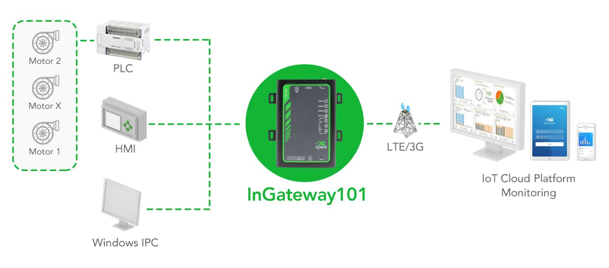

<strong>图 1-1 InGateway101典型组网方式</strong>

### 1.3 包装清单

| 物品 | 数量 | 说明 |
|------|------|------|
| InGateway101系列边缘网关 | 1台 | 标配 |
| 4G LTE吸盘天线 | 1根 | 标配 |
| 7pin工业端子 | 1个 | 标配 |
| 取卡针 | 1个 | 标配 |
| 电源适配器 | 1个 | 选配 |

**表 1-1 InGateway101接口说明**

| 接口 | 信号定义 | 功能说明 |
| :---: | --- | --- |
| 接线端子1 | V+ | 电源正极 |
| 接线端子2 | V- | 电源负极 |
| 接线端子3 | B | 串口1的RS-485- |
| 接线端子4 | A | 串口1的RS-485+ |
| 接线端子5 | GND | 串口通信收发地 |
| 接线端子6 | TXD | 串口RS232通信发送 |
| 接线端子7 | RXD | 串口RS232通信接收 |
| USB配置口 | - | Type-C接口，用于连接PC运行配置工具及现场调试 |
| SIM卡槽 | - | 用于插入SIM卡，通过取卡针弹出卡槽 |
| LTE天线接口 | - | SMA-J接口，用于连接4G LTE天线 |

### 1.4 指示灯说明

InGateway101提供7个状态指示灯，指示灯位置如图1-4所示。

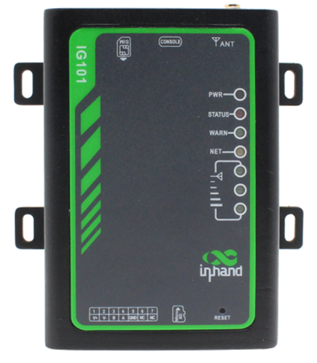

<strong>图 1-4 InGateway101状态灯示意图</strong>

**表 1-2 运行状态指示灯定义**

| POWER（红色） | STATUS（绿色） | WARN（黄色） | NET（绿色） | 设备状态 |
| :---: | :---: | :---: | :---: | :---: |
| 亮 | 灭 | 灭 | 灭 | 开机 |
| 亮 | 慢闪 | 灭 | 灭 | 开机成功 |
| 亮 | 慢闪 | 灭 | 快闪 | 正在拨号 |
| 亮 | 慢闪 | 灭 | 亮 | 拨号成功 |
| 亮 | 慢闪 | 灭 | 慢闪 | 平台连接成功 |
| 亮 | 慢闪 | 慢闪 | 灭 | 复位成功 |
| 亮 | 慢闪 | 快闪 | 灭 | 正在升级 |

**表 1-3 信号强度指示灯定义**

| 信号状态 | 指示灯1 | 指示灯2 | 指示灯3 |
| :---: | :---: | :---: | :---: |
| 未检测到信号 | 灭 | 灭 | 灭 |
| 信号弱（1≤CSQ≤9） | 亮 | 灭 | 灭 |
| 信号一般（10≤CSQ≤19） | 亮 | 亮 | 灭 |
| 信号良好（20≤CSQ≤31） | 亮 | 亮 | 亮 |

### 1.5 默认设置

**表 1-4 InGateway101默认参数**

| 参数项 | 默认值 | 说明 |
|------|------|------|
| 配置工具登录账号 | adm | 登录InHand IG100配置工具 |
| 配置工具登录密码 | 123456 | 登录InHand IG100配置工具 |
| 拨号参数 | 公网拨号参数 | SIM卡无特殊配置要求时无需修改 |
| NTP服务 | 开启 | 同步周期默认1小时，最长可设置360小时 |
| MODBUS功能 | 关闭 | 需手动开启后方可配置 |
| MODBUS响应超时 | 1000毫秒 | 最低可设置10毫秒 |
| MODBUS发送间隔 | 100毫秒 | - |
| MODBUS采集周期 | 60秒 | - |
| MQTT功能 | 关闭 | 需手动开启后方可配置 |
| MQTT心跳时间 | 60秒 | - |

## 第2章 安装与首次使用

### 2.1 安装前准备

安装设备前，需确认以下事项：

1. **电源要求**：供电范围为DC 7V～38V（典型12VDC），需注意电源电压等级；
2. **环境要求**：工作温度-20℃～70℃，存储温度-40℃～85℃，相对湿度5%～95%（无凝露）。设备表面可能高温，安装时需考虑周边环境，应安装在受限制的区域；
3. 安装位置应避免阳光直射，远离发热源或有强烈电磁干扰的区域；
4. 检查是否已备齐安装所需的电缆和接头；
5. 设备支持导轨安装和挂耳安装，具体安装方式可根据实际需求选定。

> **注意**：请不要在带电情况下进行硬件安装。

> **注意**：供电必须保证电源的稳定性（纹波小于300mV，并确保瞬间电压不超过38V），并保证电源功率大于8W。

### 2.2 安装指南

#### 2.2.1 安装SIM卡

1. 用随整机配套的取卡针插入SIM卡槽旁边的取卡孔，稍微向内用力，弹出SIM卡槽；
2. 放入SIM卡，还原插回卡槽。SIM卡安装如图2-1所示。

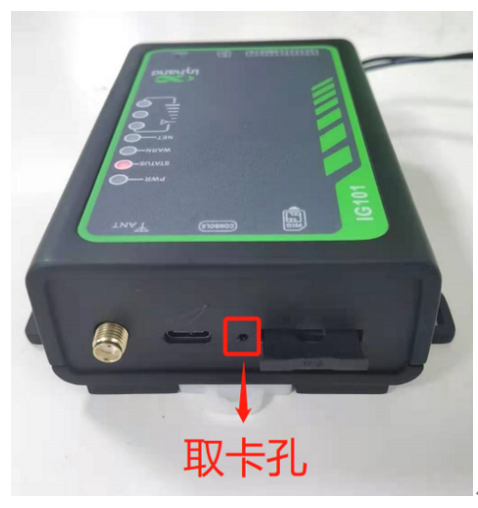

<strong>图 2-1 SIM卡安装</strong>

#### 2.2.2 安装LTE天线

用手轻轻转动金属SMA-J接口可活动部分到不能转动（此时看不到天线连接线外螺纹）即可，不要握住黑色胶套用力拧天线。LTE天线安装如图2-2所示。

<strong>图 2-2 LTE天线安装</strong>

#### 2.2.3 端子连接与上电

1. 参照[表 1-1 接口说明](#14-外观与接口)中的接线定义连接设备；
2. 连接电源线（接线端子1接电源正极V+，接线端子2接电源负极V-）；
3. 根据现场设备连接串口线（RS-485对应A/B端子，RS-232对应TXD/RXD端子）；
4. 确认接线无误后给设备上电，观察指示灯状态（参见[1.5 指示灯说明](#15-指示灯说明)）。

> **注意**：请不要在带电情况下进行硬件安装。

> **注意**：设备支持的供电范围为DC 7V～38V，供电必须保证电源的稳定性（纹波小于300mV，并确保瞬间电压不超过38V），并保证电源功率大于8W以上。

#### 2.2.4 安装配置工具

设备通过InHand IG100配置工具进行配置，配置工具界面如图2-3所示。

<strong>图 2-3 InHand IG100配置工具</strong>

1. 双击安装包可执行文件，按照默认提示完成安装。配置工具运行环境如图2-4所示。

<strong>图 2-4 配置工具运行环境</strong>

2. 安装串口驱动，用于调试串口，如图2-5所示。

<strong>图 2-5 安装串口驱动</strong>

#### 2.2.5 连接设备并登录配置工具

1. 在PC打开配置工具前，先确认登录配置工具的串口号。在PC设备管理器中查看串口（Type-C接口）的COM号，如图2-6、图2-7所示。

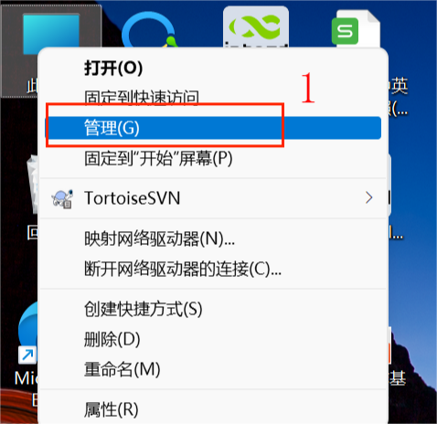

<strong>图 2-6 打开设备管理器</strong>

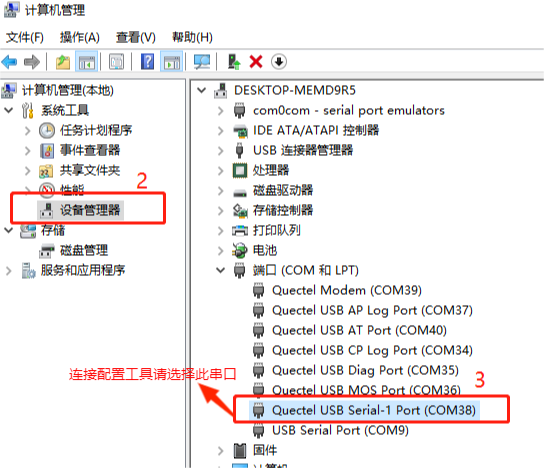

<strong>图 2-7 查看串口COM号</strong>

2. PC打开配置工具，单击"连接设备"，在弹出的新对话框中选择串口和串口波特率等串口参数，最后单击"连接"即可，如图2-8～图2-10所示。默认管理员账号为adm，登录密码为123456。

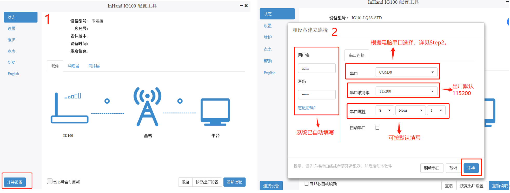

<strong>图 2-8 连接设备</strong>

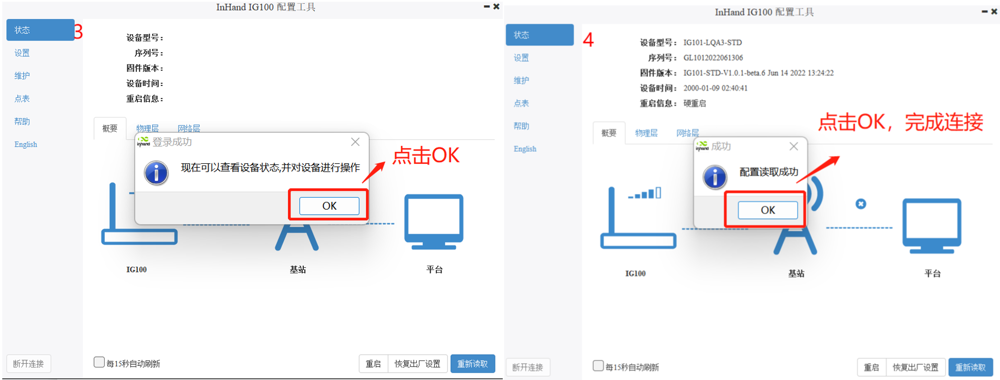

<strong>图 2-9 选择串口参数</strong>

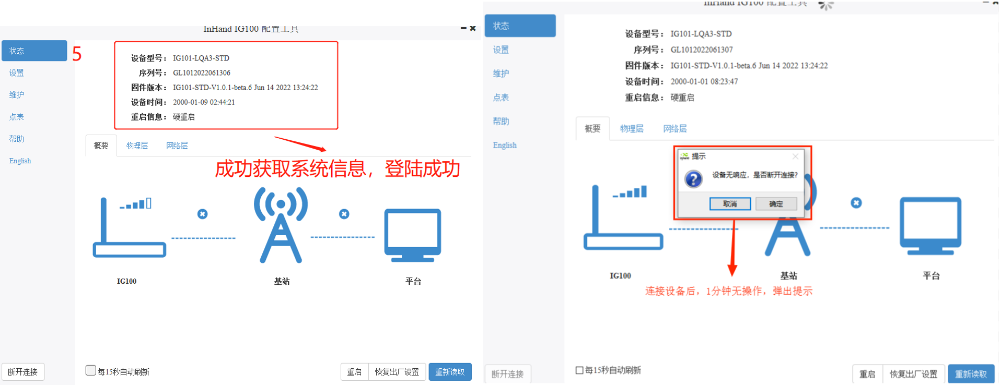

<strong>图 2-10 配置工具主界面</strong>

> **注意**：连接成功后，若长时间无操作，配置工具将弹出提示。

### 2.3 快速检查

安装完成后，按以下清单逐项检查：

| 检查项 | 预期结果 | 参考章节 |
|------|------|------|
| 电源连接 | POWER指示灯常亮 | [1.5 指示灯说明](#15-指示灯说明) |
| 设备启动 | STATUS指示灯慢闪（开机成功） | [1.5 指示灯说明](#15-指示灯说明) |
| SIM卡与天线 | SIM卡安装到位，天线安装牢固 | [2.2.1](#221-安装sim卡)、[2.2.2](#222-安装lte天线) |
| 配置工具连接 | 配置工具可正常连接设备 | [2.2.5](#225-连接设备并登录配置工具) |
| 蜂窝网络 | 拨号成功后NET指示灯常亮 | [场景1](#场景1蜂窝拨号上网) |

## 第3章 常用场景配置

本章按使用场景组织配置任务。设备通过InHand IG100配置工具进行配置（连接方法参见[2.2.5 连接设备并登录配置工具](#225-连接设备并登录配置工具)）。各场景配置完成后，均需单击"保存配置"并重启设备，配置方可生效。

### 场景1：蜂窝拨号上网

**目标**：通过4G蜂窝网络接入互联网。

**前提**：已插入SIM卡并安装天线，设备已上电，PC已通过配置工具连接设备。

**预计用时**：约5分钟。

**操作步骤**：

1. 打开"网络设置>>拨号参数设置>>SIM卡1设置"进行参数修改，如图3-1所示。

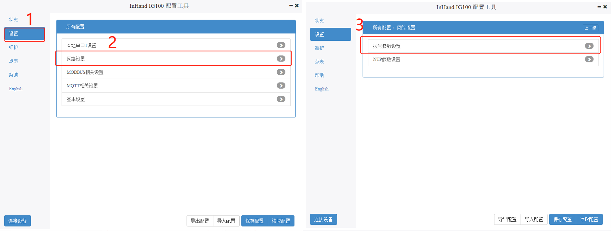

<strong>图 3-1 SIM卡1拨号参数设置</strong>

2. 默认参数即为公网拨号参数，如SIM卡无特殊配置要求，无需更改；如使用专线，修改网络接入点名称（APN）、网络拨号用户名/密码，如图3-2所示。

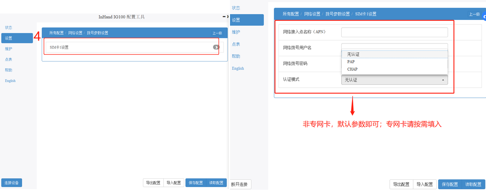

<strong>图 3-2 拨号参数修改</strong>

3. 单击"保存配置"，重启设备使配置生效。

> **注意**：拨号用户名无法采用中文字符，需用英文字符命名。

**验证方法**：

1. 观察NET指示灯：快闪表示正在拨号，常亮表示拨号成功（参见[1.5 指示灯说明](#15-指示灯说明)）；
2. 拨号成功后，设备即可通过蜂窝网络接入互联网。

**常见问题**：

- 无法拨号：检查SIM卡是否正确插入、是否欠费停机或损坏；检查APN、账号、密码等拨号参数是否正确；检查无线网络信号质量。详见[附录 故障处理](#附录-故障处理)。

### 场景2：NTP时间同步

**目标**：通过网络时间协议（NTP）同步设备系统时间。

**前提**：设备已拨号上网（参见[场景1](#场景1蜂窝拨号上网)），PC已通过配置工具连接设备。

**预计用时**：约5分钟。

**操作步骤**：

1. 打开"网络设置>>NTP参数设置"，默认已开启NTP服务，设备可从NTP服务器获取时间并同步，如图3-3所示。

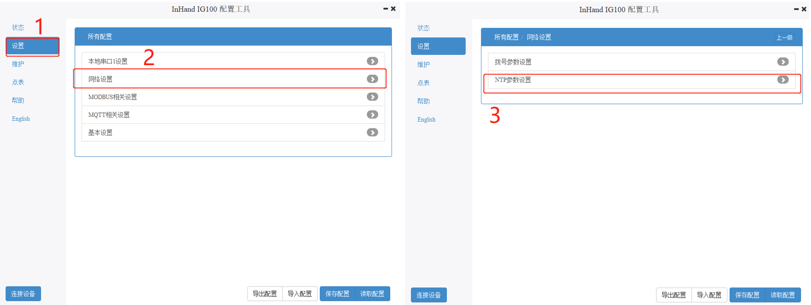

<strong>图 3-3 NTP参数设置</strong>

2. 按需修改同步周期，如图3-4所示。NTP同步周期最长可设置360小时，默认1小时。

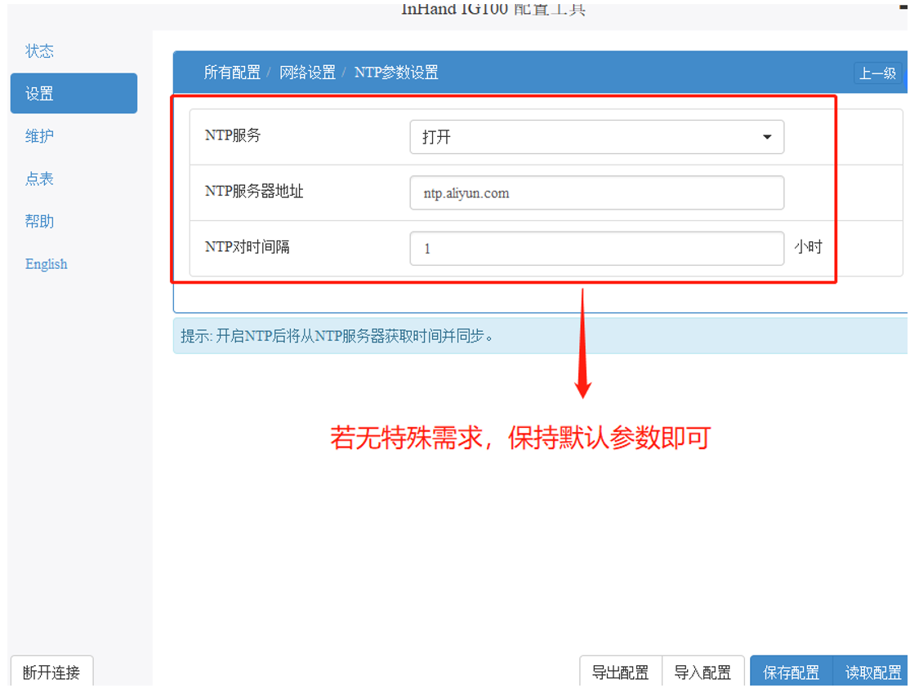

<strong>图 3-4 NTP同步周期修改</strong>

3. 单击"保存配置"，重启设备使配置生效。

> **注意**：如使用NTP，需保持无线网络正常。

**验证方法**：

1. 查看设备系统时间，确认与标准时间一致。

**常见问题**：

- 时间同步失败：检查设备是否已拨号上网，确认NTP服务器可达。

### 场景3：MODBUS数据采集配置

**目标**：通过串口采集MODBUS从设备的数据。

**前提**：MODBUS从设备已通过RS-485或RS-232串口接入设备对应端子（接线定义参见[表 1-1 接口说明](#14-外观与接口)），PC已通过配置工具连接设备。

**预计用时**：约10分钟。

**操作步骤**：

1. 设置通信串口（本地串口1）参数，其参数设置需和本串口相连的对端串口参数保持一致，如图3-5所示。

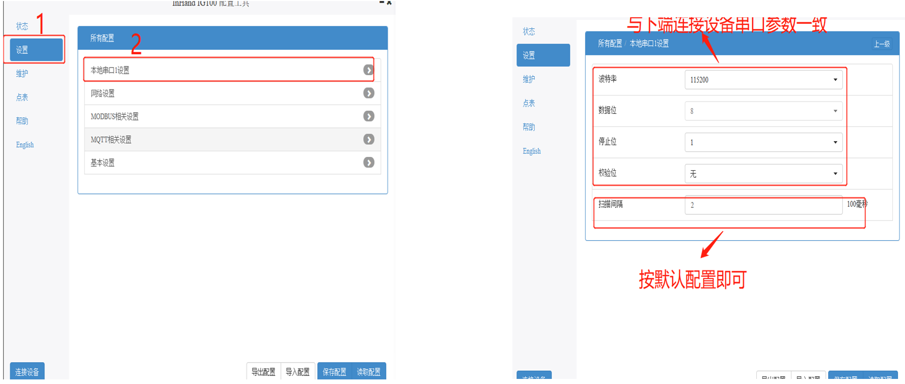

<strong>图 3-5 通信串口参数设置</strong>

> **注意**：此设备不支持1200波特率。

2. 打开"网络设置>>MODBUS相关设置"，默认关闭MODBUS功能，需手动点击"打开"后方可进行后续配置。
3. 配置数据串口、响应超时、发送间隔、采集周期等参数，参数说明详见[4.4 MODBUS参数](#44-modbus参数)，如图3-6所示。

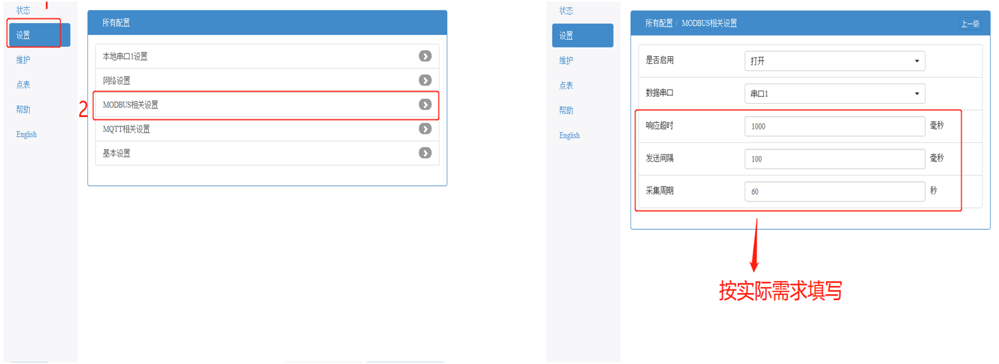

<strong>图 3-6 MODBUS相关设置</strong>

> **注意**：采集周期应大于响应超时×测点数量。

4. 单击"保存配置"，重启设备使配置生效。

**验证方法**：

1. 使用MODBUS调试工具连接设备串口，验证数据采集是否正常。详细步骤参见[案例1](#案例1模拟modbus采集数据转换mqtt上云)中的MODBUS调试验证部分。

**常见问题**：

- 串口通信失败：检查串口接线（RS-485的A/B线、RS-232的TXD/RXD线是否对应）；检查串口参数是否与对端设备一致。

### 场景4：MQTT上云配置

**目标**：将设备数据通过MQTT协议发布至MQTT服务器。

**前提**：设备已拨号上网（参见[场景1](#场景1蜂窝拨号上网)），MQTT服务器地址、端口及鉴权信息已就绪，PC已通过配置工具连接设备。

**预计用时**：约10分钟。

**操作步骤**：

1. 打开"网络设置>>MQTT相关设置"，默认关闭MQTT，手动点击"打开"后方可启用MQTT，如图3-7所示。

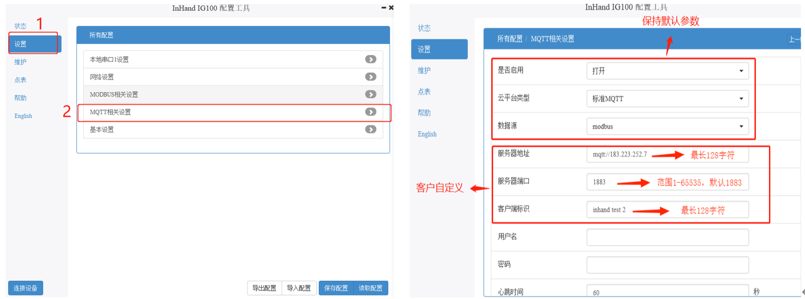

<strong>图 3-7 MQTT相关设置</strong>

2. 配置服务器地址、服务器端口、客户端标识、用户名/密码、心跳时间等参数，参数说明详见[4.5 MQTT参数](#45-mqtt参数)，如图3-8、图3-9所示。

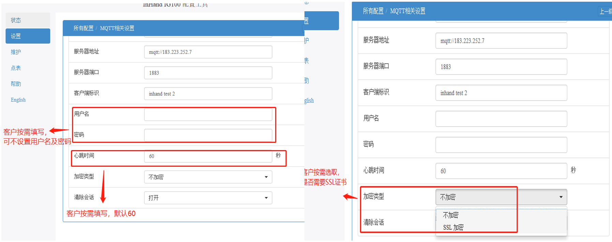

<strong>图 3-8 MQTT参数配置</strong>

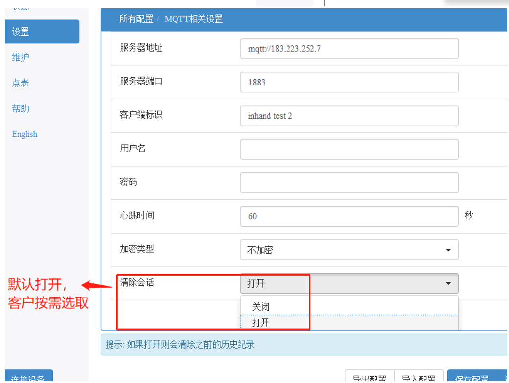

<strong>图 3-9 MQTT参数配置界面</strong>

3. 单击"保存配置"，重启设备使配置生效。

**验证方法**：

1. 使用MQTT客户端工具连接服务器并订阅主题，验证数据上报是否正常。详细步骤参见[案例1](#案例1模拟modbus采集数据转换mqtt上云)中的MQTT调试验证部分。

**常见问题**：

- MQTT连接失败：检查服务器地址和端口是否正确；检查用户名、密码是否正确；确认设备已正常联网。

### 场景5：配置MODBUS点表

**目标**：定义需通过串口采集的MODBUS数据点。

**前提**：已完成[场景3](#场景3modbus数据采集配置)（MODBUS功能已开启），PC已通过配置工具连接设备。

**预计用时**：约10分钟（视点表数量而定）。

**操作步骤**：

1. 打开"点表>>MODBUS"，如图3-10所示。

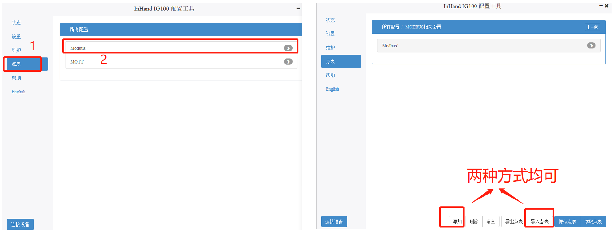

<strong>图 3-10 MODBUS点表列表</strong>

2. 采用以下两种方式之一添加点表：
   - **方式1：逐个添加**。点击"添加"，依次配置变量名、设备地址、起始地址等参数（参数说明详见[4.6 MODBUS点表参数](#46-modbus点表参数)），如图3-11～图3-13所示。

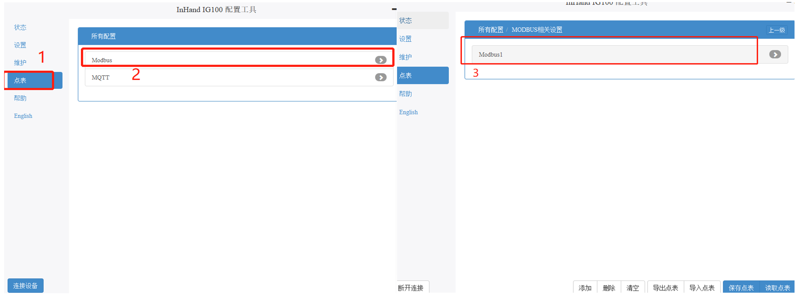

<strong>图 3-11 逐个添加MODBUS点表</strong>

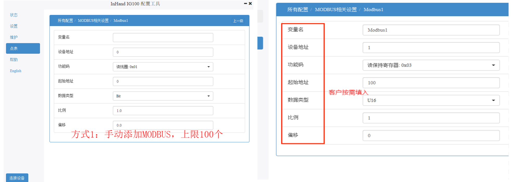

<strong>图 3-12 MODBUS点表参数配置</strong>

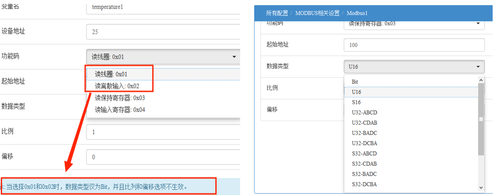

<strong>图 3-13 点表添加完成</strong>

   - **方式2：外部导入**。在"点表>>MODBUS"页面导入点表文件，如图3-14、图3-15所示。导入后如需重新配置变量名、设备地址、起始地址等参数，参见方式1。

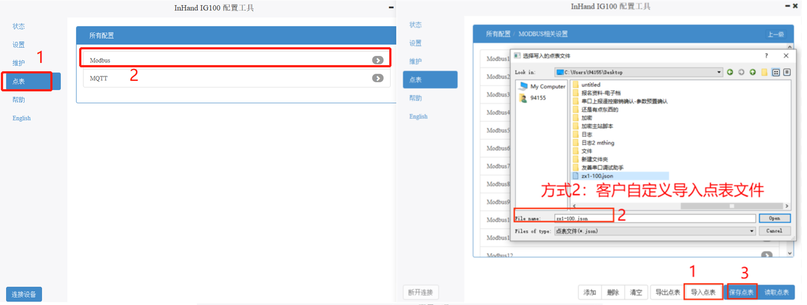

<strong>图 3-14 导入MODBUS点表</strong>

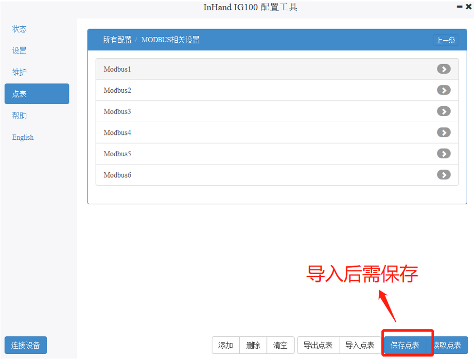

<strong>图 3-15 导入完成</strong>

> **说明**：IG101暂默认支持MODBUS RTU，支持RS-232及RS-485两种电气接口。

3. 添加或导入完成后，返回上一级，点击"保存点表"，如图3-16所示。

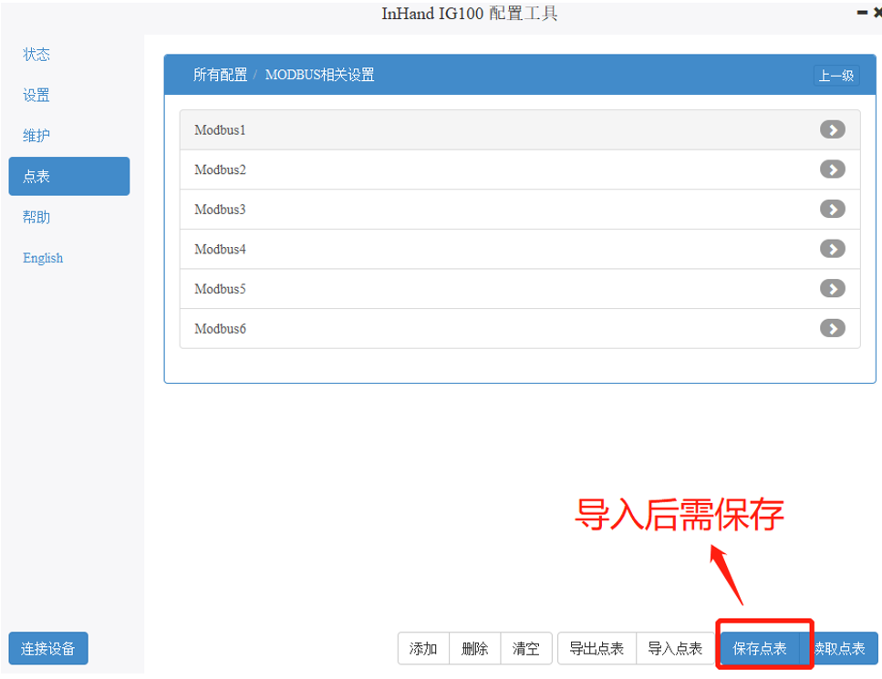

<strong>图 3-16 保存点表</strong>

4. 重新连接设备。

> **注意**：MODBUS点表上限200个。变量名只能采用英文定义。

**验证方法**：

1. 重新连接设备后，查看点表列表，确认点表已保存生效。

**常见问题**：

- 点表保存失败：确认已点击"保存点表"并重新连接设备；确认点表数量未超过上限200个。

### 场景6：配置MQTT点表

**目标**：定义通过MQTT发布的数据点及其主题（topic）。

**前提**：已完成[场景4](#场景4mqtt上云配置)（MQTT已开启）和[场景5](#场景5配置modbus点表)（MODBUS点表已配置），PC已通过配置工具连接设备。

**预计用时**：约10分钟（视点表数量而定）。

**操作步骤**：

1. 打开"点表>>MQTT"，如图3-17所示。

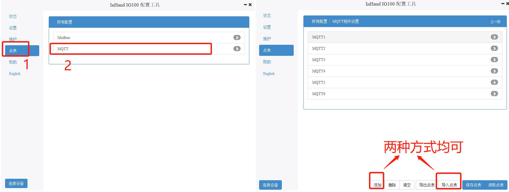

<strong>图 3-17 MQTT点表列表</strong>

2. 采用以下两种方式之一添加点表：
   - **方式1：逐个添加**。点击"添加"，依次配置发布（Publisher）部分的topic、qos、retain等参数（参数说明详见[4.7 MQTT点表参数](#47-mqtt点表参数)），如图3-18所示。

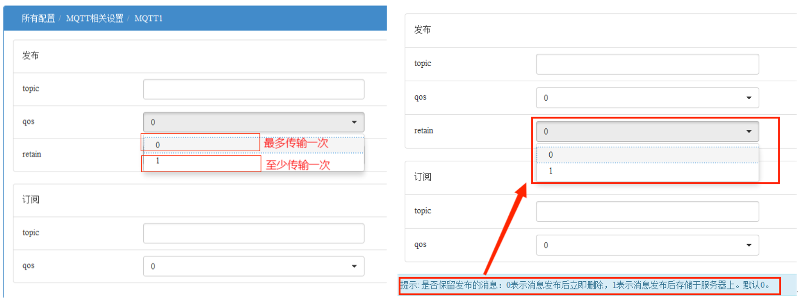

<strong>图 3-18 逐个添加MQTT点表</strong>

   - **方式2：外部导入**。在"点表>>MQTT"页面导入点表文件，如图3-19所示。导入后如需重新配置topic、qos、retain等参数，参见方式1。

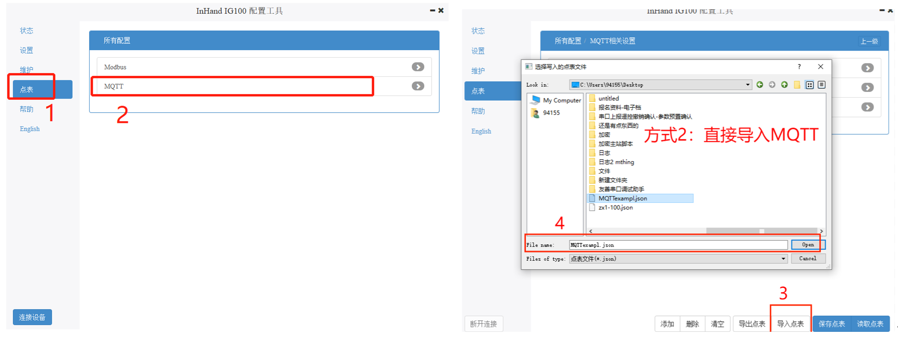

<strong>图 3-19 导入MQTT点表</strong>

> **说明**：外部导入的MQTT点表格式参见[案例1](#案例1模拟modbus采集数据转换mqtt上云)中的MQTT点表示例部分。

> **注意**：IG101暂不支持MQTT订阅模式。

3. 添加或导入完成后，返回上一级，点击"保存点表"，如图3-20所示。

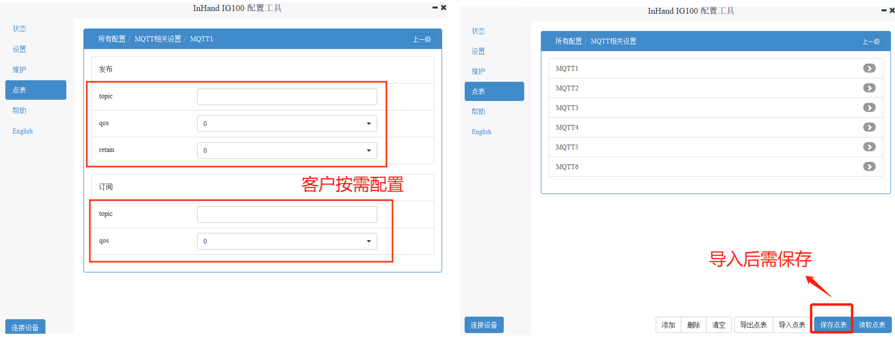

<strong>图 3-20 保存点表</strong>

4. 重新连接设备。

> **注意**：MQTT点表上限100个。

**验证方法**：

1. 重新连接设备后，查看点表列表，确认点表已保存生效。

**常见问题**：

- 点表保存失败：确认已点击"保存点表"并重新连接设备；确认点表数量未超过上限100个。

## 第4章 功能说明与参数参考

本章按功能模块说明各参数的含义与取值。各功能的配置入口及操作步骤参见[第3章 常用场景配置](#第3章-常用场景配置)。

### 4.1 拨号参数

**配置入口**："网络设置>>拨号参数设置>>SIM卡1设置"

| 参数 | 说明 |
|------|------|
| 默认拨号参数 | 默认参数即公网拨号参数，如SIM卡无特殊配置要求，无需更改 |
| 网络接入点名称（APN） | 使用专线时需修改，参数从运营商获取 |
| 网络拨号用户名/密码 | 使用专线时需修改 |

> **注意**：用户名无法采用中文字符，需用英文字符命名。

### 4.2 NTP参数

**配置入口**："网络设置>>NTP参数设置"

| 参数 | 说明 |
|------|------|
| NTP服务 | 默认开启，开启后设备可从NTP服务器获取时间并同步 |
| 同步周期 | 默认1小时，最长可设置360小时 |

> **注意**：如使用NTP，需保持无线网络正常。

### 4.3 串口参数

**配置入口**：配置工具主界面"通信串口（本地串口1）"参数设置

串口参数需与相连的对端串口参数保持一致（参见图3-5）。

> **注意**：此设备不支持1200波特率。

### 4.4 MODBUS参数

**配置入口**："网络设置>>MODBUS相关设置"。默认关闭MODBUS功能，需手动点击"打开"后方可进行后续配置。

| 参数 | 说明 |
|------|------|
| 数据串口 | 用于MODBUS数据通信的串口，默认显示串口1 |
| 响应超时 | 从机/从设备响应超时的时间。默认1000毫秒，即1000毫秒内从机无响应，主机将重新发送报文；最低可设置10毫秒，按需配置 |
| 发送间隔 | 主机发送报文的间隔时间。默认100毫秒，即主机每隔100毫秒发送一次报文 |
| 采集周期 | 每轮数据采集完成的时间。默认60秒，即每隔60秒从第一个从机/从设备开始，重新采集所有从机/从设备的数据 |

> **注意**：采集周期应大于响应超时×测点数量。

### 4.5 MQTT参数

**配置入口**："网络设置>>MQTT相关设置"。默认关闭MQTT，手动点击"打开"后方可启用。

| 参数 | 说明 |
|------|------|
| 服务器地址 | MQTT服务器地址，可以是域名或IP，按实际情况填入 |
| 服务器端口 | MQTT服务器端口，按实际情况填入 |
| 客户端标识 | 每一个设备特有的标识，用于识别设备 |
| 用户名、密码 | MQTT服务具有鉴权功能，账号和密码正确才能订阅和发布消息；可不设置，按实际情况选填 |
| 心跳时间 | 每隔一个"心跳时间"可收到服务器的一次响应，以证明服务器与客户端保持链路畅通。默认60秒 |
| 清除会话 | 清除目前为止采集到的数据 |

### 4.6 MODBUS点表参数

**配置入口**："点表>>MODBUS"。点表支持手动添加和外部导入两种方式，点表上限200个。

| 参数 | 说明 |
|------|------|
| 变量名 | 按需填入。变量名只能采用英文定义，例如以温度作为参数时，应采用temperature1～temperature100 |
| 设备地址 | 地址码是信息帧的第一个字节（8位）。范围0～247，0代表广播地址，1～247代表单机地址。广播时，主站（PLC/工控机/PC等）向总线所有设备发出广播报文，所有从设备都不做应答，因此报文中地址为0 |
| 功能码 | 功能码是信息帧的第二个字节，即报文命令，代表主站对从站的操作（读或写）。主机通过功能码告诉从机执行什么动作，从机发送的功能码与主机发送来的功能码一致，表明从机已响应主机进行的操作。默认读线圈0x01，可按需配置。不同功能码与数据类型对应关系如图4-1所示 |
| 起始地址 | 范围0～65535。起始地址为主站读进来时数据存储的首地址，根据需求自定义填写 |
| 数据类型 | 因不同的功能码及不同的从机而不同。数据区可以是实际数据、状态值、参考地址、数据长度等 |

<strong>图 4-1 功能码与数据类型对应表</strong>

> **说明**：IG101暂默认支持MODBUS RTU，支持RS-232及RS-485两种电气接口。

### 4.7 MQTT点表参数

**配置入口**："点表>>MQTT"。点表支持手动添加和外部导入两种方式，点表上限100个。

MQTT是一个支持客户端-服务器的发布/订阅消息传输的标准通信协议。它使发送消息的客户端（发布者Publisher）与接收消息的客户端（订阅者Subscriber）分离，发布者与订阅者不需要建立直接联系，由一个被称为代理（Broker）的中间角色负责所有消息路由和分发的工作，如图4-2所示。

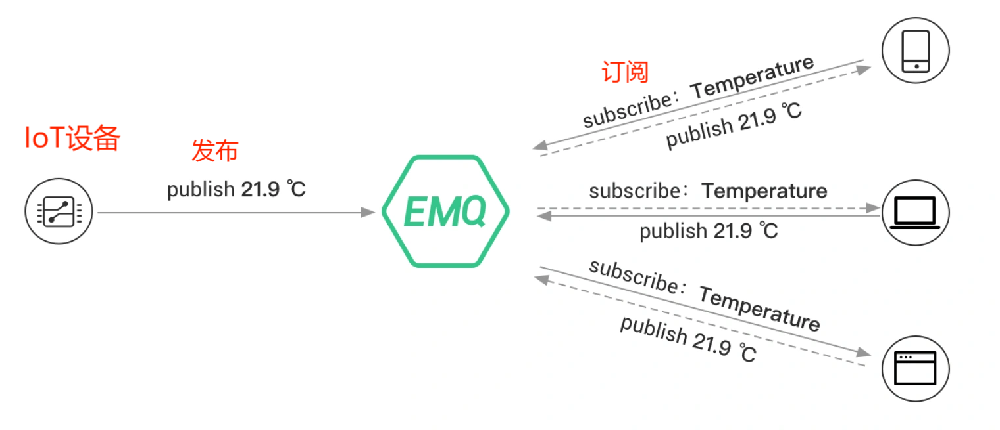

<strong>图 4-2 MQTT发布/订阅架构</strong>

MQTT协议通过网络传输应用消息，应用消息通过MQTT传输时，关联主题（topic）和服务质量（qos）。发布（Publisher）部分参数说明如下：

| 参数 | 说明 |
|------|------|
| topic | Topic Name，主题名。主题名必须至少包含一个字符，且大小写敏感（ACCOUNTS和Accounts是不同主题名），可包含空格字符和斜杠（/），不能包含null字符。按需定义主题名 |
| qos | Quality of Service，服务质量，作用域为发布者的qos和订阅者的qos。IG101暂支持level 0和level 1：level 0代表最多传输一次，Sender（可能是Publisher或者Broker）发送一条消息之后，不再关心是否发送到对方，也不设置任何重发机制，如果当时客户端不可用，则会丢失该消息；level 1代表至少传输一次，包含重发机制，Sender发送消息后等待接收方的ACK，如果没收到ACK则重新发送消息，该模式能保证消息至少到达一次，但无法保证消息不重复。按需配置 |
| retain | Retained Message，保留消息。默认为0，清除消息；若设置为1，保留消息会驻留在消息服务器，后来的订阅者订阅主题时可以接收到最新一条保留消息。按需配置 |

> **注意**：IG101暂不支持MQTT订阅模式。

## 第5章 典型应用

### 案例1：模拟MODBUS采集数据转换MQTT上云

**场景描述**：现场MODBUS从设备（如仪表、PLC等）通过RS-485/RS-232串口接入InGateway101，网关作为MODBUS主站轮询采集从设备数据，并通过4G蜂窝网络以MQTT协议将数据上报至云平台/物联网服务器。本案例以模拟MODBUS从设备的方式，演示从MODBUS数据采集到MQTT上云的完整配置与验证过程。

**网络拓扑**：

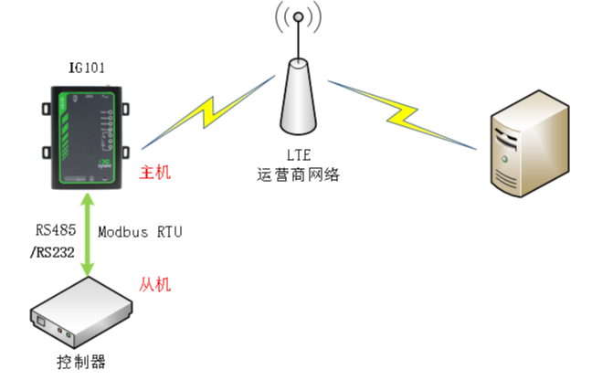

<strong>图 5-1 MODBUS数据采集通过MQTT上云网络拓扑</strong>

**设备角色**：InGateway101作为边缘网关，对下承担MODBUS主站角色，通过串口轮询采集从设备数据；对上作为MQTT客户端，将采集的数据发布至MQTT服务器。

**配置步骤**：

#### 阶段一：MODBUS数据采集配置与验证

1. **MODBUS设备接入**：配置串口参数并开启MODBUS功能，参见[场景3：MODBUS数据采集配置](#场景3modbus数据���集配置)。
2. **添加MODBUS点表**：变量名、设备地址、起始地址等参数按需配置，参数含义参见[4.6 MODBUS点表参数](#46-modbus点表参数)，如图5-2、图5-3所示。

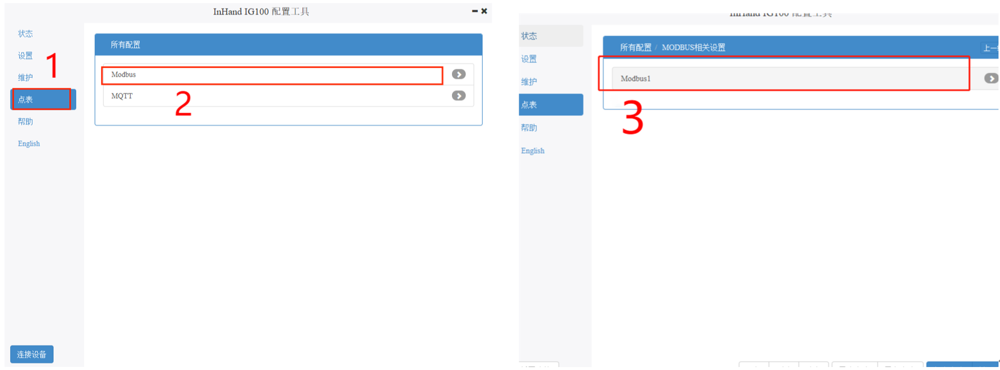

<strong>图 5-2 添加MODBUS点表</strong>

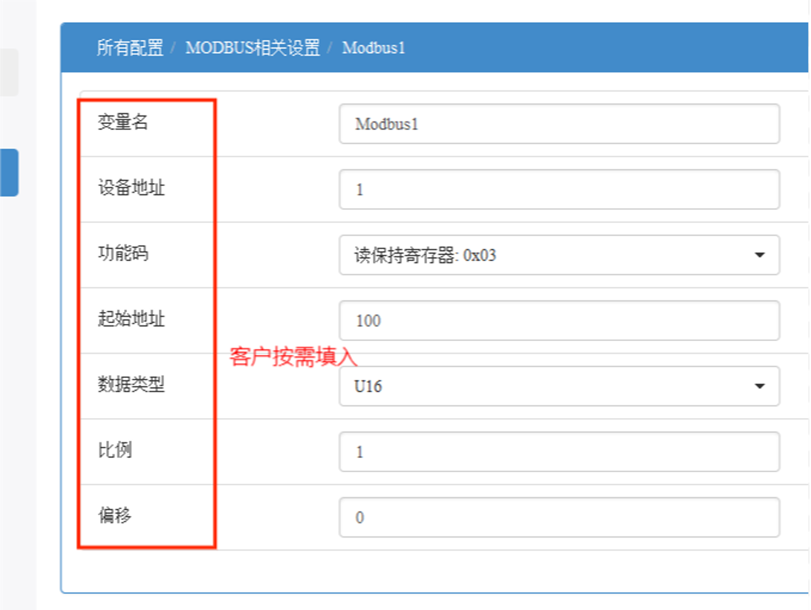

<strong>图 5-3 MODBUS点表参数配置</strong>

3. **保存MODBUS配置**：配置完成后返回上一级，点击"保存点表"，连续点击"确认"后，重新连接设备，如图5-4、图5-5所示。

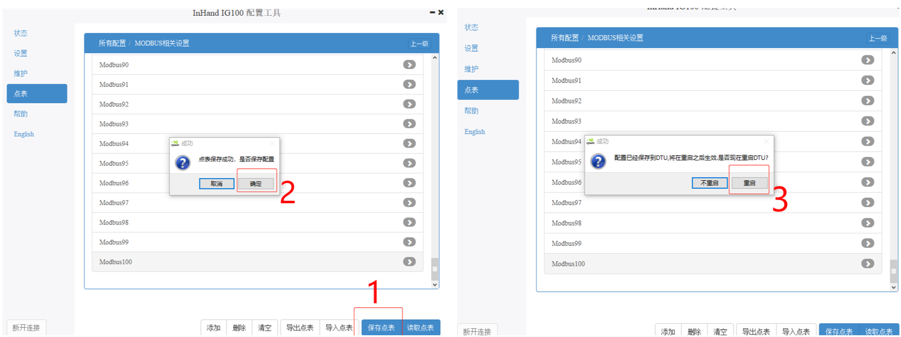

<strong>图 5-4 保存MODBUS点表</strong>

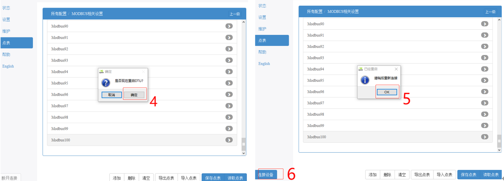

<strong>图 5-5 确认保存</strong>

4. **使用MThings调试验证MODBUS功能**：下载MODBUS调试工具（本案例采用MThings，可自行网上搜索下载，或使用其他任意调试工具）连接设备，部分参数应与IG100配置工具中的参数保持一致，添加设备的步骤如图5-6～图5-9所示。

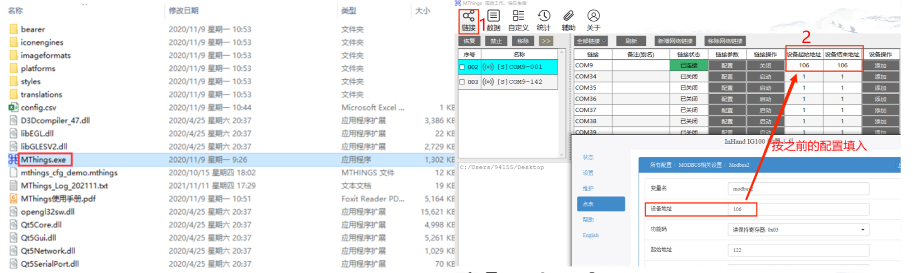

<strong>图 5-6 MThings添加设备</strong>

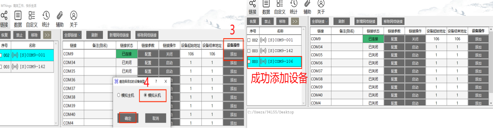

<strong>图 5-7 MThings串口参数设置</strong>

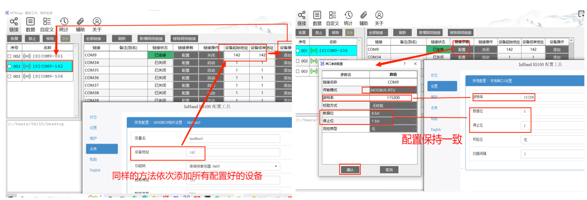

<strong>图 5-8 MThings设备参数设置</strong>

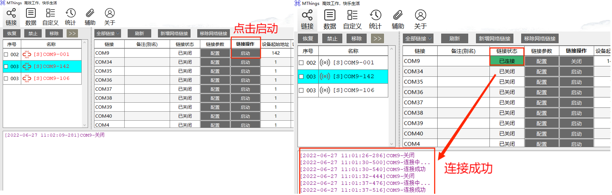

<strong>图 5-9 MThings添加测点</strong>

5. **自定义数值**：按照需求自定义数值，部分参数应与IG100配置工具中的参数保持一致。MThings提供友好的数据可视化方法，支持以实际业务格式展示报文数据，传输类型即MODBUS数据协议中定义的类型，如图5-10、图5-11所示。

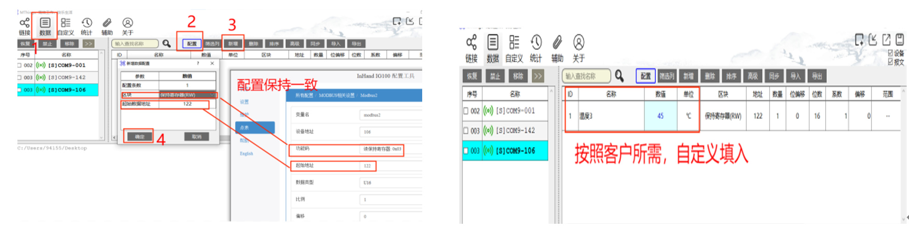

<strong>图 5-10 MThings自定义数值</strong>

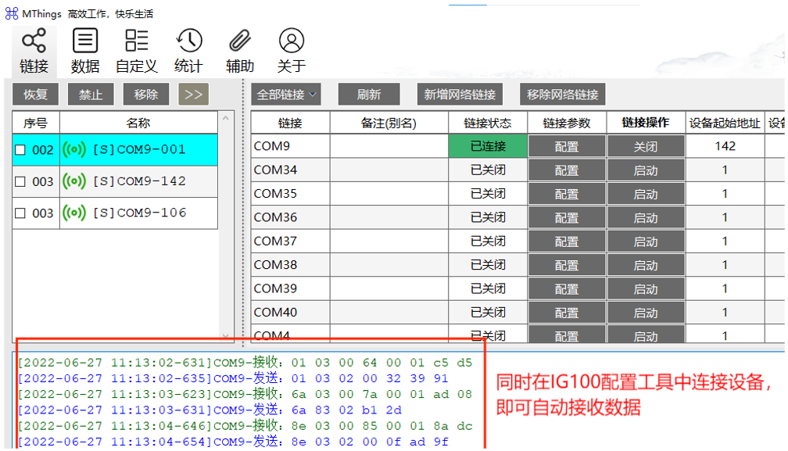

<strong>图 5-11 MThings数据展示</strong>

MODBUS报文的具体解析参见[附录 MODBUS报文解析参考](#附录-modbus报文解析参考)。

#### 阶段二：MQTT上云配置与验证

1. **MQTT设备上云**：配置MQTT连接参数，参见[场景4：MQTT上云配置](#场景4mqtt上云配置)。
2. **添加MQTT点表**：参见[场景6：配置MQTT点表](#场景6配置mqtt点表)。
3. **保存MQTT配置**：配置完成后返回上一级，点击"保存点表"，连续点击"确认"后，重新连接设备，如图5-12～图5-14所示。

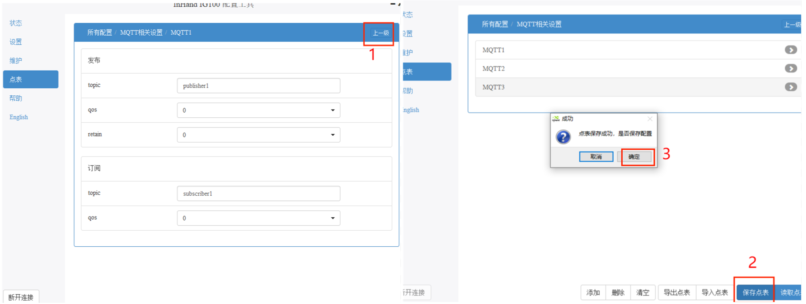

<strong>图 5-12 保存MQTT点表</strong>

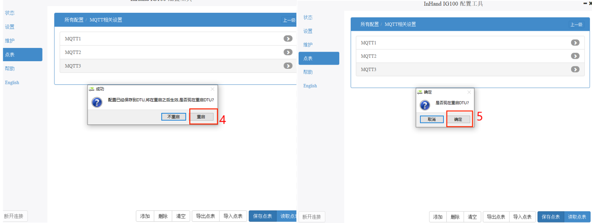

<strong>图 5-13 确认保存</strong>

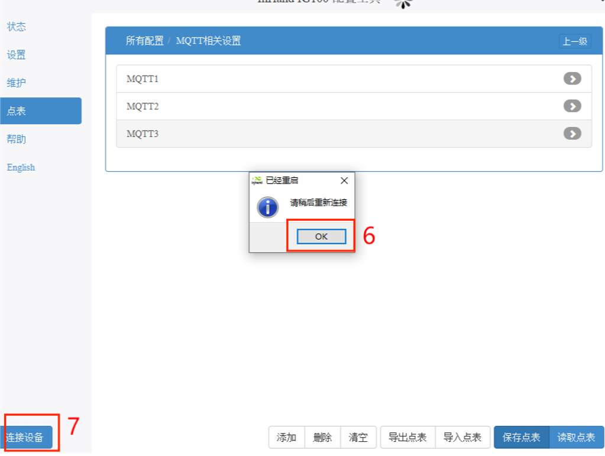

<strong>图 5-14 重新连接设备</strong>

4. **使用MQTT X调试验证MQTT功能**：下载MQTT客户端工具（本案例采用MQTT X，可自行网上搜索下载，或使用其他任意调试工具），部分参数应与IG100配置工具中的参数保持一致，如图5-15所示。

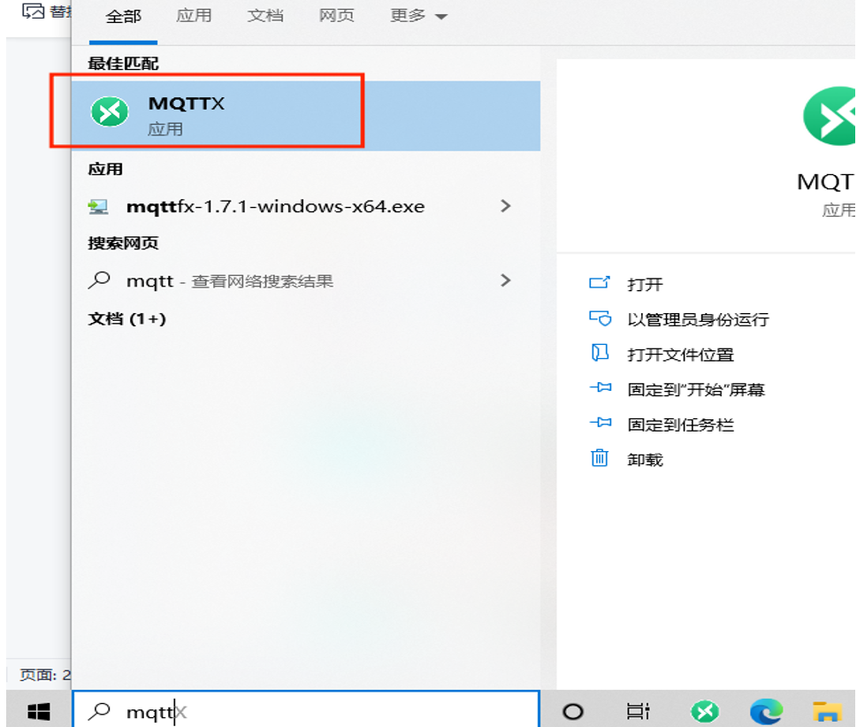

<strong>图 5-15 MQTT X连接配置</strong>

5. 使用MQTT X进行连接，所需参数均应与IG100配置工具中的参数内容保持一致。设置好参数后点击右上角"连接"，如图5-16所示。

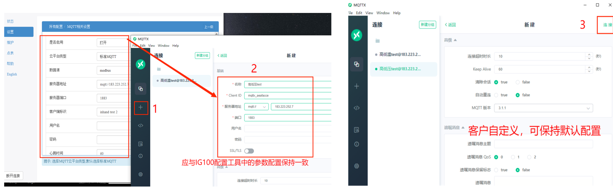

<strong>图 5-16 MQTT X连接参数</strong>

6. 连接成功后，点击"添加订阅"，自定义配置，部分参数需与IG100配置工具中的内容保持一致，如图5-17所示。

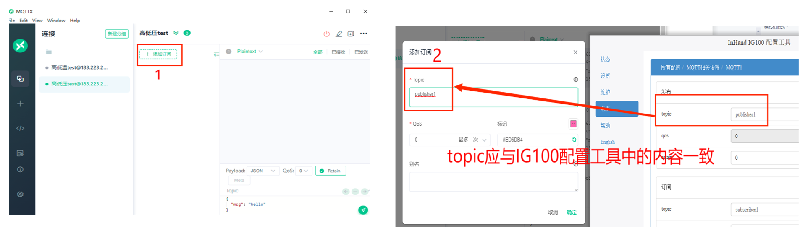

<strong>图 5-17 MQTT X添加订阅</strong>

7. 确保MQTT X保持连接状态，同时确保IG100配置工具也保持连接状态，即可等待接收消息，如图5-18所示。

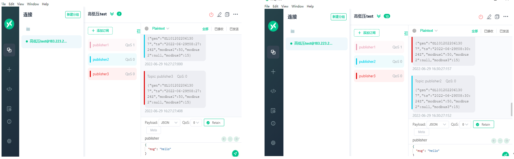

<strong>图 5-18 MQTT X接收消息</strong>

**参考章节**：

- [场景1：蜂窝拨号上网](#场景1蜂窝拨号上网)
- [场景3：MODBUS数据采集配置](#场景3modbus数据采集配置)
- [场景4：MQTT上云配置](#场景4mqtt上云配置)
- [场景5：配置MODBUS点表](#场景5配置modbus点表)
- [场景6：配置MQTT点表](#场景6配置mqtt点表)
- [4.6 MODBUS点表参数](#46-modbus点表参数)
- [4.7 MQTT点表参数](#47-mqtt点表参数)

## 附录 故障处理

### 1 上电与运行问题

| 现象 | 可能原因 | 排查步骤 | 对应章节 |
|------|----------|----------|----------|
| 上电后频繁重启 | SIM卡异常 | 1. 确认是否正确插入UIM/SIM/USIM卡 2. 确认SIM卡是否欠费停机或损坏 | [场景1：蜂窝拨号上网](#场景1蜂窝拨号上网) |
| 上电后频繁重启 | 拨号参数配置错误 | 1. 检查设备是否能拨号上网 2. 检查拨号参数（拨号号码、接入点参数、账号、密码）是否填写正确 | [场景1：蜂窝拨号上网](#场景1蜂窝拨号上网) |
| 上电后频繁重启 | 无线信号质量差 | 1. 检查无线网络信号质量是否低于20 2. 将设备移至信号较好的地方再次上电查看 | [场景1：蜂窝拨号上网](#场景1蜂窝拨号上网) |
| 上电后频繁重启 | 供电异常 | 检查给设备供电的电源电压是否正常 | [2.1 安装前准备](#21-安装前准备) |
| 上电后电源指示灯不亮 | 电源连接不牢固 | 确认设备与电源转换器连接牢固 | [2.2.3 端子连接与上电](#223-端子连接与上电) |
| 上电后电源指示灯不亮 | 电源输出不符 | 检查电源转换器是否输出DC 7V～38V的直流电压 | [2.1 安装前准备](#21-安装前准备) |
| 上电后电源指示灯不亮 | 设备内部指示灯损坏 | 联系映翰通公���的销售代表 | [技术支持](#技术支持) |

### 2 配置与升级问题

| 现象 | 可能原因 | 排查步骤 | 对应章节 |
|------|----------|----------|----------|
| 无法对设备进行配置 | 串口连接异常 | 1. 检查串口电缆，检查PC串口是否正常 2. 确认配置工具所选端口是否正确 | [2.2.5 连接设备并登录配置工具](#225-连接设备并登录配置工具) |
| 无法对设备进行配置 | 供电异常 | 1. 确认供电为DC 7V～38V直流 2. 确认电源极性是否正确 | [2.1 安装前准备](#21-安装前准备) |
| 无法对设备进行串口升级 | 串口连接异常 | 1. 检查串口电缆，检查PC串口是否正常 2. 确认配置工具所选端口是否正确 | [2.2.5 连接设备并登录配置工具](#225-连接设备并登录配置工具) |
| 无法对设备进行串口升级 | 供电异常 | 1. 确认供电为DC 7V～38V直流 2. 确认电源极性是否正确 | [2.1 安装前准备](#21-安装前准备) |

## 附录 日志抓取

排查问题时，有时需要长时间抓取设备的运行日志。由于IG存储空间较小，可借助其他串口工具抓取设备日志。本附录采用SecureCRT进行说明，可自行网上搜索下载，或使用其他任意串口工具。

抓取日志前，先连接设备与PC，打开IG配置工具。

**Step1：打开IG调试模式**，如图A-1所示。

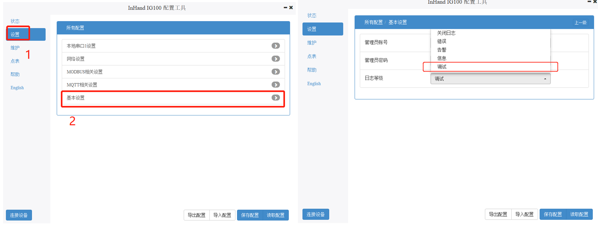

<strong>图 A-1 打开IG调试模式</strong>

**Step2：设置保存日志文件名**。配置好IG100工具后断开连接设备，打开SecureCRT，文件→会话日志→取一个文件名→保存，如图A-2、图A-3所示。

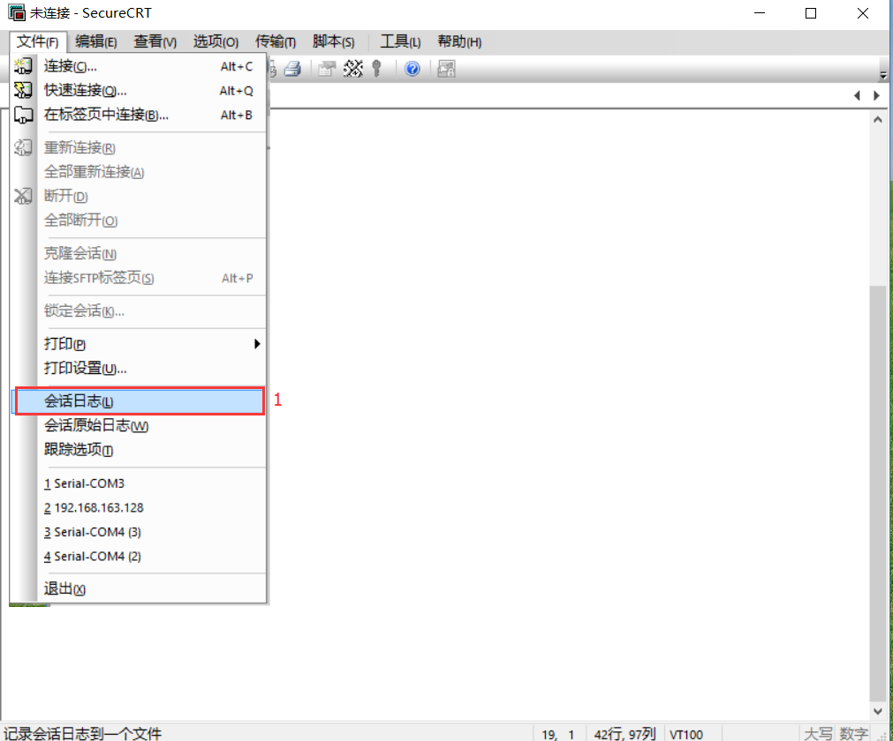

<strong>图 A-2 打开会话日志</strong>

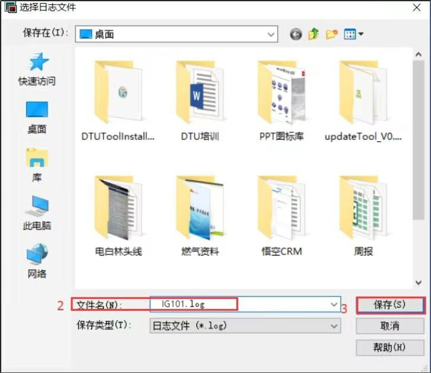

<strong>图 A-3 设置日志文件名</strong>

**Step3：连接IG**。选择相应串口，配置与设备一致的串口参数，点击连接，如图A-4所示。

<strong>图 A-4 SecureCRT连接设备</strong>

**Step4：保存日志**。抓取完日志后点击结束保存，再次点击"会话日志"，如图A-5所示。

<strong>图 A-5 结束保存日志</strong>

## 附录 MODBUS报文解析参考

### 1 基本帧格式

以MODBUS 03功能码（读保持寄存器）为例，基本数据帧格式为：

- 主机请求：地址 + 要查询的寄存器个数 + 校验；
- 从机回复：从机地址 + 数据的字节数 + 数据 + 校验。

### 2 报文示例解析

以如下报文为例（如图A-6所示）：

- 主机请求：`01 03 00 64 00 01 c5 d5`
- 从机回复：`01 03 02 00 32 39 91`

<strong>图 A-6 MODBUS报文解析示例</strong>

**主机请求：01 03 00 64 00 01 c5 d5**

1. 第一个字节 0x01 是地址域，即通信帧中的地址字段，内容为从机/从设备地址。MODBUS消息帧的地址域包含1个字节（RTU模式），从设备的地址是0～247（十进制），0x01对应的十进制数是1，表示第1个从设备。
2. 第二个字节 0x03 是功能码域（功能码类型与IG100配置工具中自定义的一致），功能码用于表示消息帧的功能。功能码域由1个字节构成，取值范围为1～255（十进制）。从设备根据功能码执行相应的功能，执行完成后在响应消息帧中设置同样的功能码。
3. 第三至第六个字节 0x00 0x64 0x00 0x01 是数据域，数据域存放功能码需要操作的具体数据，以字节为单位，长度可变。其中0x00 0x64表示起始地址为64，0x00 0x01表示读取的寄存器个数为1。
4. 第七、八个字节 0xc5 0xd5 是校验码。在RTU模式中，报文包含一个错误校验字段，该字段由16个bit位共两个字节组成，其值基于对校验域之前的所有字节执行的循环冗余校验（CRC）计算结果而来。

**从机回复：01 03 02 00 32 39 91**

1. 0x01：确认从机地址为01。
2. 0x03：表示MODBUS 03功能码，与查询报文一致。
3. 0x02：表示数据长度，即后面数据的字节数。一个寄存器有2个字节，因此后面的字节数为2×查询的寄存器个数。
4. 0x00 0x32：为返回的寄存器数据。
5. 0x39 0x91：为CRC校验码。
