# IG502-LITE快速安装手册V1.0

**极简型边缘网关IG502-LITE系列**

**快速安装手册**

# 第一部分：快速装机

> **您需要先做：** 开箱 → 固定设备 → 接电源与网线 →（若用蜂窝）**断电**装 SIM、接天线 → 上电 → PC 同网段 → 浏览器打开 Web。
> **再做：** 翻到下方 **第二部分**，按需查阅装箱、灯义、壁挂、各接口引脚等。

## 必读摘要（接线、上电前）

| 项目 | 要求 |
|------|------|
| 供电 | **12-48 V DC**，接入 DC 端口（7 针工业端子 V+ / V-）；**PWR 红灯常亮**表示已正常上电（见 §2.5.2）。 |
| SIM 卡 | 位于上面板，安装**不支持热拔插，须在断电情况下操作**（见 §2.5.3）。 |
| Micro SD 卡 | **不支持热插拔，须在断电情况下操作**（见 §2.5.4）。 |
| 4G 天线 | 将天线拧到对应 **SMA 接口**即可（见 §2.5.3）。 |

## 步骤 1：对照实物，确认面板与接口区域

您手里的 IG502-LITE 有两个接线面：**正面板**集中了网口与指示灯，**上面板**集中了天线、SIM 卡槽、SD 卡槽、电源/串口端子与复位按键。面板布局详见 §2.2。

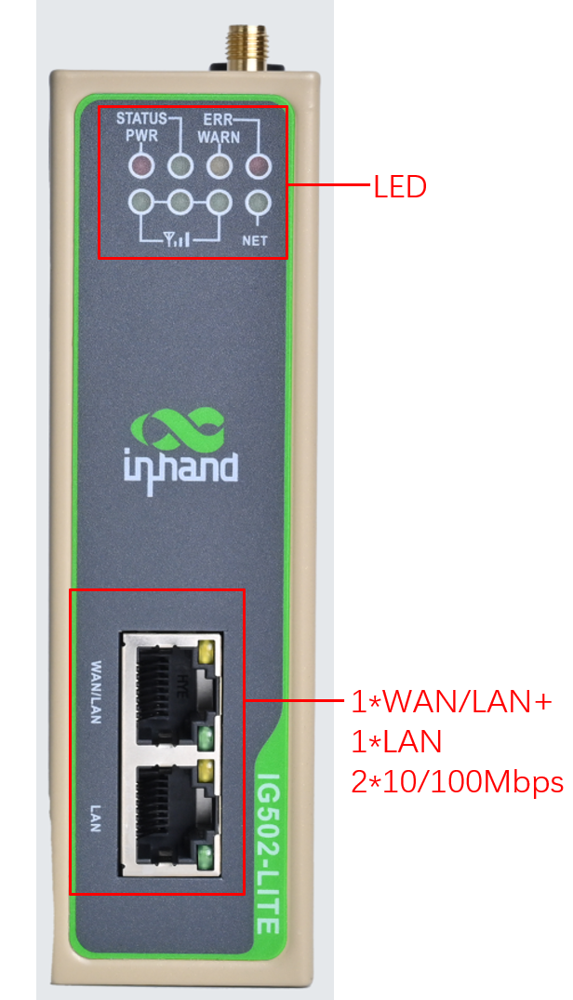

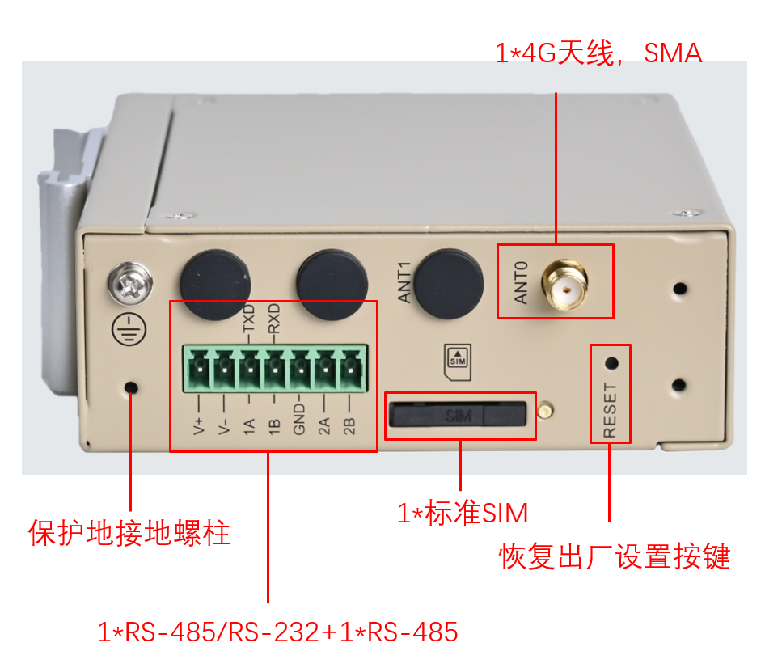

## 步骤 2：将设备固定到导轨或柜内

标准配件中含 **DIN 轨安装配件**：DIN 轨的安装板附在设备后面板上，将卡轨座上部卡入 DIN 轨，再按下图箭头所示将设备下端转入卡轨即可，安装步骤详见 §2.4.1。若需壁挂，共 3 种壁挂方式可选，详见 §2.4.3。

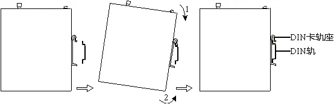

## 步骤 3：连接电源与以太网

将工业端子插入 DC 端口，接 **12-48 V DC** 电源；网线一端插入设备任一网口，另一端插入电脑网口，并将电脑 IP 地址设置为与设备网口同网段。引脚定义详见 §2.5.1、§2.5.2。

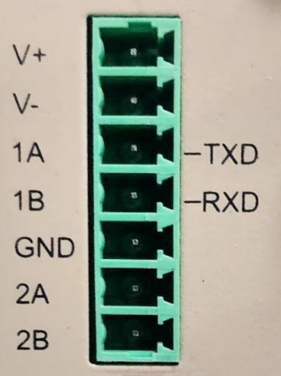

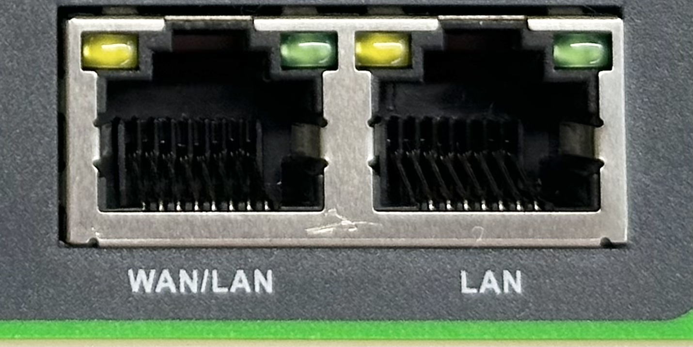

## 步骤 4：（若使用蜂窝）断电装 SIM，并接好天线

**先断电**，在上面板装入标准 SIM 卡；再将 4G 蜂窝天线拧到 SMA 天线接口。详见 §2.5.3。

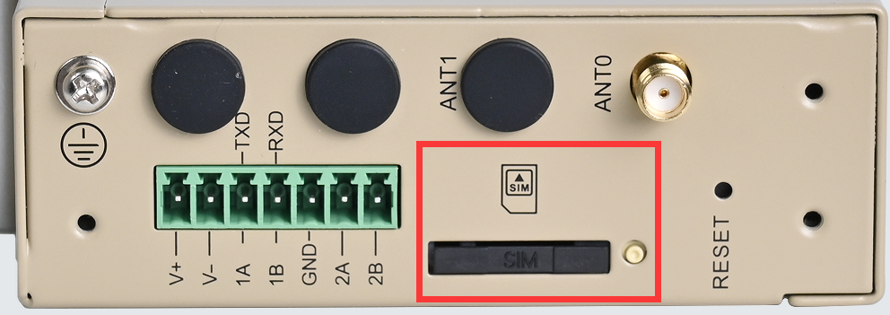

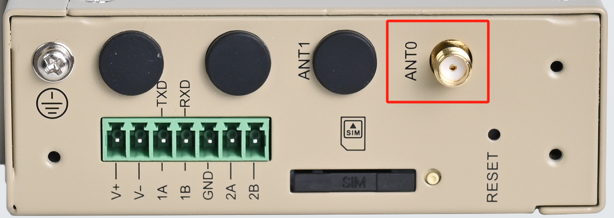

## 步骤 5：上电，确认设备已就绪

上电后确认：**PWR 红灯常亮**（已正常上电）→ **STATUS 绿灯慢闪**（开机成功）→ 使用蜂窝时 **NET 绿灯常亮**（拨号成功）。灯态组合详见 §2.3。

## 步骤 6：PC 与浏览器登录 Web

使用以下默认 IP 连接到 IG502-LITE：

| 端口角色 | 默认 IP |
| :---: | :---: |
| WAN/LAN | 192.168.1.1 |
| LAN | 192.168.2.1 |

1. 浏览器打开 **https://192.168.2.1/**（以网线插入 LAN 口为例）。
2. 输入初始登陆账号 **adm**；初始登陆密码**查看设备面板上的铭牌**获取。
3. 登录后即可通过 IEOS Web 界面进行网络管理和系统管理。

## 装完自检

- ☐ 设备已固定（DIN 导轨或壁挂）。
- ☐ 电源、网线已接好；若用蜂窝，SIM 与天线已**断电**装好。
- ☐ **PWR 常亮**且 **STATUS 慢闪**。
- ☐ 使用蜂窝时 **NET 常亮**（拨号成功）。
- ☐ 浏览器已能打开 https://192.168.2.1 登录页并完成登录。

上电后灯态异常时，对照 §2.3 的指示灯组合排查；蜂窝信号指示灯仅 1 亮（1≤CSQ≤9）时，请检查天线是否安装完好、SIM 卡是否正确识别以及当地信号状况（见 §2.3.2）；需要将设备恢复出厂设置时，见 §2.7。

---

# 第二部分：详细说明

## 2.1 装箱清单

**标准配件**

| 序号 | 名称 | 数量 | 单位 | 备注 |
| --- | --- | --- | --- | --- |
| 1 | IG502-LITE | 1 | 台 | IG502-LITE边缘计算网关 |
| 2 | 4G蜂窝天线 | 1 | 个 | 蜂窝通信 |
| 3 | 导轨安装配件 | 1 | 套 | 固定网关 |
| 4 | 工业端子 | 1 | 个 | 7针工业端子 |

**可选配件**

| 序号 | 名称 | 数量 | 单位 | 备注 |
| --- | --- | --- | --- | --- |
| 1 | 电源适配器 | 1 | 个 | 12V 2A 电源适配器 |
| 2 | 壁挂安装套件 | 1 | 套 | IG502-LITE共有3种壁挂安装方式，可根据实际部署场景选择合适的壁挂方式进行安装 |

## 2.2 产品结构与标识

IG502-LITE是面向工业物联网领域推出的极简型边缘网关。IG502-LITE尺寸小巧，具备便捷的全球蜂窝接入能力。支持用户使用Python二次开发，可内置映翰通DeviceSupervisor™ Agent服务，支持上百种数据采集协议，轻松实现设备数据采集、处理及上云，同时支持映翰通DeviceLive云管理，帮助企业加快数字化进程。

IG502-LITE的面板布局如下所示。

### 2.2.1 正面板

### 2.2.2 上面板

## 2.3 指示灯与复位键

### 2.3.1 运行状态指示灯

| PWR | STATUS | WARN | ERR | NET | 说明 |
| :---: | :---: | :---: | :---: | :---: | :---: |
| **电源指示灯（红色）** | **状态指示灯（绿色）** | **告警指示灯（黄色）** | **错误指示灯（红色）** | **网络指示灯（绿色）** |  |
| 亮 | 灭 | 灭 | 灭 | 灭 | 开机 |
| 亮 | 慢闪 | 灭 | 灭 | 灭 | 开机成功 |
| 亮 | 慢闪 | 灭 | 灭 | 快闪 | 正在拨号 |
| 亮 | 慢闪 | 灭 | 灭 | 亮 | 拨号成功 |
| 亮 | 慢闪 | 慢闪 | 慢闪 | 灭 | 复位成功 |
| 亮 | 慢闪 | 快闪 | 快闪 | 灭 | 升级 |

备注：

1. 亮表示常亮，即至少保持3 秒钟亮
2. 灭表示常灭，即至少保持3 秒钟不亮
3. 慢闪表示闪烁频率1Hz
4. 快闪表示闪烁频率5Hz

### 2.3.2 蜂窝信号强度指示灯

| 信号状态指示灯1（绿色） | 信号状态指示灯2（绿色） | 信号状态指示灯3（绿色） | 说明 |
| :---: | :---: | :---: | --- |
| 灭 | 灭 | 灭 | 未检测到信号 |
| 亮 | 灭 | 灭 | 信号状况1≤CSQ≤9（说明信号状况有问题，请检查天线是否安装完好，SIM卡是否正确识别，以及该地区信号状况是否良好） |
| 亮 | 亮 | 灭 | 信号状况10≤CSQ≤19（说明信号状态基本正常，设备可以正常使用） |
| 亮 | 亮 | 亮 | 信号状况20≤CSQ≤31（说明信号状态良好） |

### 2.3.3 复位键

IG502-LITE有一个复位按键，用于系统恢复出厂，按键位置见 §2.2 面板示意图。采用硬件方式恢复出厂的完整步骤见 §2.7。

## 2.4 机械安装

### 2.4.1 DIN导轨：安装

DIN轨的安装板附在IG502-LITE的后面板上，如下图所示：

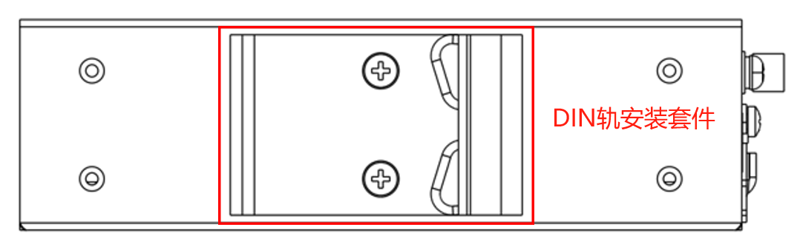

安装步骤如下：

1. 选定设备的安装位置，确保有足够的空间；
2. 将DIN卡轨座的上部卡在DIN轨上，在设备的下端向上稍微用力按箭头2所示转动设备，即可将DIN卡轨座卡在DIN轨上，确认设备可靠地安装到DIN轨上，如下图所示：

### 2.4.2 DIN导轨：拆卸

拆卸IG502-LITE的方法为：

1. 如下图箭头1所示，向下压设备使设备下端有空隙脱离DIN轨。
2. 将设备按箭头2的方向转动，并同时向外移动设备的下端，待下端脱离DIN轨后向上抬设备，即可从DIN轨上取下设备。

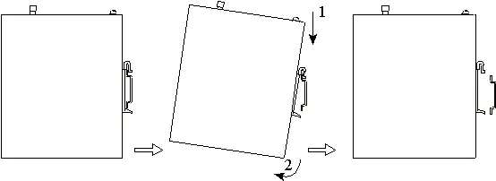

### 2.4.3 壁挂安装（可选）

IG502-LITE可以采用壁挂套件进行安装，套件需要单独购买。共有三种壁挂方式，均为：先将壁挂安装套件采用螺钉固定到设备对应面板上，再将设备采用螺钉固定到墙面或者柜子上。

#### 方式一：将壁挂套件安装在IG502-LITE的上、下面板上（挂耳安装）

**步骤一**：将壁挂安装套件采用螺钉分别固定到上面板和下面板上

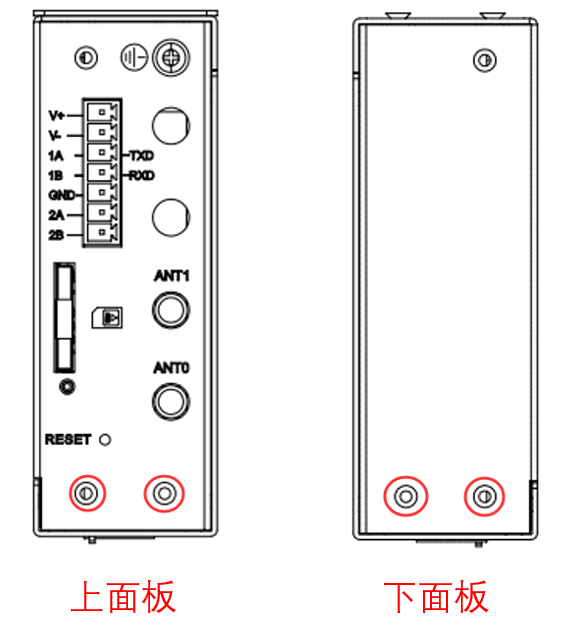

固定完成后如下图所示：

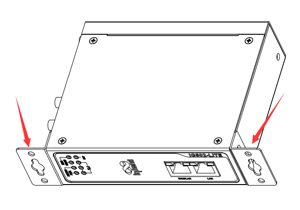

**步骤二**：当壁挂安装套件固定到设备以后，采用螺钉将设备固定到墙面或者柜子上

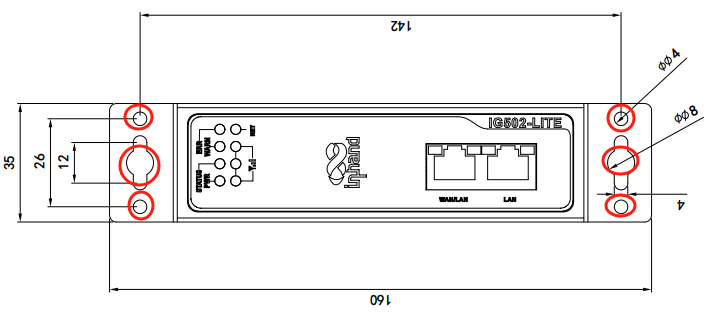

#### 方式二：将壁挂套件安装在IG502-LITE的后面板上（背面挂耳）

**步骤一**：将壁挂安装套件采用螺钉分别固定到设备的后面板上

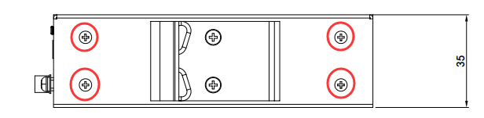

固定完成后如下图所示：

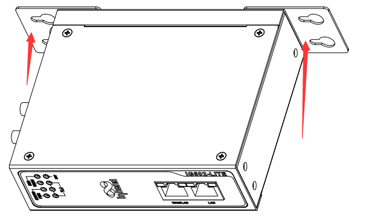

**步骤二**：当壁挂安装套件固定到设备以后，采用螺钉将设备固定到墙面或者柜子上

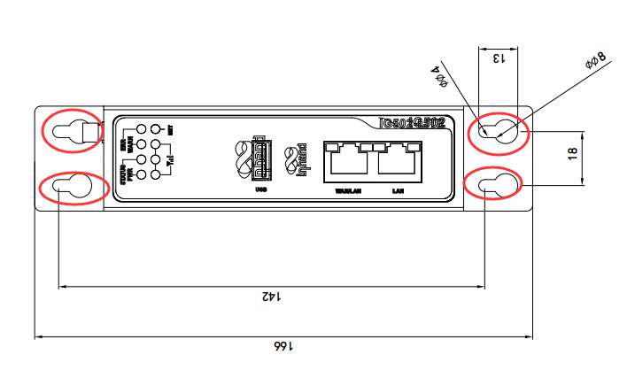

#### 方式三：将壁挂套件安装在IG502-LITE的上、下面板（大面挂耳）

**步骤一**：将壁挂安装套件采用螺钉分别固定到设备的上下面板上

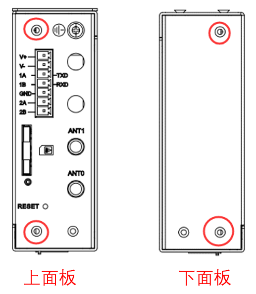

固定完成后如下图所示：

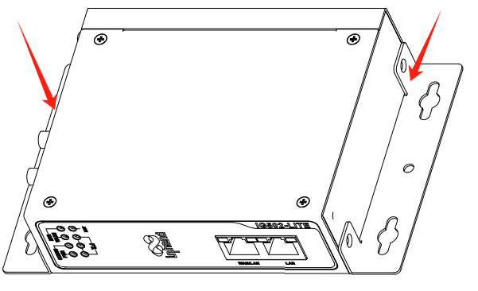

**步骤二**：当壁挂安装套件固定到设备以后，采用螺钉将设备固定到墙面或者柜子上

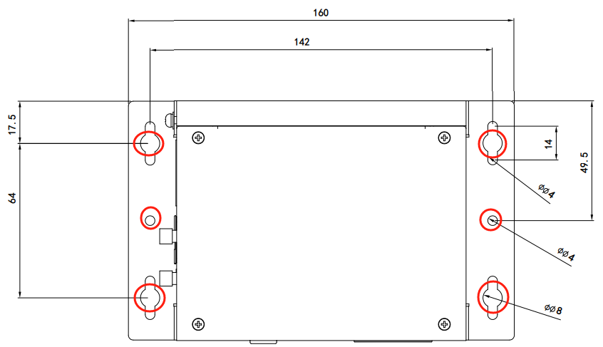

## 2.5 连接与布线

### 2.5.1 以太网

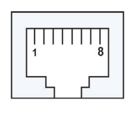

IG502-LITE有2个RJ45以太网口，支持10M/100M自适应速率。RJ45的引脚说明如下：

| RJ45引脚号 | 10M/100M |
| :---: | :---: |
| 1 | TX+ |
| 2 | TX- |
| 3 | RX+ |
| 4 | — |
| 5 | — |
| 6 | RX- |
| 7 | — |
| 8 | — |

### 2.5.2 电源与串口

**供电**：IG502-LITE支持12-48V DC供电。将适配器端子插入到IG502-LITE的DC端口中，然后连接电源适配器。当PWR电源指示灯长亮则代表设备已经正常上电。

**串口**：IG502-LITE有2个串口，一路串口支持RS-485，一路串口支持RS-232或RS-485模式。

**当接口组合为RS232+RS485时：**

- RS232串口对应的设备节点：/dev/ttyO1
- RS485串口对应的设备节点：/dev/ttyO3

**当接口组合为RS485+RS485时：**

- RS485-1串口对应的设备节点：/dev/ttyO1
- RS485-2串口对应的设备节点：/dev/ttyO3

电源、串口采用7PIN端子，接口引脚说明如下：

| 引脚 | 名称 | 定义 |
| :---: | :---: | :---: |
| 1 | V+ | 电源正极 |
| 2 | V- | 电源负极 |
| 3 | TXD或1A | 串口RS232发送或第一路RS485+ |
| 4 | RXD或1B | 串口RS232接受或第一路RS485- |
| 5 | GND | 串口RS232信号地 |
| 6 | 2A | 第二路RS485+ |
| 7 | 2B | 第二路RS485- |

### 2.5.3 蜂窝 SIM 与天线

**SIM 卡**：IG502-LITE配备1个用于蜂窝通信的SIM卡座，位于上面板。

> **注意：SIM卡安装不支持热拔插，需要在断电的情况下进行操作。**

**天线**：IG502-LITE共有1个4G天线接口，将天线拧到对应SMA接口即可。

### 2.5.4 Micro SD

> **注意：IG502-LITE有一个Micro SD卡，SD卡不支持热插拔，需要在断电的情况下操作。**

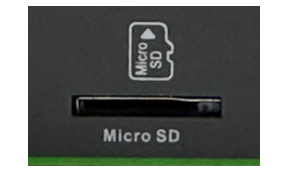

如果一个micro SD存储设备有多个分区，IG502-LITE可以自动挂载前9个分区，其余的分区需要手动挂载。IG502-LITE会把所有micro SD存储设备分区挂载到/mnt/sd路径下，挂载文件夹的命名格式为mmcblk0p<num>。其中<num>可以是1~9的数字。通过开发者模式进入Linux后台执行df -h命令可以看到具体的挂载情况。

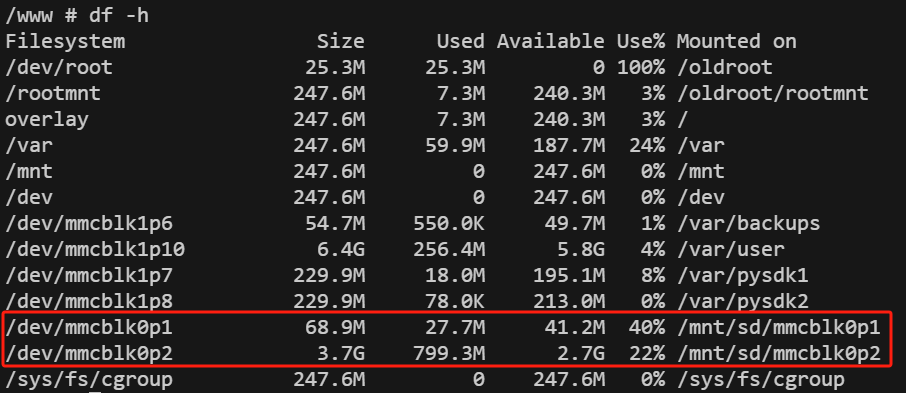

Web的概览页面只显示第一个分区的容量和使用情况，为了方便在Web页面查看SD卡使用情况，建议只创建一个分区，并将该分区格式化为FAT32文件系统。

- SD卡容量 <= 32GB：SD卡插入读卡器，然后将读卡器插入使用Windows系统的电脑。大部分Windows系统只支持将容量小于32GB的SD卡格式为FAT32系统，格式化的时候会自动创建一个分区；也可以在Linux系统下格式化为FAT32文件系统，方法同SD卡容量 > 32GB。
- SD卡容量 > 32GB：SD卡容量大于32GB时，需要在Linux下格式化FAT32格式。SD卡插入读卡器，然后将读卡器插入使用Linux系统的电脑或者安装虚拟机Linux虚拟机的电脑。

a. 执行fdisk -l查看SD卡对应的设备节点，示例中是/dev/sda

b. 执行fdisk /dev/sda进行分区(p查看当前分区，d删除已有分区，n新创建分区，w保存更改)，创建分区 /dev/sda1

c. 执行 sudo mkfs.vfat -F 32 /dev/sda1将分区格式化为FAT32格式。

## 2.6 供电与环境

| 项目 | 规格 |
| --- | --- |
| 输入电压 | 12-48 VDC （双引脚端子，V+、V-） |
| 工作功耗 | 230mA@12V |
| 工作温度 | -20-70℃（-4-158℉） |
| 存储温度 | -40-85℃（-40-185℉） |
| 环境湿度 | 5~ 95% (无凝霜) |

## 2.7 首次登录与恢复出厂

### Web 登录

使用以下默认IP 地址连接到IG502-LITE：

| 端口角色 | 默认 IP |
| :---: | :---: |
| WAN/LAN | 192.168.1.1 |
| LAN | 192.168.2.1 |

1. **将IG502-LITE和PC互联**：将网线一端插入到IG502-LITE任一网口中，另外一端插入到电脑的网口，同时将电脑的IP地址设置为设备接口同网段地址。
2. **通过web对IG502-LITE进行网络管理和系统管理**：IG502-LITE支持基于IEOS的WEB界面管理方式。IEOS是映翰通自研的一套运行在Linux系统上的网络管理和系统管理程序，IEOS可提供web界面服务。以网线网口插入到 LAN 口为例，设备登录信息如下：
   - 登陆地址：**https://192.168.2.1**
   - 初始登陆账号：**adm**
   - 初始登陆密码：**查看设备面板上的铭牌获取初始密码信息**

下图是使用WEB连接的示例：

### 恢复出厂（RESET）

复位按键说明见 §2.3.3。采用硬件方式恢复出厂设备步骤如下：

1. 步骤1：设备上电后10s内长按RESET键不松开；
2. 步骤2：当ERR灯变红后，松开RESET键；
3. 步骤3：几秒之后当ERR灯熄灭，再次按住RESET键不松开；
4. 步骤4：当看到ERR灯闪烁时松开RESET键；等待ERR灯熄灭，表明恢复出厂设置成功。

## 2.8 相关文档

| 需求 | 去向 |
|------|------|
| 产品与公司信息、软件与公告 | [映翰通官网 www.inhand.com.cn](http://www.inhand.com.cn/) |

## 2.9 法律信息

本手册中描述的软件是根据许可协议提供的，只能按照该协议的条款使用。

**版权声明**

© 2024 映翰通网络 保留所有权利。

**商标**

InHand标志是映翰通网络的注册商标。

本手册中的所有其他商标或注册商标属于其各自的制造商。

**免责声明**

本公司保留对此手册更改的权利，产品后续相关变更时，恕不另行通知。对于任何因安装、使用不当而导致的直接、间接、有意或无意的损坏及隐患概不负责。
