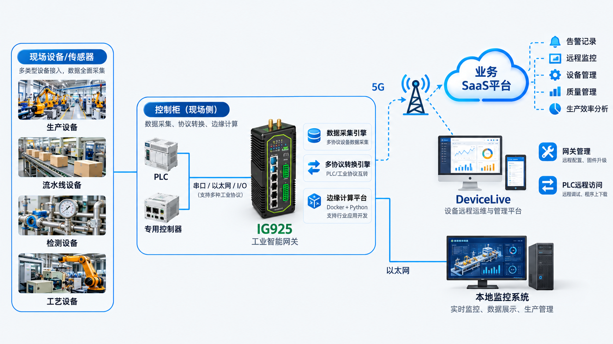
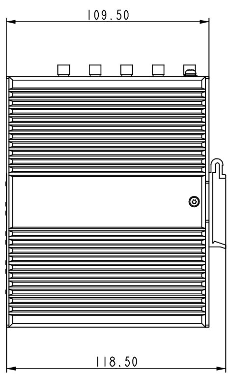
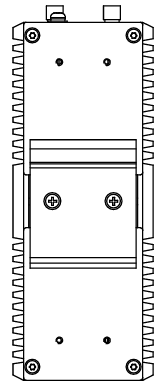
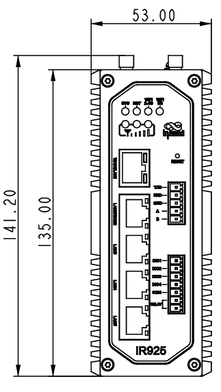

  

    

      
    

    

      拥抱 5G，开启边缘智能之旅
    

  

  

    

      IG925 高性能 5G 边缘计算网关
    

    

      

        
· 5G

        
· Wi-Fi 6

      

      

        
· 边缘计算

        
· 云管理

      

    

  

---

## 产品定位与核心价值
### 产品定位

**IG925 是映翰通面向工业物联网推出的高性能 5G 边缘计算网关** — 由高性能 5G 蜂窝接入 + Wi-Fi 6 无线能力和内置边缘计算平台组成，在兼顾网络能力的同时，于设备端实现**多类型工业数据的采集、协议转换与边缘计算**，将现场孤岛数据就近处理并按需上云。一款设备替代传统「工业网关 + RTU + 数据采集器」的组合，可通过容器化应用扩展行业化业务。

IG925 是映翰通（InHand Networks）打造的一体化高性能 5G 边缘计算网关。硬件平台提供 1 GHz 处理器、512 MB 内存与丰富工业接口（5G/4G、Wi-Fi 6、2.5GbE、RS232/RS485、DIO、Relay），软件平台在其上运行**数据采集引擎、协议转换引擎与边缘计算框架**，所有数据处理与业务逻辑在设备端就地完成，**打破数据壁垒、按需上云**。客户还可在同一平台部署自有或第三方 Docker 应用与 Python 程序，真正实现一台设备承载多种业务。

### 核心价值
| 价值维度 | 说明 |
| --- | --- |
| **数据采集** | 通过串口（RS232/RS485）、以太网、I/O 与 Modbus 等协议，采集 PLC、仪表、传感器、控制器等现场设备的实时数据，打破信息孤岛 |
| **协议转换** | 内置协议转换引擎，支持 Modbus RTU/TCP 双向转换及多种工业协议互转，异构设备互联互通 |
| **边缘计算** | 内置 Docker 容器化应用平台与 Python 二次开发环境，数据就近处理、逻辑本地下发，降低云端流量与响应时延 |
| **云边协同** | 接入 DeviceLive 统一云管平台，实现远程连接、批量运维与 OTA 升级，"数据上云、管理在云、计算在边" |
| **工业可靠** | 金属外壳、无风扇散热、IP30；工作温度 -40°C ~ +70°C；DC 9~48 V 宽压；导轨 / 壁挂安装 |

### "一机替多机"
| 传统方案（多台设备） | IG925 方案（1 台设备） |
| --- | --- |
| 工业网关（联网 + 数据采集） | ✅ 内置 |
| 协议转换器 | ✅ 内置 |
| DTU 数据透传单元 | ✅ 内置 |
| 边缘采集 / 前置处理设备 | ✅ 内置（Docker + Python） |
| 现场服务器（数据前置处理） | ✅ 内置（边缘计算） |
| **多台设备 + 多套线缆** | **1 台设备 + 1 套线缆** |

### 核心技术指标
| 指标 | 数值 |
| --- | --- |
| 蜂窝网络 | 5G，下行最大 3.4 Gbps，Sub6，兼容 4G/3G |
| Wi-Fi | Wi-Fi 6，双频并发 3000 Mbps（2.4 GHz & 5.8 GHz） |
| 以太网 | 1 × 2.5GbE + 4 × 1GbE RJ45，WAN/LAN/VLAN |
| 串口 | 1 × RS232 + 1 × RS485 |
| I/O | 4 × DI（干接点） + 4 × DO（可配）+ 1 × Relay |
| 协议转换 | Modbus RTU/TCP、OPC UA Client、ISO on TCP 等 |
| 边缘计算 | Docker 容器化部署 + Python 二次开发 |
| 远程管理 | DeviceLive 统一云管 + OTA 升级 |
| 工作温度 | -40°C ~ +70°C |
| 供电 | DC 9~48 V 宽压 |
| 防护等级 | IP30 |

### 目标应用场景
| 优先级 | 场景 | 典型客户 | 关键需求 | 切入点 |
| --- | --- | --- | --- | --- |
| **P0** | 智慧工厂 | 制造企业、系统集成商 | 产线设备联网、数据采集、协议转换 | "5G / 有线多链路接入，支撑 24 小时连续生产" |
| **P0** | 配电自动化 | 电网公司、能源服务商 | 异常信息快速上送、安全隔离通信 | "VPN 与多层防火墙，助力更快速、准确的电网控制" |
| **P1** | 仓储自动化 | 物流仓储、自动化集成商 | AGV/AMR 联网、现场无线覆盖、集中管控 | "Wi-Fi 6 与蜂窝备份，提升作业效率" |
| **P1** | 远程医疗 | 医院、医疗设备商 | 远程会诊、医疗数据安全回传 | "高带宽低延迟连接，拓展专家诊疗边界" |
| **P1** | 巡检机器人 | 电力、石化、制造巡检场景 | 实时视频与状态回传、移动连续在线 | "双 SIM 与链路检测，严密监控生产过程" |
| **P2** | 智慧城市 | 市政、园区、城市运营方 | 分布式站点联网、统一云管 | "DeviceLive 集中管理，打造安全可持续的城市连接" |

---

## 系统架构与拓扑
### 解决方案组成
IG925 解决方案由三部分构成：**边缘终端（IG925 主机）+ 外接现场设备/传感器 + 云管理平台（DeviceLive）**。现场 PLC、仪表、传感器等设备通过串口、以太网或 I/O 接入 IG925，IG925 内置**数据采集引擎与多协议转换引擎**，将异构设备统一接入并完成 Modbus RTU/TCP、OPC UA 等协议互转；随后通过**边缘计算平台**（Docker + Python）将数据就地处理、逻辑本地下发，再按需上云至 DeviceLive，实现"数据采集在边、协议转换在边、计算在边"。

### 单站点部署
每个站点安装一台 IG925 终端，标准配置连接：

| 组件 | 数量 | 说明 |
| --- | --- | --- |
| IG925 主机 | 1 | 导轨或壁挂安装，部署于机柜 / 现场箱体 |
| 5G / 4G 天线 | 4 / 2 | 4 × 5G 天线或 2 × 4G 天线（蜂窝型号） |
| Wi-Fi 天线 | 0 / 2 | WLAN 型号配置 2 × Wi-Fi 天线 |
| GNSS 天线 | 0 / 1 | WLAN 型号（含 GPS）配置 GNSS 天线 |
| SIM 卡 | 1 ~ 2 | 抽屉式卡座，支持双 Nano-SIM；可选 eSIM |
| 电源 | 1 | DC 9~48 V，2 PIN 工业端子，防过流 / 防反接 |
| 以太网连接 | 最多 5 | 1 × 2.5GbE + 4 × 1GbE RJ45，WAN/LAN/VLAN |
| 现场设备 | 按需 | PLC、仪表、传感器等经 RS232/RS485/以太网接入 |

### 多站点部署
单个平台实例可管理 **上万台设备**。每台 IG925 独立完成数据采集与边缘计算，站点扩展不影响系统性能，实现分布式工业网络的统一云管。

---

## 硬件平台 — IG925
### 核心规格
| 类别 | 参数 |
| --- | --- |
| **产品名称** | IG925 高性能 5G 边缘计算网关 |
| **处理器** | 1 GHz |
| **内存** | 512 MB |
| **存储** | 8 GB eMMC |
| **蜂窝网络** | 5G，下行最大 3.4 Gbps，Sub6（450 MHz ~ 6 GHz），兼容 4G/3G |
| **Wi-Fi** | 2.4 GHz & 5.8 GHz，双频并发 3000 Mbps；802.11 ax/ac/a/b/g/n（WLAN 型号） |
| **以太网端口** | 1 × 2.5GbE + 4 × 1GbE RJ45，WAN/LAN/VLAN；1.5 KV 网络隔离变压保护 |
| **串口** | 1 × RS232 + 1 × RS485；ESD 防护 15 KV |
| **I/O** | 4 路数字量 I/O（DI / DO 可配）+ 1 × Relay（2 A @ 30 V DC） |
| **SIM 卡槽** | 1 × 抽屉式卡座，支持双 Nano-SIM，1.8 V / 3 V；eSIM（可选） |
| **天线接口** | 4 × 5G 或 2 × 4G；2 × Wi-Fi；1 × GNSS |
| **指示灯** | 1 × 系统，1 × 联网，1 × 2.4G Wi-Fi，1 × 5G Wi-Fi，3 × 信号 |
| **硬件组件** | RTC 支持；TPM 支持 |
| **供电** | DC 9~48 V，防过流保护，防反接，2 × PIN 工业端子 |
| **工作温度** | -40°C ~ +70°C |
| **存储温度** | -40°C ~ +85°C |
| **防护等级** | IP30 |
| **尺寸** | 141.2 × 118.5 × 53 mm |
| **重量** | 1002 g |
| **安装** | 导轨、壁挂 |
| **外壳 / 散热** | 金属外壳，无风扇散热 |

### 产品尺寸

  

    
    
正视图

  

  

    
    
侧视图

  

  

    
    
接口图

  

  
注意：

1.所有尺寸单位为毫米（mm）。

2.所有尺寸均为近似值，仅供参考。

3.图示尺寸不得用于生产加工。

4.尺寸需符合零件及制造公差要求。

5.尺寸如有变更，恕不另行通知。

### 关键硬件优势
|  | 优势 | 说明 |
| --- | --- | --- |
| 1 | **5G 高速接入** | 下行高达 3.4 Gbps，兼容 4G/3G，高带宽、低延迟助力新一代工业联网体验 |
| 2 | **多速率以太网** | 1 × 2.5GbE + 4 × 1GbE，满足高带宽现场设备与多终端接入 |
| 3 | **工业接口齐全** | RS232 / RS485、数字量 I/O（DI / DO 可配）、继电器输出，便于对接工控与现场设备 |
| 4 | **宽温宽压** | -40°C ~ +70°C 工作温度，DC 9~48 V 供电，适配严苛工业环境 |
| 5 | **TPM + 无风扇** | 硬件 TPM 支持；无风扇被动散热，利于长期无人值守运行 |
| 6 | **灵活安装** | 导轨、壁挂两种安装方式，便于机柜与箱体部署 |

---

## 数据采集
### 采集能力总览
IG925 内置数据采集引擎，将异构现场设备统一接入、统一建模：

| 通道 | 类型 | 典型接入设备 |
| --- | --- | --- |
| **串口** | RS232 / RS485 | PLC、电表、水表、气表、温湿度传感器等 |
| **以太网** | 2.5GbE / GbE | 网口 PLC、Modbus TCP 设备、工业相机、上位机 |
| **I/O** | 4 路数字量 I/O（DI / DO 可配）+ 1 × Relay | 开关量、脉冲量、干接点、报警信号等 |
| **无线** | 5G/4G、Wi-Fi | 无线设备、移动终端、无人值守站点 |

### 采集特性
+ **多通道并行采集**：串口与以太网通道同步采集，互不影响
+ **轮询与主动上报**：支持定时轮询、变化上报、指令下发多种采集模式
+ **断电续传**：网络中断时数据本地缓存，恢复后自动补传
+ **多级链路检测**：心跳检测 + 断线自动连接，保障采集链路稳定可靠

## 协议转换
### 协议转换能力
IG925 内置协议转换引擎，实现异构设备间的互联互通：

| 转换方向 | 说明 |
| --- | --- |
| **Modbus RTU → Modbus TCP** | 串口 RTU 设备接入 IP 网络，数据透明转发与地址映射 |
| **Modbus TCP → Modbus RTU** | 上位机 / 云平台通过 TCP 访问串口设备 |
| **工业协议互转** | 支持多种工业与现场总线协议的相互转换、数据映射 |
| **数据透传** | TCP / UDP 透传，满足 DTU 场景需求 |

### 支持的工业协议
IG925 内置丰富的工业与电力协议栈，覆盖主流现场设备与系统：

| 协议类别 | 支持的协议 |
| --- | --- |
| **通用工业协议** | Modbus RTU / Modbus TCP、OPC UA Client、ISO on TCP 等 |
| **PLC 协议** | Siemens S7、Mitsubishi MC / CPU、Omron FINS、HOSTLINK、PPI 等 |
| **电力协议** | DLT645-2007、IEC 101 / 104、DNP3.0 等 |
| **楼宇与 IT 协议** | BACnet、EtherNet/IP 等 |
| **数据透传** | TCP / UDP 透传，满足 DTU 场景需求 |

### 转换特性
+ **零代码/低代码配置**：通过图形化界面完成通道、设备、点位映射，无需编写代码
+ **协议栈丰富**：内置主流工业协议（具体协议清单以订购信息为准）
+ **双向同步**：支持数据读、写双向操作，满足控制类应用需求
+ **与边缘计算协同**：转换后的结构化数据可直接供边缘应用使用

---

## 边缘计算
IG925 在标准网关功能基础上，扩展边缘计算软件能力，支持在设备端部署并运行边缘应用，实现数据的本地采集、处理与转发，降低对云端的依赖与网络流量，缩短业务响应时延。

### 边缘计算优势
| 能力 | 说明 |
| --- | --- |
| **本地实时处理** | 数据在设备端就近采集、处理与转发，降低云端流量与响应时延 |
| **基础功能协同** | 边缘应用与路由、VPN、防火墙等基础功能协同运行，互不影响 |
| **Docker 容器化** | 支持容器化应用部署，应用与系统隔离部署，独立安装、卸载与升级 |
| **多应用并行** | 支持多应用并行部署与生命周期管理 |
| **SDK / Python 二次开发** | 提供应用开发与二次开发能力，支持 Python 应用开发 |
| **资源调用** | 边缘应用可调用设备串口、I/O、网络等资源，拓展行业化业务 |
| **AI / 边缘应用** | 提供 AI / 边缘应用相关能力 |
| **云平台对接** | 边缘应用可按需与 DeviceLive 云管理平台及第三方云平台对接，实现数据上云 |

---

## 网络与通信
### 多网络接入
| 网络 | 规格 |
| --- | --- |
| **5G / 4G** | 5G 网络，下行最大 3.4 Gbps，Sub6，兼容 4G/3G，双 SIM 切换 |
| **Wi-Fi 6** | 双频并发 3000 Mbps；AP / Client 双模式，Wi-Fi Portal，多 SSID |
| **以太网** | 1 × 2.5GbE + 4 × 1GbE，WAN/LAN/VLAN |

### 网络协议
| 协议类别 | 支持的协议 |
| --- | --- |
| **网络接入** | APN、VPDN |
| **认证** | CHAP、PAP |
| **网络类型** | WCDMA、TDD LTE / FDD LTE、5G NR（SA/NSA） |
| **局域网协议** | ARP、Ethernet |
| **广域网协议** | 静态 IP、DHCP、PPPoE |
| **路由** | 静态路由、OSPF、BGP |
| **协议与应用** | TCP、UDP、IPv4、IPv6、ICMP、NTP、DNS、HTTP、HTTPS、SSL/TLS、VRRP*、SSH、DHCP Server/Relay/Client、DDNS、Telnet、IP Passthrough |

### 网络安全
| 安全功能 | 描述 |
| --- | --- |
| **防火墙** | 基于 MAC / IP / 端口 / 协议的过滤；NAT、端口映射；访问控制；策略路由；802.1X |
| **数据安全** | IPsec VPN、L2TP VPN、OpenVPN、WireGuard VPN、VXLAN*；CA 证书 |
| **管理安全** | 用户权限分级管理 |

### 链路管理与备份
+ **备份功能**：接口备份、VRRP*
+ **双 SIM 链路切换**：双 SIM 无缝切换
+ **链路在线检测**：心跳包检测，断线自动连接
+ **内嵌看门狗**：设备运行自检，故障自修复

---

## 云管理平台
### DeviceLive 平台集成
IG925 可接入映翰通 DeviceLive 设备管理运营平台，通过统一云平台实时管理上万分布式站点设备，随时随地掌控现场设备状态。用户可通过云服务实现现场设备的远程连接，对分布式现场设备进行诊断、调试和修复，减少设备失效带来的损失，让管理更轻松、更高效、更经济。

### 平台功能
| 功能模块 | 说明 |
| --- | --- |
| **实时监控** | 随时随地掌控现场设备状态 |
| **批量管理** | 通过 DeviceLive 对分布式站点设备进行批量管理 |
| **远程维护** | 支持远程维护，降低现场运维成本 |
| **远程连接** | 通过云服务远程连接现场设备，进行诊断、调试和修复 |

### 监控与告警
+ **仪表盘**：设备信息、接口状态、精细化流量统计
+ **链路监控**：链路时延、抖动、丢包、吞吐率监控
+ **蜂窝信号**：实时查看蜂窝信号强度、RSSI、RSRP、RSRQ、SINR
+ **日志与告警**：系统日志、诊断日志、设备事件、邮件告警
+ **短信**：短信重启设备

### 系统管理
+ **远程访问**：Web / CLI 远程访问
+ **网管功能**：DeviceLive 批量管理；远程维护；SNMP v1 / v2c / v3
+ **网络诊断**：Ping、Traceroute、网络抓包、测速工具
+ **配置备份**：配置导入 / 导出

---

## OTA 远程升级
### 升级能力
| 类型 | 说明 |
| --- | --- |
| **应用 / 固件升级** | 通过 DeviceLive 远程升级设备固件与边缘应用 |
| **批量升级** | 支持单台和批量操作，支持灰度发布 |

### 可靠性保障
+ 下载失败自动重试
+ 升级前自动校验包完整性
+ 升级结果自动上报平台（成功 / 失败 / 重试状态）

---

## 环境与法规支持
### 可靠性指标
| 测试项目 | 标准 | 等级/结果 |
| --- | --- | --- |
| **ESD（静电放电）** | EN61000-4-2 | 3 级 |
| **辐射抗扰度** | EN61000-4-3 | 3 级 |
| **EFT（电快速瞬变）** | EN61000-4-4 | 3 级 |
| **浪涌** | EN61000-4-5 | 3 级 |
| **传导抗扰度** | EN61000-4-6 | 3 级 |
| **振荡波** | EN61000-4-12 | 3 级 |
| **工频磁场** | EN61000-4-8 | 水平 / 垂直 400 A/m（≥ 2 级） |
| **冲击** | IEC60068-2-27 | 符合 |
| **振动** | IEC60068-2-6 | 符合 |
| **自由跌落** | IEC60068-2-32 | 符合 |

---

## 部署与安装
### 安装方式
+ **导轨安装**：支持导轨安装，适合工业机柜部署
+ **壁挂安装**：支持壁挂安装，适合箱体与墙面固定

### 安装步骤
| 步骤 | 操作 |
| --- | --- |
| 1 | 按现场需求选择导轨或壁挂方式安装 IG925 主机 |
| 2 | 连接外置天线（5G/4G、Wi-Fi、GNSS，视型号配置） |
| 3 | 插入 SIM 卡（双 SIM 配置时按需安装） |
| 4 | 连接电源（DC 9~48 V）并做好接地 |
| 5 | 连接以太网、串口及 I/O 设备（按需） |
| 6 | 上电并通过 Web / CLI 完成初始配置 |
| 7 | （可选）接入 DeviceLive 云平台 |

---

## 订货指南
### 型号代码结构
**型号编号：** IG925-\<WMNN\>-\<WLAN/NA\>

+ \<WMNN\>：无线通讯类型 & 模块
+ \<WLAN/NA\>：WLAN = Wi-Fi 和 GPS；NA = 无 Wi-Fi 和 GPS

| 型号 | 区域 | 网络制式 |
| --- | --- | --- |
| **IG925-GLNR-WLAN** | **全球** | **5G NR NSA** n1/2/3/5/7/8/12/13/14/18/20/25/26/28/29/30/38/40/41/48/66/70/71/75/76/77/78/79 **5G NR SA** n1/2/3/5/7/8/12/13/14/18/20/25/26/28/29/30/38/40/41/48/66/70/71/75/76/77/78/79 **LTE FDD** B1/2/3/4/5/7/8/12/13/14/17/18/19/20/25/26/28/29/30/32/66/71 **LTE TDD** B34/38/39/40/41/42/43/48 **LTE LAA** B46 **WCDMA** B1/2/4/5/8/19 |

**示例：** IG925-GLNR-WLAN 表示 IG925 系列工业计算网关，支持 5G/4G 蜂窝网络，支持 Wi-Fi 6 且支持 AP & Client 模式，支持 RS232 和 RS485，支持数字 IO，支持 GPS。

---

## 联系我们
+ **官网：** [映翰通官网](https://www.inhand.com.cn)
+ **版权声明：** ©映翰通网络 保留所有权利

---
