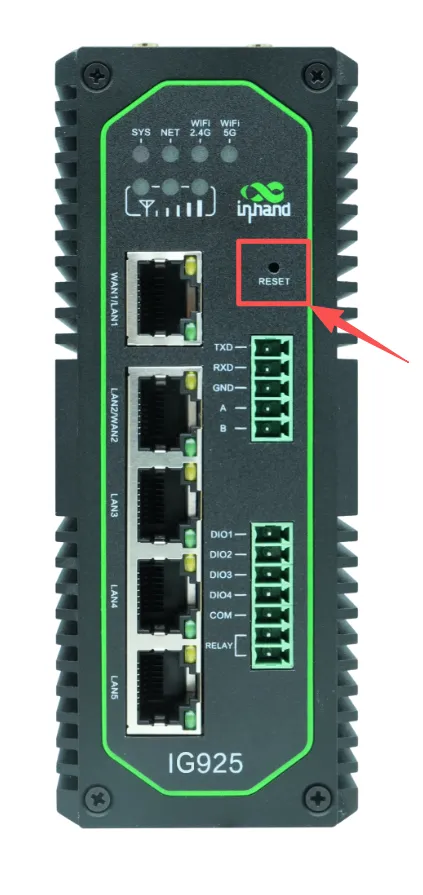
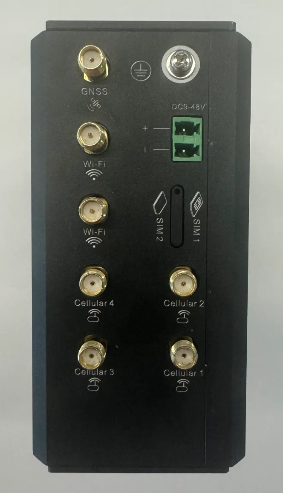
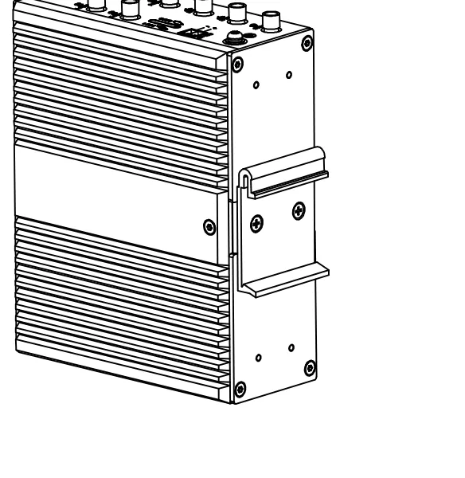
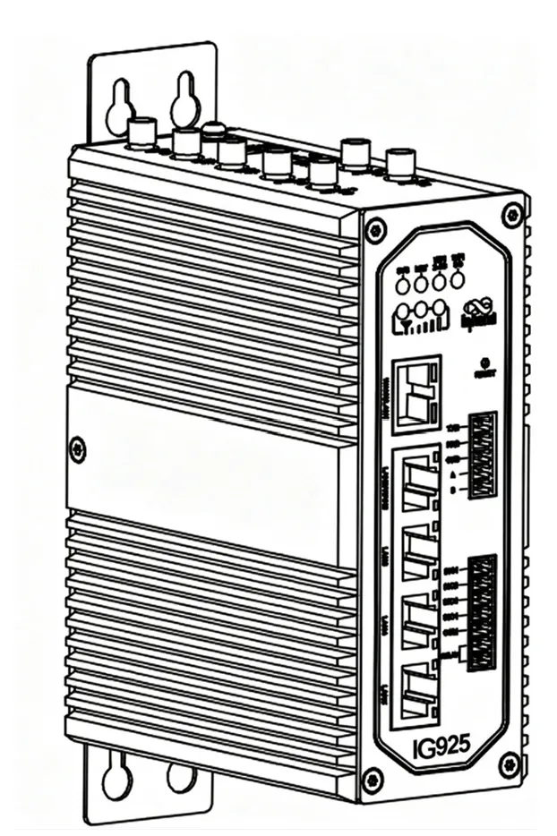
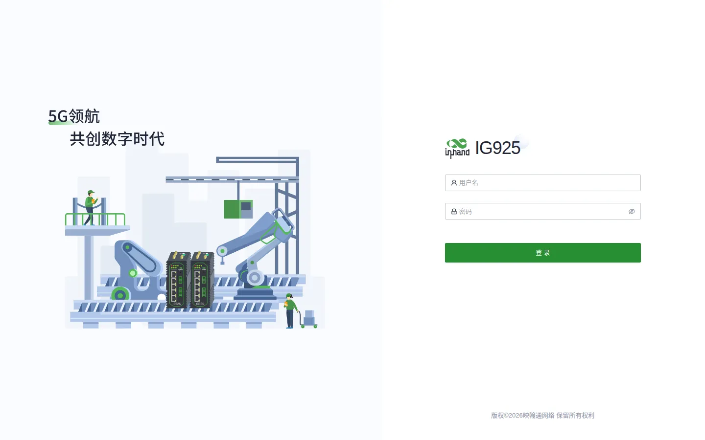
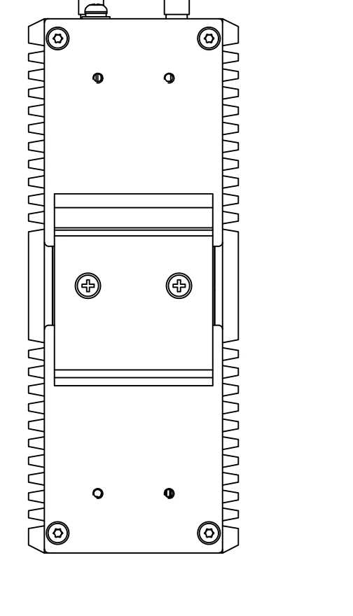
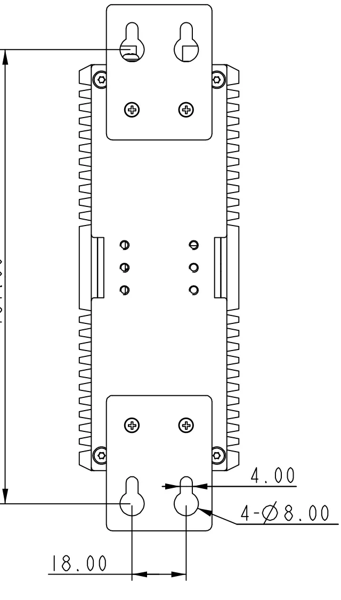

# IG925 快速安装手册

**IG925 高性能 5G 边缘计算网关**

**快速安装手册 V1.0**

---

## 第一部分：快速装机（图文整体流程）

> **您需要先做：** 开箱 → 固定设备 → 接电源与网线 →（若用蜂窝）**断电**装 SIM、接天线 → 上电 → PC 同网段 → 浏览器打开 Web。
> **再做：** 翻到下方 **第二部分**，按需查阅装箱、灯义、安装、各接口引脚等。

### 必读摘要（接线、上电前）

| 项目 | 要求 |
|------|------|
| 供电 | **9～48 V DC**，2 PIN 工业端子，具备防过流、防反接保护；按端子标识核对正负极。 |
| SIM 卡 | 抽屉式卡座，支持双 Nano-SIM；**须断电**安装或拔出，**不可热插拔**。 |
| 天线 | 按接口标识接入蜂窝天线（4×5G 或 2×4G）、Wi-Fi 天线（2 个）、GNSS 天线（1 个），具体以型号为准。 |
| 环境 | 工作温度 **−40 ～ +70 ℃**，存储温度 **−40 ～ +85 ℃**；防护等级 **IP30**，需防止进水。 |
| 安装位置 | 避免强电磁干扰环境，勿与高功率设备过于接近；预留散热和走线空间。 |

### 步骤 1：对照实物，确认面板与接口区域

打开包装，按 §2.1 装箱清单核对配件。设备正面板集中了指示灯、网口、串口与 I/O 端子：

**图 1 正面板（含 Reset 按钮位置）**

- 顶部：**SYS / NET / Wi-Fi 2.4G / Wi-Fi 5G 指示灯**与 **3 颗蜂窝信号灯**；
- 中部：**WAN1/GE1、LAN2/WAN2、LAN3、LAN4、LAN5** 共 5 个 RJ45 网口；
- 右侧：**串口端子（TXD/RXD/GND、A/B）**、**DIO 端子（DIO1～DIO4/COM）**、**RELAY 继电器端子**；
- **Reset 按钮**位于网口右上方（见图 1 红框）。

上面板为天线接口、电源端子与 SIM 卡座区域：

**图 2 上面板（天线接口、电源端子、SIM 卡座）**

详细面板与接口说明见 §2.2；指示灯含义见 §2.3。

### 步骤 2：将设备固定到导轨或柜内

IG925 支持两种安装方式，按现场场景任选其一：

- **DIN 导轨安装**：适合工业机柜部署，详见 §2.4.1。
- **壁挂安装**：适合箱体与墙面固定，详见 §2.4.2。

**图 3 DIN 导轨安装（背面卡轨）**

**图 4 壁挂安装**

固定后确认设备不会晃动，线缆不应牵拉接线端子。

### 步骤 3：连接电源与以太网

1. **接电源**：断电状态下，按上面板电源端子的丝印（**+** / **−**）将 **9～48 V DC** 电源接入 2 PIN 电源端子，并做好接地（端子位置见步骤 1 的上面板照片）。
2. **接以太网（PC 管理）**：用网线将 PC 连到 IG925 的任意 LAN 口（**LAN2～LAN5**；若 LAN2 已配置为 WAN2，请使用 **LAN3～LAN5**）。
3. **接以上行（如有线联网）**：用网线将 **WAN1/GE1** 口与上行设备（光猫、上级交换机或路由器）连接。

### 步骤 4：（若使用蜂窝）断电装 SIM，并接好天线

> ⚠ **务必确认设备已断电**，再进行 SIM 卡安装，以免造成数据丢失或设备损坏。

1. 取出 SIM 卡托，放入 **Nano-SIM** 卡后推回卡座（支持双 SIM，出厂默认"仅 SIM1"拨号）；SIM1/SIM2 卡座位于上面板（见步骤 1 上面板照片）。
2. 将蜂窝天线、Wi-Fi 天线、GNSS 天线（视型号配置）按上面板丝印（Cellular 1～4、Wi-Fi、GNSS）拧入对应天线接口。

天线接口与 SIM 卡座详细说明见 §2.5.5。

### 步骤 5：上电，确认设备已就绪

接通电源，观察正面板灯态：

- **SYS 红色常亮** → 系统启动中/工作正常；
- **NET 绿色常亮** → 蜂窝连接成功（使用蜂窝时）；
- **蜂窝信号灯**：1 颗亮 = 信号较差，2 颗亮 = 中等，3 颗亮 = 信号好；
- **Wi-Fi 2.4G / 5G 绿色闪烁** → 对应频段正常工作。

完整灯义见 §2.3。

### 步骤 6：PC 与浏览器登录 Web

1. 将 PC 的 IP 地址设置为与设备同网段：

   - 推荐将 PC 设为"自动获取 IP 地址"（设备 LAN 口默认启用 DHCP，地址池 192.168.2.2～192.168.2.254）；
   - 若 PC 无法自动获取地址，手动配置：IP **192.168.2.2～192.168.2.254** 中任一地址，子网掩码 **255.255.255.0**，默认网关 **192.168.2.1**，DNS **8.8.8.8**。

2. 在浏览器中打开 **<https://192.168.2.1>**。
3. 输入用户名和密码登录（**初始用户名和密码查看产品机身铭牌获取**）。
   - 若页面提示连接不安全，确认访问的是本设备地址后，点击"高级"，选择"继续前往"。

   

   **图 5 Web 登录界面**

4. 登录后进入【仪表盘】，核对设备型号、序列号和固件版本与铭牌一致；建议首次登录后立即修改初始密码。

详细登录与恢复出厂操作见 §2.7。

### 装完自检

- ☐ 设备已固定（DIN 导轨或壁挂），无晃动。
- ☐ 电源已按正负极接入 9～48 V DC 并接地；PC 网线已接到 LAN 口。
- ☐ 若使用蜂窝：SIM 已**断电**安装到位，各天线已按接口标识拧紧。
- ☐ **SYS 红色常亮**；使用蜂窝时 **NET 绿色常亮**、信号灯显示正常。
- ☐ PC 已获取 192.168.2.0 网段地址。
- ☐ 浏览器已能打开 <https://192.168.2.1> 并完成登录，【仪表盘】信息与铭牌一致。

> 若 Web 无法访问：检查 PC IP 是否与设备同网段、网线是否接到 LAN 口；必要时按 §2.7 的 Reset 步骤恢复出厂后重试。

---

## 第二部分：详细说明

### 2.1 装箱清单

| 物品 | 数量 | 说明 |
|------|------|------|
| IG925 边缘计算网关主机 | 1 台 | - |
| 蜂窝天线 | 若干 | 根据型号配置 |
| Wi-Fi 天线 | 若干 | 根据型号配置（WLAN 型号） |
| GNSS 天线 | 若干 | 根据型号配置（WLAN 型号） |
| 快速入门指南 | 1 份 | - |

### 2.2 产品结构与标识

#### 2.2.1 正面板

**图 6 正面板**

| 区域 | 说明 |
| --- | --- |
| 指示灯区 | SYS、NET、Wi-Fi 2.4G、Wi-Fi 5G 状态灯 + 3 颗蜂窝信号灯（见 §2.3） |
| 以太网口 | WAN1/GE1（1 个 2.5GbE，默认 WAN1 上行）、LAN2/WAN2、LAN3～LAN5（1GbE，本地接入）；1.5 KV 网络隔离变压保护 |
| 串口端子 | TXD/RXD/GND（RS232）、A/B（RS485），ESD 防护 15 KV |
| I/O 端子 | DIO1～DIO4/COM（4 路数字量 I/O，每路可独立配置为输入或输出） |
| 继电器端子 | RELAY，触点额定 2 A @ 30 V DC |
| Reset 按钮 | 用于恢复出厂设置（见 §2.7.2） |

#### 2.2.2 上面板

上面板为天线接口、电源端子与 SIM 卡座区域。

**图 7 上面板**

| 项目 | 丝印标识 | 说明 |
| --- | --- | --- |
| GNSS 天线接口 | GNSS | 1 个，GNSS 天线（WLAN 型号） |
| Wi-Fi 天线接口 | Wi-Fi | 2 个，Wi-Fi 天线（WLAN 型号） |
| 蜂窝天线接口 | Cellular 1～Cellular 4 | 4 个（5G 型号）；4G 型号为 2 个，以实物为准 |
| 电源端子 | DC9-48V，丝印 **+** / **−** | 2 PIN 工业端子，DC 9～48 V，防过流、防反接 |
| SIM 卡座 | SIM1、SIM2 | 抽屉式卡座，支持双 Nano-SIM（1.8 V / 3 V），可选 eSIM |
| 接地螺钉 | 接地符号 | 用于设备接地 |

### 2.3 指示灯与复位键

#### 2.3.1 运行状态指示灯

| 指示灯 | 状态 | 含义 |
|--------|------|------|
| 系统状态灯（SYS） | 常灭 | 设备未上电 |
| | 红色常亮 | 系统启动中/系统工作正常 |
| | 红色闪烁 | 固件升级中/系统错误 |
| 蜂窝状态灯（NET） | 绿色闪烁 | 蜂窝连接中 |
| | 绿色常亮 | 蜂窝连接成功 |
| Wi-Fi 2.4G | 常灭 | AP&STA 未使能 |
| | 绿色闪烁 | 2.4G 正常工作 |
| | 绿色常亮 | 工作模式为 STA 且未关联 AP |
| Wi-Fi 5G | 常灭 | AP&STA 未使能 |
| | 绿色闪烁 | 5G 正常工作 |
| | 绿色常亮 | 工作模式为 STA 且未关联 AP |

#### 2.3.2 蜂窝信号灯

| 信号灯状态 | 含义 |
| --- | --- |
| 常灭 | 无蜂窝连接 |
| 一颗绿色常亮 | 信号质量较差（请检查天线是否安装完好、SIM 卡是否正确识别，以及该地区信号状况） |
| 二颗绿色常亮 | 信号质量中等，设备可以正常使用 |
| 三颗绿色常亮 | 信号质量好 |

> **注意**：指示灯只反映设备和链路的大致状态，蜂窝信号灯亮不代表业务服务器一定可达，业务是否正常需结合 Web 界面的状态信息判断。

#### 2.3.3 复位键（Reset）

Reset 按钮位于正面板网口右上方（参见图 1、图 6）。恢复出厂的详细步骤见 §2.7.2。

> **注意**：若在 Web 界面【系统】→【其他设置】中禁用了硬件重置按钮，Reset 按钮将不能用于恢复出厂设置。

### 2.4 机械安装

#### 2.4.1 DIN 导轨安装

1. 选定设备的安装位置，确保有足够的散热和走线空间。
2. 设备背面附有 DIN 导轨卡座，将卡座上部卡入 DIN 导轨，再将设备下端向导轨方向按入，确认卡接牢固、设备不晃动。

**图 8 DIN 导轨卡座（背面）**

**图 9 导轨安装（背面立体图）**

拆卸时按下卡座的释放弹片，使卡座脱离 DIN 导轨后向外取下设备。

#### 2.4.2 壁挂安装

1. 选定设备的安装位置，确保有足够的空间。
2. 将壁挂支架用螺钉固定到设备背面，再用螺钉将支架固定到墙面或柜体。

**图 10 壁挂支架安装孔尺寸（背面）**

**图 11 壁挂安装（正面立体图）**

> 壁挂支架采用葫芦孔（钥匙孔）挂装方式，单个支架 2 个挂孔，孔径 Ø8 mm，挂孔中心距 18 mm（见图 10）。先将支架固定到设备背面，再用螺钉穿过挂孔固定到墙面或柜体；拆卸时逆序操作。安装完成后需确认设备固定牢靠，避免因设备跌落造成损坏。

### 2.5 连接与布线

#### 2.5.1 以太网

IG925 提供 5 个 RJ45 以太网口：**1 个 2.5GbE + 4 个 1GbE**，可配置为 WAN 或 LAN；默认 **WAN1 为上行口**（WAN1/GE1），**LAN2～LAN5 用于本地接入**（LAN2 可切换为 WAN2）。

| 端口丝印 | 默认角色 | 说明 |
| --- | --- | --- |
| WAN1/GE1 | WAN1（上行） | 2.5GbE，默认通过 DHCP 获取地址 |
| LAN2/WAN2 | LAN | 可在 Web 中添加为第二条 WAN |
| LAN3 | LAN | 本地接入 |
| LAN4 | LAN | 本地接入 |
| LAN5 | LAN | 本地接入 |

- LAN 侧默认启用 DHCP Server，地址池为 192.168.2.2～192.168.2.254。
- 如需有线上行：将 WAN1/GE1 与上行设备连接；如需静态 IP 或 PPPoE，在 Web【Internet】中编辑 WAN1。

#### 2.5.2 电源

IG925 支持 **9～48 V DC** 宽压供电，采用 2 PIN 工业端子（位于上面板，丝印 **DC9-48V**），具备**防过流、防反接**保护。

| 端子丝印 | 名称 | 定义 |
| --- | --- | --- |
| **+** | 电源正极 | 接 DC 9～48 V 电源正极 |
| **−** | 电源负极 | 接电源负极 |

**接线要求**：

1. 断电状态下接线，按端子丝印（**+** / **−**）核对正负极；
2. 使用符合规格的 DC 9～48 V 电源；
3. 做好接地（上面板配有接地螺钉）；
4. 上电后 **SYS 红色常亮**表示已正常供电。

电源端子位置见 §2.2.2 上面板照片（图 7）。

#### 2.5.3 串口（RS232 / RS485）

IG925 提供 1 路 RS232 + 1 路 RS485，用于连接 PLC、仪表等现场设备。

| 引脚（端子丝印） | 名称 | 定义 |
| --- | --- | --- |
| TXD | RS232 发送 | |
| RXD | RS232 接收 | |
| GND | RS232 信号地 | |
| A | RS485+ | |
| B | RS485− | |

**接线说明**：

- RS232：TX、RX 需与对端**交叉连接**并共地；
- RS485：按两端资料连接 A、B 差分信号，注意 A/B 不要接反；
- 串口参数（波特率、数据位、停止位、校验）需与串口设备一致，在 Web【工业接口】中配置。

> **注意**：同一个串口不能同时被 DTU、GNSS 串口转发、AT 服务等多个功能占用。

#### 2.5.4 数字量 I/O 与继电器

| 端子丝印 | 名称 | 说明 |
| --- | --- | --- |
| DIO1～DIO4 | 数字量输入/输出 | 4 路 DIO，每路可独立配置为输入或输出（出厂默认干接点输入） |
| COM | I/O 公共端 | |
| RELAY | 继电器输出 | 1 路（2 针端子），触点额定 2 A @ 30 V DC |

- 工作模式、输出电平、继电器触点状态在 Web【工业接口】→【IO】中配置；
- 接线需符合接口的电气参数。

#### 2.5.5 蜂窝 SIM 与天线

**SIM 卡座**：IG925 配备抽屉式 SIM 卡座，支持双 Nano-SIM，位于上面板。

安装步骤：

1. **断电**：SIM 卡需要在断电的情况下进行安装，请确保安装前已经断开设备电源。
2. **插卡**：取出 SIM 卡托，将 Nano-SIM 卡放入卡托后推回卡座。
3. 出厂默认拨号配置为"仅 SIM1"；使用 SIM2 或双卡模式时，需在 Web【Internet】→ 编辑 Cellular →"工作模式"中修改。

> **警告**：插拔 SIM 卡前，需拔掉电源，以免造成数据丢失或设备损坏。

**天线接口**：天线接口位于上面板，按丝印对接：

| 丝印标识 | 名称 | 数量 | 说明 |
| --- | --- | --- | --- |
| Cellular 1～Cellular 4 | 蜂窝天线接口 | 4 | 5G 型号（4×5G）；4G 型号为 2 个 |
| Wi-Fi | Wi-Fi 天线接口 | 2 | WLAN 型号 |
| GNSS | GNSS 天线接口 | 1 | WLAN 型号（含 GPS） |

将所需天线拧入对应天线接口，确认拧紧、接触良好。

**订购型号天线配置**：

| 型号 | 蜂窝天线 | Wi-Fi 天线 | GNSS 天线 |
| --- | --- | --- | --- |
| IG925 | 4 × 5G | 2 | 1 |

> **说明**：Wi-Fi 与 GNSS 天线仅 WLAN 型号配置，具体以实际订购信息为准。

#### 2.5.6 其他接口

| 项目 | 说明 |
| --- | --- |
| Reset 按钮 | 正面板，恢复出厂设置（见 §2.7.2） |
| USB / 存储扩展 | 规格书与用户手册均未列出 USB、Micro SD 等扩展接口，本机不提供（如实际提供请以实物为准） |

### 2.6 供电与环境

| 项目 | 规格 |
| :---: | :--- |
| 输入电压 | 9～48 V DC（2 PIN 工业端子，防过流、防反接） |
| 工作温度 | −40 ～ +70 ℃ |
| 存储温度 | −40 ～ +85 ℃ |
| 防护等级 | IP30（需防止进水） |
| 散热方式 | 金属外壳，无风扇散热 |
| 尺寸 | 141.2 × 118.5 × 53 mm |
| 重量 | 1002 g |
| 安装方式 | DIN 导轨、壁挂 |

### 2.7 首次登录与恢复出厂

#### 2.7.1 Web 登录

使用以下默认地址连接到 IG925：

| 项目 | 默认值 |
| :---: | :---: |
| 本地管理地址 | <https://192.168.2.1>（LAN 口，HTTPS） |
| 用户名 | 查看产品机身铭牌 |
| 密码 | 查看产品机身铭牌 |
| PC 同网段地址 | 192.168.2.2～192.168.2.254（DHCP 自动获取） |
| 默认网关 | 192.168.2.1 |
| 子网掩码 | 255.255.255.0 |

**步骤一：将 IG925 和 PC 互联**

用网线将 PC 连接到 IG925 的任意 LAN 口（LAN2～LAN5），将 PC 的 IP 地址设置为与设备同一网段（推荐"自动获取 IP 地址"）。

**步骤二：通过 Web 登录**

1. 在浏览器中输入 **<https://192.168.2.1>**，跳转到登录界面。
2. 输入用户名和密码（见产品机身铭牌）登录。
   - 若页面提示连接不安全，确认访问的是本设备地址后，点击"高级"，选择"继续前往"。

   

   **图 12 Web 登录界面**

3. 登录后进入【仪表盘】，核对设备型号、序列号和固件版本与铭牌一致。
4. 为了设备安全，**建议首次登录后点击页面右上角的用户名，选择"修改密码"修改初始密码**，并妥善保管新密码。

> **注意**：通过上行接口访问设备的 HTTPS、SSH、Ping 默认关闭；本地 LAN 口管理不受限制。如需远程管理，需在【系统】→【远程访问控制】中开启，开启前请修改初始密码并评估网络安全风险。

#### 2.7.2 恢复出厂（Reset）

通过正面板的 Reset 按钮采用硬件方式恢复出厂，步骤如下：

1. 设备上电的同时**长按 Reset 按钮 5～10 秒**，然后松开，此时 **SYS 指示灯红色慢闪**。若松开后 SYS 指示灯未慢闪，请断电后重新操作。
2. 在 SYS 指示灯**慢闪期间（约 10 秒内）再次按住 Reset 按钮约 2 秒**，SYS 指示灯快速闪烁后松开，设备开始恢复出厂设置。

也可以在 Web 界面的【系统】→【设备选项】中执行恢复出厂设置。

> **注意**：
> - 恢复出厂设置会将网关的配置恢复为默认值，**不会删除**已安装的 Python App、Docker 容器及其业务数据；但 Python 边缘计算引擎、Docker 管理器和各 App 的启用状态会恢复为默认的未启用状态，恢复后需重新启用。
> - 操作前建议先在【系统】→【配置管理】中导出配置。
> - 设备接入云平台后，平台可能会将原有配置重新下发到设备。
> - 若在【系统】→【其他设置】中禁用了硬件重置按钮，Reset 按钮无效。

### 2.8 常见问题速查

| 现象 | 可能原因 | 排查步骤 |
|------|----------|----------|
| 无法打开 Web 界面 | PC 与设备不同网段 | 1. 确认 PC 获取到 192.168.2.0 网段地址 2. 检查网线是否接到 LAN 口 |
| 无法打开 Web 界面 | 浏览器兼容性或证书提示 | 1. 更换浏览器（推荐 Chrome/Edge/Firefox） 2. 证书提示时点击"高级"→"继续前往" |
| 忘记登录密码 | 已修改过初始密码 | 1. 查看产品机身铭牌（仅限未修改过） 2. 已修改且忘记，需恢复出厂设置（§2.7.2） |
| 无法连接蜂窝网络 | SIM 卡问题 | 1. 断电后检查 SIM 卡是否正确插入 2. 检查 SIM 是否欠费、APN 是否需手动配置 |
| 无法连接蜂窝网络 | 信号弱或无信号 | 1. 检查天线是否连接牢固 2. 调整设备或天线位置，观察信号灯 |
| SYS 红色闪烁 | 固件升级中/系统错误 | 1. 升级过程中请勿断电 2. 非升级状态时联系技术支持 |

更多故障处理见《IG925 用户手册》附录。

### 2.9 相关文档

| 需求 | 去向 |
| --- | --- |
| 产品功能详细介绍、场景配置、Python/Docker 边缘计算、DeviceLive 使用 | 《IG925 用户手册》 |
| 订购信息、型号与频段、详细技术规格 | 《IG925 规格书》 |
| 软件下载与公告 | [www.inhand.com.cn](https://www.inhand.com.cn) |

### 2.10 法律信息

**版权声明**

© 映翰通网络 保留所有权利。

**商标**

InHand 标志是映翰通网络的注册商标。

本手册中的所有其他商标或注册商标属于其各自的制造商。

**免责声明**

本公司保留对此手册更改的权利，产品后续相关变更时，恕不另行通知。对于任何因安装、使用不当而导致的直接、间接、有意或无意的损坏及隐患概不负责。
