# IG925 边缘计算网关用户手册
## 前置信息

### 声明

首先非常感谢您选择本公司产品！在使用前，请您仔细阅读本用户手册，遵守以下声明，将有助于维护知识产权和法律合规性，以确保您的使用体验与产品的最新信息相一致。如有任何疑问或需要获取书面许可，请随时联系我们的技术支持团队。

- 版权声明

本用户手册包含受版权保护的内容，版权归北京映翰通网络技术股份有限公司及其许可者所有。未经书面许可，任何单位和个人不得擅自摘抄、复制本手册的部分或全部内容，且不得以任何形式传播。

- 免责声明

由于产品技术和规格不断更新，本公司不能承诺用户手册中的资料与实际产品完全一致。因此，不承担由于实际技术参数与用户手册不符而引起的任何争议。任何关于产品的改动恕不提前通知，本公司保留最终更改权和解释权。

- 版权信息

本用户手册内容受版权法律保护，版权归北京映翰通网络技术股份有限公司及其许可者所有，保留一切权利。未经书面许可，不得擅自使用、复制或传播本手册的内容。

### 图形界面约定

| 符号 | 含义 | 示例 |
|------|------|------|
| `< >` | 表示变量或参数，需替换为实际值 | `<IP地址>` 表示需填入具体IP |
| `" "` | 表示界面上的文字标签 | 点击"保存"按钮 |
| `→` | 表示菜单层级或操作顺序 | 【Internet】→【上行链路列表】 |
| `【 】` | 表示菜单或页面名称 | 进入【系统】页面 |

### 技术支持

**北京映翰通网络技术股份有限公司（总部）**

电话：010-8417 0010

地址：北京市朝阳区紫月路18号院3号楼5层

**成都办事处**

电话：028-8679 8244

地址：四川省成都市武侯区天府大道北段1777号中国太平金融大厦14层

**广州办事处**

电话：020-8562 9571

地址：广州市天河区黄埔大道中660号汇金国际金融中心B栋1913单元

**武汉办事处**

电话：027-8716 3566

地址：武汉市洪山区关山大道465号光谷新发展国际中心B座5层

**上海办事处**

电话：021-5480 8501

地址：上海市普陀区国浩长风城北座326室

### 如何使用本手册

- 首次使用用户：建议按顺序阅读「认识设备」→「安装与首次使用」→「常用场景配置」→「功能说明与参数参考」
- 已有设备用户：可直接查阅「功能说明与参数参考」或「附录 故障处理」
- 二次开发与应用部署用户：可查阅「常用场景配置」中的Python边缘计算、Docker容器部署场景
- 云平台管理用户：可查阅「常用场景配置」中的连接DeviceLive平台场景

**按任务快速跳转**

| 任务 | 对应章节 | 预计用时 |
|------|----------|----------|
| 了解设备外观、接口和默认配置 | [认识设备](#第1章-认识设备) | 约10分钟 |
| 安装设备并首次登录 | [安装与首次使用](#第2章-安装与首次使用) | 约15分钟 |
| 通过蜂窝网络接入互联网 | [场景1：蜂窝联网](#场景1蜂窝联网) | 约5分钟 |
| 通过有线网络接入互联网 | [场景2：有线接入网络](#场景2有线接入网络) | 约5分钟 |
| 通过Wi-Fi接入互联网 | [场景3：Wi-Fi(STA)接入网络](#场景3wi-fista接入网络) | 约5分钟 |
| 串口设备数据透传到服务器 | [场景4：串口数据透传](#场景4串口数据透传) | 约10分钟 |
| 部署和运行Python App | [场景5：Python边缘计算](#场景5python边缘计算) | 约15分钟 |
| 部署Docker容器应用 | [场景6：Docker容器部署](#场景6docker容器部署) | 约15分钟 |
| 连接DeviceLive云平台 | [场景7：连接DeviceLive平台](#场景7连接devicelive平台) | 约10分钟 |
| 配置VPN、防火墙等高级功能 | [功能说明与参数参考](#第4章-功能说明与参数参考) | 按需 |
| 排查设备故障 | [附录 故障处理](#附录-故障处理) | 按需 |

---

## 第1章 认识设备

### 1.1 概述

IG925是映翰通面向工业物联网推出的高性能5G边缘计算网关。设备集成5G/4G蜂窝、Wi-Fi 6、2.5GbE/1GbE以太网以及RS232/RS485、数字量I/O、继电器等工业接口，在提供稳定可靠网络接入的同时，内置Python二次开发环境和Docker容器化应用平台，可在设备端完成现场数据采集、协议转换和边缘计算，并通过DeviceLive云平台实现远程连接、批量运维与OTA升级。设备采用金属外壳、无风扇散热设计，支持-40℃～+70℃宽温工作和DC 9～48V宽压供电，适用于工业自动化、能源电力、智慧城市等场景。

本手册适用的产品型号如下：

| 产品型号 | 固件版本 |
|----------|----------|
| IG925 | V2.1.4版本及以上 |

> **说明**：不同订购型号的蜂窝制式、Wi-Fi与GNSS配置不同，具体以设备铭牌和订购信息为准。本手册以IG925-GLNR-WLAN（支持5G/4G、Wi-Fi 6及GNSS）为例进行说明。

### 1.2 包装清单

| 物品 | 数量 | 说明 |
|------|------|------|
| IG925边缘计算网关主机 | 1台 | - |
| 蜂窝天线 | 若干 | 根据型号配置 |
| Wi-Fi天线 | 若干 | 根据型号配置（WLAN型号） |
| GNSS天线 | 若干 | 根据型号配置（WLAN型号） |
| 快速入门指南 | 1份 | - |

> **说明**：装箱物品以实际订购型号和随箱清单为准。

### 1.3 外观与接口

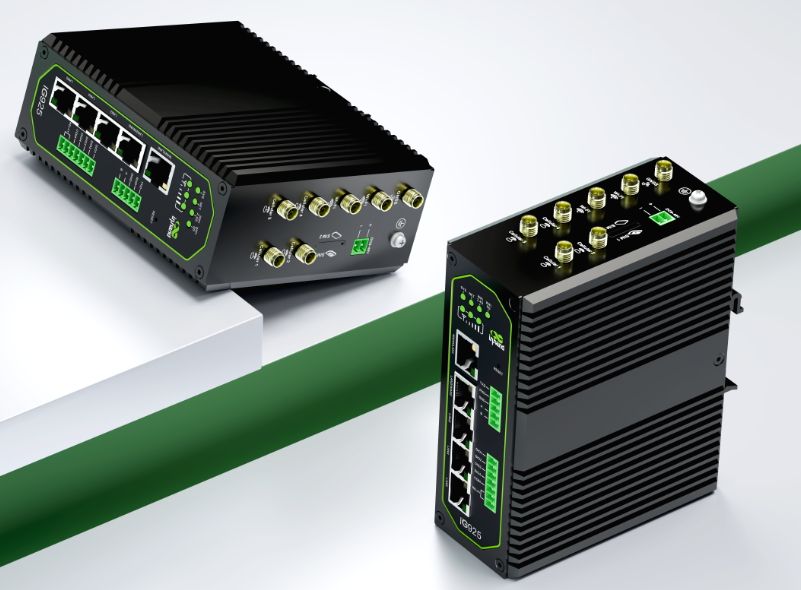

<strong>图 1-1 IG925边缘计算网关外观</strong>

| 接口 | 数量 | 功能说明 |
|------|------|----------|
| 以太网口 | 5 | 1个2.5GbE + 4个1GbE RJ45口，可配置为WAN或LAN；默认WAN1为上行口，LAN2～LAN5用于本地接入 |
| 串口 | 2 | 1路RS232 + 1路RS485，用于连接PLC、仪表等现场设备 |
| 数字量I/O | 4 | 4路DIO，每路可独立配置为输入或输出 |
| 继电器 | 1 | 1路继电器输出，触点额定2A@30V DC |
| SIM卡槽 | 1 | 抽屉式卡座，支持双Nano-SIM卡 |
| 天线接口 | — | 蜂窝天线（4×5G或2×4G）、Wi-Fi天线（2个）、GNSS天线（1个），具体以型号为准 |
| 电源接口 | 1 | DC 9～48V，2针工业端子，具备防过流、防反接保护 |
| Reset按钮 | 1 | 用于恢复出厂设置 |

### 1.4 指示灯说明

| 指示灯 | 状态 | 含义 |
|--------|------|------|
| 系统状态灯（SYS） | 常灭 | 设备未上电 |
|  | 红色常亮 | 系统启动中/系统工作正常 |
|  | 红色闪烁 | 固件升级中/系统错误 |
| 蜂窝状态灯（NET） | 绿色闪烁 | 蜂窝连接中 |
|  | 绿色常亮 | 蜂窝连接成功 |
| 蜂窝信号灯 | 常灭 | 无蜂窝连接 |
|  | 一颗信号灯绿色常亮 | 信号质量较差 |
|  | 二颗信号灯绿色常亮 | 信号质量中等 |
|  | 三颗信号灯绿色常亮 | 信号质量好 |
| Wi-Fi 2.4G | 常灭 | AP&STA未使能 |
|  | 绿色闪烁 | 2.4G正常工作 |
|  | 绿色常亮 | 工作模式为STA且未关联AP |
| Wi-Fi 5G | 常灭 | AP&STA未使能 |
|  | 绿色闪烁 | 5G正常工作 |
|  | 绿色常亮 | 工作模式为STA且未关联AP |

> **注意**：指示灯只反映设备和链路的大致状态，蜂窝信号灯亮不代表业务服务器一定可达，业务是否正常需结合Web界面的状态信息判断。

### 1.5 恢复出厂设置

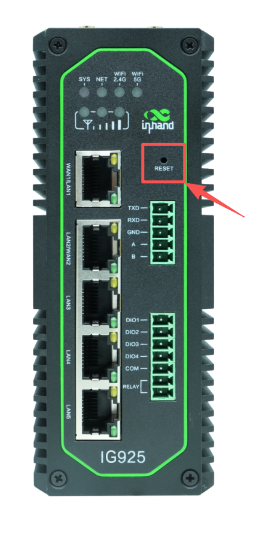

<strong>图 1-2 Reset按钮位置</strong>

按照以下步骤进行操作将设备恢复出厂设置：

1. 设备上电的同时长按Reset按钮5～10秒，然后松开Reset按钮，此时SYS指示灯红色慢闪。若松开后SYS指示灯未慢闪，请断电后重新操作。
2. 在SYS指示灯慢闪期间（约10秒内）再次按住Reset按钮约2秒，SYS指示灯快速闪烁后松开，设备开始恢复出厂设置。

也可以在Web界面的【系统】→【设备选项】中执行恢复出厂设置，参见[设备选项](#4124-设备选项)。

> **注意**：恢复出厂设置会将网关的配置恢复为默认值，不会删除已安装的Python App、Docker容器及其业务数据。由于配置恢复为默认值，Python边缘计算引擎、Docker管理器和各App的启用状态也会恢复为默认的未启用状态，恢复后需重新启用；操作前建议先在【系统】→【配置管理】中导出配置。

> **注意**：若在【系统】→【其他设置】中禁用了硬件重置按钮，Reset按钮将不能用于恢复出厂设置。

### 1.6 默认设置

| 序号 | 功能 | 默认配置 |
|------|------|----------|
| 1 | 本地管理地址 | 192.168.2.1/24，通过HTTPS访问Web管理界面 |
| 2 | 用户名和密码 | 需查看产品机身上的铭牌获取 |
| 3 | 以太网 | WAN1启用并通过DHCP获取地址；LAN2～LAN5用于本地接入；LAN侧DHCP服务器启用，地址池为192.168.2.2～192.168.2.254 |
| 4 | 蜂窝网络拨号 | 启用，默认配置"仅SIM1"，自动选择拨号参数 |
| 5 | Wi-Fi | WLAN型号的Wi-Fi 2.4G、5G接入点启用，SSID分别以IG925-、IG925-5G-为前缀，后面为无线MAC后6位 |
| 6 | 远程访问控制 | 通过上行接口访问设备的HTTPS、SSH、Ping默认关闭；本地LAN口管理不受此限制 |
| 7 | 云管理 | 启用，联网后自动连接DeviceLive平台 |
| 8 | 边缘计算 | 出厂预装最新版本的Python SDK、DeviceSupervisor Agent（DSA）和Docker SDK，版本和运行状态可在【边缘计算】页面查看 |

---

## 第2章 安装与首次使用

### 2.1 安装前准备

在进行设备安装前，需确认以下环境要求和工具准备：

| 项目 | 要求 |
|------|------|
| 电源 | DC 9～48V直流电源，按端子标识核对极性 |
| 环境温度 | 工作温度-40℃～+70℃，存储温度-40℃～+85℃ |
| 安装空间 | 导轨或壁挂安装，预留散热和走线空间；设备防护等级IP30，需防止进水 |
| 网络环境 | 需准备可用的蜂窝/有线/Wi-Fi网络 |
| SIM卡 | 如使用蜂窝网络，需准备运营商Nano-SIM卡 |
| 网线 | 需准备标准网线 |
| 电脑 | 用于访问设备Web管理界面，推荐使用Chrome、Edge或Firefox浏览器 |

> **注意**：安装设备时禁止将设备安装在强电磁干扰环境下，避免与高功率设备过于接近。

### 2.2 安装指南

#### 2.2.1 设备固定

根据现场情况选择导轨安装或壁挂安装，固定后确认设备不会晃动，线缆不应牵拉接线端子。

#### 2.2.2 天线安装与SIM卡插入

1. 按天线接口标识安装蜂窝天线、Wi-Fi天线和GNSS天线（视型号配置）。
2. 断电状态下，取出SIM卡托，放入Nano-SIM卡后推回卡座。

> **警告**：插拔SIM卡前，需拔掉电源，以免造成数据丢失或设备损坏。

#### 2.2.3 电源与网络连接

1. 断电状态下，按端子标识的正负极将DC 9～48V电源接入电源端子，并做好接地。
2. 用网线将电脑连接到设备任意LAN口（LAN2～LAN5）。
3. 如使用有线上网，用网线将WAN1口与上行设备（如光猫、上级交换机或路由器）连接。
4. 接通电源，设备开始启动。

#### 2.2.4 PC网络配置

将PC的IP地址设置为与网关处于同一网段。

- 设备LAN口默认启用DHCP Server功能，将PC设置为"自动获取IP地址"，PC即可通过IG925获取IP地址，需确认该地址是否处于192.168.2.0网段。
- 若PC无法通过DHCP的方式自动获取IP地址，则需手动将PC的IP地址配置为192.168.2.2～192.168.2.254中的任一地址；默认网关为192.168.2.1，子网掩码为255.255.255.0，DNS设置为8.8.8.8或从运营商获取的DNS地址。

#### 2.2.5 登录Web管理界面

1. 在浏览器地址栏中输入https://192.168.2.1，跳转到登录界面后输入用户名和密码（见产品机身铭牌）进入设备的Web管理界面。如果页面提示连接不安全，确认访问的是本设备地址后，点击"高级"，选择"继续前往"。

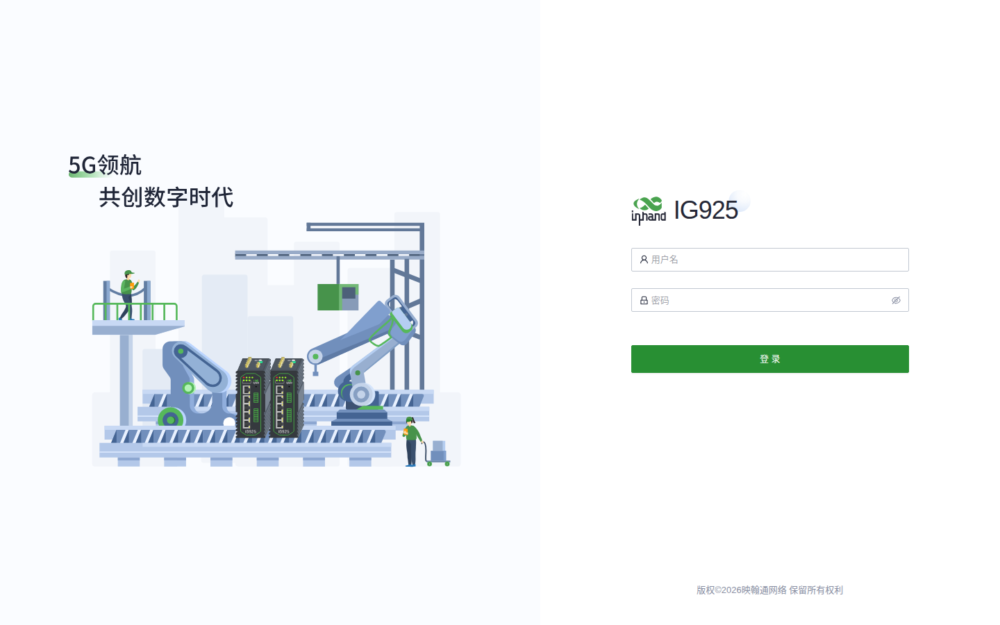

<strong>图 2-1 设备Web登录界面</strong>

2. 登录后进入【仪表盘】，核对设备型号、序列号和固件版本，确认登录的是目标设备。
3. 为了设备安全，建议首次登录后点击页面右上角的用户名，选择"修改密码"修改初始密码，并妥善保管新密码。

### 2.3 快速检查

完成安装后，需进行以下检查：

- [ ] 设备已上电，系统状态灯正常显示
- [ ] 蜂窝/Wi-Fi/GNSS天线已正确安装
- [ ] SIM卡已正确插入（如使用蜂窝网络）
- [ ] PC已通过网线连接到LAN口
- [ ] PC已获取到192.168.2.0网段的IP地址
- [ ] 可通过浏览器访问https://192.168.2.1打开Web管理界面
- [ ] 【仪表盘】中显示的型号、序列号和固件版本与设备铭牌一致
---

## 第3章 常用场景配置

### 场景1：蜂窝联网

**目标**：通过5G/4G蜂窝网络接入互联网。

**前提**：已在断电状态下插入SIM卡并安装蜂窝天线，设备已上电。

**预计用时**：约5分钟。

**操作步骤**：

1. 设备上电后，IG925将使用SIM1自动拨号并接入网络，无需额外配置。
2. 如运营商要求指定APN，进入【Internet】菜单，点击"Cellular"所在行的"编辑"按钮，将"拨号参数集"改为手动后，填写运营商提供的APN、认证方式、用户名和密码。
3. 如SIM卡启用了PIN码，在同一页面填写正确的PIN码。
4. 点击"保存"。

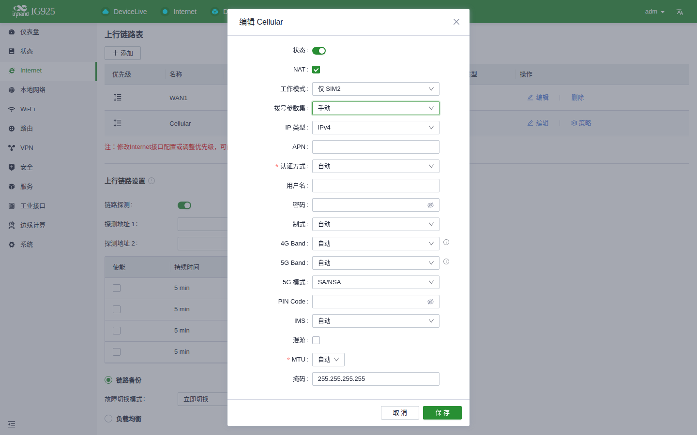

<strong>图 3-1 编辑Cellular，手动配置APN</strong>

**验证方法**：

1. 检查蜂窝状态灯，确认蜂窝连接成功（绿色常亮）；检查蜂窝信号灯，确认信号质量。
2. 在【仪表盘】中查看Cellular接口已获取IP地址。
3. 在【系统】→【工具】→【Ping】中选择Cellular接口，Ping一个已知可达的地址。

**常见问题**：

- 无法拨号：检查SIM卡是否在断电状态下正确插入、APN参数是否正确、SIM卡是否欠费。
- 信号弱：检查天线是否连接牢固，调整设备或天线位置。
- 物联网卡或专网卡只能访问指定网络：需使用运营商允许访问的地址验证，并按需在【Internet】→【上行链路设置】中修改链路探测地址。

### 场景2：有线接入网络

**目标**：通过以太网接入互联网。

**前提**：已准备网线，上行设备（如光猫、上级路由器或交换机）可用。

**预计用时**：约5分钟。

**操作步骤**：

1. 用网线将IG925的WAN1口与上行设备连接。WAN1默认通过DHCP获取地址，上行设备提供DHCP时无需修改配置。
2. 如需使用静态IP或PPPoE，进入【Internet】菜单，点击"WAN1"所在行的"编辑"按钮，选择对应的"IPv4类型"并填写网络管理员或运营商提供的参数，点击"保存"。

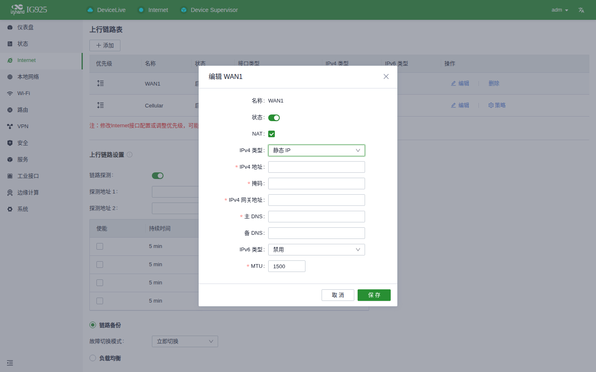

<strong>图 3-2 编辑WAN1，配置静态IP</strong>

3. 如需配置第二条有线链路，先确认电脑连接在LAN3～LAN5中的任一端口，在【Internet】中点击"添加"，选择WAN并完成配置，再将第二条上行网线接入LAN2/WAN2口。

**验证方法**：

1. 在【仪表盘】中查看WAN1接口已获取IP地址、网关和DNS。
2. 在【状态】→【链路监控】中查看链路健康状态。

**常见问题**：

- 无法获取IP地址：检查网线连接、确认上行设备的DHCP服务正常。
- PPPoE拨号失败：检查账号密码是否正确。
- 上行网段与本地网段冲突：先在【本地网络】中修改本地网段，再接入上行网络。

### 场景3：Wi-Fi(STA)接入网络

**目标**：通过现场无线热点接入互联网。

**前提**：现场有可用的Wi-Fi接入点（AP），已获知其SSID、安全方式和密码；电脑通过网线连接设备LAN口进行管理。

**预计用时**：约5分钟。

**操作步骤**：

1. 进入【Internet】菜单，点击"添加"按钮，选择"Wi-Fi(STA)"。
2. 选择2.4GHz或5GHz频段，点击SSID旁的扫描按钮选择现场AP（隐藏SSID可手动填写）。
3. 核对AP的安全方式和加密方式，输入密码，地址类型一般选择DHCP。
4. 点击"保存"，IG925将主动向AP发起连接。

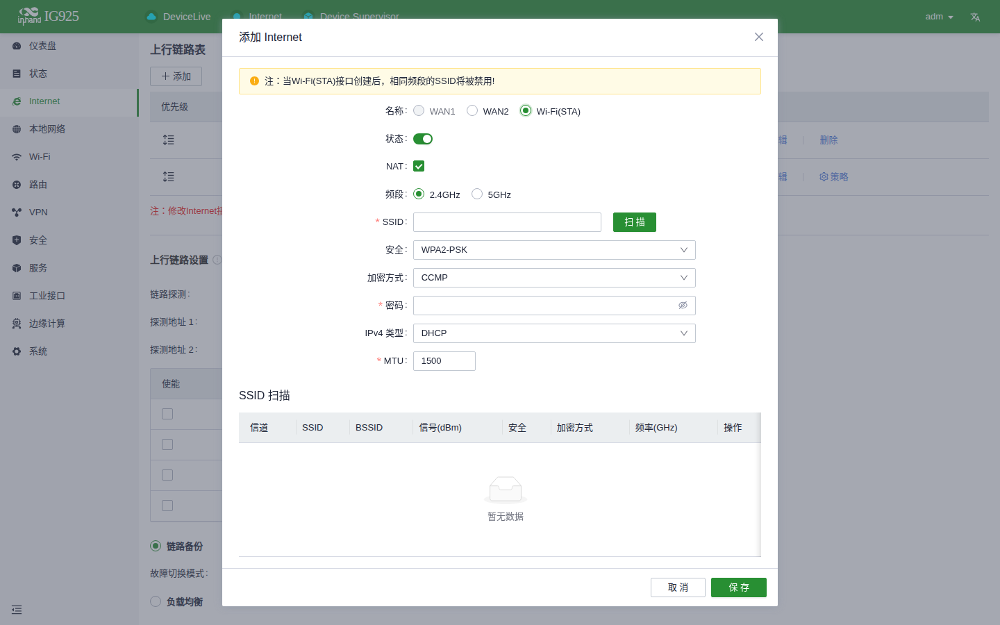

<strong>图 3-3 添加Wi-Fi(STA)上行链路</strong>

> **注意**：添加Wi-Fi(STA)后，相同频段的本地Wi-Fi接入点将被禁用。如果电脑通过该频段的Wi-Fi连接设备，保存后连接会断开，需使用有线方式管理设备。

**验证方法**：

1. 在【仪表盘】中查看Wi-Fi(STA)接口已获取IP地址。
2. 在【状态】→【链路监控】中查看链路健康状态。

**常见问题**：

- 无法连接AP：检查SSID和密码是否正确、确认AP信号强度和支持的频段。
- 认证失败：核对AP的认证策略和加密策略是否与IG925配置一致。

### 场景4：串口数据透传

**目标**：通过DTU功能，将RS232/RS485串口设备的数据透传到TCP/UDP服务器，并将服务器下发的数据写回串口。

**前提**：串口设备已按接口定义接入IG925的RS232或RS485口；设备已联网；已获知服务器地址、端口及串口参数（波特率、数据位、停止位、校验）。

**预计用时**：约10分钟。

**操作步骤**：

1. 进入【工业接口】，选择RS232或RS485页签，设置与串口设备一致的波特率、数据位、停止位、校验和流控。
2. 启用DTU透明传输，选择协议（TCP或UDP）和连接方式，在目标中填写服务器地址和端口。
3. 按服务器要求设置DTU标识、心跳、分帧长度/间隔、重连间隔等参数，点击"保存"。

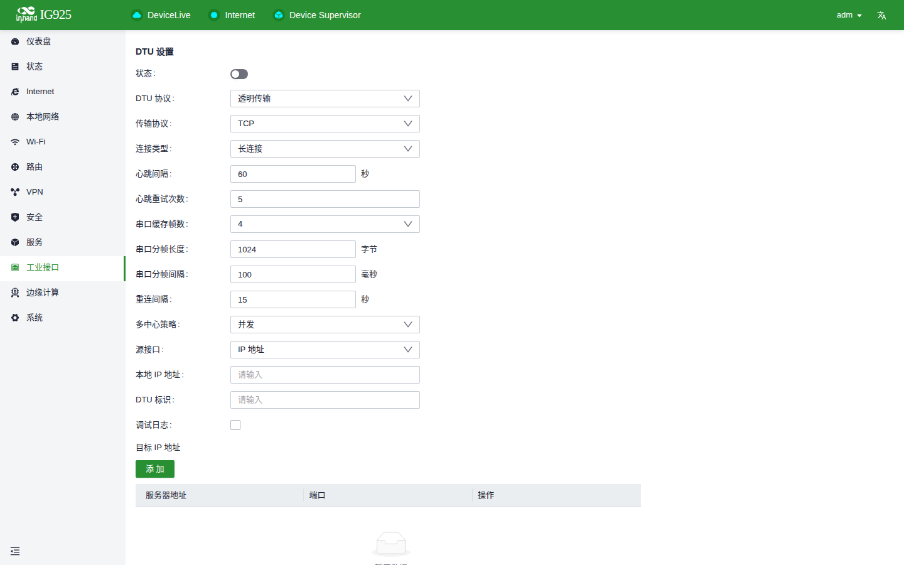

<strong>图 3-4 串口参数与DTU配置</strong>

**验证方法**：

1. 在【状态】→【DTU】中查看连接状态和收发记录。
2. 从串口设备发送一条数据，确认服务器收到相同的数据；从服务器下发一条数据，确认串口设备收到。

**常见问题**：

- 服务器收不到数据：检查串口参数是否与设备一致、RS232收发线是否交叉连接、RS485的A/B线是否接反。
- 连接反复断开：检查服务器地址和端口、心跳与重连参数是否与服务器要求一致。
- 同一串口被多个功能占用：DTU、GNSS串口转发、AT服务等不能同时使用同一业务串口。

> **说明**：透明传输模式只在串口与网络之间转发原始数据，不解析Modbus等应用层协议；需要将Modbus TCP请求转换为串口Modbus RTU时，可将"DTU 协议"设为"Modbus 网桥"（见[工业串口](#4101-工业串口)）。如需按协议采集和处理数据，可使用Python App或DeviceSupervisor Agent。

### 场景5：Python边缘计算

**目标**：启用Python边缘计算引擎，将自行开发或供应商提供的Python App签名、安装并运行在IG925上。

**前提**：已获取需要部署的App包；电脑已登录设备Web界面。设备出厂已预装Python SDK，如需升级，需获取适用于IG925的SDK安装包（如py3.14.6sdk-V1.0.1_Edge-IG925.zip）。

**预计用时**：约15分钟。

**操作步骤**：

1. 进入【边缘计算】→【Python 边缘计算】，查看"SDK 版本"。需要升级时，点击"升级 SDK"，选择SDK安装包并确认，等待安装完成。
2. 打开"启用引擎"，等待"引擎状态"显示为"运行中"。
3. 如果手中的App包尚未签名（自行开发并按打包说明生成的内层包），在页面下方"App签名"中点击"导入文件"选择该包，点击"签名"，成功后点击"导出文件"保存签名后的App包。供应商交付的已签名App包可跳过此步。

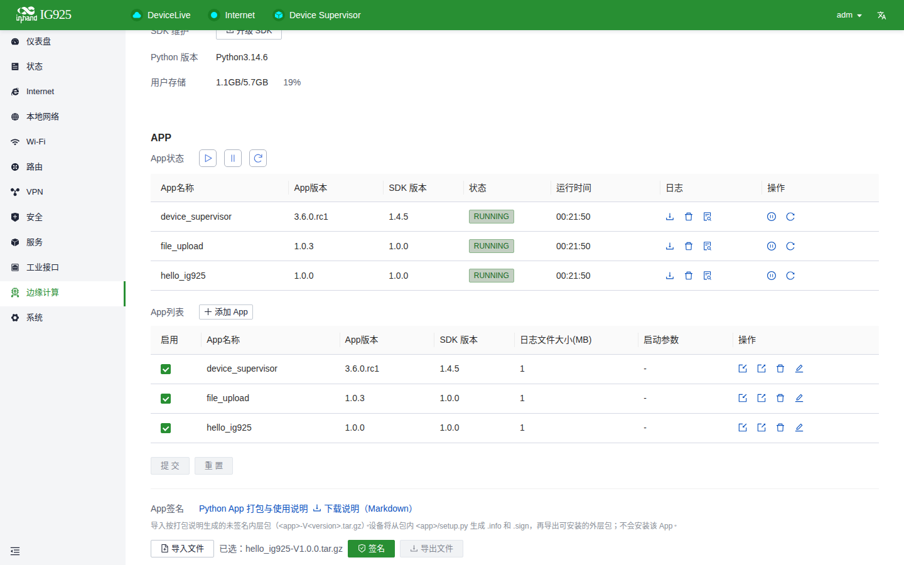

<strong>图 3-5 App签名</strong>

4. 在"App列表"中点击"添加 App"，选择签名后的App包并确认安装。

<strong>图 3-6 确认安装App包</strong>

5. 安装完成后勾选该App的"启用"，按需填写"启动参数"，点击"提交"。

> **参考**：App的目录结构、打包和签名要求可在"App签名"区域的"Python App 打包与使用说明"中在线阅读，也可点击"下载说明（Markdown）"保存到本地。

**验证方法**：

1. 在"App状态"中确认App状态为"RUNNING"。
2. 点击该App的查看日志按钮，确认日志中有App的正常输出、无报错信息；日志页面使用本页的"Python App日志账户"登录。
3. 在业务接收端（如服务器或平台）确认收到App上报的数据。

**常见问题**：

- 安装失败：确认选择的是签名后的App包，App的Python版本与SDK一致（SDK V1.0.1使用Python 3.14.6）。
- App无法启动：检查启动参数和App配置，查看App日志中的报错信息。
- "启用"与"停止"的区别："启用"决定设备重启后App是否自动运行，"停止"只暂停当前运行。

### 场景6：Docker容器部署

**目标**：启用Docker管理器和Portainer，在IG925上部署容器化应用。

**前提**：应用镜像支持linux/arm/v7平台；部署时设备可访问镜像仓库，或已准备离线镜像文件。设备出厂已预装Docker SDK，如需升级，需获取适用于IG925的Docker SDK安装包（如IG925-docker-sdk-V1.0.0.zip）。

**预计用时**：约15分钟。

**操作步骤**：

1. 进入【边缘计算】→【Docker 管理】，查看Docker版本。需要升级时，点击"升级 SDK"，选择Docker SDK安装包并确认，等待安装完成。
2. 打开Docker管理器的"启用管理器"，等待状态显示为"运行中"；如需使用镜像加速，在"镜像仓库"中填写镜像加速地址并保存。
3. 打开Portainer管理器的"启用管理器"，等待状态显示为"运行中"。

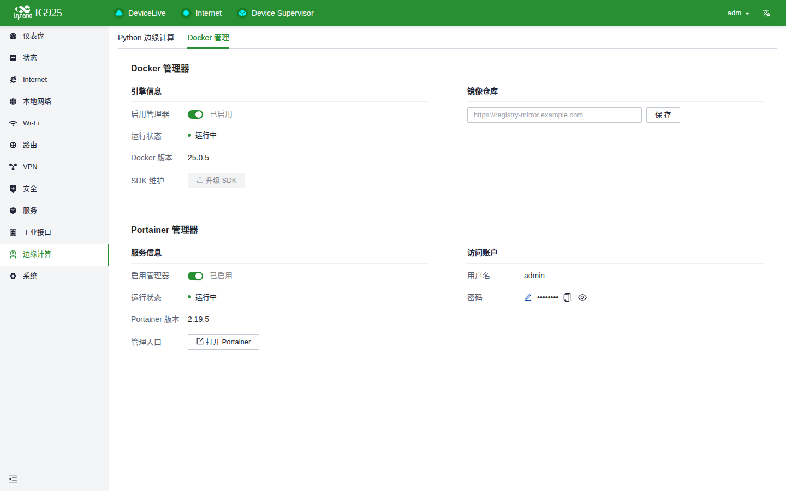

<strong>图 3-7 Docker管理</strong>

4. 点击"打开 Portainer"，使用"访问账户"中显示的用户名（admin）和密码登录Portainer。
5. 在Portainer中通过"Stacks"或"Containers"部署应用，按应用要求配置端口映射、环境变量、重启策略和数据卷。

**验证方法**：

1. 在Portainer中确认容器处于运行状态。
2. 从电脑或业务终端访问容器发布的服务端口，确认服务响应正常。

**常见问题**：

- 镜像拉取失败：检查设备网络和DNS，确认镜像仓库地址可访问，或改用离线导入镜像。
- 容器无法运行：确认镜像架构为linux/arm/v7，x86（amd64）和arm64镜像不能直接在IG925上运行。
- 无法登录Portainer：Portainer访问账户与设备Web账号不同，以"Docker 管理"页面"访问账户"中显示的信息为准。

> **注意**：容器发布的端口会对外提供服务，生产部署前需评估访问范围；容器内的业务数据应挂载到数据卷，并按业务需要单独备份。

### 场景7：连接DeviceLive平台

**目标**：将IG925连接至DeviceLive云平台，实现远程监控、远程访问和批量运维。

**前提**：设备已接入互联网，已准备好DeviceLive平台账号。

**预计用时**：约10分钟。

**操作步骤**：

1. 在浏览器中（建议使用谷歌浏览器），输入网址https://device.inhandcloud.cn，进入DeviceLive登录/注册页面。单击"立即注册"以创建平台账号。

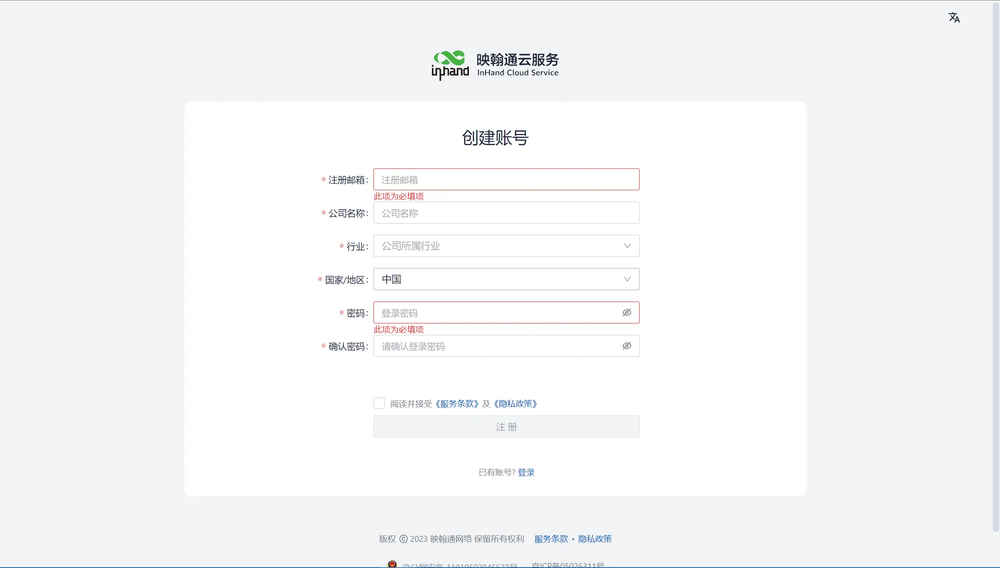

<strong>图 3-8 DeviceLive注册页面</strong>

2. 完成账号注册后，使用用户名和密码登录映翰通云服务平台，并选择【Device Live】服务。

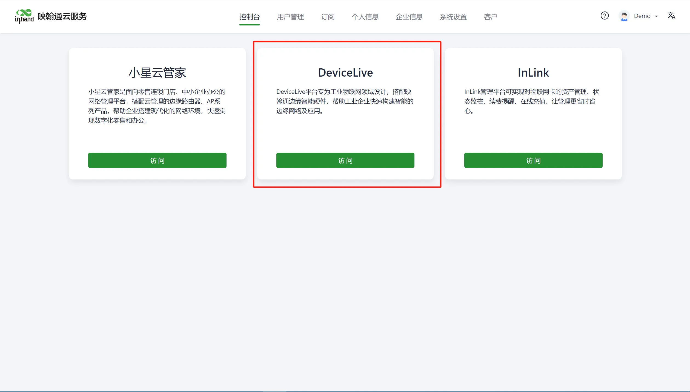

<strong>图 3-9 DeviceLive登录页面</strong>

3. 登录DeviceLive平台后，进入【设备】菜单，点击"添加"按钮，填写设备名称、序列号和所属组织后点击"保存"；如页面要求填写MAC地址等凭证信息，按提示填写。序列号和MAC地址可在设备铭牌或设备Web界面【仪表盘】中查看。

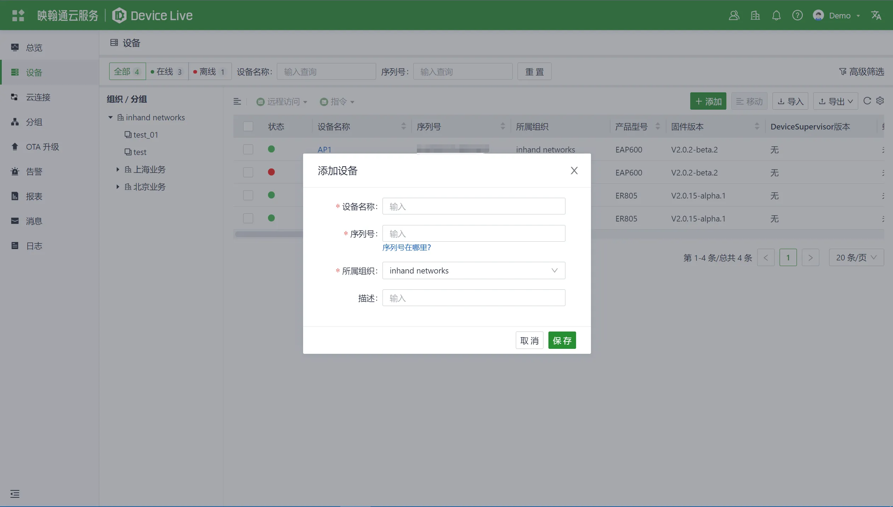

<strong>图 3-10 DeviceLive添加设备</strong>

4. 在设备Web界面【系统】→【云管理】中确认"启用云服务"已开启，"云服务器"与所用平台站点一致（中国站点为device.inhandcloud.cn，全球站点为device.inhandcloud.com）。

**验证方法**：

1. 在DeviceLive平台【设备】列表中查看设备是否在线。
2. 点击设备名称查看设备详细信息，或通过平台的远程访问功能打开设备Web界面。

**常见问题**：

- 设备无法上线：检查设备是否已联网、序列号和MAC地址填写是否正确、【系统】→【云管理】中的云服务器是否正确。
- 高级功能不可用：DeviceLive的部分高级功能需要相应的许可证，设备的许可状态可在【仪表盘】中查看。

---

## 第4章 功能说明与参数参考

本章按设备Web界面左侧菜单的顺序，说明各页面的功能和主要参数。页面顶部导航栏中，"DeviceLive"用于跳转到设备所连接的DeviceLive平台，"Internet"显示设备当前的联网状态，"Device Supervisor"用于打开已安装的DeviceSupervisor Agent应用页面；右上角点击用户名可"修改密码"或"注销登录"，点击语言图标可切换Web界面语言。

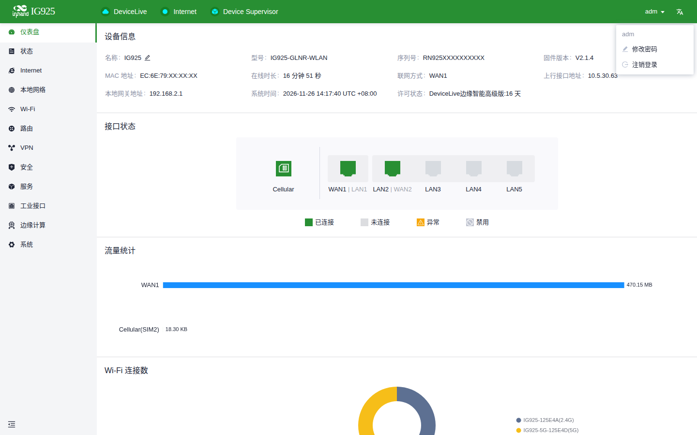

<strong>图 4-1 导航栏与用户菜单</strong>

### 4.1 仪表盘

【仪表盘】集中展示设备的基本信息和运行状态。

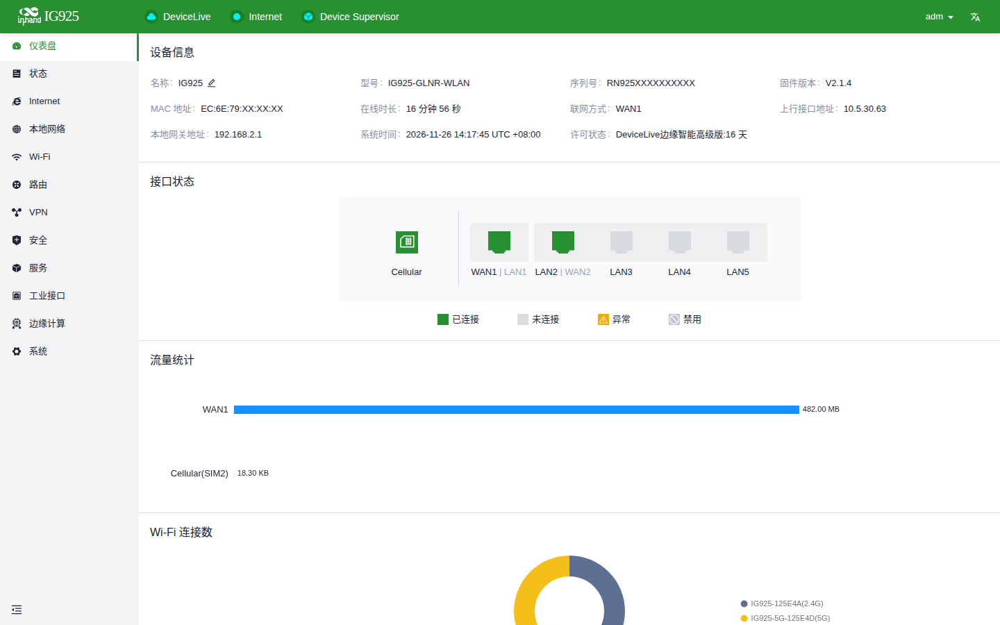

<strong>图 4-2 仪表盘</strong>

**设备信息**

- 名称：标识设备的名称，默认"IG925"，点击编辑图标可修改。
- 型号：设备的订购型号，可用于判断设备是否支持5G、Wi-Fi和GNSS。
- 序列号：唯一标识设备的编码，可用于将设备添加到DeviceLive平台。
- 固件版本：设备当前运行的固件版本号。
- MAC地址：设备的物理MAC地址。
- 在线时长：设备本次上电后的运行时间。
- 联网方式：设备当前联网所使用的上行接口。
- 上行接口地址：当前上行接口的IP地址。
- 本地网关地址：设备默认本地网络的网关地址。
- 系统时间：设备所在时区及系统时间。
- 许可状态：设备在DeviceLive平台上的许可信息。

**接口状态**

直观展示蜂窝及各以太网口的连接状态（已连接、未连接、异常、禁用）。点击接口图标可在右侧弹出框中查看该接口的详细信息，如IP地址、网关、DNS、速率等。

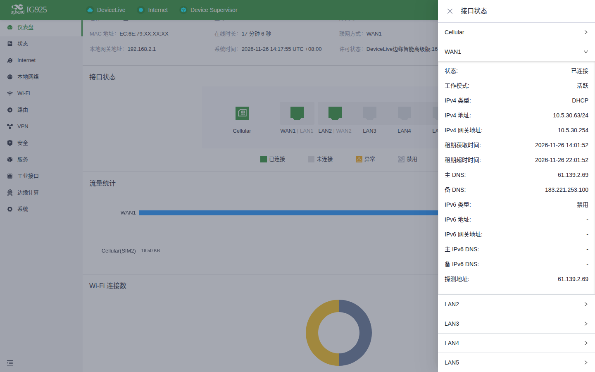

<strong>图 4-3 接口详细信息</strong>

**流量统计**

展示设备本次上电以来各上行接口的流量使用情况，设备重启后统计数据重置。

**Wi-Fi连接数**

展示当前启用的SSID及各SSID下连接的客户端数量。

### 4.2 状态

【状态】菜单汇总设备各项功能的实时运行状态，用于日常巡检和故障排查。

#### 4.2.1 链路监控

展示各上行链路的健康状态，以及运营商、流量、吞吐率、延迟、丢包、信号强度等信息。延迟、丢包等数据依赖链路探测功能，关闭链路探测后无法查看。

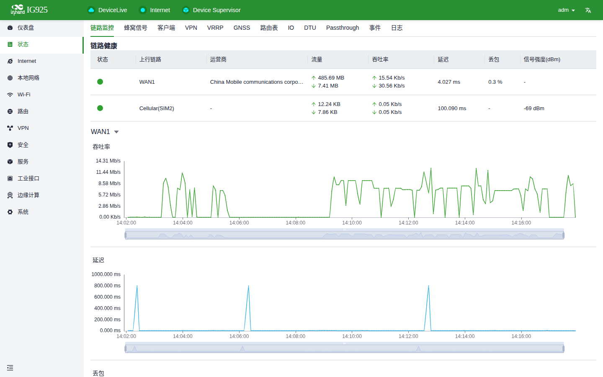

<strong>图 4-4 链路监控</strong>

#### 4.2.2 蜂窝信号

以曲线展示蜂窝信号强度以及RSSI、RSCP、EC/IO、RSRP、RSRQ、SINR等指标随时间的变化，可拖动图表下方的滑块查看不同时间段，用于判断现场信号质量是否稳定。

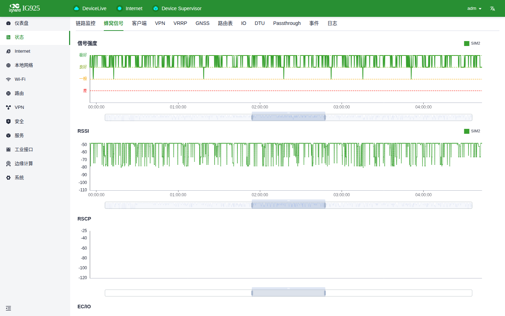

<strong>图 4-5 蜂窝信号</strong>

#### 4.2.3 客户端

展示连接到设备的客户端名称、IP地址、MAC地址、连接方式和在线时长。

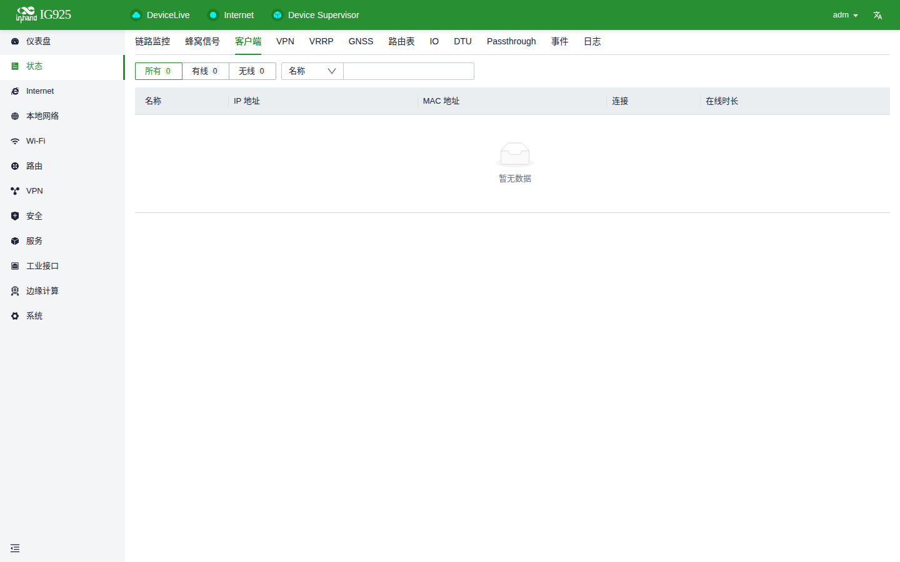

<strong>图 4-6 客户端</strong>

#### 4.2.4 VPN

按IPsec、L2TP等类型展示VPN隧道的状态、上行接口、接口地址、对端地址、可用子网、流量和最近一次连接时长。

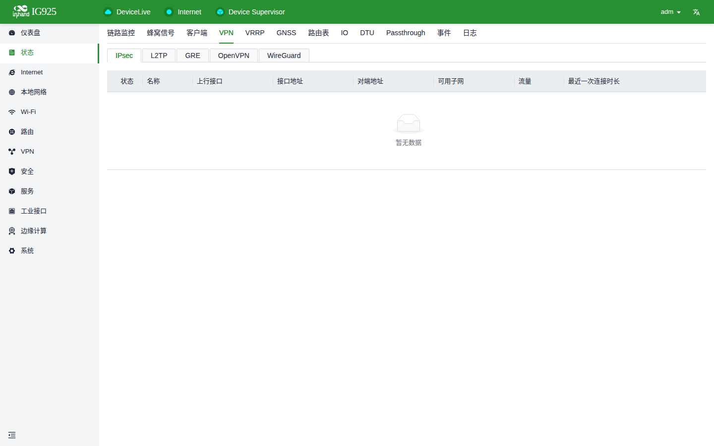

<strong>图 4-7 VPN状态</strong>

#### 4.2.5 VRRP

展示VRRP备份组的VRID、状态、VRRP版本、设备角色、设备优先级、本地子网和虚拟IP地址。

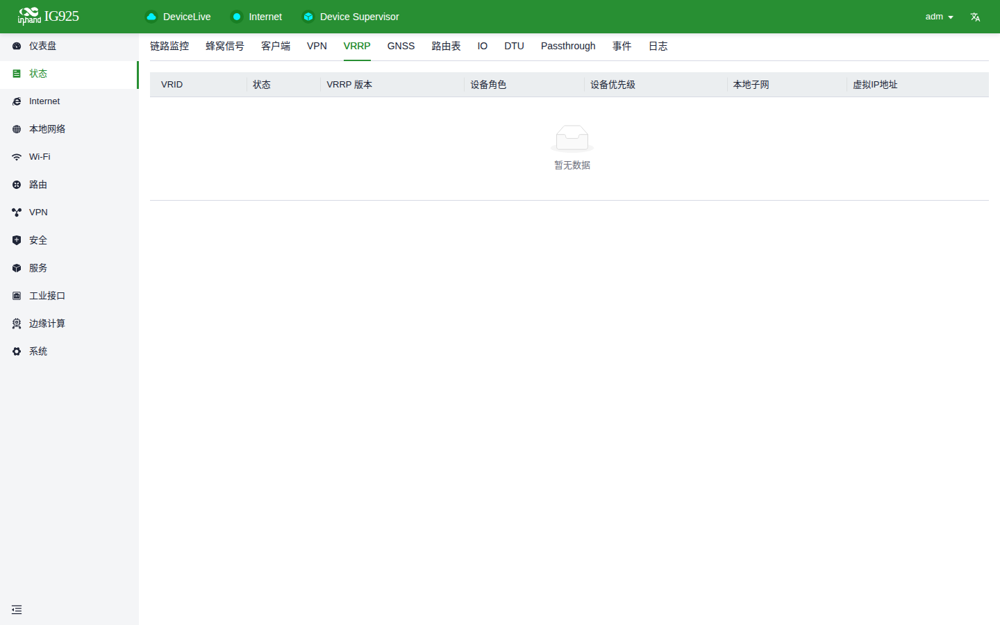

<strong>图 4-8 VRRP状态</strong>

#### 4.2.6 GNSS

展示GNSS定位状态、经纬度、海拔、速度、卫星数量和定位时间。需在【服务】→【GNSS】中开启GNSS功能并安装GNSS天线。

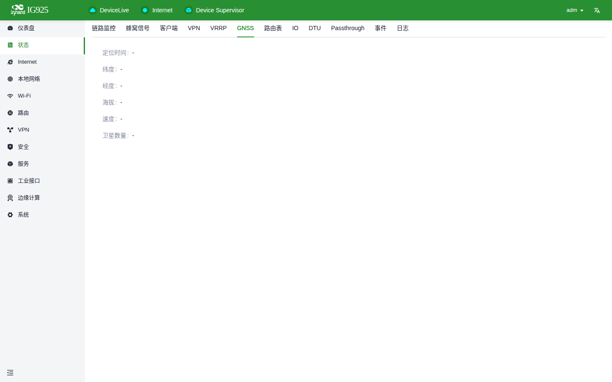

<strong>图 4-9 GNSS状态</strong>

#### 4.2.7 路由表

展示设备当前生效的路由，包括类型、目的网络、子网掩码、网关、接口、距离/度量和时间。

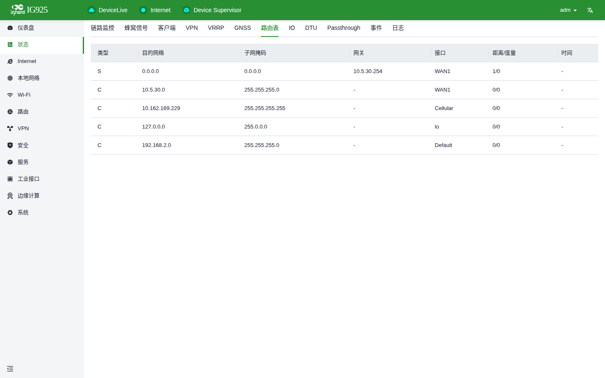

<strong>图 4-10 路由表</strong>

#### 4.2.8 IO

展示4路数字量输入/输出的当前状态以及继电器状态。

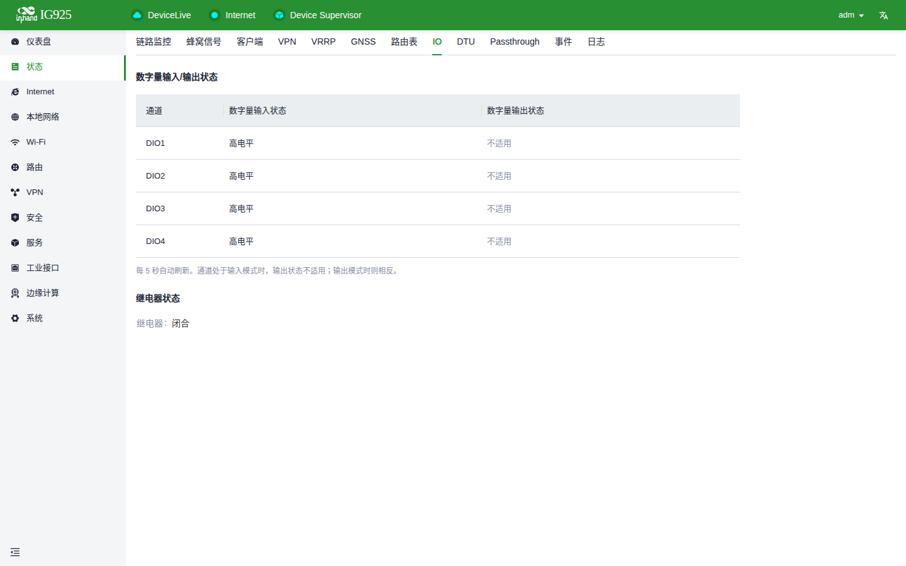

<strong>图 4-11 IO状态</strong>

#### 4.2.9 DTU

"DTU 连接状态"展示各串口的DTU工作模式、协议、对端地址、连接状态和连接时长；"DTU 交互数据"按时间记录串口与对端之间收发数据的方向、长度和HEX内容，可用于核对透传数据是否完整。

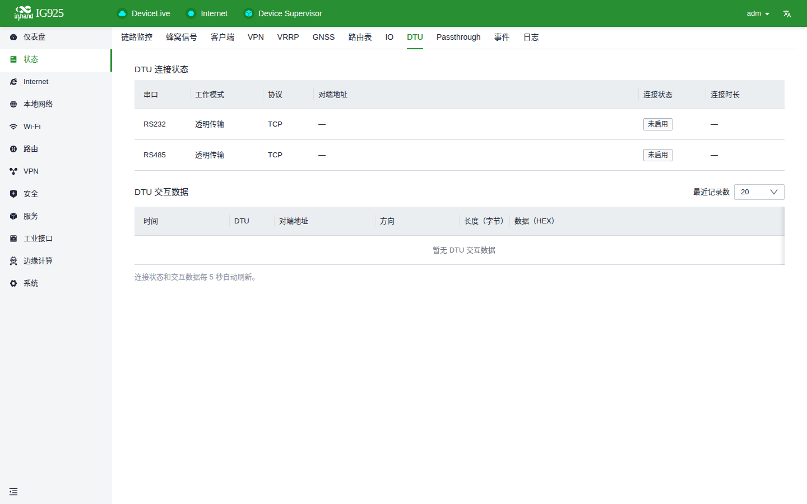

<strong>图 4-12 DTU状态</strong>

#### 4.2.10 Passthrough

展示IP Passthrough（IP透传）的工作状态、Passthrough WAN/LAN、透传的IP地址/掩码、网关地址、DNS、获取透传地址的设备MAC、地址分配状态和租期超时时间。

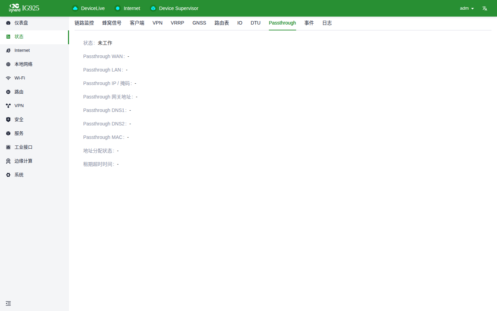

<strong>图 4-13 IP透传状态</strong>

#### 4.2.11 事件

记录设备登录、配置变化、上行链路状态变化、重启等事件，支持按日期和类型筛选，可"清除事件"或"导出事件"。

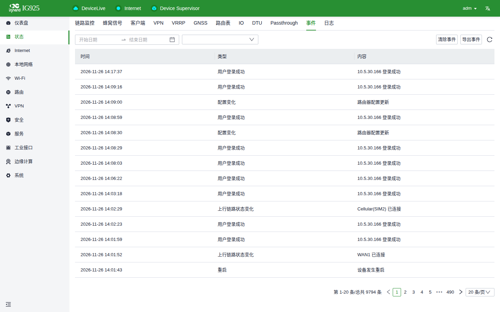

<strong>图 4-14 事件</strong>

#### 4.2.12 日志

展示设备系统日志，支持按级别和关键字筛选，可设置显示行数并手动刷新，用于故障分析。

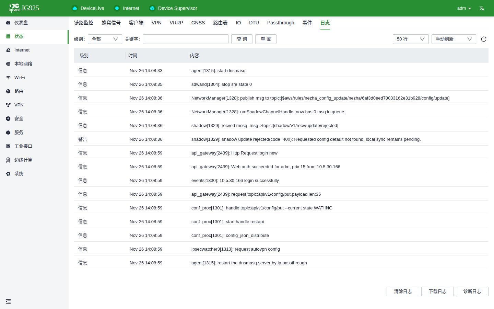

<strong>图 4-15 日志</strong>

### 4.3 Internet

在【Internet】菜单中可配置各上行接口的参数和工作方式。IG925支持有线（WAN）、蜂窝（Cellular）和Wi-Fi（STA）三类上行链路，链路按"上行链路表"中的优先级工作。

> **注意**：对Internet菜单的修改可能导致设备联网中断，需谨慎操作。

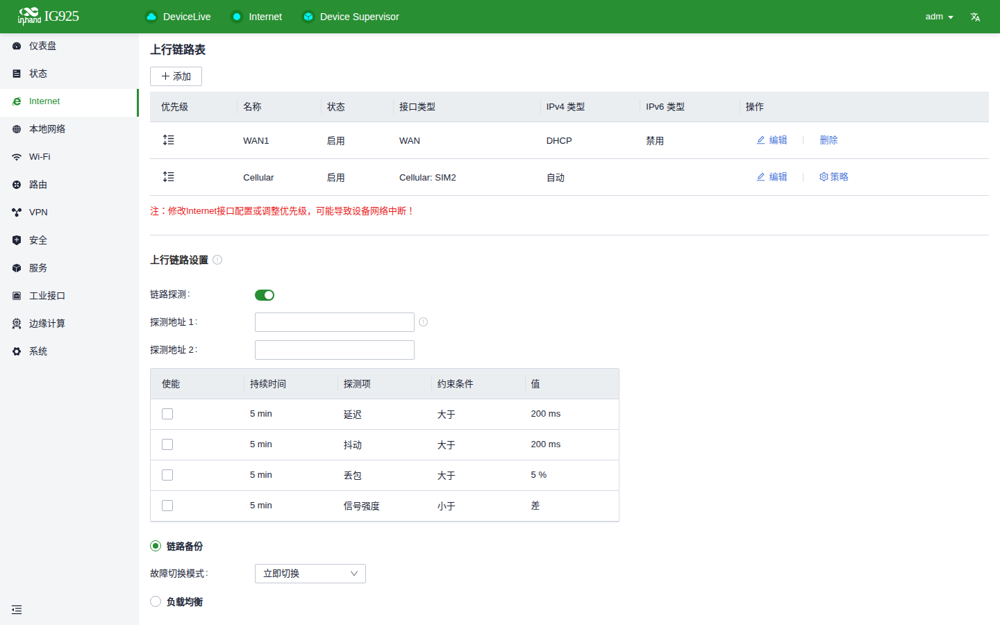

<strong>图 4-16 上行链路表与上行链路设置</strong>

#### 4.3.1 有线连接

WAN1默认启用，并通过DHCP获取地址。点击"WAN1"所在行的"编辑"按钮可修改连接方式。

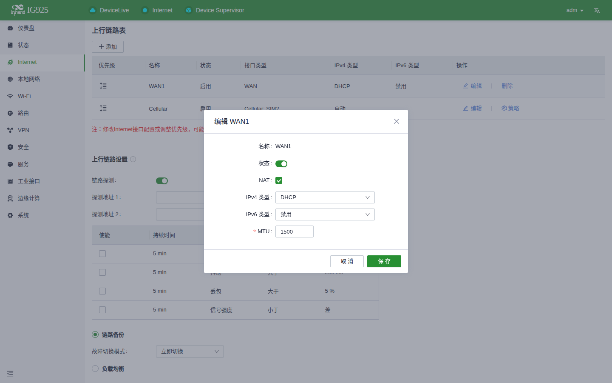

<strong>图 4-17 编辑WAN1</strong>

- 名称：上行接口的名称。
- 状态：启用或禁用该上行接口。
- NAT：内网设备通过该接口访问外部网络时进行地址转换，一般保持开启。
- IPv4类型：支持DHCP、静态IP和PPPoE。
  - DHCP：从上行设备（如光猫、上级路由器）自动获取地址。
  - 静态IP：手动填写IPv4地址、掩码、IPv4网关地址和主/备DNS，参数由网络管理员或运营商提供。
  - PPPoE：填写运营商提供的用户名和密码，设备通过PPPoE拨号接入网络。
- IPv6类型：设置该接口的IPv6获取方式。
- MTU：接口最大传输单元，一般保持默认。

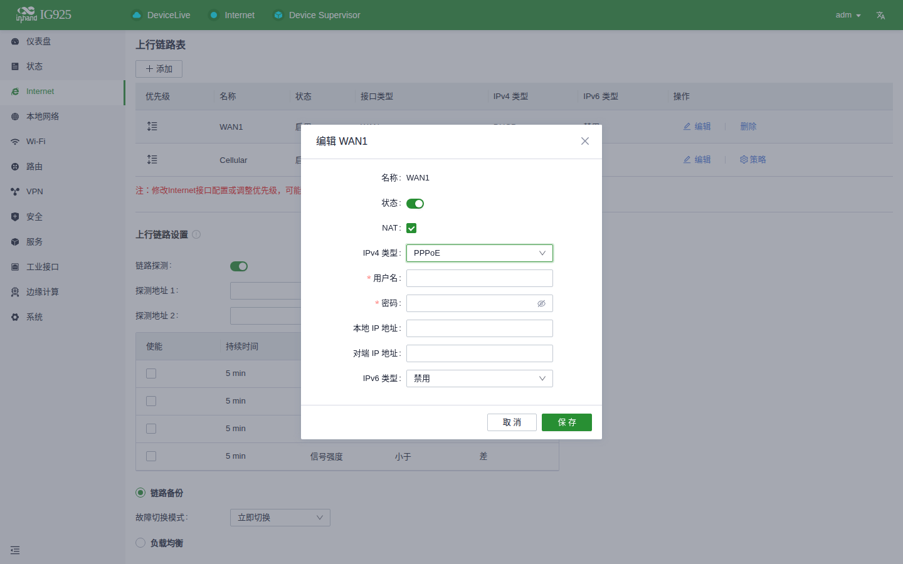

<strong>图 4-18 配置PPPoE拨号</strong>

在上行链路表中点击"添加"，可添加第二条有线上行链路（WAN2）。

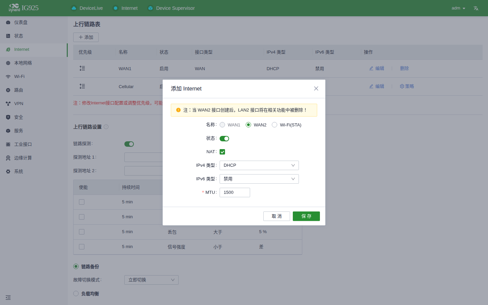

<strong>图 4-19 添加上行链路</strong>

- 添加WAN2后，原LAN2接口角色切换为WAN2；删除WAN接口后，接口角色恢复为LAN。
- 删除WAN接口后，与该接口相关的静态路由、入站/出站规则、端口转发、策略路由等配置将被删除。

#### 4.3.2 无线连接

IG925可作为客户端接入现场AP。在上行链路表中点击"添加"，选择"Wi-Fi(STA)"，配置以下参数（操作示例见[场景3](#场景3wi-fista接入网络)）：

- 频段：选择2.4GHz或5GHz。
- SSID：需连接的AP名称，可点击扫描按钮从附近AP列表中选择。
- 安全/加密方式：需与AP的认证策略和加密策略一致。
- 密码：AP的连接密码。
- IPv4类型：一般选择DHCP。

> **注意**：添加Wi-Fi(STA)后，相同频段的本地Wi-Fi接入点将被禁用且状态不可修改，直到Wi-Fi(STA)被删除。删除Wi-Fi(STA)后，与其相关的静态路由、防火墙规则、策略路由等配置将被删除。

#### 4.3.3 蜂窝连接

正常情况下，安装SIM卡和蜂窝天线后，设备上电即自动拨号联网。点击"Cellular"所在行的"编辑"按钮可修改蜂窝参数。

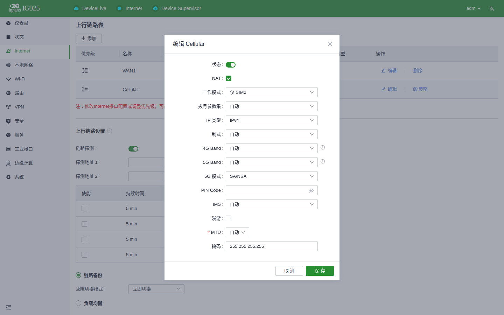

<strong>图 4-20 编辑Cellular</strong>

- 状态：启用或禁用蜂窝拨号。
- NAT：内网设备通过蜂窝访问外部网络时进行地址转换，一般保持开启。
- 工作模式：设置SIM卡使用方式，可选仅SIM1、仅SIM2、仅eSIM（支持eSIM的型号）或双卡模式。
- 拨号参数集：默认自动选择；需要指定APN时选择手动，并填写APN、认证方式、用户名和密码（见[场景1](#场景1蜂窝联网)）。
- IP类型：拨号使用的IP协议类型。
- 制式：网络制式，一般保持自动。
- 4G Band / 5G Band / 5G模式：指定蜂窝频段和5G组网模式，一般保持默认。
- PIN Code：SIM卡启用PIN码时填写。
- IMS、漫游：按运营商要求设置。
- MTU、掩码：一般保持默认；部分专网需按运营商要求配置蜂窝接口的子网掩码。

点击"Cellular"所在行的"策略"按钮，可为每张SIM卡设置月流量策略。策略启用后，SIM卡流量达到阈值时执行对应动作，流量统计在每月起始日期重置。

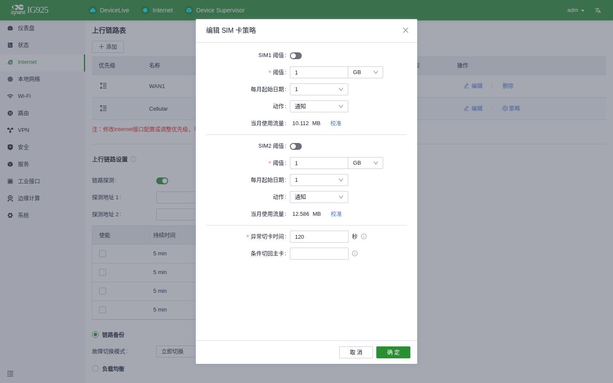

<strong>图 4-21 SIM卡策略</strong>

- 阈值、每月起始日期：月流量阈值和统计起始日。
- 动作：流量达到阈值后触发的动作。
  - 通知：生成流量到达阈值的事件，不停止转发业务流量。
  - 仅保留云管理：生成事件，只转发云管理流量，不再转发访问Internet的业务流量。
  - 切换SIM：生成事件，并切换到另一张SIM卡拨号。
- 当月使用流量：本月已使用的流量统计，仅供运维参考，计费以运营商记录为准。
- 异常切卡时间、条件切回主卡：双卡场景下的切卡与回切条件。

> **注意**：插拔SIM卡前需断开电源，以免造成数据丢失或设备损坏。部分专网环境下，需关闭"链路探测"功能或修改探测地址，避免因探测不通导致蜂窝反复重拨。

#### 4.3.4 上行链路表

上行链路表列出所有上行接口的优先级、名称、状态、接口类型和IPv4/IPv6类型。拖动"优先级"一栏的图标可调整链路优先级，靠上的优先级更高。可在此编辑Cellular接口，并添加、编辑、删除WAN和Wi-Fi(STA)接口。

#### 4.3.5 上行链路设置

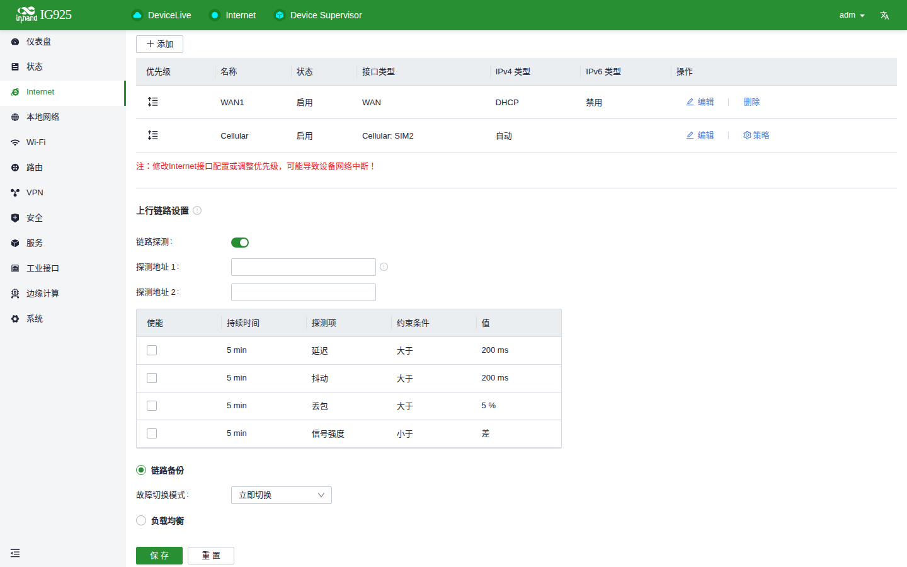

<strong>图 4-22 上行链路设置</strong>

- 链路探测：默认开启，设备通过探测判断上行链路是否可用。关闭后，无法在【状态】→【链路监控】中查看延迟、丢包等信息。
- 探测地址1/2：探测目标地址。为空时，设备探测上行接口的DNS地址和备选探测地址，并从中选择可用的地址；填写后所有上行链路只探测所填地址，所填地址不可达会影响设备联网。
- 链路备份：按优先级使用上行链路，主链路不可用时切换到下一条可用链路。
  - 故障切换模式：可选立即切换、延迟切换或不切换。
  - 探测项：可按延迟、抖动、丢包、信号强度设置约束条件和持续时间，满足条件时触发链路间和SIM卡间的切换（需开启链路探测，且故障切换模式不为"不切换"）。
- 负载均衡：所有可正常工作的上行链路同时转发业务流量。

### 4.4 本地网络

在【本地网络】中可自定义本地子网，包括地址段、VLAN和DHCP服务。新建的本地网络需在【服务】→【接口管理】中绑定到LAN口，或在【Wi-Fi】中绑定到SSID后才能使用。

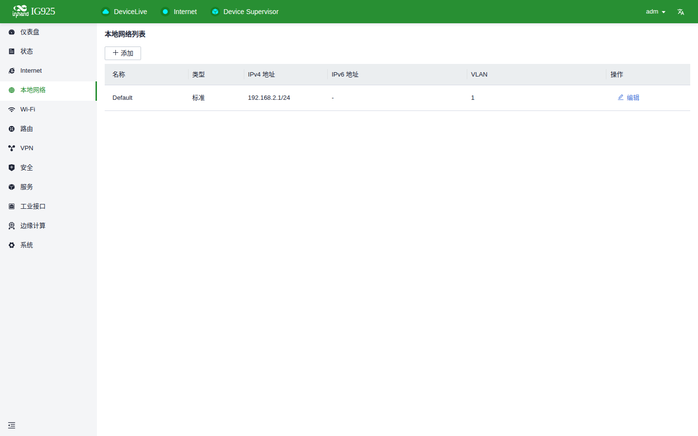

<strong>图 4-23 本地网络</strong>

点击"添加"或"编辑"可添加新的本地网络或修改已有网络。

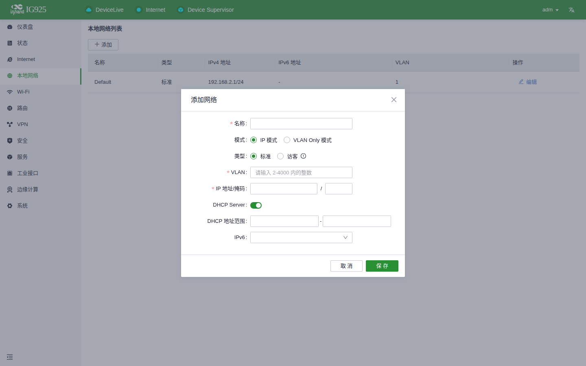

<strong>图 4-24 添加本地网络</strong>

- 名称：用于标识网络，可在"Wi-Fi"和"接口管理"中选择。
- 模式：IP模式（3层，设备提供网关地址）或VLAN Only模式（2层透明传输，无需配置IP地址和DHCP）。
- 类型：标准或访客；连接访客网络的客户端只能访问Internet。
- VLAN：将局域网划分到不同的虚拟网络，默认所有接口和Wi-Fi使用Default（VLAN1）网络。
- IP地址/掩码：该网络的网关地址，默认网络为192.168.2.1/24。
- DHCP Server、DHCP地址范围：为接入该网络的客户端自动分配地址。
- IPv6：设置该网络的IPv6参数。

> **注意**：默认本地网络不可删除，仅支持修改IP地址/掩码和DHCP配置；已添加的本地网络不支持修改模式。修改当前管理网络的地址后，需使用新地址重新登录。

### 4.5 Wi-Fi

IG925可作为AP提供多SSID无线接入（WLAN型号）。设备默认有2.4G和5G两个主SSID，主SSID频段不可修改且不可删除。

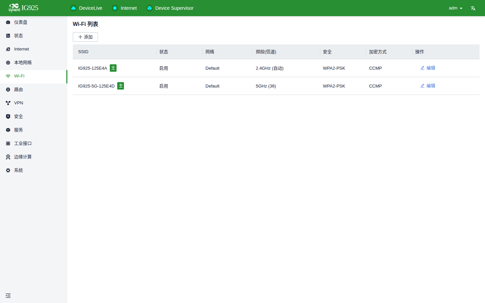

<strong>图 4-25 Wi-Fi列表</strong>

点击"添加"或"编辑"可添加新的SSID或修改已有SSID。

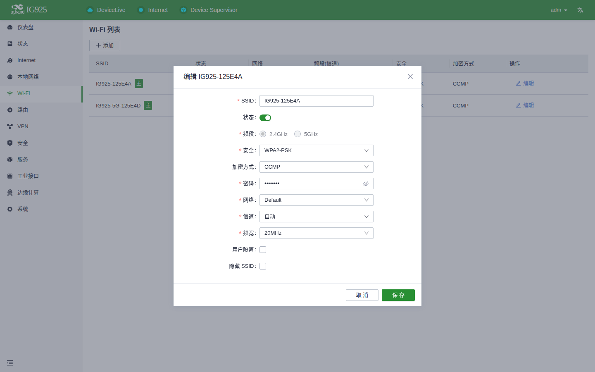

<strong>图 4-26 编辑SSID</strong>

- SSID、状态：无线网络名称及启用开关。
- 频段：2.4G或5G，已添加的SSID频段不可修改。
- 安全、加密方式、密码：无线认证与加密设置，建议使用WPA2-PSK或更高安全等级。
- 网络：该SSID接入的本地网络。
- 信道、频宽：无线信道和信道带宽，附加SSID的信道自动与所属主SSID保持一致。
- 用户隔离：开启后，同一SSID下的终端之间不能互相访问。
- 隐藏SSID：开启后，终端扫描时不显示该SSID。

> **注意**：在【Internet】中创建Wi-Fi(STA)接口后，与其相同频段的SSID都无法启用。

### 4.6 路由

#### 4.6.1 静态路由

在【路由】→【静态路由】中可手动配置静态路由条目，使数据从指定的下一跳或接口转发。由VPN等功能自动生成的路由不在此列表中显示，可在【状态】→【路由表】中查看。

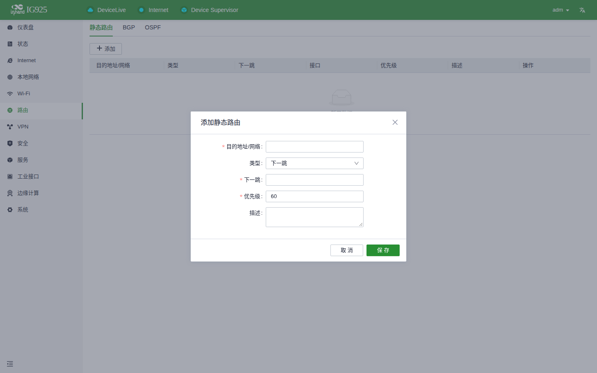

<strong>图 4-27 添加静态路由</strong>

- 目的地址/网络：目的网段或主机地址。
- 类型、下一跳：选择通过下一跳地址或出接口转发。
- 优先级：同一目的网络存在多条路由时的优先级。
- 描述：路由备注。

> **注意**：相同目的网络的静态路由，下一跳、接口或优先级不能相同；删除WAN、Wi-Fi(STA)、L2TP客户端等接口后，使用对应接口的静态路由也将被删除。

#### 4.6.2 BGP

BGP（边界网关协议）用于在不同自治系统之间交换路由信息。

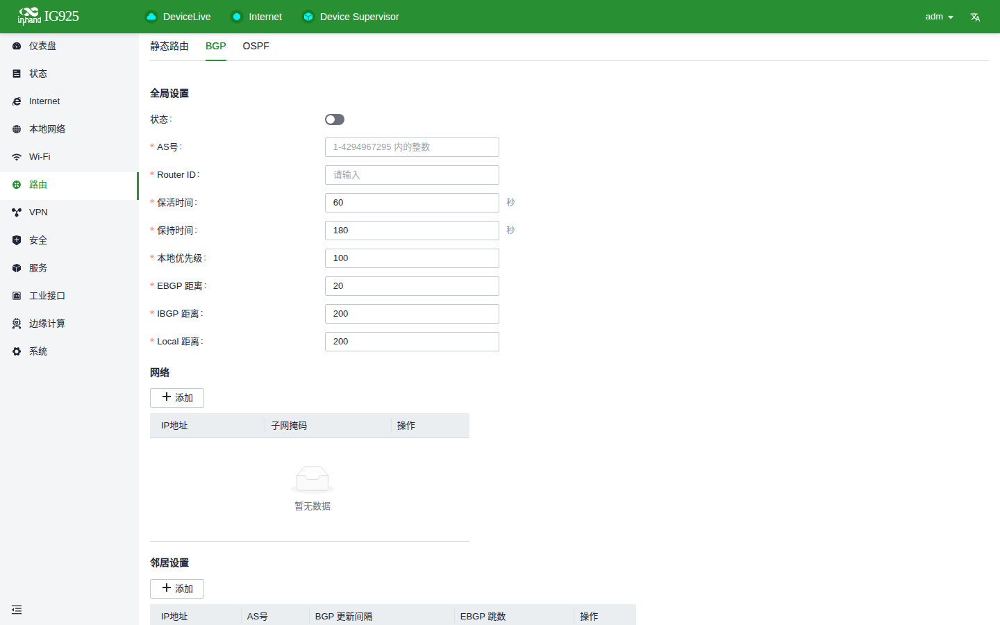

<strong>图 4-28 BGP</strong>

- 状态、AS号、Router ID：启用BGP并设置本地自治系统号和路由器标识。
- 保活时间、保持时间：BGP邻居之间的保活与超时参数。
- 本地优先级、EBGP距离、IBGP距离、Local距离：路由选路参数。
- 网络：需要通过BGP发布的本地网段（IP地址/子网掩码）。
- 邻居：BGP邻居的IP地址、AS号、BGP更新间隔和EBGP跳数。
- 路由重定向：将其他类型的路由引入BGP，可设置重定向类型和度量。

#### 4.6.3 OSPF

OSPF（开放最短路径优先）是一种链路状态内部网关协议，适用于企业内部网络的动态路由。

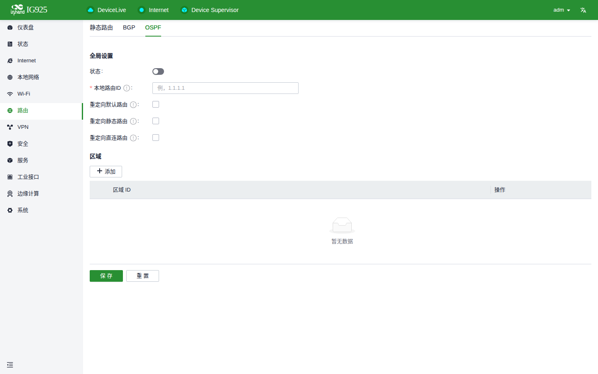

<strong>图 4-29 OSPF</strong>

- 状态、本地路由ID：启用OSPF并设置路由器标识。
- 重定向默认路由/静态路由/直连路由：将对应路由引入OSPF。
- 区域：添加OSPF区域（最多3个），设置区域ID及该区域包含的子网（每个区域最多10个）。
- 接口设置：可设置参与OSPF的接口的Hello间隔、Dead间隔和认证方式。选择上行接口（WAN）时，设备会放行该接口入向的OSPF报文；若该接口连接不可信网络，建议启用MD5认证。

### 4.7 VPN

虚拟专用网络（VPN）用于在公共网络上建立加密的私有通信通道。IG925支持IPsec、L2TP、GRE、OpenVPN和WireGuard，隧道状态可在【状态】→【VPN】中查看。

#### 4.7.1 IPsec VPN

点击"VPN"→"IPsec VPN"下的"添加"按钮，添加新的IPsec VPN，两端配置一致后隧道即可建立。

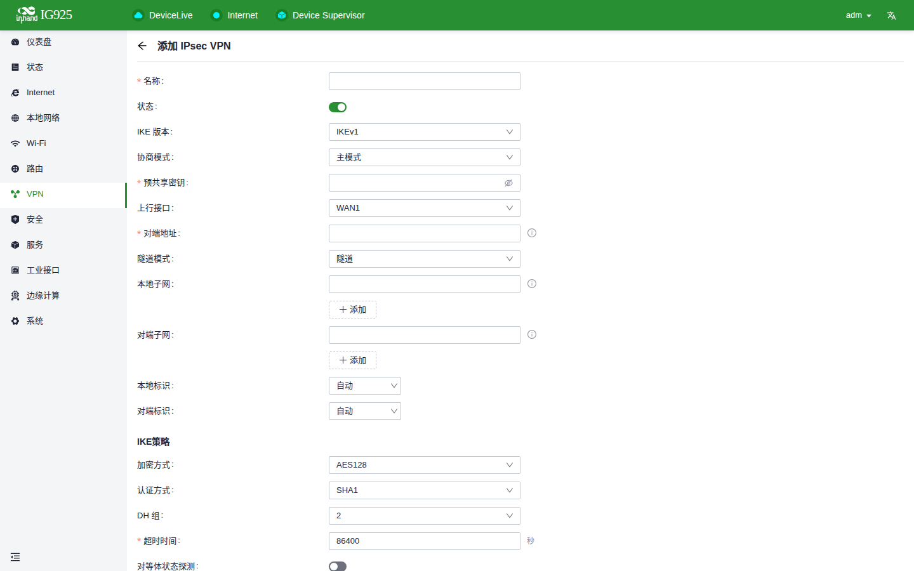

<strong>图 4-30 添加IPsec VPN</strong>

- 名称、状态：隧道名称及启用开关。
- IKE版本、协商模式：支持IKEv1和IKEv2；IKEv1可选择主模式或野蛮模式。
- 预共享密钥：两端需配置相同的认证密钥。
- 上行接口：本端建立隧道使用的上行接口。
- 对端地址：对端设备的通信地址。通常以具有公网地址的一端作为服务器，服务器侧对端地址配置为0.0.0.0，客户端侧填写服务器的公网地址或域名。
- 隧道模式：支持隧道模式和传输模式。
- 本地子网、对端子网：需通过隧道互通的本端和对端网段。
- 本地标识、对端标识：两端身份标识，需与对端配置对应。

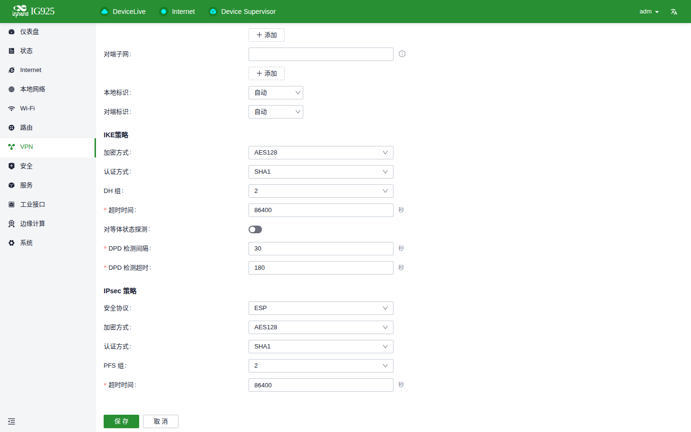

<strong>图 4-31 IKE策略与IPsec策略</strong>

- IKE策略：加密方式、认证方式、DH组和超时时间，需与对端一致。
- 对等体状态探测（DPD）：开启后按DPD检测间隔和超时检测对端是否在线，对端失联时重新协商。
- IPsec策略：安全协议、加密方式、认证方式、PFS组和超时时间，需与对端一致。

#### 4.7.2 L2TP VPN

L2TP（二层隧道协议）常用于远程接入和分支机构互联。

**客户端**：IG925作为L2TP客户端与远端L2TP服务器建立隧道。点击"L2TP VPN"→"客户端"下的"添加"按钮添加客户端。

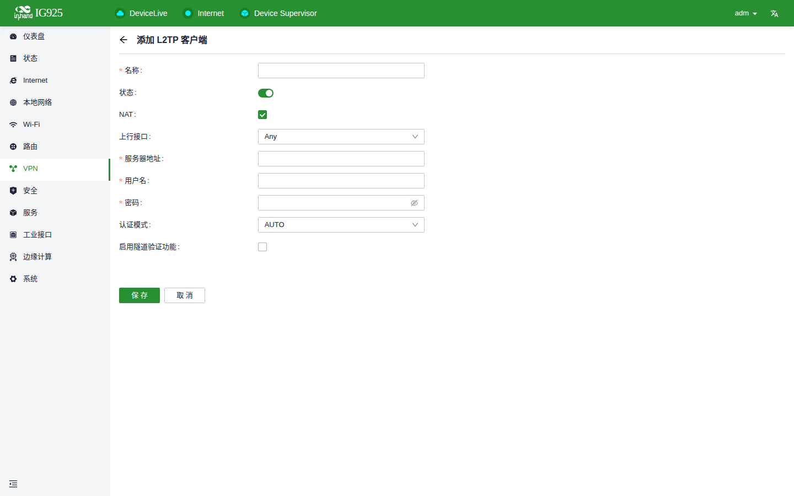

<strong>图 4-32 添加L2TP客户端</strong>

- 名称、状态：客户端名称及启用开关。
- NAT：客户端转发时的地址转换开关。
- 上行接口：与服务器通信使用的上行接口。
- 服务器地址：对端L2TP服务器的地址。
- 用户名/密码、认证模式：需与服务器配置一致。
- 启用隧道验证功能：启用后，两端用于隧道验证的用户名/密码需相同。

**服务器**：IG925作为L2TP服务器，为远端客户端提供接入。

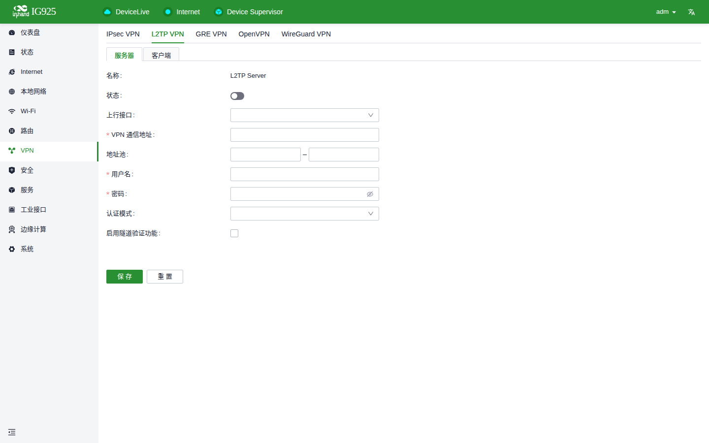

<strong>图 4-33 L2TP服务器</strong>

- 状态：L2TP服务器开关，默认关闭。
- 上行接口：服务器使用的上行接口。
- VPN通信地址：服务器在隧道中的地址，作为客户端的网关。
- 地址池：为接入的客户端分配的地址范围。
- 用户名/密码、认证模式、启用隧道验证功能：需与客户端配置一致。

#### 4.7.3 GRE VPN

GRE（通用路由封装）用于在两个网络之间建立点对点隧道，通常与IPsec配合实现加密。

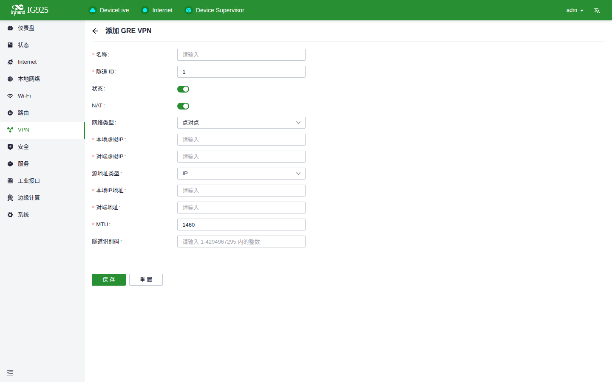

<strong>图 4-34 添加GRE VPN</strong>

- 名称、隧道ID、状态：隧道标识及启用开关。
- NAT：隧道转发时的地址转换开关。
- 网络类型：隧道的网络类型。
- 本地虚拟IP、对端虚拟IP：隧道两端的虚拟地址。
- 源地址类型、本地IP地址：本端建立隧道使用的源地址或接口。
- 对端地址：对端设备的地址。
- MTU：隧道最大传输单元。
- 隧道识别码：两端需一致的隧道密钥。

#### 4.7.4 OpenVPN

**服务器**：IG925作为OpenVPN服务器，为远端客户端提供接入。

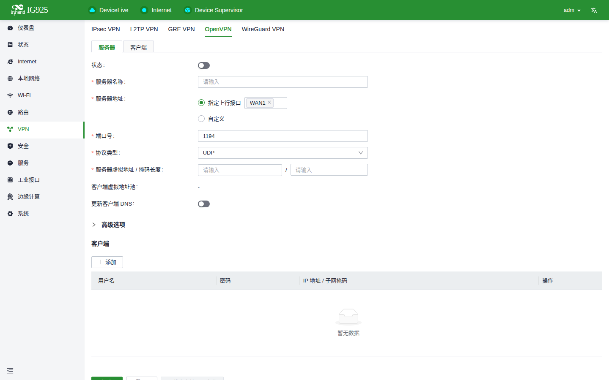

<strong>图 4-35 OpenVPN服务器</strong>

- 状态、服务器名称：服务器开关及名称。
- 服务器地址、端口号、协议类型：客户端连接服务器使用的地址、端口和传输协议（UDP/TCP）。
- 服务器虚拟地址/掩码长度、客户端虚拟地址池：隧道内服务器的地址和分配给客户端的地址范围。
- 更新客户端DNS：开启后向客户端下发DNS。
- 用户：客户端的用户名、密码及IP地址/子网掩码。
- 高级选项：共享登录凭证、重定向客户端网关、接口类型、本地子网等。
- 可点击"下载客户端配置文件"获取供客户端导入的配置；需要更换证书时可"重置证书"，重置后客户端需重新导入配置文件。

**客户端**：IG925作为OpenVPN客户端连接远端服务器，添加客户端时填写名称、接口类型，并上传OpenVPN配置文件。

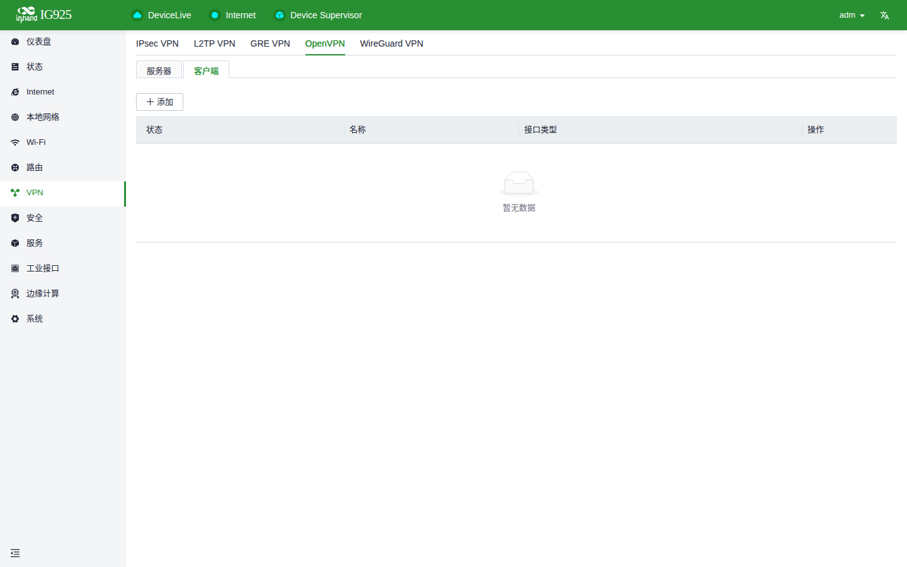

<strong>图 4-36 OpenVPN客户端</strong>

#### 4.7.5 WireGuard VPN

WireGuard是一种配置简单、性能较高的VPN协议，两端通过公钥/私钥认证。

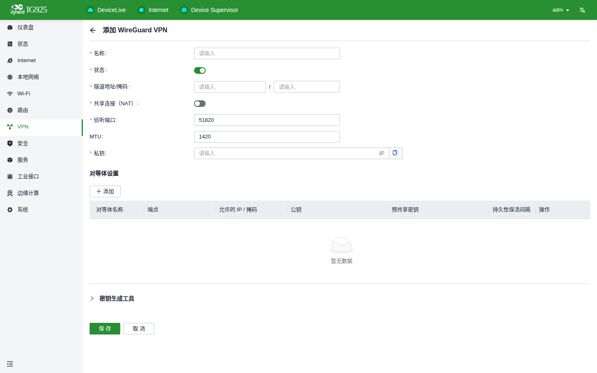

<strong>图 4-37 添加WireGuard VPN</strong>

- 名称、状态：隧道名称及启用开关。
- 隧道地址/掩码：本端在隧道中的地址。
- 共享连接（NAT）：开启后对隧道流量进行地址转换。
- 侦听端口、MTU：本端监听端口和隧道MTU。
- 私钥：本端私钥，可使用"密钥生成工具"生成密钥对，并将公钥提供给对端。
- 对等体：对端名称、端点（地址和端口）、允许的IP/掩码、公钥、预共享密钥和持久性保活间隔。

### 4.8 安全

#### 4.8.1 防火墙

防火墙包括入站规则、出站规则、端口转发、网络地址转换、MAC地址过滤、域名过滤和DMZ等功能。

**入站规则/出站规则**

基于上行接口控制经过设备转发的流量。入站规则控制外部网络经上行接口访问内网的流量，默认拒绝所有；出站规则控制内网访问外部网络的流量，默认全部放行。可拖动"优先级"一栏的图标调整规则顺序。访问设备自身管理服务（HTTPS、SSH、Ping）由【系统】→【远程访问控制】控制，不受入站规则影响。

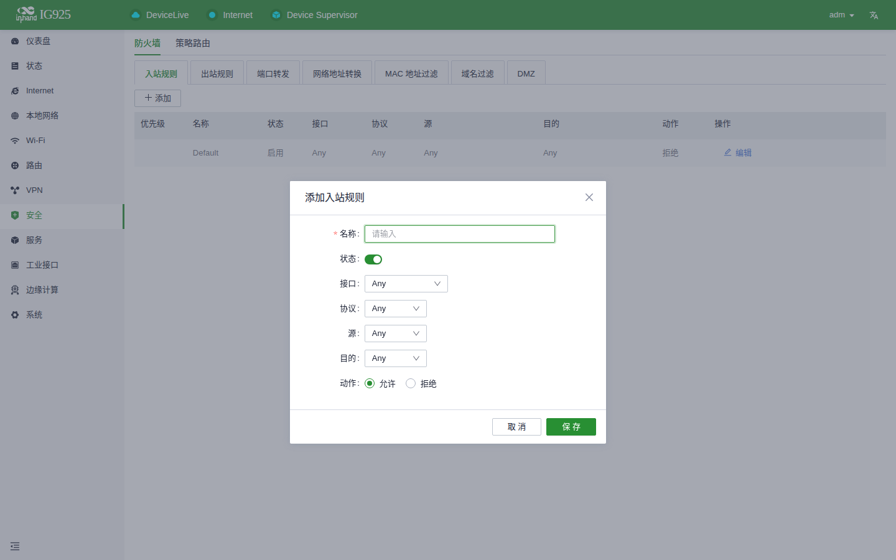

<strong>图 4-38 添加入站规则</strong>

- 名称、状态：规则名称及启用开关。
- 接口：入站规则为流量进入的上行接口，出站规则为流量流出的上行接口。
- 协议：Any、TCP、UDP、ICMP或自定义。
- 源、目的：匹配流量的源地址和目的地址，默认Any。
- 动作：允许或拒绝。

**端口转发**

将上行接口的端口映射到内网设备，使外部网络可以访问内网服务。例如将内网192.168.2.10的1024端口映射到WAN1的1024端口后，外部可通过"WAN1地址:1024"访问该服务。

<strong>图 4-39 添加端口转发</strong>

- 接口：提供映射的上行接口，需具备外部可访问的地址。
- 协议：TCP、UDP或TCP&UDP。
- 公网端口、本地端口：外部访问端口和内网设备端口，两者范围需一致。
- 本地地址：内网目标设备的地址。

**网络地址转换**

对经过设备的数据包进行源地址转换（SNAT）或目的地址转换（DNAT）。

<strong>图 4-40 添加网络地址转换规则</strong>

- 类型：SNAT（转换源地址）或DNAT（转换目的地址）。
- 协议：Any、TCP、UDP或TCP&UDP。
- 源、目的：匹配数据包的源和目的地址。
- 转换后地址：转换后的地址。

**MAC地址过滤**

按MAC地址控制局域网设备能否上网，可设置为仅允许列表中的设备访问网络（白名单），或禁止列表中的设备访问网络（黑名单）。

<strong>图 4-41 MAC地址过滤</strong>

**域名过滤**

允许或禁止客户端访问列表中设置的域名（白名单/黑名单）。

<strong>图 4-42 域名过滤</strong>

**DMZ**

将来自外部的访问整体转发给内网指定主机。

<strong>图 4-43 DMZ</strong>

- 启用DMZ：DMZ功能开关。
- DMZ主机地址：接收转发流量的内网主机地址。
- 来源地址范围：允许访问DMZ主机的外部地址范围。
- 接口：启用DMZ的上行接口。

> **说明**：开启DMZ后，【系统】→【远程访问控制】中已开启的设备管理服务（HTTPS、SSH、Ping）仍由设备自身响应，不会转发给DMZ主机。

#### 4.8.2 策略路由

按源地址、目的地址和协议将不同的数据流指定到不同的出口转发。

<strong>图 4-44 添加策略路由</strong>

- 名称、状态：规则名称及启用开关。
- 协议、源、目的：匹配的流量，源和目的不能同时设置为Any。
- 出口：匹配流量使用的上行接口。
- 强制转发：开启后，指定出口不可用时也不改走其他链路。

### 4.9 服务

【服务】菜单包含接口管理、DHCP Server、DNS Server、固定地址列表、Dynamic DNS、GNSS、AT服务、短信控制、Passthrough设置、SNMP配置和VRRP等功能。

#### 4.9.1 接口管理

设置LAN口的启用状态、所属本地网络和链路速率。新建的本地网络需在此绑定到LAN口。

<strong>图 4-45 编辑LAN口</strong>

#### 4.9.2 DHCP Server

DHCP Server根据本地网络自动生成，可修改各网络的启用状态、DHCP地址范围、租期和下发的DNS。

<strong>图 4-46 DHCP Server</strong>

> **注意**：删除本地网络后，其DHCP Server也会被删除；VLAN Only模式的网络不提供DHCP服务。

#### 4.9.3 DNS Server

设置设备使用的DNS服务器地址。未设置时使用上行接口获取的DNS地址；设置后全局生效，但不影响上行接口原有的链路探测和切换逻辑。

<strong>图 4-47 DNS Server</strong>

#### 4.9.4 固定地址列表

根据接入设备的MAC地址分配固定IP地址，该设备每次接入时都获取相同的地址。分配的地址必须在IP模式本地网络的地址范围内。

<strong>图 4-48 固定地址列表</strong>

#### 4.9.5 Dynamic DNS

动态DNS用于在上行接口地址变化时自动更新域名解析，使外部可通过固定域名访问设备。

<strong>图 4-49 Dynamic DNS</strong>

- 服务提供商：动态DNS服务商，或选择自定义并填写URL地址。
- 域名、用户名、密码：在服务商处注册获得的信息。
- 更新间隔、上行接口：更新周期和使用的上行接口。

#### 4.9.6 GNSS

开启GNSS后可获取设备位置，并可启用"更新设备时间"使用卫星时间校时。GNSS IP转发可将定位数据通过TCP/UDP发送到指定服务器；GNSS串口转发可将定位数据通过RS232/RS485输出给串口设备。

<strong>图 4-50 GNSS</strong>

#### 4.9.7 AT服务

AT服务用于通过AT命令与设备内置的蜂窝模组交互，可配置使用的串口及其参数。

<strong>图 4-51 AT服务</strong>

> **注意**：不了解命令影响时，不要发送修改网络制式、断开连接等控制命令；日常联网配置请使用【Internet】菜单。

#### 4.9.8 短信控制

允许指定号码通过发送约定内容的短信控制设备。可设置短信内容、动作（目前支持重启）、认证方式、授权手机号码（任意或指定号码，最多10个）及回信设置，最多可添加100条规则。使用短信功能需要在蜂窝配置中启用IMS。

<strong>图 4-52 短信控制</strong>

#### 4.9.9 Passthrough设置

IP Passthrough（IP透传）将上行接口获取的地址直接分配给下游指定设备，使该设备直接使用上行地址通信。

<strong>图 4-53 Passthrough设置</strong>

- IP Passthrough：功能开关。
- Passthrough WAN：提供地址的上行接口。
- Passthrough LAN：连接下游设备的本地网络。
- Passthrough MAC：接收透传地址的设备MAC地址；为空时分配给最先请求地址的设备。
- Passthrough IP掩码、DHCP Server、租期：下发给下游设备的地址参数。

> **注意**：
> - 开启IP Passthrough后，只有一个客户端可以访问Internet，静态路由、VPN、策略路由、固定地址分配和云连接功能将不工作。
> - 上行接口地址透传给客户端后，从外部访问该客户端需要在入站规则中放行。
> - 透传会改变设备的地址分配，请确认可通过其他方式管理设备后再操作。

#### 4.9.10 SNMP配置

支持SNMP V1&V2c和SNMP V3，可供网管系统查询设备状态，并可"导出MIB文件"。

<strong>图 4-54 SNMP配置</strong>

#### 4.9.11 VRRP

VRRP（虚拟路由冗余协议）可将多台设备组成备份组，对外提供同一个虚拟网关地址，主设备故障时由备份设备接管。

<strong>图 4-55 添加VRRP备份组</strong>

- VRRP状态、VRID、VRRP版本：备份组开关、编号和协议版本，同组设备的VRID需一致。
- 本地子网、虚拟IP地址：备份组所在的本地网络和虚拟网关地址。
- 设备优先级：优先级高的设备成为主设备。
- 允许抢占、抢占延时：优先级更高的设备恢复后是否重新成为主设备，以及等待时间。
- 通告间隔：主设备发送通告报文的间隔。
- 监视接口：被监视的接口故障时降低本设备优先级。

### 4.10 工业接口

#### 4.10.1 工业串口

IG925提供1路RS232和1路RS485，两者配置项相同。使用适当的线缆连接设备串口与目标设备串口：RS232的TX、RX需交叉连接并共地；RS485按两端资料连接A、B差分信号。

<strong>图 4-56 工业串口</strong>

**串口参数**：波特率、数据位（7或8）、停止位、校验和软件流控，需与串口设备一致。

**DTU设置**：将串口数据透明传输到TCP/UDP服务器（操作示例见[场景4](#场景4串口数据透传)）。

- 状态：DTU功能开关。
- DTU协议：透明传输或Modbus网桥。
  - 透明传输：在串口与服务器之间转发原始数据，以下参数适用于该模式。
  - Modbus网桥：设备作为TCP服务器在本地端口（RS232默认502，RS485默认503）监听，将收到的Modbus TCP请求转换为Modbus RTU发往串口设备，并将应答返回给客户端；可设置帧间隔和帧响应超时。
- 传输协议、连接类型：TCP或UDP；TCP可选择长连接或短连接。
- 服务器地址、端口：数据接收端，可添加多个中心。
- 多中心策略：多个服务器之间的发送策略。
- 心跳间隔、心跳重试次数：链路保活参数。
- 串口缓存帧数、串口分帧长度、串口分帧间隔：串口数据的缓存和分帧规则。
- 重连间隔：连接断开后重新连接的间隔。
- 源接口、本地IP地址：连接服务器使用的接口和地址。
- DTU标识：连接建立后发送给服务器的标识，按服务器要求填写，不需要时留空。
- 调试日志：开启后记录详细收发日志，用于排查。

> **注意**：同一个串口不能同时被DTU、GNSS串口转发、AT服务等多个功能占用。

#### 4.10.2 IO

IG925提供4路数字量I/O（DIO1～DIO4）和1路继电器。

<strong>图 4-57 IO设置</strong>

- 工作模式：每路DIO可独立设置为输入或输出；也可使用快捷设置将全部通道设为输入或输出。
- 输出电平：输出模式下的高电平或低电平，快捷电平设置只影响输出通道。
- 触点状态：继电器触点闭合或断开。

设置点击"保存"后生效，点击"重置"恢复设备当前配置。接线需符合接口的电气参数，继电器触点额定值为2A@30V DC。

### 4.11 边缘计算

#### 4.11.1 Python边缘计算

"Python 边缘计算"页面提供Python二次开发运行环境，并管理设备上的Python App（操作示例见[场景5](#场景5python边缘计算)）。

<strong>图 4-58 Python边缘计算</strong>

**引擎信息**

- 启用引擎、引擎状态：Python边缘计算引擎开关及运行状态。
- SDK版本、SDK维护：当前Python SDK版本；点击"升级 SDK"可安装或升级SDK。
- Python版本：SDK提供的Python解释器版本（SDK V1.0.1为Python 3.14.6）。
- 用户存储：用户分区已用空间和总空间。

<strong>图 4-59 确认安装或升级SDK</strong>

**Python App日志账户**：在线查看App日志时使用的用户名和密码，与设备Web登录账号不同。

**App状态**：展示各App的版本、SDK版本、状态和运行时间，可对App下载、清除或查看日志，以及停止、重启App；表头按钮可全部启动、全部停止或全部重启App。

<strong>图 4-60 App状态与App列表</strong>

**App列表**

- 添加App：选择签名后的App包进行安装；安装同名App时为升级，升级后保持原有的运行或停止状态。
- 启用：勾选后，设备每次启动时App自动运行。
- 日志文件大小、启动参数：点击编辑按钮设置App日志文件大小、数量和启动参数，修改后点击"提交"。
- 导出配置/导入配置：备份或恢复App配置，导入后重启App生效。
- 卸载：卸载App。

<strong>图 4-61 编辑App参数</strong>

**App签名**：导入按打包说明生成的未签名内层包（<app>-V<version>.tar.gz），设备根据包内的<app>/setup.py生成签名信息，导出可安装的App包；签名不会安装App。"Python App 打包与使用说明"提供目录结构和打包要求，可在线阅读或下载。

#### 4.11.2 Docker管理

"Docker 管理"页面用于安装Docker SDK、管理Docker引擎和Portainer（操作示例见[场景6](#场景6docker容器部署)）。

<strong>图 4-62 Docker管理页面</strong>

- 引擎信息：启用管理器、状态、Docker版本；点击"升级 SDK"安装或升级Docker SDK。
- 镜像仓库：设置镜像加速地址，保存后用于拉取镜像。
- 服务信息：Portainer管理器的启用开关、状态和版本，点击"打开 Portainer"进入容器管理界面。
- 访问账户：登录Portainer使用的用户名和密码，与设备Web账号不同。

> **说明**：IG925 Docker SDK V1.0.0包含Docker 25.0.5和Portainer 2.19.5，容器镜像需支持linux/arm/v7平台。

### 4.12 系统

#### 4.12.1 云管理

DeviceLive是映翰通的设备远程运维与管理平台，支持零接触部署、远程访问、批量配置和OTA升级。设备默认联网后自动接入DeviceLive平台，不使用时可手动关闭。

<strong>图 4-63 云管理</strong>

- 启用云服务：云管理功能开关。
- 云服务器：选择DeviceLive平台站点，中国站点为device.inhandcloud.cn，全球站点为device.inhandcloud.com，默认站点由设备出厂配置决定。
- 连云平台的接口：连接平台使用的上行接口，默认任意（Any）。
- MQTT心跳时间：设备与平台之间的保活间隔。
- 日志上报：开启后将设备日志上报到平台。

#### 4.12.2 远程访问控制

设置是否允许通过上行接口从外部访问设备的管理服务。LAN口访问不受此处配置影响，防火墙规则不限制远程访问。

<strong>图 4-64 远程访问控制</strong>

- HTTPS：开启后，可通过"上行接口地址:端口"远程访问设备Web界面。
- SSH：开启后，可通过SSH工具远程登录设备。
- PING：开启后，上行接口地址响应外部Ping请求。

> **注意**：开启远程访问前，需修改设备初始密码并评估网络安全风险。

#### 4.12.3 时钟

选择设备所在时区，并配置NTP服务器同步系统时间。NTP客户端默认开启，设备联网后自动校时；开启NTP服务器后，设备可为内网设备提供校时服务。

<strong>图 4-65 时钟</strong>

#### 4.12.4 设备选项

可重启网关、升级网关固件版本、升级设备模组版本，以及将网关恢复出厂设置。

<strong>图 4-66 设备选项</strong>

> **注意**：
> - 升级固件或模组时需使用从正规渠道获取的、适用于本设备型号的升级包；升级过程中不要断电。上传的模组包型号与设备模组不匹配时，设备会拒绝升级。
> - 恢复出厂设置会将网关配置恢复为默认值，不会删除已安装的Python App、Docker容器及其业务数据；Python引擎、Docker管理器和App的启用状态同样恢复为默认的未启用状态，需重新启用。设备接入云平台后，平台可能会将原有配置重新下发到设备。

#### 4.12.5 配置管理

可将设备配置导出到本地备份，或导入备份配置恢复设备。导出的配置文件中，口令类字段以加密形式保存。导入配置后设备将重启。

<strong>图 4-67 配置管理</strong>

#### 4.12.6 设备告警

勾选需要关注的告警事件，并设置邮件或短信接收方式，事件发生时设备自动发送告警。

<strong>图 4-68 设备告警</strong>

- 告警设置：可选用户登录成功/失败、配置变化、CPU/内存利用率过高、蜂窝流量到达阈值、链路探测状态变化、VPN状态变化、客户端状态变化、上行链路状态变化与切换、重启、升级等事件。
- 邮件接收设置：配置发件服务器地址、端口、用户名、密码、TLS和接收邮件地址；可通过"发送测试邮件到"检验发件邮箱配置是否正确。
- 短信告警：开启后向设置的号码发送告警短信（需使用支持短信的SIM卡）。

<strong>图 4-69 邮件接收设置与短信告警</strong>

#### 4.12.7 工具

提供Ping、Traceroute、抓包和Iperf等网络诊断工具。

<strong>图 4-70 Ping、Traceroute与抓包</strong>

- Ping：检测设备到目标地址的连通性，可指定接口、源地址、包大小和包个数。
- Traceroute：检测设备到目标地址经过的路由路径。
- 抓包：抓取指定接口的数据包，可设置过滤表达式和时长，结果可显示或导出。
- Iperf：测试网络带宽，设备可作为服务器或客户端。

<strong>图 4-71 Iperf</strong>

#### 4.12.8 计划重启

设置设备在每日、每周或每月的固定时刻自动重启。每月重启时，若选择的日期大于当月天数，设备在当月最后一天重启。

<strong>图 4-72 计划重启</strong>

#### 4.12.9 日志服务器

启用后，设备将日志发送到指定的日志服务器。

<strong>图 4-73 日志服务器</strong>

#### 4.12.10 账号管理

管理登录设备Web界面的用户名、密码和角色，可添加用户或修改已有用户的密码。

<strong>图 4-74 账号管理</strong>

<strong>图 4-75 添加用户</strong>

#### 4.12.11 其他设置

<strong>图 4-76 其他设置</strong>

- Web登录管理：设置Web登录无操作后自动退出的时间。
- 自动重启：开启后，设备在长时间无法联网时自动重启，帮助恢复现场网络。
- SIP ALG：SIP协议应用层网关开关，默认开启。
- 禁用硬件重置按钮：开启后，Reset按钮不能用于恢复出厂设置，避免现场误操作。

---

## 第5章 典型应用

### 案例1：工业现场数据采集与远程运维

**场景描述**：在工厂或站点现场，IG925通过以太网和RS232/RS485连接PLC、仪表和传感器，使用Python App或DeviceSupervisor Agent采集数据并在本地处理，通过5G/4G蜂窝网络将数据上传到业务平台，同时接入DeviceLive实现远程运维。

**设备角色**：IG925作为边缘计算网关，负责现场设备接入、数据采集与协议转换、边缘计算和安全上云。

**配置步骤**：

1. 按照[安装与首次使用](#第2章-安装与首次使用)完成设备安装和登录。
2. 按照[场景1：蜂窝联网](#场景1蜂窝联网)或[场景2：有线接入网络](#场景2有线接入网络)完成联网；如有备用链路，在【Internet】中调整优先级。
3. 在【本地网络】和【服务】→【接口管理】中规划PLC等设备所在的网段，在【工业接口】中设置串口参数。
4. 按照[场景5：Python边缘计算](#场景5python边缘计算)部署采集App；只需将串口数据原样转发时，使用[场景4：串口数据透传](#场景4串口数据透传)。
5. 如需加密传输到企业内网，在【VPN】中配置IPsec等VPN隧道。
6. 按照[场景7：连接DeviceLive平台](#场景7连接devicelive平台)将设备加入平台，实现远程监控和运维。

**参考章节**：

- [Internet](#43-internet)
- [VPN](#47-vpn)
- [边缘计算](#411-边缘计算)

---

## 附录 故障处理

### 1 网络连接问题

| 现象 | 可能原因 | 排查步骤 | 对应章节 |
|------|----------|----------|----------|
| 无法连接蜂窝网络 | SIM卡未插入或接触不良 | 1. 断电后检查SIM卡是否正确插入 2. 重新插拔SIM卡后上电 | [蜂窝联网](#场景1蜂窝联网) |
| 无法连接蜂窝网络 | APN参数配置错误 | 1. 核对APN参数是否正确 2. 联系运营商获取正确APN | [蜂窝连接](#433-蜂窝连接) |
| 无法连接蜂窝网络 | 信号弱或无信号 | 1. 检查天线是否连接 2. 调整设备或天线位置 | [蜂窝信号](#422-蜂窝信号) |
| 蜂窝反复重拨 | 专网卡无法访问探测地址 | 1. 修改链路探测地址为允许访问的地址 2. 必要时关闭链路探测 | [上行链路设置](#435-上行链路设置) |
| 无法通过有线接入网络 | 网线连接故障 | 1. 检查网线是否插紧 2. 更换网线测试 | [有线接入网络](#场景2有线接入网络) |
| 无法通过有线接入网络 | 端口角色错误或网段冲突 | 1. 确认上行网线接在WAN口 2. 确认上行网段与本地网段不重叠 | [有线连接](#431-有线连接) |
| 无法通过Wi-Fi(STA)接入网络 | SSID、密码或认证策略不匹配 | 1. 核对SSID和密码 2. 核对AP的认证策略和加密策略 | [无线连接](#432-无线连接) |

### 2 Web访问问题

| 现象 | 可能原因 | 排查步骤 | 对应章节 |
|------|----------|----------|----------|
| 无法打开Web界面 | IP地址错误 | 1. 确认电脑与设备在同一网段 2. 检查设备本地网关地址 | [登录Web管理界面](#225-登录web管理界面) |
| 无法打开Web界面 | 浏览器兼容性或缓存问题 | 1. 更换浏览器（推荐Chrome） 2. 清除浏览器缓存 | [登录Web管理界面](#225-登录web管理界面) |
| 无法从外网访问设备 | 远程访问未开启 | 在【系统】→【远程访问控制】中开启HTTPS/SSH | [远程访问控制](#4122-远程访问控制) |
| 忘记登录密码 | 未记录修改后的密码 | 1. 查看产品机身铭牌 2. 如已修改且忘记，需恢复出厂设置 | [恢复出厂设置](#15-恢复出厂设置) |

### 3 VPN连接问题

| 现象 | 可能原因 | 排查步骤 | 对应章节 |
|------|----------|----------|----------|
| IPsec VPN隧道无法建立 | 预共享密钥或IKE/IPsec策略不一致 | 核对两端预共享密钥、加密方式、认证方式、DH组等参数 | [IPsec VPN](#471-ipsec-vpn) |
| IPsec VPN隧道无法建立 | 对端地址配置错误 | 1. 服务器侧配置为0.0.0.0 2. 客户端侧填写服务器公网地址 | [IPsec VPN](#471-ipsec-vpn) |
| L2TP VPN隧道无法建立 | 用户名/密码错误或服务器不可达 | 1. 核对两端用户名和密码 2. 检查到服务器的网络连通性 | [L2TP VPN](#472-l2tp-vpn) |

### 4 边缘计算问题

| 现象 | 可能原因 | 排查步骤 | 对应章节 |
|------|----------|----------|----------|
| App安装失败 | App包未签名或Python版本不匹配 | 1. 先在"App签名"中签名后再安装 2. 确认App与SDK的Python版本一致 | [Python边缘计算](#4111-python边缘计算) |
| App状态不是RUNNING | 启动参数或配置错误 | 查看App日志中的报错信息，修正后重启App | [Python边缘计算](#场景5python边缘计算) |
| 容器无法运行 | 镜像架构不匹配 | 使用支持linux/arm/v7的镜像 | [Docker容器部署](#场景6docker容器部署) |
| 镜像拉取失败 | 网络或镜像仓库不可达 | 检查设备网络、DNS和镜像加速地址，或离线导入镜像 | [Docker管理](#4112-docker管理) |

### 5 云平台连接问题

| 现象 | 可能原因 | 排查步骤 | 对应章节 |
|------|----------|----------|----------|
| 设备无法在DeviceLive上线 | 设备未联网 | 1. 确认设备已接入互联网 2. 检查蜂窝/有线/Wi-Fi连接状态 | [连接DeviceLive平台](#场景7连接devicelive平台) |
| 设备无法在DeviceLive上线 | 序列号或MAC地址填写错误 | 核对平台中填写的信息与设备铭牌一致 | [连接DeviceLive平台](#场景7连接devicelive平台) |
| 设备无法在DeviceLive上线 | 云管理未开启或站点不一致 | 在【系统】→【云管理】中确认已启用云服务且云服务器正确 | [云管理](#4121-云管理) |

---

## 附录 安全注意事项

1. 需使用符合规格的DC 9～48V电源，接线前断开电源并核对正负极，避免因电源不匹配造成设备损坏。
2. 安装设备时禁止将设备安装在强电磁干扰环境下，避免与高功率设备过于接近。安装完成后需确认设备固定牢靠，避免因设备跌落造成损坏。
3. 需确认设备使用环境满足规格书所要求的温度和湿度，设备防护等级为IP30，需防止进水。
4. 需定期检查设备线缆，包括网线、电源线、串口和I/O线缆，如有破损需及时更换。
5. 清洁设备时，避免使用化学试剂直接喷洒在设备表面，需使用柔软的布料清洁产品。
6. 首次登录后需修改初始密码，开启远程访问前需评估网络安全风险。
7. 禁止私自拆修或改装设备，这将导致安全问题并且设备会失去保修资格。

---

## FAQ 常见问题解答

### 问题1：IG925支持哪些边缘计算方式？

IG925支持三种方式：通过Python边缘计算运行Python App（包括DeviceSupervisor Agent），通过Docker管理器和Portainer部署容器化应用，以及通过工业串口的DTU功能进行串口数据透明传输或Modbus网桥转换。

### 问题2：如何确认IG925的固件版本？

登录设备Web界面，在【仪表盘】的"设备信息"中查看"固件版本"；Python SDK和Docker SDK的版本分别在【边缘计算】→【Python 边缘计算】和【Docker 管理】中查看。

### 问题3：蜂窝网络无法拨号成功怎么办？

断电后确认SIM卡已正确插入、天线连接牢固；在【仪表盘】的"接口状态"中查看Cellular接口的详细信息，在【状态】→【链路监控】中查看蜂窝链路状态和信号强度；如运营商要求指定APN，在【Internet】中编辑Cellular并手动配置APN。物联网卡或专网卡还需确认链路探测地址可访问。

### 问题4：Web界面登录密码忘记怎么办？

如果未修改过初始密码，可查看产品机身铭牌；如果已修改且忘记，需按[恢复出厂设置](#15-恢复出厂设置)操作。恢复出厂会将网关配置恢复为默认值，已安装的App、容器和业务数据会保留，但需重新配置网络并启用边缘计算功能。

### 问题5：Python App开发需要哪些环境？

开发电脑需安装与设备SDK一致的Python版本（SDK V1.0.1为Python 3.14），按"App签名"区域"Python App 打包与使用说明"的要求组织目录并打包，再在设备上签名、安装。

### 问题6：如何备份和恢复设备配置？

在【系统】→【配置管理】中点击"导出"备份配置，需要恢复时点击"导入"选择备份文件，导入后设备重启。Python App的配置可在App列表中单独导出/导入，容器数据需通过数据卷单独备份。
