# IG974快速安装手册V1.0

**边缘网关IG974**

**快速安装手册**

---

# 第一部分：快速装机

> **您需要先做：** 开箱 → 固定设备 → 接电源与网线 → **断电**装 SIM、接天线 → 上电 → PC 同网段 → 浏览器打开 Web。
> **再做：** 翻到下方 **第二部分**，按需查阅装箱、灯义、壁挂、各接口引脚等。

## 必读摘要（接线、上电前）

| 项目 | 要求 |
|------|------|
| 供电 | **12-48 V DC**，接入 DC 端口（2PIN 端子 + / -）；**PWR 红灯常亮**表示已正常上电（见 §2.5.3）。 |
| SIM 卡 | 抽屉式卡座位于上面板，**需要在断电的情况下进行安装**，请确保安装前已经断开设备电源（见 §2.5.6）。 |
| 天线 | 5G 版共 **7 个**天线接口、4G 版共 **5 个**，按丝印标识对接（见 §2.5.6）；标配天线数量因型号而异。 |

## 步骤 1：对照实物，确认面板与接口区域

您手里的 IG974 分 **5G 版**和 **4G 版**：正面板集中了天线接口、Console 口和网口，上面板集中了 SIM 卡槽、电源/串口端子等。面板布局详见 §2.2。

5G版：

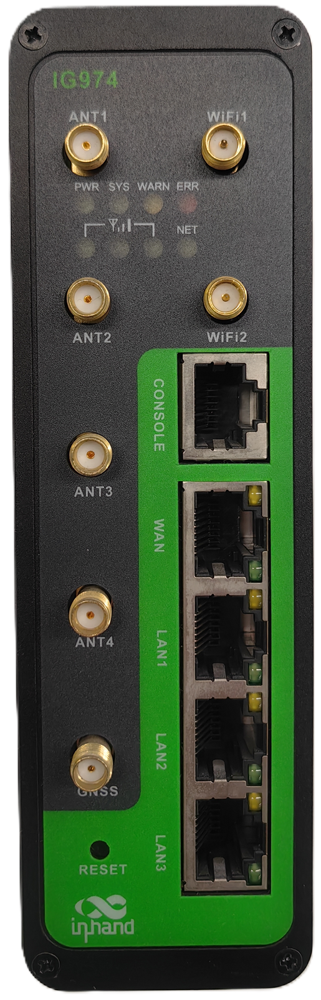

4G版：

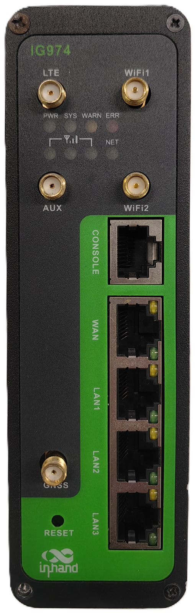

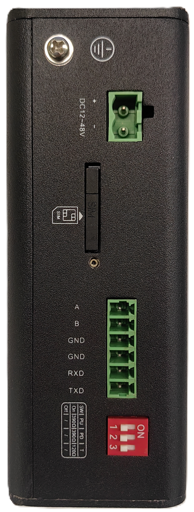

## 步骤 2：将设备固定到导轨或柜内

标准配件中含 **DIN 轨安装配件**：DIN 轨的安装板附在设备后面板上，将卡轨座上部卡入 DIN 轨，再按下图箭头所示将设备下端转入卡轨即可，安装步骤详见 §2.4.1。若需壁挂（背面挂板），安装与拆卸见 §2.4.3。

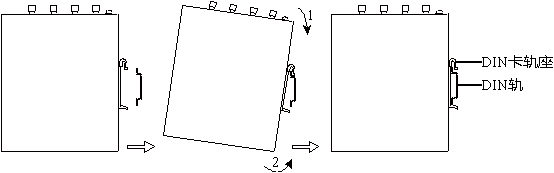

## 步骤 3：连接电源与以太网

将适配器端子插入 DC 端口，接 **12-48 V DC** 电源；标配 1.5m 网线一端插入设备任一网口，另一端插入电脑网口，并将电脑 IP 地址设置为与设备网口同网段。引脚定义详见 §2.5.1、§2.5.3。

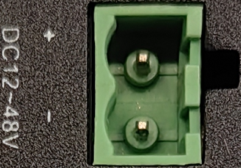

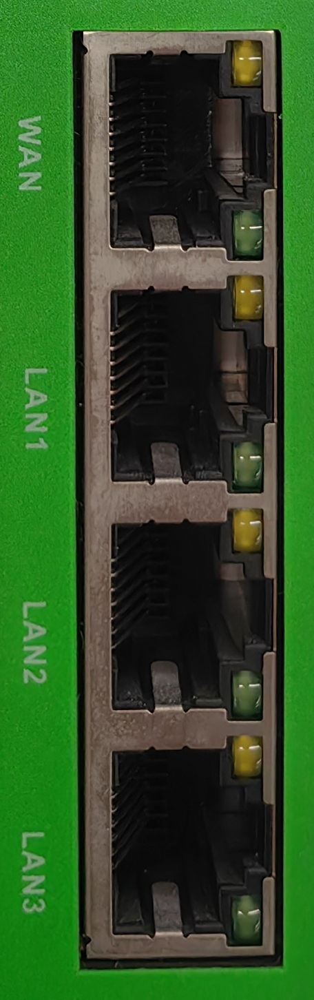

## 步骤 4：（若使用蜂窝）断电装 SIM，并接好天线

**先断电**，用取卡针轻戳上面板卡槽旁的按钮，弹出卡槽装入 SIM 卡后插回；再将各天线按丝印标识拧到对应接口。详见 §2.5.6。

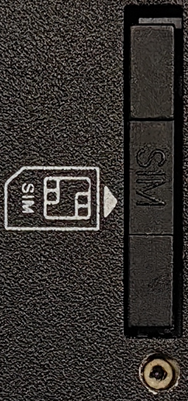

## 步骤 5：上电，确认设备已就绪

上电后确认：**PWR 红灯常亮**（已正常上电）→ **SYS 绿灯慢闪**（开机成功）→ 使用蜂窝时 **NET 绿灯常亮**（拨号成功）。灯态组合详见 §2.3。

## 步骤 6：PC 与浏览器登录 Web

使用以下默认 IP 连接到 IG974：

| 端口角色 | 默认 IP |
| :---: | :---: |
| WAN | 192.168.1.1 |
| LAN1 | 192.168.2.1 |
| LAN2 | 192.168.3.1 |
| LAN3 | 192.168.4.1 |

1. 浏览器打开 **https://192.168.2.1**（以网线插入 LAN1 口为例）。
2. 输入初始登陆账号 **adm**；初始登陆密码**查看设备面板上的铭牌**获取。
3. 登录后即可通过 IEOS Web 界面进行网络管理和系统管理。

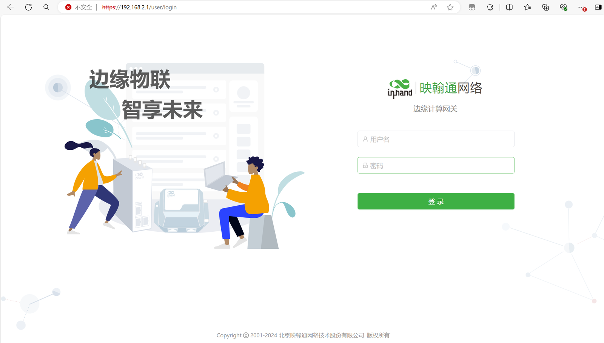

## 装完自检

- ☐ 设备已固定（DIN 导轨或壁挂）。
- ☐ 电源、网线已接好。
- ☐ SIM 卡已**断电**装好，各天线已按丝印接好。
- ☐ **PWR 常亮**且 **SYS 慢闪**。
- ☐ 使用蜂窝时 **NET 常亮**（拨号成功）。
- ☐ 浏览器已能打开 https://192.168.2.1 登录页并完成登录。

上电后灯态异常时，对照 §2.3 的指示灯组合排查；蜂窝信号指示灯仅 1 亮（1-9 ASU）时，请检查天线是否安装完好、SIM 卡是否正确识别以及当地信号状况（见 §2.3.2）；需要将设备恢复出厂设置时，见 §2.7。

---

# 第二部分：详细说明

## 2.1 装箱清单

**标准配件**

| 序号 | 名称 | 数量 | 单位 | 备注 |
| --- | --- | --- | --- | --- |
| 1 | IG974 | 1 | 台 | IG974边缘计算网关 |
| 2 | GNSS天线 | — | 个 | 天线的个数以及种类根据实际型号而定 |
| 3 | WLAN天线 | — | 个 | |
| 4 | 蜂窝天线 | — | 个 | |
| 5 | 导轨安装配件 | 1 | 套 | 固定网关 |
| 6 | 工业端子 | 1 | 个 | 7针工业端子 |
| 7 | 网线 | 1 | 根 | 1.5m网线 |
| 8 | 产品保修卡 | 1 | 张 | 保修期为1年 |
| 9 | 合格证 | 1 | 张 | IG974边缘计算网关合格证 |

**可选配件**

| 序号 | 名称 | 数量 | 单位 | 备注 |
| --- | --- | --- | --- | --- |
| 1 | 电源适配器 | 1 | 个 | 12V  2A 电源适配器 |
| 2 | 壁挂安装套件 | 1 | 套 | IG974支持背面挂耳的壁挂安装方式，若部署场景适用这种安装方式，则设备出厂时会配备相应的配件 |

## 2.2 产品结构与标识

InGateway974 (简称IG974)是映翰通面向工业物联网领域推出的新一代工业级5G边缘网关；其拥有强大的边缘算力、丰富接口及Python开发环境，在物联网边缘节点进行数据优化、实时响应、敏捷连接和智能分析；同时支持多种工业协议和主流IoT云平台，轻松实现工业设备上云，帮助加快企业数字化进程，提升企业竞争力。

### 2.2.1 正面板

IG974分5G版和4G版，面板布局如下所示：

5G版：

4G版：

### 2.2.2 上面板

## 2.3 指示灯与复位键

### 2.3.1 运行状态指示灯

| PWR | SYS | WARN | ERR | NET | 说明 |
| :---: | :---: | :---: | :---: | :---: | :---: |
| **电源指示灯（红色）** | **状态指示灯（绿色）** | **告警指示灯（黄色）** | **错误指示灯（红色）** | **网络指示灯（绿色）** |  |
| 亮 | 灭 | 灭 | 灭 | 灭 | 开机 |
| 亮 | 慢闪 | 灭 | 灭 | 灭 | 开机成功 |
| 亮 | 慢闪 | 灭 | 灭 | 快闪 | 正在拨号 |
| 亮 | 慢闪 | 灭 | 灭 | 亮 | 拨号成功 |
| 亮 | 慢闪 | 慢闪 | 慢闪 | 灭 | 复位成功 |
| 亮 | 慢闪 | 快闪 | 快闪 | 灭 | 升级 |

### 2.3.2 蜂窝信号强度指示灯

| 信号状态指示灯1（绿色） | 信号状态指示灯2（绿色） | 信号状态指示灯3（绿色） | 说明 |
| :---: | :---: | :---: | --- |
| 灭 | 灭 | 灭 | 未检测到信号 |
| 亮 | 灭 | 灭 | 信号状况1-9ASU（说明信号状况有问题，请检查天线是否安装完好，SIM卡是否正确识别，以及该地区信号状况是否良好） |
| 亮 | 亮 | 灭 | 信号状况10-19ASU（说明信号状态基本正常，设备可以正常使用） |
| 亮 | 亮 | 亮 | 信号状况20-31ASU（说明信号状态良好） |

### 2.3.3 复位键

IG974有一个复位按键，用于系统恢复出厂，按键位置见 §2.2 面板示意图。采用硬件方式恢复出厂的完整步骤见 §2.7。

## 2.4 机械安装

### 2.4.1 DIN导轨：安装

DIN轨的安装板附在IG974后面板上，如下图所示：

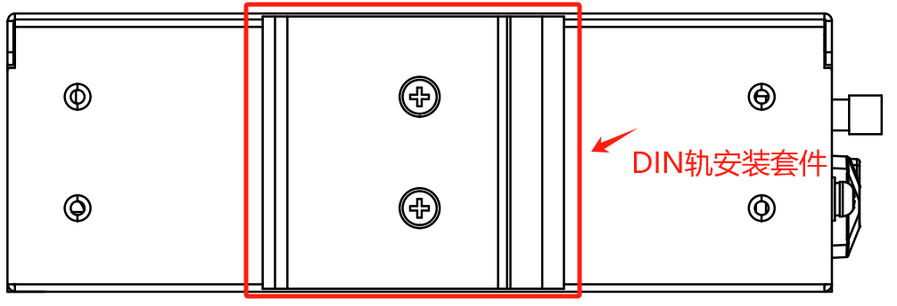

安装步骤如下：

1. 选定设备的安装位置，确保有足够的空间；
2. 将DIN卡轨座的上部卡在DIN轨上，在设备的下端向上稍微用力按箭头2所示转动设备，即可将DIN卡轨座卡在DIN轨上，确认设备可靠地安装到DIN轨上，如下图所示：

### 2.4.2 DIN导轨：拆卸

拆卸IG974的方法为：

1. 如下图箭头1所示，向下压设备使设备下端有空隙脱离DIN轨。
2. 将设备按箭头2的方向转动，并同时向外移动设备的下端，待下端脱离DIN轨后向上抬设备，即可从DIN轨上取下设备。

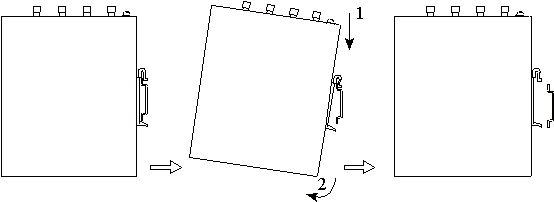

### 2.4.3 壁挂式安装（可选）

安装IG974的具体步骤如下：

1. 选定设备的安装位置，确保有足够的空间。
2. 用螺丝刀把壁挂安装板安装在设备的后面，如下图所示

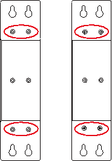

3. 取出螺钉（与壁挂安装板配套包装），用螺丝刀将螺钉固定在安装位置上，然后下拉设备使设备处于稳定状态，如下图所示

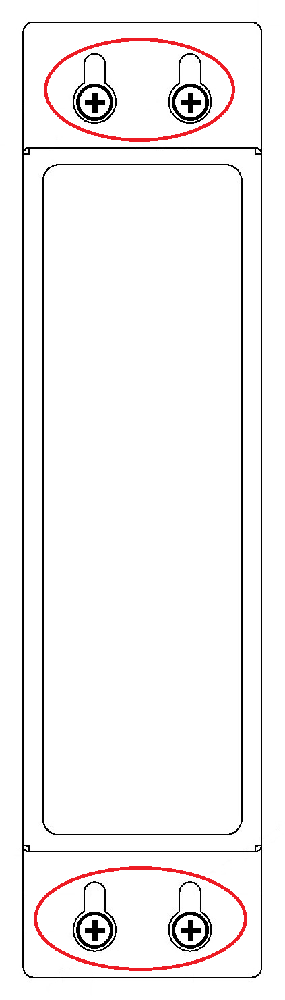 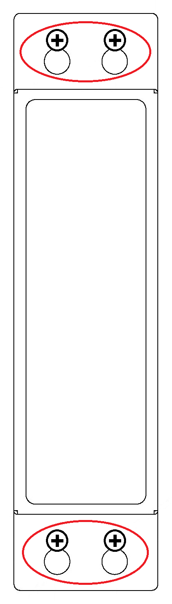

### 2.4.4 壁挂式拆卸

拆卸IG974的方法为：用一只手扶住设备，另外一只手把设备上端起固定作用的螺钉卸掉，即可把设备从安装位置拆卸掉。

## 2.5 连接与布线

### 2.5.1 以太网

IG974有4个RJ45以太网口，支持10M/100M/1000M自适应速率。RJ45的引脚说明如下：

| RJ45引脚号 | 10M/100M | 1000M |
| :---: | :---: | :---: |
| 1 | TX+ | TRD(0)+ |
| 2 | TX- | TRD(0)- |
| 3 | RX+ | TRD(1)+ |
| 4 | — | TRD(2)+ |
| 5 | — | TRD(2)- |
| 6 | RX- | TRD(1)- |
| 7 | — | TRD(3)+ |
| 8 | — | TRD(3)- |

### 2.5.2 Console接口

IG974带有1个RJ45的Console接口，接口采用RS-232通信标准。接口的引脚说明如下：

| RJ45引脚号 | 名称 | 定义 |
| :---: | :---: | :---: |
| 1 | CTS | 清除发送 |
| 2 | DSR | 数据设备准备 |
| 3 | RxD | 数据接收 |
| 4 | GND | 地线 |
| 5 | GND | 地线 |
| 6 | TxD | 数据发送 |
| 7 | DTR | 数据终端准备 |
| 8 | RTS | 请求发送 |

### 2.5.3 电源

IG974支持12-48 VDC供电。将适配器端子插入到IG974的DC端口中，然后连接电源适配器。当PWR电源指示灯长亮则代表设备已经正常上电。

电源采用2PIN端子，接口引脚说明如下：

| 引脚 | 名称 | 定义 |
| :---: | :---: | :---: |
| 1 | + | 电源正极 |
| 2 | - | 电源负极 |

### 2.5.4 串口

IG974支持2路串口，一路RS-232串口，一路RS-485串口。

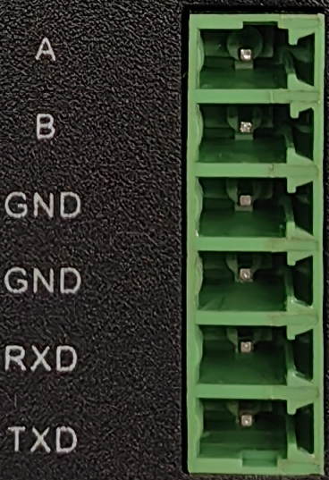

串口采用6PIN端子，接口引脚说明如下：

| 引脚 | 名称 | 定义 |
| :---: | :---: | :---: |
| 1 | A | 串口RS485+ |
| 2 | B | 串口RS485- |
| 3 | GND | 串口RS485信号地 |
| 4 | GND | 串口RS232信号地 |
| 5 | RXD | 串口RS232接受 |
| 6 | TXD | 串口RS232发送 |

### 2.5.5 RS-485 拨码开关

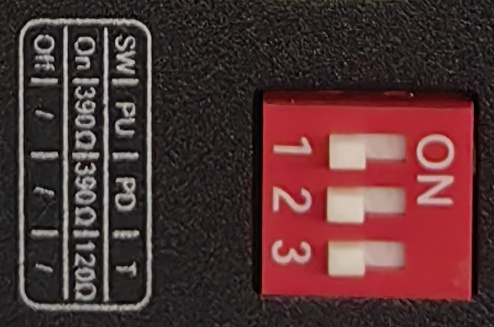

如上图所示，可通过3位的拨码开关分别实现RS-485接口的A/B的上/下拉电阻，和A、B端间电阻的使能选择；通过使能电阻可提高RS-485总线的抗干扰能力及解决因接口芯片兼容性导致的乱码问题。

| 标识 | 描述 |
| :---: | :---: |
| PU | ON:使能COM RS-485 A上拉电阻 OFF:未使能COM RS-485 A上拉电阻（默认） |
| PD | ON:使能COM RS-485 B下拉电阻 OFF:未使能COM RS-485 B下拉电阻（默认） |
| T | ON: 使能终端匹配电阻 OFF: 禁用终端匹配电阻（默认） |

> **备注**：但使能电阻，会减少RS-485总线允许最大的接入设备数量。

### 2.5.6 蜂窝 SIM 与天线

**SIM 卡**：IG974配备1个用于蜂窝通信的抽屉式SIM卡座，位于上面板。安装步骤如下：

1. **步骤一**：IG974的SIM卡需要在断电的情况下进行安装，请确保安装前已经断开设备电源
2. **步骤二**：用取卡针轻戳卡槽旁边的按钮，卡槽从插槽弹出
3. **步骤三**：将SIM卡装入卡槽，卡槽插回插槽中

**天线**：IG974的5G版本共有7个天线接口，4G版本共有5个，不同型号标配的天线数量不同。具体型号对应的天线支持情况可参见《IG974系列边缘网关产品规格书》中"订购信息"部分。

5G版：

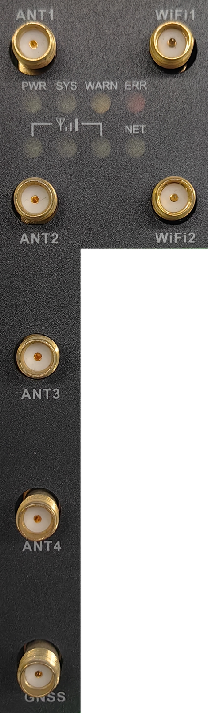

| 标识 | 名称 |
| :---: | :---: |
| ANT1 | 主天线 |
| ANT2 | 分集天线1 |
| ANT3 | 分集天线2 |
| ANT4 | 分集天线3 |
| GNSS | GPS/北斗天线 |
| WiFi1 | WiFi天线1 |
| WiFi2 | WiFi天线2 |

4G版：

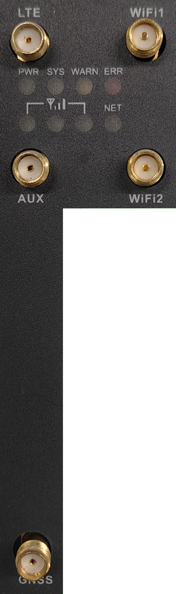

| 标识 | 名称 |
| :---: | :---: |
| ANT1 | 主天线 |
| ANT2 | 分集天线 |
| GNSS | GPS/北斗天线 |
| WiFi1 | WiFi天线1 |
| WiFi2 | WiFi天线2 |

## 2.6 供电与环境

| 项目 | 规格 |
| --- | --- |
| 输入电压 | 12-48 VDC （双引脚端子，V+、V-） |
| 工作温度 | -20-70℃ |
| 存储温度 | -40-85℃ |
| 环境湿度 | 5~ 95% (无凝霜) |

## 2.7 首次登录与恢复出厂

### Web 登录

使用以下默认IP 地址连接到IG974：

| 端口角色 | 默认 IP |
| :---: | :---: |
| WAN | 192.168.1.1 |
| LAN1 | 192.168.2.1 |
| LAN2 | 192.168.3.1 |
| LAN3 | 192.168.4.1 |

1. **将IG974和PC互联**：将网线一端插入到IG974任一网口中，另外一端插入到电脑的网口，同时将电脑的IP地址设置为设备接口同网段地址。
2. **通过web对IG974进行网络管理和系统管理**：IG974支持基于IEOS的WEB界面管理方式。IEOS是映翰通自研的一套运行在Linux系统上的网络管理和系统管理程序，IEOS可提供web界面服务。以网线网口插入到LAN1为例，设备登录信息如下：
   - 登陆地址：**https://192.168.2.1**
   - 初始登陆账号：**adm**
   - 初始登陆密码：**查看设备面板上的铭牌获取初始密码信息**

下图是使用WEB连接的示例：

### 恢复出厂（RESET）

复位按键说明见 §2.3.3。采用硬件方式恢复出厂设备步骤如下：

1. 步骤1：设备上电后10s内长按RESET键；
2. 步骤2：ERR灯常亮时，松开RESET键；
3. 步骤3：ERR灯熄灭后，再次按住RESET键，ERR灯闪烁时松开RESET键；等待ERR灯熄灭，表明恢复出厂设置成功。

## 2.8 相关文档

| 需求 | 去向 |
|------|------|
| 各型号天线支持情况、订购信息 | 《IG974系列边缘网关产品规格书》"订购信息"部分 |

## 2.9 法律信息

本手册中描述的软件是根据许可协议提供的，只能按照该协议的条款使用。

**版权声明**

© 2024 映翰通网络 保留所有权利。

**商标**

InHand标志是映翰通网络的注册商标。

本手册中的所有其他商标或注册商标属于其各自的制造商。

**免责声明**

本公司保留对此手册更改的权利，产品后续相关变更时，恕不另行通知。对于任何因安装、使用不当而导致的直接、间接、有意或无意的损坏及隐患概不负责。
