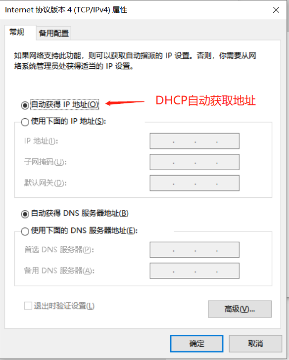
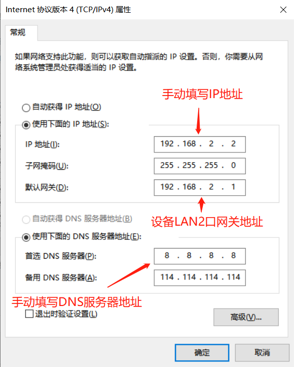
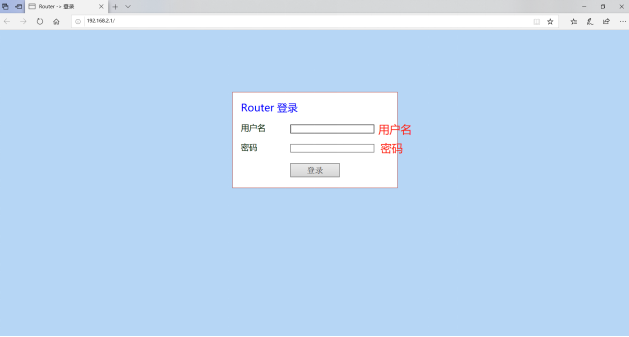
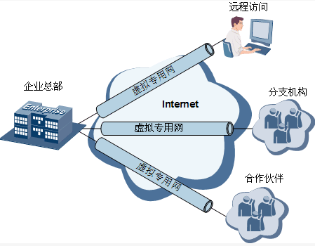

# 北京映翰通工业路由器IR202-Lite系列产品用户手册

## 前置信息

### 声明

首先非常感谢您选择本公司产品！在使用前，请您仔细阅读本用户手册，遵守以下声明，将有助于维护知识产权和法律合规性，以确保您的使用体验与产品的最新信息相一致。如有任何疑问或需要获取书面许可，请随时联系我们的技术支持团队。

- 版权声明

本用户手册包含受版权保护的内容，版权归北京映翰通网络技术股份有限公司及其许可者所有。未经书面许可，任何单位和个人不得擅自摘抄、复制本手册的部分或全部内容，且不得以任何形式传播。

- 免责声明

由于产品技术和规格不断更新，本公司不能承诺用户手册中的资料与实际产品完全一致。因此，不承担由于实际技术参数与用户手册不符而引起的任何争议。任何关于产品的改动恕不提前通知，本公司保留最终更改权和解释权。

- 版权信息

本用户手册内容受版权法律保护，版权归北京映翰通网络技术股份有限公司及其许可者所有，保留一切权利。未经书面许可，不得擅自使用、复制或传播本手册的内容。

### 图形界面约定


| 符号    | 含义                               | 示例                 |
| ----- | -------------------------------- | ------------------ |
| `< >` | 表示变量或参数，需替换为实际值                  | `<IP地址>` 表示需填入具体IP |
| `" "` | 表示界面上的文字标签                       | 点击"保存"按钮           |
| `→`   | 表示菜单层级或操作顺序                      | 【网络】→【Cellular】    |
| `【 】` | 表示菜单或页面名称                        | 进入【系统设置】页面         |
| 注意    | 提醒操作中应注意的事项，不当的操作可能会导致数据丢失或者设备损坏 | -                  |
| 说明    | 对操作内容的描述进行必要的补充和说明               | -                  |


### 技术支持

**北京映翰通网络技术股份有限公司（总部）**

电话：010-8417 0010

地址：北京市朝阳区紫月路18号院3号楼5层

**成都办事处**

电话：028-8679 8244

地址：四川省成都市武侯区天府大道北段1777号中国太平金融大厦14层

**广州办事处**

电话：020-8562 9571

地址：广州市天河区棠东东路5号远洋新三板创意园B-130单元

**武汉办事处**

电话：027-8716 3566

地址：湖北省武汉市洪山区珞瑜东路2号巴黎豪庭11栋2001室

**上海办事处**

电话：021-5480 8501

地址：上海市普陀区顺义路18号1103室

### 如何使用本手册

**对号入座**：

- 首次使用用户：建议按顺序阅读「认识设备」→「安装与首次使用」→「常用场景配置」→「功能说明与参数参考」
- 已有设备用户：可直接查阅「功能说明与参数参考」或「附录 故障处理」
- 云平台管理用户：可查阅「常用场景配置」中的场景5，以及「功能说明与参数参考」中的设备远程管理平台

**按任务快速跳转**：


| 任务              | 对应章节                                       | 预计用时  |
| --------------- | ------------------------------------------ | ----- |
| 了解设备外观、指示灯与默认参数 | [第1章 认识设备](#第1章-认识设备)                      | 约5分钟  |
| 安装设备并登录Web配置界面  | [第2章 安装与首次使用](#第2章-安装与首次使用)                | 约15分钟 |
| 通过4G蜂窝网络接入互联网   | [场景1：蜂窝联网](#场景1蜂窝联网)                       | 约5分钟  |
| 通过有线宽带接入互联网     | [场景2：有线宽带接入](#场景2有线宽带接入)                   | 约10分钟 |
| 提供Wi-Fi无线接入     | [场景3：提供Wi-Fi接入（AP模式）](#场景3提供wi-fi接入ap模式)   | 约10分钟 |
| 作为客户端接入上游Wi-Fi  | [场景4：接入上游Wi-Fi（STA模式）](#场景4接入上游wi-fista模式) | 约10分钟 |
| 接入设备管理平台远程运维    | [场景5：接入设备远程管理平台](#场景5接入设备远程管理平台)           | 约10分钟 |
| 查阅功能参数说明        | [第4章 功能说明与参数参考](#第4章-功能说明与参数参考)            | 按需    |
| 排查设备故障          | [附录 故障处理](#附录-故障处理)                        | 按需    |
| 使用命令行管理设备       | [附录 命令行参考](#附录-命令行参考)                      | 按需    |


## 第1章 认识设备


### 1.1 概述

InRouter202-Lite（简称 IR202-Lite）是集4G网络、虚拟专用网等技术于一体的物联网无线路由器产品。设备凭借4G无线广域网以及Wi-Fi无线局域网等技术，提供不间断的多种网络接入能力，以其全面的安全性和无线服务等特性，实现多达万级的设备联网，为设备信息化提供数据的高速通路。

该产品面向无人值守现场通信需求设计，采用软硬件看门狗及多级链路检测机制保证通信的稳定性和可靠性，同时支持映翰通 Device Manager"设备云"管理平台，便于用户远程管理。设备提供人性化的Web配置界面，降低配置使用难度。

### 1.2 包装清单


| 物品         | 数量  | 说明                   |
| ---------- | --- | -------------------- |
| IR202-Lite | 1台  | 工业级路由器               |
| 网线         | 1根  | 1.5米网线               |
| 电源         | 1个  | 提供12V/1A的直流电         |
| 4G天线       | 1根  | 吸盘天线（仅带蜂窝功能的产品提供）    |
| Wi-Fi天线    | 1根  | 吸盘天线（仅带Wi-Fi功能的产品提供） |
| 产品保修卡      | 1张  | 保修期为1年               |
| 合格证        | 1张  | IR202-Lite工业级路由器合格证  |


### 1.3 接口说明


| 接口/部件 | 功能说明 |
| --- | --- |
| SIM卡座 | 插入SIM卡；取出时向内按压SIM卡，SIM卡自动弹出 |
| Reset按钮 | 长按可恢复出厂设置，详见[恢复出厂设置](#15-恢复出厂设置) |
| 4G天线接口（SMA-J） | 连接4G吸盘天线（仅带蜂窝功能的产品提供） |
| Wi-Fi天线接口（SMA-J） | 连接Wi-Fi吸盘天线（仅带Wi-Fi功能的产品提供） |
| LAN口 | 连接PC或下级交换机等以太网设备，其中LAN1可切换为WAN口工作模式 |
| 电源接口 | 连接12V DC直流电源 |
| SYS/CELL/Wi-Fi指示灯 | 显示设备工作状态，详见[指示灯说明](#14-指示灯说明) |


### 1.4 指示灯说明


| 指示灯   | 状态   | 含义           |
| ----- | ---- | ------------ |
| SYS   | 常灭   | 设备未上电        |
|       | 红色闪烁 | 设备启动中        |
|       | 红色常亮 | 设备工作         |
| CELL  | 常灭   | 蜂窝功能未开启      |
|       | 绿色闪烁 | 蜂窝网络连接中      |
|       | 绿色常亮 | 蜂窝网连接正常      |
| Wi-Fi | 常灭   | Wi-Fi未启动     |
|       | 绿色闪烁 | Wi-Fi工作/数据输出 |


### 1.5 恢复出厂设置

通过Reset键恢复出厂设置的步骤如下：

1. 在设备面板上找到Reset按钮。
2. 长按Reset按钮，此时SYS指示灯熄灭再亮起。5秒后松开，SYS指示灯熄灭，表明已进入出厂重置控制程序。
3. 再次按下Reset按钮，直到SYS指示灯亮起，然后松开。此时SYS指示灯闪烁，表明出厂重置操作已成功。


### 1.6 默认设置


| 项目       | 默认值                                                      |
| -------- | -------------------------------------------------------- |
| LAN口IP地址 | 192.168.2.1                                              |
| 子网掩码     | 255.255.255.0                                            |
| Web登录用户名 | adm                                                      |
| Web登录密码  | 出厂默认值（见产品铭牌）                                             |
| DHCP服务   | 启用，分配范围192.168.2.2~192.168.2.100                         |
| DNS转发    | 启用                                                       |
| WLAN工作模式 | AP（默认禁用），SSID：inhand                                     |
| WAN端口    | 禁用                                                       |
| 管理服务端口   | HTTP 80 / HTTPS 443 / TELNET 23 / SSH 22 / HTTP_API 4444 |
| 登录超时时间   | 500秒                                                     |


## 第2章 安装与首次使用


### 2.1 安装前准备


| 项目   | 要求                                       |
| ---- | ---------------------------------------- |
| 网络环境 | 设备处于3G/4G网络覆盖范围内，现场无屏蔽                   |
| 供电环境 | 220V AC（可与产品附带直流电源配合使用）或12V DC（纹波<100mV） |
| 安装位置 | 尽量放置于水平平面，安装于振动频率较小的环境                   |
| 管理PC | 一台已安装以太网卡的PC                             |
| SIM卡 | 一张已开通数据服务、未欠费停机的SIM卡                     |


> **注意**：设备的安装操作必须在设备断电状态下进行！

> **注意**：首次安装必须在映翰通公司认可合格的工程师指导下进行。


### 2.2 安装指南

**1. 安装SIM卡**

将SIM卡按设备表面图示方向插入IR202-Lite即可完成安装。取出SIM卡时，向内按压SIM卡，SIM卡会自动弹出。

**2. 安装天线**

用手轻轻转动天线金属SMA-J接口可活动部分，转到不能转动为止（此时看不到天线连接线外螺纹）即完成安装。不应握住黑色胶套用力拧天线。

**3. 连接电源**

安装完天线后，将12V DC电源接上设备。观察设备面板上SYS指示灯是否点亮。如果指示灯没有点亮，应立即联系映翰通技术支持。

**4. 连接管理PC**

通过网线将PC与IR202-Lite的一个LAN口相连。登录路由器Web设置页面前，需确保管理计算机已安装以太网卡。管理PC的IP地址可通过以下两种方式配置。

**方式一：自动获取IP地址（推荐）**

将管理PC设置成"自动获得IP地址"和"自动获得DNS服务器地址"（计算机系统的缺省配置），由设备自动为管理PC分配IP地址。



**图 2-1 设置自动获得IP地址**

**方式二：设置静态IP地址**

将管理PC的IP地址（例如设置为192.168.2.2）与设备的LAN口IP地址设置在同一网段内。设备LAN口初始IP地址为192.168.2.1，子网掩码为255.255.255.0。



**图 2-2 设置静态IP地址**

**5. 取消代理服务器**

如果当前PC使用代理服务器访问因特网，则必须取消代理服务。操作步骤如下：

1. 在浏览器窗口中，选择【工具】→【Internet选项】。
2. 选择"连接"页签，点击"局域网设置"按钮，进入"局域网（LAN）设置"窗口。
3. 确认未选中"为LAN使用代理服务器"选项；若已选中，取消勾选后点击"确定"。

**6. 登录Web设置页面**

打开浏览器，在地址栏中输入IR202-Lite设备的IP地址（出厂默认为 [http://192.168.2.1](http://192.168.2.1)）。连接建立后，在弹出的登录界面输入用户名和密码（见产品铭牌）。



**图 2-3 Web登录界面**

 **说明**：为了安全起见，建议首次登录后修改缺省的登录密码，并妥善保管密码信息。

### 2.3 快速检查

安装完成后，按以下清单逐项确认：

- [ ] SYS指示灯红色常亮，表示设备正常工作。
- [ ] CELL指示灯绿色闪烁或常亮，表示蜂窝网络连接正常（仅带蜂窝功能的产品）。
- [ ] 管理PC可通过浏览器打开 [http://192.168.2.1](http://192.168.2.1) 并成功登录Web配置界面。
- [ ] 在【状态】→【Modem状态】页面查看注册状态正常（仅带蜂窝功能的产品）。
- [ ] 在【状态】→【网络连接】页面查看拨号端口已获取IP地址。


## 第3章 常用场景配置


### 场景1：蜂窝联网

**目标**：通过4G蜂窝网络接入互联网。

**前提**：已插入已开通数据服务的SIM卡并安装4G天线，设备已上电。

**预计用时**：约5分钟。

**操作步骤**：

1. 安装SIM卡与4G天线（见[第2章 安装与首次使用](#第2章-安装与首次使用)）。
2. 设备默认自动拨号，天线、电源、SIM卡安装完成后等待几分钟即可联网。
3. 如有特殊需求，进入【网络】→【Cellular】菜单，进入"拨号端口"界面配置拨号参数（参数说明见[拨号端口](#421-cellular)）。

**验证方法**：

1. 查看CELL指示灯，绿色常亮表示蜂窝网连接正常。
2. 进入【状态】→【Modem状态】页面，查看注册状态与信号级别。
3. 进入【状态】→【网络连接】页面，查看拨号端口已获取IP地址。

**常见问题**：

- 网络连接失败：检查SIM卡是否正确插入、SIM卡是否开通数据业务、拨号参数（如APN）是否正确，详见[附录 故障处理](#附录-故障处理)。


### 场景2：有线宽带接入

**目标**：通过有线宽带方式（静态IP/DHCP/PPPoE）接入互联网。

**前提**：设备已上电并可登录Web配置界面，现场具备有线宽带接入条件。

**预计用时**：约10分钟。

**操作步骤**：

1. 将外部宽带网线接入设备LAN1接口。
2. 进入【网络】→【WAN端口】菜单，进入"WAN端口"界面。
3. 将接口设置为WAN口工作模式，并根据宽带类型选择接入方式：
  - 静态IP：填写运营商分配的固定IP地址、子网掩码与网关。
  - DHCP动态地址（推荐）：自动获得上级路由器分配的地址。
  - ADSL（PPPoE）拨号：填写宽带运营商提供的拨号用户名与密码。
4. 点击"保存"，等待连接建立。

各接入方式的参数说明见[WAN/LAN切换](#422-wanlan切换)。

**验证方法**：

1. 进入【状态】→【网络连接】页面，查看WAN端口已获取IP地址。
2. 连接在WAN口下的PC可正常访问互联网。

**常见问题**：

- 无法上网：确认WAN口已启用、接入方式与宽带类型匹配、账号密码正确，详见[附录 故障处理](#附录-故障处理)。


### 场景3：提供Wi-Fi接入（AP模式）

**目标**：将设备配置为无线接入点（AP），为其他无线设备提供Wi-Fi接入。

**前提**：设备已上电，且已通过有线或蜂窝方式接入Internet；已安装Wi-Fi天线。

**预计用时**：约10分钟。

**操作步骤**：

1. 进入【网络】→【WLAN模式切换】菜单，确认WLAN工作模式为AP（设备默认工作模式为AP）。切换WLAN模式后需重启设备才能生效。
2. 进入WLAN配置界面，启用WLAN。
3. 配置SSID、认证方式与加密方式（建议使用WPA2-PSK等安全认证方式）。
4. 点击"保存"，等待WLAN启动。

参数说明见[WLAN AP模式](#425-wlan-ap模式)。

**验证方法**：

1. 无线终端搜索到设备SSID并成功关联。
2. 进入【状态】→【WLAN状态】页面，查看WLAN状态信息。

**常见问题**：

- 无线终端搜不到信号：确认WLAN已启用、SSID广播已开启，详见[附录 故障处理](#附录-故障处理)。


### 场景4：接入上游Wi-Fi（STA模式）

**目标**：设备以无线客户端（STA）方式连接上游无线接入点，通过上游Wi-Fi接入网络。

**前提**：设备已上电，环境中存在可用的无线接入点，已知其SSID、认证方式与加密方式；已安装Wi-Fi天线。

**预计用时**：约10分钟。

**操作步骤**：

1. 进入【网络】→【WLAN模式切换】菜单，将WLAN接口类型切换为"客户端"，切换后需重启设备生效。
2. 进入【网络】→【WLAN客户端】菜单，在"SSID扫描"界面查看所有可用的SSID名称。
3. 选择要连接的SSID，配置与上游接入点一致的认证方式与加密方式（参数说明见[WLAN客户端（STA模式）](#426-wlan客户端sta模式)）。
4. 关闭【网络】→【Cellular】菜单中的拨号接口。
5. 在【网络】→【WAN(STA)】中配置WLAN接口的接入方式。

**验证方法**：

1. 进入【状态】→【WLAN状态】页面，查看设备作为客户端的连接状态。
2. 连接在LAN口下的PC可正常访问网络。

**常见问题**：

- 连接不上上游AP：确认认证方式、加密方式与上游接入点配置一致，详见[附录 故障处理](#附录-故障处理)。


### 场景5：接入设备远程管理平台

**目标**：将设备接入映翰通 Device Manager 设备管理平台，实现远程查询设备运行状态、升级软件、重启设备、下发配置等远程管理操作。

**前提**：设备已接入互联网（蜂窝或有线方式），已在映翰通DM官网注册账户。

**预计用时**：约10分钟。

**操作步骤**：

1. 进入【服务】→【设备远程管理平台】菜单。
2. 启用设备远程管理平台。
3. 选择服务类型（设备管理Device Manager / InConnect Service / 自定义），并填写对应服务器地址：
  - DM服务器：国内iot.inhand.com.cn；海外iot.inhandnetworks.com
  - InConnect服务器：国内ics.inhandiot.com；海外ics.inhandnetworks.com
4. 填写在映翰通DM/InConnect官网注册的注册账户。
5. 按需配置安全通道、上报间隔与心跳间隔，点击"保存"。

参数说明见[设备远程管理平台](#434-设备远程管理平台)。

**验证方法**：

1. 进入【状态】→【设备管理平台】页面，查看平台连接状态。
2. 登录Device Manager平台，确认设备已上线。

**常见问题**：

- 设备未上线：确认设备已接入互联网、服务器地址与注册账户填写正确，详见[附录 故障处理](#附录-故障处理)。


## 第4章 功能说明与参数参考


### 4.1 系统


#### 4.1.1 基本设置

基本设置用于选择路由器Web配置界面的显示语言以及自定义路由器主机名称。

进入【系统】→【基本设置】菜单，进入"基本配置"页面即可进行配置。

**表 4-1 基本设置参数说明**


| 参数名称 | 说明                      | 缺省值    |
| ---- | ----------------------- | ------ |
| 界面语言 | WEB配置页面的语言配置            | 中文     |
| 主机名  | 给路由器连接的主机或设备设置一个名称以方便查看 | Router |


#### 4.1.2 系统时间

为保证本设备与其它设备协调工作，需将系统时间配置准确。系统时间用于配置和查看系统时间和系统时区，其目的是对网络内所有具有时钟的设备进行时钟同步，使网络内所有设备的时钟保持一致，从而使设备能够提供基于统一时间的多种应用。

进入【系统】→【系统时间】菜单，进入"系统时间"界面，在主机时间部分点击"同步时间"按钮可直接将主机时间设置成网关的系统时间。

**表 4-2 系统时间参数说明**


| 参数名称    | 说明                                    | 缺省值                 |
| ------- | ------------------------------------- | ------------------- |
| 路由器时间   | 显示路由器当前时间                             | 2021-xx-xx 08:00:00 |
| 主机时间    | 显示PC机当前时间                             | 当前时间                |
| 时区      | 设置路由器所在时区                             | 定制                  |
| 设置时区字符串 | 设置路由器所在时区字符串                          | CST-8               |
| 自动更新时间  | 选择是否自动更新时间，可选择启动时、每1/2/…小时等不同时间自动更新时间 | 禁用                  |


#### 4.1.3 管理控制

管理服务包含HTTP、HTTPS、TELNET和SSHD四种形式。

- **HTTP**：HTTP超文本传输协议用来在Internet上传递Web页面信息。在设备上使能HTTP服务后，用户即可通过HTTP协议登录设备，利用Web功能访问并控制设备。
- **HTTPS**：HTTPS是超文本传输协议的安全版本，是支持SSL协议的HTTP协议，提高了安全性。在设备上使能HTTPS服务后，用户即可通过HTTPS协议登录设备，利用Web功能访问并控制设备。
- **TELNET**：Telnet协议通过网络提供远程登录和虚拟终端功能，以服务器/客户端（Server/Client）模式工作。Telnet客户端向Telnet服务器发起请求，Telnet服务器提供Telnet服务。设备支持Telnet客户端和Telnet服务器功能。在设备上使能TELNET服务后，可通过Telnet协议访问设备终端。
- **SSHD**：SSHD服务可允许其他设备使用SSH协议远程访问设备终端。
- **HTTP_API**：在设备上开启HTTP_API服务后，可通过HTTP协议的POST或GET方法，将要请求的操作发送给路由器，由路由器返回操作结果。访问端口号为4444，请求时需携带用户名密码认证。

进入【系统】→【管理控制】菜单，进入"管理控制"界面，即可进行配置。

**表 4-3 管理控制参数说明**


| 参数名称                               | 说明                                                                 | 缺省值               |
| ---------------------------------- | ------------------------------------------------------------------ | ----------------- |
| **用户名/密码**                         |                                                                    |                   |
| 用户名                                | 设置登录WEB配置的用户名                                                      | adm               |
| 旧密码                                | 原来登录WEB配置的密码                                                       | 空                 |
| 新密码                                | 设置新的登录WEB配置的密码                                                     | 空                 |
| 确认密码                               | 再次确认新的登录密码                                                         | 空                 |
| **管理功能**                           |                                                                    |                   |
| 服务端口                               | HTTP/HTTPS/TELNET/SSHD/HTTP_API的服务端口                               | 80/443/23/22/4444 |
| 本地管理                               | 启用：允许本地局域网使用相应服务（如HTTP）对路由器进行管理；禁用：本地局域网不能使用相应服务对路由器进行管理           | 启用                |
| 远程管理                               | 启用：允许远程主机使用相应服务（如HTTP）对路由器进行管理；禁用：远程主机不能使用相应服务对路由器进行管理             | 启用                |
| 允许远程管理的地址范围（可选）                    | 设置允许远程管理的地址范围，可设置控制服务的主机，例如192.168.2.1/30或192.168.2.1-192.168.2.10 | -                 |
| 说明                                 | 便于记录管理功能各项参数的意义（不影响路由器配置）                                          | 空                 |
| **控制台登录用户（设置好一组用户名和密码后需点击"新增"按钮）** |                                                                    |                   |
| 用户名                                | 配置控制台登录用户名，用户自定义                                                   | 无                 |
| 密码                                 | 配置控制台登录密码，用户自定义                                                    | 无                 |
| **其他参数**                           |                                                                    |                   |
| 登录超时                               | 设置登录超时时间（登录超时后路由器会自动断开配置界面）                                        | 500秒              |


 **说明**：

> - "用户名/密码"配置部分可以更改该用户名和密码，但不能新建用户名，即Web登录方式只能使用这一个用户名。
> - "控制台登录用户"配置部分可以新建多个用户名，即采用串口或TELNET控制台登录方式可以使用多个用户名。


#### 4.1.4 系统日志设置

通过"系统日志设置"界面，可以设置远程日志服务器，网关会将所有的系统日志上传到远程日志服务器，这需要主机上的远程日志软件（如：Kiwi Syslog Daemon）配合。

Kiwi Syslog Daemon是一个用于Windows的免费日志服务器软件，可以接收、记录、显示来自开启syslog的主机（如网关、交换机、Unix主机等）的日志。下载并安装Kiwi Syslog Daemon后，通过"File>>Setup>>Input>>UDP"界面设置必要参数。

进入【系统】→【系统日志设置】菜单，进入"系统日志设置"界面进行相应配置。

**表 4-4 系统日志设置参数说明**


| 参数名称            | 说明               | 缺省值   |
| --------------- | ---------------- | ----- |
| 发送到远程日志服务器      | 点选启用日志服务器        | 禁用    |
| 日志服务器地址、端口（UDP） | 设置远程日志服务器的地址/端口号 | 空：514 |


#### 4.1.5 配置管理

配置管理用于备份参数、导入参数备份、恢复出厂设置。

进入【系统】→【配置管理】菜单，进入"配置管理"界面即可进行配置。

**表 4-5 配置管理参数说明**


| 参数名称       | 说明                            | 缺省值 |
| ---------- | ----------------------------- | --- |
| 浏览         | 从主机选择将要导入到路由器的配置文件            | 无   |
| 导入         | 将配置文件导入到路由器                   | 无   |
| 备份         | 备份配置文件到主机                     | 无   |
| 恢复出厂设置     | 点选以恢复出厂设置（恢复出厂设置后需重新启动系统才能生效） | 无   |
| 网络运营商（ISP） | 用于配置全球各大运营商的APN、用户名、密码等参数     | 无   |


>  **注意**：应确保导入配置的合法性与有序性。导入配置时，系统会过滤格式不合法的命令，然后将正确的配置存储，在系统重启后顺序执行这些配置。如果导入的配置内容不是按照有效的顺序排列，将导致系统不能进入期望状态。

>  **注意**：为了不影响当前的系统运行，执行导入配置和恢复出厂配置后，需重启设备新的配置才能生效。


#### 4.1.6 计划任务

开启此功能后，设备将按照设定时间定时重启。

进入【系统】→【计划任务】菜单，进入"计划任务"界面即可进行设置。

**表 4-6 计划任务参数说明**


| 参数名称    | 说明                                                          | 缺省值      |
| ------- | ----------------------------------------------------------- | -------- |
| 启用      | 开启/关闭计划任务功能                                                 | 禁用       |
| 时/分     | 配置每天定时重启的时间                                                 | 0:00     |
| 天       | 每天重启                                                        | Everyday |
| 显示高级选项  | 启用后可配置更详细的定时重启规则，可配置多条重启规则，指定时间或按一定间隔重启设备。启用后会禁用之前的每天定时重启功能 | 禁用       |
| 拨号后重启设备 | 配置后，当设备拨号成功一段时间后会自动重启，空表示此功能不生效                             | 空        |


#### 4.1.7 系统升级

升级过程共分为两个阶段：第一阶段将升级文件写入备份固件区；第二阶段将备份固件区中的文件拷贝到主固件区，此阶段将在系统重启时执行。在软件升级过程中，不应在Web上进行任何操作，否则可能导致软件升级中断。

进入【系统】→【系统升级】菜单，进入"系统升级"界面即可进行配置。

升级系统步骤如下：

1. 点击"浏览"，选择升级文件。
2. 点击"升级"，在弹出窗口中选择"确定"。
3. 升级成功后，重启设备即可生效。


#### 4.1.8 重启系统

设备重启前需保存配置，否则重启后未保存的配置将会全部丢失。

如需重启系统，进入【系统】→【重启系统】，点击"确定"重启系统。

#### 4.1.9 退出系统

如需退出系统，进入【系统】→【退出系统】，点击"确定"退出系统。

### 4.2 网络


#### 4.2.1 Cellular

设备装入SIM卡后，通过拨号接口往外拨号，实现路由器的无线网络连接功能。设备默认自动拨号，天线、电源、SIM卡安装完成后等待几分钟即可联网。如有特殊需求，进入【网络】→【Cellular】菜单，进入"拨号端口"界面进行配置。

**表 4-7 拨号端口参数说明**


| 参数名称         | 说明                                                                                                                  | 缺省值    |
| ------------ | ------------------------------------------------------------------------------------------------------------------- | ------ |
| 启用           | 点选启用PPP拨号                                                                                                           | 启用     |
| 启用时间         | 设置拨号启用的时间阶段表                                                                                                        | 全部     |
| PPPoE桥接      | 启用后路由器会通过WAN口建立PPP连接，一般情况应禁用                                                                                        | 禁用     |
| 共享连接（NAT）    | 启用：连接到Router的本地设备可以通过Router上网；禁用：连接到Router的本地设备不能通过Router上网                                                         | 启用     |
| 默认路由         | 点选启用默认路由                                                                                                            | 启用     |
| SIM1网络运营商    | 用于选择为当前SIM卡提供服务的运营商                                                                                                 | 定制     |
| 网络选择方式       | 选择网络类型，选择并固定使用某一网络制式                                                                                                | 自动     |
| 连接方式         | 可选择永远在线、按需拨号、手工拨号                                                                                                   | 永远在线   |
| 重拨间隔         | 设置登录失败时重新拨号的时间                                                                                                      | 30秒    |
| 显示高级选项       | 点选显示高级选项（以下为高级选项参数）                                                                                                 | 禁用     |
| 启用双SIM卡      | 启用第二张SIM卡                                                                                                           | 未启用    |
| SIM2网络运营商    | 选择第二张SIM卡提供服务的供应商                                                                                                   | 拨号参数集1 |
| SIM2绑定ICCID  | 绑定SIM卡2的ICCID                                                                                                       | 空      |
| SIM PIN码     | 填写第二张SIM卡的PIN码                                                                                                      | 空      |
| 选择主卡         | 设置主卡                                                                                                                | SIM卡1  |
| 最大拨号次数       | 拨号尝试的最大次数，若达到最大次数后仍未拨号成功，路由器会切换SIM卡                                                                                 | 5      |
| 信号阈值         | 蜂窝信号的阈值，若当前信号强度低于此阈值，路由器会切换SIM卡                                                                                     | 0（禁用）  |
| 最小连接时间       | 拨号连接的最小连接时间                                                                                                         | 0（禁用）  |
| 初始化命令        | 用于初始化拨号参数                                                                                                           | AT     |
| 绑定ICCID      | 将设备与SIM卡的ICCID绑定                                                                                                    | 空      |
| PIN码         | 用于设置PIN码                                                                                                            | 空      |
| 拨号超时时间       | 一次拨号尝试中判定拨号失败的尝试时间                                                                                                  | 120    |
| MTU          | 设置最大传输单元                                                                                                            | 1500   |
| 使用分配的DNS服务器  | 使用分配的DNS服务器解析                                                                                                       | 启用     |
| 连接检测间隔       | 设置连接检测的间隔                                                                                                           | 55秒    |
| 启用调试模式       | 点选启用调试模式                                                                                                            | 禁用     |
| 启用modem调试模式  | 点选启用modem调试模式                                                                                                       | 禁用     |
| ICMP探测模式     | 设置ICMP探测模式。设备会通过ICMP探测拨号链路是否正常，若ICMP探测失败会重启拨号。忽略流量模式：无论是否有数据流量通过拨号接口，设备都会进行ICMP探测；监控流量模式：如果有数据流量通过拨号接口，设备不会进行ICMP探测 | 忽略流量模式 |
| ICMP探测服务器    | 设置ICMP探测服务器，空表示不启用ICMP探测                                                                                            | 空      |
| ICMP探测间隔时间   | 设置ICMP探测间隔时间                                                                                                        | 30秒    |
| ICMP探测超时时间   | 设置ICMP探测超时时间（探测超时自动重启）                                                                                              | 20秒    |
| ICMP探测最大重试次数 | 设置ICMP探测失败时的最大重试次数（达到最大次数后会重新拨号）                                                                                    | 5      |


**表 4-8 拨号端口——时间表管理参数说明**


| 参数名称  | 说明       | 缺省值         |
| ----- | -------- | ----------- |
| 时间表名称 | 时间表自定义名称 | schedule1   |
| 周日~周六 | 点击启用     | 空           |
| 时间范围1 | 设置时间范围1  | 9:00-12:00  |
| 时间范围2 | 设置时间范围2  | 14:00-18:00 |
| 时间范围3 | 设置时间范围3  | 0:00-0:00   |
| 说明    | 设置说明内容   | 空           |


#### 4.2.2 WAN/LAN切换

WAN/LAN切换用于设置WAN/LAN1接口的工作模式。若设备通过有线方式访问互联网，应将接口设置为WAN口工作模式。

1. WAN端口类型支持静态IP、DHCP动态地址（推荐）、ADSL（PPPoE）拨号三种有线接入方式。
2. DHCP采用客户端/服务器通信模式，由客户端向服务器提出配置申请，服务器返回为客户端分配的IP地址等相应的配置信息，以实现IP地址等信息的动态配置。
3. PPPoE是基于以太网的点对点协议。用户需在保持原接入方式的基础上安装一个PPPoE客户端。通过PPPoE协议，远端接入设备能够实现对每个接入用户的控制和计费。
4. 设备WAN端口默认情况下为禁用状态。

进入【网络】→【WAN端口】菜单，进入"WAN端口"界面即可进行配置。

**表 4-9 WAN端口——静态IP参数说明**


| 参数名称                      | 说明                                                          | 缺省值              |
| ------------------------- | ----------------------------------------------------------- | ---------------- |
| 共享连接                      | 启用：连接到Router的本地设备可以通过Router上网；禁用：连接到Router的本地设备不能通过Router上网 | 启用               |
| 默认路由                      | 点选启用默认路由                                                    | 启用               |
| MAC地址                     | 设备的MAC地址                                                    | 设备硬件MAC地址（制造商提供） |
| IP地址                      | 设置WAN端口的IP地址                                                | 192.168.1.29     |
| 子网掩码                      | 设置WAN端口的子网掩码                                                | 255.255.255.0    |
| 网关                        | 设置WAN端口的网关                                                  | 192.168.1.1      |
| MTU                       | 最大传输单元，可选择默认值/手工设置                                          | 默认值（1500）        |
| **多IP支持（最多可设定8个额外的IP地址）** |                                                             |                  |
| IP地址                      | 设置LAN端口额外的IP地址                                              | 空                |
| 子网掩码                      | 设置子网掩码                                                      | 空                |
| 说明                        | 便于记录额外IP地址的意义                                               | 空                |


**表 4-10 WAN端口——动态地址（DHCP）参数说明**


| 参数名称  | 说明                          | 缺省值        |
| ----- | --------------------------- | ---------- |
| 共享连接  | 是否允许LAN端口通过WAN端口的IP地址访问外部网络 | 启用         |
| 默认路由  | 点选启用设备访问外网的默认路由             | 启用         |
| MAC地址 | 设备的MAC地址                    | 设备的硬件MAC地址 |
| MTU   | 最大传输单元，可选择默认值/手工设置          | 默认值（1500）  |


**表 4-11 WAN端口——ADSL拨号（PPPoE）参数说明**


| 参数名称                | 说明                                                          | 缺省值        |
| ------------------- | ----------------------------------------------------------- | ---------- |
| 共享连接                | 启用：连接到Router的本地设备可以通过Router上网；禁用：连接到Router的本地设备不能通过Router上网 | 启用         |
| 默认路由                | 点选启用默认路由                                                    | 启用         |
| MAC地址               | 设备的MAC地址                                                    | 设备的硬件MAC地址 |
| MTU                 | 最大传输单元，可选择默认值/手工设置                                          | 默认值（1492）  |
| **ADSL拨号（PPPoE）设置** |                                                             |            |
| 用户名                 | 设置拨号用户名                                                     | 空          |
| 密码                  | 设置拨号密码                                                      | 空          |
| 静态IP                | 点击启用静态IP                                                    | 禁用         |
| 连接方式                | 设置拨号连接方式（永远在线、按需拨号、手工拨号）                                    | 永远在线       |
| **高级选项参数**          |                                                             |            |
| 服务名称                | 设置服务名称                                                      | 空          |
| 发送队列长度              | 设置发送队列长度                                                    | 3          |
| 启用IP包头压缩            | 点选启用IP包头压缩                                                  | 禁用         |
| 使用分配的DNS服务器         | 点击启用使用分配的DNS服务器                                             | 启用         |
| 连接检测间隔              | 设置连接检测间隔                                                    | 55秒        |
| 连接检测最大重试次数          | 设置连接检测最大重试次数                                                | 10         |
| 启用调试模式              | 勾选启用调试模式                                                    | 禁用         |
| 专家选项                | 设置专家选项                                                      | 空          |
| ICMP探测服务器           | 设置ICMP探测服务器                                                 | 空          |
| ICMP探测间隔时间          | 设置ICMP探测间隔时间                                                | 30秒        |
| ICMP探测超时时间          | 设置ICMP探测超时时间                                                | 20秒        |
| ICMP探测最大重试次数        | 设置ICMP探测最大重试次数                                              | 3          |


#### 4.2.3 LAN端口

LAN端口用于配置与更改LAN端口相关参数，可修改LAN端口MAC地址、IP地址等基本信息，同时支持LAN端口的多IP访问。

进入【网络】→【LAN端口】菜单，即可进行配置。

**表 4-12 LAN端口参数说明**


| 参数名称                      | 说明                         | 缺省值           |
| ------------------------- | -------------------------- | ------------- |
| MAC地址                     | 路由器LAN网关的MAC地址             | 设备的硬件MAC地址    |
| IP地址                      | 设置LAN网关的IP地址               | 192.168.2.1   |
| 子网掩码                      | 设置LAN网关的子网掩码               | 255.255.255.0 |
| MTU                       | 最大传输单元，可选择默认值/手工设置         | 默认值（1500）     |
| 网口模式                      | 设置LAN接口的通信模式               | 自动协商          |
| **多IP支持（最多可设定8个额外的IP地址）** |                            |               |
| IP地址                      | 设置LAN端口额外的IP地址             | 空             |
| 子网掩码                      | 设置子网掩码                     | 空             |
| 说明                        | 便于记录额外IP地址的意义              | 空             |
| **LAN端口使能**               |                            |               |
| LAN1/LAN2                 | 启用对应端口                     | 启用            |
| **免费ARP**                 |                            |               |
| 启用                        | 启用后路由器会自动向LAN中的其它设备发送ARP广播 | 禁用            |
| 广播次数                      | 设置ARP广播的发送次数               | 5             |
| 广播超时时间                    | 设置ARP广播超时时间                | 10            |


#### 4.2.4 WLAN模式切换

WLAN即无线局域网。WLAN接口有接入点（AP）和客户端（STA）两种类型。

进入【网络】→【WLAN模式切换】菜单，即可进行WLAN模式切换。切换WLAN模式后需重启设备才能使配置生效。

> **说明**：设备作为AP时，需确保设备本身已经通过有线、蜂窝的方式接入Internet。


#### 4.2.5 WLAN AP模式

设备WLAN工作在AP模式时，可为其它无线网络设备提供网络接入点，使其进行正常网络通讯。

进入【网络】→【WLAN模式切换】菜单，即可进入"WLAN模式切换"界面进行配置，设备的WLAN默认工作模式为AP。

**表 4-13 WLAN模式切换参数说明**


| 参数名称     | 说明                                                                  | 缺省值         |
| -------- | ------------------------------------------------------------------- | ----------- |
| 启用       | 启用WLAN                                                              | 禁用          |
| SSID广播   | 广播设备的SSID，便于其他设备连接路由器                                               | 开启          |
| 模式       | 六种类型可选：802.11g/n、802.11g、802.11n、802.11b、802.11b/g、802.11b/g/n      | 802.11b/g/n |
| SSID     | 用户自定义SSID名称                                                         | inhand      |
| 认证方式     | 支持开放式、共享式、自动选择WEP、WPA-PSK、WPA、WPA2-PSK、WPA2、WPA/WPA2、WPAPSK/WPA2PSK | 开放式         |
| 加密方式     | 根据不同认证方式，支持NONE、WEP、AES、TKIP                                        | NONE        |
| 无线频宽     | 无线局域网广播的频率带宽                                                        | 20MHz       |
| 启用WDS    | 启用WDS，路由器桥接至其他AP，扩展无线局域网覆盖范围                                        | 禁用          |
| 默认路由     | 点选启用默认路由                                                            | 启用          |
| 桥接的SSID  | 配置WDS连接的AP的SSID，可点击扫描按钮以选择网络中现有AP                                   | 空           |
| 桥接的BSSID | 配置WDS连接的AP的BSSID                                                    | 空           |
| 认证方式     | 配置连接的AP的认证方式                                                        | 开放式         |
| 加密方式     | 配置连接的AP的加密方式                                                        | NONE        |


#### 4.2.6 WLAN客户端（STA模式）

设备WLAN工作在STA模式时，可通过连接网络接入点设备进行正常的网络通讯。

进入【网络】→【WLAN客户端】菜单，进入"WLAN端口"界面，接口类型选用"客户端"，并配置相关参数。此时应关闭【网络】→【Cellular】菜单中的拨号接口。

在WLAN接口类型处选择客户端时，SSID扫描功能才能开启。在"SSID扫描"界面，会显示所有可用的SSID名称，并可以显示设备作为客户端的连接状态。

配置WLAN客户端后，需在【网络】→【WAN(STA)】中配置WLAN接口的接入方式。

**表 4-14 WLAN客户端参数说明**


| 参数名称 | 说明                 | 缺省值         |
| ---- | ------------------ | ----------- |
| 模式   | 支持802.11b/g/n等多种模式 | 802.11b/g/n |
| SSID | 选择要连接的接入点SSID名称    | inhand      |
| 认证方式 | 与要连接的接入点保持一致       | 开放式         |
| 加密方式 | 与要连接的接入点保持一致       | NONE        |


#### 4.2.7 静态路由

设置去往目的网段及其子网掩码、网关的静态路由，默认有一条去往任意网段的默认路由。

进入【网络】→【静态路由】菜单，进入"静态路由"界面即可进行配置。

**表 4-15 静态路由参数说明**


| 参数名称 | 说明                      | 缺省值           |
| ---- | ----------------------- | ------------- |
| 目的网络 | 设置目的网络的IP地址             | 空             |
| 子网掩码 | 设置目的网络的子网掩码             | 255.255.255.0 |
| 网关   | 设置目的网络的网关               | 空             |
| 接口   | 可选择LAN / CELLULAR / WAN | 空             |
| 说明   | 描述标记静态路由的名称或作用（不支持中文字符） | 空             |


### 4.3 服务

服务设置包括DHCP、域名服务器、DNS转发、设备远程管理平台、流量管理、告警等参数配置。

#### 4.3.1 DHCP服务

DHCP采用客户端/服务器通信模式，由客户端向服务器提出配置申请，服务器返回为客户端分配的IP地址等相应的配置信息，以实现IP地址等信息的动态配置。

- 设备作为DHCP服务器，职责是当工作站登录进来时分配IP地址，并确保分配给每个工作站的IP地址不同。DHCP服务器极大地简化了以前需要用手工完成的网络管理任务。
- 设备作为DHCP客户端，登录到DHCP服务器后接收DHCP服务器分配的IP地址，此时设备的以太网接口需配置为自动方式。

进入【服务】→【DHCP服务】菜单，进入"DHCP服务"界面即可配置。

**表 4-16 DHCP服务参数说明**


| 参数名称                             | 说明                                  | 缺省值               |
| -------------------------------- | ----------------------------------- | ----------------- |
| 启用DHCP                           | 点选启用DHCP服务，动态分配IP地址                 | 启用                |
| 起始                               | 设置动态分配的起始IP地址                       | 192.168.2.2       |
| 结束                               | 设置动态分配的结束IP地址                       | 192.168.2.100     |
| 有效期                              | 设置动态分配的IP的有效期                       | 60分钟              |
| DNS                              | 设置DNS服务器                            | 192.168.2.1       |
| Windows名称服务器                     | 设置Windows名称服务器                      | 空                 |
| 域名选项                             | 开启后路由器会为接入客户端分配域名                   | inhand-router.com |
| **静态指定DHCP分配（最多可设置20个静态指定DHCP）** |                                     |                   |
| MAC地址                            | 设置一个静态指定DHCP的MAC地址（不能与其他MAC相同，防止冲突） | 00:00:00:00:00:00 |
| IP地址                             | 设置一个静态指定的IP地址                       | 192.168.2.2       |
| 主机                               | 设置主机名称                              | 空                 |


#### 4.3.2 域名服务器

域名系统（DNS，Domain Name System）是一种用于TCP/IP应用程序的分布式数据库，提供域名与IP地址之间的转换。通过域名系统，用户进行某些应用时可直接使用便于记忆的、有意义的域名，由网络中的DNS服务器将域名解析为正确的IP地址。设备通过DNS服务器进行动态域名解析。

手动设置域名服务器时，如果为空则使用拨号获得的DNS。一般在WAN口使用静态IP时才需设置此项。

进入【网络】→【域名服务】菜单，进入"域名服务"界面配置即可。

**表 4-17 域名服务器参数说明**


| 参数名称      | 说明                | 缺省值     |
| --------- | ----------------- | ------- |
| 首选域名服务器   | 设置首选域名服务器         | 0.0.0.0 |
| 备选域名服务器   | 设置备选域名服务器         | 0.0.0.0 |
| 关闭本机DNS转发 | 路由器不会转发本机DNS服务器地址 | 禁用      |


#### 4.3.3 DNS转发

设备作为DNS代理，在DNS客户端和DNS服务器之间转发DNS请求和应答报文，代替DNS客户端进行域名解析。

进入【服务】→【DNS转发】菜单，进入"DNS转发"界面进行配置即可。

**表 4-18 DNS转发参数说明**


| 参数名称                                 | 说明                 | 缺省值                  |
| ------------------------------------ | ------------------ | -------------------- |
| 启用DNS转发服务                            | 点选以启用DNS转发服务       | 启用（开启DHCP服务后DNS自动打开） |
| **指定[IP地址<=>域名]对（可指定20个IP地址<=>域名对）** |                    |                      |
| IP地址                                 | 设置指定IP地址<=>域名的IP地址 | 空                    |
| 主机                                   | 设置指定IP地址<=>域名的域名名称 | 空                    |
| 说明                                   | 便于记录IP地址<=>域名的意义   | 空                    |


> **注意**：开启DHCP功能后，会默认开启DNS转发功能并且不能关闭；要关闭DNS转发，需先关闭DHCP服务器。


#### 4.3.4 设备远程管理平台

网管平台是通过一个软件平台管理设备。启用云网管平台后，可以通过软件平台对设备进行管理操作，使网络高效正常运行。例如：查询设备运行状态、升级设备软件、重启设备、对设备下发配置参数等。

配置网管平台功能，能够实现路由器设备连接到网管平台上。进入【服务】→【设备远程管理平台】菜单，进入"设备远程管理平台"界面。

**表 4-19 设备远程管理平台参数说明**


| 参数名称           | 说明                                                                                                                       | 缺省值               |
| -------------- | ------------------------------------------------------------------------------------------------------------------------ | ----------------- |
| 启用             | 是否启用远程管理平台                                                                                                               | 未启用               |
| 服务类型           | 工作模式为设备管理（Device Manager）、InConnect Service、自定义                                                                          | 设备管理              |
| 服务器            | DM服务器地址，国内：iot.inhand.com.cn；海外：iot.inhandnetworks.com；InConnect服务器地址，国内：ics.inhandiot.com；海外：ics.inhandnetworks.com；自定义 | iot.inhand.com.cn |
| 安全通道           | 通过加密协议连接服务器，加密传输，保障数据安全                                                                                                  | 未启用               |
| 注册账户           | 在映翰通DM/InConnect官网注册的用户                                                                                                  | 空                 |
| 现场名称（选填）       | 对管理账号所属局点的名称                                                                                                             | 空                 |
| Cellular信息上报间隔 | Cellular相关信息向平台上报的时间间隔                                                                                                   | 1小时               |
| 流量信息上报间隔       | 设备产生的流量数据上报的时间间隔                                                                                                         | 1小时               |
| 心跳间隔           | 设备的心跳时长                                                                                                                  | 30S               |


#### 4.3.5 流量管理

该功能主要用于提供拨号接口的流量统计。如果阈值设置为0，则只进行流量统计，设置的匹配规则不生效。该功能需配合开启NTP时钟使用。开启高级功能后，当流量超过设置的阈值，设备会阻塞除了管理接口以外的所有接口（如果选择关闭接口，当流量超出阈值时会直接断开）。

**表 4-20 流量管理参数说明**


| 参数名称            | 说明                                                      | 缺省值         |
| --------------- | ------------------------------------------------------- | ----------- |
| 启用              | 点选启用流量统计功能                                              | 禁用          |
| 每月起始日期          | 设置统计周期的起始日                                              | 1           |
| 月流量阈值           | 设置以月为周期的流量峰值                                            | 0 MB        |
| 每月流量超过阈值后       | 设置流量超过阈值后的行为：1、只发送告警；2、阻塞管理以外的所有流量（DM不受影响）；3、关闭接口（断开拨号） | 只发送告警       |
| 过去24小时流量阈值      | 设置过去24小时流量的峰值                                           | 0 KB        |
| 过去24小时流量超过阈值后行为 | 设置流量超过阈值后的行为：1、只发送告警；2、阻塞管理以外的所有流量（DM不受影响）；3、关闭接口（断开拨号） | 阻塞除管理外的所有流量 |
| 流量超限上报          | 发送流量超限告警到TCP服务器，需与行业应用/status report配合使用，一般情况下无需使用      | 禁用          |
| 高级选项（以下为高级选项内容） |                                                         |             |
| 自定义             | 自定义时间段的流量阈值、行为                                          | 空           |


#### 4.3.6 告警设置

选择路由器接收的告警类型，可选内容包括：系统服务异常、内存不足、WAN/LAN1链路Up/Down、LAN2链路Up/Down、Cellular Up/Down、流量告警、流量断开告警、SIM/UIM卡故障、信号质量异常。默认告警选项为空。

#### 4.3.7 用户体验计划

映翰通"用户体验计划"旨在改善产品的用户体验，提升客户服务的质量。客户可以选择是否参与"用户体验计划"。

**表 4-21 用户体验计划参数说明**


| 参数名称   | 说明            | 缺省值 |
| ------ | ------------- | --- |
| 用户体验计划 | 点选启用或禁用用户体验计划 | 禁用  |


### 4.4 防火墙

路由器的防火墙功能实现了根据报文的内容特征（例如协议类型、源/目的IP地址等），对入站方向（从因特网发向局域网的方向）和出站方向（从局域网发向因特网的方向）的数据流执行相应的控制，保证路由器和局域网内主机的安全运行。

防火墙设置包括基本设置、访问控制、设备访问控制、内容过滤、端口映射、虚拟IP映射、DMZ设置、MAC-IP绑定、NAT。

#### 4.4.1 基本设置

进入【防火墙】→【基本设置】菜单，进入"基本设置"界面进行配置即可。

**表 4-22 防火墙基本配置参数说明**


| 参数名称                | 说明            | 缺省值 |
| ------------------- | ------------- | --- |
| 默认处理策略              | 可选择放行/阻止      | 放行  |
| 过滤来自Internet的PING探测 | 点选开启过滤PING探测  | 禁用  |
| 过滤多播                | 点选开启过滤多播功能    | 启用  |
| 防范DoS攻击             | 点选开启防范DoS攻击   | 启用  |
| SIP ALG             | 点选开启SIP ALG功能 | 禁用  |


#### 4.4.2 访问控制

通过配置匹配规则，对指定数据流执行允许或禁止通过，达到对网络接口数据的过滤。当路由器的端口接收到报文后，即根据当前端口上应用的规则对报文的字段进行分析，在识别出特定的报文之后，根据预先设定的策略允许或禁止相应的数据包通过。

进入【防火墙】→【访问控制】菜单，进入"访问控制"界面进行配置即可。

**表 4-23 访问控制参数说明**


| 参数名称 | 说明                         | 缺省值       |
| ---- | -------------------------- | --------- |
| 启用   | 点选启用访问控制                   | 启用        |
| 协议   | 可选择全部/TCP/UDP/ICMP         | 全部        |
| 来源地址 | 设置访问控制的来源地址                | 0.0.0.0/0 |
| 来源端口 | 设置访问控制的来源端口                | 不可用       |
| 目的地址 | 设置目的地址                     | 空         |
| 目的端口 | 设置访问控制的目的端口                | 不可用       |
| 处理方式 | 可选择放行/阻止                   | 放行        |
| 记录日志 | 点选启用记录日志，系统将会记录关于访问控制方面的日志 | 禁用        |
| 说明   | 便于记录访问控制各项参数意义             | 空         |


#### 4.4.3 设备访问控制

通过配置匹配规则，对访问路由器本身的数据流量进行过滤和访问控制。

进入【防火墙】→【设备访问控制】菜单，进入"设备访问控制"界面进行配置即可。

**表 4-24 设备访问控制参数说明**


| 参数名称 | 说明                         | 缺省值       |
| ---- | -------------------------- | --------- |
| 启用   | 点选启用访问控制                   | 启用        |
| 协议   | 可选择全部/TCP/UDP/ICMP         | 全部        |
| 来源地址 | 设置访问控制的来源地址                | 0.0.0.0/0 |
| 来源端口 | 设置访问控制的来源端口                | 不可用       |
| 目的地址 | 设置目的地址                     | 空         |
| 目的端口 | 设置访问控制的目的端口                | 不可用       |
| 接口   | 设置访问控制的来源接口                | All WANs  |
| 处理方式 | 可选择放行/阻止                   | 放行        |
| 记录日志 | 点选启用记录日志，系统将会记录关于访问控制方面的日志 | 禁用        |
| 说明   | 便于记录访问控制各项参数意义             | 空         |


#### 4.4.4 内容过滤

通过配置匹配规则，一般用于设置禁止访问的网站。

进入【防火墙】→【内容过滤】菜单，进入"内容过滤"界面即可进行配置。

**表 4-25 内容过滤参数说明**


| 参数名称 | 说明                         | 缺省值 |
| ---- | -------------------------- | --- |
| 启用   | 点选启用内容过滤                   | 启用  |
| URL  | 设置需过滤的网址                   | 空   |
| 处理方式 | 可选择放行/阻止                   | 放行  |
| 记录日志 | 点选启用记录日志，系统将会记录关于内容过滤方面的日志 | 禁用  |
| 说明   | 便于记录内容过滤各项参数的意义            | 空   |


#### 4.4.5 端口映射

设置端口映射后，当外网主机访问路由器的特定端口时，路由器可将数据转发到内网IP地址所对应主机的特定端口。

进入【防火墙】→【端口映射】菜单，进入"端口映射"界面即可进行配置。

**表 4-26 端口映射参数说明（最多可设定50个端口映射）**


| 参数名称     | 说明                    | 缺省值       |
| -------- | --------------------- | --------- |
| 启用       | 点选启用端口映射              | 启用        |
| 协议       | 可选择TCP/UDP/TCP&UDP    | TCP       |
| 来源地址     | 设置端口映射的来源地址           | 0.0.0.0/0 |
| 服务端口     | 设置端口映射的服务端口号          | 8080      |
| 内部地址     | 设置端口映射的内部地址           | 空         |
| 内部端口     | 设置端口映射的内部端口           | 8080      |
| 记录日志     | 点选启用记录日志，系统将会记录端口映射日志 | 禁用        |
| 外部地址（可选） | 设置端口映射的外部地址/隧道名称      | 空         |
| 说明       | 便于记录每条端口映射规则的意义       | 空         |


#### 4.4.6 虚拟IP映射

路由器和内网主机的IP地址都可以与一个虚拟IP一一对应。在不改变内网IP分配的情况下，外网可以通过虚拟IP来访问内网主机。此项通常结合VPN一起使用。

进入【防火墙】→【虚拟IP映射】菜单，进入"虚拟IP映射"界面即可进行配置。

**表 4-27 虚拟IP映射参数说明**


| 参数名称       | 说明                        | 缺省值 |
| ---------- | ------------------------- | --- |
| 路由器的虚拟IP地址 | 设置路由器的虚拟IP地址              | 空   |
| 来源地址范围     | 设置来源地址范围                  | 空   |
| 启用         | 点选启用虚拟IP地址                | 启用  |
| 虚拟IP       | 设置虚拟IP映射的虚拟IP地址           | 空   |
| 真实IP       | 设置虚拟IP映射的真实IP地址           | 空   |
| 记录日志       | 点选启用记录日志，系统将会记录虚拟IP地址相关日志 | 禁用  |
| 说明         | 便于记录每条虚拟IP地址规则的意义         | 空   |


#### 4.4.7 DMZ设置

DMZ相当于映射了DMZ内设备的所有端口，外网设备可以通过访问路由器某端口从而访问DMZ内内部设备的对应端口。

路由器本身的服务会占用某些端口（如HTTP、HTTPS服务端口），通过这些端口的数据不会转发到DMZ内部。

进入【防火墙】→【DMZ设置】菜单，进入"DMZ设置"界面即可进行配置。

**表 4-28 DMZ设置参数说明**


| 参数名称   | 说明        | 缺省值      |
| ------ | --------- | -------- |
| 启用DMZ  | 点选启用DMZ   | 禁用       |
| DMZ主机  | 设置DMZ主机地址 | 空        |
| 来源地址范围 | 输入来源地址范围  | 空        |
| 接口     | 设置来源地址的接口 | All WANs |


#### 4.4.8 MAC-IP绑定

当防火墙基本配置中默认处理策略设为阻止时，只有MAC-IP绑定的主机才能访问外网。

进入【防火墙】→【MAC-IP绑定】菜单，进入"MAC-IP绑定"界面即可进行配置。

**表 4-29 MAC-IP绑定参数说明（最多可设定20个MAC-IP地址绑定）**


| 参数名称  | 说明                  | 缺省值               |
| ----- | ------------------- | ----------------- |
| MAC地址 | 设置绑定的MAC地址          | 00:00:00:00:00:00 |
| IP地址  | 设置绑定的IP地址           | 192.168.2.2       |
| 说明    | 便于记录每条MAC-IP绑定配置的意义 | 空                 |


#### 4.4.9 NAT

NAT即网络地址转换功能，包括源地址转换（SNAT）和目的地址转换（DNAT）。

源NAT指内网访问外网时，目的地址不变，将源地址转换成跟目的地址同一网段的地址进行通信；目的NAT指外网访问内网时，源地址不变，将内网的目的地址进行转换，也称端口映射。配置选项中，0.0.0.0/0表示任意地址，空表示所有端口或接口。

**表 4-30 NAT参数说明**


| 参数名称    | 说明          | 缺省值          |
| ------- | ----------- | ------------ |
| 启用NAT功能 | 点选启用NAT功能   | 启用           |
| 类型      | 设置NAT的源目类型  | SNAT         |
| 协议      | 选择地址转换的协议类型 | TCP          |
| 源地址     | 设置源地址       | 0.0.0.0/0 所有 |
| 源端口     | 设置进行地址转换的端口 | 空（所有）        |
| 目的地址    | 设置目的地址      | 0.0.0.0/0 所有 |
| 目的端口    | 设置进行目的转换的端口 | 空（所有）        |
| 转换地址    | 进行转换的地址     | 0.0.0.0/0 所有 |
| 转换端口    | 设置进行地址转换的端口 | 空（所有）        |


### 4.5 VPN

VPN是指依靠Internet服务提供商ISP和网络服务提供商NSP在公共网络中建立的虚拟私人专用通信网络。"虚拟"是一种逻辑上的网络。

VPN具有以下两个基本特征：

- 专用（Private）：VPN资源不被网络中非该VPN的用户所使用；且VPN能够提供足够的安全保证，确保VPN内部信息不受外部侵扰。
- 虚拟（Virtual）：VPN用户内部的通信是通过公共网络进行的，而这个公共网络同时也可以被其他非VPN用户使用，VPN用户获得的只是一个逻辑意义上的专网。这个公共网络称为VPN骨干网（VPN Backbone）。

通过VPN可将远程用户、公司分支机构、合作伙伴同公司总部网络建立可信的安全连接，实现数据的安全传输，如下图所示：



**图 4-1 VPN数据安全传输示意图**

**VPN基本原理**

VPN的基本原理是利用隧道技术，把VPN报文封装在隧道中，利用VPN骨干网建立专用数据传输通道，实现报文的透明传输。

隧道技术使用一种协议封装另外一种协议报文，而封装协议本身也可以被其他封装协议所封装或承载。对用户来说，隧道是其公共电话交换网PSTN/综合业务数字网ISDN链路的逻辑延伸，在使用上与物理链路相同。

VPN设置包括：IPSec基本参数、IPSec隧道配置、证书管理。

#### 4.5.1 IPSec基本参数

IPSec是IETF制定的一组开放的网络安全协议，在IP层通过数据来源认证、数据加密、数据完整性和抗重放功能来保证通信双方在Internet上传输数据的安全性。IPSec包括认证头协议AH、封装安全载荷协议ESP、因特网密钥交换协议IKE，用于保护主机与主机之间、主机与网关之间、网关与网关之间的一个或多个数据流。其中，AH和ESP这两个安全协议用于提供安全服务，IKE协议用于密钥交换。

IPSec通过在IPSec对等体间建立双向安全联盟，形成一个安全互通的IPSec隧道，来实现Internet上数据的安全传输。

进入【VPN设置】→【IPSec基本参数】菜单，进入"IPSec基本参数"界面即可进行配置。

**表 4-31 IPSec基本参数说明**


| 参数名称          | 说明                                                              | 缺省值 |
| ------------- | --------------------------------------------------------------- | --- |
| 启用NAT穿越（NATT） | 点选启用NAT穿越。一般情况下开启此项，除非确认网络中不存在NAT路由器。为了保持VPN隧道的联通，需适当设置NATT间隔时间 | 启用  |
| 维持NAT穿越的间隔时间  | 维持NAT穿越的间隔时间                                                    | 60秒 |
| 启用数据压缩        | 点选启用数据压缩                                                        | 启用  |
| 启用调试模式        | 用于获得IPSec的调试信息                                                  | 禁用  |
| 强制NATT        | 点选启用强制NATT                                                      | 禁用  |
| 启用动态NATT端口    | 点选启用动态NATT端口                                                    | 禁用  |


#### 4.5.2 IPSec隧道配置

进入【VPN设置】→【IPSec隧道配置】菜单，进入"IPSec隧道配置"界面，点击"新增"按钮，即可进行配置。

**表 4-32 IPSec隧道配置参数说明**


| 参数名称                 | 说明                                                        | 缺省值            |
| -------------------- | --------------------------------------------------------- | -------------- |
| 显示高级选项               | 点选启用高级选项                                                  | 禁用（开启后打开高级选项）  |
| **基本参数**             |                                                           |                |
| 隧道名称                 | 用户自定义隧道名称                                                 | IPSec_tunnel_1 |
| 对端地址                 | 设置对端IP地址或域名                                               | 0.0.0.0        |
| 启动方法                 | 可选择：自动启动/流量激活/被动响应/手工启动                                   | 自动启动           |
| 链路失败时重启WAN           | 点选启用                                                      | 启用             |
| 协商模式                 | 可选择：主模式/野蛮模式                                              | 主模式            |
| IPSec协议（高级选项）        | 可选择：ESP/AH                                                | ESP            |
| IPSec模式（高级选项）        | 可选择：隧道模式/传输模式                                             | 隧道模式           |
| VPN over IPSec（高级选项） | 可选择：L2TP over IPSec/GRE over IPSec/None                   | None           |
| 隧道类型                 | 可选择：主机-主机/主机-子网/子网-主机/子网-子网                               | 子网-子网          |
| 本地子网地址               | 设置本地子网IP地址                                                | 192.168.2.1    |
| 本地子网掩码               | 设置本地子网掩码                                                  | 255.255.255.0  |
| 对端子网地址               | 设置对端子网IP地址                                                | 0.0.0.0        |
| 对端子网掩码               | 设置对端子网掩码                                                  | 255.255.255.0  |
| **第一阶段参数**           |                                                           |                |
| IKE策略                | 提供多种策略可供选择                                                | 3DES-MD5-DH2   |
| IKE生命周期              | 设置IKE生命周期                                                 | 86400秒         |
| 本地标识类型               | 可选择：IP地址/User FQDN/FQDN。根据选择的标识类型填入相应标识（UserFQDN应为标准邮箱格式） | IP地址           |
| 对端标识类型               | 可选择：IP地址/User FQDN/FQDN                                   | IP地址           |
| 认证方式                 | 可选择：共享密钥/数字证书                                             | 共享密钥           |
| 密钥                   | 设置IPSec VPN协商密钥                                           | 空              |
| **XAUTH参数（高级选项）**    |                                                           |                |
| XAUTH模式              | 点选启用XAUTH模式                                               | 禁用             |
| XAUTH用户名             | 用户自定义XAUTH用户名                                             | 空              |
| XAUTH密码              | 用户自定义XAUTH密码                                              | 空              |
| MODECFG              | 点选启用MODECFG                                               | 禁用             |
| **第二阶段参数**           |                                                           |                |
| IPSec策略              | 提供多种策略可供选择                                                | 3DES-MD5-96    |
| IPSec生命周期            | 设置IPSec生命周期                                               | 3600秒          |
| 完美向前加密（PFS）（高级选项）    | 可选择：禁用/Group 1/Group 2/Group 5（此项配置需与服务端匹配）               | 禁用             |
| **连接检测参数（高级选项）**     |                                                           |                |
| 连接检测（DPD）时间间隔        | 设置时间间隔                                                    | 60秒            |
| 连接检测（DPD）超时时间        | 设置超时时间                                                    | 180秒           |
| ICMP探测服务器            | 设置ICMP探测服务器                                               | 空              |
| ICMP探测本地地址           | 设置ICMP探测本地地址                                              | 空              |
| ICMP探测间隔时间           | 设置ICMP探测间隔时间                                              | 60秒            |
| ICMP探测超时时间           | 设置ICMP探测超时时间                                              | 5秒             |
| ICMP探测最大重试次数         | 设置ICMP探测最大重试次数                                            | 10             |


> **注意**：加密算法的安全性由高到低依次是AES、3DES、DES。安全性高的加密算法实现机制复杂，但运算速度慢。对于普通的安全要求，DES算法即可满足需要。


#### 4.5.3 证书管理

进入【VPN】→【证书】菜单，进入"证书管理"界面即可进行配置，可导入CA、公钥、密钥等证书。

### 4.6 工具

工具包括PING探测、路由探测。

#### 4.6.1 PING探测

进入【工具】→【PING探测】菜单，进入"PING探测"界面即可使用PING探测工具。

**表 4-33 PING探测参数说明**


| 参数名称 | 说明              | 缺省值  |
| ---- | --------------- | ---- |
| 主机   | 需要PING探测的目的主机地址 | 空    |
| 次数   | 设置PING探测的次数     | 4    |
| 包大小  | 设置PING探测的包大小    | 32字节 |
| 专家选项 | 可使用PING的高级参数    | 空    |


#### 4.6.2 路由探测

进入【工具】→【路由探测】菜单，进入"路由探测"界面即可使用路由探测工具。

**表 4-34 路由探测参数说明**


| 参数名称 | 说明           | 缺省值 |
| ---- | ------------ | --- |
| 主机   | 需要探测的目的主机地址  | 空   |
| 最大跳数 | 设置路由探测的最大跳数  | 20  |
| 超时时间 | 设置路由探测的超时时间  | 3秒  |
| 协议   | 可选择：ICMP/UDP | UDP |
| 专家选项 | 可使用路由探测的高级参数 | 空   |


### 4.7 状态


#### 4.7.1 系统状态

进入【状态】→【系统状态】菜单，进入"系统状态"界面即可查看。

本页显示系统状态，包括：名称、型号、序列号、说明、当前版本、当前Bootloader版本、路由器时间、主机时间（点选同步时间可使路由器时间与主机时间同步）、启动时间、CPU负载以及内存状态等基本信息。

#### 4.7.2 Modem状态

进入【状态】→【Modem状态】菜单，进入"Modem状态"界面即可查看。

本页显示拨号端口的基本信息，包括：状态、信号级别、注册状态、IMEI(ESN)号码、IMSI号码、网络类型、PLMN码、位置区码、小区ID信息。

#### 4.7.3 流量状态

进入【状态】→【流量状态】界面即可查看。

本页显示Cellular最近一个月收发流量、流量状态，最近24小时接收流量、流量状态。

#### 4.7.4 告警状态

进入【状态】→【告警状态】界面即可查看。

本页按序号显示告警信息，包括告警的状态、等级、日期、内容。

#### 4.7.5 WLAN状态

进入【状态】→【WLAN状态】界面即可查看WLAN的状态信息。

本页显示WLAN的信道、SSID、安全、信号、模式、状态等。

#### 4.7.6 网络连接

进入【状态】→【网络连接】菜单，进入"网络连接"界面可查询网络连接状态。

本页显示拨号端口以及LAN端口的基本信息：

- 拨号端口包括：连接类型、IP地址、子网掩码、网关、DNS、MTU、状态以及连接时间。
- LAN端口包括：MAC地址、IP地址、子网掩码、MTU以及DNS信息。


#### 4.7.7 设备管理平台

进入【状态】→【设备管理平台】菜单，进入"设备平台管理"界面查看平台连接状态信息。

#### 4.7.8 路由状态

进入【状态】→【路由状态】菜单，进入"路由状态"界面可查询路由状态。

本页显示活动路由表，包括目的网络、子网掩码、网关、跳数以及接口信息。

#### 4.7.9 设备列表

进入【状态】→【设备列表】菜单，进入"设备列表"界面可查询设备列表。

本页显示设备列表，包括接口、MAC地址、IP地址、主机以及有效期（点选MAC地址超链接到IEEE查询地址合法性）信息。

#### 4.7.10 系统日志

进入【状态】→【系统日志】菜单，进入"系统日志"界面可查看系统日志。

本页显示系统日志，包括选择查看日志行数（可选20/50/…/全部）、日志信息的级别（分为信息、调试、警告）、时间、模块、内容。可以选择清除日志、下载日志文件、下载系统诊断记录（本页刷新率可选择5/10/…，默认为1min）。

#### 4.7.11 第三方软件声明

进入【状态】→【第三方软件声明】菜单，进入"第三方软件声明"界面查看路由器系统使用的第三方软件及版本信息。

## 第5章 典型应用


### 案例1：无人值守现场4G联网与远程运维

**场景描述**：水利、气象、油田等无人值守现场，现场设备需通过4G网络将数据上报至远端中心，运维人员需远程查看设备运行状态、升级固件或修改配置，现场无需驻留维护人员。

**设备角色**：IR202-Lite作为现场边缘接入路由器，向下通过LAN口连接现场数据采集设备，向上通过4G蜂窝网络接入互联网，并接入Device Manager设备管理平台实现远程运维。

**配置步骤**：

1. 安装SIM卡与4G天线，连接现场设备与电源，使设备通过4G蜂窝网络接入互联网，具体操作见[场景1：蜂窝联网](#场景1蜂窝联网)。
2. 进入【服务】→【设备远程管理平台】菜单，启用平台功能并填写服务器地址与注册账户，使设备接入Device Manager平台，具体操作见[场景5：接入设备远程管理平台](#场景5接入设备远程管理平台)。
3. 如需为现场提供无线接入，可按[场景3：提供Wi-Fi接入（AP模式）](#场景3提供wi-fi接入ap模式)启用WLAN AP功能。
4. 按需配置流量管理与告警，实现流量超限告警与链路异常告警，参数说明见[流量管理](#435-流量管理)与[告警设置](#436-告警设置)。

**参考章节**：

- [场景1：蜂窝联网](#场景1蜂窝联网)
- [场景5：接入设备远程管理平台](#场景5接入设备远程管理平台)
- [流量管理](#435-流量管理)
- [告警设置](#436-告警设置)


### 案例2：IPSec VPN实现分支与总部互联

**场景描述**：企业分支机构与总部分处异地，分支内网设备需与总部内网安全互访。通过在分支出口部署IR202-Lite，与总部VPN网关建立IPSec隧道，实现分支与总部之间数据的安全传输。网络拓扑参见[图 4-1 VPN数据安全传输示意图](#45-vpn)。

**设备角色**：IR202-Lite作为分支侧VPN接入网关，负责建立与总部VPN网关之间的IPSec隧道，对分支与总部之间传输的数据进行加密保护。

**配置步骤**：

1. 使IR202-Lite接入互联网（蜂窝或有线方式），见[场景1：蜂窝联网](#场景1蜂窝联网)或[场景2：有线宽带接入](#场景2有线宽带接入)。
2. 进入【VPN设置】→【IPSec基本参数】菜单，按需配置NAT穿越等参数（参数说明见[IPSec基本参数](#451-ipsec基本参数)）。
3. 进入【VPN设置】→【IPSec隧道配置】菜单，点击"新增"按钮，配置隧道：
  - 填写隧道名称与总部VPN网关的对端地址。
  - 隧道类型选择"子网-子网"，填写本地子网地址/掩码与对端子网地址/掩码。
  - 认证方式选择"共享密钥"，填写与总部端一致的密钥。
  - IKE策略、IPSec策略等参数需与总部端保持一致，详细参数说明见[IPSec隧道配置](#452-ipsec隧道配置)。
4. 保存配置，隧道按"自动启动"方式协商建立。
5. 分支内网设备ping总部内网设备，验证隧道连通性。

**参考章节**：

- [IPSec基本参数](#451-ipsec基本参数)
- [IPSec隧道配置](#452-ipsec隧道配置)
- [证书管理](#453-证书管理)


## 附录 故障处理


### 1 上电与启动问题


| 现象                | 可能原因             | 排查步骤                                       | 对应章节                  |
| ----------------- | ---------------- | ------------------------------------------ | --------------------- |
| 设备上电后电源指示灯（SYS）不亮 | 保险管烧坏            | 1. 检查保险管是否烧坏 2. 更换保险管后重新上电                 | [连接电源](#22-安装指南)      |
| 设备上电后电源指示灯（SYS）不亮 | 电源电压范围不符或正负极连接错误 | 1. 检查电源电压是否符合设备规格（12V DC） 2. 检查电源正负极是否连接正确 | [安装前准备](#21-安装前准备)    |
| 设备上电后频繁重启         | 蜂窝模块异常或未插SIM卡    | 1. 检查蜂窝模块是否正常 2. 检查是否已插入SIM卡               | [安装SIM卡](#22-安装指南)    |
| 设备上电后频繁重启         | SIM卡未开通数据业务或欠费停机 | 1. 确认SIM卡已开通数据业务 2. 确认SIM卡未欠费停机            | [安装前准备](#21-安装前准备)    |
| 设备上电后频繁重启         | 拨号参数配置错误         | 1. 检查拨号号码、账号、密码是否正确 2. 核对APN等拨号参数          | [拨号端口](#421-cellular) |
| 设备上电后频繁重启         | 信号或电源电压异常        | 1. 检查信号是否正常 2. 检查电源电压是否正常                  | [安装前准备](#21-安装前准备)    |


### 2 网络连接问题


| 现象                | 可能原因             | 排查步骤                                    | 对应章节                  |
| ----------------- | ---------------- | --------------------------------------- | --------------------- |
| 设备上电后无法通过其上网      | 未插入SIM卡          | 1. 检查是否已插入SIM卡 2. 重新插拔SIM卡              | [安装SIM卡](#22-安装指南)    |
| 设备上电后无法通过其上网      | SIM卡未开通数据业务或欠费停机 | 1. 确认SIM卡已开通数据业务 2. 确认SIM卡未欠费停机         | [安装前准备](#21-安装前准备)    |
| 设备上电后无法通过其上网      | 拨号参数错误           | 1. 检查APN、拨号号码、账号、密码是否正确 2. 联系运营商获取正确参数  | [拨号端口](#421-cellular) |
| 设备上电后无法通过其上网      | 本机IP与设备不在同一网段    | 1. 检查本机IP是否和设备处于同一网段 2. 将设备的IP设为网关      | [连接管理PC](#22-安装指南)    |
| ping设备内网IP出现丢包    | 网线故障             | 确认网络交叉线是否完好，必要时更换网线                     | [连接管理PC](#22-安装指南)    |
| 设备与PC连接后网络指示灯不亮   | 未使用交叉线或网线故障      | 1. PC与设备直接连接时，检查是否使用网络交叉线 2. 检查网络电缆是否正常 | [连接管理PC](#22-安装指南)    |
| 设备与PC连接后网络指示灯不亮   | PC网卡工作模式不匹配      | 将PC上的网卡特性设为10/100M、全双工                  | [连接管理PC](#22-安装指南)    |
| 网络指示灯正常，但ping不通设备 | PC的IP与设备不在同一网段   | 1. 检查PC的IP是否与设备处于同一网段 2. 将设备的IP设为网关     | [连接管理PC](#22-安装指南)    |
| 设备总是拨号不成功         | 配置参数混乱           | 恢复出厂设置，重新配置相关参数                         | [恢复出厂设置](#15-恢复出厂设置)  |


### 3 Web配置问题


| 现象                  | 可能原因          | 排查步骤                                   | 对应章节                  |
| ------------------- | ------------- | -------------------------------------- | --------------------- |
| 上电后无法使用Web界面对设备进行配置 | 本机IP与设备不在同一网段 | 1. 检查本机IP是否和设备处于同一网段 2. 将设备的IP设为网关     | [连接管理PC](#22-安装指南)    |
| 上电后无法使用Web界面对设备进行配置 | PC防火墙屏蔽       | 查看配置所用PC上的防火墙设置，确认未屏蔽此功能               | [连接管理PC](#22-安装指南)    |
| 上电后无法使用Web界面对设备进行配置 | 浏览器装有第三方插件    | 查看IE是否装有第三方插件（如3721、IE伴侣等），建议卸载插件后进行配置 | [登录Web设置页面](#22-安装指南) |
| 修改IP后忘记配置，无法管理设备    | LAN口IP被修改且遗忘  | 通过Reset键恢复出厂设置后重新配置                    | [恢复出厂设置](#15-恢复出厂设置)  |


### 4 软件升级问题


| 现象          | 可能原因               | 排查步骤                                   | 对应章节              |
| ----------- | ------------------ | -------------------------------------- | ----------------- |
| 升级固件时总是提示失败 | 本地升级时PC与设备不在同一网段   | 1. 检查本地PC和设备是否在同一网段 2. 调整PC的IP至同一网段后重试 | [系统升级](#417-系统升级) |
| 升级固件时总是提示失败 | 远程升级时设备未接入Internet | 1. 确认设备已能连上Internet 2. 恢复网络连接后重试       | [系统升级](#417-系统升级) |


### 5 VPN问题


| 现象                                     | 可能原因        | 排查步骤                                     | 对应章节                                             |
| -------------------------------------- | ----------- | ---------------------------------------- | ------------------------------------------------ |
| VPN建立后，分支下端设备可ping通中心端，中心端ping不通分支下端设备 | 分支下端设备防火墙拦截 | 确认分支下端设备上的防火墙已经关闭                        | [IPSec隧道配置](#452-ipsec隧道配置)                      |
| VPN建立后，分支下端设备与中心端互相ping不通              | 共享连接未开启     | 1. 确认"网络>>WAN端口"或"网络>>拨号端口"中的"共享连接"选项已打开 | [WAN/LAN切换](#422-wanlan切换)、[拨号端口](#421-cellular) |


## 附录 命令行参考

设备支持通过TELNET、SSH或串口控制台访问命令行界面。在控制台输入`help`或`?`可获取命令帮助，在输入命令的过程中可随时输入`?`获取当前命令或命令参数的帮助，在命令或命令参数唯一时还能自动补全命令或参数。

### 1 帮助命令


#### 1.1 help

**【命令】** help []

**【功能】** 获取命令的帮助。

**【视图】** 所有视图

**【参数】**

- ：命令名

**【举例】**

输入`help`，获得当前所有可用命令的列表：

```
help
```

输入`help show`，显示show命令的所有参数及其使用说明：

```
help show
```


### 2 视图切换命令


#### 2.1 enable

**【命令】** enable [15 [<_password_>]]

**【功能】** 切换到特权用户级别。

**【视图】** 普通用户视图

**【参数】**

- 15：用户权限级别，目前只支持权限级别15（超级用户）
- <_password_>：特权级别对应的密码，如果不输入则会给出输入密码的提示

**【举例】**

在普通用户视图下输入以下命令，切换到超级用户，密码为123456：

```
enable 123456
```


#### 2.2 disable

**【命令】** disable

**【功能】** 退出特权用户级别。

**【视图】** 超级用户视图、配置视图

**【参数】** 无

**【举例】**

在超级用户视图下输入以下命令，返回普通用户视图：

```
disable
```


#### 2.3 end 和 !

**【命令】** end 或 !

**【功能】** 退出当前视图，返回前一视图。

**【视图】** 配置视图

**【参数】** 无

**【举例】**

在配置视图下输入以下命令，返回到超级用户视图：

```
end
```


#### 2.4 exit

**【命令】** exit

**【功能】** 退出当前视图，返回前一视图（如果当前为普通用户视图则退出控制台）。

**【视图】** 所有视图

**【参数】** 无

**【举例】**

在配置视图下输入以下命令，返回到超级用户视图：

```
exit
```

在普通用户视图下输入以下命令，退出控制台：

```
exit
```


### 3 查看系统状态命令


#### 3.1 show version

**【命令】** show version

**【功能】** 显示路由器的型号、软件版本等信息。

**【视图】** 所有视图

**【参数】** 无

**【举例】**

输入以下命令，显示型号（设备当前出厂型号）、序列号（设备当前出厂序列号）、说明（[www.inhand.com.cn](http://www.inhand.com.cn)）、当前版本、当前Bootloader版本等信息：

```
show version
```


#### 3.2 show system

**【命令】** show system

**【功能】** 显示路由器系统信息。

**【视图】** 所有视图

**【参数】** 无

**【举例】**

输入以下命令，显示系统运行信息（例如：00:00:38 up 0 min, load average: 0.00, 0.00, 0.00）：

```
show system
```


#### 3.3 show clock

**【命令】** show clock

**【功能】** 显示路由器的系统时间。

**【视图】** 所有视图

**【参数】** 无

**【举例】**

输入以下命令，显示系统时间（例如：Sat Jan  1 00:01:28 UTC 2000）：

```
show clock
```


#### 3.4 show modem

**【命令】** show modem

**【功能】** 显示路由器的MODEM状态。

**【视图】** 所有视图

**【参数】** 无

**【举例】**

输入以下命令，显示Modem类型、状态、厂商、产品名称、信号级别、注册状态、IMSI号码、网络类型等信息：

```
show modem
```


#### 3.5 show log

**【命令】** show log [lines ]

**【功能】** 显示路由器的系统日志，默认显示最新的100条日志。

**【视图】** 所有视图

**【参数】**

- lines ：限制显示的日志条数。n为正整数时显示最新的n条日志，为负整数时显示最早的n条日志，为0表示输出所有日志。

**【举例】**

输入以下命令，显示最新的100条日志记录：

```
show log
```


#### 3.6 show users

**【命令】** show users

**【功能】** 显示路由器的用户列表。

**【视图】** 所有视图

**【参数】** 无

**【举例】**

输入以下命令，显示系统用户列表（带*号的用户为超级用户）：

```
show users
```

显示如下：

```
  User:
-------------------------------------------------
* adm
------
```


#### 3.7 show startup-config

**【命令】** show startup-config

**【功能】** 显示路由器的启动配置。

**【视图】** 超级用户视图、配置视图

**【参数】** 无

**【举例】**

输入以下命令，显示系统的启动配置：

```
show startup-config
```


#### 3.8 show running-config

**【命令】** show running-config

**【功能】** 显示路由器的运行配置。

**【视图】** 超级用户视图、配置视图

**【参数】** 无

**【举例】**

输入以下命令，显示系统的运行配置：

```
show running-config
```


### 4 查看网络状态命令


#### 4.1 show interface

**【命令】** show interface

**【功能】** 显示路由器的接口状态信息。

**【视图】** 所有视图

**【参数】** 无

**【举例】**

输入以下命令，显示所有接口的状态：

```
show interface
```


#### 4.2 show ip

**【命令】** show ip

**【功能】** 显示路由器的IP状态信息。

**【视图】** 所有视图

**【参数】** 无

**【举例】**

输入以下命令，显示系统的IP状态：

```
show ip
```


#### 4.3 show route

**【命令】** show route

**【功能】** 显示路由器的路由表。

**【视图】** 所有视图

**【参数】** 无

**【举例】**

输入以下命令，显示系统的路由表：

```
show route
```


#### 4.4 show arp

**【命令】** show arp

**【功能】** 显示路由器的ARP表。

**【视图】** 所有视图

**【参数】** 无

**【举例】**

输入以下命令，显示系统的ARP表：

```
show arp
```


### 5 网络测试命令

路由器提供了ping、telnet和traceroute等网络测试工具用于网络测试。

#### 5.1 ping

**【命令】** ping  [count ] [size ] [source ]

**【功能】** 对指定的主机执行ICMP探测。

**【视图】** 所有视图

**【参数】**

- ：要探测的主机地址或域名
- count ：探测的次数
- size ：探测数据包的大小（字节）
- source ：指定探测时所使用的IP地址

**【举例】**

输入以下命令，执行对 [www.g.cn](http://www.g.cn) 的探测并显示探测结果：

```
ping www.g.cn
```


#### 5.2 telnet

**【命令】** telnet  [] [source ]

**【功能】** telnet登录到指定的主机。

**【视图】** 所有视图

**【参数】**

- ：要telnet登录的主机地址或域名
- ：telnet的端口
- source ：指定telnet登录时所使用的IP地址

**【举例】**

输入以下命令，telnet登录到192.168.2.2：

```
telnet 192.168.2.2
```


#### 5.3 traceroute

**【命令】** traceroute  [maxhops ] [timeout ]

**【功能】** 对指定的主机执行路由探测。

**【视图】** 所有视图

**【参数】**

- ：要探测的主机地址或域名
- maxhops ：探测的最大路由跳数
- timeout ：每一跳探测的超时时间（秒）

**【举例】**

输入以下命令，执行对 [www.g.cn](http://www.g.cn) 的路由探测并显示探测结果：

```
traceroute www.g.cn
```


### 6 配置命令

在超级用户视图下，路由器可用configure命令切换到配置视图对路由器进行管理。

一些设置命令同时支持no和default两种变形，其中no表示取消某项参数的设置，default表示恢复某项参数为默认配置。

#### 6.1 configure

**【命令】** configure terminal

**【功能】** 切换到配置视图，从终端输入配置。

**【视图】** 超级用户视图

**【参数】** 无

**【举例】**

在超级用户视图下输入以下命令，切换到配置视图：

```
configure terminal
```


#### 6.2 hostname

**【命令】** hostname []
default hostname

**【功能】** 显示或设置路由器的主机名。

**【视图】** 配置视图

**【参数】**

- ：新的主机名

**【举例】**

在配置视图下输入以下命令，显示路由器的主机名：

```
hostname
```

在配置视图下输入以下命令，设置路由器的主机名为MyRouter：

```
hostname MyRouter
```

在配置视图下输入以下命令，恢复路由器的主机名为出厂设置：

```
default hostname
```


#### 6.3 clock timezone

**【命令】** clock timezone  
default clock timezone

**【功能】** 设置路由器的时区信息。

**【视图】** 配置视图

**【参数】**

- ：时区名称，3个大写英文字母
- ：时区偏差值，-12~+12

**【举例】**

在配置视图下输入以下命令，设置路由器的时区为东八区，时区名为CST（中国标准时间）：

```
clock timezone CST -8
```

在配置视图下输入以下命令，恢复路由器的时区为出厂设置：

```
default clock timezone
```


#### 6.4 clock set

**【命令】** clock set <YEAR/MONTH/DAY> [[HH:MM:SS](HH:MM:SS)]

**【功能】** 设置路由器的日期和时间。

**【视图】** 配置视图

**【参数】**

- <YEAR/MONTH/DAY>：日期，格式为：年-月-日
- [HH:MM:SS](HH:MM:SS)：时间，格式为：小时:分钟:秒

**【举例】**

在配置视图下输入以下命令，设置路由器的时间为2009年10月5日上午10点01分02秒：

```
clock set 2009-10-5 10:01:02
```


#### 6.5 ntp server

**【命令】**
ntp server 
no ntp server
default ntp server

**【功能】** 设置网络时间服务器的客户端。

**【视图】** 配置视图

**【参数】**

- ：时间服务器的主机地址或域名

**【举例】**

在配置视图下输入以下命令，设置网络时间服务器地址为pool.ntp.org：

```
ntp server pool.ntp.org
```

在配置视图下输入以下命令，禁用路由器通过网络获取系统时间：

```
no ntp server
```

在配置视图下输入以下命令，恢复路由器的网络时间服务器为出厂设置：

```
default ntp server
```


#### 6.6 config export

**【命令】** config export

**【功能】** 导出系统配置。

**【视图】** 配置视图

**【参数】** 无

**【举例】**

在配置视图下输入以下命令，输出当前的路由器运行配置：

```
config export
```


#### 6.7 config import

**【命令】** config import

**【功能】** 导入系统配置。

**【视图】** 配置视图

**【参数】** 无

**【举例】**

在配置视图下输入以下命令，按照提示导入系统配置：

```
config import
```


### 7 系统管理命令


#### 7.1 reboot

**【命令】** reboot

**【功能】** 重启系统。

**【视图】** 超级用户视图、配置视图

**【参数】** 无

**【举例】**

在超级用户视图下输入以下命令，系统重新启动：

```
reboot
```


#### 7.2 enable username

**【命令】** enable username 

**【功能】** 更改超级用户的用户名。

**【视图】** 配置视图

**【参数】**

- ：新的超级用户用户名

**【举例】**

在配置视图下输入以下命令，更改超级用户的用户名为admin：

```
enable username admin
```


#### 7.3 enable password

**【命令】** enable password []

**【功能】** 更改超级用户的密码。

**【视图】** 配置视图

**【参数】**

- ：新的超级用户密码

**【举例】**

在配置视图下输入以下命令，按照提示输入密码：

```
enable password
```


#### 7.4 username

**【命令】** username  [password []]
no username 
default username

**【功能】** 设置用户名、密码。

**【视图】** 配置视图

**【参数】**

- ：用户名
- ：密码

**【举例】**

在配置视图下输入以下命令，增加一个普通用户，用户名为abc，密码为123：

```
username abc password 123
```

在配置视图下输入以下命令，删除用户名为abc的普通用户：

```
no username abc
```

在配置视图下输入以下命令，删除所有普通用户：

```
default username
```

