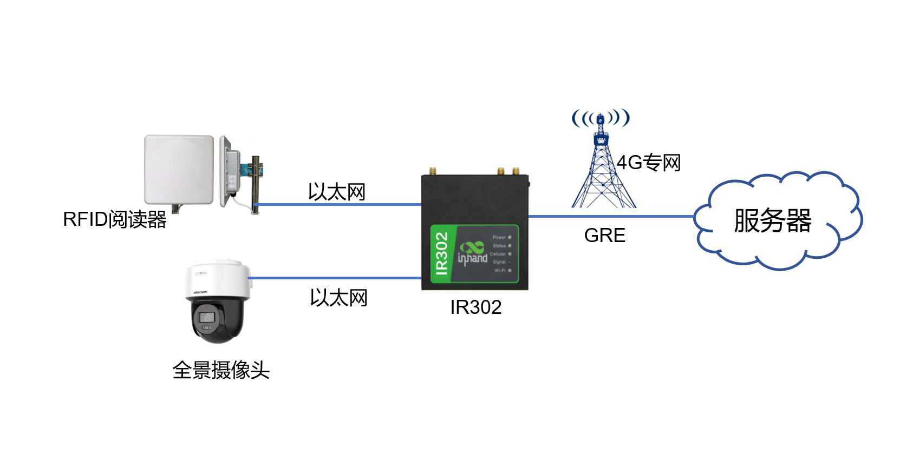

# 阅读器联网解决方案

## 一、方案概述

### 1.1 项目背景

某城投集团阅读器联网项目实质上是指由某城投集团旗下控股子公司主导建设的"新型数字交通物联网大数据服务平台"及其配套的采集系统，其核心是通过在全市大规模部署基于RFID技术的路面读写器（智能终端），构建一个实时采集车辆动态数据的物联网网络。该项目的实施背景既源于某城投集团从传统基建融资平台向"城市建设运营商"转型的战略需求，也契合国家推动智慧城市和车联网发展的政策导向；同时，某市作为国家级车联网先导区，需要依托海量交通数据实现精细化管理、公共安全支撑和应急调度，而大规模读写器联网正是实现数据采集的基础设施。自2018年起，该项目已进行数亿元的设备和工程建设投入，并在2023年启动了中心城区及部分区县的采集点扩建，旨在为城市交通畅通、疫情防控以及未来更广泛的智慧应用提供坚实的数据底座。

### 1.2 建设目标

- 构建覆盖全市的车辆动态数据采集物联网网络，实现海量交通数据的实时汇聚
- 通过大规模读写器联网，支撑智慧城市与国家级车联网先导区建设
- 统一整合多家运营商分散的数千条专线网络，实现集中化管理、提升网络稳定性并降低运维成本
- 为城市交通畅通、公共安全防控及应急调度等场景提供实时数据底座
- 探索数据资产化，形成可持续的大数据运营能力

### 1.3 适用场景

- 停车场出入口车牌识别与车辆数据采集
- 城市道路RFID路面读写器联网
- 车联网大数据采集与智慧交通管理
- 公共安全防控与应急调度数据支撑
- 大规模物联网终端集中联网与远程维护

## 二、需求分析

### 2.1 设备现状

- 设备类型：RFID路面读写器、车牌识别阅读器、全景摄像头
- 通信接口：以太网（LAN口）
- 通信协议：4G LTE、GRE隧道
- 部署环境：停车场出入口、城市道路
- 数量规模：全市大规模部署，涉及数千条专线网络

### 2.2 核心需求

1. **战略转型需求**：某城投集团需从传统基建融资平台向"城市建设运营商"转型，通过该项目拓展市场化业务，形成可持续的大数据运营能力
2. **基础设施与感知网络建设需求**：为支撑某市国家级车联网先导区建设，需在全市大规模部署基于RFID技术的路面读写采集设备，构建覆盖主要道路的车辆实时感知体系
3. **社会治理与公共服务需求**：利用采集的车辆动态数据，为城市交通畅通、公共安全防控及应急管理等场景提供实时数据支撑
4. **数据平台与智慧应用底座需求**：建设统一的大数据服务平台，汇聚、分析多源交通数据，为智慧城市应用提供可靠的数据底座，并探索数据资产化
5. **网络资源整合与统一管理需求**：将此前由多家运营商提供的、分散的数千条专线网络，统一替换、整合为电信运营商的专线服务，以实现集中化管理、提升网络稳定性与维护效率，并通过规模化采购降低成本

## 三、总体架构设计

停车场出入口的车牌识别阅读器及全景摄像头，通过以太网统一接入现场IR302工业路由器。IR302利用4G专网与远程服务器建立GRE隧道，实现二层数据的透明传输，将前端采集的车辆与视频信息，通过该隧道安全、高效地回传至服务器。

### 3.1 四层架构

1. **感知层**：RFID路面读写器、车牌识别阅读器、全景摄像头等前端采集设备
2. **网络层**：映翰通IR302工业路由器，支持4G LTE专网与GRE隧道
3. **平台层**：远程服务器、新型数字交通物联网大数据服务平台
4. **应用层**：车辆动态数据采集、交通精细化管理、公共安全支撑、应急调度

### 3.2 数据流

数据采集流：车牌识别阅读器 / 全景摄像头 → 以太网 → IR302工业路由器（4G专网）→ 远程服务器

远程维护通道：工程师 → GRE隧道 → IR302 → 现场采集设备

## 四、网络与接入方案

### 4.1 联网方式选型

InRouter300（简称IR300）系列产品，是集4G网络、Wi-Fi、虚拟专用网等技术于一体的物联网无线路由器产品。凭借4G无线广域网以及Wi-Fi无线局域网等技术，提供不间断的多种网络接入能力，以其全面的安全性和无线服务等特性，实现多达万级的设备联网，为设备联网提供数据的高速通路。

本方案采用4G专网接入，IR302工业路由器通过GRE隧道与远程服务器建立二层连接，实现前端数据的透明传输。

### 4.2 边缘网关选型要点

**IR302工业路由器特性**：

- 支持4G LTE CAT4高速网络和LTE CAT1低速网络
- 冗余链路设计，双SIM切换，保障设备网络通信不间断
- 高可靠性设计、链路检测设计，链路层检测，检测链路情况，实现掉线自动重拨；保持链路长连接、PPP层检测，维持与运营商网络侧的连接，防止被强行休眠，保持网络的畅通性
- 硬件看门狗，设备故障自愈设计，设备运行故障自修复，保障设备维持高可用性
- 尺寸小巧紧凑，便于安装
- 可以稳定可靠运行，为无人值守现场提供不间断网络
- 支持GRE，实现远程管理部署，按需建立维护通道，掌控现场
- 支持LAN口，便于接入设备与调试
- 高性能，体积小

## 五、协议与数据采集方案

### 5.1 支持协议

- **网络协议**：4G LTE CAT4/CAT1、Wi-Fi、以太网
- **隧道协议**：GRE隧道，支持与服务器建立二层透明连接
- **远程管理**：支持按需建立维护通道，实现远程管理部署

### 5.2 北向协议支持

- 支持GRE隧道与远程服务器建立连接
- 支持二层数据的透明传输，回传车辆与视频信息
- 支持远程管理部署，按需建立维护通道

## 六、方案亮点总结

1. **大规模集中联网能力**：凭借4G无线广域网以及Wi-Fi无线局域网等技术，提供不间断的多种网络接入能力，实现多达万级的设备联网

2. **数据透明回传**：通过GRE隧道实现二层数据的透明传输，将前端采集的车辆与视频信息安全、高效地回传至服务器

3. **网络可靠性**：冗余链路设计，双SIM切换，保障设备网络通信不间断；高可靠性设计、链路检测设计、硬件看门狗、设备故障自愈设计

4. **集中化管理**：将分散的数千条专线网络统一整合，实现集中化管理，提升网络稳定性与维护效率，并通过规模化采购降低成本

5. **远程维护能力**：支持GRE远程管理部署，按需建立维护通道，掌控现场，为无人值守现场提供不间断网络

6. **尺寸优势**：尺寸小巧紧凑，便于安装，高性能、体积小
