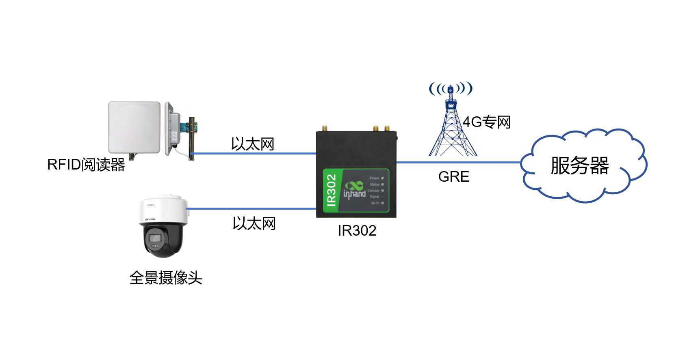
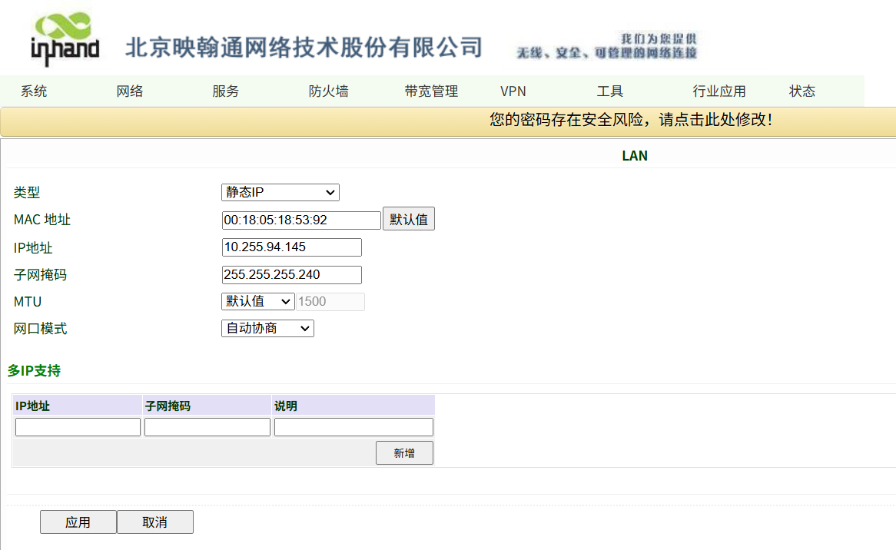
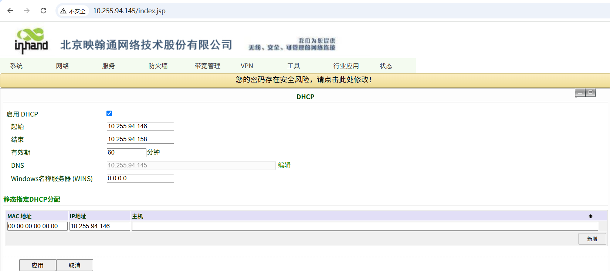
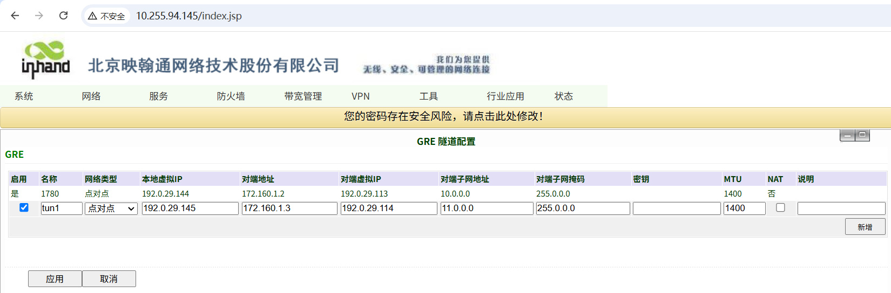
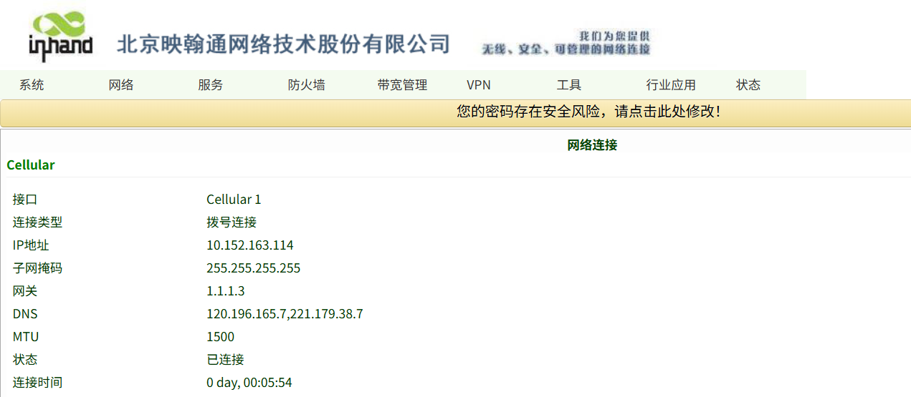
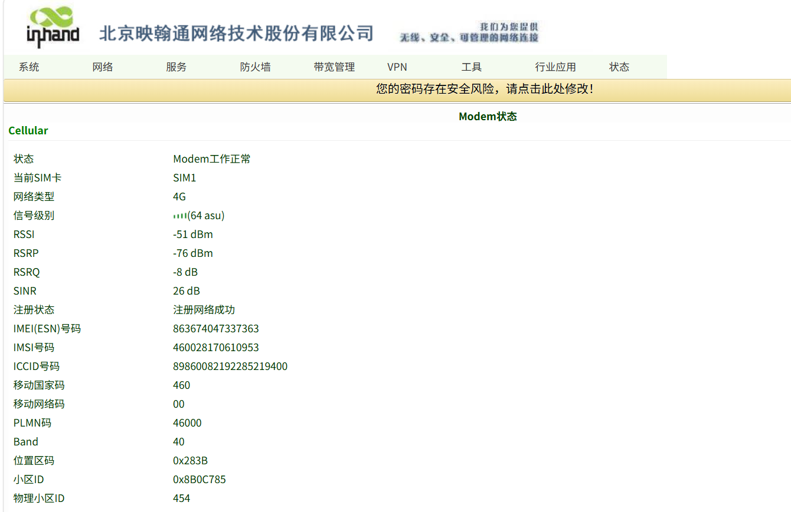

# 阅读器联网方案IR302配置指导手册

## 一、文档信息

| 项目   | 内容          |
| ---- | ----------- |
| 文档名称 | 配置手册        |
| 产品型号 | IR302       |
| 固件版本 | V3.5.96     |
| 适用场景 | 设备联网        |
| 编写日期 | 2026年08月20日 |

## 二、路由器概述

### 2.1 产品简介

- InRouter300系列产品，是集4G网络、Wi-Fi、虚拟专用网等技术于一体的物联网无线路由器产品。凭借 4G 无线广域网以及 Wi-Fi 无线局域网等技术，提供不间断的多种网络接入能力，以其全面的安全性和无线服务等特性，实现多达万级的设备联网，为设备联网提供数据的高速通路。

### 2.2 主要功能

- 4G上网
- 远程配置、远程诊断、远程升级
- 宽温工业级设计

### 2.3 典型应用拓扑

- 阅读器/全景摄像头 → 以太网 → IR302路由器 → 4G /GRE→服务器
  

## 三、硬件说明

### 3.1 外观与接口

- 电源接口：DC 9–36V
- 网口：LAN ×1路+1WAN/LAN
- 无线：4G
- 指示灯：Power、status、cellular、Signal
- 复位键：恢复出厂设置

### 3.2 接线说明

#### 3.2.1 电源接线

- 正极：+
- 负极：-
- 注意：防反接、防雷、接地

#### 3.2.2 以太网接线

- 直连 / 交叉自适应，建议超五类及以上网线。

## 四、出厂默认参数

- 默认 IP：10.255.94.145
- 子网掩码：255.255.255.240
- Web 用户名：adm
- Web 密码：123456

## 五、前期准备

- 电脑设置与网关同网段 IP
- 网线连接电脑与网关 LAN 口
- 路由器上电，等待 Power 灯常亮
- 浏览器输入设备 IP 进入配置页面

## 六、网络配置

### 6.1 本地网络配置

- 插入4G SIM 卡。

- 开启移动网络。

- APN：自动 / 手动填写。

- 信号强度查看。

- LAN口配置。
  

- DHCP功能配置。
  

## 七、配置GRE隧道

## 八、配置备份与恢复

- 导出配置文件
- 恢复出厂配置

## 九、状态监控与诊断

### 9.1 运行状态

- 设备在线状态
  

- 网络流量、信号强度
  

### 9.2 日志查看

- 系统日志

## 十、常见问题与排查

- 无法打开 Web
- 检查网段、网线、IP 是否冲突
- 复位网关重试

## 十一、安全注意事项

- 工业现场可靠接地
- LAN口地址要修改成本地子网的网关
- 配置完成后备份
- 远程密码定期修改
- 禁止非授权人员操作
