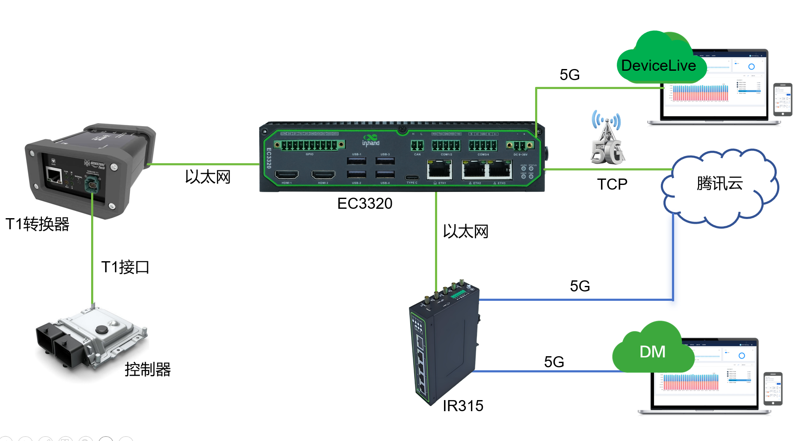

# 智能驾驶数据上云解决方案

## 一、方案概述

### 1.1 项目背景

某汽车推进智能驾驶数据采集与上云，是其落实“科技跃迁”战略、向科技型企业转型的关键举措。该项目旨在构建一个以数据为核心驱动的智能驾驶研发闭环：通过大规模采集真实路况数据并上传云端，与华为、腾讯、中国电信等伙伴共建“车-路-云”一体化平台和强大的算力基础设施，从而加速自动驾驶算法的训练与迭代。其直接目标是攻克高阶自动驾驶技术，并已将成果凝结为规模达400TB的“真实道路驾驶多模态数据集”；长远来看，此举意在将海量数据转化为核心资产，支撑企业在未来的智能化出行竞争中建立技术优势。

### 1.2 建设目标

- 构建以数据为核心驱动的智能驾驶研发闭环，加速自动驾驶算法的训练与迭代
- 攻克高阶自动驾驶技术，形成规模达400TB的“真实道路驾驶多模态数据集”
- 将海量数据转化为核心资产，支撑企业在智能化出行竞争中建立技术优势
- 落实集团数字化转型战略，从传统制造企业向科技型企业转型

### 1.3 适用场景

- 智能驾驶数据采集与云端训练
- “车-路-云”一体化平台建设
- 无人小巴、物流车、清扫车等多元商业场景
- 充电桩、智慧巡检等物联网场景

## 二、需求分析

### 2.1 设备现状

- 设备类型：车辆控制器、T1转以太网转换器、边缘计算终端EC3320、工业路由器IR315
- 通信接口：T1接口、以太网口、5G/4G蜂窝网络
- 部署环境：真实道路车辆、车-路-云一体化平台
- 数据规模：形成规模达400TB的“真实道路驾驶多模态数据集”

### 2.2 核心需求

1. **技术层面需求**：获取海量且高质量的真实道路驾驶数据，支撑自动驾驶算法的训练与迭代。需要构建一套覆盖数据采集、处理、模型训练、仿真测试到OTA升级的完整闭环系统，高效解决长尾场景覆盖不足、实车路测成本高等问题，并在云端完成算法的快速验证与优化
2. **战略与业务层面需求**：落实“东方风起”集团数字化转型战略，从传统制造企业向科技型企业转型。通过积累乘用车数据优势，借助生成式AI等技术手段，将能力快速复制到无人小巴、物流车、清扫车等多元商业场景中，开拓新的业务增长点
3. **基础架构与合规层面需求**：建设统一的“集团一朵云”整合现有分散的数据中心，实现云、边、端的协同计算，确保数据传输和处理的效率。所有数据采集必须获得用户明确授权，并完成严格的脱敏处理，符合国家数据安全法规和隐私保护要求

### 2.3 路由器核心要求

- **高可用连接**：具备可靠性，提供安全、不间断的数据传输链路，确保网络长期稳定运行
- **高速演进与扩展**：支持5G NR高速网络，满足高带宽业务需求；配备LAN接口，便于现场设备接入、调试与运维

## 三、总体架构设计

本方案采用车辆控制器 + T1转以太网转换器 + 边缘计算终端EC3320 + 工业路由器IR315的整体架构，通过5G网络将智能驾驶数据上传至腾讯云，并结合映翰通DeviceLive与Device Manager双平台实现设备统一运维。

### 3.1 方案拓扑

### 3.2 数据采集与传输链路

车辆控制器数据通过其T1接口，经由专用T1转以太网转换器接入边缘计算终端EC3320。EC3320运行自研APP程序进行数据采集，并通过内置5G蜂窝模组以TCP协议将数据上传至腾讯云。

### 3.3 网络冗余增强

为保障传输高可用性，工业级路由器IR315通过5G联网，并以以太网线连接EC3320的ETH1接口，为EC3320提供辅助高速网络通道。两者协同形成双路并发/备份传输机制，显著提升数据上云的可靠性与带宽能力。

### 3.4 设备统一运维

- **DeviceLive平台**：对分散部署的EC3320进行统一管理，支持批量远程升级、流量查询等运维操作
- **Device Manager平台**：对IR315路由器进行集中管控，实现版本升级、流量监控、远程故障诊断与维护等功能

## 四、网络与接入方案

InRouter315（简称IR315）系列产品是一款集成了5G/4G网络、Wi-Fi和虚拟专用网等多种技术的物联网无线路由器，提供简单、可靠和安全的互联网连接。产品设计考虑到无人值守现场通信的要求，采用软硬件看门狗和多级链路检测机制，确保通信的稳定性和可靠性，适用于各种工业和商业物联网应用。

### 4.1 联网方式选型

采用5G NR高速网络接入方式，支持5G/4G蜂窝网络、有线及Wi-Fi多种联网方式，配备双Nano SIM卡槽，实现SIM卡自动切换与链路备份。

### 4.2 边缘网关选型要点

**IR315工业路由器特性**：

- 支持5G/4G蜂窝网络、有线及Wi-Fi多种联网方式，配备双Nano SIM卡槽，可实现SIM卡自动切换与链路备份
- 提供5个百兆以太网口，可选配RS232/RS485串口及I/O接口
- 内置防火墙，支持IPsec/OpenVPN/L2TP等多种VPN协议及访问控制策略
- 全工业级设计，工作温度-20℃~70℃，防护等级IP30，内置看门狗，支持VRRP高可用冗余
- 支持接入映翰通Device Manager云平台，实现远程监控与集中管理
- 可选配2.4GHz Wi-Fi模块，支持AP或STA模式
- 支持9~36V宽压输入，体积小巧，支持DIN导轨安装
- 已通过CE、CB、UKCA等多项国际认证，适用于充电桩、智慧巡检等场景

## 五、协议与数据采集方案

### 5.1 支持协议

- **传输协议**：TCP协议（EC3320通过内置5G蜂窝模组上传数据至腾讯云）
- **网络协议**：5G NR、5G/4G蜂窝网络、Wi-Fi
- **安全协议**：IPsec、OpenVPN、L2TP，内置防火墙及访问控制策略

### 5.2 北向协议支持

- 支持接入映翰通Device Manager云平台，实现远程监控与集中管理
- 支持DeviceLive平台，对分散部署的EC3320进行统一管理

## 六、方案亮点总结

1. **数据驱动研发闭环**：构建覆盖数据采集、处理、模型训练、仿真测试到OTA升级的完整闭环系统，高效解决长尾场景覆盖不足、实车路测成本高等问题

2. **网络高可用**：EC3320与IR315协同形成双路并发/备份传输机制，显著提升数据上云的可靠性与带宽能力

3. **高速联网**：支持5G NR高速网络，满足高带宽业务需求

4. **统一云管理**：DeviceLive与Device Manager双平台协同，实现设备批量远程升级、流量监控、远程故障诊断与维护

5. **安全可靠**：内置防火墙，支持IPsec/OpenVPN/L2TP等多种VPN协议及访问控制策略

6. **工业级设计**：工作温度-20℃~70℃，防护等级IP30，内置看门狗，支持VRRP高可用冗余，已通过CE、CB、UKCA等多项国际认证
