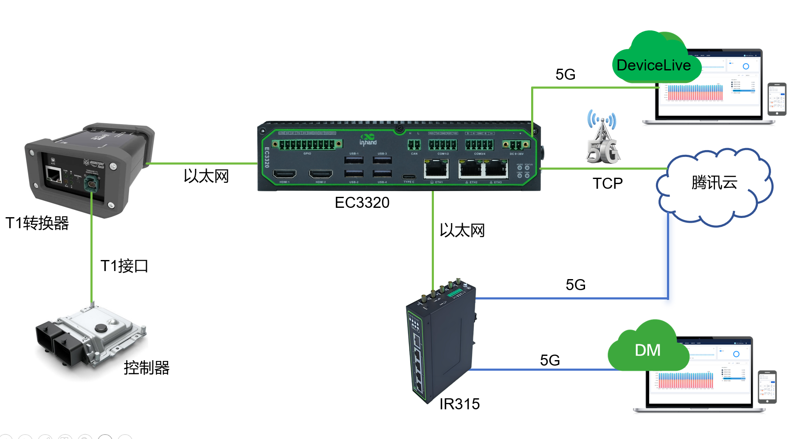
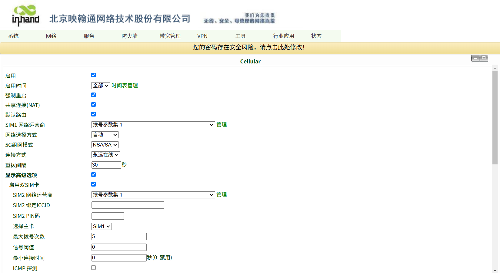
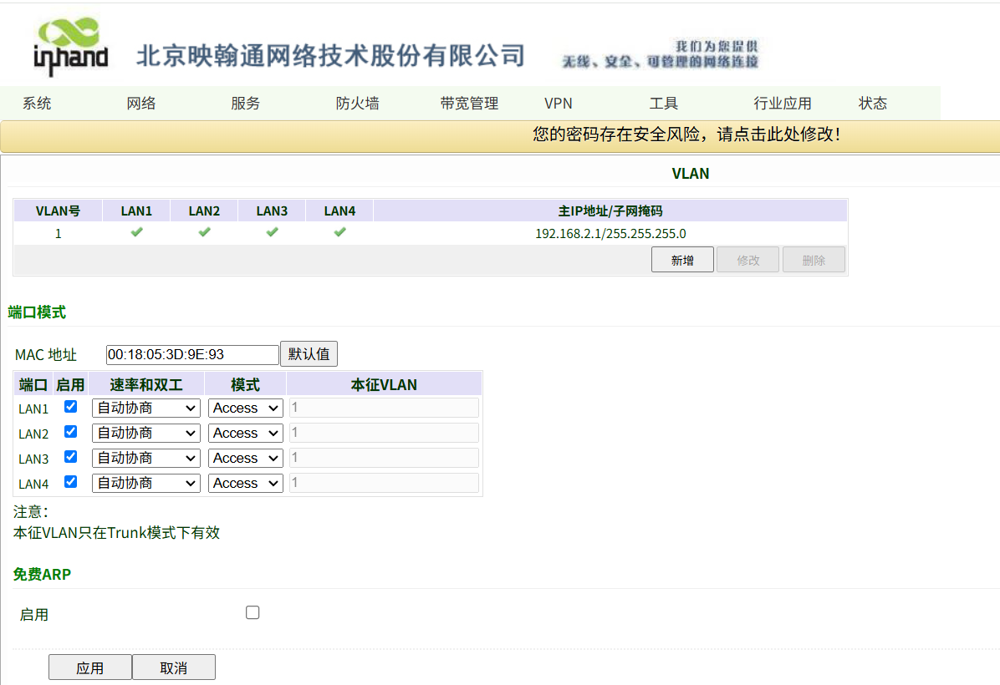
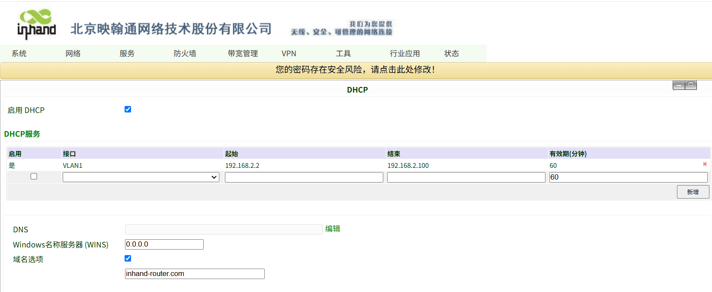
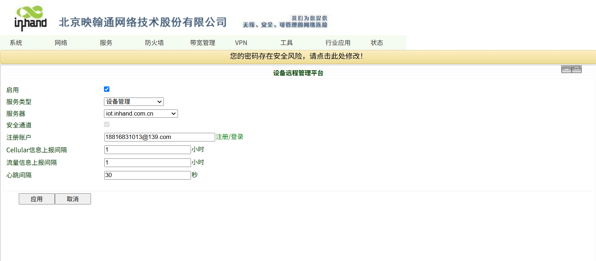
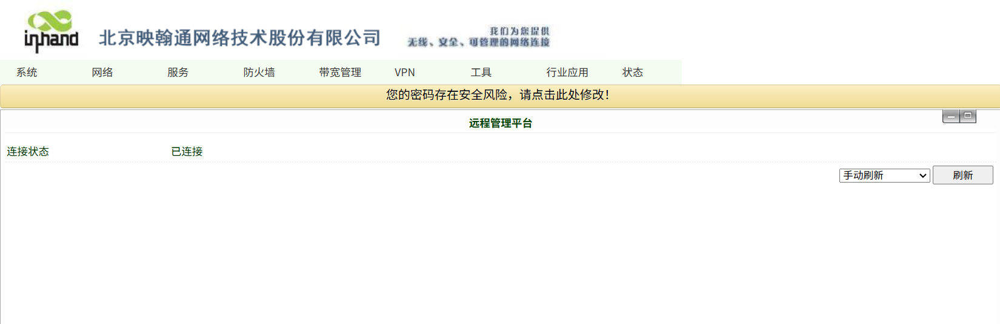
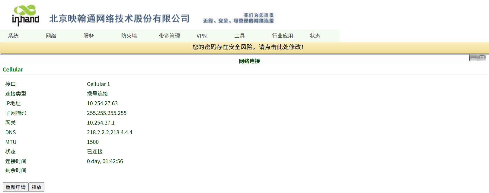
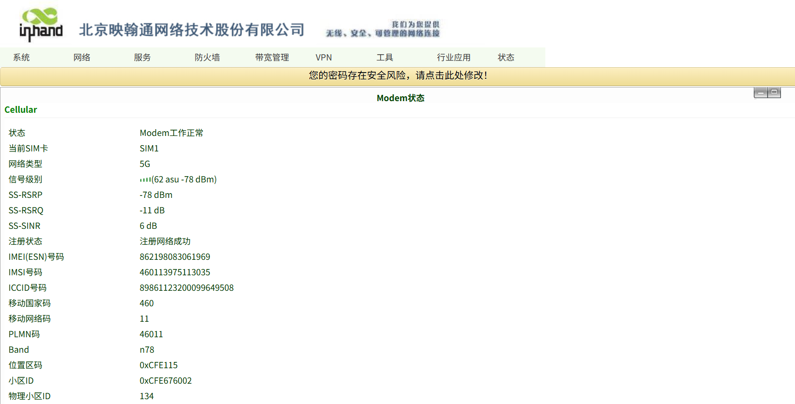

# 智能驾驶数据上云IR315配置指导手册

## 一、文档信息

- 文档名称：配置手册
- 产品型号：IR315
- 固件版本：V1.0.118
- 适用场景：设备联网
- 编写日期：2026年08月20日

## 二、路由器概述

### 2.1 产品简介

InRouter315系列产品是一款集成了5G/4G网络、Wi-Fi和虚拟专用网等多种技术的物联网无线 路由器，提供简单、可靠和安全的互联网连接。产品设计考虑到无人值守现场通信的要求，采用了软硬件看门狗 和多级链路检测机制，以确保通信的稳定性和可靠性。同时，支持映翰通的Device Manager“设备云”管理 平台，使用户能够实现远程智能化设备管理。IR315系列产品适用于各种工业和商业物联网应用，为数字化物联 网提供了高效和可靠的解决方案。

### 2.2 主要功能

- 5G上网
- 远程配置、远程诊断、远程升级
- 宽温工业级设计

### 2.3 典型应用拓扑

车辆控制器→ T1转换器→ EC3320 → 以太网 → IR315路由器 → 5G蜂窝→ 腾讯云

## 三、硬件说明

### 3.1 外观与接口

- 电源接口：DC 9–36V
- 网口：LAN ×4路+1WAN
- 无线：5G
- 指示灯：Power、status、cellular、Signal
- 复位键：恢复出厂设置

### 3.2 接线说明

#### 3.2.1 电源接线

- 正极：+
- 负极：-
- 注意：防反接、防雷、接地

#### 3.2.2 以太网接线

直连 / 交叉自适应，建议超五类及以上网线。

## 四、出厂默认参数

- 默认 IP：192.168.2.1
- 子网掩码：255.255.255.0
- Web 用户名：adm
- Web 密码：123456

## 五、前期准备

- 电脑设置与网关同网段 IP
- 网线连接电脑与网关 LAN 口
- 路由器上电，等待 Power 灯常亮
- 浏览器输入设备 IP 进入配置页面

## 六、网络配置

### 6.1 本地网络配置

- 插入5G SIM 卡。
- 开启移动网络。

- APN：自动 / 手动填写。
- 信号强度查看。
- LAN口配置。

- DHCP功能配置。

## 七、设备远程管理平台配置。

## 八、配置备份与恢复

- 导出配置文件
- 恢复出厂配置

## 九、状态监控与诊断

### 9.1 运行状态

- 设备在线状态

- 网络流量、信号强度

### 9.2 日志查看

- 系统日志

## 十、常见问题与排查

- 无法打开 Web
  - 检查网段、网线、IP 是否冲突
  - 复位网关重试

## 十一、安全注意事项

- 工业现场可靠接地
- LAN口地址要修改成本地子网的网关
- 配置完成后备份
- 远程密码定期修改
- 禁止非授权人员操作
