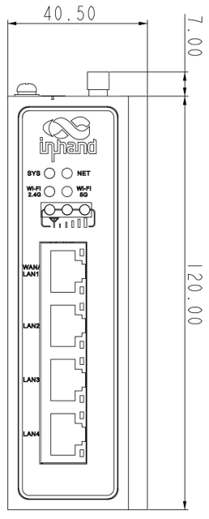
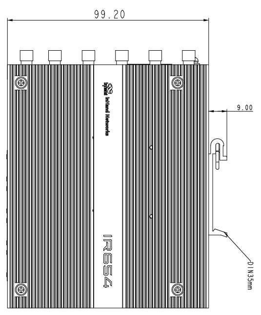
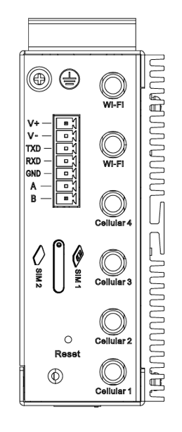

  

    

      
    

    

      5G 高速互联，工业级可靠，安全可管可维
    

  

  

    

      IR654 工业级 5G 路由器
    

    

      

        
· 5G

        
· Wi-Fi 6

      

      

      
· 安全

      
· 云管理

      

    

  

# 1. 产品概述

IR654 系列是映翰通面向工业物联网场景自主研发的高性能 5G 工业级路由器，为电力、能源、交通、制造、医疗等行业的无人值守现场提供高带宽、高可靠的现场网络接入。产品集成 5G 蜂窝、Wi‑Fi 6 双频无线与 4 路千兆以太网口，并配备 RS232/RS485 工业串口，一台设备即可完成现场回传、本地组网与工业设备接入。

针对现场最关注的"业务不能断、现场不用去"两大诉求，IR654 提供有线/蜂窝接口备份、双 SIM 智能切换与回切、链路质量监测（LQM）与硬件看门狗构成的多层自愈机制；机身采用金属无风扇被动散热设计，支持 ‑40~70 ℃ 宽温工作并通过 EN 61000-4 系列 Level 3 电磁兼容抗扰度测试，适应严苛工业环境。设备同时内置 VPN 加密隧道、状态检测防火墙、精细化访问控制与运维审计能力，保障数据在公网传输与本地接入两侧的安全；支持接入 DeviceLive 设备云平台集中运维，也可完全本地独立部署，兼顾分布式远程管理与隔离网络场景。

## 核心特性

- **三网融合通信架构**：支持 5G、Wi‑Fi 6、千兆有线多链路组网能力，覆盖全场景应用。
- **高性能本地接入**：产品提供千兆有线以太网与高速 Wi‑Fi 6 无线网络，承载现场终端稳定接入。
- **持续在线保障**：双 SIM 切换、多 WAN 智能链路切换、心跳检测、硬件看门狗，维持无人值守场景通信连续。
- **精细化流量管控**：支持 QoS 优先级调度，优先保障关键工业业务稳定传输。
- **安全加密组网**：兼容主流 VPN 协议，搭载防火墙与访问控制，实现业务数据加密远程透传。
- **云管云维**：接入映翰通 DeviceLive 云平台，支持批量配置、远程 OTA、故障诊断、告警推送，海量分布式站点统一管控。
- **丰富网络协议栈**：支持 IPv4/IPv6、IP 透传、DDNS 等多种能力，灵活适配多元化工业组网方案。
- **全工况工业设计**：IP30 无风扇金属机身，-40℃~+70℃宽温运行，工业 EMC 防护，支持 DIN 导轨、壁挂安装。

## 典型应用场景

### 智慧能源

- **电力行业**：配网自动化站点、变电站边缘接入、光伏 / 风电电站监控
- **油气行业**：油气管道监测站点、野外阀室数据采集回传

### 智慧交通

- **智慧高速**：ETC 门架通信、路侧单元联网
- **轨道交通**：地铁 PIS 系统、信号设备监控
- **港口场站 / 智能网联车**：场站设备联网、车载视频监控与车辆调度管理

### 工业物联网

- **智能制造**：PLC/CNC 设备联网、MES 数据采集、AGV 调度通信
- **能源行业**：电力配网自动化、光伏电站监控、油气管道监测
- **智慧矿山**：矿井安全监控数据回传、井下设备远程控制

### 智慧医疗

- **医院信息联网**：HIS/PACS 数据加密回传、分院间专网互联
- **远程医疗**：远程会诊、远程手术指导高清视频传输
- **公共卫生**：疾控数据采集上报、应急医疗通信

## 产品尺寸

    
    
正视图

  

  

    
    
侧视图

  

  

    
    
俯视图

  

  

    
<strong>注意事项：</strong>

    
1. 所有尺寸单位为毫米（mm）。

    
2. 所有尺寸为近似值，仅供参考。

    
3. 图纸不得用于生产制造。

    
4. 尺寸可能因部件和制造公差而有所变化。

    
5. 规格如有变更，恕不另行通知。

  

# 2. 产品亮点

## 亮点一：一机多网，设备直连即用

现场设备类型杂、接口各异，往往需要额外配置交换机或协议网关。IR654 把以太网交换、蜂窝回传、无线接入与工业串口集成于一台设备，减少设备数量、供电点与故障源。

- **5G 蜂窝回传**：支持 SA/NSA 双模，3GPP Release 15/16，Sub‑6 GHz。支持 NR/LTE 频段锁定与过滤，在多网干扰或跨区漫游场景中可锁定最优频段，避免频繁重选导致的业务抖动。无有线资源的点位也能快速开通业务，适用于高清视频回传、批量数据同步等带宽密集型业务。
- **Wi‑Fi 6本地接入**：2.4 GHz + 5 GHz 双频并发，合计无线速率 AX3000，最大支持 128 个终端接入，可为巡检终端、PDA、笔记本电脑、无线摄像头等提供现场接入。

- **4 × 10/100/1000 Mbps 自适应以太网口**：每个端口可独立配置为 WAN 或 LAN，支持 Access/Trunk 模式、PVID/VID 与基于端口的 VLAN 划分，具备 1.5 kV 网络隔离变压器保护。既可作为多路 WAN 上行（支持备份与负载均衡），也可直连 PLC、摄像头、工控机等本地设备，并可按业务划分不同网段。
- **1 × RS232 + 1 × RS485 工业串口**：15 kV 静电放电（ESD）防护，支持 DTU 数据透传（TCP/UDP）与 Modbus RTU 转 Modbus TCP 协议转换，可直接接入仪表、传感器、PLC 等串口设备，无需外置协议转换器。
- **入网方式灵活**：支持静态 IP、DHCP、PPPoE 与多 APN（最多 4 组）配置，IPv4/IPv6 双栈，有线、无线、蜂窝按需取用。
- **部署模式可选**：支持 IP 透传（IP Passthrough）与桥接模式，可将蜂窝网络 IP 直接分配给下挂设备，简化下端设备的地址规划。
- **远程调试通道**：支持 AT 指令代理，可通过网络或串口远程向蜂窝模组下发 AT 指令，便于远程排查模组侧问题。

> 核心价值：路由、交换、无线与串口网关集于一台设备，现场少一台设备，就少一个供电点、一根线缆和一个故障点。

## 亮点二：硬件可信安全底座，构建全链路安全闭环

工业设备接入公网后，极易遭受非法入侵、固件篡改与数据泄露风险。IR654 搭载硬件可信安全底座，覆盖数据传输加密、边界防护、接入控制、运维审计等安全环节，从底层保障设备可信、数据安全、操作全程可追溯。

- **传输加密**：支持 IPSec、L2TP、OpenVPN、WireGuard 多种 VPN 隧道，满足分支机构与中心之间的加密互联；管理通道支持 HTTPS / SSH 加密，日志与告警支持远程 Syslog 外发与 SMTP-TLS 加密传输。
- **边界防护**：状态检测防火墙（SPI），支持出入站精细化策略与默认策略（允许 / 拒绝）、SNAT / DNAT 与端口映射、基于 IP / 端口 / 协议的报文过滤、MAC 地址与 URL 域名黑白名单。
- **接入控制**：支持 802.1X 端口接入认证；Wi‑Fi 支持 WPA3-PSK / WPA3-Enterprise；可关闭 WAN 侧 Ping 响应，减少设备在公网的暴露面。
- **设备与运维安全**：HTTP/HTTPS/SSH/Telnet 管理服务可独立开关、自定义端口并绑定可信源 IP；SNMP v3 采用 SHA 认证与 AES 加密，避免网管协议明文泄露；登录、配置变更、链路状态等事件全量记录留存，支持远程 Syslog 集中审计。

> 核心价值：硬件可信打底、数据传输加密、外部非法访问阻断、操作全程审计留痕，单台设备有助于满足工业现场等保与工控安全基线合规要求。

## 亮点三：链路自愈，业务不中断

对无人值守现场而言，业务中断的代价往往远高于带宽不足。IR654 从链路、SIM 卡、整机三个层面构建自愈机制，缩短网络中断时间，减少必须派人到现场的需求。

- **有线与蜂窝互为备份**：千兆有线 WAN 与 5G 蜂窝链路可配置为主备或互备，有线中断自动切换至蜂窝，蜂窝链路异常时自动回切有线，切换过程对下端业务透明；多 WAN 场景支持负载均衡。
- **双 SIM 智能切换与回切**：支持主备卡优先级与拨号超时（默认 120 秒）配置，拨号失败或链路探测失败自动切至备卡；支持按运行时长、已用流量、指定日期三种策略自动回切主卡，既保障业务在线，又避免主卡套餐闲置、备卡流量超支。
- **链路质量监测（LQM）**：可对时延、抖动、丢包率、信号强度分别设置超标阈值与持续周期，支持 ICMP、DNS 解析、TCP 连接三种探测方式。判据是"业务通路是否真的可用"，而不是"拨号是否成功"，因此在链路彻底中断前即可发现质量劣化并提前切换或告警。
- **硬件看门狗（WDT）**：独立于系统软件运行，设备无响应时自动复位，无需人工现场断电重启。
- **断线自动重连**：心跳包保活，链路中断后自动重新拨号建链。

> 核心价值：链路可自动切换、SIM 卡可自动切换、设备可自动恢复，把故障恢复从"等人工到场"缩短为"自动化快速恢复"，同时让双卡流量花得更可控。

## 亮点四：全维度环境耐受，适应恶劣工业环境

现场设备一旦部署，往往数年无人巡检。IR654 从结构、散热、供电到电磁兼容按工业现场要求设计，以最大限度减少现场维护为目标。

- **结构与散热**：金属外壳，无风扇被动散热，整机无机械转动部件，从源头消除风扇失效与积灰导致的宕机风险。
- **环境适应性**：工作温度 ‑40~70 ℃，存储温度 ‑40~85 ℃，相对湿度 5%~95%（无凝露），适应北方户外低温与夏季密闭机柜高温。
- **电磁兼容**：依据 EN 61000-4 系列标准，静电放电、射频电磁场辐射、电快速瞬变脉冲群（EFT）、浪涌（冲击）、射频场感应的传导骚扰、工频磁场、振荡波等抗扰度项目均达到 Level 3 及以上（工频磁场测试场强 400 A/m，水平/垂直），适配变电站、工厂车间等强电磁干扰环境。
- **机械可靠性**：符合 IEC 60068-2-6（振动）、IEC 60068-2-27（冲击）、IEC 60068-2-32（自由跌落，含包装 75 cm、外箱 1 m）。
- **供电与安装**：DC 9~48 V 宽压输入，2-PIN 工业端子，具备防反接与过流保护，适应现场电源波动；防护等级 IP30，支持导轨与壁挂安装。
- **尺寸紧凑**：127 × 108.2 × 40.5 mm，适合机柜内密集部署。

> 核心价值：宽温、无风扇、抗强干扰的工业硬件，面向长期无人值守运行设计，有助于降低硬件故障率与现场维护频次。

## 亮点五：云地双模，运维少跑现场

设备分散在成百上千个点位时，运维成本才是长期投入的大头。IR654 同时支持云端集中运维与本地独立运维，一套软件能力适配两类项目形态。

- **集中运维**：接入 InHand DeviceLive 设备云平台，支持设备状态监控、批量配置下发、远程固件升级、流量与信号统计；设备侧 MQTT keepalive 与云连接出接口可配置，适应不同上行链路条件。
- **远程诊断**：支持远程 Ping、Traceroute、抓包与 Iperf 测速，网络问题可远程定位、远程取证，减少现场出差。
- **告警通知**：链路状态变化、信号异常、设备重启等事件可通过 SMTP 邮件（TLS 加密）通知多个接收人，并支持按 SIM 卡设置月度流量阈值告警。
- **权限与审计**：云平台侧支持多角色分级权限管理，操作日志全程留痕。
- **本地独立部署**：不依赖任何云平台，通过 Web（HTTPS）与 CLI（SSH/Telnet）即可完成全部配置管理，满足隔离网络、数据本地留存等不允许上云的项目要求。

> 核心价值：分布广的设备在云端批量管，不允许上云的设备本地也能管；把大量"必须到现场"的运维工作变成远程处理，有效降低运维成本。

# 3. 硬件规格

| 项目 | 规格 |
| ------------- | --------------------------------------- |
| **处理器** | 四核 RISC-V@1GHz |
| **内存** | 256MB DDR3 |
| **存储** | 128 MB SPI NAND Flash |
| **5G 模组** | 5G NR 模组，3GPP Release 15/16 |
| **SIM 卡槽** | 抽屉式卡座，支持2 × Nano-SIM |
| **以太网端口** | 4 × 10/100/1000 Mbps RJ45 独立管理交换端口，支持 WAN/LAN/VLAN，1.5KV 网络隔离变压保护；每端口独立配置速率（Auto/10/100/1000）、模式（Access/Trunk）、PVID/VID |
| **串口** | 1 × RS232 + 1 × RS485（静电放电防护 15KV）|
| **Wi-Fi** | Wi‑Fi 6 (802.11ax)，双频 AX3000，2.4 GHz 20 dBm / 5 GHz 20 dBm |
| **蜂窝天线** | 4 × SMA 接头（5G 蜂窝天线） |
| **Wi‑Fi 天线** | 2 × RP-SMA 接头 |
| **供电** | DC 9~48V，2-PIN 工业端子，防过流、防反接 |
| **功耗** | 待机：370~480 mA @ 12 V；典型工作：415~530 mA @ 12 V；峰值：530 mA @ 12 V（具体视配置与负载而定） |
| **复位按钮** | 1 × 针孔式复位按键 |
| **接地端子** | 支持 |
| **LED指示灯** | SYS（系统状态）x1、NET（联网状态）x1、2.4 GHz Wi-Fi x1、5 GHz Wi-Fi x1、信号强度指示灯 x3 |
| **散热** | 金属外壳无风扇被动散热 |
| **防护等级** | IP30 |
| **外壳材质** | 金属机身 |
| **颜色** | 黑色 |
| **尺寸（W × D × H）** | 127 × 108.2 × 40.5 mm |
| **重量** | 约 550 g |
| **安装方式** | 导轨安装、壁挂安装 |
| **工作温度** | -40 ~ 70 ℃ |
| **存储温度** | -40 ~ 85 ℃ |
| **相对湿度** | 5% ~ 95%（无凝露）|

# 4. 网络连接

## 4.1 5G/4G 蜂窝网络

- **网络制式：**
  - 5G：NR SA/NSA，Sub-6 GHz，3GPP Release 15/16
  - 4G：LTE FDD / LTE TDD
  - 3G：WCDMA
- **高级蜂窝功能：**
  - **5G 模式选择**：支持 SA/NSA/SA-NSA 双模切换
  - **频段锁定**：支持 LTE 和 NR 频段手动锁定与过滤
  - **多 APN 配置**：支持 4 个独立 APN 配置文件，分别配置接入点、认证（auto/PAP/CHAP）、用户名/密码
  - **PDP 类型**：IPv4/IPv6 可选
  - **SIM 卡 PIN 码**：支持 SIM 卡 PIN 码保护
  - **IMS 配置**：支持 VoLTE IMS 开启/关闭
  - **连接模式**：always-online（始终在线）
  - **流量套餐管理**：支持 SIM1/SIM2 分别配置月度流量套餐阈值告警（GB 级可配），超限策略支持告警通知

## 4.2 SIM 卡管理

- **双 SIM 卡设计**：2 × Nano-SIM 抽屉式卡座
- **智能切换：**
  - 拨号失败自动切换
  - 链路探测失败自动切换
  - 可配置切换策略
- **双卡策略备份（Dual SIM Backup）：**
  - 支持指定主卡，主/备卡优先级可调
  - 拨号超时时长可配置（默认 120 秒）
  - **基于时长的回切策略**：备卡运行指定时长后回切主卡
  - **基于流量的回切策略**：备卡运行消耗指定流量后回切主卡
  - **回切日期可配置**：按天周期回切

## 4.3 有线网络

- **WAN 口**：4 × 1 Gbps RJ45，支持 WAN/LAN 可配；每个端口独立配置速率（Auto/10/100/1000/2500）、模式（Access/Trunk）、PVID/VID
- **VLAN 支持**：基于端口的 VLAN 划分，支持 Access/Trunk 端口模式
- **IPv6 支持**：完整 IPv6 功能
- **多 WAN 链路管理**：支持多 WAN 接口备份与负载均衡

## 4.4 Wi-Fi 6 无线接入

- **标准**：IEEE 802.11ax (Wi‑Fi 6)，向下兼容 802.11a/b/g/n/ac/ac Wave2
- **频段**：2.4 GHz + 5 GHz 双频并发
- **无线规格**：AX3000（2.4 GHz + 5 GHz 聚合速率）
- **最大连接终端数**：128
- **工作模式**：AP / Client，支持 Wi‑Fi Portal
- **安全**：WPA3-PSK / WPA2-PSK / WPA3-Enterprise / WPA2-Enterprise
- **漫游**：支持 802.11k/v/r 快速漫游

# 5. 链路管理与备份

## 5.1 智能链路备份

- **备份模式**：主备模式、接口备份
- **探测方式**：心跳包检测，断线自动重连
- **切换策略**：
  - 链路故障时自动切换
  - 双 SIM 链路自动切换

## 5.2 链路质量监控

- **实时监控**：实时显示链路状态、时延、抖动、丢包率和吞吐率
- **蜂窝信号监控**：实时查看 RSRP、RSRQ、RSSI、SINR 等关键信号指标
- **健康检查**：自动化链路健康评估
- **告警通知**：链路异常即时邮件告警
- **链路质量检测**（Link Quality Monitor）：支持告警阈值配置，链路异常时可触发邮件告警
  - **时延检测**：时延超标阈值及持续周期可配置
  - **抖动检测**：抖动超标阈值及持续周期可配置
  - **丢包率检测**：丢包率超标阈值及持续周期可配置
  - **信号强度检测**：信号强度超标阈值及持续周期可配置
  - **检测模式**：支持 ICMP、DNS 解析、TCP 连接三种链路检测模式

# 6. 安全特性

## 6.1 防火墙

- **状态检测**：基于连接状态的数据包检测
- **入站规则**：精细化入站访问控制，支持默认策略（允许/拒绝）
- **出站规则**：出站流量策略管理，支持默认策略（允许/拒绝）
- **端口转发**：端口映射和 NAT 穿透支持
- **NAT**：网络地址转换（NAT），支持 SNAT/DNAT，支持 NAT 规则自定义
- **MAC 过滤**：基于 MAC 地址的访问控制（黑/白名单模式）
- **域名过滤**：基于域名的 URL 级别访问控制（黑/白名单模式）
- **协议过滤**：基于 IP/端口/协议过滤
- **802.1X**：基于端口的网络访问控制

## 6.2 VPN 支持

- IPSec VPN
- L2TP VPN
- OpenVPN
- WireGuard VPN

## 6.3 设备访问与运维安全

- **管理服务加固**：HTTP/HTTPS/SSH/Telnet 各自独立启用/关闭，端口可自定义，支持绑定受信任源 IP 地址
- **攻击面收敛**：支持 WAN 侧 Ping 响应开启/关闭
- **网管协议安全**：SNMP v3 支持 SHA/MD5 认证与 AES/DES 加密
- **运维审计**：支持远程 Syslog 日志外发，SMTP-TLS 加密邮件告警；登录、配置变更、链路状态等事件全量记录留存
- **定时重启**：支持按从不/每天/每周/每月策略定时重启设备，主动规避长期运行隐患

# 7. 本地网络服务

## 7.1 接口管理

- **接口配置**：支持端口模式切换（WAN/LAN）、VLAN 配置
- **接口状态**：实时显示 UP/DOWN 状态

## 7.2 WAN 接入

- **接入协议**：静态 IP、DHCP、PPPoE
- **接入认证**：APN、VPDN、CHAP/PAP

## 7.3 DHCP 服务

- **DHCP 服务器**：多地址池配置
- **DHCP 中继**：跨子网 DHCP 服务
- **租约管理**：灵活的 IP 租约配置

## 7.4 DNS 服务

- **DNS 代理**：本地 DNS 缓存和转发
- **DDNS**：支持动态域名解析
- **自定义 DNS**：多 DNS 服务器配置

## 7.5 静态地址分配

- **IP-MAC 绑定**：静态地址分配
- **冲突检测**：自动 IP 地址冲突检测

## 7.6 流量整形

- **带宽限制**：接口级带宽控制
- **流量整形**：基于队列的精细化流量管理
- **QoS 保证**：关键业务流量优先保障

## 7.7 路由协议

- **静态路由**：多条静态路由配置，灵活的路由优先级设置
- **动态路由**：支持 BGP、OSPF 动态路由协议

## 7.8 策略路由

- **智能流量引导**：基于源/目的地址、端口和协议的策略路由
- **强制路由**：指定流量强制走特定出接口

## 7.9 IP 透传 (IP Passthrough)

- **桥接模式**：蜂窝网络 IP 透传
- **灵活配置**：支持多种透传模式

## 7.10 IP 应用

TCP、UDP、IPv4/IPv6、ICMP、NTP、DNS、HTTP/HTTPS、SSL/TLS、PPP、SSH、Telnet

## 7.11 DTU / 协议转换

- **DTU 功能**：支持 TCP/UDP 透明传输
  - 支持长连接/短连接模式，心跳保活、断线重连
  - 并发服务器连接，数据缓冲区与拆包策略可配
  - 本地 IP 绑定、设备标识
- **协议转换**：支持 Modbus RTU 转 Modbus TCP，满足工业自动化设备联网需求
  - 支持 Modbus 网关 Server/Client 模式
  - 本地端口可配，传输间隔与超时时长可配置

## 7.12 AT 指令代理（AT Agent）

- **AT Server**：通过 TCP 网络远程发送 AT 指令给蜂窝模组，端口与空闲超时可配
- **AT 透传**：通过串口（RS232/RS485）直接发送 AT 指令给蜂窝模组，串口参数可配置

## 7.13 访客网络（Guest Network）

- **独立访客 VLAN**：与主网络逻辑隔离
- **上行链路策略**：访客流量可指定出接口（任意/指定接口）
- **接入时长控制**：访客网络接入时长可配置

# 8. 云端管理与运维

IR654 由 InHand DeviceLive 云管理平台驱动，实现设备全生命周期远程管理。

## 8.1 集中管理能力

- **设备监控**：实时监控设备状态，仪表盘展示设备信息、接口状态、精细化流量统计
- **远程配置**：通过云端远程配置网络参数，批量部署
- **固件升级**：远程批量固件升级，降低人为错误风险
- **故障诊断**：远程运行诊断命令，即时获取结果
- **告警管理**：链路告警、信号告警等异常事件记录与通知
- **MQTT 连接**：设备端 MQTT keepalive 可配置，支持指定云连接出接口

## 8.2 远程维护工具

- **状态查询**：仪表盘-设备信息、接口状态、精细化流量统计
- **链路监控**：链路时延、抖动、丢包、吞吐率监控
- **信号监控**：实时查看蜂窝信号强度、RSSI、RSRP、RSRQ、SINR
- **远程诊断**：Ping、Traceroute、抓包、测速

## 8.3 邮件告警

- **SMTP 邮件告警**：支持配置 SMTP 服务器，TLS 加密传输
- **多接收人**：支持多个告警接收邮箱
- **告警事件**：链路状态变化、信号异常、设备重启等事件邮件通知

# 9. 系统管理与维护

## 9.1 设备管理

- **Web 管理**：直观的 Web 配置界面（HTTPS 本地/远程访问）
- **CLI 管理**：命令行配置（SSH/Telnet 远程访问）
- **管理访问控制**：HTTP/HTTPS/SSH/Telnet 各自独立启用、端口可配、支持绑定受信任源 IP 地址
- **Ping 响应控制**：支持 WAN 侧 Ping 响应开启/关闭
- **配置导入/导出**：配置文件备份和恢复
- **恢复出厂设置**：通过复位按键一键恢复
- **固件升级**：Web / 云端多模式升级
- **定时重启（Schedule Reboot）**：支持按从不/每天/每周/每月策略定时重启设备
- **Web 会话超时**：Web 管理会话超时时长可配置

## 9.2 日志与诊断

- **系统日志**：详细的系统运行日志和诊断日志，支持本地查看
- **远程 Syslog**：支持将系统日志发送至远程 Syslog 服务器（支持配置 2 个独立服务器地址及端口 514）
- **事件记录**：设备事件（登录、连接、重启等）记录与查询
- **诊断工具**：Ping、Traceroute、网络抓包、Iperf 测速

## 9.3 告警管理

- **告警类型**：链路告警、信号告警等
- **告警通知**：邮件告警通知

## 9.4 SNMP 网络管理

- **SNMP v1/v2c**：支持只读/读写 Community 配置
- **SNMP v3**：支持用户级认证与加密，认证协议 SHA/MD5，加密协议 AES/DES

## 9.5 系统特性

- **工作模式**：支持路由模式（Routing）与桥接模式（Bridge）切换
- **SFE 快速转发**：硬件快速转发加速引擎，提升 NAT 转发性能
- **SIP ALG**：SIP 应用层网关，确保 VoIP 语音流量穿越 NAT
- **环路检测**：自动检测网络环路，防止广播风暴
- **NTP 服务**：支持 NTP 时间同步，可配置多个 NTP 服务器地址

## 9.6 可靠性保障

- **硬件看门狗**：内嵌硬件看门狗，运行故障自修复
- **双卡切换**：双 SIM 链路故障自动切换
- **接口备份**：有线/蜂窝接口相互备份
- **断线重连**：心跳包检测，断线自动重连

# 10. 订购信息

## 10.1 型号说明

**Model code:** IR654-\<WMNN\>-\<WLAN/NA\>-\<S/IO\>-\<G/NA\>

- \<WMNN\>：无线通讯类型（取值见 10.2 频段说明）
- \<WLAN/NA\>：WLAN 表示支持 Wi‑Fi 6（AX3000），NA 表示不支持 Wi‑Fi
- \<S\>：S 表示支持串口（1 × RS232 + 1 × RS485）
- \<G/NA\>：G 表示支持 GNSS，NA 表示不支持 GNSS

## 10.2 频段说明

| WMNN | 区域 | 蜂窝制式与频段 | 最大传输速率 |
| -------- | ----------- | -------------- | -------------- |
| CNNR | 中国 | 5G SA/NSA：n1/n3/n5/n8/n28A/n41/n77/n78/n79 LTE FDD：B1/B3/B5/B8 LTE TDD：B34/B38/B39/B40/B41 WCDMA：B1/B5/B8 | SA：DL 2 Gbps / UL 1 Gbps NSA：DL 2.2 Gbps / UL 575 Mbps LTE：DL 600 Mbps / UL 150 Mbps |

> 注：表中速率为理论峰值速率，实际速率受运营商网络、信号覆盖与套餐限制；标 \* 频段的支持情况以最终认证结果为准。

## 10.3 标准型号列表

| 型号              | 蜂窝 | Wi-Fi | 串口 |
| ----------------- | ---- | ----- | ---- |
| IR654-CNNR-S      | ✓    | ✗     | ✓    |
| IR654-CNNR-WLAN-S | ✓    | ✓     | ✓    |

## 10.4 包装清单

- IR654 路由器 × 1
- 12 V / 2 A 电源适配器 × 1（插头类型按目标市场配置）
- 1.5 m RJ45 网线 × 1
- 取卡针 x 1
- 天线（按型号附带）

# 11. 可靠性标准与认证

## 11.1 防护等级

- **IP 等级**：IP30

## 11.2 机械可靠性

- **振动**：整机振动测试；符合 IEC 60068-2-6
- **冲击**：符合 IEC 60068-2-27
- **自由跌落**：含包装 75 cm；外箱 1 m；符合 IEC 60068-2-32

## 11.3 EMC 电磁兼容

| 标准 | 等级 | 测试项目 |
|------|------|----------|
| EN 61000-4-2 | Level 3 | 静电放电抗扰度 |
| EN 61000-4-3 | Level 3 | 射频电磁场辐射抗扰度 |
| EN 61000-4-4 | Level 3 | 电快速瞬变脉冲群（EFT）抗扰度 |
| EN 61000-4-5 | Level 3 | 浪涌（冲击）抗扰度 |
| EN 61000-4-6 | Level 3 | 射频场感应的传导骚扰抗扰度 |
| EN 61000-4-8 | 400 A/m | 工频磁场抗扰度（水平 / 垂直）|
| EN 61000-4-12 | Level 3 | 振荡波抗扰度 |

## 11.4 认证与合规

| 认证类型 | 规格 |
|----------|------|
| **合规认证** | SRRC\*、CTA\* |
| **环保认证** | RoHS / REACH |

注：*表示进行中。

# 12. 技术支持

- **官网**：[映翰通官网](https://www.inhand.com.cn)
- **版权声明**：©映翰通网络 保留所有权利
