# InDTU311系列产品用户手册V4.2

InDTU311系列

用户手册

声明

首先非常感谢您选择本公司产品！在使用前，请您仔细阅读本用户手册。

非本公司书面许可，任何单位和个人不得擅自摘抄、复制本书内容的部分或全部，并不得以任何形式传播。

由于不断更新，本公司不能承诺该资料与实际产品一致， 同时也不承担由于实际技术参数与本资料不符所导致的任何争议，任何改动恕不提前通知。本公司保留最终更改权和解释权。

版权所有©2019北京映翰通网络技术股份有限公司及其许可者版权所有，保留一切权利。

本手册图形界面约定

| **格 式** | **意 义** |
| --- | --- |
| > | “   ”表示按钮名，如“单击确定按钮”。 |
| “” | 带双引号“”表示窗口名、菜单名，如：弹出“新建用户”窗口。 |
| >> | 多级菜单用“>>”隔开。如“文件>>新建>>文件夹”多级菜单表示“文件”菜单下的“新建”子菜单下的“文件夹”菜单项。 |
|  | 提醒操作中应注意的事项，不当的操作可能会导致数据丢失或者设备损坏。 |
|  | 对操作内容的描述进行必要的补充和说明。 |

## 技术支持

**北京映翰通网络技术股份有限公司（总部）**

电话：010-8417 0010

地址：北京市朝阳区紫月路18号院3号楼5层

**成都办事处**

电话：028-8679 8244

地址：四川省成都市武侯区天府大道北段1777号中国太平金融大厦14层

**广州办事处**

电话：020-8562 9571

地址：广州市天河区黄埔大道中660号汇金国际金融中心B栋1913单元

**武汉办事处**

电话：027-8716 3566

地址：武汉市洪山区关山大道465号光谷新发展国际中心B座5层

**上海办事处**

电话：021-5480 8501

地址：上海市普陀区国浩长风城北座326室

目 录

[1 产品简介 1](#_Toc14189315)

[1.1 系统应用 1](#_Toc14189316)

[1.2 功能说明 2](#_Toc14189317)

[1.2.1 硬件系统 2](#_Toc14189318)

[1.2.2 软件功能 2](#_Toc14189319)

[2 设备安装上电 6](#_Toc14189320)

[2.1 设备安装 6](#_Toc14189321)

[2.1.1 适用于InDTU312/332设备 6](#_Toc14189322)

[2.1.2 适用于InDTU311/331设备 8](#_Toc14189323)

[2.1.3 适用于InDTU323设备 9](#_Toc14189324)

[2.1.4 适用于InDTU314/317设备 10](#_Toc14189325)

[2.1.5 适用于InDTU324和InDTU325设备 12](#_Toc14189326)

[2.2 指示灯说明 16](#_Toc14189327)

[2.2.1 InDTU3XX_STD_V1.4.3之前版本（不含本版本） 16](#_Toc14189328)

[2.2.2 InDTU3XX_STD_V1.4.3之后版本（包含本版本） 16](#_Toc14189329)

[2.2.3 InDTU324指示灯定义 17](#_Toc14189330)

[2.2.4 InDTU 325LH09/325GS52指示灯定义 17](#_Toc14189331)

[3 维护功能 18](#_Toc14189332)

[3.1 实时日志 18](#_Toc14189333)

[3.2 历史日志 20](#_Toc14189334)

[3.3 固件升级 21](#_Toc14189335)

[4 参数配置 22](#_Toc14189336)

[4.1 本地串口/本地串口2设置 22](#_Toc14189337)

[4.2 DTU工作模式设置 23](#_Toc14189338)

[4.3 GPRS拨号参数设置 24](#_Toc14189339)

[4.4 企业网关相关设置 26](#_Toc14189340)

[4.5 多IP数据中心设置 27](#_Toc14189341)

[4.6 多连接策略 27](#_Toc14189342)

[4.7 其他配置（应用扩展配置） 27](#_Toc14189343)

[4.8 网管平台相关设置 28](#_Toc14189344)

[4.9 管理员登陆设置 28](#_Toc14189345)

[4.10 ICMP参数设置 29](#_Toc14189346)

[4.11 自定义帧 30](#_Toc14189347)

[4.12 支撑平台相关设置 30](#_Toc14189348)

[5 常用参数配置及应用举例 31](#_Toc14189349)

[5.1 设备联网配置 31](#_Toc14189350)

[5.2 DC模式协议配置 34](#_Toc14189351)

[5.2.1 DCTCP模式 34](#_Toc14189352)

[5.2.2 DCUDP模式 41](#_Toc14189353)

[5.3 透明TCP协议配置 44](#_Toc14189354)

[5.3.1 参数配置 44](#_Toc14189355)

[5.3.2 演示举例 47](#_Toc14189356)

[5.4 TCP SERVER配置 51](#_Toc14189357)

[5.4.1 参数配置 51](#_Toc14189358)

[5.4.2 演示举例 54](#_Toc14189359)

[**5.5** 南网协议 57](#_Toc14189360)

[5.6 Modbus-Net-Bridge配置 59](#_Toc14189361)

[5.6.1 参数配置 59](#_Toc14189362)

[5.6.2 演示举例 64](#_Toc14189363)

[5.7 101探测 68](#_Toc14189364)

[5.8 101转104配置 71](#_Toc14189365)

[5.8.1 DTU参数配置 71](#_Toc14189366)

[5.8.2 101从站的配置：DTU做101的主站 73](#_Toc14189367)

[5.8.3 104主站的配置：DTU做104的从站 75](#_Toc14189368)

[5.9 串口2输出日志配置方法 78](#_Toc14189369)

[5.10 导入/导出配置 80](#_Toc14189370)

[5.11 自定义帧配置 81](#_Toc14189371)

[5.12 双卡切换功能举例 82](#_Toc14189372)

[5.13 链路维持功能举例 87](#_Toc14189373)

[5.14 长短信应用举例 89](#_Toc14189374)

[6 国网加密 91](#_Toc14189375)

[6.1 简介 91](#_Toc14189376)

[6.2 终端证书申请步骤（仅做了解） 91](#_Toc14189377)

[**6.3** 导出证书请求文件 92](#_Toc14189378)

[6.3.1 接线 92](#_Toc14189379)

[6.3.2 InDTU配置工具配置步骤 92](#_Toc14189380)

[6.3.3 导出证书申请文件 94](#_Toc14189381)

[7 工具设置 101](#_Toc14189382)

[7.1 添加GPRSDEMO 101](#_Toc14189383)

[附录 102](#_Toc14189384)

[DTU工作模式 102](#_Toc14189385)

[抓取DTU日志 103](#_Toc14189386)

[常见故障处理 107](#_Toc14189387)

## 1 产品简介

### 1.1 系统应用

本手册内容是以个别产品为例进行说明的，具体情况请以实物为准。

InDTU300系列产品以无线蜂窝网络作为承载网完成远程数据采集和传输，从而实现工业领域的远程监控。映翰通公司提供一套完备的解决方案，使用户以最小的投入，获得极高的生产运行效率。其典型组网方式如图1-1所示。

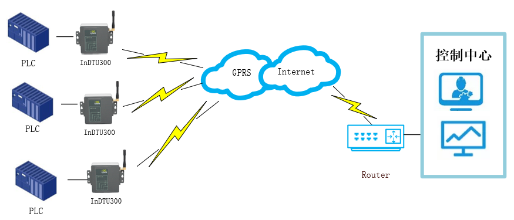

图 1‑1 InDTU300组网方式

### 1.2 功能说明

### 1.2.1 硬件系统

InDTU300产品是基于无线蜂窝网的数据通信系统。该系统中的硬件InDTU300集成了一个无线通讯模组，支持GSM/LTE/WCDMA/TDSCDMA网络制式。InDTU300基于高性能微处理器设计，集成无线模块以实现无线通信功能。提供多种工业化总线标准的支持，具备良好的可扩展性，该产品广泛应用于远程/现场数据采集、远程监控、现场控制等多种领域。

主要特点如下：

- 采用精巧外形、快速安装设计；
- 防潮、抗干扰设计；
- 适应工业需求,宽电压范围+5~35VDC；
- 工业级温度范围：-40℃～+70℃；

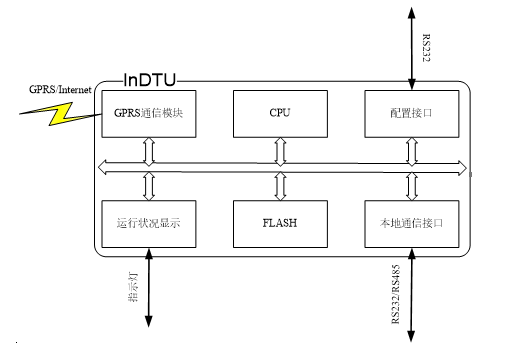

图 1‑2 InDTU硬件架构

### 1.2.2 软件功能

InDTU300系列产品，实现了远程控制站串口设备与中心控制系统间的无线数据通信，其主要功能如下介绍。

**表 1‑1 基本功能**

| **功能名称** | **功能说明** |
| --- | --- |
| GPRS网络 | 支持无线蜂窝网络 |
| 串口配置 | 通过外部串口可进行配置 |
| 运行状态指示 | LED显示运行状态 |
| 安装方式 | 桌面或壁挂安装 |
| 无线DDN支持 | 支持中国移动的无线DDN业务；支持电信/联通的VPDN业务 |
| 数据透明传输 | 将应用数据通明双向传输 |
| 协议转换功能 | DC、MODBUS bridge自定义UDP协议 |
| 长连接模式 | 可实时连接应用服务器 |
| 短连接模式 | 可根据配置激活策略实现短连接应用服务器模式 |
| 本地数据激活 | 在短连接模式下，当InDTU300处于休眠状态时，通过本地数据发送激活联网 |
| 电话激活 | 在短连接模式下，当InDTU300处于休眠状态时，通过电话呼入激活联网 |
| 短信激活 | 在短连接模式下，InDTU300处于休眠状态，通过接收短信激活联网 |
| 定时激活/定时下线 | 通过设置定时激活InDTU300联网或下线 |
| 日志功能 | 可通过配置，打开日志开关，从串口输出日志，方便工程人员观察运行状态 |
| 多串口通信速率 | 支持波特率：1200~115200bps不支持300/600/5600bps。 |
| RS 232/485 | 支持RS 232/485通信，型号不同接口不同 |
| 软件看门狗功能 | 看门狗机制防止InDTU300死机 |
| 用户分级认证 | 支持管理员和普通用户两级用户。管理员缺省用户名/密码：adm/123456；普通用户名/密码：guest/123456 |
| 实时时钟 | 断电后，内部使用超级电容给RTC供电，设备系统时间不丢失(需供电2小时以上，否则设置将恢复为默认时间) 。仅部分产品有此功能 |
| 恢复出厂设置 | 擦除现有配置，写入默认配置。通过配置程序实现 |

**表 1‑2 网络功能**

| **功能名称** | **功能说明** |
| --- | --- |
| PPP协议支持 | 点对点拨号协议 |
| CHAP认证 | 认证方式 |
| PAP认证 | 认证方式 |
| 自动认证方式 | 轮流使用PAP和CHAP认证方式来拨号。 上电第一次使用pap认证，如果拨号失败，再次拨号时就使用chap认证，再下一次拨号又使用pap认证，以此类推。 |
| PPP层心跳 | 可侦测PPP链接的稳定性 |
| ICMP探测 | 维持与运营商网络侧的连接 |
| TCP层心跳 | 在TCP层实现对应用服务器的连接侦测 |
| 应用层心跳 | 通过应用层的心跳可实现对应用服务器的连接侦测 |

**表 1‑3 高级功能**

| **功能名称** | **功能说明** |
| --- | --- |
| 升级功能 | 通过本地串口进行升级 |
| 配置导入/导出功能 | 可将InDTU300内部配置导出，或将备份配置导入至InDTU300 |
| 日志存储 | 将关键日志保存到flash中， 可通过配置工具或串口读出 |
| DM远程网络管理功能 | 开启DM功能后，可以通过DM平台管理设备。可以进行下发配置，读取设备配置和设备状态，进行远程升级，支持基站定位；InDTU300定时将小区信息上报到DM平台。  |
| TCP server功能 | 允许TCP客户端连接到InDTU300，此时调试串口与该TCP组成网桥模式， 便于用户远程调试用户的设备。需获得公网IP的卡才能支持此功能 |
| RTool功能 | 通过RTool工具实现对InDTU300主程序或配置的远程更新。 须在可获得静态IP的专网下使用。 |
| SNTP功能（包括串口使用55 AA 55 AA 07命令查询当前时间功能） | 设备每次拨号成功后，如果配置了SNTP服务器则会和配置的服务器同步，否则立即与windows服务器同步时间，同步成功后，以后每1h同步一次。 如果拨号成功后同步时间不成功，设备会每隔10s重发一次同步包，最多重试5次，如果这5次都不成功不再重发，下个小时再试。 |
| 通过55 AA命令发送标准格式短信的功能 | 通过改变发送格式可以发中文或者英文短信。格式参数为0表示定制英文短信，1表示定制中文短信，2表示标准英文短信，3表示标准中文短信。 例：  发送定制英文短信：55 AA 55 AA 13 00 1D 81 80 00 0B 31 33 31 32 31 33 38 37 39 33 30 81 81 00 01 00 81 82 00 05 31 32 33 34 35 23 84 发送定制中文短信：55 AA 55 AA 13 00 1C 81 80 00 0B 31 33 31 32 31 33 38 37 39 33 30 81 81 00 01 01 81 82 00 04 8F C7 6D 41 20 4C 发送标准英文短信：55 AA 55 AA 13 00 22 81 80 00 10 31 32 35 32 30 31 33 38 31 30 38 35 32 36 34 35 81 81 00 01 02 81 82 00 05 68 65 6C 6C 6F C3 D0 发送标准中文短信：55 AA 55 AA 13 00 24 81 80 00 0B 31 33 31 32 31 33 38 37 39 33 30 81 81 00 01 03 81 82 00 0C 8F C7 6D 41 8F C7 6D 41 8F C7 6D 41 FB A0 |
| 短信管理功能 | 指定版本支持。可对设备进远程配置，强制上线，查询状态以及重新启动。 |
| 读取ICCID的功能 | 可以通过日志或者串口发55 AA命令读取出来 |
| 多中心功能 | 配置多个IP中心，，支持多中心并发模式；设置时必须按照先配置企业网关IP中心，再按顺序配置扩展企业网关。 |
| 链路维持功能 | 为了规避运营商网优参数问题导致的网络阻塞，打开该功能之后，每隔网络空闲间隔会向探测主机发送一个字节的IP包。（此功能仅在标准版V1.4.3及其以上版本支持） |

|  InDTU3XXLH09产品使用电信卡时，仅支持4G数据业务，不支持电话短信激活，不支持短信收发。 |
| --- |

|  1. DM平台功能仅支持在公网条件下使用；使用专网IP卡进行远程升级功能或远程配置功能时，需在专网服务器上配置DM软件！ 2设备全部已配置的通道都进入短信模式，并且超出短信切换时间还未成功连接DM网管平台，将停止连接DM平台，DM网管功能不可用！ |
| --- |

## 2 设备安装上电

### 2.1 设备安装

### 2.1.1 适用于InDTU312/332设备

InDTU300装在塑料盒内，底座上有安装螺丝孔。卸掉螺丝钉后打开外壳方法如图2-1所示。

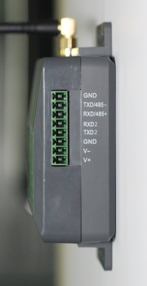

图 2‑1 DTU拆卸图示（左）和DTU接口端子（右）

**表 2‑1 接口端子说明**

| 管脚 | 管脚作用 | 备注 |
| --- | --- | --- |
| GND | 数字地 | 提供串口接地 |
| TXD/485- | 232的发送，485- |  |
| RXD/485+ | 232的接收，485+ |  |
| RXD2 | 配置串口接收，仅支持232 |  |
| TXD2 | 配置串口发送，仅支持232 |  |
| GND | 数字地 | 提供串口接地 |
| V- | 负极 | 支持5V DC～35V DC直流电源输入，纹波小于100mV |
| V+ | 正极 | |

第一步：装入SIM卡。将外壳打开后，将外上盖滑开，按正确方式装入SIM卡，再将外上盖滑动封合，如图2-2所示。

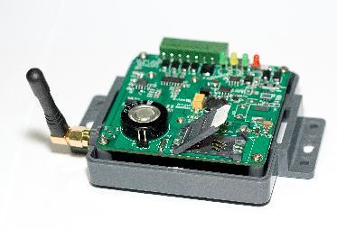

图 2‑2 InDTU312/332装入SIM卡

第二步：连接天线。将增强天线的放大器放置于能够接收到无线蜂窝网络信号的地方，接好线并检查无误后，接通电源，如图2-3所示。

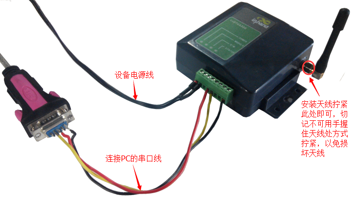

图 2‑3 InDTU312/332设备连线

### 2.1.2 适用于InDTU311/331设备

第一步：安装SIM卡和天线（GPRS），如图2-4所示。

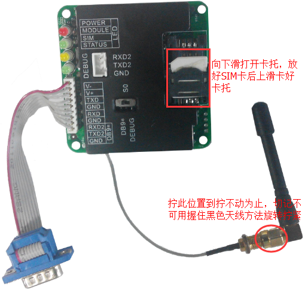

图 2‑4 InDTU331 SIM卡和天线安装

|  3G、4G内置天线安装方法：撕下PCB 背部的3M 胶纸；将撕下的3M 背胶对准两边平稳放下、压紧即可。 |
| --- |

第二步：自制线，链接设备和电脑，如图2-5所示。

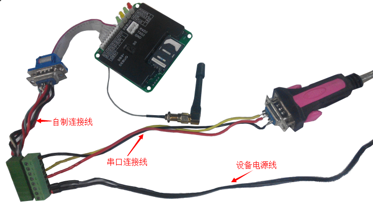

图 2‑5 InDTU331接线方式

### 2.1.3 适用于InDTU323设备

InDTU323对应有两款天线可选，如图2-6所示。

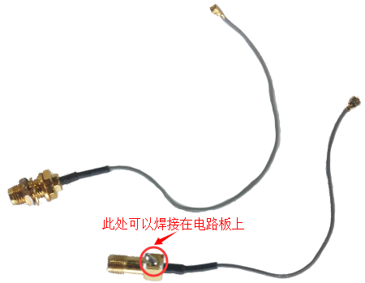

图 2‑6 InDTU323可焊接款天线

InDTU323需要搭配底板使用，可选映翰通的底板也可选用其他对应底板。使用映翰通底板，需将InDTU323设备红色方框位置插在底板红色方框位置，天线连接好即可，如图2-7所示。

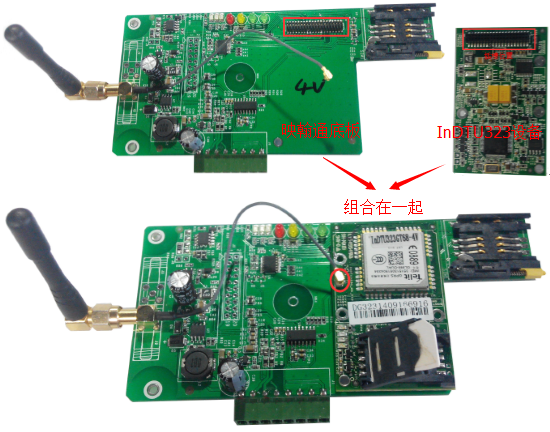

图 2‑7 InDTU323组合方式

**表 2‑2 接口端子（从左至右）说明**

| 管脚 | 管脚作用 | 备注 |
| --- | --- | --- |
| GND | 数字地 | 提供串口接地 |
| TXD/485- | 232的发送，485- |  |
| RXD/485+ | 232的接收，485+ |  |
| RXD2 | 配置串口接收，仅支持232 |  |
| TXD2 | 配置串口发送，仅支持232 |  |
| GND | 数字地 | 提供串口接地 |
| V- | 负极 | 支持5V DC～35V DC直流电源输入，纹波小于100mV |
| V+ | 正极 | |

### 2.1.4 适用于InDTU314/317设备

按正确方式装入SIM卡，再将外上盖滑动封合；连接天线，接好线并检查无误后，接通电源。如图2-8所示。

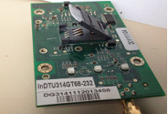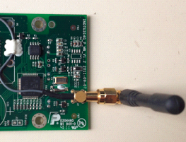

图 2‑8 InDTU314/317安装SIM卡与天线

InDTU314、317PCB板带有4个安装孔，便于固定到用户的设备中。采用2×10 2.54mm间距20Pin双排双卡插针，插针为高度8mm的连接器，如图2-9所示。

图 2‑9 InDTU314/317PCB板安装孔示意

**表 2‑3 InDTU314的pin脚标签说明**

| pin管脚 | 定义 | 方向 | 说明 |
| --- | --- | --- | --- |
| 1、2 | PWR+ | I | 电源正极 |
| 5、6 | GND | I | 电源负极 |
| 3、4、7 | NC | | |
| 10 | TXD1 | O | InDTU串口一的数据发送脚 |
| 11 | RXD1 | I | InDTU串口一的数据接收脚 |
| 12 | RXD2 | I | InDTU串口二的数据接收脚 |
| 13 | TXD2 | O | InDTU串口二的数据发送脚 |
| 14 | RTS | I | |
| 15 | CTS | O | |
| 16 | Ring | O | |
| 17、18、19、20 | NC | | |

### 2.1.5 适用于InDTU324和InDTU325设备

第一步：装入SIM卡。按住SIM卡座弹出键即会弹出卡座，装入SIM卡即可，如图2-10所示。

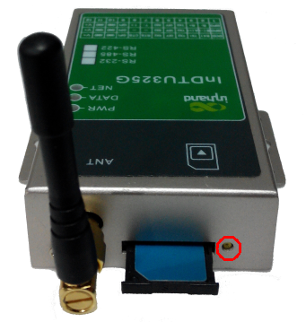

图 2‑10 InDTU325 SIM卡安装

第二步：安装天线。用手轻轻转动金属SMA-J接口可活动部分到不能转动，看不到天线连接线外螺纹时即可，不要握住黑色胶套用力拧天线。如图2-11所示。

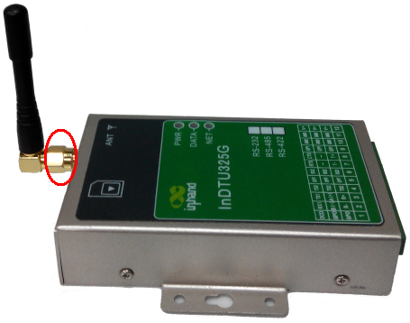

图 2‑11 InDTU325安装天线

第三步：端子接线。安装时将端子从设备上取下，将端子上的锁紧螺钉旋松，将对应线缆插入端子后将螺钉锁紧，如图2-12所示。

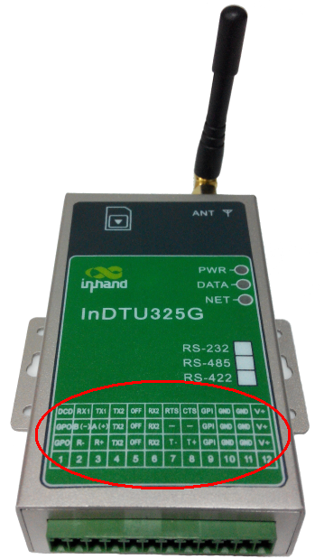

图 2‑12 InDTU325 端子线排序

端子线序因产品型号不同共有两种，分别是：RS-232、RS-485。

**表 2‑4 InDTU324 两种线序说明**

| 引脚 | 信号名称 | 描述 |
| --- | --- | --- |
| RS-232 PIN定义 | | |
| 1 | GPO | 通用GPIO口，作为DTU上下线指示 |
| 2 | RX1 | DTU串口1数据接收 |
| 3 | TX1 | DTU串口1数据发送 |
| 4 | TX2 | DTU串口2数据发送 |
| 5 | OFF | 电源控制：高电平（3.0～10V）关闭；低电平(0～0.3)或者悬空该引脚开启 |
| 6 | RX2 | DTU串口2数据接收 |
| 7 | GPI | 通用GPIO口预留 |
| 8 | GND | 数字地，提供串口接地 |
| 9 | GND | 电源输入负极 |
| 10 | V+ | 电源输入正极 |
| 引脚 | 信号名称 | 描述 |
| RS-485 PIN定义 | | |
| 1 | GPO | 通用GPIO口，作为DTU上下线指示 |
| 2 | B(-) | DTU串口1 RS485- |
| 3 | A(+) | DTU串口1 RS485+ |
| 4 | TX2 | DTU串口2数据发送 |
| 5 | OFF | DTU 电源控制：高电平（3.0～10V）关闭；低电平(0～0.3)或者悬空该引脚开启 |
| 6 | RX2 | DTU串口2数据接收 |
| 7 | GPI | 通用GPIO口 预留 |
| 8 | GND | 数字地，提供串口接地 |
| 9 | GND | 电源输入负极 |
| 10 | V+ | 电源输入正极 |

**表 2‑5 InDTU325 两种线序说明**

| 引脚 | 信号名称 | 描述 |
| --- | --- | --- |
| RS-232 PIN定义 | | |
| 1 | DCD | 载波检测信号输出，作为DTU上下线指示 |
| 2 | RX1 | DTU串口1数据接收 |
| 3 | TX1 | DTU串口1数据发送 |
| 4 | TX2 | DTU串口2数据发送 |
| 5 | OFF |  电源控制：高电平（3.0～10V）关闭；低电平(0～0.3)或者悬空该引脚开启 |
| 6 | RX2 | DTU串口2数据接收 |
| 7 | RTS | 短信切换控制：RTS悬空或输入电压为-5V~-15时，允许切换到短信模式；输入电压为+5V~+15V时，不允许切换到短信模式。 |
| 8 | CTS | 预留 |
| 9 | GPI | 通用GPIO口预留 |
| 10 | GND | 数字地，提供串口接地 |
| 11 | GND | 电源输入负极 |
| 12 | V+ | 电源输入正极 |
| 引脚 | 信号名称 | 描述 |
| RS-485 PIN定义 | | |
| 1 | GPO | 通用GPIO口，作为DTU上下线指示 |
| 2 | B(-) | DTU串口1 RS485- |
| 3 | A(+) | DTU串口1 RS485+ |
| 4 | TX2 | DTU串口2数据发送 |
| 5 | OFF | DTU 电源控制：高电平（3.0～10V）关闭；低电平(0～0.3)或者悬空该引脚开启 |
| 6 | RX2 | DTU串口2数据接收 |
| 7 | - | 空 |
| 8 | - | 空 |
| 9 | GPI | 通用GPIO口 预留 |
| 10 | GND | 数字地，提供串口接地 |
| 11 | GND | 电源输入负极 |
| 12 | V+ | 电源输入正极 |

|  请不要在带电情况下进行硬件安装。 |
| --- |

如果MODULE灯闪烁（亮、灭或闪烁情况根据选用模块不同而不同），说明已找到网络。LED指示含义请参阅章节[2.2指示灯说明](#_2.2_指示灯说明)。

### 2.2 指示灯说明

### 2.2.1 InDTU3XX_STD_V1.4.3之前版本

| **POWER** | **MODULE** | **SIM** | **STATUS** | **含义** |
| :---: | :---: | :---: | :---: | --- |
| **亮** | X | X | 慢闪 | 初始化模块 |
| **亮** | 快闪 | X | 慢闪 | 设备正在拨号 |
| **亮** | X | 灭 | 快闪 | 设备拨号成功，中心未连接成功 |
| **亮** | X | 同步慢闪 | | 设备拨号成功，中心连接成功 |

### 2.2.2 InDTU3XX_STD_V1.4.3及之后版本

| **DTU状态** | **SIM灯** | **STATUS灯** |
| --- | :---: | :---: |
| 系统启动 | 灭 | 灭 |
| 拨号中，无故障 | 灭 | 灭 |
| 拨号中，故障 | 灭 | 亮 |
| 拨号成功，中心连接中 | 亮 | 灭 |
| 拨号成功，连接中心故障 | 亮 | 亮 |
| 连接中心成功 | 同步慢闪 | |
| DTU作为TCP Server时，如果有客户端链接成功 | 同步慢闪 | |
| 短连接待激活 | 灭 | 慢闪 |
| SIM卡故障 | 慢闪 | 亮 |
| TROY模式 | 交替快闪 | |
|  | | |

|  + 亮表示常亮，即至少保持3秒钟不闪； + 灭表示常灭，即至少保持3秒钟不闪； + 慢闪表示闪烁频率大约1Hz即每1秒闪一次； + 快闪表示闪烁频率大约5HZ即每0.2秒闪一次； + “X”表示任意状态。 |
| --- |

### 2.2.3 InDTU324指示灯定义

InDTU324共有3个指示灯，POWER（红色）、SIM（黄色）、STATUS（绿色）；POWER灯：设备上电后应常亮；SIM和STATUS灯：指示DTU工作状态。

| **DTU状态** | **POWER电源** | **SIM卡** | **STATUS运行** |
| :---: | :---: | :---: | :---: |
| 系统启动 | 亮 | 灭 | 灭 |
| 拨号中，无故障 | 亮 | 灭 | 灭 |
| 拨号中，故障 | 亮 | 灭 | 亮 |
| 模块打开处于AT模式troy模式 | 亮 | 交替快闪 | |
| 拨号成功，中心连接中 | 亮 | 亮 | 灭 |
| 设备处于短连接模式 | 亮 | 灭 | 慢闪 |
| 拨号成功，连接中心故障 | 亮 | 亮 | 亮 |
| 连接中心成功 | 亮 | 同步慢闪 | |
| DTU作为TCP Server时，如果有客户端链接成功 | 亮 | 同步慢闪 | |
| SIM卡故障 | 亮 | 慢闪 | 亮 |

### 2.2.4 InDTU 325LH09/325GS52指示灯定义

| DTU状态 | POWER黄色 | DATA黄色 | NET黄色 |
| :---: | :---: | :---: | :---: |
| 初始化模块 | 亮  |  灭 | 快闪  |
| 设备正在拨号或有用户数据收发 | 亮 | 快闪 | X |
| 设备拨号成功，用户中心未连接成功 | 亮 | X | 亮 |
| 用户中心连接成功 | 亮 | 灭 | 慢闪 |
| DTU作为TCP Server时，如果有客户端链接成功 | 亮 | 灭 | 慢闪 |
| 设备进入 AT 模式 | 亮 | 同步慢闪 | 同步慢闪 |
| 设备进入短连接模式 | 亮 | 交替慢闪 | 交替慢闪 |

初始化模块过程时间非常短，只闪一下。

## 3 维护功能

### 3.1 实时日志

**查看InDTU串口实时输出的内容。**

第一步：登录配置工具，可参见[5.1设备联网配置](#_设备联网配置)。

第二步：选择“高级模式”。点击“设置>>其他配置（应用扩展配置）>>是否为调试模式”，中选择“是(串口2)”，“调试等级”根据需要选择“显示详细日志/中文简洁日志/英文简洁日志/显示调试日志”。如图3-1所示。

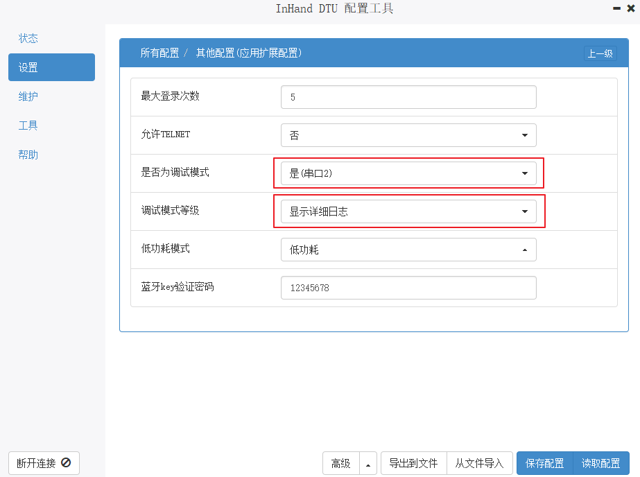

图 3‑1 实时日志1

第三步：保存配置，并不重启设备。

第四步：点击“维护>>实时日志>>开始接收”，需要等待约30s。窗口内将显示设备日志。日志显示如图3-2所示。

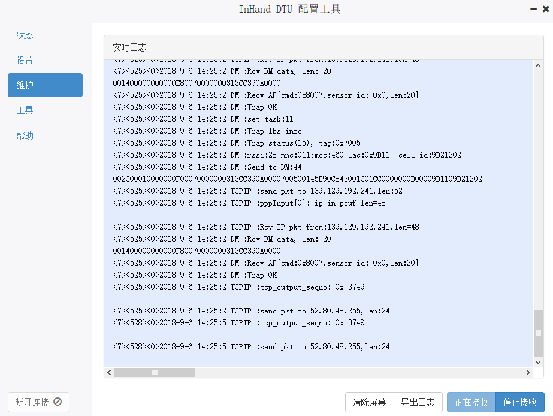

图 3‑2 实时日志2

第五步：若有需要保存日志。点击“导出日志”，导出的日志将以(*.txt)格式保存。导出的日志信息内容包括两部分：1.配置文件基本信息；2.日志。

**清除屏幕：** 清除当前窗口内的日志显示，不影响日志内容。

### 3.2 历史日志

**查看InDTU存储的历史日志。**

第一步：登录配置工具，可参见[5.1设备联网配置](#_设备联网配置)。

第二步：点击“设置>>其他配置（应用扩展配置）>>是否为调试模式”，中选择“是(串口2)”，“调试等级”根据需要选择“显示详细日志/中文简洁日志/英文简洁日志/调试日志”。

第三步：保存配置，并不重启设备。

第四步：点击“维护>>历史日志>>读取日志”，配置工具将主动读取DTU上所有的日志，如图3-3所示。

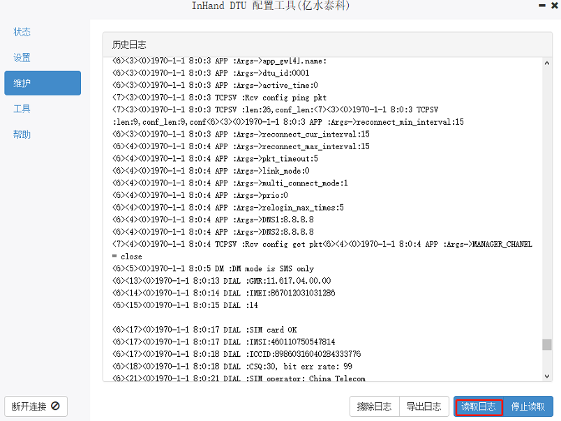

图 3‑3 历史日志

第五步：若有需要保存日志。点击“导出日志”，导出的日志将以(*.txt)格式保存。导出的日志信息内容为简略的日志，不包含配置信息。

**擦出日志**：擦除DTU内保存的所有日志。

### 3.3 固件升级

**通过导入新版本的InDTU固件对设备进行升级。**

第一步：登录配置工具，可参见[5.1设备联网配置](#_设备联网配置)。

第二步：点击“维护>>InDTU固件升级”，如图3-4所示。

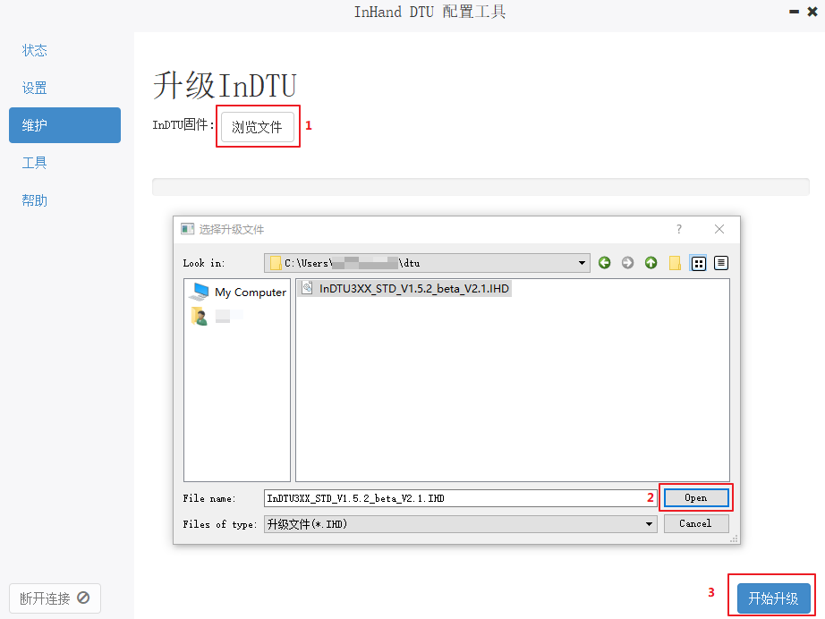

图 3‑4 设备升级1

第三步：设备升级成功，根据软件提示进行重启。

## 4 参数配置

### 4.1 本地串口/本地串口2设置

设置本地串口对应参数，本串口参数设置要和本串口相连的对端串口参数保持一致。

**表 4‑1 本地串口设置参数说明**

| **参数名称** | **说明** | **缺省值** |
| --- | --- | --- |
| 波特率 | 可以选择1200、2400、4800、9600、14400、19200、38400、57600、115200(bps) | 9600 |
| 数据位 | 可以选择5、6、7、8 | 8 |
| 停止位 | 可以选择1位、1.5为、2位 | 1 |
| 校验位 | 无校验/奇校验/偶校验 | 无 |
| 扫面间隔 | 默认为2即可 | 2 |
| 数据包响应超时 | 默认为5即可 | 5 |
| 帧大小 | 默认为1024，可随意设置，范围：（10~1024） | 1024 |
| 流控 | 只有部分型号如InDTU 325才支持流控 | 关闭 |

### 4.2 DTU工作模式设置

设置DTU连接方式及激活方式等工作模式相关设置。

**表 4‑2 DTU工作模式设置参数说明**

| **参数名称** | **说明** | **缺省值** |
| --- | --- | --- |
| 连接方式 | 长连接或短连接 （“长连接”方式下，InDTU300实时在线，断线自动重连；只有在“短连接”的方式下，才有电话激活、本地数据激活、定时激活的功能） | 长连接 |
| 电话激活 | 打开或关闭电话激活 （一般情况下选择“打开”）在短连接模式下，如果有任何电话打进来则InDTU300激活开始联网 | 打开 |
| 短信激活 | 打开或关闭短信激活，在短连接模式下，如果接收到DM短信则InDTU300激活开始联网 | 打开 |
| 本地数据激活 | 打开或关闭本地数据激活 （一般情况下选择“打开”）在短连接模式下，如果本地串口有数据则InDTU300激活开始联网 | 打开 |
| 定时激活时间间隔 | InDTU300按照这个时间，在进入休眠模式时开始计时，时间到就重新联网，实现定时激活功能。范围0~1440 | 0 |
| 定时下线时间间隔 | InDTU300按照这个时间定时退网重启，这个值不支持0，如果设置为0，则会自动适应为1 (一般情况下填0，范围0~60) | 0 |
| GPRS/SMS链路 | GPRS或SMS链路。 | GPRS链路 |
| 收短信到本地串口 | 打开或关闭。状态为打开时即可在收到短信后输出到工作串口。 | 关闭 |
| DTU配置模式 | 帧模式和流模式。 | 流模式 |

|  关于发短信功能的格式可以详见《用户设备配置及监控GPRS模块集成设计》 |
| --- |

### 4.3 GPRS拨号参数设置

**表 4‑3 GPRS拨号参数设置说明----单卡版本**

| **参数名称** | **说明** | | **缺省值** |
| --- | --- | --- | --- |
| 自动拨号 | 是或否，选择是否自动拨号。 | | 是 |
| PPP层心跳间隔 | PPP层心跳包的时间间隔，输入范围0~9999。 | | 50 |
| 重拨间隔 | PPP断开后重新拨号的间隔，输入范围0~3600。 | | 60 |
| 最大重拨次数 | 连续多次拨号失败后重启系统，输入范围0~10。 | | 3 |
| 双卡模式 | 开启后，默认使用SIM1。 当拨号故障或网络故障时自动切换到SIM2；切换到SIM2后正常情况不会切回SIM1，但是如出现拨号故障或网络故障或拨号成功后计时到所设置SIM2的在线时间时，将会切换到SIM1。 | | 关闭 |
| 中心无法连接时切卡 | 能触发切换SIM卡动作。 | | 关闭 |
| **SIM卡设置** | | | |
| GPRS网络拨号号码 | | 接入移动网络的拨号号码。 | *99***1# |
| 网络接入点名称（APN） | | 接入移动网络时需要提供此项。 | cmnet |
| GPRS网络拨号用户名 | | 拨号接入移动网络时需要提供用户名。 | gprs |
| GPRS网络拨号密码 | | 拨号接入移动网络时需要提供密码。 | gprs |
| 认证模式 | | 自动--轮流使用PAP和CHAP认证方式来拨号（上电第一次使用pap认证，如果拨号失败，再次拨号时就使用chap认证，再下一次拨号又使用pap认证，以此类推）。 如果认证模式不选择“自动”，而是选择PAP或CHAP，那就仅仅使用PAP或CHAP认证方式来拨号。 | 自动 |
| 网络模式 | | 仅2G、3G、4G、3G/2G和自动。 | 自动 |
| 网络模式 | | 仅2G、3G、4G、3G/2G和自动。 | 自动 |
| **默认承载设置** | | | |
| 默认承载APN | **请询问运营商相关参数。** | | 空 |
| 默认承载用户名 | **请询问运营商相关参数。** | | 空 |
| 默认承载密码 | **请询问运营商相关参数。** | | 空 |
| 默认承载鉴权模式 | 自动--轮流使用PAP和CHAP认证方式来拨号（上电第一次使用pap认证，如果拨号失败，再次拨号时就使用chap认证，再下一次拨号又使用pap认证，以此类推）。 如果认证模式不选择“自动”，而是选择PAP或CHAP，那就仅仅使用PAP或CHAP认证方式来拨号。 | | 自动 |

**表 4‑4 GPRS拨号参数设置说明----双卡版本**

| **SIM卡2设置** | | |
| --- | --- | --- |
| GPRS网络拨号号码 | 接入移动网络的拨号号码。 | *99***1# |
| 网络接入点名称（APN） | 接入移动网络时需要提供此项。 | cmnet |
| GPRS网络拨号用户名 | 拨号接入移动网络时需要提供用户名。 | gprs |
| GPRS网络拨号密码 | 拨号接入移动网络时需要提供密码。 | gprs |
| 认证模式 | 自动--轮流使用PAP和CHAP认证方式来拨号（上电第一次使用pap认证，如果拨号失败，再次拨号时就使用chap认证，再下一次拨号又使用pap认证，以此类推）。 如果认证模式不选择“自动”，而是选择PAP或CHAP，那就仅仅使用PAP或CHAP认证方式来拨号。 | 自动 |
| 网络模式 | 仅2G、3G、4G、3G/2G和自动。 | 自动 |
| SIM卡2在线时间（分钟） | SIM2拨号成功后开始计时，SIM2自动切换到SIM1的时间。 | 0 |
| **默认承载设置** | | |
| 默认承载APN | **请询问运营商相关参数。** | 空 |
| 默认承载用户名 | **请询问运营商相关参数。** | 空 |
| 默认承载密码 | **请询问运营商相关参数。** | 空 |
| 默认承载鉴权模式 | 自动--轮流使用PAP和CHAP认证方式来拨号（上电第一次使用pap认证，如果拨号失败，再次拨号时就使用chap认证，再下一次拨号又使用pap认证，以此类推）。 如果认证模式不选择“自动”，而是选择PAP或CHAP，那就仅仅使用PAP或CHAP认证方式来拨号。 | 自动 |

|  默认承载设置是针对某些运营商的网络数据传输特殊情况设置的功能，一般情况不用配置。如需配置，请询问运营商默认承载的相关参数。 |
| --- |

### 4.4 企业网关相关设置

**表 4‑5 企业网关相关参数设置说明**

| **参数名称** | **说明** | **缺省值** |
| --- | --- | --- |
| DTU设备号 | 人为的给DTU做标示，必须与中心站保持一致最长为11位。 | 0001 |
| 企业网关 | 需要填写中心端的IP地址、端口号、域名、本机端口；配置本机端口，默认0表示随机端口，多IP中心各个中心配置的本机端口不能相同。(如果IP与域名同时填入，以IP为准) | 0.0.0.0/空/0/0 |
| 企业网关连接方式 | 可以选择TCP、UDP、DCTCP、DCUDP和Modbus网桥。如果选择透明UDP时必须手动添加自定义心跳帧，否则DTU没办法检测到连接已经断开，也就没办法恢复。 | TCP |
| 传输失败最大重发次数 | 0 （TCP协议自动重发） | 5 |
| 强制DC心跳 | DC工作模式下，“关闭”表示有数据时不发心跳；“打开”表示有无数据都会发送心跳。 | 关闭 |
| 企业网关心跳间隔（分） | 心跳包的时间间隔，范围1~60 | 1 |
| 企业网关心跳间隔（秒） | | 0 |
| DNS IP1 | 或者填入专用域名解析服务器地址 | 8.8.8.8 |
| DNS IP2 | | |
| SNTP服务 | “关闭”表示SNTP服务没有开启，在设备连接中心之后不会同步时间，即时间是默认的1970-1-1；“开启”表示SNTP服务开启，设备会在连接中心之后，发送SNTP服务，即设备会与当前时间同步。 | 关闭 |
| SNTP服务器域名 | SNTP服务器域名：time.nist.gov(当此地址不可用时，请手动填写支持校时的地址) | time.nist.gov |
| 本地串口互换 | “关闭”表示正常即串口1是通信串口，串口2是调试串口；“打开”表示串口1和串口2功能互换。 | 关闭 |
| TCP服务器监听端口 | 作为TCP Server时监听端口（填0为关闭TCPServer功能） | 8888 |
|  |  |  |
|  关于SNTP可以详见《用户设备配置及监控GPRS模块集成设计》 | | |

### 4.5 多IP数据中心设置

在选择多中心模式的情况下，填写扩展1 企业网关~扩展4企业网关的IP地址、端口号、本机端口及其连接方式。对于单中心模式此项留空。

|  在设置多中心的情况下请将每个中心的IP及端口正确填写，在非多中心情况下请将非中心的IP及端口全部设置为零。 最多可配置5个中心，但是为了保证设备的稳定性，最好不超过3个中心。 |
| --- |

### 4.6 多连接策略

**表 4‑6 多连接策略参数设置说明**

| **参数名称** | **说明** | **缺省值** |
| --- | --- | --- |
| 重连最小间隔 | TCP中连接失败重新连接的最小间隔 | 15 |
| 重连最大间隔 | TCP中连接失败重新连接的最大间隔 | 60 |
| 轮询模式 | 多中心模式时，选择多中心连接为轮询模式或并发模式 | 多中心轮询 |

### 4.7 其他配置（应用扩展配置）

**表 4‑7 应用扩展参数设置说明**

| **参数名称** | **说明** | **缺省值** |
| --- | --- | --- |
| 最大登录次数 | 设置最大登陆次数，一般使用默认值就可以 | 5 |
| 允许TELNET | 是否允许TELNET | 否 |
| 是否为调试模式 | 是或否（选择是，将通过串口工具看到InDTU的运行日志）调试模式参数配置立即生效。 | 否 |
| 调试模式等级 | 显示详细日志、中文简洁日志、英文简洁日志和显示调试日志。 | 显示详细日志 |
| 低功耗模式 | 低功耗、均衡和高性能；低功耗只支持某些型号 | 低功耗 |
| 蓝牙key验证密码 | 设置蓝牙key验证密码 | 12345678 |

|  正常使用情况下请勿打开调试模式！默认关闭调试模式，运行性能更好。 |
| --- |

### 4.8 网管平台相关设置

**表 4‑8 平台相关参数设置说明**

| **参数名称** | **说明** | **缺省值** |
| --- | --- | --- |
| 序列号 | 网关平台识别设备的标识15位字符串(出厂时已定义，不可修改)。 | 空 |
| 工作模式 | 仅短信模式，短信加IP模式或者禁用。 | 仅短信 |
| 信任号码列表 | InDTU300的DM功能仅接受信任列表中的用户短信，如果列表为空，则接受任意用户。 | 空 |
| 设备号 | 网管平台设备标识(出厂时已定义，不可修改)。 | 0 |
| 网管平台地址 | 网管平台的IP地址、域名和端口号。 | 0.0.0.0/ c.inhand.com.cn/ 20003 |
| 心跳间隔 | 同网管平台间心跳时间间隔，输入范围30~600。 | 120 |
| 状态数据上报间隔 | 每隔该时间间隔上报流量、基站数据等状态信息。 | 3600 |

### 4.9 管理员登陆设置

**表 4‑9 管理员登陆参数设置说明**

| **参数名称** | **说明** | **缺省值** |
| --- | --- | --- |
| 管理员账号 | 管理员账户名称设置 | adm |
| 管理员密码 | 管理员帐户的密码设置 | 123456 |
| 普通用户账号 | 普通用户的名称设置 | adm |
| 普通用户密码 | 普通用户的密码设置 | 123456 |

### 4.10 ICMP参数设置

**表 4‑10 ICMP参数设置说明**

| **参数名称** | **说明** | **缺省值** |
| --- | --- | --- |
| 链路维持功能 | 开启后，每隔“网络空闲间隔”向探测主机发送一个字节的IP包。该功能主要是为了规避运营商网优参数问题导致的网络阻塞。 | 关闭 |
| 探测主机 | 检测PPP连接是否正常，填写IP地址，对于双卡版本，若企业网管异常，会进行ICMP探测，如果该地址没有设置则自动探测企业网管地址，单卡版本仅探测该地址。 | 0.0.0.0 |
| 最大丢包数 | 仅针对ICMP探测功能生效。单卡版本：累积探测时间达到“最大丢包数*网络空闲间隔”，ICMP探测失败次数累计达到该值，触发重新拨号；双卡版本：探测时间达到“最大丢包数*断网探测间隔”，ICMP探测失败次数累计达到该值，触发切卡后重新拨号。 | 3 |
| 网络空闲间隔 | 超过该时间未收到网络数据包后，发送ICMP探测包，输入范围30~3600。。 | 55 |
| 断网探测间隔 | 主要用于双卡切换，当企业网管连接失败或者异常断开后，会间隔该时间发送ICMP探测；单卡版本该值无效。输入范围1~120。 | 10 |
| ICMP超时 | 改时间内没有收到ICMP回复并且没有收到其他网络数据，则认为ICMP探测失败一次，输入范围1~120。 | 5 |
| 强制ICMP探测 | 仅对ICMP探测生效，“关闭”表示未收到数据一定间隔后才发送ICMP探测；“打开”表示是否收到中心数据都定时发送ICMP探测。 | 关闭 |

### 4.11 自定义帧

帧类型：ASCII类型或HEX类型或DC类型。ASCII类型即使用ASCII字符，HEX类型即使用HEX字符。DC类型为映翰通公司自主开发的帧类型。

**表 4‑11 自定义帧参数设置说明**

| **参数名称** | **说明** | **缺省值** |
| --- | --- | --- |
| 登陆 | 企业网关连接方式为纯TCP或纯UDP时的登录帧 |  |
| 登陆应答 | 企业网关连接方式为纯TCP或纯UDP时的登录应答帧 |  |
| 心跳 | 企业网关连接方式为纯TCP或纯UDP时的心跳帧 |  |
| 心跳应答 | 企业网关连接方式为纯TCP或纯UDP时的心跳应答帧 |  |
| 退出 | 企业网关连接方式为纯TCP或纯UDP时的退出帧 |  |
| 退出应答 | 企业网关连接方式为纯TCP或纯UDP时退出应答帧 |  |

|  此项配置仅在企业网关连接方式为纯TCP或纯UDP时有效，登录帧和登录应答帧必须同时配置使用，其他帧亦如此。使企业网关实时了解下端设备状态。 |
| --- |

### 4.12 支撑平台相关设置

短信中心号码：需要的短信中心号码，在北京是8613800100500。

## 5 常用参数配置及应用举例

**注明，本章内采用演示软件皆为网上下载的，仅作演示使用。**

### 5.1 设备联网配置

把设备串口2通过串口线和PC相连，然后给设备上电。

第一步：打开并登录DTU配置工具。通过PC打开配置工具，单击“连接设备”，在弹出的的新对话框中输入用户名/密码（初始为：adm/123456），然后选择串口和串口波特率等串口参数，可在PC设备管理查看串口的COM号。最后单击“连接”即可，如图5-1所示。

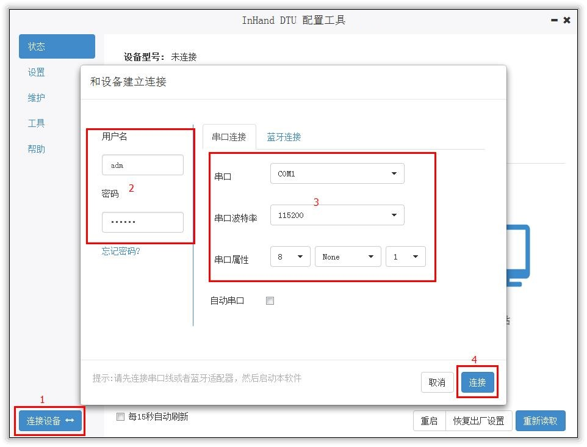

图 5‑1登录配置工具

|  1.登陆成功后，一定要在提示“配置读取成功”以后再开始修改配置参数。 |
| --- |

第二步：设置本地串口参数，使设备的本地串口参数与InDTU下端设备串口参数一致，如图5-2所示。

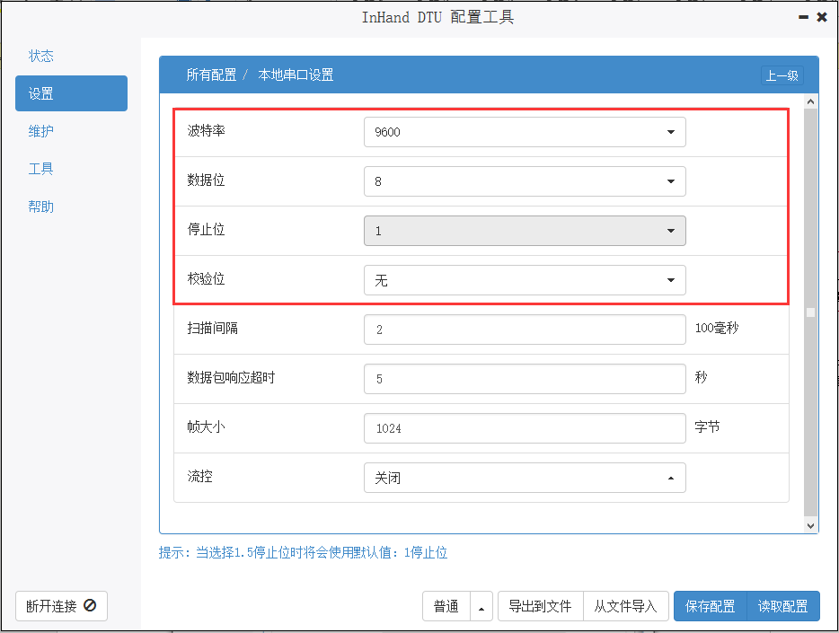

图 5‑2设置本地串口参数

|  做客户端时在本地串口设置参数；做服务器时在本地串口2设置参数。 |
| --- |

第三步：打开“GPRS 拨号参数设置”进行参数修改即可。比如修改“自动拨号”，如图5-3所示。**默认参数即公网拨号参数，非专线无需更改；若是专线请修改网络接入点名称（APN）、GPRS网络拨号用户名/密码。**

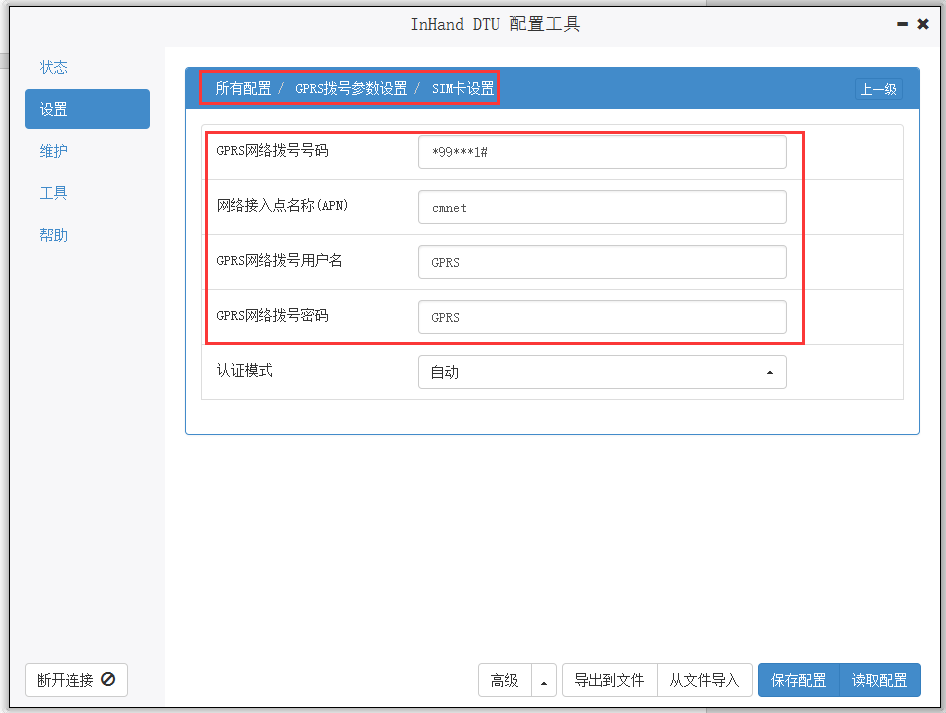

图 5‑3 设置SIM卡参数

第三步：**设置好参数后，单击保存配置，重启设备新参数即可生效。**

|  1.在标准版固件InDTU3XX_STD_V1.5.0及其以前，本地串口2的参数配置生效条件：（1）DTU开启TCP服务器；2.并与TCP客户端建立连接。（2）其他情况下，本地串口2通信参数固定为115200,8，N,1。 2.在标准版固件InDTU3XX_STD_V1.5.1及其以后，本地串口2的通信参数采用用户配置的参数（出厂默认为115200,8，N,1）。 3.如果用户忘记之前配置的串口参数，可勾选配置工具上的“自动串口”进行连接。 |
| --- |

### 5.2 DC模式协议配置

### 5.2.1 DCTCP模式

#### 5.2.1.1 参数配置

第一步：参见章节[5.1登陆配置工具](#_4.1_设备联网最基本配置)。

第二步：打开“企业网关相关设置”，设置“DTU设备号”（用户自定义）和“企业网关连接方式”（DCTCP），如图5-4所示。

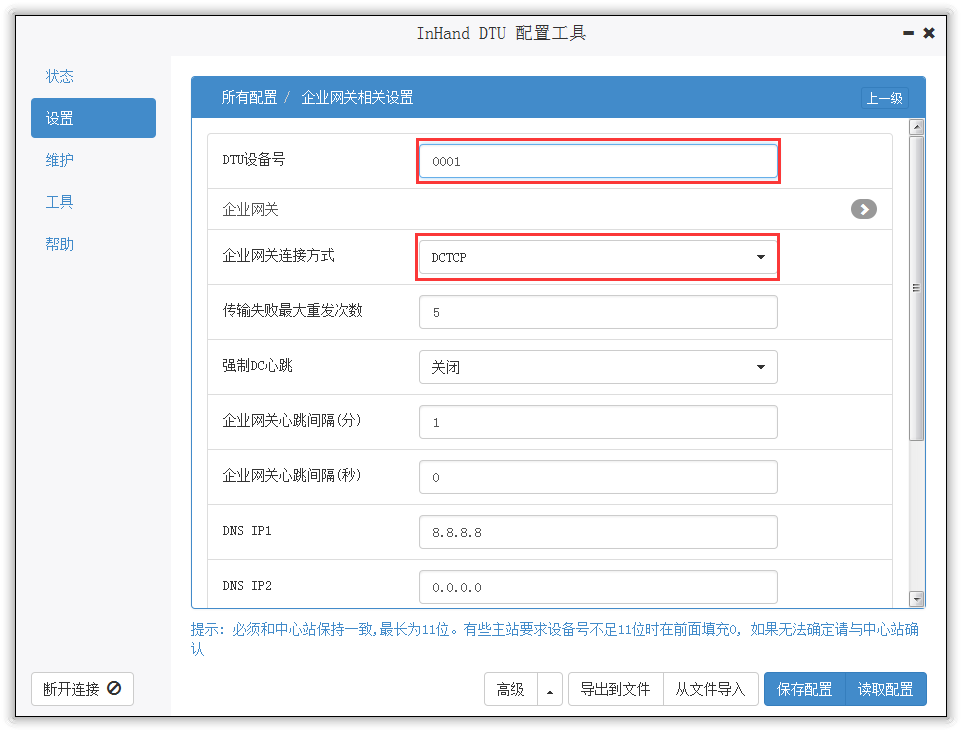

图 5‑4 DCTCP模式配置1

第三步：打开“企业网关相关设置>>企业网关”，设置中心的“IP”地址和“网关端口”号以及“本机端口”（可默认选择0，即为随机端口），如图5-5所示。

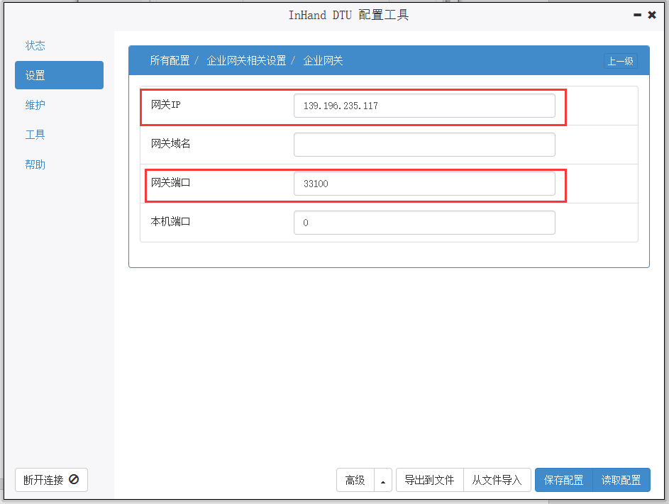图 5‑5 DCTCP模式配置2

第四步：打开“企业网关相关设置”设置“SNTP服务”为“开启”，使设备与当前时间同步。当默认的SNTP服务器地址不可用时，请填入支持校时的地址。如图5-6、5-7所示。

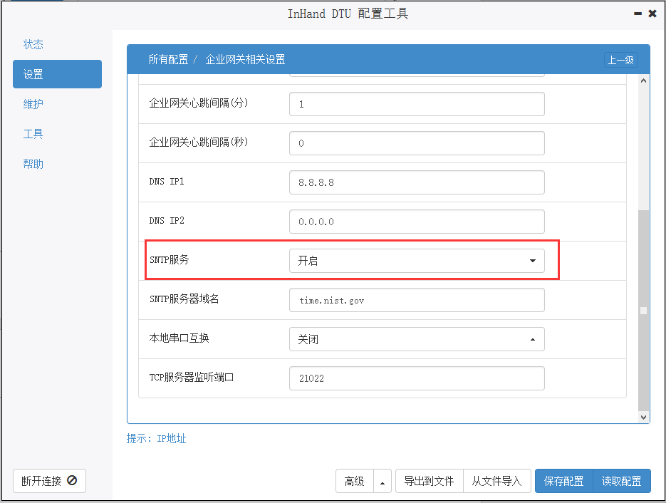图 5‑6 DCTCP模式配置3

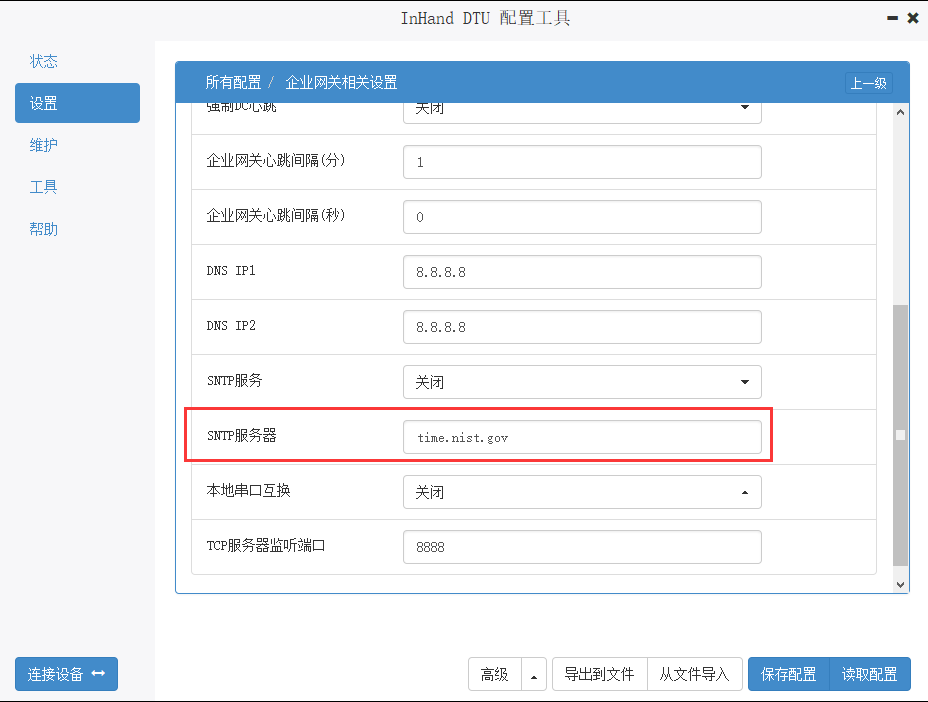图 5‑7 DCTCP模式配置4

第五步：打开“其他配置（应用扩展配置）”，根据需求可在低功耗模式选择配置“低功耗模式/均衡模式/高性能模式”三种模式之一，如图5-8所示。

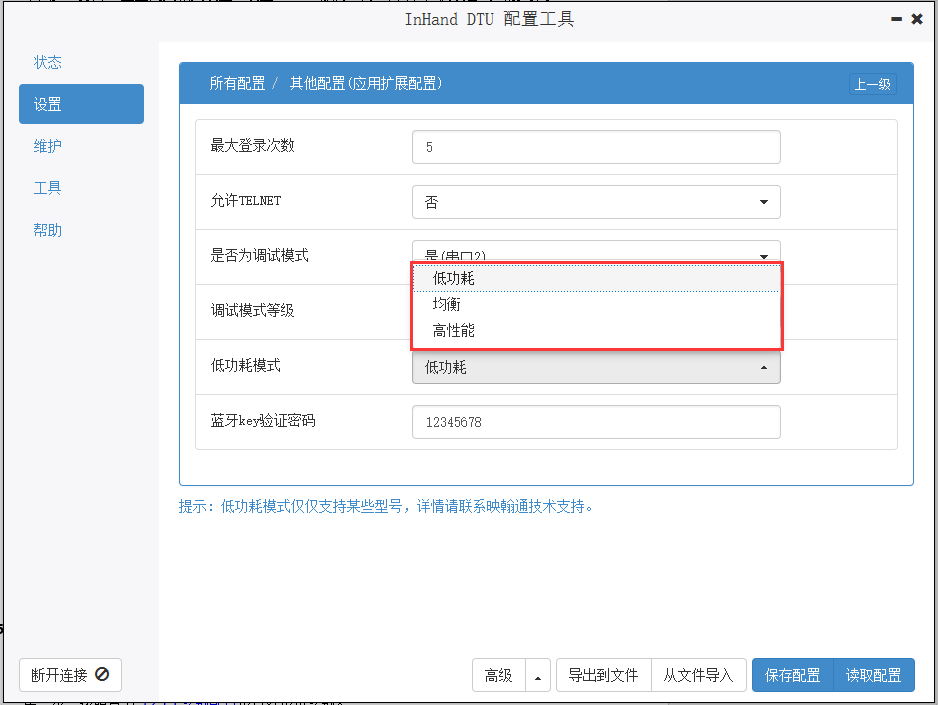

图 5‑8 DCTCP模式配置5

第六步：**设置好参数后，单击保存配置，重启设备即可生效。**

#### 5.2.1.2  演示举例

用一台PC作为中心，演示DTU和中心之间的通信。

第一步：按照章节[5.2.1.1参数配置](#_4.2.1.1_参数配置)设置好设备参数。

第二步：打开InDTU配置工具，点击“工具>>数据中心测试”，即可打开数据中心测试工具GPRSDEMO。(若GPRSDEMO无法启动，请参考[6.1 添加GPRSDEMO](#_5.1_添加GPRSDEMO)。)选择TCP协议启动服务程序，创建服务器，使PC作为中心。单击红色方框处按钮，停止服务，如图5-9所示。

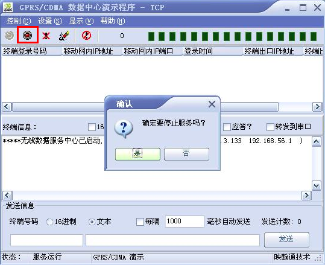

图 5‑9 DCTCP协议演示1

第三步：单击设置按钮，打开“端口设置”对话框配置TCP端口号（作为中心的PC的TCP端口号），配置好参数后单击红色方框处按钮，启动服务，如图5-10所示。

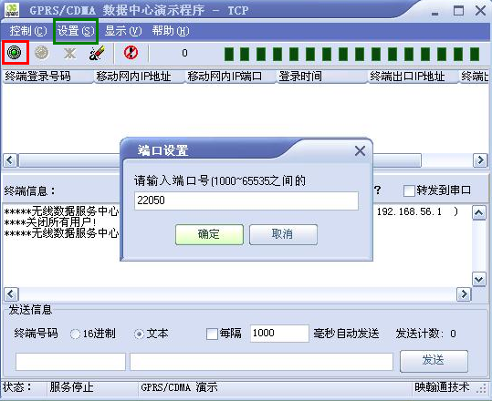

图 5‑10 DCTCP协议演示2

第四步：启动服务后，在“终端登录号码”下边会出现连接到中心上的DTU的相关信息。单击出现的终端登录号码，在发送信息的终端号码处会出现该号码（红色方框处），然后设置自动发送间隔，在终端号码后输入要发送数据内容，点选“每隔”则中心即开始向DTU发送数据，如图5-11所示。

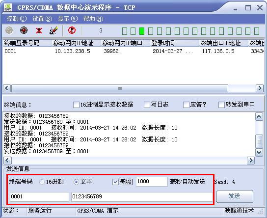

图 5‑11 DCTCP协议演示3

第五步：用串口线把DTU的串口1与PC相连，在PC上用串口工具(例如：SSCOM5.12)即可查看收到终端发送的内容。如图5-12所示。

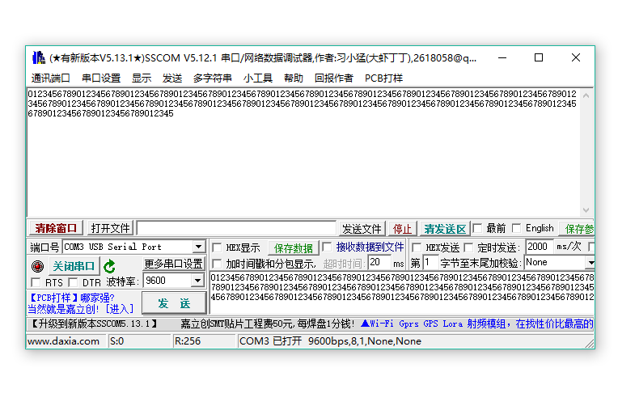

图 5‑12 DCTCP协议演示4

### 5.2.2 DCUDP模式

#### 5.2.2.1 参数配置

配置方法参见章节[5.2.1.1参数配置](#_5.2.1.1_参数配置)。DTU与企业网关的连接方式选择DCUDP，配置好中心的IP地址和中心端口号。用例采用IP为203.86.63.234，中心的端口号为22055。

#### 5.2.2.2 演示举例

用一台PC作为中心，演示DTU和中心之间的通信。

第一步：按照章节[5.2.2.1参数配置](#_4.2.2.1_参数配置)设置好设备参数。

第二步：打开InDTU配置工具，点击“工具>>数据中心测试”，即可打开数据中心测试工具GPRSDEMO。(若GPRSDEMO无法启动，请参考[6.1 添加GPRSDEMO。](#_添加GPRSDEMO))选择UDP协议启动服务程序，创建服务器，使PC作为中心。单击红色方框处按钮，停止服务，如图5-13所示。

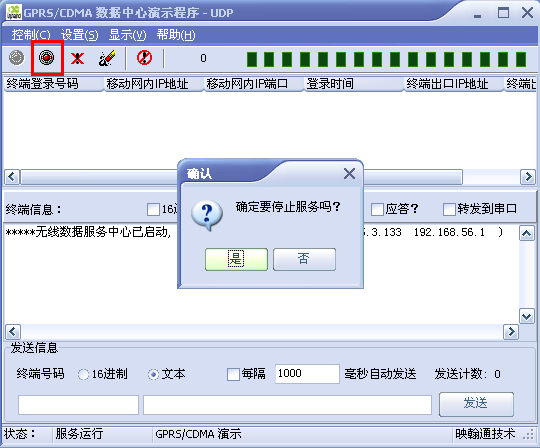

图 5‑13 DCUDP协议演示1

第三步：单击设置按钮，打开 “端口设置”对话框配置UDP端口号（作为中心的PC的UDP端口号），配置好参数后单击红色方框处按钮，启动服务。如图5-14所示。

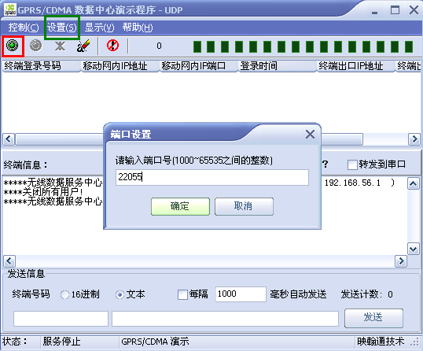

图 5‑14 DCUDP协议演示2

第四步：启动服务后，在“终端登录号码”下边会出现连接到中心上的DTU的相关信息。单击出现的终端登录号码，在发送信息的终端号码处会出现该号码（红色方框处），然后设置自动发送间隔，在终端号码后输入要发送数据内容，点选“每隔”则中心开始向DTU发送数据，如图5-15所示。

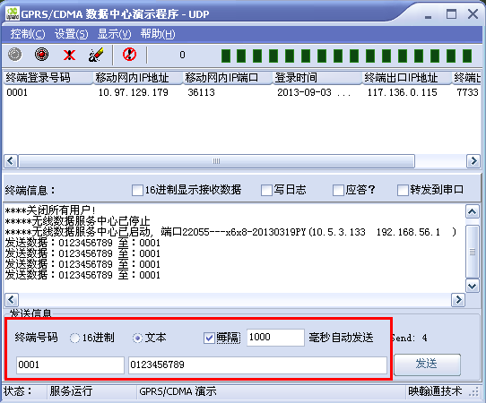

图 5‑15 DCUDP协议演示3

第五步：用串口线把DTU的串口1与PC相连，在PC上用串口工具(例如：SSCOM5.12)即可查看收到终端发送的内容。如图5-16所示。

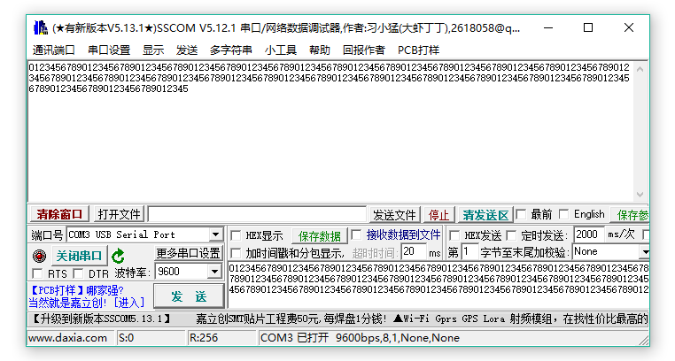

图 5‑16 DCUDP协议演示4

### 5.3 透明TCP协议配置

### 5.3.1 参数配置

第一步：参见章节[5.1设备联网配置](#_设备联网配置)。

第二步：打开“企业网关相关设置”，设置“DTU设备号”（用户自定义）和“企业网关连接方式”（TCP），如图5-17所示。

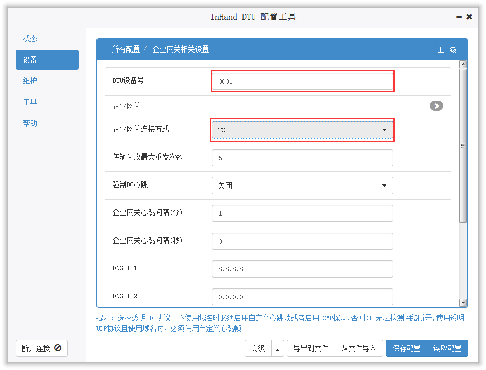

图 5‑17 TCP协议配置1

第三步：打开“企业网关相关设置>>企业网关”，设置中心的“IP”地址和“端口”号以及“本机端口”（可默认选择0，即为随机端口），如图5-18所示。

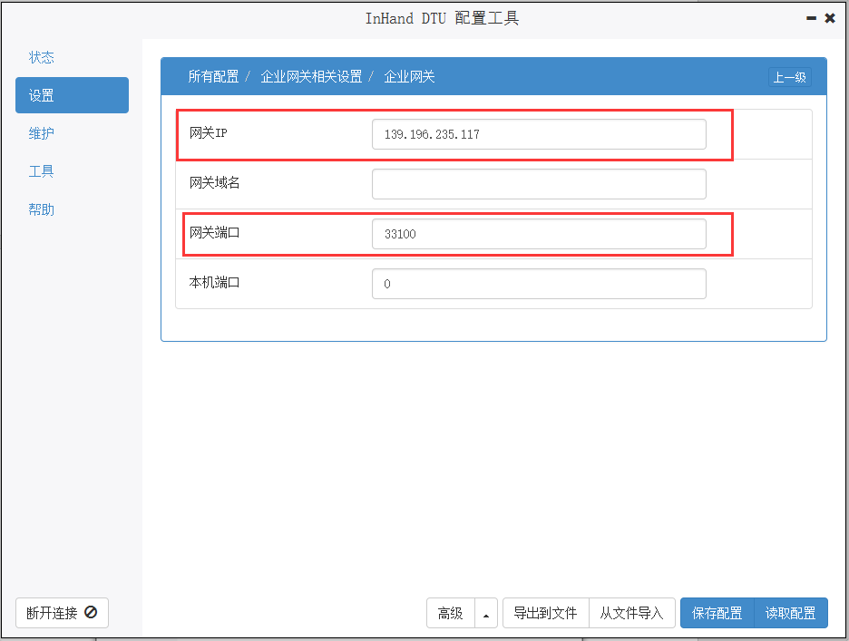

图 5‑18 TCP协议配置2

第四步：打开“企业网关相关设置”设置“SNTP服务”为“开启”，使设备与当前时间同步，如图5-19所示。（当默认SNTP服务器地址不可用时，参见[5.2 DC模式协议配置](#_5.2_DC模式协议配置)第四步）

图 5‑19 TCP协议配置3

第五步：打开“其他配置（应用扩展配置）”，根据需求可在低功耗模式选择配置“低功耗模式/均衡模式/高性能模式”三种模式之一，如图5-20所示。

图 5‑20 TCP协议配置4

第六步：**设置好参数后，单击保存配置，重启设备即可生效。**

### 5.3.2 演示举例

用一台PC作为中心，演示DTU和中心之间的通信。

第一步：按照章节[5.3.1参数配置](#_4.3.1_参数配置)设置好设备参数。

第二步：打开“TCP＆UDP测试工具”，创建服务器，使PC作为中心，“本机端口”填写作为中心的PC的TCP端口号，如图5-21所示。

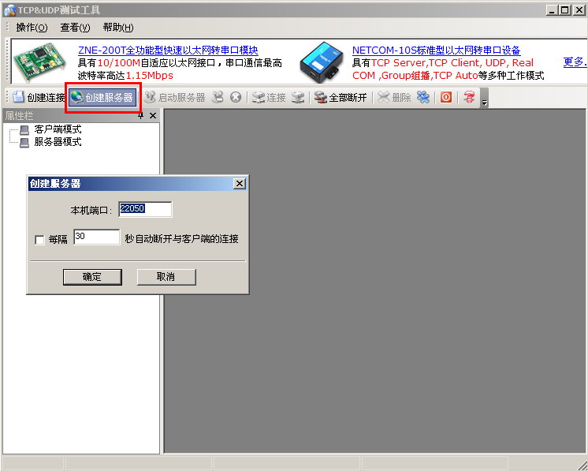

图 5‑21 TCP协议演示1

第三步：创建好服务器后，单击“启动服务器”（红色方框位置），稍后在导航树中会看到“本机”下边出现一个绿色三角形即为连接到中心上的DTU，如图5-22所示。

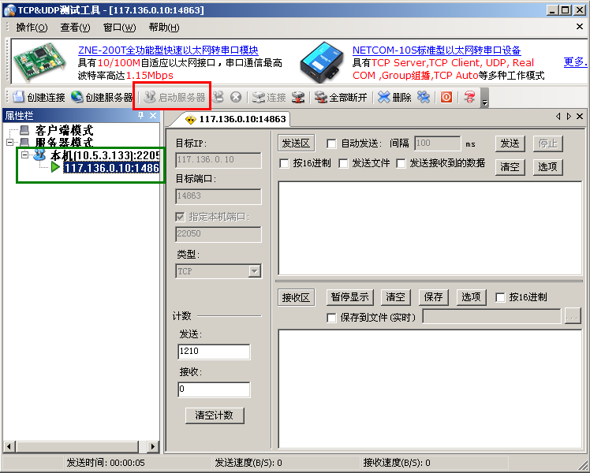

图 5‑22 TCP协议演示2

第四步：在“TCP＆UDP测试工具”页面右侧设置好自动发送间隔，在发送区输入发送内容，点选“自动发送”则中心即开始向DTU发送发送区的数据，如图5-23所示。

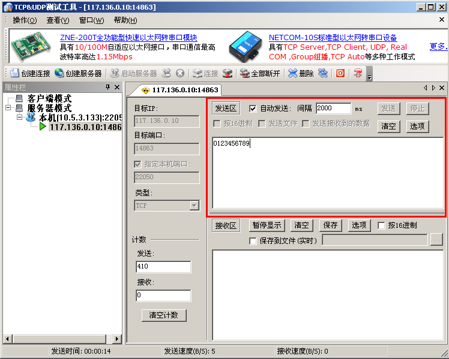

图 5‑23 TCP协议演示3

第五步：用串口线把DTU的串口1与PC相连，在PC上用串口工具(例如：SSCOM5.12)即可查看收到中心发送的内容，如图5-24所示。

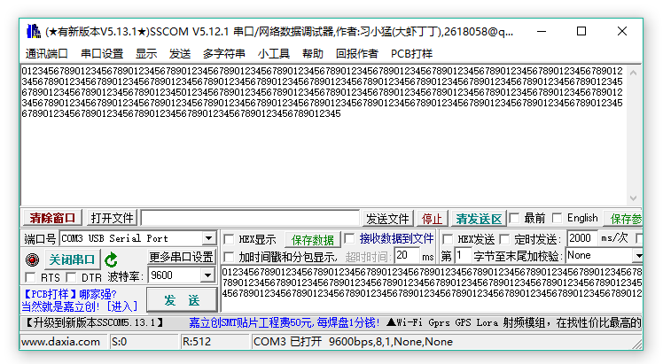

图 5‑24 TCP协议演示4

### 5.4 TCP SERVER配置

GPRS DTU工作在TCPServer模式时，有如下两方面需要说明：

- 工作在TCPServer模式，GPRS DTU需要具有固定IP地址，即一般要办理无线DDN专网业务；
- 工作在TCPServer模式，GPRS DTU以检测无线侧数据来判断链路存活状态，当发现两小时（此时间目前不可设）无线侧没有数据，则GPRS断开PPP连接，重新拨号联网。

### 5.4.1 参数配置

第一步：参见章节[5.1设备联网配置](#_设备联网配置)。

第二步：打开“企业网关相关设置>>企业网关”，将“IP”地址设置成“0.xxx.xxx.xxx”形式，其中“xxx”为任意数字。即设置GPRS DTU不主动连接企业网关，如图5-25所示。

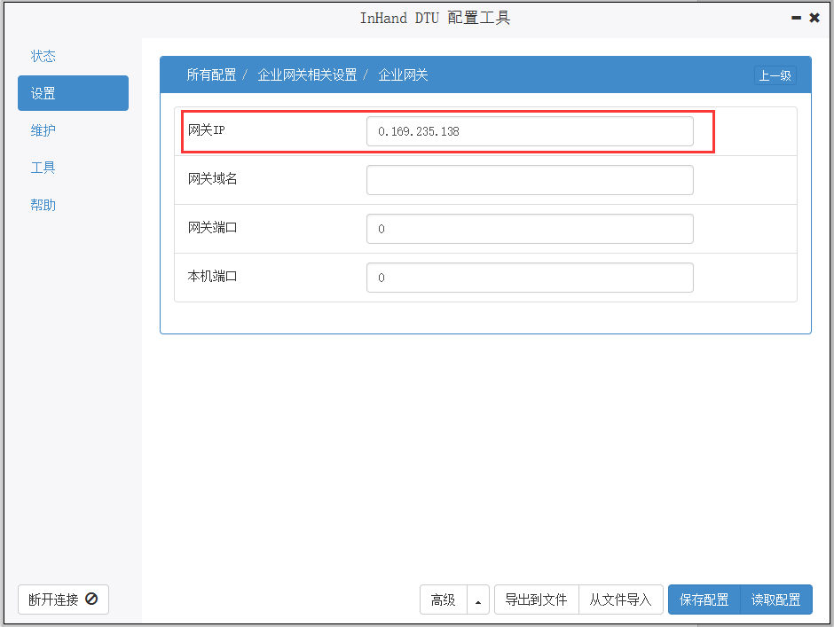

图 5‑25 TCP SERVER配置1

第三步：打开“企业网关相关设置”，设置“TCP服务器监听端口”（如设置为21022）。如图5-26所示。

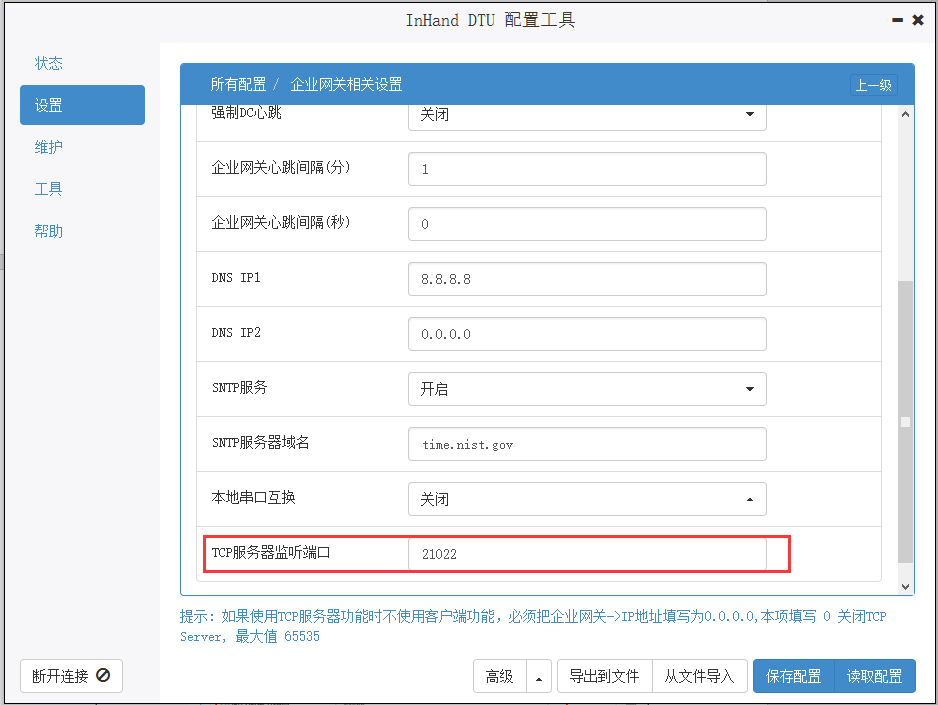图 5‑26 TCP SERVER配置2

第四步：打开“GPRS拨号参数设置->SIM卡设置”，设置“网络接入点名称（APN）”为public-vpn.bj，如图5-27所示。

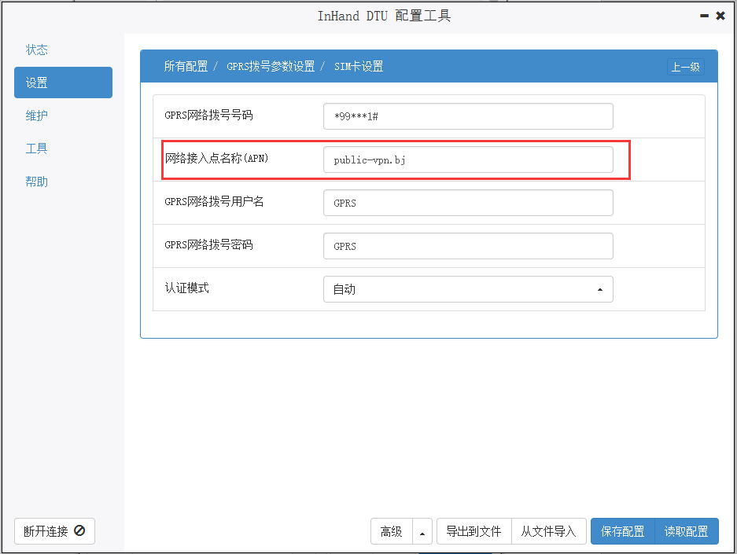

图 5‑27 TCP SERVER配置3

第五步：打开“ICMP参数设置”，分别设置ICMP三项参数。如图5-28所示，为设置好的一个例子，其中ICMP探测主机的IP地址必须是24小时随时可以Ping的。

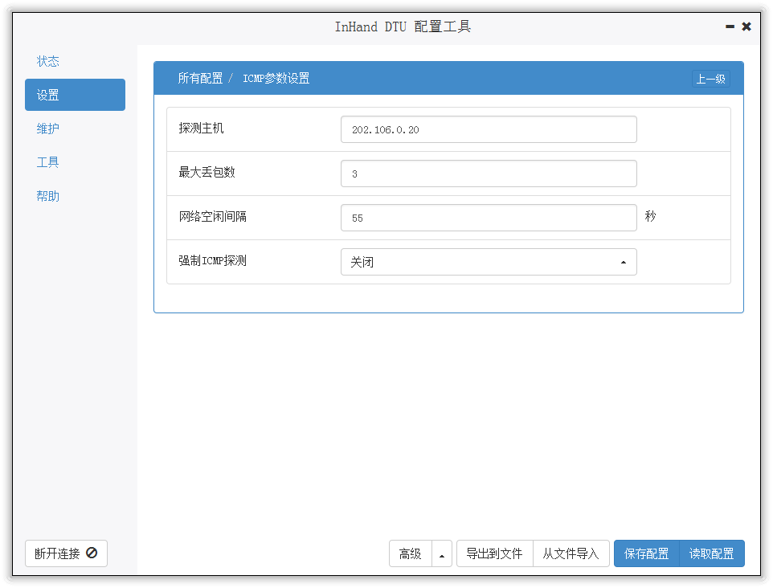

图 5‑28 TCP SERVER配置4

第六步：**设置好参数后，单击保存配置，重启设备即可生效。**

### 5.4.2 演示举例

用一台PC作为客户端，演示作为服务器的DTU和客户端之间的通信。

第一步：按照章节[5.4.1参数配置](#_演示举例)设置好设备参数。

第二步：通过串口工具查看日志，在日志中找到DTU拨上号后获得的Local IP地址，比如：211.136.69.32。查看日志方法参见章节[5.7串口2输出日志配置方法](#_4.7_串口2输出日志配置方法)

第三步：在PC上打开“TCP＆UDP测试工具”，创建连接，使PC作为客户端。在创建连接对话框中“类型”选为“TCP”；“目标IP”为DTU拨上号后获得的Local IP；“端口”为DTU的TCP服务器监听端口，如图5-29所示。

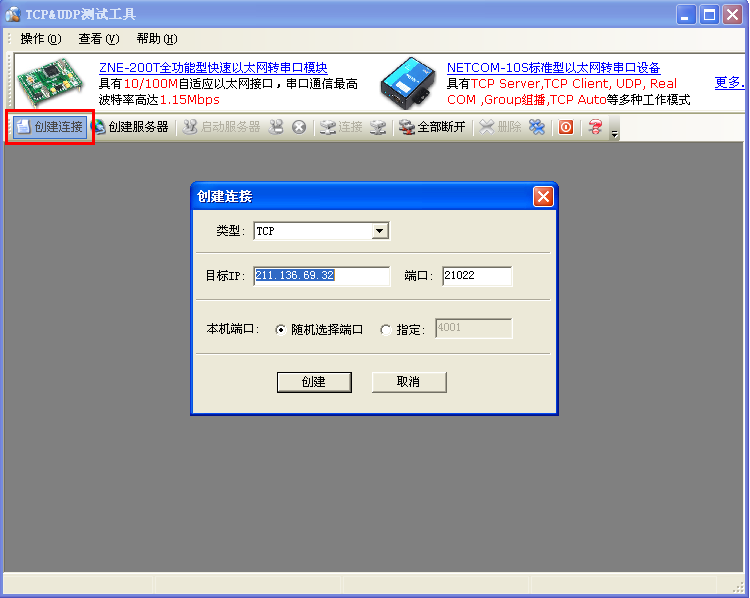

图 5‑29 TCP SERVER演示1

第三步：在新创建的连接中单击连接按钮，如图5-30所示。

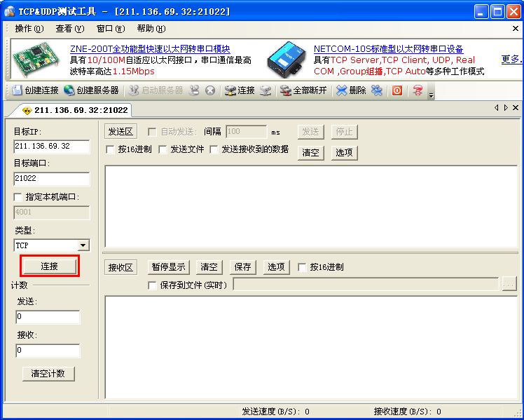

图 5‑30 TCP SERVER演示2

**第四步：** InDTU3XX_STD_V1.5.4及其以上版本，当DTU作为TCP Server时，如果有客户端链接成功，可通过配置工具查看客户端IP以及链接状态。

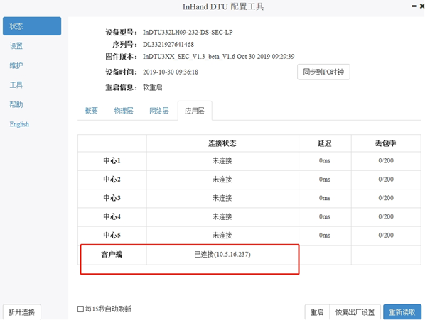

第五步：当客户端PC和DTU连接上后，在“TCP＆UDP测试工具”页面右侧设置好自动发送间隔，在发送区输入发送内容，点选“自动发送”则客户端即开始向DTU发送发送区的数据，如图5-31所示。

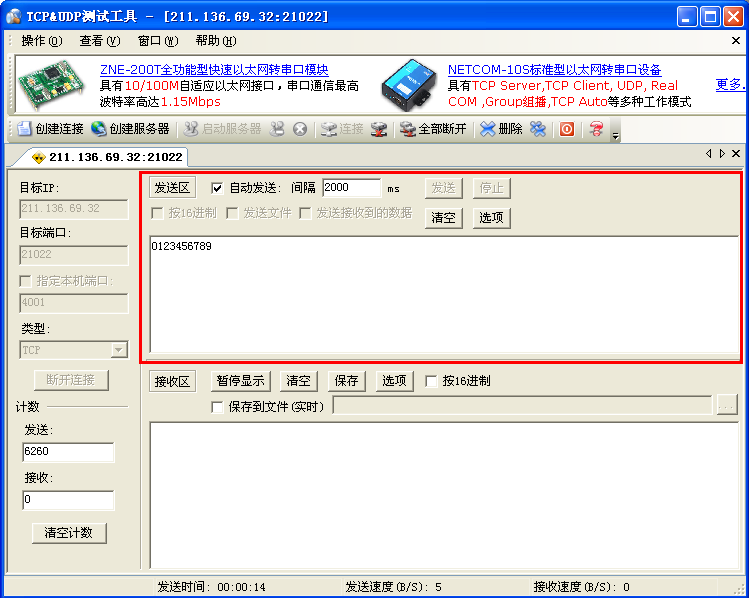

图 5‑31 TCP SERVER演示3

第六步：用串口线把DTU的串口2与PC相连，在PC上用串口工具(例如：SSCOM5.12)即可查看收到客户端发送的内容。如图5-32所示。

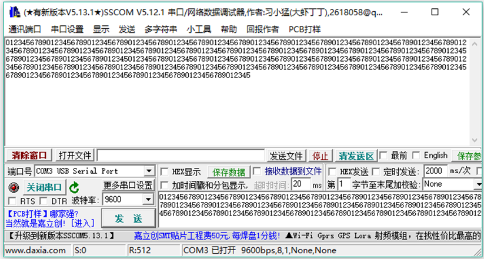

图 5‑32 TCP SERVER演示4

### 5.5 南网协议

第一步：登录InDTU配置工具，参考[5.1设备联网配置](#_4.1_设备联网最基本配置)

第二步：点击设置>>选择高级>>网管平台相关设置。

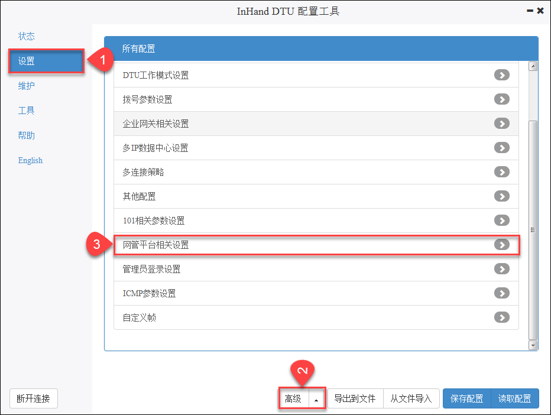

第三步：选择南网协议，进入网管平台地址设置。

第四步：填入南网的IP和端口号，点击保存配置。

如果使用域名，则IP填0.0.0.0。

### 5.6 Modbus-Net-Bridge配置

### 5.6.1 参数配置

第一步：参见章节[5.1 设备联网最基本配置](#_4.1_设备联网最基本配置)。

第二步：打开“企业网关相关设置>”菜单，选择“企业网关连接方式”的Modbus-Net-Bridge链接方式，如图5-33所示。

图 5‑33 Modbus-Net-Bridge配置1

第三步：打开“ICMP参数设置”菜单，分别设置ICMP三项参数（红色方框位置为设置好的一个例子，其中ICMP探测主机的IP地址必须是24小时随时可以Ping的），如图5-34所示。

图 5‑34 Modbus-Net-Bridge配置2

第四步：打开“GPRS拨号参数设置->SIM卡设备”菜单，设置“网络接入点名称（APN）”为public-vpn.bj，如图5-35所示。

图 5‑35 Modbus-Net-Bridge配置3

第五步：打开“企业网关相关设置”菜单，设置“DTU设备号”，设备号要小于10，如图5-36所示。

图 5‑36 Modbus-Net-Bridge配置4

第六步：打开“其它配置（应用扩展配置）”菜单，在“是否为调试模式”处选择“否”即可，如图5-37所示。

图 5‑37 Modbus-Net-Bridge配置5

第七步：**设置好参数后，单击保存配置，重启设备即可生效。**

### 5.6.2 演示举例

第一步：按照章节[5.5.1参数配置](#_4.5.1_参数配置)设置好设备参数。

第二步：在配置工具里读取设备日志，查看DTU获得的“Local IP”，如图5-38所示。

图 5‑38 Modbus-Net-Bridge演示1

第三步：打开mod_RSsim.exe工具，设置正确的串口、串口波特率、串口数据位、串口停止位和串口校验位，如图5-39所示。

图 5‑39 Modbus-Net-Bridge演示2

当设置好后，就开始发送数据，如图5-40所示。

图 5‑40 Modbus-Net-Bridge演示3

第四步：打开ModScan32.exe工具，单击“Connection>>Connect”，在弹出的新对话框中“IP Address”设置为DTU的 Local IP，“Service”设置为502，如图5-41所示。

图 5‑41 Modbus-Net-Bridge演示4

设置好后ModScan32.exe开始接收数据，如图5-42所示。

图 5‑42 Modbus-Net-Bridge演示5

### 5.7 101探测

第一步：PC连接InDTU的串口1，DTU插入SIM卡，并点击开始>>搜索设备管理>>查看串口1的COM号。

第二步：使配置工具连接串口1，点击连接设备>>刷新串口>>选择刚查看到的串口号，其它选项设置如下图，配好后点击连接。

第三步：断开连接。

第四步：点击设置>>所有配置>>企业相关设置>>企业网关，填入被探测主机的网关IP和端口号，点击保存配置。

如果使用网关域名，则网关IP填0.0.0.0。

第五步：配置完企业网关后重启设备。

第六步：再次连接设备，并点击读取配置，在状态栏看到InDTU、基站、主站联通。

第七步：点击维护>>101探测>>开始探测，探测完成后提示成功。

### 5.8 101转104配置

### 5.8.1 DTU参数配置

第一步：参见章节[5.1设备联网配置](#_设备联网配置)。

第二步：打开“101相关参数设置>>101转104功能设置”菜单，分别设置其包含的参数，一般采用默认参数即可，如图5-43所示。**图中参数为设置好的一个例子。**

图 5‑43 101转104配置1

第三步：打开“GPRS拨号参数设置->SIM设置”菜单，配置“网络接入点名称（APN）”参数，如图5-44所示。**下图是以专网环境北京的APN为例说明，具体请以当地为准。**

图 5‑44 101转104配置2

第四步：**设置好参数后，单击保存配置，重启设备即可生效。**

### 5.8.2 101从站的配置：DTU做101的主站

1）InDTU做101的主站，通过串口与101从站通讯，所以101从站和101主站串口波特率、停止位、校验位、数据位两端必须保持一致；DTU的“101相关参数设置>>101转104功能设置>>101规约模式:“平衡式”，也必须与101从站保持一致；DTU的“101相关参数设置>>101转104功能设置>>101链路地址长度: 1”，必须与101从站保持一致。如图5-45所示。

图 5‑45 101从站的配置1

2）Link address与DTU中“101相关参数设置>>101转104功能设置>>101链路地址”一致；DTU的“101相关参数设置>>101转104功能设置>>101ASDU地址长度: 2// 101COT长度: 2// 101IOA长度:2”，必须与101从站保持一致。如图5-46所示。

图 5‑46 101从站的配置2

3）DTU的“101相关参数设置>>其它相关设置>>101公共规约地址”与101从站中ASDU address一致，如图5-47所示。

图 5‑47 101从站的配置3

4）连接成功的日志，如图5-48所示。

图 5‑48配置成功日志显示

### 5.8.3 104主站的配置：DTU做104的从站

1）Host是DTU获得的专网IP，port固定是2404，local IP是运行104软件的PC的IP，如图5-49所示。

图 5‑49 104主站的配置1

2）DTU的“101相关参数设置>>101转104功能设置>>104COT长度: 2”，与104主站保持一致，如图5-50所示。

图 5‑50 104主站的配置2

3）ASDU Address必须与101从站保持一致（DTU的“101相关参数设置>>其它相关设置>>101公共规约地址”与101从站中ASDU address一致），如图5-51所示。

图 5‑51 104主站的配置3

4）连接成功的日志，如图5-52所示。

图 5‑52 配置成功日志显示

### 5.9 串口2输出日志配置方法

第一步：打开“其它配置(应用扩展配置)”，在“是否为调试模式”处选择“是（设备串口2）”即可，如图5-53所示。

图 5‑53 打开调试模式

第二步：打开“其他配置（应用扩展配置）”，在“调试模式等级”处根据需求选择“显示详细日志/中文简洁日志/英文简洁日志/显示调试日志”四者之一，如图5-54所示。

图 5‑54 选择调试模式等级

第三步：**设置好参数后，单击保存配置，重启设备即可生效。**

### 5.10 导入/导出配置

**导出到文件**，将当前DTU配置以（*.ini）的文件格式导出保存。

**从文件导入**，导入（*.ini）配置文件应用到当前连接的DTU。

第一步：登录配置工具。

第二步：单击“导出到文件”或“从文件导入”按钮，进行配置文件的导出或导入，如图所示5-55所示。

图 5‑55 导入/导出配置

|  导入配置文件后，需单击保存配置，重启设备后参数才生效！ |
| --- |

### 5.11 自定义帧配置

在这里用户可以自定义与中心端的登陆、心跳和退出的帧类型和帧内容。自定义帧的登陆包括登陆和登陆应答帧；自定义帧的心跳包括心跳和心跳应答；自定义帧的退出包括退出和退出应答。

帧类型有三种：ASCLL、HEX和DC。**选择HEX帧类型，空格占用字节数；选择ASCLL帧类型，空格不占用字节数；帧内容最长为32字节。**

**选择DC帧类型，对应帧内容不需配置。**

对设备进行基本联网配置，参见章节[5.1设备联网配置](#_设备联网配置)。在DTU 配置工具页面中，打开“自定义帧”，选择要定义帧的帧类型并定义帧内容，如图5-56所示。

图 5‑56 自定义帧配置

### 5.12 双卡切换功能举例

第一步：点击“所有配置>>GPRS拨号参数设置”，将“双卡模式”和“中心无法连接时切卡”的状态修改为“开启”。如图5-57所示。

图 5‑57 双卡切换配置1

第二步：点击“所有配置>>企业网关相关设置>>企业网关连接方式”，配置企业网关连接方式为TCP。如图5-58所示。

图 5‑58 双卡切换配置2

|  “中心无法连接时切卡”的配置，仅在企业网关连接方式为TCP时生效！ |
| --- |

第三步：“所有配置>>其他配置（应用扩展配置）>>最大登录次数”，根据需要设置最大登录次数。如图5-59所示。

图 5‑59 双卡切换配置3

举例：

（1）当前配置了1个中心，设置最大登录次数为3，当与中心建立连接失败次数达到6次后，将切卡重拨。

（2）当前配置了1个中心，默认最大登录次数为5，当与中心建立连接失败次数达到10次后，将切卡重拨。

第四步：如果需要配置多个中心，点击“所有配置>>多IP中心设置>>扩展企业网关”进行配置。如图5-60所示。如果不需要配置多个中心，则跳过此步。

图 5‑60 双卡切换配置4

举例：

（1）当前配置了1个中心，最大登录次数为5，当与中心建立连接失败次数达到10次后将切卡重拨。

（2）当前配置了2个中心，最大登录次数为5，当与中心建立连接失败次数达到20次后将切卡重拨。

第五步：点击“所有配置>>多连接策略>>最大重连间隔”，默认值为15s，可根据需要进行修改。如图5-61所示。

图 5‑61 双卡切换配置5

举例：

当配置为15S时，即设备未成功与中心建立连接时，会每隔15S尝试与中心建立连接。

**设置好参数后，单击保存配置，重启设备新参数即可生效。**

|  以下情况也会导致切卡： 1)ICMP探测丢包数超过设置的最大丢包数； 2)没有资费或者APN设置错误导致无数据服务； 3)PAP/CHAP认证失败(专网下可能会出现，公网下一般不会出现)； 4)SIM1卡槽SIM卡故障(如检测不到SIM卡)； 5)信号值过低(CSQ<8)，不足以承载数据通信； 6)无法注册网络； 7)无法附着网络； 8)数据业务拨号失败(ATD Error)。 |
| --- |

### 5.13 链路维持功能举例

在这里用户可以根据需求选择打开链路维持功能。链路维持功能的主要是为了规避运营商网优参数问题导致的网络阻塞问题。

对设备进行基本联网配置，参见章节[5.1设备联网配置](#_设备联网配置)。在DTU配置工具页面中，打开“ICMP参数设置”，选择“打开”链路维持功能，并且填写需要探测的主机IP地址，以及网络空闲间隔。如图5-62所示。

图 5‑62 ICMP参数设置

打开链路维持功能之后，会每隔“网络空闲间隔”向探测主机发送一个字节的IP包。具体日志显示，如图5-63所示。

图 5‑63 链路维持日志显示

### 5.14 长短信应用举例

标准中文短信，短信命令通过55 AA 55 AA命令发送，下发的短信命令帧中，长度超过140字节(也就是70个中文字符)，会以长短信发送。

例如，要发送短信内容为“你好0123456！你好0123456！你好0123456！你好0123456！你好0123456！你好0123456！你好0123456！你好0123456！”。将要发送内容编译为“55AA55AA1300B88180000B31353031303236373730388181000103818200A04F60597D0030003100320033003400350036FF014F60597D0030003100320033003400350036FF014F60597D0030003100320033003400350036FF014F60597D0030003100320033003400350036FF014F60597D0030003100320033003400350036FF014F60597D0030003100320033003400350036FF014F60597D0030003100320033003400350036FF014F60597D0030003100320033003400350036FF015DD9”，然后通过串口1发送。

串口1收到短信发送确认命令，表示发送的短信命令正确，具体格式为AA55AA55的命令，如图5-64所示。

图 5‑64 长短信应用举例1

手机收到短信之后，串口1会收到一条已收到短信的确认命令，如图5-65所示。

图 5‑65 长短信应用举例2

此时手机会收到“你好0123456！你好0123456！你好0123456！你好0123456！你好0123456！你好0123456！你好0123456！你好0123456！”的内容。

标准英文短信，下发的短信命令帧中，长度超过160字节(也就是160个英文字符)，会以长短信发送，方法和中文短信完全相同。

## 6 国网加密

### 6.1 简介

InDTU3XX-SEC设备（-SEC标识，指设备内含加密芯片）可为国网IEC101终端设备提供加密的数据传输通道，使IEC101终端和IEC101主站的数据在网络中安全的交互，数据的加密传输符合国网安全协议相关文档的要求。支持登录身份双向认证，提供国网IEC101数据的加解密传输通道，支持远程秘钥和证书管理，支持现场秘钥和证书管理。

### 6.2 终端证书申请步骤（仅做了解）

第一步：协调加密主站，得到主站IP地址和端口，通过InDTU配置工具配置主站的IP地址和端口。

第二步：准备专网手机卡，得到专网APN, 通过InDTU配置工具配置APN。

第三步：从101终端设备获取设备序列号，通过配置工具配置序列号到InDTU设备。

第四步：通过证书管理工具从设备导出证书请求文件，客户通过内网向中国电科院申请正式证书。

第五步：导入上一步骤获取到的证书文件到主站。

第六步：配置自定义数据帧(可选)。

其中：第3-5步是证书申请相关的步骤，其他几个步骤不影响证书的申请，但是对于成功连接主站是必不可少的。

### 6.3 导出证书请求文件

首先确保InDTU设备和其所使用的固件均具备加密功能。

### 6.3.1 接线

InDTU设备的串口2连接到PC机；串口1连接101终端。

### 6.3.2 InDTU配置工具配置步骤

第一步：登录InDTU配置工具，参考[5.1设备联网配置](#_4.1_设备联网最基本配置)

第二步：开启国网加密功能，并进入国网加密设置。

第三步：配置终端设备序列号，并打开证书管理工具。终端设备序列号，一般可以从终端设备铭牌获取，不同终端类型采用不同命名规则；如配网DTU、FTU序列号: D30XXXXXX1302013020800112、F20XXXXXX120201307081009。

第四步：配置101相关参数。

第五步：配置专网APN，用户名和密码。

第六步：配置连接主站的IP地址及端口。

第七步：配置自定义数据帧（少数主站才需配置此项）

   帧类型ASCII、HEX、上海协议三种可选, 上海协议中DTU设备在与主站建立连接的过程中，需要先向主站发送登陆帧，把101链路地址和专网卡的IP地址绑定在一起。上海协议的登陆帧数据格式如下10 02 01 00 03 16 , 同101固定帧格式，中间的标红色的部分，表示链路地址为0x0001。上图中的帧内容，需要填写链路地址，范围0-65535。

### 6.3.3 导出证书申请文件

可自定义选择证书管理配置工具导出证书申请文件，虽然使用的软件不同，但各类软件配置方法大致相同。

以配电终端证书管理工具为例，描述怎样导出证书申请文件，配置步骤如下：

第一步：右击，以管理员身份运行。

第二步：进入界面后，点击“选项>>端口配置”，进入端口配置界面，如下图。选择串口2的COM号，波特率选115200，校验位选None，然后确认保存。

第三步：点击图标，此时左下角端口状态由关闭变成打开。

第四步：点击终端身份认证，点击认证，如果认证失败重新点击终端身份认证，认证成功后点击关闭。

第五步：认证成功后，左侧功能均处于可用状态（蓝色）。点击终端信息采集>>取读终端基本信息，点击确定，完成后点击关闭。（特别注意：此界面中的终端序列号为设备配置中的终端标识，需与设备金属铭牌一致）

第六步：点击终端信息管理>>查询，查看采集到的信息。

第七步：选择需导出的证书申请表, 点击导出>>选择导出位置>>保存。

第八步：点击终端证书导入导出，选择需导出的请求文件，保存到PC。

第九步：更换终端，重复以上步骤，将所有设备证书请求文件和申请表导出。

第十步：在相应目录下找到所有“终端序列号_安全芯片序列号.req”的请求文件以及“证书申请表_2018xxxx”文件，打包成.zip格式，命名为“P10.zip”发给局方相关负责人，该负责人通过内网邮箱方式向中国电科院申请签发证书。签发回的证书导入主站，该证书与此台终端是唯一对应关系，对应失败该终端与主站不能正常通讯。中国电科院给的交由主站使用（据四方主站说此证书在主站向设备远程更新秘钥时使用，与我们无关）。

第十一步：单击应用证书导入>>选择要导入的证书，并点击导入证书。然后断开端口关闭软件。

第十二步：关闭证书管理工具功能。因为证书管理工开启后，不能连接主站。

## 7 工具设置

### 7.1 添加GPRSDEMO

中心测试工具在window server系统上若无法使用，请按照下图步骤进行添加。

右键“我的电脑>>属性>>高级系统设置”弹出“系统属性”窗口，按照图6-1、6-2操作添加gprsdemo软件，并保存设置即可使用。

gprsdemo软件位置：X:\DTU Tool YSTK\addon\center ，X为DTU配置工具的安装盘。

图 6‑1添加GPRSDEMO1

图 6‑2 添加GPRSDEMO2

附录

DTU工作模式

**DTU工作模式描述**

1）系统上电后自动进行GPRS网络检测，如果成功进入GPRS网络，往串口输出： “GPRSOK”。

2）如果无法成功进入GPRS网络，将自动切换到短信传输模式，并往串口输出：“SMSSEND”。

 a）当短信发送成功时，往串口输出："SMSSOK"。

b）当短信发送失败时，往串口输出："SMSERROR"。

c）当短信发送超时时，往串口输出："SMSTIMEOUT"。

3）遥测终端机232口的第4针是与DTU的握手线(与DTU的RTS线相连)：

通常情况下遥测终端机232口的第4针信号电平为-5V：在这种情况下，允许DTU在通过GPRS方式连接中心不成功的时，自动转向短消息模式。

4）多中心

GPRSOKi（i=1,2…）表示i通道GPRS正常

SMSSENDi（i=1,2…）表示i通道SMS正常

SMSOKi（i=1,2…）

抓取DTU日志

在进行排查问题时，有些时候需要长时间抓取设备的运行日志，因为DTU存储空间较小，此时我们可以考虑借助其他软件来抓取我们的DTU日志。本次示例中采用软件为SecureCRT，客户可自行网上搜索下载。

首先连接DTU与PC，打开DTU 配置工具

**Step1：打开DTU调试模式，如图1所示。**

图1

**Step2:设置保存日志文件名**

配置好DTU tool 后断开连接设备

打开Secure CRT，文件—>会话日志—>取一个文件名字—>保存，如图2、图3所示。

图2

图3

**Step3:连接DTU**

选择相应串口，配置与DTU一致的串口参数，点击连接

图4

**Step4:保存日志**

抓取完日志点击结束保存，再次点击 “会话日志”

图5

常见故障处理

**1）DTU300上电后，频繁重启**

故障排查：

1.检查设备是否能拨号上网；

2.请确认DTU是否正确插入UIM/SIM/USIM卡；

3.请确认UIM/SIM/USIM卡是否被欠费停机，或者卡损坏；

4.拨号参数（如拨号号码，接入点参数，账号，密码）是否填写正确；

5.检查无线网络信号质量，是否低于20，同样也把DTU发到信号较好的地方再次上电查看；

6.检查给DTU供电的电源电压是否正常。

**2）DTU300上电后电源指示灯不亮**

故障排查：

1.请确认已经将DTU与电源转换器连接牢固；

1. 请确认环境可以提供100V AC～240V AC的交流电的电压；

3.请检查DTU的电源转换器是否输出满足5V DC～35V DC的直流电压；

4.有可能DTU的内部灯烧坏，请尽快与映翰通公司的销售代表取得联系。

**3）无法对DTU300进行配置**

故障排查：

1.请检查串口电缆，并检查PC串口是否正常，设置软件所选端口是否正确；

2.提供电源为5V DC～35V DC；极性是否正确。

**4）无法对DTU设备进行串口升级**

故障排查：

1.请检查串口电缆，并检查PC串口是否正常，设置软件所选端口是否正确；

2.提供电源为5V DC～35V DC；极性是否正确。
