# InDTU351S系列产品快速用户手册V1.2

InDTU351S系列

快速指导手册

声明

首先非常感谢您选择本公司产品！在使用前，请您仔细阅读本用户手册。

非本公司书面许可，任何单位和个人不得擅自摘抄、复制本书内容的部分或全部，并不得以任何形式传播。

由于不断更新，本公司不能承诺该资料与实际产品一致， 同时也不承担由于实际技术参数与本资料不符所导致的任何争议，任何改动恕不提前通知。本公司保留最终更改权和解释权。

版权所有©2021北京映翰通网络技术股份有限公司及其许可者版权所有，保留一切权利。

本手册图形界面约定

| **格 式** | **意 义** |
| --- | --- |
| > | “   ”表示按钮名，如“单击确定按钮”。 |
| “” | 带双引号“”表示窗口名、菜单名，如：弹出“新建用户”窗口。 |
| >> | 多级菜单用“>>”隔开。如“文件>>新建>>文件夹”多级菜单表示“文件”菜单下的“新建”子菜单下的“文件夹”菜单项。 |
|  | 提醒操作中应注意的事项，不当的操作可能会导致数据丢失或者设备损坏。 |
|  | 对操作内容的描述进行必要的补充和说明。 |

## 技术支持

**北京映翰通网络技术股份有限公司（总部）**

电话：010-8417 0010

地址：北京市朝阳区紫月路18号院3号楼5层

**成都办事处**

电话：028-8679 8244

地址：四川省成都市武侯区天府大道北段1777号中国太平金融大厦14层

**广州办事处**

电话：020-8562 9571

地址：广州市天河区黄埔大道中660号汇金国际金融中心B栋1913单元

**武汉办事处**

电话：027-8716 3566

地址：武汉市洪山区关山大道465号光谷新发展国际中心B座5层

**上海办事处**

电话：021-5480 8501

地址：上海市普陀区国浩长风城北座326室

## 1 产品简介

### 1.1 系统应用

本手册内容是以个别产品为例进行说明的，具体情况请以实物为准。

InDTU350S系列是一款工业级无线数据终端产品，支持北斗/GPS定位授时。他以无线蜂窝网络为承载网，为工业用户提供TCP/IP之上的无线数据传输通道，功能上完成现场控制站串口或者网口设备和中心控制系统间的无线数据通信，使远程工业现场控制得以实现。

映翰通公司提供一套完备的解决方案，使用户以最小的投入，获得极高的生产运行效率。其典型组网方式如图1-1所示。

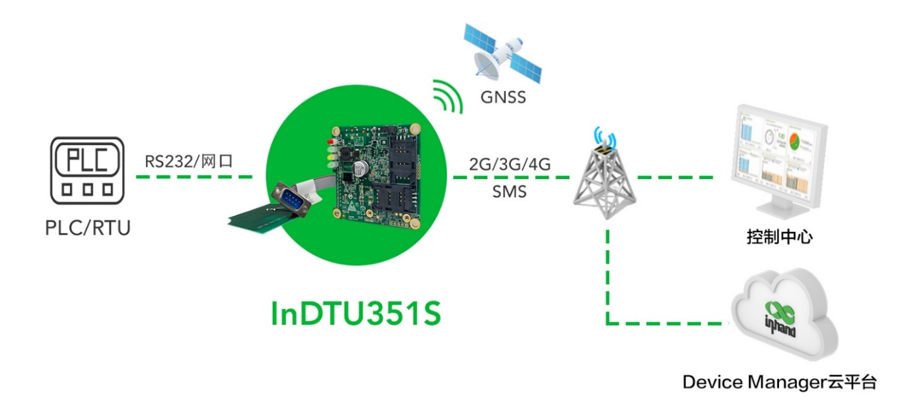

图 1‑1 InDTU350S组网方式

### 1.2 功能说明

InDTU351S产品是基于无线蜂窝网的数据通信系统。该系统中的硬件InDTU351S集成了一个无线通讯模组，支持GSM/LTE/WCDMA/TDSCDMA网络制式。InDTU351S基于高性能微处理器设计，硬件资源丰富，外部接口种类齐全。其硬件设计具备良好的可扩展性，能提供多种工业化总线标准的支持，该产品广泛应用于远程/现场数据采集、远程监控、现场控制等多种领域。

主要特点如下：

- 提供嵌入式板卡设计，电力罩式FTU专供；
- 网串一体接口设计，兼容网口终端设备；
- 支持GNSS，北斗/GPS双模定位授时；
- 防潮、抗干扰设计；
- 适应工业需求,宽电压范围+5~48VDC；
- 工业级温度范围：-40℃～+75℃；

## 2 设备安装上电

### 2.1 发货配件清单

| 品名 | 数量 | 备注 |
| --- | --- | --- |
| InDTU351S-LQA8系列网串一体无线通信模块 | 1台 | 标配 |
| 4G PCB天线 | 1根 | 标配 |
| DB-9转接线 | 1根 | 标配 |
| GNSS天线 | 1根 | GNSS型号标配 |

### 2.2 InDTU351S设备安装

第一步：安装SIM卡和天线（4G），如图2-1所示。

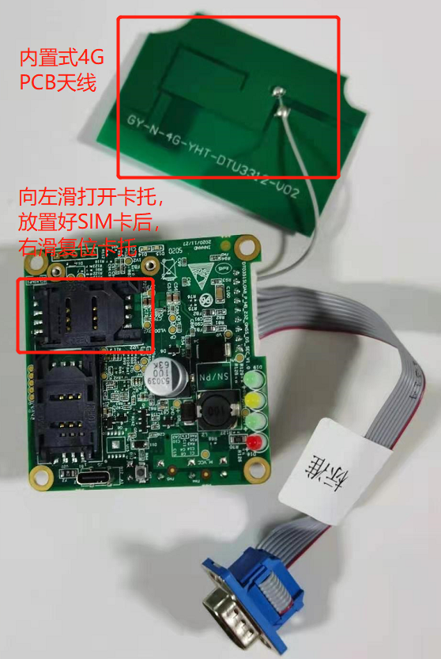

图 2‑1 InDTU351S SIM卡和天线安装

| 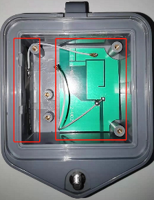 1、4G内置天线安装方法：撕下PCB 背部的3M 胶纸；将撕下的3M 背胶对准两边平稳放下、压紧即可。 2、双SIM卡型号可将SIM卡安装在任意卡槽，切忌不要带电安装和插拔SIM卡。 3、GNSS天线请不要撕拉、弯折，并贴于通信舱侧壁内。 |
| --- |

第二步：连接终端设备和电脑，给设备供电和配置，如图2-2所示。

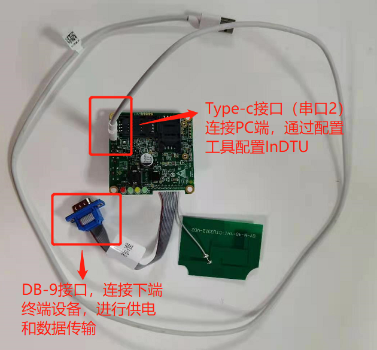

图 2‑2 InDTU351S接线方式

**表 2‑1 InDTU351S 接线定义**

| DB9 管脚号 | 对应XH9 Pin | 信号定义 | 备注 |
| :---: | :---: | --- | --- |
| 1 | 1 | V- | 通信电源负 |
| 2 | 3 | TXD | 串口通信发送 |
| 3 | 5 | RXD | 串口通信接收 |
| 4 | 7 | LAN-TX+ | 网口发信号+ |
| 5 | 9 | GND | 串口通信收发地 |
| 6 | 2 | V+ | 通信电源正（DC24V） |
| 7 | 4 | LAN-RX- | 网口收信号- |
| 8 | 6 | LAN-RX+ | 网口收信号+ |
| 9 | 8 | LAN-TX- | 网口发信号- |

|  1. 请不要在带电情况下进行硬件安装。 2. 设备支持的供电范围为DC 5-48V，供电必须保证电源的稳定性（纹波小于 300mV，并确保瞬间电压不超过 48V），并保证电源功率大于 8W 以上。 |
| --- |

### 2.3 指示灯说明

### 2.3.1 InDTU351S指示灯状态

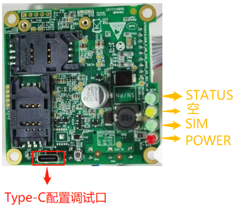

| **DTU状态** | **POWER灯** | **SIM灯** | **STATUS灯** |
| --- | :---: | :---: | :---: |
| 系统启动 | 亮 | 灭 | 灭 |
| 拨号中，无故障 | 亮 | 灭 | 灭 |
| 拨号中，故障 | 亮 | 灭 | 亮 |
| 拨号成功，中心连接中 | 亮 | 亮 | 灭 |
| 拨号成功，连接中心故障 | 亮 | 亮 | 亮 |
| 连接中心成功 | 亮 | 同步慢闪 | |
| SIM卡故障 | 亮 | 慢闪 | 亮 |
|  | | | |

|  + 亮表示常亮，即至少保持3秒钟不闪； + 灭表示常灭，即至少保持3秒钟不闪； + 慢闪表示闪烁频率大约1Hz即每1秒闪一次； + 快闪表示闪烁频率大约5HZ即每0.2秒闪一次； + “X”表示任意状态。 |
| --- |

## 3 配置工具

工具名称：InHand DTU3XX 配置工具

安装方法：双击可执行文件，按照默认提示完成安装。

运行环境：

   

## 4 快速配置

### 4.1 101串口数据转发

### 4.1.1 网络拓扑

### 4.1.2 配置步骤

**Step1：登陆配置工具。（默认管理员账号：adm；登陆密码：123456）**

通过PC打开配置工具，单击“连接设备”，在弹出的新对话框中选择串口和串口波特率等串口参数，可在PC设备管理查看串口（Type-c接口）的COM号。最后单击“连接”即可。

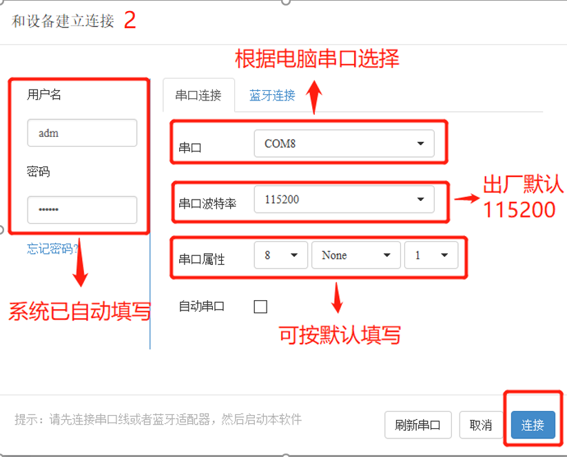

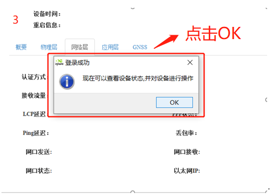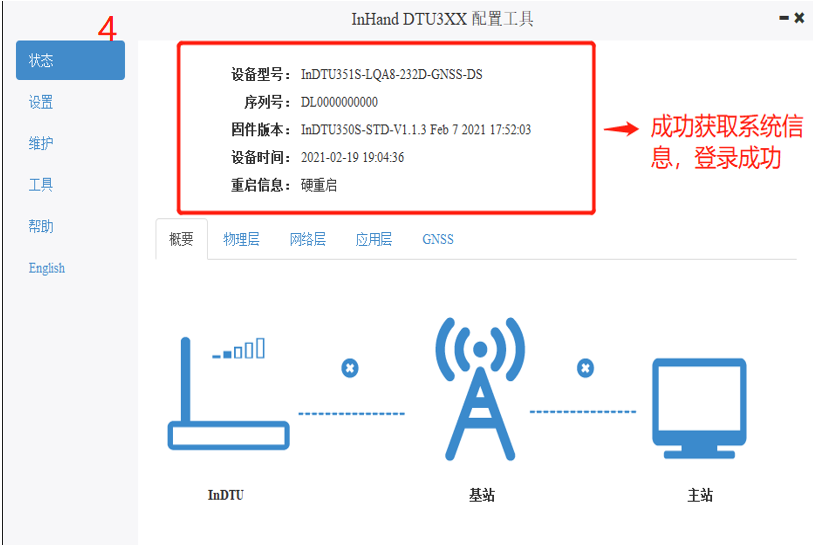

**Step2：设置通信串口（本地串口1）参数。**

设置通信串口（本地串口1）对应参数，其参数设置要和本串口相连的对端串口参数（如FTU）保持一致。

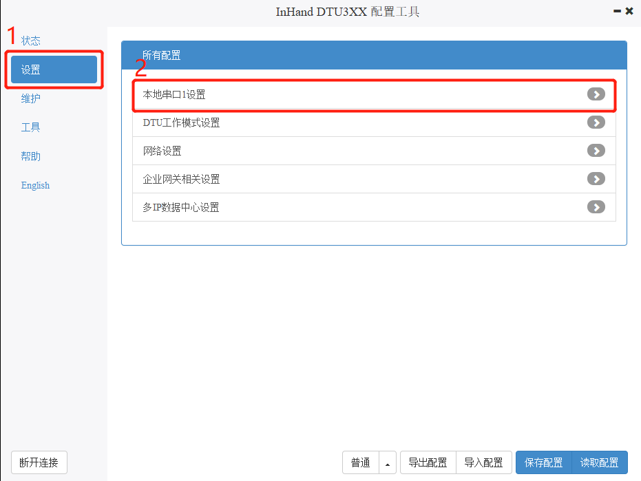

**Step3：设置拨号参数。**

打开“网络设置>>拨号参数设置”进行参数修改即可。默认参数即公网拨号参数，非专线无需更改；若是专线请修改网络接入点名称（APN）、网络拨号用户名/密码。

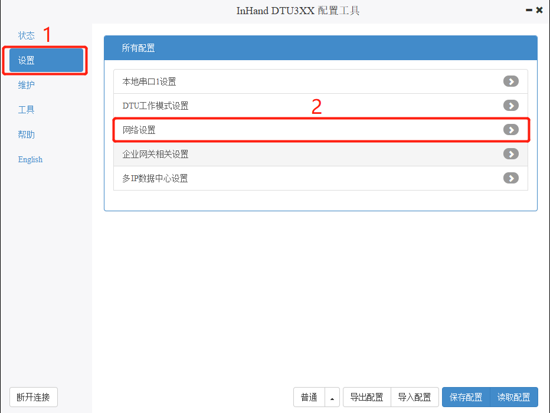

**Step4：中心侧参数设置。**

打开“企业网关相关设置”进行参数修改即可。

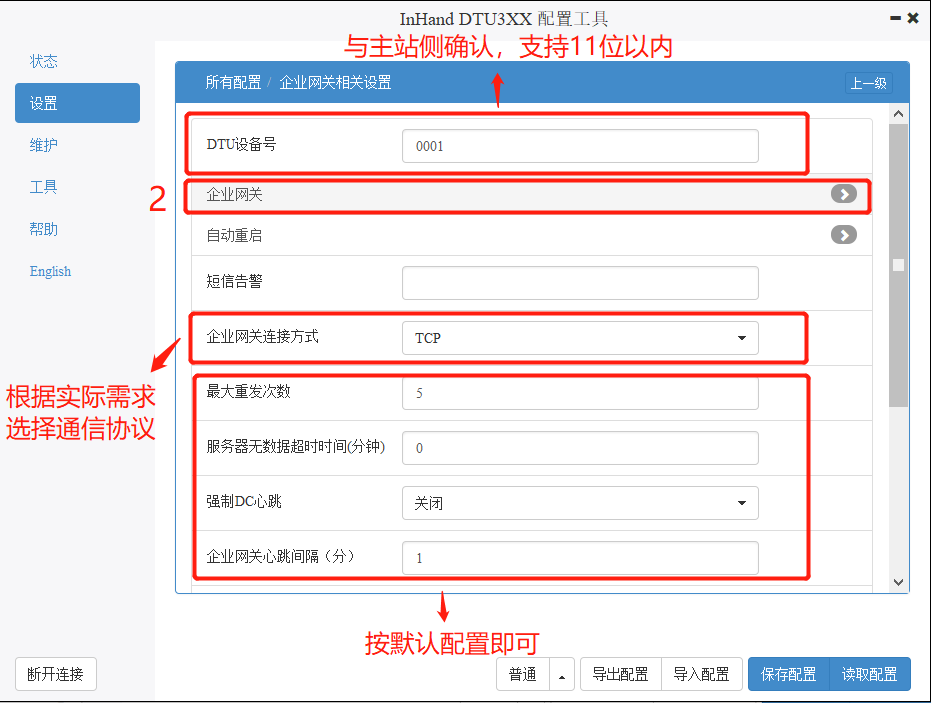

**Step5：保存配置。**

设置好参数后，单击保存配置，重启设备即可生效。

### 4.2 104网口数据转发

### 4.2.1 网络拓扑

### 4.2.2 配置步骤

**Step1：登陆配置工具。**

参照4.1.2>>Step1。

**Step2：设置拨号参数。**

打开“网络设置>>拨号参数设置”进行参数修改即可。专线需填入网络接入点名称（APN）、网络拨号用户名/密码。这里以“网络接入点名称（APN）”为public-vpn.bj，用户名/密码分别为GPRS举例说明。如下图所示。

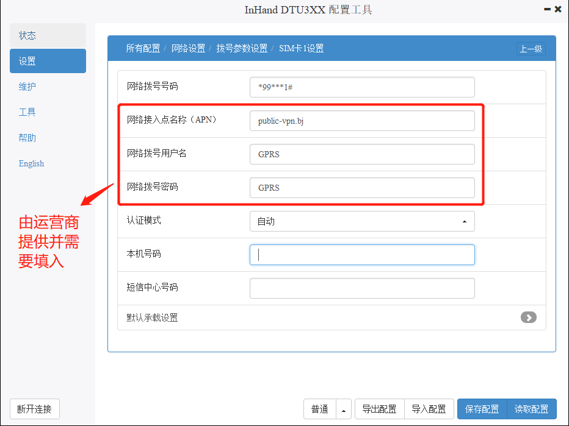

**Step3：设置以太网口IP地址。**

打开“网络设置>>以太网设置”进行设置即可。需注意InDTU351S与下端网口设备IP地址需在同一网段才能正常通信，InDTU351S出厂默认的静态IP地址为192.168.1.1。

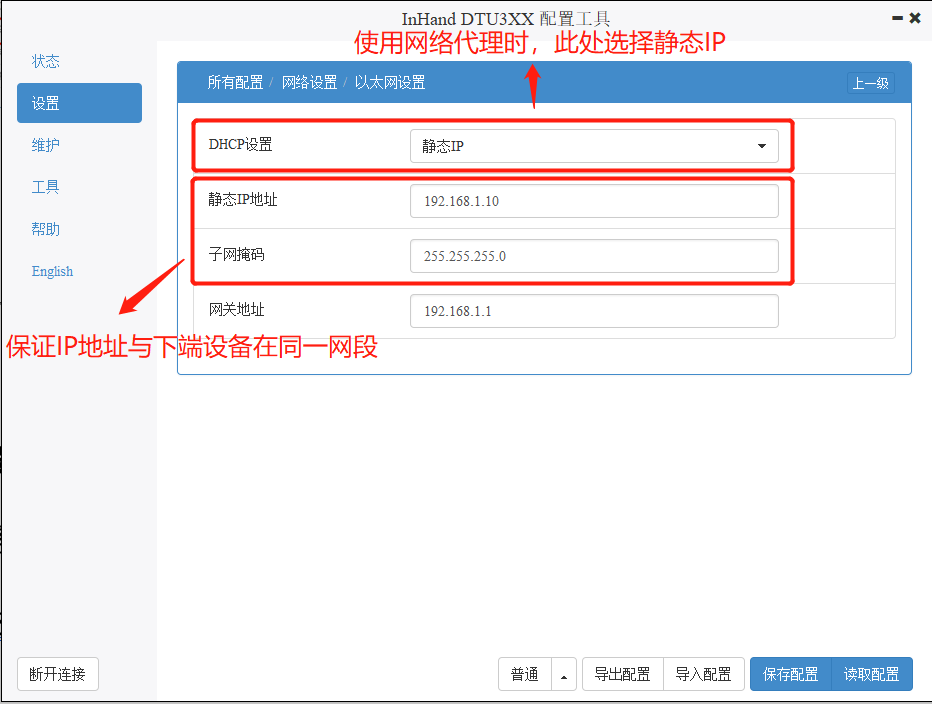

**Step4：设置网络代理。**

打开“网络设置>>网络代理”进行设置即可。需注意使用网络代理功能时，服务器IP地址必需保证为固定IP。

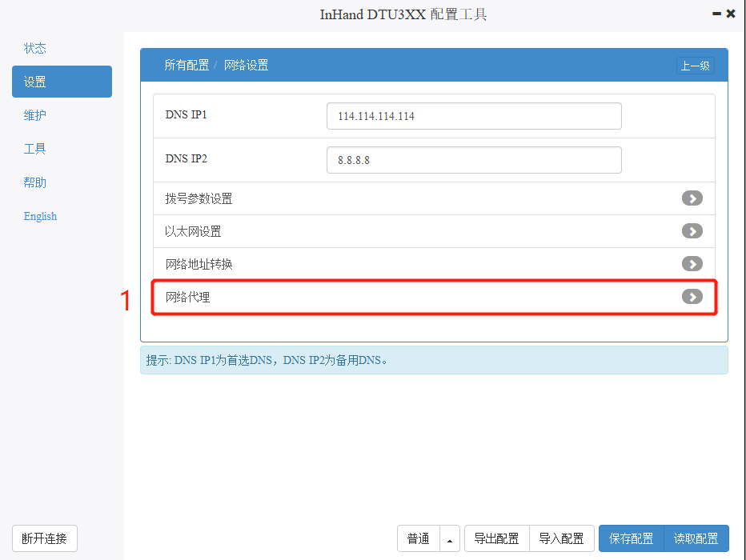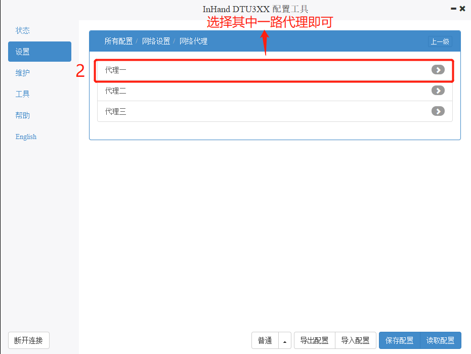

**Step5：保存配置。**

设置好参数后，单击保存配置，重启设备即可生效。

附录

抓取DTU日志

在进行排查问题时，有些时候需要长时间抓取设备的运行日志，因为DTU存储空间较小，此时我们可以考虑借助其他软件来抓取我们的DTU日志。本次示例中采用软件为SecureCRT，客户可自行网上搜索下载。

首先连接DTU与PC，打开DTU 配置工具

**Step1：打开DTU调试模式，如图1所示。**

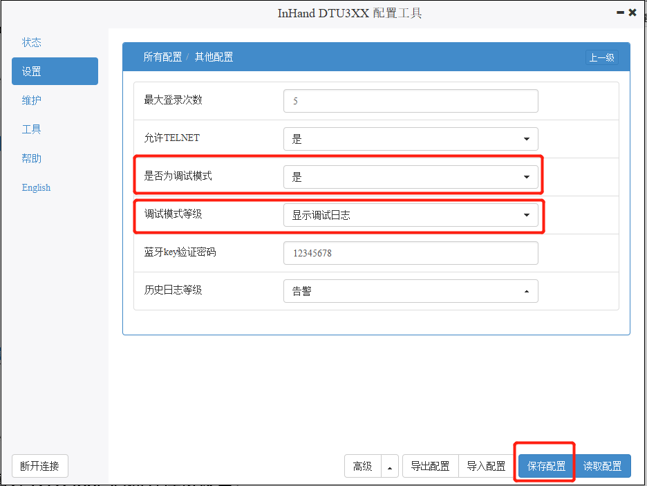

图1

**Step2:设置保存日志文件名**

配置好DTU tool 后断开连接设备

打开Secure CRT，文件—>会话日志—>取一个文件名字—>保存，如图2、图3所示。

图2

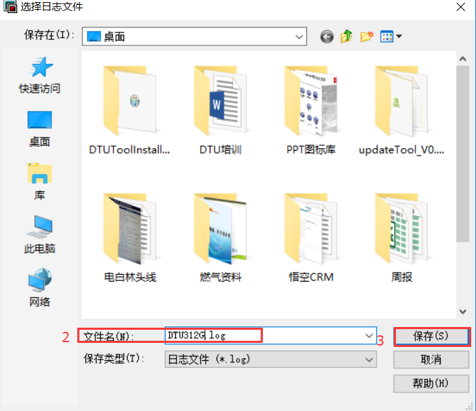

图3

**Step3:连接DTU**

选择相应串口，配置与DTU一致的串口参数，点击连接

图4

**Step4:保存日志**

抓取完日志点击结束保存，再次点击 “会话日志”

图5

常见故障处理

**1）DTU351S上电后，频繁重启**

故障排查：

1.检查设备是否能拨号上网；

2.请确认DTU是否正确插入UIM/SIM/USIM卡；

3.请确认UIM/SIM/USIM卡是否被欠费停机，或者卡损坏；

4.拨号参数（如拨号号码，接入点参数，账号，密码）是否填写正确；

5.检查无线网络信号质量，是否低于20，同样也把DTU发到信号较好的地方再次上电查看；

6.检查给DTU供电的电源电压是否正常。

**2）DTU351S上电后电源指示灯不亮**

故障排查：

1.请确认已经将DTU与电源转换器连接牢固；

2.请检查DTU的电源转换器是否输出满足5V DC～48V DC的直流电压；

3.有可能DTU的内部灯烧坏，请尽快与映翰通公司的销售代表取得联系。

**3）无法对DTU351S进行配置**

故障排查：

1.请检查串口电缆，并检查PC串口是否正常，设置软件所选端口是否正确；

2.提供电源为5V DC～48V DC；极性是否正确。

**4）无法对DTU设备进行串口升级**

故障排查：

1.请检查串口电缆，并检查PC串口是否正常，设置软件所选端口是否正确；

2.提供电源为5V DC～48V DC；极性是否正确。
