# InDTU352S系列产品快速用户手册V1.0

InDTU352S系列

快速指导手册

资料版本：V1.0—2022.01

声明

首先非常感谢您选择本公司产品！在使用前，请您仔细阅读本用户手册。

非本公司书面许可，任何单位和个人不得擅自摘抄、复制本书内容的部分或全部，并不得以任何形式传播。

由于不断更新，本公司不能承诺该资料与实际产品一致， 同时也不承担由于实际技术参数与本资料不符所导致的任何争议，任何改动恕不提前通知。本公司保留最终更改权和解释权。

版权所有©2021北京映翰通网络技术股份有限公司及其许可者版权所有，保留一切权利。

本手册图形界面约定

| **格 式** | **意 义** |
| --- | --- |
| > | “   ”表示按钮名，如“单击确定按钮”。 |
| “” | 带双引号“”表示窗口名、菜单名，如：弹出“新建用户”窗口。 |
| >> | 多级菜单用“>>”隔开。如“文件>>新建>>文件夹”多级菜单表示“文件”菜单下的“新建”子菜单下的“文件夹”菜单项。 |
|  | 提醒操作中应注意的事项，不当的操作可能会导致数据丢失或者设备损坏。 |
|  | 对操作内容的描述进行必要的补充和说明。 |

## 技术支持

**北京映翰通网络技术股份有限公司（总部）**

电话：010-8417 0010

地址：北京市朝阳区紫月路18号院3号楼5层

**成都办事处**

电话：028-8679 8244

地址：四川省成都市武侯区天府大道北段1777号中国太平金融大厦14层

**广州办事处**

电话：020-8562 9571

地址：广州市天河区黄埔大道中660号汇金国际金融中心B栋1913单元

**武汉办事处**

电话：027-8716 3566

地址：武汉市洪山区关山大道465号光谷新发展国际中心B座5层

**上海办事处**

电话：021-5480 8501

地址：上海市普陀区国浩长风城北座326室

## 1 产品简介

### 1.1 系统应用

本手册内容是以个别产品为例进行说明的，具体情况请以实物为准。

InDTU350S系列是一款工业级无线数据终端产品，支持北斗/GPS定位授时。他以无线蜂窝网络为承载网，为工业用户提供TCP/IP之上的无线数据传输通道，功能上完成现场控制站串口或者网口设备和中心控制系统间的无线数据通信，使远程工业现场控制得以实现。

映翰通公司提供一套完备的解决方案，使用户以最小的投入，获得极高的生产运行效率。其典型组网方式如图1-1所示。

图 1‑1 InDTU352S组网方式

### 1.2 功能说明

InDTU352S产品是基于无线蜂窝网的数据通信系统。该系统中的硬件InDTU352S集成了一个无线通讯模组，支持GSM/LTE/WCDMA/TDSCDMA网络制式。InDTU352S基于高性能微处理器设计，硬件资源丰富，外部接口种类齐全。其硬件设计具备良好的可扩展性，能提供多种工业化总线标准的支持，该产品广泛应用于远程/现场数据采集、远程监控、现场控制等多种领域。

主要特点如下：

- 网串一体接口设计，兼容网口终端设备；
- 链路维持，“永久”在线；
- 防潮、抗干扰设计；
- 工业级温度范围：-40℃～+75℃；

## 2 设备安装上电

### 2.1 发货配件清单

| 品名 | 数量 | 备注 |
| --- | --- | --- |
| InDTU352S网串一体无线通信终端 | 1台 | 标配 |
| 4G小吸盘天线 | 1根 | 标配 |
| USB配置线（type-C接口） | 1根 | 选配 |

### 2.2 InDTU352S设备安装

**第一步：安装SIM卡和天线，如下图所示。**

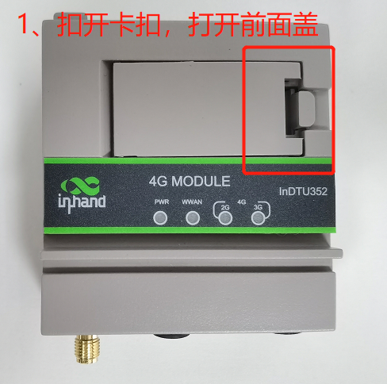 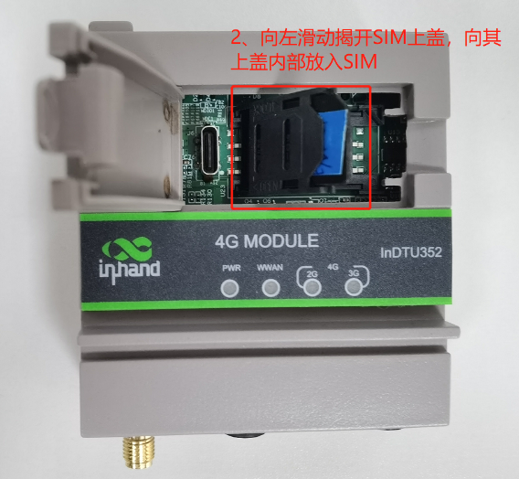

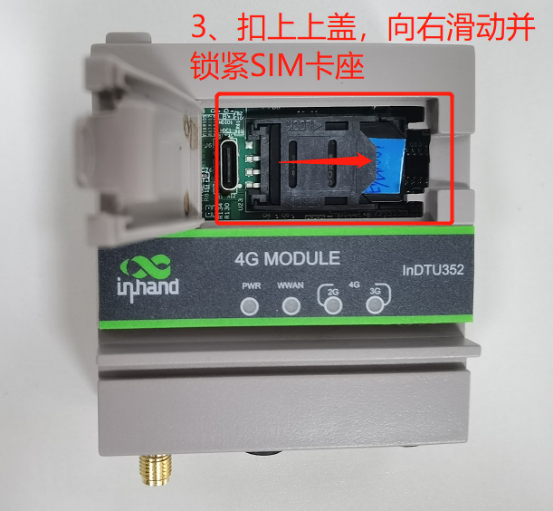 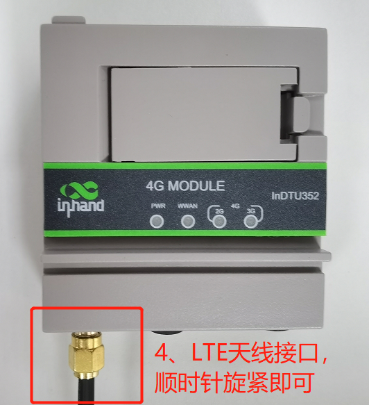

图 2‑1 InDTU352S SIM卡和天线安装

**第二步：连接终端设备，给设备供电，接口定义如表2-1所示。**

InDTU352S接口应采用标准2.54mm，2×15双排插针作为连接件，其引脚示意图及定义说明如下图所示，引脚定义说明见下表。通过此连接件可连接下端设备。

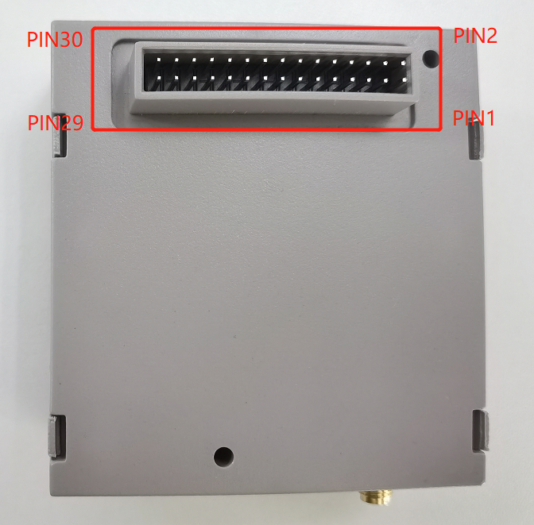

**表 2‑1 InDTU352S 接口定义**

| 引脚编号 | 信号类别 | 信号名称 | 信号方向   （针对模块） | 说明 |
| :---: | :---: | :---: | :---: | --- |
| 1 | 电源地 | GND | 电源输入 | 电源地输入，比其它信号引脚的插针稍长0.5mm |
| 2 | 电源地 | GND | 电源输入 | |
| 3 | 电源 | VCC4V | 电源输入 | 通信模块电源输入，4V±0.2V，正常工作电流500mA，电压纹波小于30mV；最大电流2A，可持续1ms。 |
| 4 | 电源 | VCC4V | 电源输入 | |
| 5 | 信号 | DCE_TXD | 输出 | 模块串口输出信号（3.3V/TTL） |
| 6 | 信号 | DCE_RXD | 输入 | 模块串口输入信号（3.3V/TTL） |
| 7 | 信号 | DCE_RTS | 输入 | UART 增加流控 |
| 8 | 信号 | DCE_CTS | 输出 | UART 增加流控 |
| 9 | 信号 | CARD_IN | 无 | 模块内部4.7K下拉到地 |
| 10 | 信号 | USB+ | 输入/输出 | USB2.0 HOST接口，可用于3G/4G等通信：预留 |
| 11 | 信号 | USB- | 输入/输出 | |
| 12 | 信号 | PCTRL | 输入 | 内部4.7K上拉3.3V，I/0：预留 |
| 13 | 电源地 | GND | 电源输入 | 通信模块电源地输入 |
| 14 | 模块控制 | /RST | 输入 | 通信模块复位控制信号，保持8s低电平“0”后通信模块恢复出厂配置（3.3V/TTL），模块内部上拉到3.3V） |
| 15 | 信号 | ON/OFF | 输入 | 通信模块控制信号，低电平持续1s为开机信号(3.3V/TTL)，模块内部下拉处理，预留接口 |
| 16 | 信号 | STATE0 | 无 | 默认模块内部4.7K下拉到地 |
| 17 | 信号 | STATE1 | 无 | |
| 18 | 信号 | STATE2 | 无 | |
| 19 | 信号 | SDA | 输入/输出 | IIC：SDA，输入/输出：预留 |
| 20 | 信号 | SCL | 输入 | IIC：SCL，输入：预留 |
| 21 | 网络信号 | /LED_ACT | 输出 | 网络指示灯输入信号，低电平有效，指示网络有数据正在传输：预留 |
| 22 | 网络信号 | /LED_LINK | 输出 | 网络指示灯输入信号，低电平有效，指示网络物理连接已建立。（3.3V/TTL） |
| 23 | 网络信号 | TD2+ | 网络差分信号 | 10/100M以太网口，内置网络变压器，自适应MDI/MDIX默认LAN口，可配置为WAN口 |
| 24 | 网络信号 | TD2- | 网络差分信号 | |
| 25 | 网络信号 | RD2+ | 网络差分信号 | |
| 26 | 网络信号 | RD2- | 网络差分信号 | |
| 27 | 电源 | VCC3V3 | 电源输入 | 逻辑电路工作电源，可用于网络变压器、电平转换、指示灯驱动等，3.3 V±0.3V，电流不小于50mA，电压纹波小于30mV  |
| 28 | 电源 | VCC3V3 | 电源输入 | |
| 29 | 电源地 | GND | 电源输入 | 电源地输入，比其它信号引脚的插针稍长0.5mm。  |
| 30 | 电源地 | GND | 电源输入 | 电源地输入，比其它信号引脚的插针稍长0.5mm。  |

**第三步：连接PC，为352S配置参数，接口定义如图2-2所示。**

在前期调试过程中，可选配InDTU352S的测试底板（供电+测试功能），InDTU352S的所有接口（UART/网口/USB）都通过测试底板引出，方便前期单独对InDTU352S进行配置测试。

这里便以测试底板配套InDTU352S联调举例。将InDTU352S通过端子插入到测试底板上，通过电源适配器给测试底板通电后（建议DC12V/1A供电），便可通过InDTU352S的USB口连接PC进行配置了，如图2-2所示。

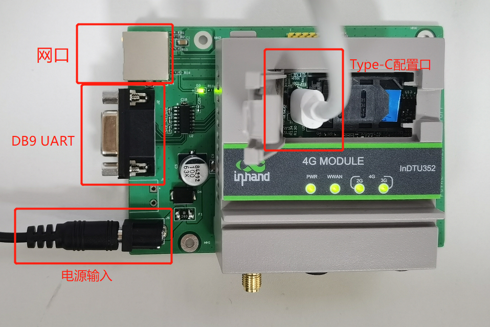

图 2‑2 InDTU352S接线方式

|  1. 请不要在带电情况下进行硬件插拔和安装。 2. 测试底板只做测试使用，不做商业用途。 |
| --- |

### 2.3 指示灯说明

图 2-3 InDTU352S灯签定义

### 2.3.1 InDTU352S指示灯状态

PWR——电源状态指示，绿色；常亮：表明系统供电正常，常灭：表明系统无供电；

WWAN——模块通信状态指示，绿色；常亮：表明4G 模块处于连接/激活状态，闪烁（4Hz）：表明4G 模块有数据传输，常灭：表明4G 模块处于未连接/未激活状态；

2G——模块工作模式状态指示，绿色；常亮：模块工作在2G 模式；

3G——模块工作模式状态指示，绿色；常亮：模块工作在3G 模式；

2G 和3G 常亮：模块工作在4G 模式；2G 和3G 常灭：模块工作异常或者未注册。

|  + 亮表示常亮，即至少保持3秒钟不闪； + 灭表示常灭，即至少保持3秒钟不闪； + 慢闪表示闪烁频率大约1Hz即每1秒闪一次； + 快闪表示闪烁频率大约5HZ即每0.2秒闪一次； |
| --- |

## 3 配置工具

工具名称：InHand DTU3XX 配置工具

配置工具版本：请使用**V1.1.68** 版本及以上

安装方法：双击可执行文件，按照默认提示完成安装。

运行环境：

    

## 4 快速配置

### 4.1 基于串口的101数据透传

### 4.1.1 网络拓扑

### 4.1.2 配置步骤

**Step1：登陆配置工具。（默认管理员账号：adm；登陆密码：123456）**

通过PC打开配置工具，单击“连接设备”，在弹出的新对话框中选择串口和串口波特率等串口参数，可在PC设备管理查看串口（Type-c接口）的COM号。最后单击“连接”即可。

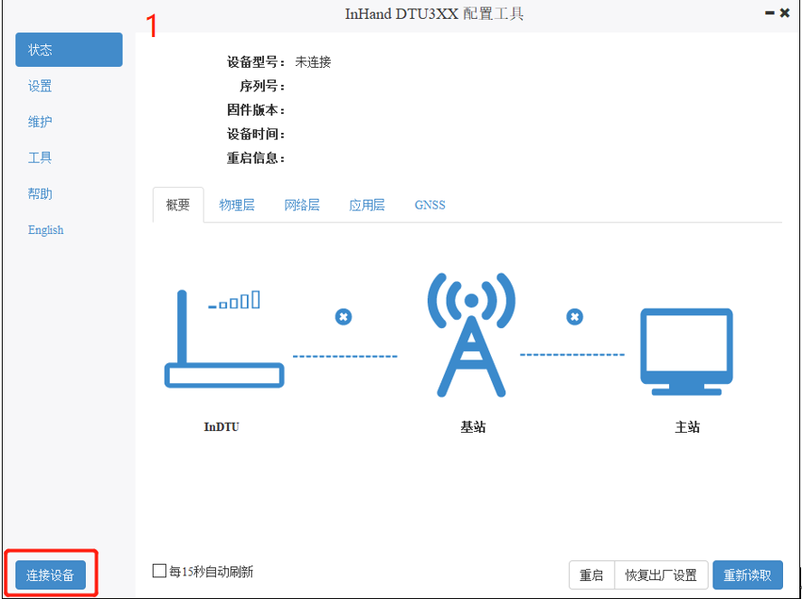

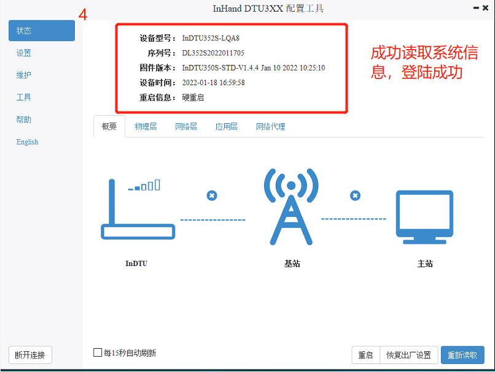

**Step2：设置通信串口（本地串口1）参数。**

设置通信串口（本地串口1）对应参数，其参数设置要和本串口相连的对端串口参数（如DTU）保持一致。

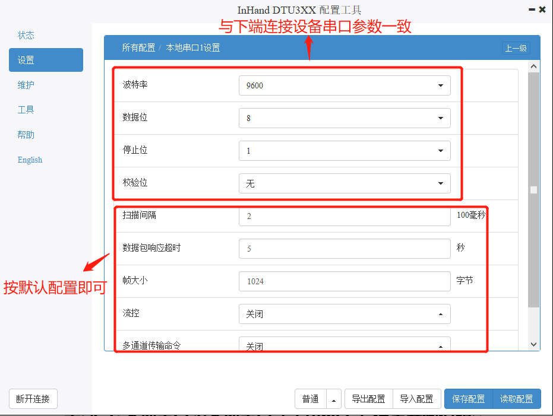

**Step3：设置拨号参数。**

打开“网络设置>>拨号参数设置”进行参数修改即可。默认参数即公网拨号参数，非专线无需更改；若是专线请修改网络接入点名称（APN）、网络拨号用户名/密码。

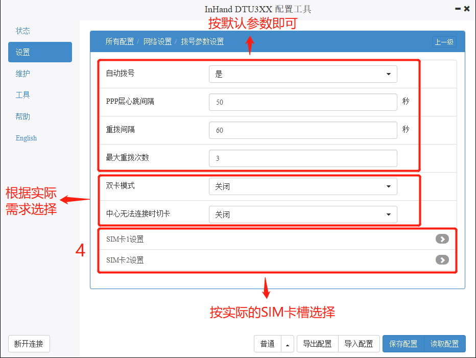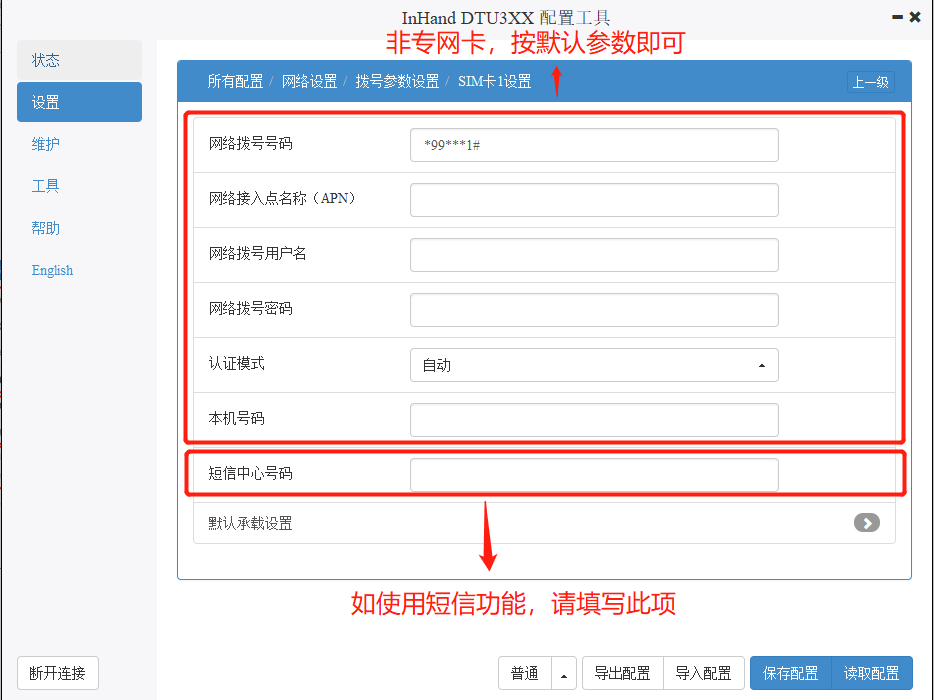

**Step4：中心侧参数设置。**

打开“企业网关相关设置”进行参数修改即可。

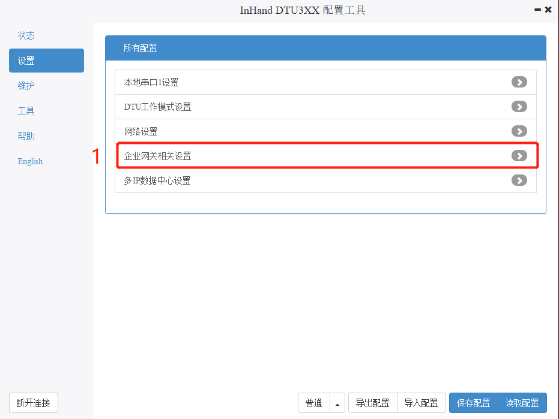

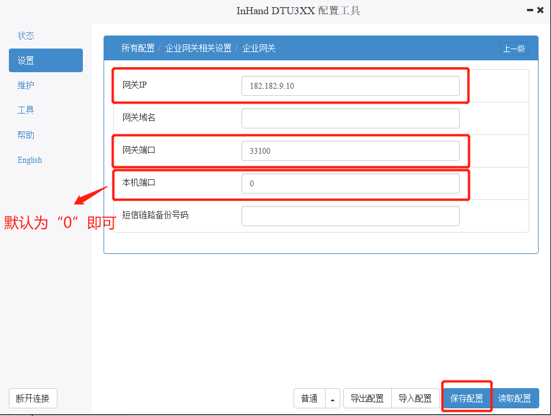

**Step5：保存配置。**

设置好参数后，单击保存配置，重启设备即可生效。此时只要配置正确，InDTU352S便能成功连接中心，进行数据交互了。

### 4.2 基于网口的104数据转发

### 4.2.1 网络拓扑

### 4.2.2 配置步骤

**Step1：登陆配置工具。**

参照4.1.2>>Step1。

**Step2：设置拨号参数。**

打开“网络设置>>拨号参数设置”进行参数修改即可。专线需填入网络接入点名称（APN）、网络拨号用户名/密码。这里以“网络接入点名称（APN）”为public-vpn.bj，用户名/密码分别为GPRS举例说明。如下图所示。

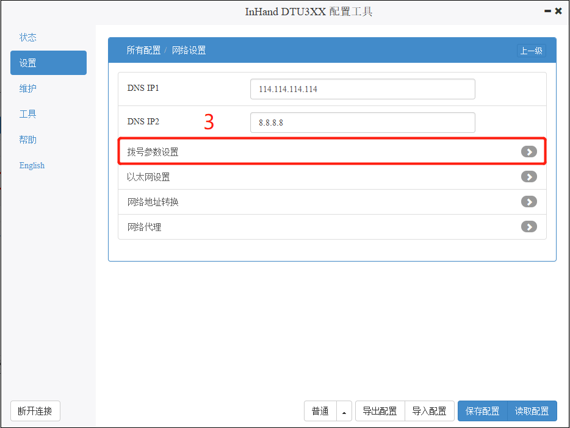

**Step3：设置以太网口IP地址。**

打开“网络设置>>以太网设置”进行设置即可。需注意InDTU352S与下端网口设备IP地址需在同一网段才能正常通信，InDTU352S出厂默认的静态IP地址为192.168.1.1。

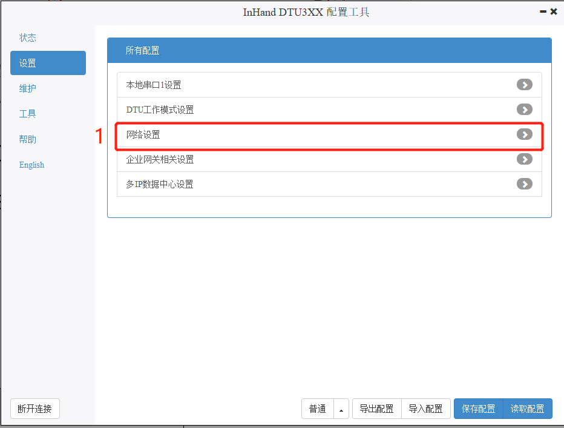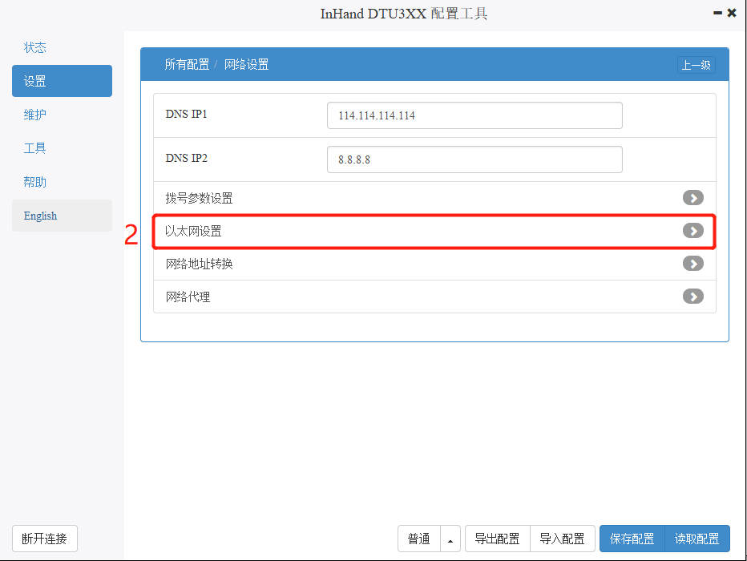

**Step4：设置网络代理。**

网络代理，即通过网络信号的跳转将ip进行变更或分享，可实现外网地址对内网地址的访问。打开“网络设置>>网络代理”进行设置即可。需注意使用网络代理功能时，服务器IP地址必需保证为固定IP。

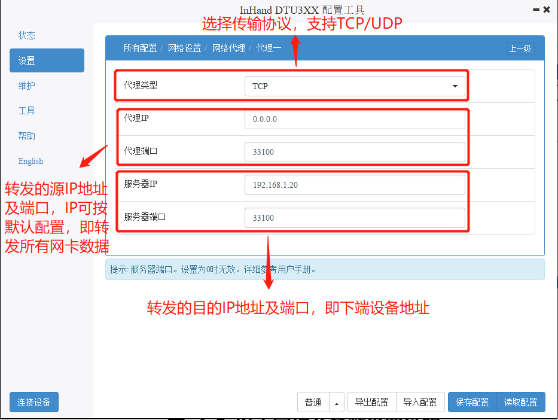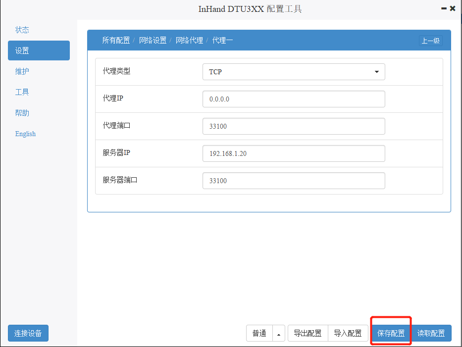

**Step5：保存配置。**

设置好参数后，单击保存配置，重启设备即可生效。

附录

抓取DTU日志

在进行排查问题时，有些时候需要长时间抓取设备的运行日志，因为InDTU存储空间较小，此时我们可以考虑借助其他软件来抓取我们的InDTU日志。本次示例中采用软件为SecureCRT，客户可自行网上搜索下载。

首先连接InDTU与PC，打开InDTU 配置工具

**Step1：打开DTU调试模式，如图1所示。**

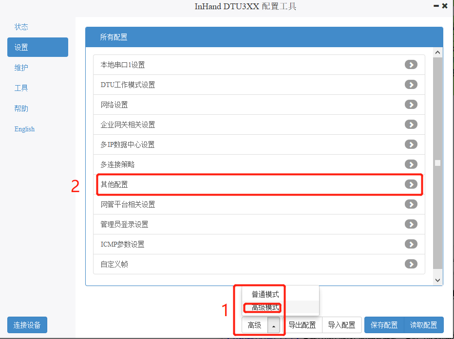

图1

**Step2:设置保存日志文件名**

配置好DTU tool 后断开连接设备

打开Secure CRT，文件—>会话日志—>取一个文件名字—>保存，如图2、图3所示。

图2

图3

**Step3:连接DTU**

选择相应串口，配置与DTU一致的串口参数，点击连接

图4

**Step4:保存日志**

抓取完日志点击结束保存，再次点击 “会话日志”

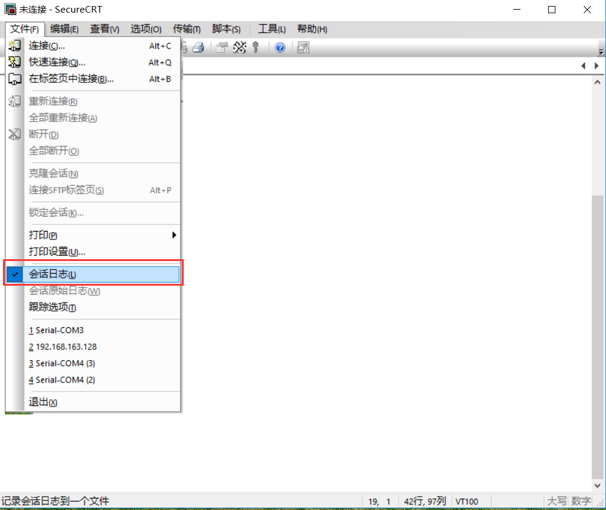

图5

常见故障处理

**1）DTU352S上电后，频繁重启**

故障排查：

1.检查设备是否能拨号上网；

2.请确认InDTU是否正确插入UIM/SIM/USIM卡；

3.请确认UIM/SIM/USIM卡是否被欠费停机，或者卡损坏；

4.拨号参数（如拨号号码，接入点参数，账号，密码）是否填写正确；

5.检查无线网络信号质量，是否低于20，同样也把InDTU发到信号较好的地方再次上电查看；

6.检查给InDTU供电的电源电压是否正常。

**2）DTU352S上电后电源指示灯不亮**

故障排查：

1.请确认已经将InDTU与电源转换器连接牢固；

2.请检查InDTU的电源转换器是否输出满足4VDC的直流电压；

3.有可能InDTU的内部灯烧坏，请尽快与映翰通公司的销售代表取得联系。

**3）无法对DTU352S进行配置**

故障排查：

1.请检查USB电缆，并检查PC USB口是否正常，设置软件所选端口是否正确；

2.请确认配置工具版本是否是V1.1.68及以上。

**4）无法对InDTU设备进行固件升级**

故障排查：

1.请检查usb电缆，并检查PC usb是否正常，设置软件所选端口是否正确；

2.请确认固件版本是否正确。
