# InDTU951系列产品快速用户手册V1.0

InDTU951-CN系列

快速指导手册

声明

首先非常感谢您选择本公司产品！在使用前，请您仔细阅读本用户手册。

非本公司书面许可，任何单位和个人不得擅自摘抄、复制本书内容的部分或全部，并不得以任何形式传播。

由于不断更新，本公司不能承诺该资料与实际产品一致， 同时也不承担由于实际技术参数与本资料不符所导致的任何争议，任何改动恕不提前通知。本公司保留最终更改权和解释权。

版权所有©2021北京映翰通网络技术股份有限公司及其许可者版权所有，保留一切权利。

本手册图形界面约定

| **格 式** | **意 义** |
| --- | --- |
| > | “   ”表示按钮名，如“单击确定按钮”。 |
| “” | 带双引号“”表示窗口名、菜单名，如：弹出“新建用户”窗口。 |
| >> | 多级菜单用“>>”隔开。如“文件>>新建>>文件夹”多级菜单表示“文件”菜单下的“新建”子菜单下的“文件夹”菜单项。 |
|  | 提醒操作中应注意的事项，不当的操作可能会导致数据丢失或者设备损坏。 |
|  | 对操作内容的描述进行必要的补充和说明。 |

## 技术支持

**北京映翰通网络技术股份有限公司（总部）**

电话：010-8417 0010

地址：北京市朝阳区紫月路18号院3号楼5层

**成都办事处**

电话：028-8679 8244

地址：四川省成都市武侯区天府大道北段1777号中国太平金融大厦14层

**广州办事处**

电话：020-8562 9571

地址：广州市天河区黄埔大道中660号汇金国际金融中心B栋1913单元

**武汉办事处**

电话：027-8716 3566

地址：武汉市洪山区关山大道465号光谷新发展国际中心B座5层

**上海办事处**

电话：021-5480 8501

地址：上海市普陀区国浩长风城北座326室

## 1 产品简介

### 1.1 系统应用

本手册内容是以个别产品为例进行说明的，具体情况请以实物为准。

InDTU951-CN系列是一款基于国产平台打造的5G工业级无线数据终端产品，支持5G SA独立组网，支持TDD 和FDD 两种网络制式，支持双卡，同时向下兼容4G/3G。它主要应用于配网自动化，匹配配电终端FTU设备，既能通过串口又能兼容网口与终端设备通信，并以无线蜂窝网络为承载网，无缝对接各种电力主站平台。支持嵌入式安装，体积小，方便部署于用户设备。

InDTU951-CN系列支持Web/Telnet/SSH远程管理、SMS远程配置、本地控制台、DM平台等多种配置和管理手段，简化现场施工及后期维护的难度，大幅提升施工效率，降低系统运营的整体成本，从而使客户真正体验到无线通信的便捷。其典型组网方式如图1-1所示。

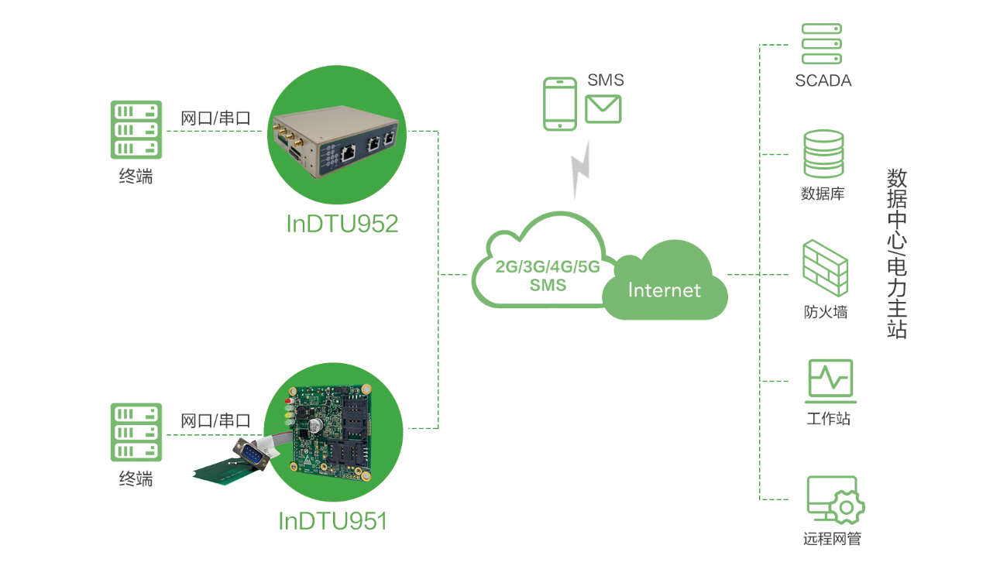

图 1‑1 InDTU950系列组网方式

### 1.2 功能说明

InDTU951-CN系列产品是基于无线蜂窝网的数据通信系统。该系统中的硬件集成了一个无线通讯模组，支持NR/LTE/WCDMA网络制式。InDTU951硬件资源丰富，外部接口种类齐全。其硬件设计具备良好的可扩展性，能提供多种工业化总线标准的支持，该产品广泛应用于远程/现场数据采集、远程监控、现场控制等多种领域。

主要特点如下：

- 支持5G SA独立组网，支持低时延
- 内置SDK，支持山东5G专网运营平台
- 网串一体接口设计，兼容网口终端设备；
- 链路维持，“永久”在线；
- 工业级温度范围：-40℃～+70℃；

## 2 设备安装上电

### 2.1 发货配件清单

| 品名 | 数量 | 备注 |
| --- | :---: | :---: |
| InDTU951-NR 5G工业无线数据通信终端 | 1台 | 标配 |
| 5G天线 | 1套 | 标配 |
| DB9工业串口线 | 1根 | 标配 |
| 产品保修卡 | 1张 | 标配 |
| 合格证 | 1张 | 标配 |
| RoHS卡 | 1张 | 标配 |
| 网口调试线（4pin转RJ45母头） | 1根 | 选配 |
| 标准网线 | 1根 | 选配 |

### 2.2 InDTU951设备安装

**第一步：安装SIM卡，如下图所示。**

InDTU951支持双卡，默认双卡模式。SIM卡建议优先放置**卡槽1** 中。操作方法为向右滑动目标卡托使其解锁，打开卡托后，放置好SIM卡入内，再左滑卡住卡托即可，如下图所示。

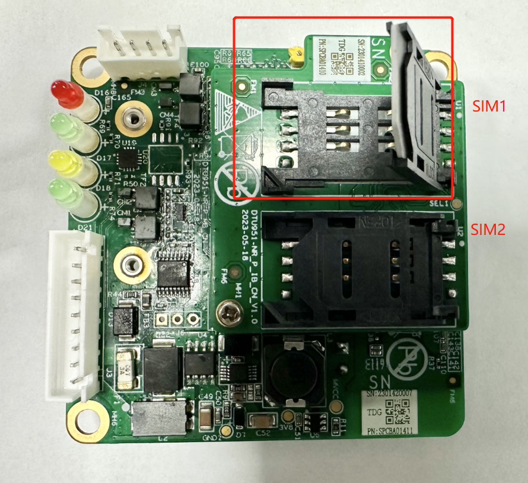

图 2‑1 InDTU951 SIM卡安装

**第二步：安装天线，如下图所示。**

InDTU951选用的5G天线为PCB天线，PCB天线具备四个天线接口。首先使用PCB天线的IPEX公头依次连接模组的天线接口IPEX母头ANT0-ANT3，最后用PCB天线背部自带的3M胶贴在通信舱底部加以固定。

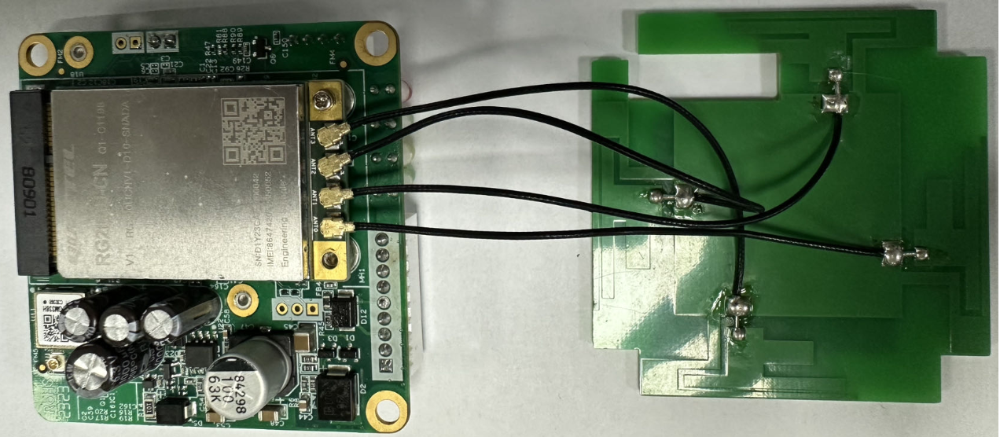

图 2‑2 InDTU951 5G天线安装

| 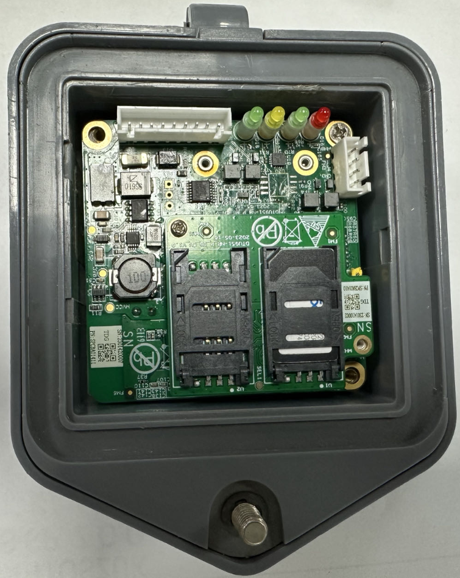  1. 请不要在带电情况下进行硬件插拔和安装。 2. 5G内置天线安装方法：撕下5G天线背部的3M胶纸；如果是FPC天线将撕下的3M背胶对准通信舱内壁平稳放下、压紧即可。如果是PCB天线，置于通信舱底部粘贴即可。 |
| --- |

**第三步：连接终端设备，给设备供电，接口定义如表2-1所示。**

InDTU951与终端的连接接口采用标准9pin单排2.5mm 间距单排排母，标配9PIN转DB9串口引出线形式对外提供，其引脚定义说明见下表。

**表 2‑1 InDTU951 接口定义**

| DB9 管脚号 | 对应XH9 Pin | 信号定义 | 备注 |
| :---: | :---: | --- | --- |
| 1 | 1 | VG  | 通信电源地 |
| 2 | 3 | TXD | 串口通信发送 |
| 3 | 5 | RXD | 串口通信接收 |
| 4 | 7 | LAN-RX+ | 网口收信号+ |
| 5 | 9 | GND | 串口通信收发地 |
| 6 | 2 | V+ | 通信电源正（DC24V） |
| 7 | 4 | LAN-TX- | 网口发信号- |
| 8 | 6 | LAN-TX+ | 网口发信号+ |
| 9 | 8 | LAN-RX- | 网口收信号- |

**图 2‑3 9Pin转DB9接口线**

**第四步：连接PC，为951配置参数。**

InDTU951配置采用Web形式，不需要额外安装配置工具。

先通过终端给951通上电源，然后使用InDTU951配套的网口调试线一端连接板载4PIN端子，另外一端通过标准网线连接PC进行配置，如图2-4所示。

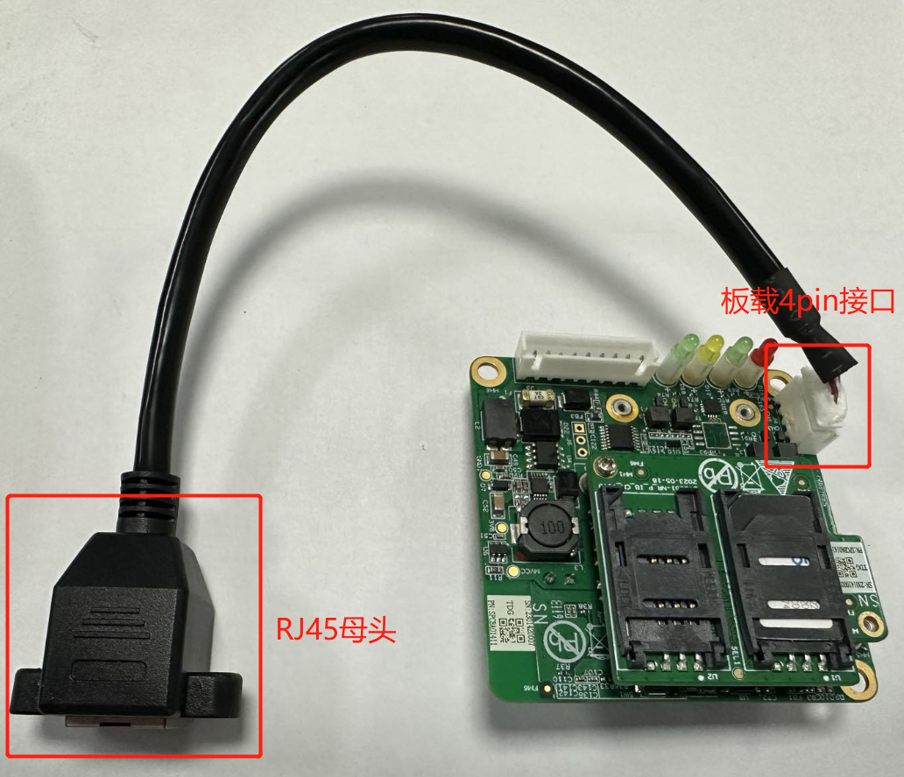

图 2‑4 InDTU951配置接线图

连接后，需要对PC上的网口进行IP设置，将其与InDTU951的网口配置为同一网段。InDTU951网口配置的初始IP地址为**I92.168.225.1。**

|  请确认您的PC端网口的IP与InDTU951在同一网段。  |
| --- |

### 2.3 指示灯说明

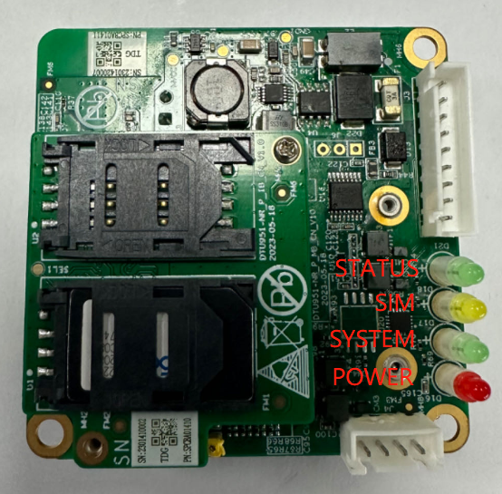

图 2‑6 LED灯定义

**表 2‑2 InDTU951-CN 灯闪定义**

| **DTU状态** | **POWER灯** | **SYSTEM灯** | **SIM灯** | **STATUS灯** | **备注** |
| --- | :---: | :---: | :---: | :---: | --- |
| 系统启动 | 亮 | 灭 | 灭 | 灭 |  |
| 系统正常工作 | 亮 | 慢闪 | / | / |  |
| 系统异常 | 亮 | 灭/常亮 | / | / |  |
| 拨号中，无故障 | 亮 | 慢闪 | 灭 | 灭 |  |
| 拨号中，故障 | 亮 | 慢闪 | 灭 | 亮 |  |
| 拨号成功 | 亮 | 慢闪 | 亮 | 灭 |  |
| 拨号成功，连接中心故障 | 亮 | 慢闪 | 亮 | 亮 | DTU功能开启即生效 |
| 连接中心成功 | 亮 | 慢闪 | 同步慢闪 | | DTU功能开启即生效 |
| SIM卡故障 | 亮 | 慢闪 | 慢闪 | 亮 |  |

注：1、连接中心的灯闪状态只在DTU功能开启下生效，当InDTU951走网口通信时不具有指示意义。

|  + 亮表示常亮，即至少保持3秒钟不闪； + 灭表示常灭，即至少保持3秒钟不闪； + 慢闪表示闪烁频率大约1Hz即每1秒闪一次； + 快闪表示闪烁频率大约5HZ即每0.2秒闪一次； |
| --- |

## 3 快速配置

### 3.1 基于串口的101数据透传

### 3.1.1 网络拓扑

图 3‑1 网络拓扑图

### 3.1.2 配置步骤

**Step1：登陆设备。**

用网线直连电脑和设备，确定将PC端网口IP与InDTU951配置口IP设置为同一网段。运行Web浏览器，在地址栏中输入“[http://192.168.225.1](http://192.168.225.1)”，回车后跳转到Web登录页面，如图3-2所示。输入“用户名”(默认: admin)和“密码”(默认:admin@123)，单击<确定>按钮或直接回车即可进入Web设置页面，如图3-3所示。

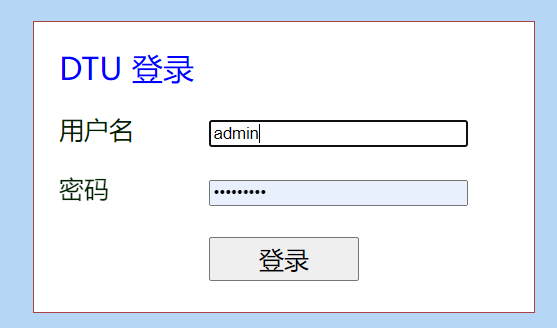

图 3‑2

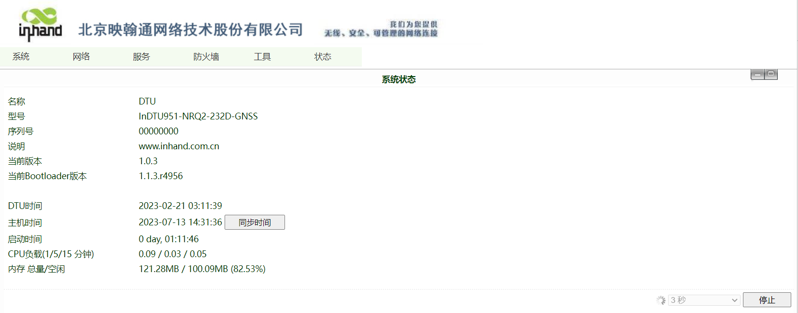

图 3‑3

**Step2：拨号参数设置。**

按照图示顺序，单击导航树中的“网络>>Celluar”菜单，进入拨号参数配置页面，如图3-4所示。

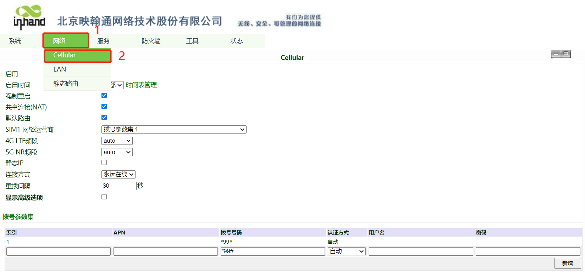

图 3‑4

默认“拨号参数集1”即公网拨号参数，非专线SIM卡，可无需更改；若是专线网络请修改网络接入点名称（APN）、网络拨号用户名/密码。

配置完拨号参数后，需要在对应“SIM 网络运营商”选择对应的“拨号参数集”，并点击“应用”。

注：InDTU951采用全网通无线模组，国内各大运营商都能支持。

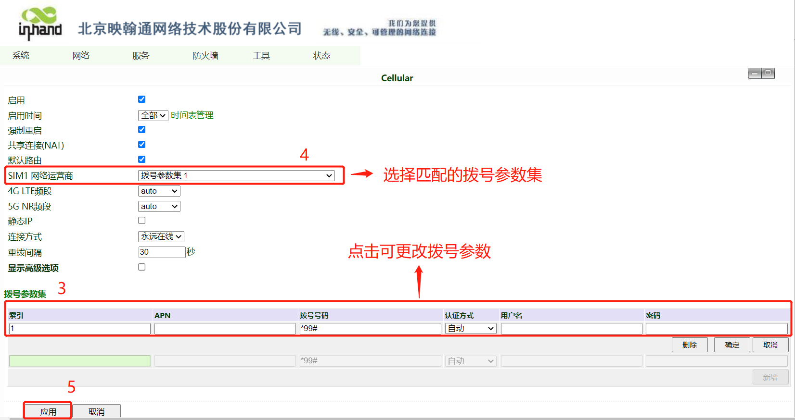

图 3‑5

InDTU951支持“单卡”和“双卡”两种拨号模式。系统默认“双卡”模式，自动识别有卡的卡槽。

在下方界面勾选 “显示高级选项>>启用双SIM卡”，进行双卡功能开启或者关闭，保存。 如图3-6所示。

注：在“拨号参数集”设置专网参数后，需在相应SIM选择对应的拨号参数序号。

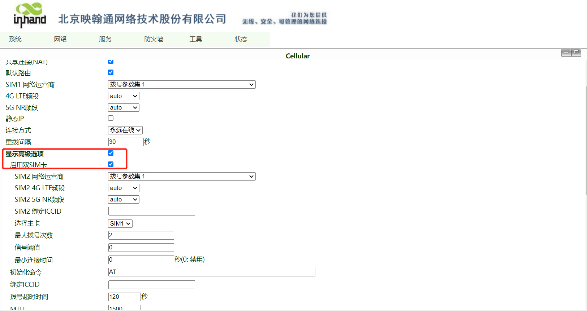

图 3‑6

**Step3：验证拨号状态。**

单击导航树中的“网络>>拨号接口”菜单，进入“状态”界面。在该界面下即可查看拨号状态、网络状态及获得的IP地址，如图3-7所示。

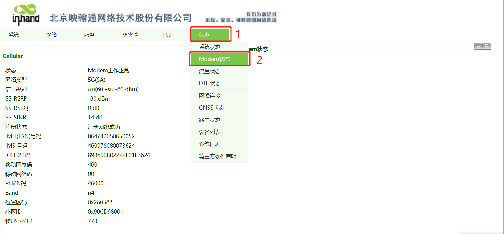

图 3‑7

**Step4：串口设置。**

单击导航树中的“系统”>> “串口设置”菜单，进入“串口设置”界面。这里可以进行串口参数设置，请将串口参数设置为与下端连接设备匹配，如图3-8所示。

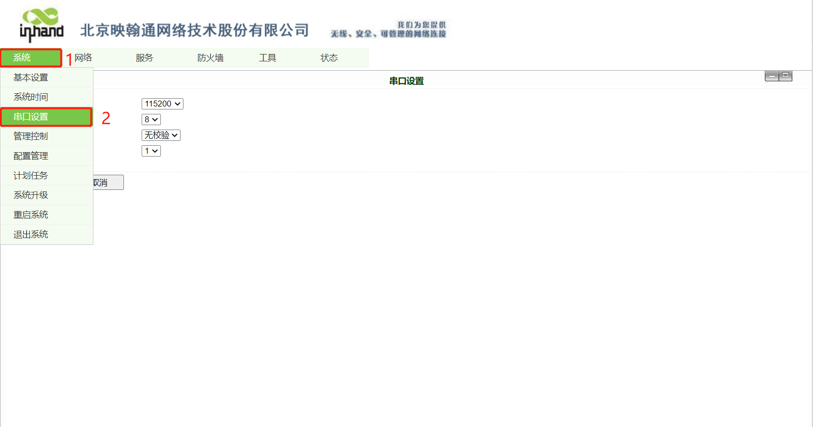

图 3‑8

**Step5：数据传输配置。**

单击导航树中的“服务”>> “DTU”菜单，如图3-9所示。在右侧弹出的窗口上点击进入“DTU”界面，并配置相关参数，如图3-10所示。

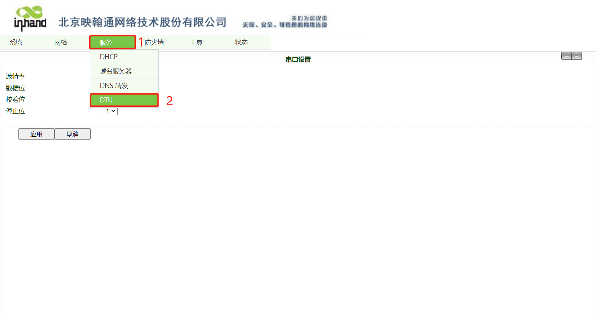

图 3‑9

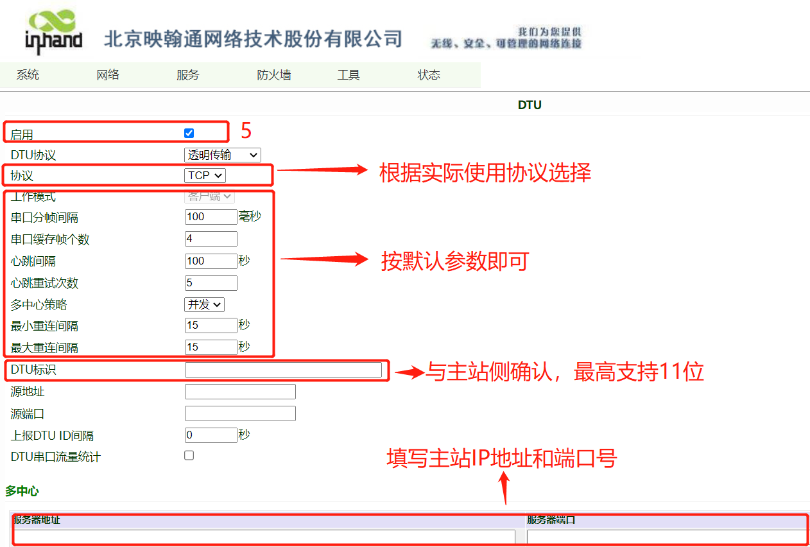

图 3‑10

注：配置完后都需要“应用并保存”。

**Step6：验证951连接主站状态。**

在“DTU状态”栏里可以查看主站是否连接成功，如图3-11所示。

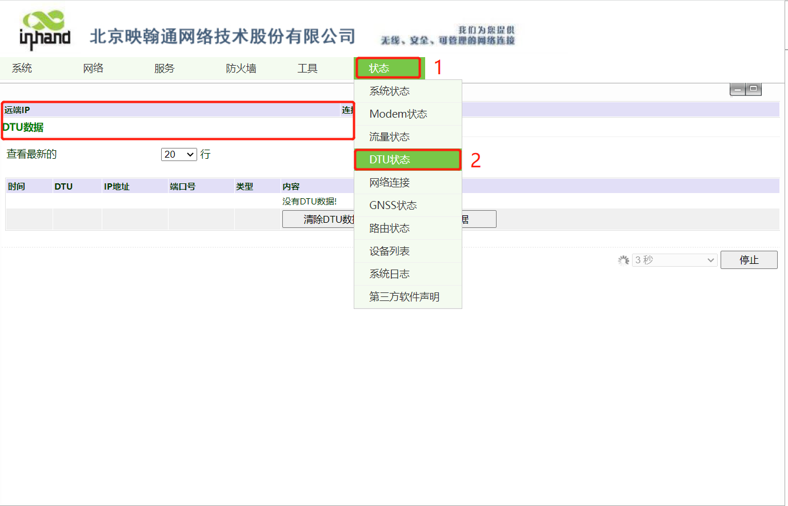

图 3‑11

### 3.2 基于网口的104数据转发

### 3.2.1 网络拓扑

图 3‑12

### 3.2.2 配置步骤

**Step1：登陆配置工具。**

参照3.1.2>>Step1。

**Step2：设置拨号参数。**

参照3.1.2>>Step2。

**Step3：设置以太网口IP地址。**

导航栏选中“网络>>LAN”进行设置即可。需注意InDTU951与下端网口设备IP地址需在同一网段才能正常通信，InDTU951出厂默认的静态IP地址为**192.168.2.1**，如图3-13所示。

注：InDTU951在不使用以太网口时，可通过页面关闭，以降低模块功耗。

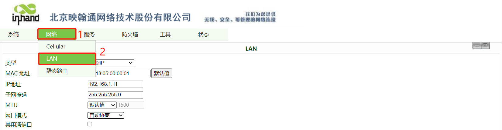

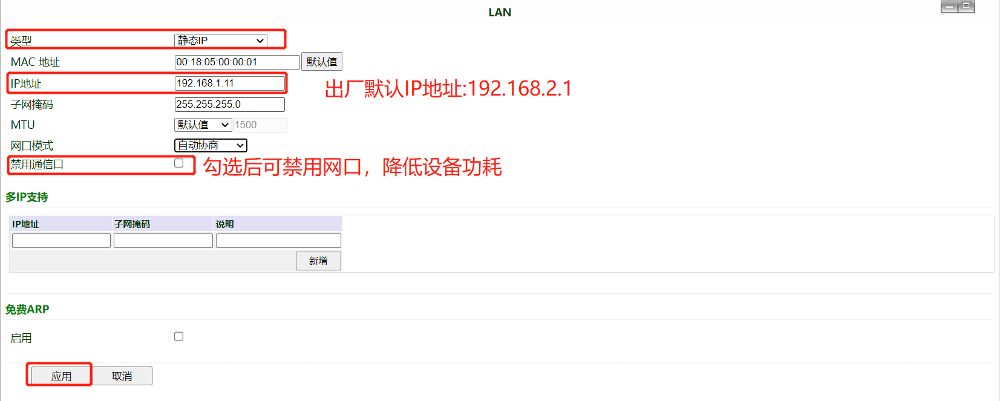

图 3‑13

**Step4：设置DMZ。**

DMZ 是英文“Demilitarized Zone”的缩写，中文名称为“隔离区”，是为了解决外部网络不能访问内部网络[服务器](https://baike.baidu.com/item/%E6%9C%8D%E5%8A%A1%E5%99%A8/100571?fromModule=lemma_inlink)的问题，而设立的一个非安全系统与[安全系统](https://baike.baidu.com/item/%E5%AE%89%E5%85%A8%E7%B3%BB%E7%BB%9F/3131501?fromModule=lemma_inlink)之间的缓冲区。作用是把内网设备允许外部访问的服务器单独部署在此区域，使整个需要保护的内部网络接在信任区后，不允许任何外部网络的直接访问，实现内外网分离，满足用户的安全需求。

具体操作如下：导航栏选中“防火墙>>DMZ”进行设置即可，如图3-14所示。配置参数如图3-15所示。

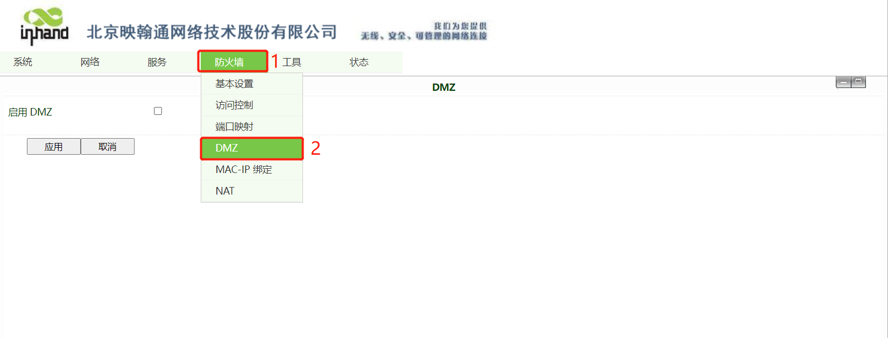

图 3‑14

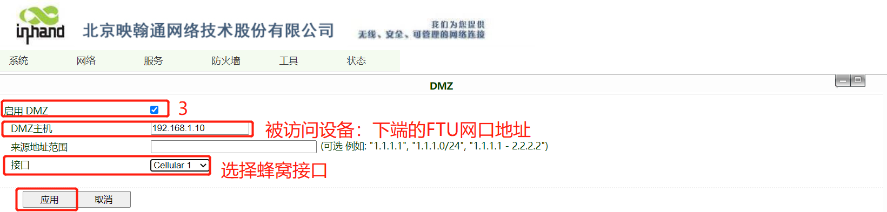

图 3‑15

附录

恢复出厂设置

登陆Web页面，单击导航树中的“系统>>配置管理”菜单，进入“配置管理”界面。如图1所示。单击<恢复出厂设置>按钮，确定恢复出厂后，重启系统，恢复出厂成功。

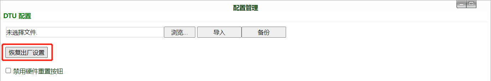

图1

系统升级

登陆Web页面，单击导航树中的“系统>>系统升级”菜单，进入“系统升级”界面。如图2所示。单击<浏览>按钮，找到升级文件，点击升级即可。

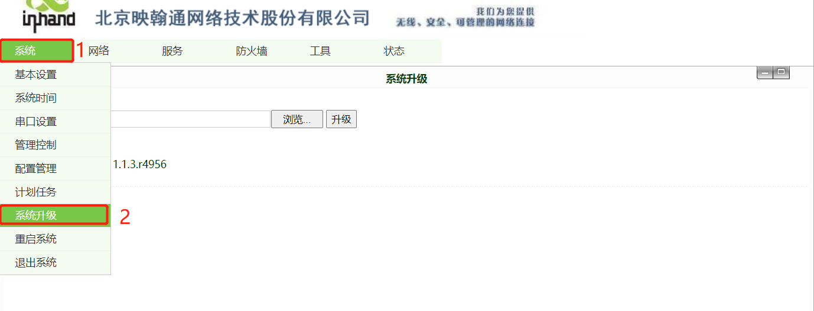

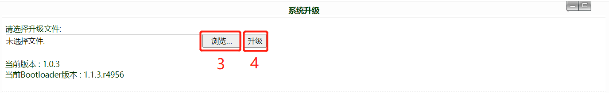

图2

配置导入导出

登陆Web页面，单击导航树中的“系统>>配置管理”菜单，进入“配置管理”界面。如图3所示。

配置导入：单击<浏览>选择配置文件，然后单击<导入>按钮。导入配置文件后，重启系统（管理>>重启系统）即可生效。

配置导出：单击<备份>，导出目前正在应用的配置参数文件，保存。 导出的文件为.dat格式，默认文件名为config.dat。

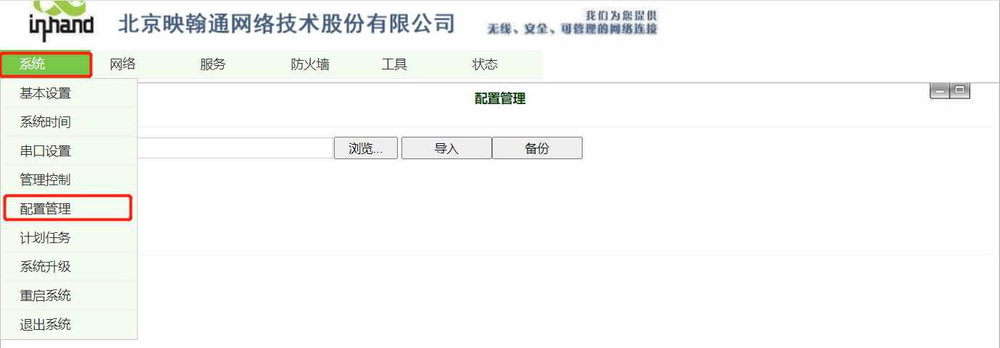

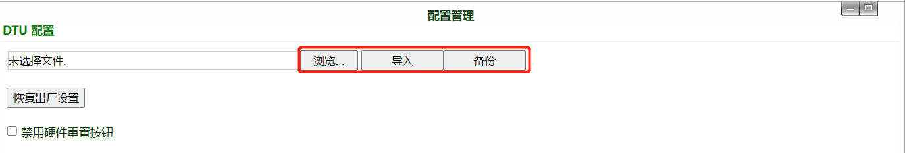

图3

日志与诊断记录

登陆Web页面，单击导航树中的“状态>>系统日志”菜单，进入“系统日志”界面。如图4所示。单击对应按钮即可完成日志与诊断记录的下载。

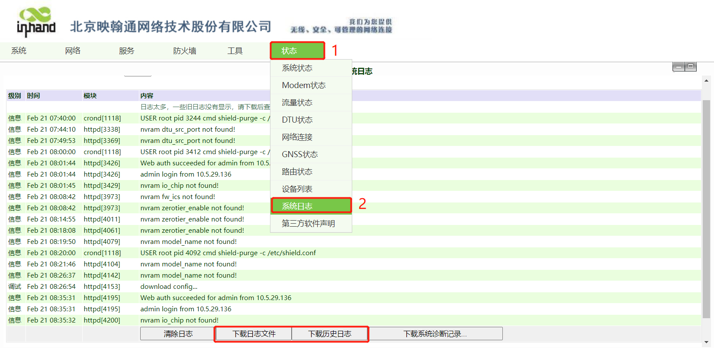

图4
