# InDTU954C 用户手册_V1.0

**InDTU954C系列工业安全数据终端**

**用户手册**

[www.inhand.com.cn](http://www.inhand.com.cn)

本手册中描述的软件是根据许可协议提供的，只能按照该协议的条款使用。

**版权声明**

© 2024 映翰通网络 保留所有权利。

**商标**

InHand标志是映翰通网络的注册商标。

本手册中的所有其他商标或注册商标属于其各自的制造商。

**免责声明**

本公司保留对此手册更改的权利，产品后续相关变更时，恕不另行通知。对于任何因安装、使用不当而导致的直接、间接、有意或无意的损坏及隐患概不负责。

## 1 简介

InDTU954C系列产品作为配电终端安全防护设备（简称配电终端安全模块），采用全国产化硬件平台，支持5G/4G/3G/2G蜂窝网络和有线接入，支持国密，设备小巧，可安装在配电室、配电柜、架空线等各类配电终端箱体中，提供对配电终端的数据保护，满足配电网数据安全实时传输的要求，无缝对接各种电力主站平台。

## 2 物料清单

- **标准配件**

| **配件** | **数量** | **描述** |
| --- | :---: | --- |
| 工业安全数据终端 | 1 台 | InDTU954C |
|  4G天线 |  - |  实际带有的天线数量和种类需要根据DTU具体型号而定 |
| 5G天线 | **-** | |
| GPS天线 | **-** | |
| 接线端子 | 1套 | 工业端子用于接入电源、串口 |

- **可选配件**

| **配件** | **数量** | **描述** |
| :---: | :---: | --- |
| 电源适配器 | 1 个 | 12V 1.5A电源适配器 |
| 安装套件 | 1套 | InDTU954C支持导轨安装和壁挂安装两种方式，具体以现场实际部署方式为准 |

## 3 面板介绍与结构尺寸

### 3.1 面板介绍

- 正面板

InDTU954C的正面板带有设备指示灯说明以及console口、以太网口灯签说明，如下图所示：

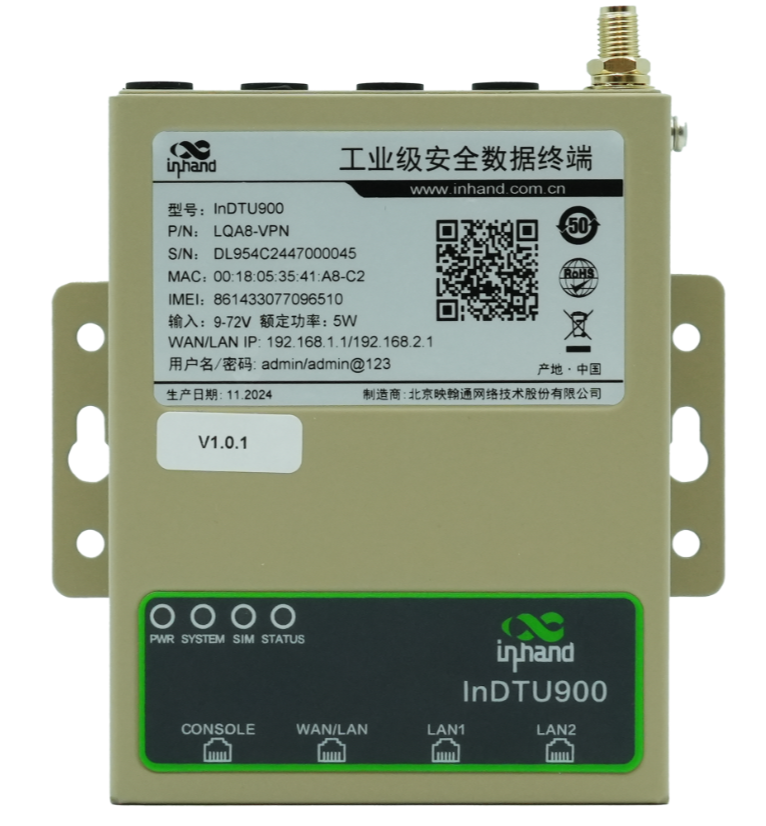

- 上面板

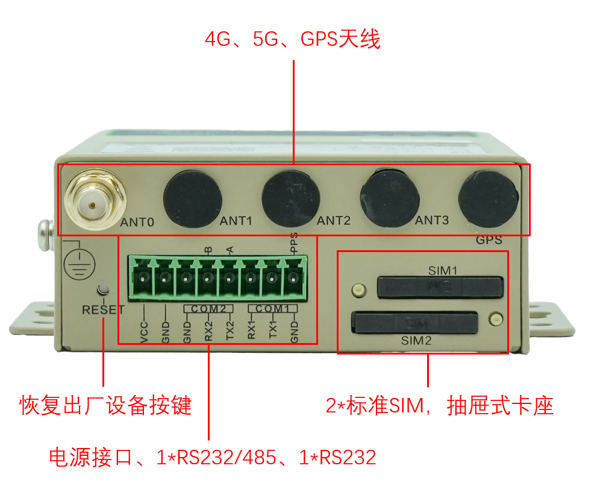

- 下面板

下面板带有一个console接口、一个WAN/LAN复用接口、2个二层LAN口

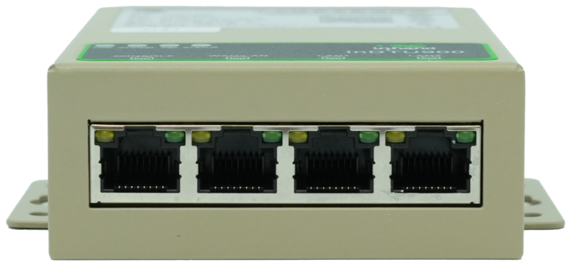

### 3.2 结构尺寸

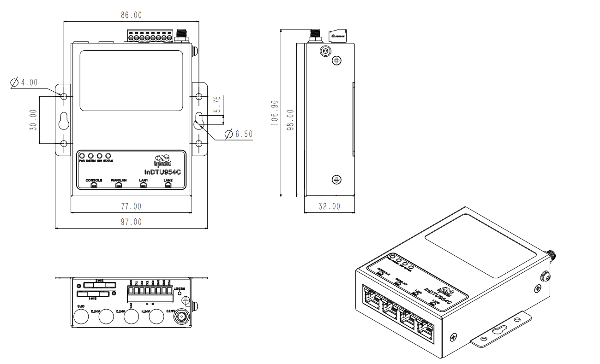

## 4 安装

### 4.1 设备安装

DTU954C支持导轨、壁挂式安装，默认采用壁挂式安装，壁挂挂耳已固定在设备的背面板上，不可拆卸，只需要使用安装螺钉将设备固定到墙面上即可。

- 壁挂式安装

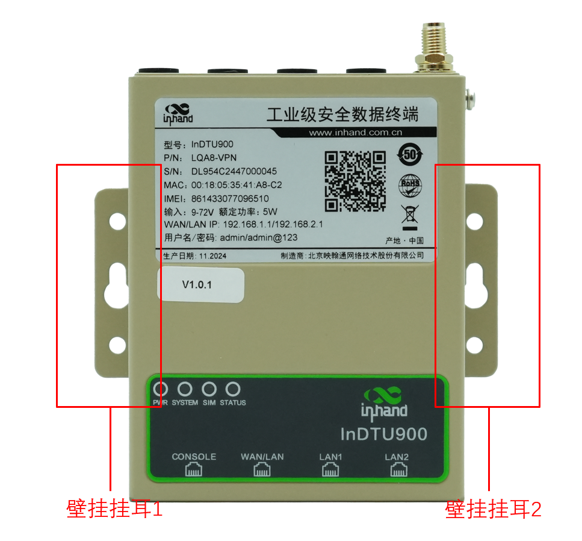

- 导轨安装

导轨安装孔位于设备的背部面板上，将导轨安装套件固定到设备的背面板，固定完成后：

1、将DIN轨安装板的上方挂钩卡入到DIN轨支架的顶端

2、缓慢向DIN轨支架方向向前推动设备使得DIN轨底端卡入到位

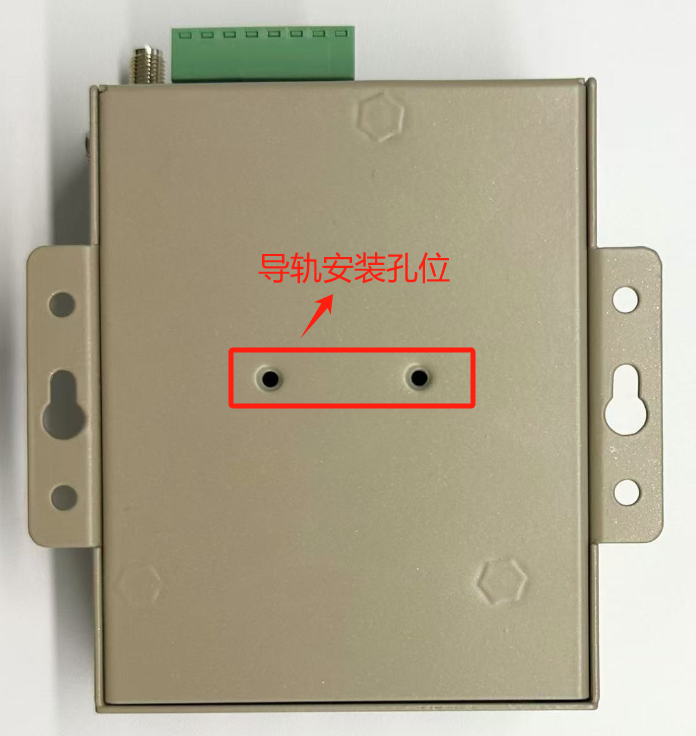

### 4.2 LED指示灯

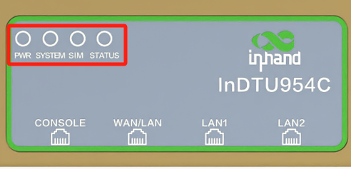

| **DTU状态** | **POWER灯** | **SYSTEM灯** | **SIM灯** | **STATUS灯** | **备注** |
| --- | --- | --- | --- | --- | --- |
| 系统启动 | 亮 | 灭 | 灭 | 灭 | |
| 系统正常工作 | 亮 | 慢闪 | / | / | |
| 系统异常 | 亮 | 灭/常亮 | / | / | |
| 拨号中，无故障 | 亮 | 慢闪 | 灭 | 灭 | |
| 拨号中，故障 | 亮 | 慢闪 | 灭 | 亮 | |
| 拨号成功 | 亮 | 慢闪 | 亮 | 灭 | |
| 拨号成功，连接中心故障 | 亮 | 慢闪 | 亮 | 亮 | DTU功能开启下状态生效 |
| 连接中心成功 | 亮 | 慢闪 | 同步慢闪 | | DTU功能开启下状态生效 |
| SIM卡故障 | 亮 | 慢闪 | 慢闪 | 亮 | |

### 4.3 电源、串口

InDTU954C支持9V～72V的直流电源，将适配器端子插入到DTU954C的电源端口中（VCC、GND），然后连接电源适配器。当PWR电源指示灯长亮则代表设备已经正常上电。

InDTU95C有两个串口，一路串口支持RS-232，一路串口支持RS-232或RS-485模式

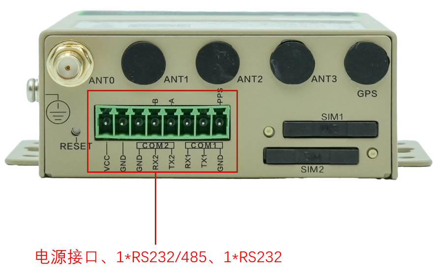

电源、串口采用8PIN端子，接口引脚说明如下：

| **引脚** | **名称** | **定义** |
| --- | :---: | --- |
| 1 | VCC | 电源正极 |
| 2 | GND | 电源负极 |
| 3 | GND | 信号地 |
| 4 | RX2或B | 串口RS232接收或RS485- |
| 5 | TX2或A | 串口RS232发送或RS485+ |
| 6 | RX1 | RS232接收 |
| 7 | TX1 | RS232发送 |
| 8 | GND或PPS | 信号地或PPS |

备注：串口类型还需要根据设备型号决定，具体支持情况可参见InDTU954C规格书中”订购信息“部分

### 4.4 SIM卡槽

InDTU954C配备2个用于蜂窝通信的标准SIM卡座，位于上面板,SIM卡安装不支持热拔插，需要在断电的情况下进行操作。

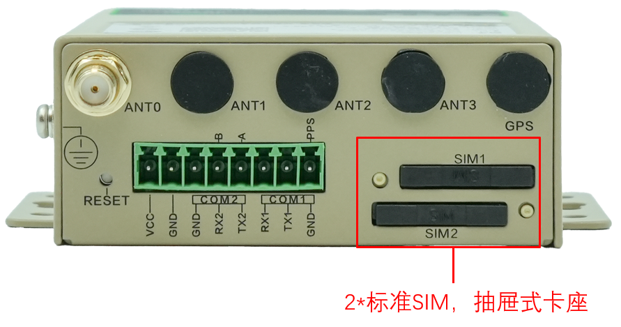

### 4.5 天线接口

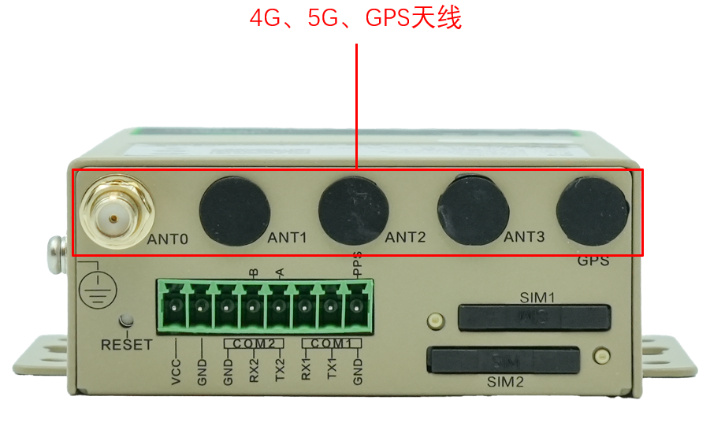

IG502共有5个天线接口，不同型号标配的天线数量不同。

| **标识** | **名称** |
| :---: | :---: |
| ANTO | 4G天线 |
| ANT1 | 5G天线 |
| ANT2 | |
| ANT3 | |
| GPS（可选） | GPS天线 |

### 4.6 恢复出厂设置

InDTU954C有一个Reset按键，可以通过硬件的方式恢复出厂设置，操作步骤如下：

 ①给DTU上电后5秒内按住复位按键  
 ②直到SIM灯和STATUS灯同步慢闪  
 ③在灯同步慢闪后的10秒内松开复位按键  
 ④设备即可恢复出厂设置

## 5 入门

### 5.1 访问InDTU954C

使用以下默认IP 地址连接到InDTU954C：

| **端口** | **默认IP** |
| :---: | :---: |
| WAN/LAN | 192.168.1.1 |
| LAN1/LAN2 | 192.168.2.1 |

- 步骤1：设置PC的IP地址与设备网口处于同一网段，将网线一端插入到设备以太网口，另一端插到电脑上,，以网线一端插入设备WAN/LAN口为例进行说明

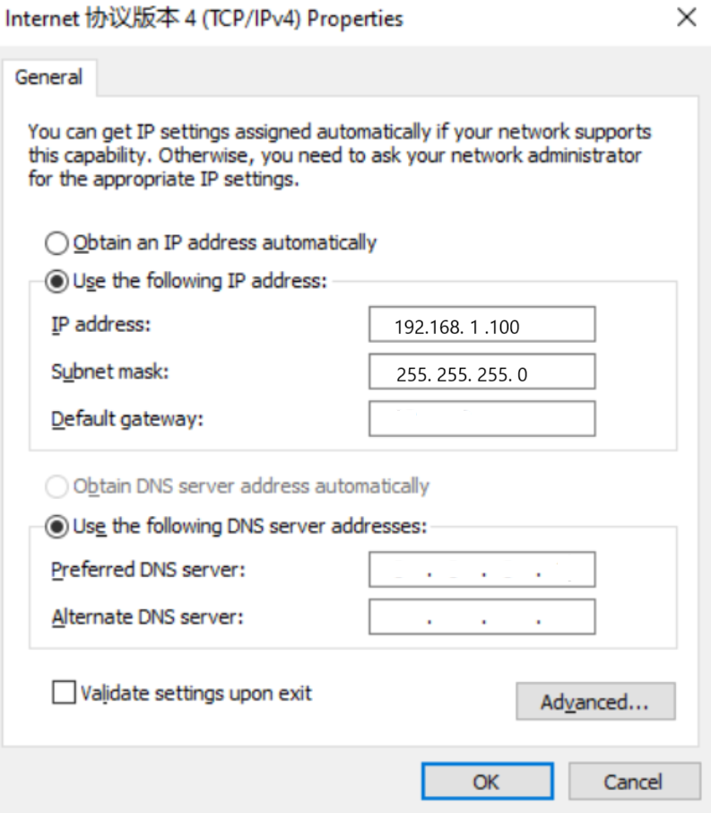

- 步骤2：打开浏览器，访问InDTU954C的以太网接口的IP地址，并输入登录用户名和密码

设备出厂默认密码：

**Username：admin**

**Password：admin@123**

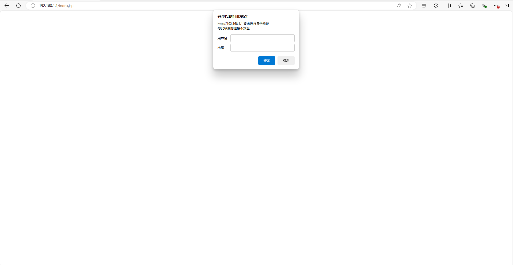

- 步骤3：登录成功后，可以查看到设备的系统状态，如下图所示

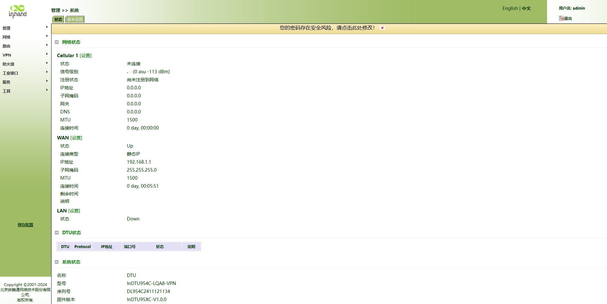

### 5.2 管理

### 5.2.1 系统

#### 5.2.1.1 状态

此页面可查看网络状态、DTU状态和系统状态。在网络状态板块，可查看网络接口的状态和地址等内容，同时点击接口后面的“设置”按键，即可切换到接口的参数设置页面；在 DTU 状态板块，可以查看 DTU 的地址、协议、端口号和状态信息，点击“设置”按键，可切换到工业接口参数设置页面；在系统状态板块中，能够查看设备的名称、型号、序列号、版本信息、当前时间、启机时间、CPU 性能以及存储等相关信息，点击“同步时间”按钮，可同步设备与主机的时间。

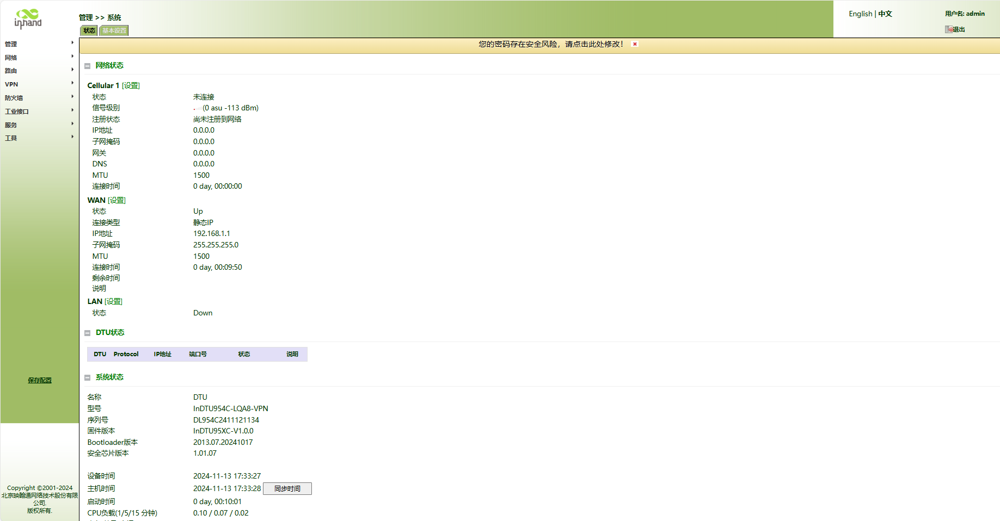

#### 5.2.1.2 基本设置

此页面显示了设备的系统语言、设备名称，用户可对其参数进行自定义。

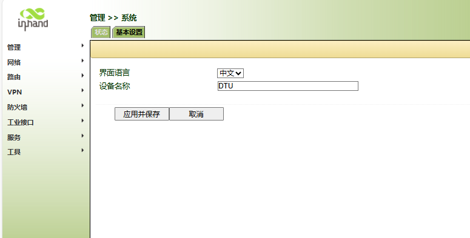

基本设置参数说明：

- 界面语言：支持随意切换界面语言（自动，中文，英文）  
注：界面语言选择“自动”时，界面显示为英文
- 设备名称：可自定义设备名称，名称长度最大支持31个字节，当设备名称为空或包含特殊字符时，不能保存配置

### 5.2.2 系统时间

点击“管理->系统时间”进入系统时间配置页面。为了让DTU和其他设备更好的协同，需精准配置系统时间。配置方式及步骤如下：

- **方法一：使用PC的本地时间配置系统时间**
    1. 选择“管理->系统时间”，进入“系统时间”界面
    2. DTU会自动获取PC的时间作为本地时间
    3. 点击“同步时间”，设备时间将与本地时间同步

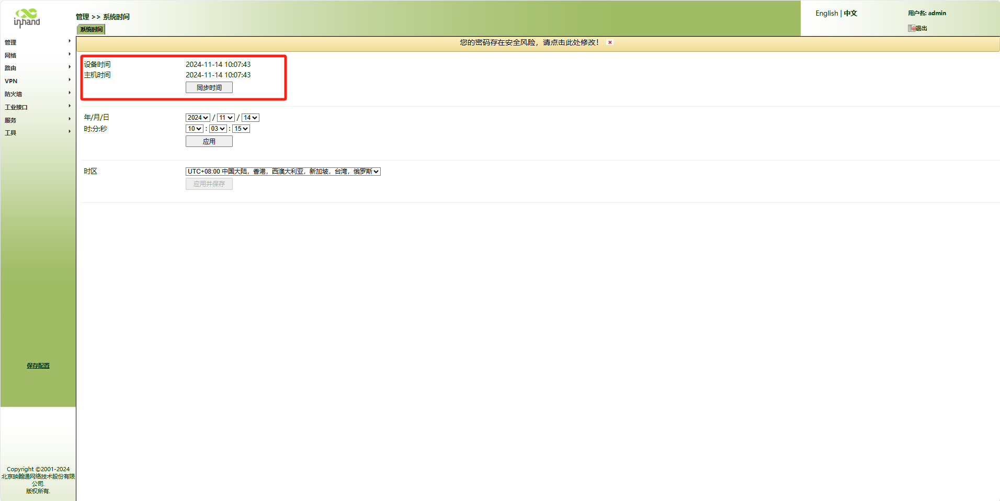

- **方法二：使用手动设置时间的方法配置系统时间**
    1. 选择“管理->系统时间”，进入“系统时间”界面
    2. 手动设置当前的日期、时刻等信息
    3. 设置完成后，点击“应用“

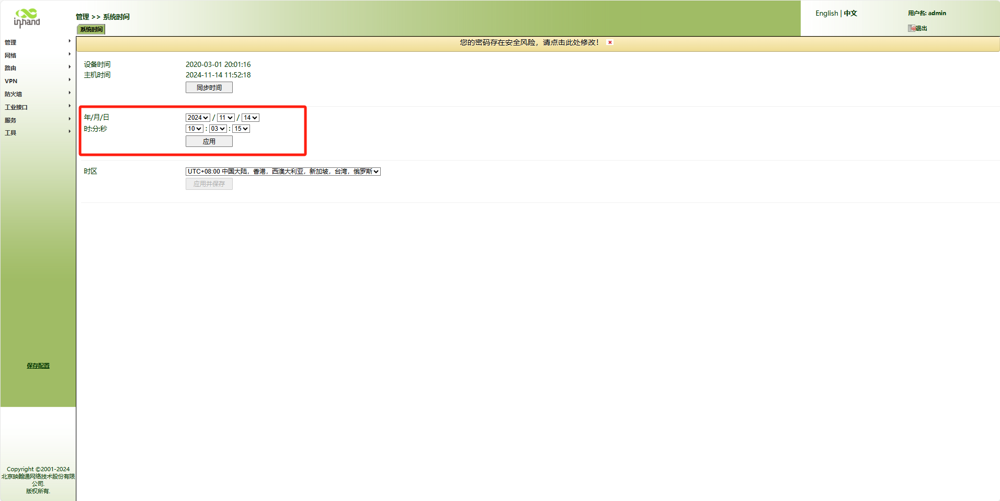

- **方法三：使用时区配置系统时间**
    1. 选择“管理->系统时间”，进入“系统时间”界面
    2. 在“系统时间”的“时区”中选择DTU的时区
    3. 选择后点击“应用并保存”即可

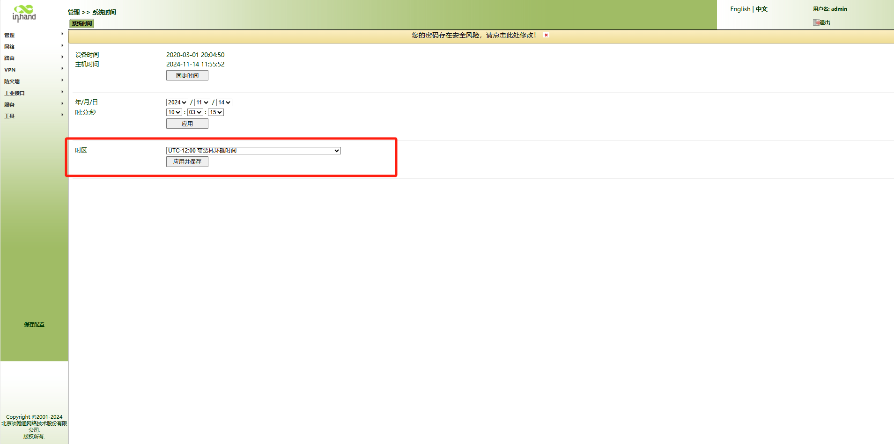

### 5.2.3 用户管理

在“用户管理”页面，可以新添加一个用户，也可以对用户的账号密码及访问权限进行管理，以此实现多用户访问和管理 DTU。

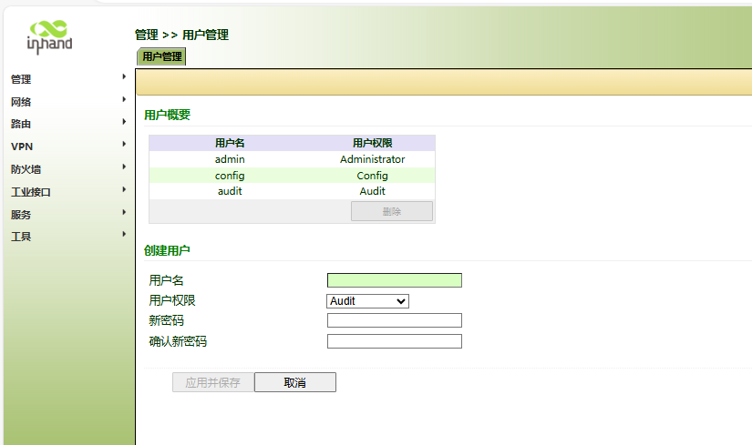

用户管理参数说明：

- 用户摘要
  - 用户名：当前已经注册成功的账号名称
  - 用户权限：当前已注册账号的权限等级
- 创建用户
  - 用户名：新增用户的用户名，最多支持新增9个用户，能够使用新增用户登录web
  - 用户权限：为用户设置不同的用户权限，登录web后能够操作的功能不同：
    - Audit：审计管理员权限，在此权限下，只能对系统中的日志进行安全审计和使用web页面上的工具进行探测、抓包
    - Config：安全管理员权限，在此权限下，仅支持参数配置、策略配置、设备密钥的生成、导入、备份和恢复等操作
    - Administrator：管理员权限（最高权限），在此权限下，所有管理操作均支持；
  - 新密码：新用户的密码，用户自定义
  - 确认新密码：再次输入设置的用户新密码，请确保两次的输入一致
- 修改用户：在“用户摘要”中点击已创建的用户，如“con”，点击后会出现用户“con”的修改用户界面，如下图所示：

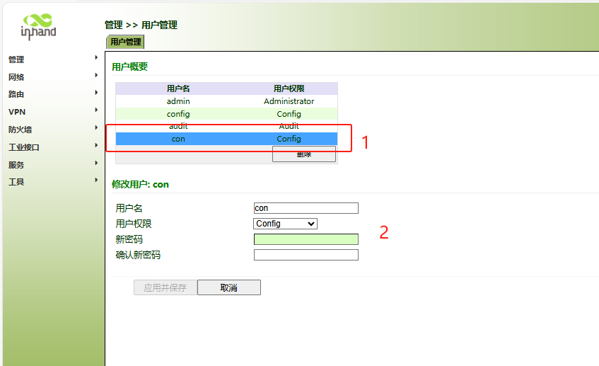

注意：默认用户权限为Administrator的用户，其权限不允许被修改

- 删除用户：点击需要删除的账户，并点击删除即可，删除成功后用户将不再允许已删除的用户登录设备

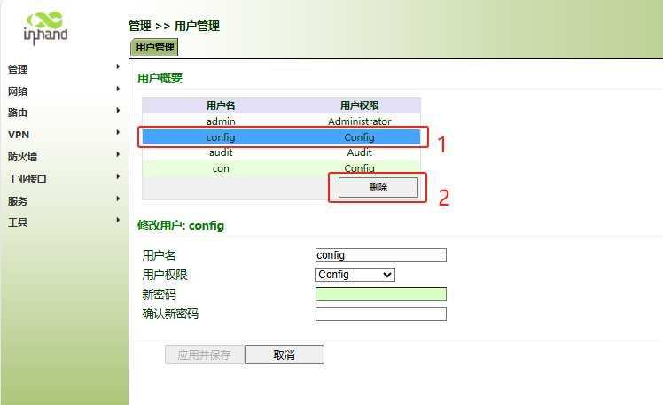

注意：默认用户权限为Administrator的用户不允许被删除

### 5.2.4 配置管理

选择“管理->配置管理”进入配置管理页面，在此页面可以对设备的配置、密钥进行管理、备份，同时也可以设置将设备恢复到出厂设置状态

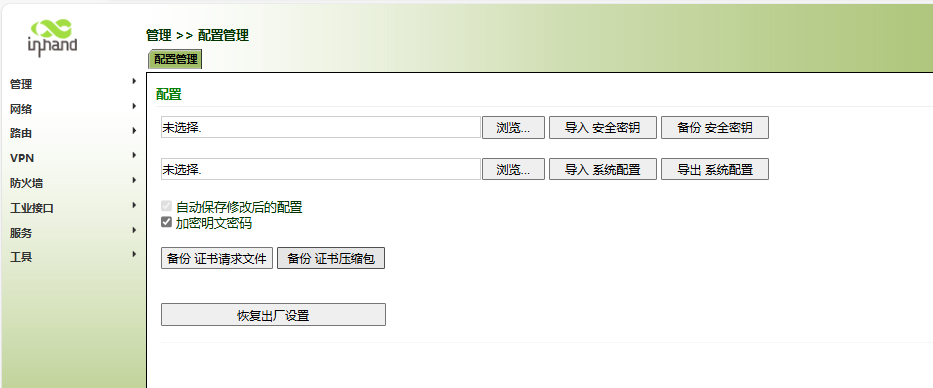

配置管理参数说明：

- 配置
  - 导入安全密钥：点击”浏览“，选择正确的.key安全密钥文件，点击”导入安全密钥“，当页面上提示”上传文件成功！“则代表安全密钥导入成功，反之则代表导入失败
  - 备份安全密钥：将设备中的安全密钥备份到本地PC上，名称为"设备名-序列号.key"
  - 导入系统配置：点击”浏览“，选择正确的.cnf配置文件，点击“导入系统配置”；页面提示“导入配置成功”，此时点击“重启系统”设备重启成功后配置生效
  - 导出系统配置：点击“导出系统配置”按钮，可导出设备的配置，在本地生成一个.cnf后缀的加密文件；导出的配置文件不支持修改，修改后将导致无法再正常导入到设备中
  - 加密明文密码：启用后DTU在 WEB 上配置的所有带密码的参数都会以加密的方式在配置中显示。提高密码安全性
  - 备份证书请求文件：导出设备上一次生成的证书请求文件，若当前设备未生成证书请求文件，将提示“设备中没有证书请求文件”
  - 备份证书压缩包：导出设备已导入的证书
  - 恢复出厂设置：将DTU恢复到出厂配置，DTU所有的配置被恢复到默认参数。恢复出厂后需要重新启动DTU才能生效

### 5.2.5 管理服务

为便于管理和配置InDTU954C,你可以在“管理->管理服务”页面配置DTU的管理和访问方式。配置步骤如下：

- **配置HTTP/HTTPS**

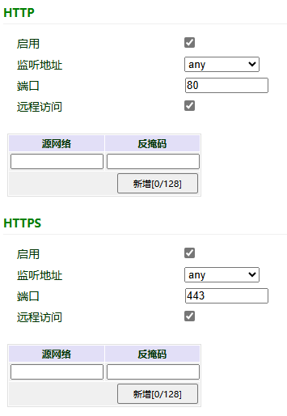

HTTP/HTTPS参数说明如下：

1. 启用：启用/禁用 HTTP/HTTPS访问功能
2. 监听地址：设置后设备仅可以通过设备指定的监听地址登录web页面，默认为any，即可以通过设备任意接口登录web页面
3. 端口：HTTP/HTTPS访问端口号,保持默认即可
4. 远程访问：设置后，将会生成一条ACL规则，并默认应用在拨号口下，同一网络下的PC可telnet到DTU拨号口IP
    1. 源网络：用于访问设备WEB页面的合法源地址；如果不设置则代表任意地址均可通过HTTP/HTTPS连接到DTU
    2. 反掩码：源地址的反掩码，如：配置源地址为192.168.2.1/24，则其掩码为255.255.255.0，其反掩码为0.0.0.255

- **配置TELNET**

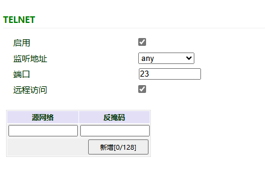

TELNET参数说明：

1. 启用：启用/禁用TELNET功能
2. 监听地址：设置后设备仅可以通过设备指定的监听地址登录web页面，默认为any，即可以通过设备任意接口登录web页面
3. 端口：TELNET访问端口号,保持默认即可
4. 远程访问：设置后，将会生成一条ACL规则，并默认应用在拨号口下，同一网络下的PC可telnet到DTU拨号口IP
    1. 源网络：用于访问设备WEB页面的合法源地址；如果不设置则代表任意地址均可通过TELNET连接到DTU
    2. 反掩码：源地址的反掩码，如：配置源地址为192.168.2.1/24，则其掩码为255.255.255.0，其反掩码为0.0.0.255

- **配置SSH**

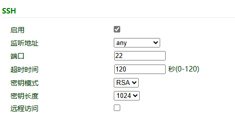

SSH参数说明：

1. 启用：启用/禁用SSH功能
2. 监听地址：设置后设备仅可以通过设备指定的监听地址登录web页面，默认为any，即可以通过设备任意接口登录web页面
3. 端口：SSH访问端口号,默认采用22端口
4. 超时时间：SSH超时时间，合法值0-120；超时时间内SSH未连接成功则视为本次连接失败
5. 密钥模式：SSH 连接通常使用非对称加密算法来实现安全通信，涉及到公钥和私钥。常见的密钥模式是RSA 模式
6. 密钥长度：RSA 算法的密钥长度可以根据需求进行选择。一般来说，密钥长度越长，安全性就越高，但生成和处理密钥所需的计算资源也会增加。可选512/1024/2048/4096，默认长度为1024
7. 远程访问：设置后，将会生成一条ACL规则，并默认应用在拨号口下，同一网络下的PC可telnet到DTU拨号口IP
    1. 源地址：用于访问设备WEB页面的合法源地址；如果不设置则代表任意地址均可通过SSH连接到DTU
    2. 反掩码：源地址的反掩码，如：配置源地址为192.168.2.1/24，则其掩码为255.255.255.0，其反掩码为0.0.0.255

- **其他参数**

web 登录的超时时间，即在超时时间内未在设备的WEB页面上进行操作，则到达超时时间后，WEB页面会自动登出，下次配置时，需要重新输入用户名密码进行登录，合法值：100-3600，单位：秒。

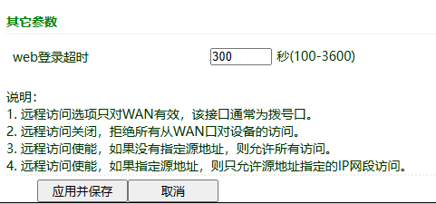

### 5.2.6 系统日志

#### 5.2.6.1 系统日志

你可以选择“管理->系统日志”，进入“系统日志”页面。该页面包含了网络和DTU的大量信息，包括运行状态、配置变化等。

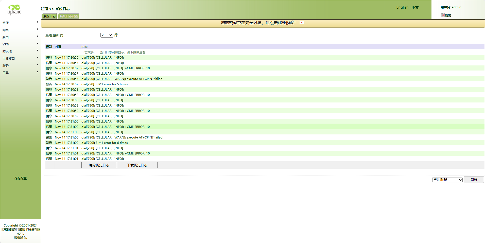

系统日志页面参数说明：

- 查看最新：查看当前最新的日志，20行，50行，100行，200行，全部；web页面上的日志能按照设置的行数显示
- 清除日志：能够将当前DTU web页面上显示的日志全部清除，同时将存储在DTU系统中的历史日志文件清除，若此时再下载历史日志，则下载到本地的“history.log”文件为空
- 下载历史日志：将DTU当前日志以.log的形式下载到本地，并自动命名为”history.log“，默认历史日志文件最大存储空间为10240KBytes
- 刷新：可选手动刷新和间隔刷新，web页面的日志将根据设置的刷新规则进行更新

#### 5.2.6.2 系统日志设置

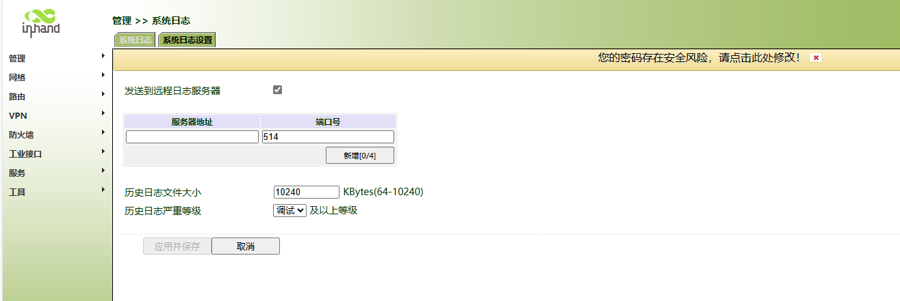

系统对接远程日志服务器参数说明如下：

- 发送到远程日志服务器：开启/关闭设备对接远程日志服务器，启用后DTU将会把实时的系统日志上传到远程日志服务器
  - 服务器地址：远程日志服务器的地址
  - 端口号：远程日志服务器的端口号

### 5.2.7 计划任务

在“管理->计划任务”页面可设置设备定时重启，到达设定的时间后，无需用户手动配置即可自动执行重启动作。

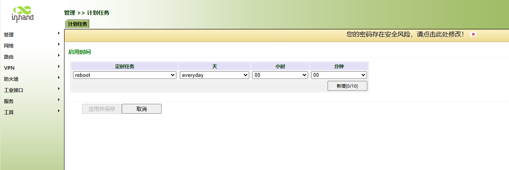

### 5.2.8 系统升级

点击进入“管理->系统升级”页面，并点击“浏览”上传固件版本，随后点击”升级“，固件上传完成后，点击立即重启设备，即可完成固件版本的升级。

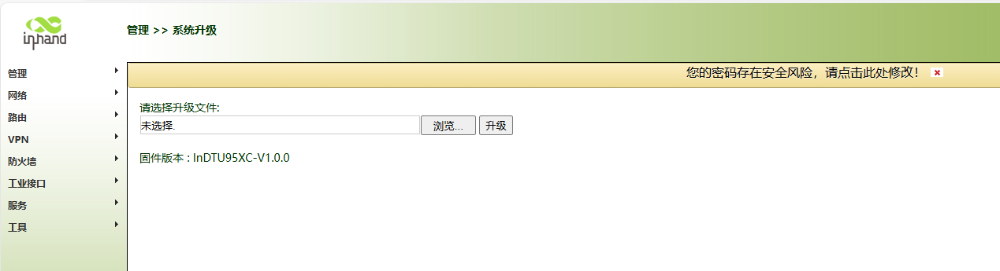

### 5.2.9 重启系统

点击“管理->重启系统”,并在弹出的提示框中点击“确定”即可对设备进行立即重启。

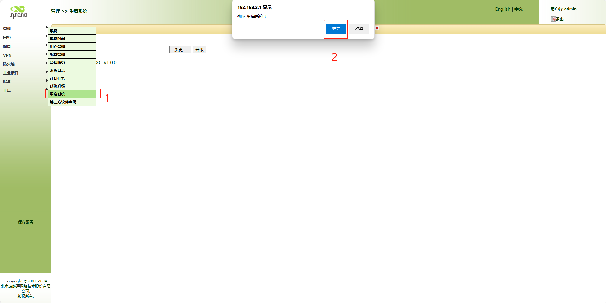

### 5.2.10 第三方软件声明

进入“管理 > 第三方软件声明”，在此查看InDTU954C的第三方软件声明。

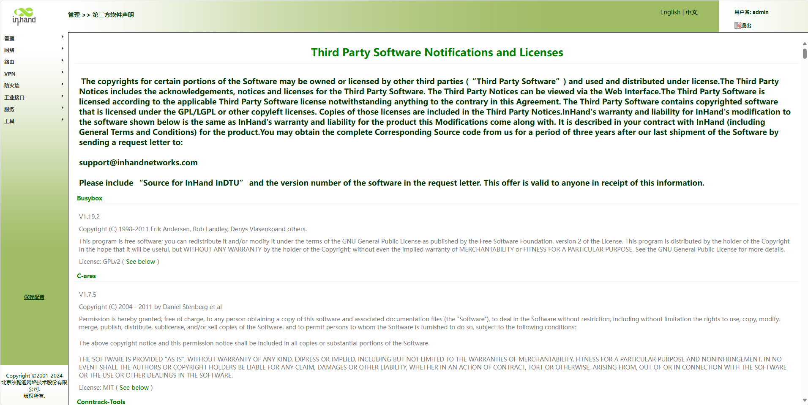

### 5.3 网络

### 5.3.1 拨号接口

#### 5.3.1.1 状态

点击“网络->拨号接口”可进入拨号接口状态界面，在此可查看当前的modem状态和网络连接状态，当点击“连接”按钮时，DTU开始拨号，当点击“断开”按钮时，DTU拨号会断开。

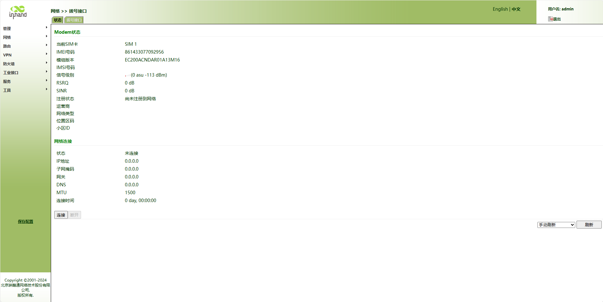

#### 5.3.1.2 拨号接口

点击“网络->拨号接口”进入到蜂窝网配置页面。此页面展示了DTU当前的配置信息。您可以通过“启用”按钮对蜂窝网参数进行配置。

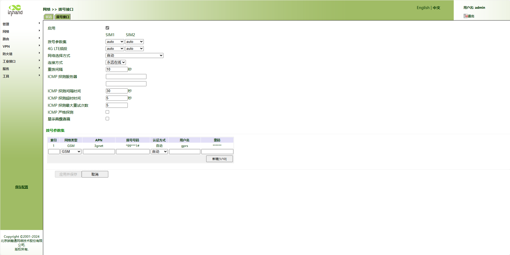

拨号接口参数说明如下：

- 启用：启用/禁用蜂窝网功能
- 拨号参数集：拨号参数集选择，若不是专用网卡，选择默认的配置即可
- 4G LTE频段：选择LTE频段，保持默认auto时，将根据SIM卡、部署环境自动调整最佳频段
- 网络选择方式：可选择Auto、2G、3G、4G等网络。用户根据所使用设备及 SIM 卡适用的情况，可选择特定的网络方式，或使用自动方式，设备可自行注册到适用当前网络状况的网络方式
- 连接方式：指定设备与蜂窝网络的连接模式，可选“永远在线”或“手工拨号"。 永远在线是系统默认拨号方式，即：设备拨号后一直在线，只有拨号接口没有任何流量时会30分钟掉线重新拨号；手工拨号：在拨号状态界面手动点击“连接”，DTU即开始拨号；点击“断开”，DTU即退出拨号；如下图所示：

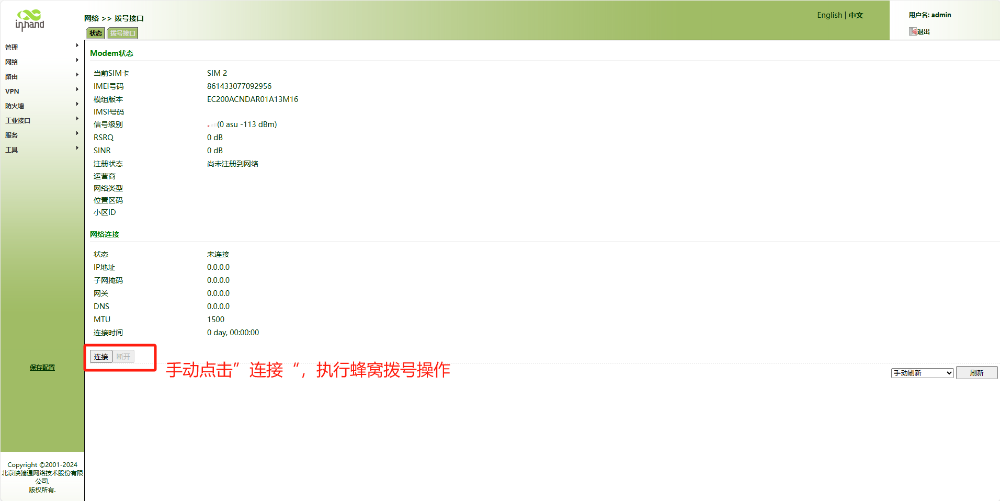

- 重拨间隔：设备每次掉线后重新拨号的等待时间
- ICMP 探测服务器：要探测的远端 IP 地址或域名，当服务器检测失败的情况下，设备会重新拨号并进行下一轮 ICMP 探测
- ICMP 探测间隔时间：设备发送 ICMP 探测报文的时间间隔
- ICMP 探测超时时间：在设置的 ICMP 探测超时时间内，没有收到 ICMP 响应包认为本次 ICMP 探测超时
- ICMP探测最大重试次数：ICMP探测超时后的重传次数
- ICMP 严格探测：关闭ICMP严格探测时，如果拨号接口有流量，则不发送ICMP探测以节省流量；开启ICMP严格探测的时候，无论拨号接口是否有流量，都会发送ICMP探测报文

### 5.3.2 以太网接口

#### 5.3.2.1 状态

点击”网络->以太网接口->状态”，进入以太网状态页面，此页面概述了以太网接口的连接状态以及基本信息。

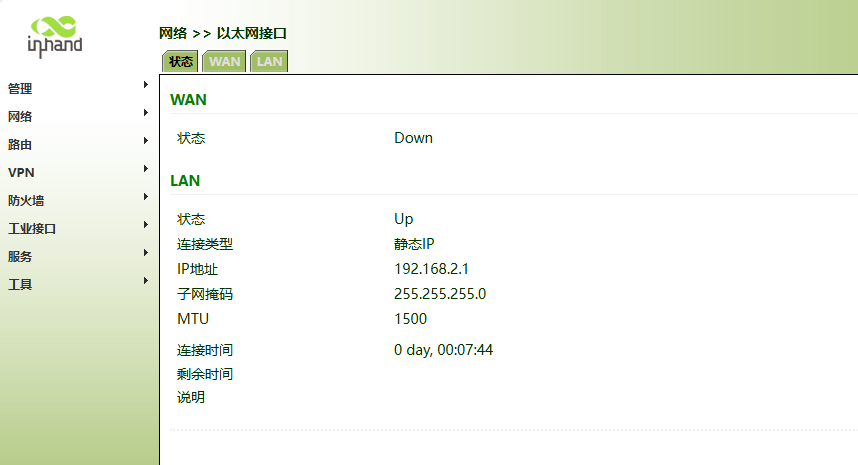

#### 5.3.2.2 WAN口

InDTU954C有一个WAN/LAN复用接口，接口IP仅支持静态配置的方式。

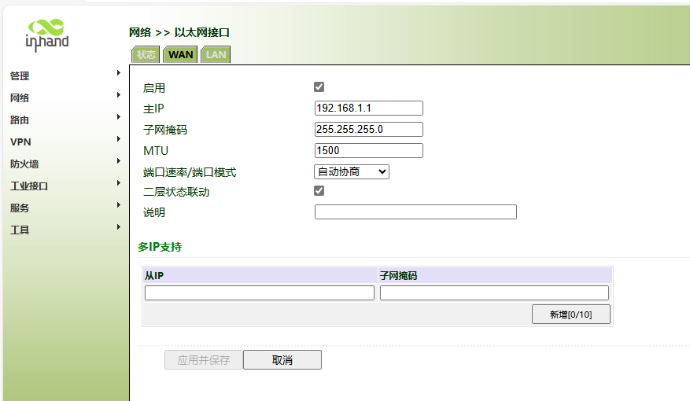

WAN口参数说明如下：

- 启用：启用/禁用WAN口
- 主IP：WAN口的IP地址，自定义，出厂默认IP地址为：192.168.1.1/24
- 子网掩码：以太网接口的子网掩码，出厂默认24位，即：255.255.255.0
- MTU：最大传输单元，以字节为单位，默认值为1500，当传输的数据超过最大传输单元后，数据将被分片
- 端口速率/端口模式：接口的协商速率，以及传输模式，可选全双工/半双工
- 二层状态联动：开启后，当设备接口的物理连接断开后，WEB页面将显示接口状态为down
- 说明：对接口配置进行说明，以便一眼看出该接口的作用
- 多IP支持：
  - 从IP：接口支持多IP地址
  - 子网掩码：多IP地址的子网掩码

#### 5.3.2.3 LAN口

InDTU954C有两个LAN接口，这两个接口属于二层接口，其上层默认IP地址为192.168.2.1/24，故当网线随机插入LAN1、LAN2时，都可以访问到192.168.2.1。

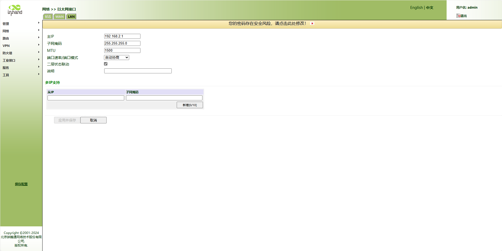

LAN口参数说明：

- 主IP：启用/禁用LAN口，自定义，出厂默认IP地址为：192.168.2.1/24
- 子网掩码：以太网接口的子网掩码，出厂默认24位，即：255.255.255.0
- MTU：最大传输单元，以字节为单位，默认值为1500，当传输的数据超过最大传输单元后，数据将被分片
- 端口速率/端口模式：接口的协商速率，以及传输模式，可选全双工/半双工
- 二层状态联动：开启后，当设备接口的物理连接断开后，WEB页面将显示接口状态为down
- 说明：对接口配置进行说明，以便一眼看出该接口的作用
- 多IP支持
  - 从IP：接口支持多IP地址
  - 子网掩码：多IP地址的子网掩码

### 5.3.3 环回接口

环回接口是设备上的一个逻辑、虚拟接口，创建并配置好环回接口之后，它的地址是能被 ping 或 telnet 的，这就可以用来测试网络的连通性。你可以在“网络->环回接口”页面配置或者查看环回接口参数。

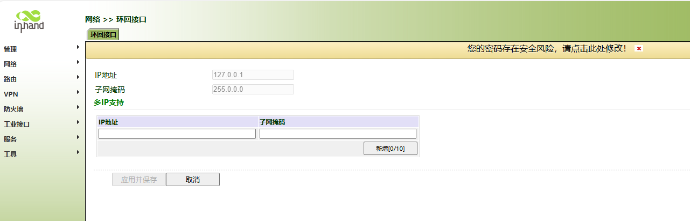

### 5.4 静态路由

点击“路由->静态路由->路由状态”,即可查看到当前设备的路由表明细信息，如下图所示：

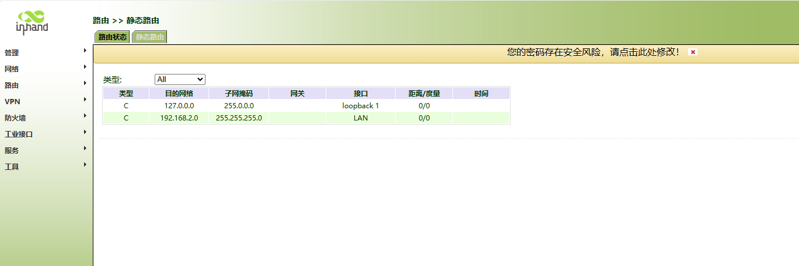

点击“静态路由”可增加、删除、修改设备路由信息，修改完成后，数据将根据指定的路由信息进行转发

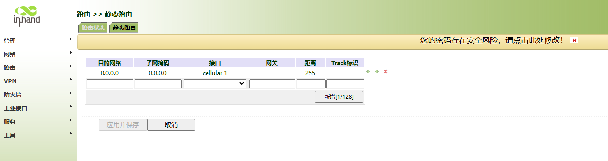

静态路由参数说明如下：

- 目的网络：需要到达的目的 IP 地址/网段
- 子网掩码：需要到达的目的地址的子网掩码
- 接口：数据到达目的网络的出接口
- 网关：设备出接口IP对应的网关
- 距离：到目标网络的开销，数值越小越优先
- Track 标识：Track 的索引或 ID

### 5.5 VPN

### 5.5.1 证书管理

#### 5.5.1.1 证书请求

点击“VPN->证书管理->证书请求”，进入“证书请求”页面。

以南网申请证书为例：

证书名：区局第一字母_YHT+设备序列号

公钥加密算法：SM2

证书格式：PEM

后缀名：csr

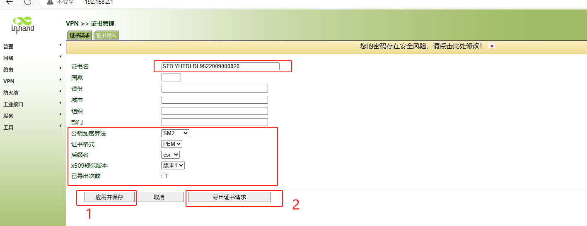

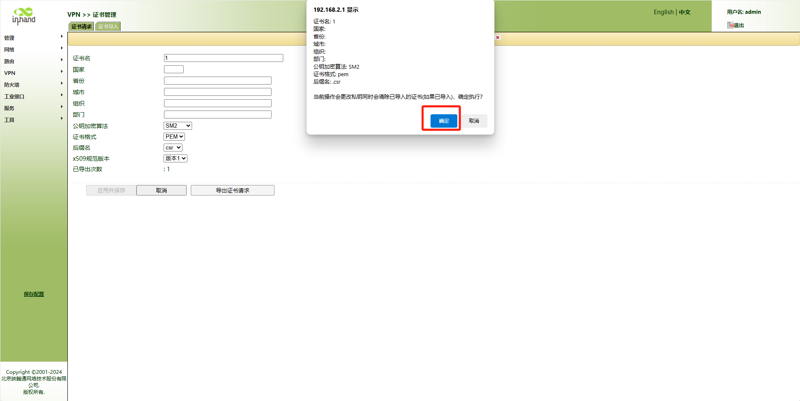

先点“应用并保存”，然后再点“导出证书请求”。随后浏览器会下载一个.csr证书文件，找到发给局方签发即可。

#### 5.5.5.2 证书导入

单击导航树中的“VPN->证书管理”菜单，进入“证书导入”界面。先点“浏览”，找到局方回签的.ZIP 文件，点“导入证书 ZIP 压缩包”，成功后会看到证书信息（如广州局的证书为 CN=GZGDJPW）。

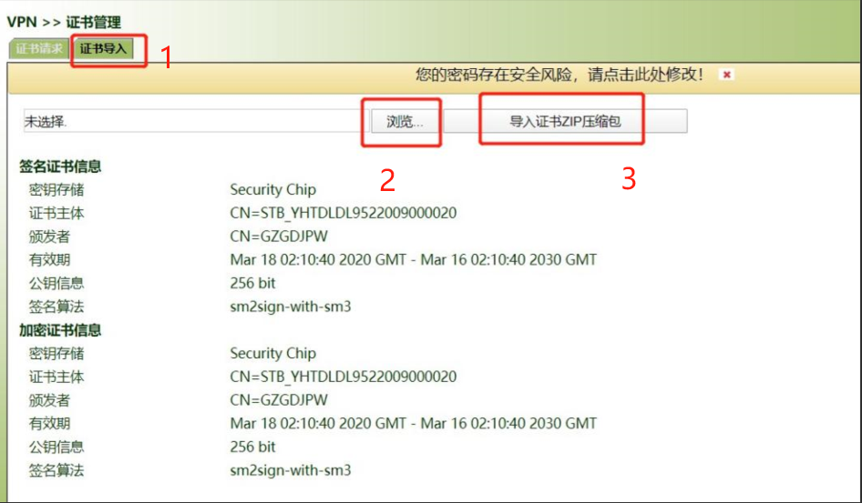

### 5.5.2 IPsec VPN

IPsec 是 IETF 制定的一组开放的网络安全协议，在 IP 层对数据包进行认证、加密操作来保证通信数据的完整性、安全性。减少数据泄漏和被窃听的风险，保障了用户业务数据传输的安全。

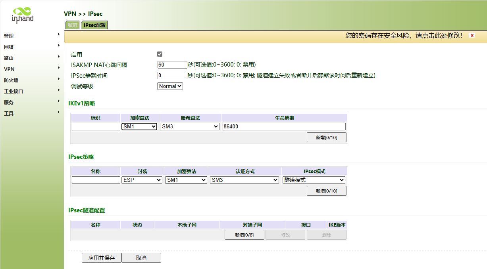

IPsec VPN参数说明：

- 启用：启用/禁用IPsec VPN功能
- ISAKMP NAT心跳间隔：通过定期发送保持活动消息，确保VPN连接在NAT环境中不被意外关闭，取值范围：0-3600,单位：s
- IPSec 静默时间： IPsec隧道建立失败或者断开后，DTU静默该时间后重新建立IPsec隧道 ，取值范围：0-3600，单位：s
- 调试等级：调试级别，用于设置VPN连接的调试信息的详细程度

**IKEv1策略：**

- 标识：自定义 IKEv1 策略标识
- 加密算法：可选SM1，SM4
- 哈希算法：可选SHA2-256，SHA2-384，SHA2-512，SM3
- 生命周期：设备会在IKEv1生命周期结束时提前1分钟重建；无论IPsec SA生命周期为多少，当IKEv1重建时，IPsec SA必然重建；有效值：120-86400，单位：秒

**IPsec策略：**

- 名称：设置 IPSec 策略的名称。配置 IPSec 策略成功后，该参数不可修改。
- 封装：IPSec 协议中的 AH 协议定义了认证的应用方法，提供数据源认证和完整性保证；ESP 协议定义了加密和可选认证的应用方法，提供数据可靠性保证
  - AH：提供数据源认证、数据完整性校验和报文防重放功能。发送端对 IP 头的不变部分和 IP 净荷进行离散运算，生成一个摘要字段。接收端根据接收的 IP 报文，对报文重新计算摘要字段，通过摘要字段的比较，判别报文在网络传输期间是否被篡改
  - ESP：ESP 封装安全载荷协议：除提供 AH 认证头协议的所有功能之外，还可对 IP 报文净荷进行加密。ESP 协议允许对IP 报对 IP 头的内容进行保护
- 加密算法：可选SM1，SM4
- 认证方式：可选SHA2-256，SHA2-384，SHA2-512，SM3
- IPsec模式：IPSec 协议的封装模式
  - 隧道模式：在原始 IP 报文头外封装一个 IPSec 报文头（AH或 ESP），然后在最外层封装新的 IP 报文头，原 IP 报文被当作有效载荷的一部分受到 IPSec 的保护。隧道模式一般用在两个安全网关之间。在一个安全网关被加密的报文，只有到达另一个安全网关才能够被解密
  - 传输模式：在 IP 报文头和上层协议报文头之间插入一个 IPSec 报文头（AH 或 ESP）。在这种模式下，原 IP 报文头不变，只是 IP 协议字段被改为 AH 或 ESP，并重新计算 IP 报文头校验和。传输模式适用于两台主机，或者是一台主机和一个安全网关之间的通讯

**IPsec隧道配置：**

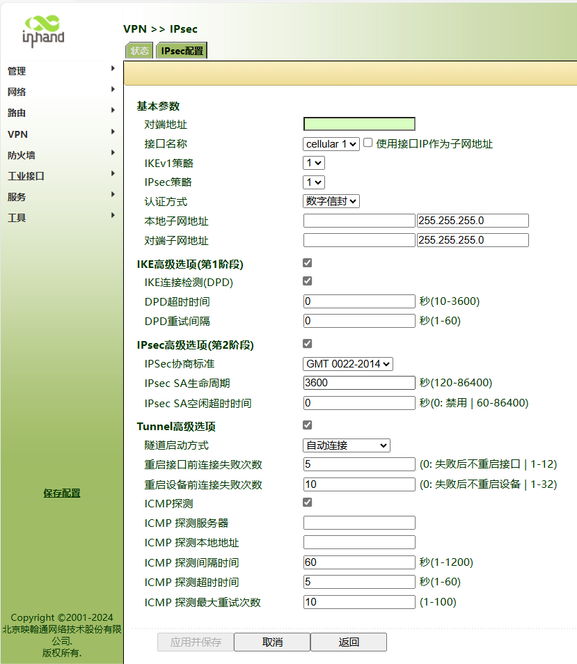

- **基本参数：**
  - 对端地址：设置对端 IKE 对等体的 IP 地址或域名（当 DTU为 server时配置为 0.0.0.0）
  - 接口名称：设置应用IPSec策略的接口
  - IKEv1策略：在 IKEv1 策略列表里定义过的策略标识
  - IPsec策略：在 IPsec 策略列表里定义过的策略标识
  - 认证方式：支持数字信封的认证方式
  - 本地子网地址：IPsec 定义的感兴趣流中的源网络
  - 对端子网地址：IPsec 定义的感兴趣流中的目的地址
- **IKE高级选项(第一阶段)：**
  - IKE连接检测（DPD）:IKE连接检测是一种在 IPsec VPN 环境中用于检测 IKE 对等体（即建立 IPsec 安全关联的双方设备）是否还存活的机制。它是一种保活机制，通过定期发送检测消息来确定对端是否可达
    - DPD超时时间：当接收端触发 DPD 查询，主动向对端发送请求报文进行检测，超过超时时间仍没有收到对端的 IPSec 加密报文时，将删除此 ISAKMP Profile，合法值：10-3600，单位：秒
    - DPD重试间隔：用于 IPSec 邻居状态的检测时间间隔。启动 DPD 功能后，当接收端在触发 DPD 的时间间隔内收不到对端的 IPSec 加密报文时，能够触发 DPD 查询，主动向对端发送请求报文，对 IKE 对等体是否存在进行检测，合法值：1-60，单位：秒
- **IPsec高级选项（第二阶段）：**
  - IPsec协商标准：支持配置GMT 0022-2014和标准RFC两种协商标准
  - IPsec SA生命周期：设置 IPSec SA 的生存周期。IPSec 协商建立 SA 时，采用本端设置的生存周期和对端的生存周期中较小的一个，设备会在一个生命周期结束时提前1分钟重建SA；合法值：120-86400，单位：秒
  - IPsec SA空闲超时时间：设备在一个空闲周期内没有业务数据，会重建IPsec链路；当设置为0时，禁用IPsec SA空闲超时功能，合法值：60-86400，单位：秒
- **Tunnel高级选项：**
  - 隧道启动方式：支持自动连接、仅响应连接请求和按需连接三种启动方式
    - 自动连接：当IPsec隧道配置完成后，不需要人为做任何操作，DTU会主动去连接主站建立隧道
    - 仅响应连接请求：当IPsec隧道配置完成后，DTU不会主动去连接主站，只有当DTU收到主站发来的连接请求时才会建立隧道
    - 按需连接：当IPsec隧道配置完成后，DTU不会主动去连接主站，只有当DTU收到主站发来的连接请求时才会建立隧道
  - 重启接口前连接失败次数：当隧道连接失败次数达到设定的值以后，重启建立隧道的物理接口；默认为0，即失败后也不重启接口，合法值：1-12次
  - 重启设备前连接失败次数：当隧道连接失败次数达到设定的值以后，重启当前设备；默认为0，即失败后也不重启设备，合法值：1-32次
  - ICMP探测：
    - ICMP探测服务器：IPsec 探测的对端主机地址
    - ICMP探测本地地址：IPsec 保护流量的源地址
    - ICMP探测间隔时间：设备发送 ICMP 探测报文的时间间隔
    - ICMP探测超时时间：在设置的 ICMP 探测超时时间内，没有收到 ICMP 响应包认为本次ICMP 探测超时
    - ICMP探测最大重试次数：设置 ICMP 探测失败时的最大重试次数（达到最大次数后会重重新启动 IPsec 服务）

### 5.6 防火墙

### 5.6.1 访问控制（ACL）

ACL 即访问控制列表，通过配置一系列匹配规则，对指定数据流（如限定的源 IP 地址、账号等）执行允许或禁止通过的操作，达到对网络接口数据的过滤。你可以在“防火墙->访问控制（ACL）”页面新增、修改、删除访问控制规则。

默认处理策略：

- 放行：在所有访问控制列表的末尾加上一条permit any any
- 阻止：在所有访问控制列表的末尾加上一条deny any any

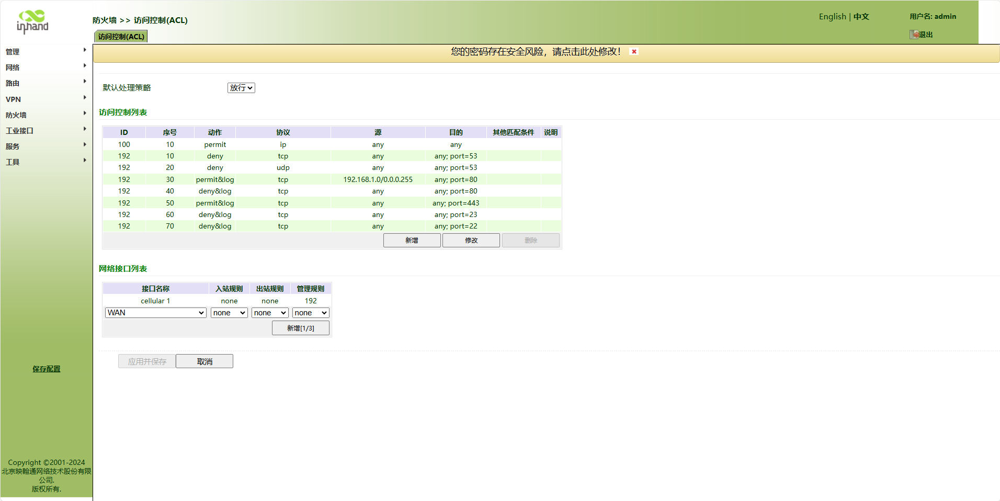

**配置标准访问控制策略，如下图所示：**

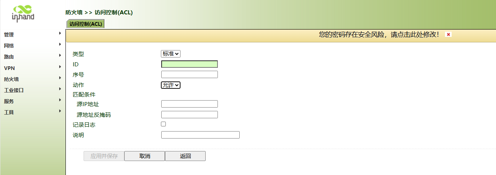

- 标准访问控制策略参数说明如下：
  - ID：ACL 规则ID，范围 1-99，用于唯一标识一个访问控制策略
  - 序号：ACL 规则序号，数值越小则优先级越高
  - 动作：允许/拒绝报文通过
  - 源IP地址：ACL 规则匹配报文的源地址，为空时表示 any，即所有网段
  - 源地址反掩码：ACL 规则匹配报文的源地址反掩码，例如：源地址网段为192.168.2.0，其掩码为255.255.255.0，则其反掩码为0.0.0.255
  - 记录日志：启用后系统会记录关于访问控制方面的日志
  - 说明：用于对该条ACL规则进行描述，方便一眼看出该ACL的作用

**配置扩展访问控制策略，如下图所示：**

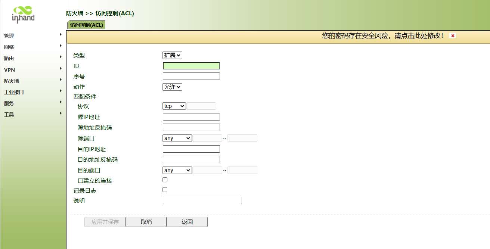

- 扩展访问控制策略参数说明如下：
  - ID：ACL 规则ID，范围 100-199
  - 序列号：ACL 规则序号，数值越小则优先级越高
  - 动作：允许/拒绝报文通过
  - 协议：访问控制协议
  - 源IP地址：ACL 规则匹配报文的源地址，为空时表示 any，即所有网络
  - 源地址反掩码：ACL 规则匹配报文的源地址反掩码
  - 源端口：源端口号，any 表示 TCP/UDP 报文的任何源端口都匹配。协议为 TCP 或 UDP 时，才能指定源端口号
  - 目的IP地址：ACL 规则匹配报文的目的地址，为空时表示 any，即所有网络
  - 目的地址反掩码：ACL 规则匹配报文的目的地址反掩码
  - 目的端口：目的端口号，any 表示 TCP/UDP 报文的任何目的端口都匹配。协议为 TCP 或 UDP 时，才能指定目的端口号。
  - 已建立的连接：启用后则控制已建立 TCP 连接的报文，未建立连接的 TCP 报文不控制；未启用则控制已建立和未建立的 TCP 报文。协议为 TCP 时，才可以配置此项参数
  - 片段：控制数据包从接口发送出去时被分片的报文。（协议类型为IP时才有此项）
  - 记录日志：启用后系统会记录关于访问控制方面的日志。
  - 说明：用于对该条ACL规则进行描述，方便一眼看出该ACL的作用

**配置接口访问控制策略，如下图所示：**

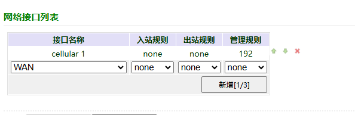

接口访问控制策略参数说明如下：

- 接口：需要设置访问控制策略的接口名称
- 入站规则：针对从该接口进入，然后由设备转发的报文，选择一条ACL规则
- 出站规则：针对通过设备转发，并且报文的出口是该接口的报文，选择一条ACL规则
- 管理规则：针对从该接口进入，目标地址是设备本身的报文，选择一条ACL控制规则，通常用于限制对本机的访问

### 5.6.2 网络地址转换（NAT）

网络地址转换（NAT） 可以实现局域网内的多台主机通过 1 个或多个公网 IP 地址接入公网，即用少量的公网 IP 地址代表较多的私网 IP 地址，节省公网的 IP 地址。你可以在“防火墙->网络地址转换（NAT）”页面查看和设置网络地址转换规则

**网络地址转换）（NAT）规则:**

- SNAT

举例：使用PC 直连DTU的LAN口，PC通过DTU上网（PC：192.168.3.166 DTU WAN口IP：192.168.2.31）

SNAT参数说明：

    - 动作：SNAT
    - 源网络：inside（内部地址转换）
    - 转换类型：IP TO IP，将PC的IP地址转换成WAN口的IP地址

注意：IP TO IP只可以一个IP地址上网，当修改PC的IP地址后，不能访问外网

- DNAT

举例：外网设备通过WAN口，访问LAN口下端设备（PC：192.168.3.166 DTU WAN口IP：192.168.2.31），PC上开启TCP sever监听端口：60001

配置完成后，当外部网络访问DTU的WAN口地址192.168.2.31：60001时，会被转换成访问PC 192.168.3.166:60001

- 1:1 NAT

举例：DTUWAN口地址为192.168.2.31，LAN口地址为192.168.3.31，PC地址为192.16,3.166，PC网关为192.168.3.31

配置完成后相当于配置了一条源地址转换和一条目的地址转换，故：既可以通过PC访问外网，也可以通过外网访问到PC：

1. PC能够正常ping通外网，当修改PC地址后，访问异常
2. PC上开启TCP sever监听端口：3333；使用外网作为TCP client访问192.168.2.31:3333，外网能够通过TCP连接到PC192.168.3.166:3333

- **内部/外部网络接口**

根据接口流量类型，将接口设置为内部接口、外部接口

1. 内部接口（inside）：表示该接口连接内部网络
2. 外部接口（outside）：表示该接口连接外部网络

### 5.6.3 MAC-IP绑定

MAC-IP 绑定是一种网络管理技术，旨在将特定设备的媒体访问控制地址（MAC 地址）与互联网协议地址（IP 地址）进行关联和固定,只有通过绑定后的地址才能访问对应网络，可以增强网络安全性，同时方便网络管理。例如：

1、新增一条MAC-IP绑定规则:设备LAN口下端PC的MAC地址绑定IP地址192.168.2.66；  
2、只有当LAN口下端PC的IP地址为192.168.2.66时，才能正常通过设备访问外网；  
3、配置PC的IP地址为非192.168.2.66以外的地址，PC不能访问外网；

### 5.7 工业接口

### 5.7.1 DTU状态

在状态页面可查看DTU状态，如DTU串口、协议、主站地址、端口号、连接状态和时间等等；同时可以点击“清除DTU数据”能够清除当前显示在web页面上的数据，点击“下载DTU数据”能够将当前显示在web页面上的数据下载到本地。

### 5.7.2 串口设置

根据与DTU相连的终端设备的串口参数设置DTU串口的参数，实现DTU与终端设备的正常通信。

串口设置参数说明如下：

- 串口类型：InDTU954C仅支持RS232
- 波特率：这是一个衡量符号传输速率的参数。它表示每秒钟传送的符号的个数
- 数据位：设置通信中实际数据位的参数
- 校验位：在串口通信中的检错方式，一般是无校验、奇校验、偶校验三种方式
- 停止位：用于表示单个包的最后一位。典型的值为 1和 2 位
- 软件流控：串口通讯的流控提供了由于某种原因不能进行通讯时阻塞通讯的一种机制。流控可以使数据接收设备在不能接收数据时通知数据发送设备，使其停止发送
- 串口描述：自定义描述

**注意：**

- DTU的串口参数与相连的终端设备的串口参数必须设置一致

### 5.7.3 DTU1

DTU 1 参数说明如下：

- 启用：启用/禁用DTU功能
- DTU协议：可选择透明传输、TCP服务器、DC协议、PMP协议
  - 透明传输：当传输协议选择TCP时，DTU作为TCP客户端向TCP服务器发起连接，并进行正常的数据传输
  - TCP服务器：DTU作为TCP Server接收TCP Client发起的连接，并进行正常的数据传输
  - DC协议：当传输协议选择TCP时，DTU使用DCTCP协议与Server端建立连接；当传输协议选择UDP时，DTU使用DCUDP协议与Server建立连接并进行数据传输
- 心跳空闲间隔：TCP 客户端和 TCP 服务器建立连接后，定期发送TCP心跳报文的时间间隔，用于检测客户端和服务器之间的连通性,合法值：0-3600，单位：秒
- 心跳超时间隔：在设置的超时间隔内，仍然没有收到上一次心跳报文的回复，则认为本次心跳报文超时传输，合法值：1-3600，单位：秒
- 心跳重试次数：当 TCP 心跳超时后，设备重新发送 TCP 心跳，达到设置的心跳重试次数后，重新建立 TCP 连接，合法值：1-100，单位：秒
- 串口缓存帧个数：串口收发数据时设置的串口缓存大小，默认 4K
- 串口分帧长度：串口发送数据时，设置的一帧数据的大小。当达到设定值后开始发送。合法值：1-2048，单位：字节
- 串口分帧间隔：当串口发送数据时，当发送间隔到达设置的分帧间隔后，设备会自动分帧发送，合法值：10-65535，单位：毫秒
- 最小重连时间：用户自定义最小重连间隔时间。设备启动连接时如果没连接成功会按照此最小重连间隔时间重连，然后依次以最小重连间隔递增，直到连接主站的重连间隔达到设置的最大重连间隔后时间不再增加，此后按照最大重连间隔去重连主站；合法值：15-60，单位：秒
- 最大重连间隔：用户自定义最大重连间隔时间。设备启动连接且连接时间达到最大重连间隔时间后，每隔此间隔时间（即用户自定义的最大重连间隔时间）连接一次。合法值：60-3600，单位：秒
- 多中心策略：可选择并发、轮询
  - 并发：同时去连接目的 IP 地址列表中的中心，多个主站同时工作且之间互不影响
  - 轮询：先连接列表前边的中心，若连接上就不再连接后边的；若没有连接上则按照自前往后的顺序去连接，直到连接上一个中心为止
- 源接口：选择DTU与主站交互的源接口，可选设备接口，也可选择IP地址
  - 本地IP地址：当源接口选择IP地址时，选择一个在DTU上实际存在且可以和主站正常交互的IP地址
- DTU 标识：自定义，成功连接服务器后自动向服务器发送的 DTU 标识，当DTU协议选择DC协议时需要填写此项，也可以不配置，保持空状态
- 调试日志：点选开启，开启后将会打印DTU相关日志
- 多主站：开启多中心服务器功能，开启后设备可与多个中心建立连接
- 连接失败重启设备间隔：检测到与中心连接断开的时间间隔，达到时间间隔后重启设备，配置为0秒时，当DTU连接主站失败后，不会触发重启机制。合法值：120-65535，单位：秒
- 目的IP地址
  - 服务器地址：自定义设备要连接的服务器 IP 地址
  - 服务器端口：自定义设备要连接的服务器端口

### 5.7.4 DTU2

同DTU1。

### 5.8 服务

### 5.8.1 DHCP服务

#### 5.8.1.1 状态

在该页面可以看到DTU所有接口的下一跳地址，如果下端有DHCP Client设备，能看到client的主机名称以及DTU分配的IP地址有效租期。

#### 5.8.1.2 DHCP服务器

DHCP 采用客户端/服务器通信模式，由客户端向服务器提出地址分配申请，服务器返回为客户端分配的 IP 地址及相关联的信息（如：租期），以实现 IP 地址等信息的动态配置。InDTU954C的WAN口和LAN口都支持开启dhcp server服务，如下图所示：

DHCP服务参数说明如下：

- DHCP服务
  - 启用：启用/禁用接口的dhcp server服务功能
  - 接口：选择需要开启dhcp server服务的接口，WAN、LAN都支持
  - 起始地址：地址池分配的起始地址，和接口IP同网段，且要符合接口掩码长度设置
  - 结束地址：地址池分配的结束地址，和接口IP同网段，且要符合接口掩码长度设置
  - 有效期：被分配出去的地址的租期，超过设置的租期后，IP地址会被回收，当设置为0时代表有效期为”无限“，在状态页面显示为”infinite，合法值：30-10080，单位：分钟
- 域名解析服务器：当DTU配置为DHCP server时，可以为下端设备指定DNS服务器，根据配置的域名服务器进行地址解析，并且能够正常访问外网。DTU954C可为下端设备分配两个域名服务器，当首选域名服务器失效后，会向备选域名服务器发起域名解析请求

- 静态IP设置：某些场景下需要部分终端固定IP地址，则可使用静态IP设置功能，将终端的MAC和地址池中的IP进行绑定，绑定后的终端每次连接该网络则固定分配该地址

#### 5.8.1.3 DHCP客户端

InDTU954C的WAN、LAN口均可作为DHCP Client，向上层DHCP Server获取IP地址等信息，无需手动给设备分配IP地址

### 5.8.2 DNS服务

#### 5.8.2.1 域名服务器

域名系统（DNS，Domain Name System）是一种用于 TCP/IP 应用程序的分布式数据库，提供域名与 IP 地址之间的转换。通过域名系统，用户进行某些应用时，可以直接使用便于记忆的、有意义的域名，而由网络中的 DNS 服务器将域名解析为正确的 IP 地址。你可以在“DNS服务->域名服务器”页面设置和查看域名服务器。

**配置DNS服务器，可支持最多配置两个域名服务器，如下图所示：**

#### 5.8.2.2 DNS转发

开启DNS转发功能后，将DTU下联的客户端DNS服务器配置为与DTU互联的以太网口IP地址，当PC访问外网时，会将DNS请求发给DTU，并由DTU进行转发DNS请求。在指定[域名<=>IP地址]后，设备在访问对应的域名时，会按照配置进行域名解析，如：主机abc.com IP地址：1.2.3.4，进入DTU后台，ping abc.com，返回对应的IP ：1.2.3.4；

注：如果开启了DHCP功能，则DNS转发服务默认是开启的，不能关闭；需要先关闭DHCP功能然后再关闭DNS转发。

### 5.8.3 短信服务

短信功能用于设置蜂窝参数，查询蜂窝状态，以及重启系统等等

短信服务参数说明：

- 启用：启用/禁用短信功能
- 模式：
  - PDU：协议数据单元传输，CDMA不支持该种方式
  - TEXT：文本信息传输，CDMA网络仅支持该种方式
- 查询间隔：设备会定期查询收到的短信，这里设置定期查询的间隔
- 短信访问控制：
  - permit：允许接受该手机号的终端发送指令给DTU，或者接收DTU的信息
  - deny：拒绝接受该手机号的终端发送指令给DTU，或者拒绝接收DTU的信息
  - Phone Number：添加手机号

### 5.8.4 南网网关服务

南网网管服务参数说明：

- 启用：启用/禁用设备对接南网网管平台
- 网管协议：选择南网网管协议
- 服务器域名IP：网管平台的IP
- 服务器端口：网管平台的服务端口号
- 心跳间隔：DTU周期性地向平台发送 “心跳信号” 的时间间隔，用于检测设备与平台的连通性
- 主动上报间隔：DTU主动向平台发送数据或状态信息的时间周期
- 消息合并周期：将多个相关的消息或数据进行合并处理的时间间隔
- 终端OUI：DTU的标识符

### 5.9 工具

在web页面导航栏选择“工具”，进入工具页面。你可以在此页面诊断DTU的网络问题。专家选项中可以输入一些扩展选项，如：Ping工具中的专家选项配置 -s 100 即为发送100字节的数据包

使用Ping工具探测网络是否可达，如下图所示：

使用路由探测工具确定 IP 数据报访问目标所经过的路径，如下图所示：

使用网络抓包工具抓取对指定接口上传输的数据进行抓取，如下图所示：

网络测速：

1、点击”浏览“选择一个大于10M小于2000M的文件，点击“上传"页面上会返回上传速率；  
2、点击”test.bin“，页面上会自动下载一个 test.bin的文件用于测试网络下载速度

**3**
