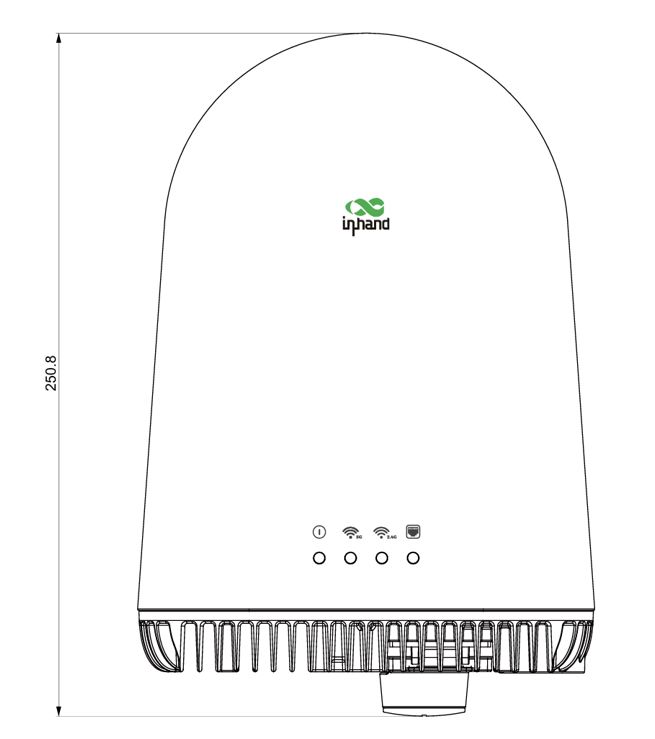
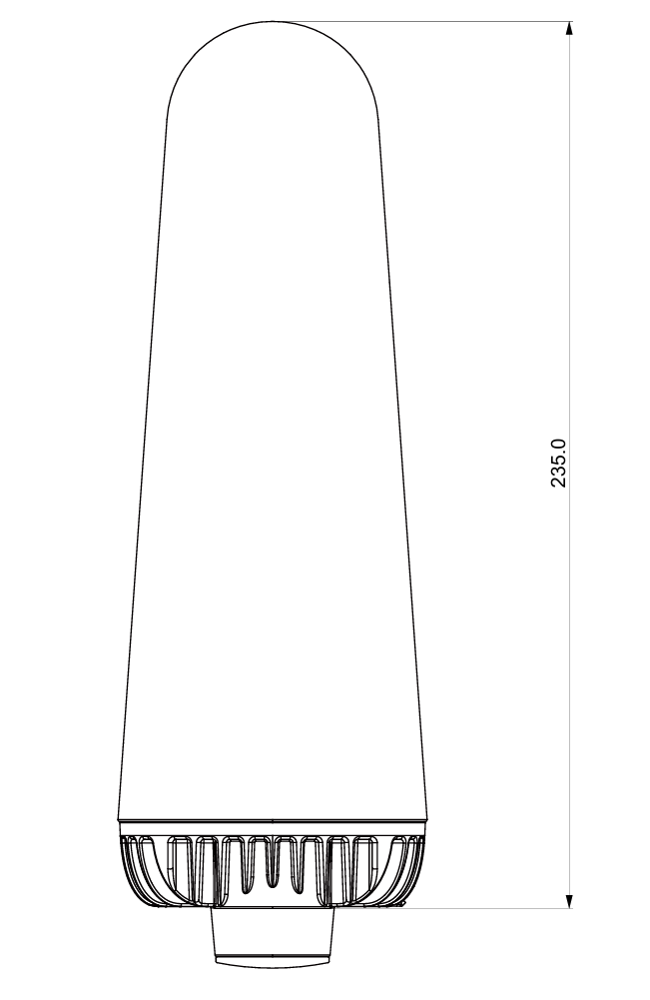
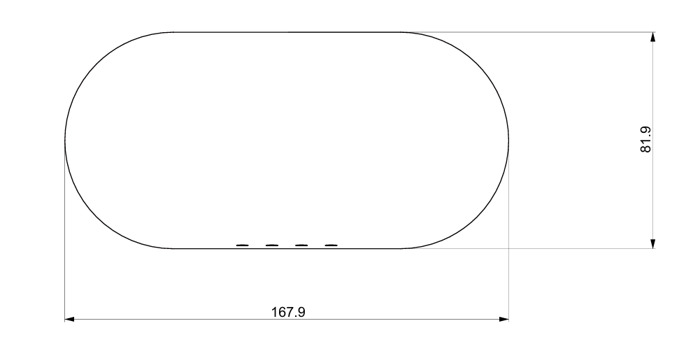

  

    

      
    

    

      Wi-Fi 7 智联户外，畅享高速连接
    

  

  

    

      OAP700 Wi-Fi 7 户外接入点
    

    

      

       
· Wi-Fi 7

        
· 2 x 2.5GE

      

      

        
· IP67

        
· 双天线覆盖模式

      

      

        
· AI原生

        
· 云管理

      

    

  

# 1. 产品概述

OAP700 是一款面向户外场景的企业级 Wi-Fi 7 接入点，基于高性能 Wi‑Fi 7 平台打造，集成 BE5000 双频并发、2×2.5GE 有线端口、可切换定向 / 全向天线硬件方案与 AI Agent 智能运维能力，整机封装于 IP67 防护外壳之中。它专为文旅景区、户外园区、交通场站、露天体育场馆、光伏电站等大面积户外覆盖场景设计，支持 IEEE 802.3at PoE 单线部署，并提供多 SSID 业务隔离，可实现访客、监控、业务网络分区接入，兼顾覆盖范围与部署效率。

OAP700 突破了传统户外 AP 覆盖形态单一的局限，通过硬件 RF 开关在**定向覆盖**与**全向覆盖**之间灵活切换，单台设备即可适配走廊式、广场式等多种户外拓扑，无需在现场更换天线或增补设备。

OAP700 同时是一款 AI 原生运维的户外 AP，依托 InCloud Manager 云管理平台与 AI Agent 实现远程故障诊断，让户外网络运维从 “跑现场” 变为 “对话式远程运维”。

## 主要特性

- **BE5000 Wi-Fi 7 双频：** 802.11be，5 GHz 3×3 + 2.4 GHz 2×2 空间流，PHY 峰值速率约 5 Gbps
- **2.5G有线端口**：双2.5G以太网端口
- **定向/全向天线切换：** 内置 5 根天线，通过 RF 开关切换定向与全向覆盖模式，一机适配多种户外拓扑
- **Wi-Fi 7 全套特性：** 支持上下行MU-MIMO、上下行OFDMA、4K-QAM、BSS Color、TWT
- **大容量接入：** 最大关联客户端 300+，活跃并发 100+（每用户保底 ≥ 20 Mbps）
- **无缝漫游：** 支持 802.11k/v/r 快速漫游，语音/视频业务不断线
- **多 SSID 独立广播**：支持多个独立 SSID，区分访客、安防、业务接入网络
- **户外级可靠：** IP67 防护等级，-30 °C ~ +70 °C 宽温工作，压铸铝一体化被动散热，搭配抗紫外线聚合物外壳
- **PoE 单线部署：** IEEE 802.3at PoE 受电，单网线同时完成供电与联网
- **AI Agent 智能运维：** 依托部署在 InCloud Manager云端的AI Agent，实现远程故障诊断与参数优化

## 典型应用场景

### 文旅景区

**古城、街区、度假区：** 大范围户外 Wi-Fi 覆盖，兼顾游客上网与智慧导览

**游船、码头、海岛：** 宽温、高湿、高盐雾环境下的可靠接入

### 户外园区

**产业园、办公园区：** 广场、连廊、停车场等室外公共区域覆盖

**工厂与物流园区：** 户外作业区、AGV 调度与安防监控网络接入

### 交通场站

**高铁站、机场广场、公交枢纽：** 承载大客流高并发接入

**高速公路服务区、收费站：** 道路沿线广域无线网络覆盖

### 露天体育场馆

**体育场、露天剧场：** 高密度并发接入，依托 BSS Color 抑制同频干扰

**营地、滑雪场：** 宽温可靠运行，支持 -30 ℃低温启动

### 商业户外

**商业步行街、户外餐饮区、露营地**

**露天集市与快闪活动**

### 智慧农田与养殖基地

**温室大棚、田间作业区：** 农业物联终端与监控视频回传接入

**规模化养殖场：** 环境监测与现场设备联动

## 产品尺寸

  

    

      
    

    
正视图

  

  

    

      
    

    
侧视图

  

  

    

      
    

    
俯视图

  

  
<strong>说明：</strong>

  
1. 所有尺寸单位为毫米（mm），括号内为英寸（in）。

  
2. 所有尺寸均为近似值，仅供参考。

  
3. 图纸不得用于生产制造。

  
4. 尺寸受零部件及制造公差影响。

  
5. 规格如有变更，恕不另行通知。

# 2. 产品亮点

## 亮点一：定向/全向天线切换

设备内置 5 根天线与 RF 开关，支持两种覆盖形态灵活切换：

- 天线配置：2 根双频全向天线 + 2 根双频定向天线 + 1 根 5 GHz 全向天线，全部内置集成
- 定向模式：适用于道路、廊道、岸线，实现远距离线性覆盖
- 全向模式：适用于广场、场馆，提供 360° 均匀覆盖
- 支持 Web 界面或云平台一键切换，无需现场拆装天线
- 区别于主流商用户外 AP 的差异化能力：单 SKU 适配两类网络拓扑，降低选型、备货与库存成本

## 亮点二：AI Agent 智能运维

依托 InCloud Manager 云端 AI Agent，面向分散户外站点提供对话式智能运维：

- 云端自动故障诊断：识别掉线、弱覆盖、射频干扰等典型问题
- AI 自适应调优：基于现场频谱与接入数据，推荐信道、发射功率、天线模式等最优配置
- 提供 Agent CLI / API，支持基于业务意图的自动化运维编排
- 大幅减少现场上门，把广分布户外站点的运维效率提升一个量级

## 亮点三：高性能Wi-Fi 7 平台

搭载四核 Cortex‑A73 高性能处理器，完备承载 Wi‑Fi 7 全部能力：

- PHY 峰值速率约 5 Gbps（5 GHz：4324 Mbps + 2.4 GHz：688 Mbps）
- 5 GHz 支持 160 MHz 带宽、4096‑QAM 高阶调制
- 上下行 MU‑MIMO、上下行 OFDMA、BSS Color、TWT 全套射频特性
- 支持 300+ 关联终端、100+ 活跃并发，保障每用户带宽不低于 20 Mbps

## 亮点四：高可靠户外机身与极简工程部署

整机兼顾长期运行可靠性与现场施工便捷性：

- 采用压铸铝一体基体，同时作为结构框架与被动散热载体
- 无风扇设计，消除转动部件故障点，在维持 IP67 防护等级的同时控制整机体积
- 外壳选用抗紫外线聚合物，长期露天环境下不易粉化、黄变，适应高温、盐雾等复杂户外工况
- 支持 IEEE 802.3at PoE 受电，向下兼容 802.3af，单根网线同时承载供电与数据传输

# 3. 硬件规格

| 项目 | 规格 |
| ------------- | --------------------------------------- |
| **处理器** | 四核 Cortex-A73 |
| **内存** | 512MB DDR4 |
| **存储** | 128 MB SPI NAND Flash |
| **Wi-Fi 标准** | IEEE 802.11be（Wi-Fi 7），2.4 GHz + 5 GHz 双频并发 |
| **空间流** | 5 GHz 3×3 : 3SS；2.4 GHz 2×2 : 2SS |
| **信道带宽** | 5 GHz：20/40/80/160 MHz；2.4 GHz：20/40 MHz |
| **调制方式** | 5 GHz 最高 4096-QAM；2.4 GHz 最高 1024-QAM |
| **Wi-Fi峰值速率** | 约 5 Gbps（5 GHz 4324 Mbps + 2.4 GHz 688 Mbps） |
| **WAN 口** | 1 × 2.5 Gbps RJ45，支持PoE受电 |
| **LAN 口** | 1 × 2.5 Gbps RJ45，数据专用 |
| **天线** | 内置 5 根：2 根双频全向 + 2 根双频定向 + 1 根 5 GHz 全向；RF 开关切换定向/全向模式 |
| **供电方式** | IEEE 802.3at（Type 2, PoE+）受电，向下兼容 IEEE 802.3af |
| **功耗** | ≤ 15 W |
| **复位按键** | 1 个 Reset 按键 |
| **指示灯** | 1 个系统灯，1个2.4 GHz Wi-Fi指示灯，1个 5 GHz Wi-Fi指示灯，1 个以太网口指示灯 |
| **看门狗** | 支持 |
| **散热方式** | 结构-散热一体化被动散热，无风扇设计 |
| **防护等级** | IP67 |
| **外壳材质** | 抗紫外线聚合物外壳 + 压铸铝散热片一体化结构 |
| **颜色** | 白色 |
| **工作温度** | -30 °C ~ +70 °C |
| **存储温度** | -40 °C ~ +85 °C |
| **相对湿度** | 5% ~ 95%，无凝结 |
| **尺寸** | 235 mm × 167.93 mm × 81.93 mm |
| **重量** | 约 1.5 kg（参考值） |
| **安装方式** | 壁挂、抱杆、屋顶安装 |

# 4. 网络连接

## 4.1 无线网络

- **标准与规格：** IEEE 802.11be（Wi-Fi 7），BE5000，2.4 GHz + 5 GHz 双频并发
- **空间流：** 5 GHz 3×3 : 3SS + 2.4 GHz 2×2 : 2SS
- **信道带宽：** 5 GHz：20/40/80/160 MHz；2.4 GHz：20/40 MHz
- **调制方式：** 5 GHz：最高 4096-QAM；2.4 GHz：最高 1024-QAM
- **最大关联客户端数：** 300+
- **最大活跃并发用户：** 100+，每用户保底 ≥ 20 Mbps
- **覆盖距离：** 视距(LOS)理想环境下最大覆盖半径150 m，实际距离受环境、干扰、终端能力影响。
- **多 SSID：** 最多 16 个 SSID 独立配置（每 SSID 独立名称与加密）
- **无线安全：** 支持 WPA3‑Personal / WPA3‑Enterprise（802.1X + RADIUS），兼容 WPA2‑PSK 回退

### Wi-Fi 7 协议特性

- **MU-MIMO（DL + UL）：** 多用户同时收发，提升并发容量
- **OFDMA（DL + UL）：** 多用户频分复用，降低多接入时延
- **4K-QAM（4096-QAM）：** 高信噪比场景速率提升
- **BSS Color：** 多 AP 同频部署时空分复用，降低同频干扰
- **TWT（Target Wake Time）：** 终端省电调度，延长电池设备续航

### 天线模式

- **定向模式：** 双频定向天线主覆盖，适用于道路、走廊、岸线等线性场景
- **全向模式：** 双频全向天线 360° 覆盖，适用于广场、场馆等面状场景
- **切换方式：** Web 界面 / 云平台一键切换（硬件 RF 开关实现），无需更换天线或现场改造

### 快速漫游

- **802.11k Neighbor Report：** 协助客户端快速发现周边邻近 AP
- **802.11v BSS Transition Management：** AP 主动引导客户端切换至更优 AP
- **802.11r Fast BSS Transition：** 支持 Over-the-DS + Over-the-Air，语音/视频业务漫游不断线

## 4.2 有线网络

- **WAN 口：** 1 × 2.5 Gbps RJ45，支持 DHCP / 静态 IP、MTU 配置和 PoE 受电
- **LAN 口：** 1 × 2.5 Gbps RJ45，数据专用
- **端口吞吐：** 2.5 Gbps 线速转发
- **工作模式：** 路由模式（FAT-Routing）/ 桥接模式（FAT-Bridge），可切换
- **本地网络：** 主网络 + 访客网络（Guest，独立 IP 段与 DHCP，与主网络隔离）
- **静态路由：** 路由模式下支持静态路由

# 5. 接入认证与 Portal

## 5.1 本地 Portal 认证

- **内置认证页：** Splash Page / Logo / 语言 / 配色方案可自定义
- **认证方式：** 点击直通、用户认证
- **免认证方式：** 上网凭证、MAC 白名单
- **SSID 绑定：** Portal 可绑定指定 SSID 生效

## 5.2 外部 Portal 对接

- **URL 重定向：** 支持重定向至第三方 Portal 服务器
- **RADIUS 对接：** 支持外部 RADIUS 用户认证
- **说明：** 本产品不支持云端 Portal，仅支持对接第三方 Portal 服务器

## 5.3 加密与认证协议

- **WPA3-Personal（SAE）**
- **WPA2-PSK**
- **WPA3-Enterprise（802.1X + RADIUS）**

# 6. 安全特性

## 6.1 设备安全设计

- **Secure Boot：** 硬件辅助安全启动 + 签名 bootloader 链
- **签名固件：** 固件需通过签名校验方可刷写
- **无默认密码：** 每台设备出厂唯一密码（预印标签），首次登录强制修改
- **传输加密：** WPA3（Wi-Fi）/ HTTPS（管理面）/ TLS 1.3（云端通信）
- **访问控制：** 管理面 IP 白名单、服务端口（HTTPS/SSH）控制、Web 登录超时

## 6.2 网络安全

- **网络隔离：** 访客网络与主网络隔离（独立 IP 段 + 独立 DHCP）
- **SSID 隔离：** 最多 16 个 SSID 独立配置，按业务划分接入域

# 7. 网络服务

## 7.1 Web 管理界面（Dashboard）

- **设备信息：** 名称 / 型号 / SN / 固件版本 / MAC / 工作模式 / 上行 IP / 系统时间 / License 状态
- **接口状态：** WAN / LAN 链路状态可视化（已连接 / 未连接 / 异常 / 已禁用）
- **流量统计：** 上下行速率图表
- **Wi-Fi 连接：** 按 SSID 分组的客户端连接分布
- **客户端管理：** 名称 / IP / MAC / VLAN / SSID / RSSI / 信道 / Wi-Fi 标准，支持搜索过滤
- **事件与日志：** 设备事件、系统日志集中查看

## 7.2 接口与网络配置

- **WAN 配置：** 接入类型（DHCP / 静态 IP）、MTU 配置
- **本地网络：** LAN IP / IPv4 掩码 / DHCP 服务器 / 地址池范围
- **访客网络：** 独立 IP 段 + 独立 DHCP 服务器 + 独立地址池，与主网络隔离
- **工作模式：** 路由模式 / 桥接模式（FAT）一键切换

## 7.3 Wi-Fi 配置

- **SSID 管理：** 双频 SSID（2.4 GHz + 5 GHz），最多 16 个 SSID 独立配置
- **Radio 设置：** 2.4 GHz / 5 GHz 信道、频宽、发射功率统一配置
- **天线模式：** 定向 / 全向切换（Antenna Mode）

## 7.4 系统管理

- **云管理：** InCloud 云连接
- **账号管理：** 管理员账号管理
- **国家码与时钟：** 国家码、NTP、时区配置
- **设备操作：** 重启 AP、恢复出厂、固件升级（上传 + 校验 + 升级 + 重启）
- **配置管理：** 配置导入 / 导出
- **设备告警：** 告警规则与告警事件
- **诊断工具：** Ping、Traceroute、抓包（pcap）
- **定时任务：** 定时重启
- **日志服务器：** 远程 syslog 服务器
- **其它设置：** Web 登录超时等

## 7.5 Agent CLI 与工程模式

- **Agent CLI：** AI Agent 管控接口（命令行 / API 入口），不提供 Web UI 配置项
- **工程模式：** 工程调试入口

# 8. 智能云管理与运维

OAP700 由 InCloud Manager AI 云管理平台提供支持。通过 AI 网络助手，用户可通过自然语言交互管理设备的完整生命周期，无需专业网络知识，尤其适合站点分散、人工到场成本高的户外网络。

## 8.1 云平台管理

- **快速上线：** 设备接入 InCloud 平台，首次上线时间 < 60 s
- **设备监控：** 设备状态、流量、客户端实时查看
- **批量运维：** 跨站点统一配置下发与固件升级
- **告警通知：** 设备异常即时告警

## 8.2 AI Agent 智能运维

- **设备监控：** 自然语言查询；AI 自动检索并返回结果
- **故障诊断：** AI 执行多步诊断并提供完整分析与修复建议
- **配置管理：** 用自然语言读取或修改配置；通过自然语言将配置复制到其他设备
- **固件升级：** AI 管理从版本选择到完成的整个过程，降低人为失误风险
- **远程终端：** 通过自然语言发起，直接访问
- **批量操作：** 自然语言批量下发，无需逐台执行

# 9. 订购信息

## 9.1 产品型号

<table style="width:100%; table-layout:fixed; font-size:15px;">
  <colgroup>
    <col style="width:50%;">
    <col style="width:50%;">
  </colgroup>
  <tr><th>Model</th><th>Region</th></tr>
  <tr><td style="white-space: nowrap;">OAP700-Plus</td><td>全球</td></tr>
</table>

## 9.2 包装清单

**标配配件：**

- OAP700 × 1
- 1 m RJ45 网线 × 1
- 安装配件（壁挂/抱杆/屋顶）× 1
- 快速入门手册（QSG）× 1

**选购配件：**

- IEEE 802.3at PoE 电源适配器

# 10. 可靠性标准与认证

## 10.1 防护等级

- **IP 防护等级：** IP67
- **盐雾测试：** 48 小时, 符合 IEC 60068-2-52

## 10.2 机械可靠性

- **振动：** 1.0 / 4.0 / 100.0 / 200.0 Hz 扫频；符合 IEC 60068-2-6
- **冲击：** 符合 IEC 60068-2-27
- **跌落：** 裸机 75 cm；整机带包装 1 m；符合 IEC 60068-2-32
- **温度循环：** 符合 IEC 60068-2-14
- **湿热循环：** 符合 IEC 60068-2-30

## 10.3 电气可靠性

- **浪涌保护：** 网口共模 2 kV（CM）；电源共模 2 kV（CM）/ 差模 1 kV（DM）；符合 IEC 61000-4-5 Level 3
- **ESD：** 接触 6 kV / 空气 8 kV；符合 IEC 61000-4-2 Level 3
- **工作环境：** -30 °C ~ +70 °C；5% ~ 95% 相对湿度，无凝结
- **存储环境：** -40 °C ~ +85 °C；5% ~ 95% 相对湿度，无凝结
- **MTBF：** ≥ 100,000 h @ 25 °C

## 10.4 认证

- **认证与合规：** FCC\*, IC\*, CE\*, CTA\*, SRRC\*
- **环保认证：** RoHS / REACH

注：带`*`标识代表对应认证尚在申请流程中。

# 11. 联系我们

- **官网：** [映翰通网络](https://www.inhand.com.cn)
- **版权：** © 映翰通网络。保留所有权利。
