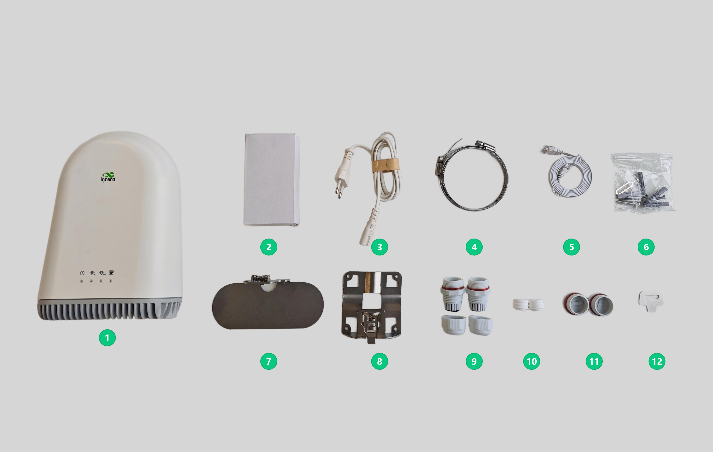
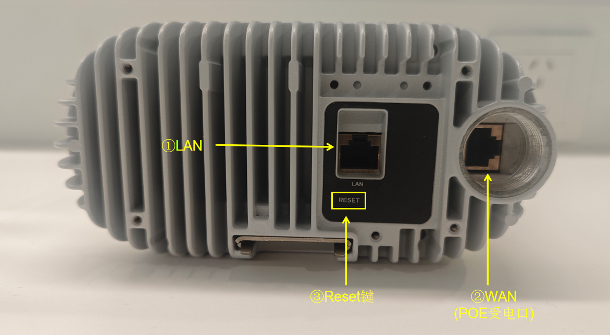
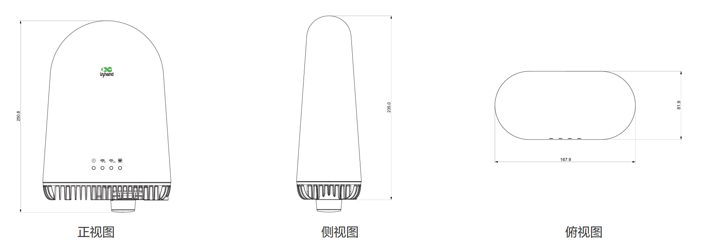
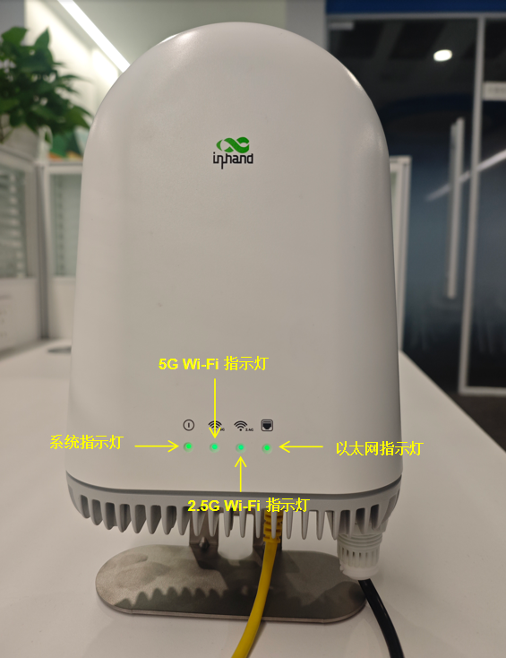
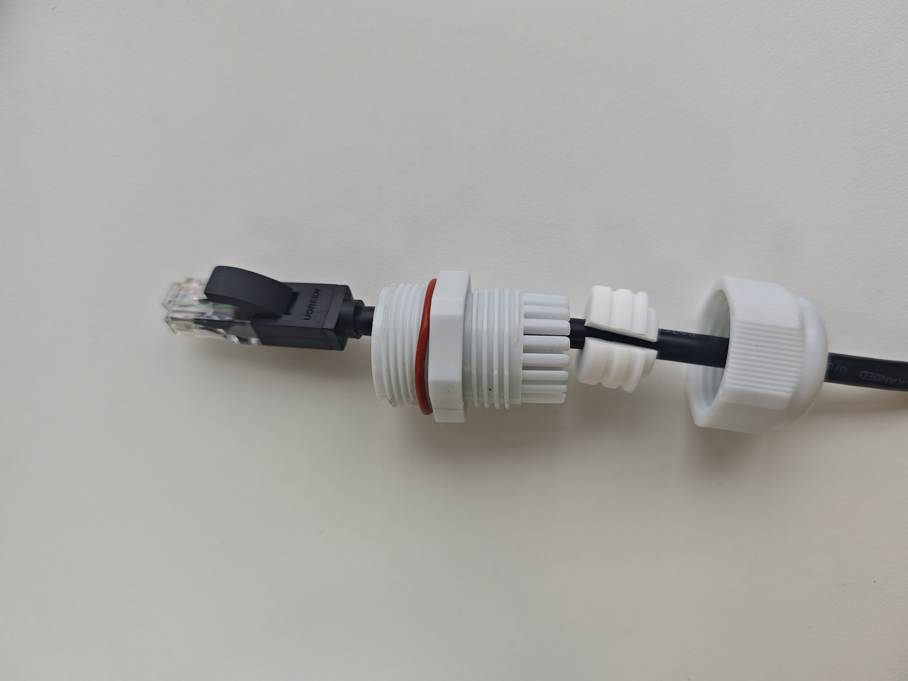
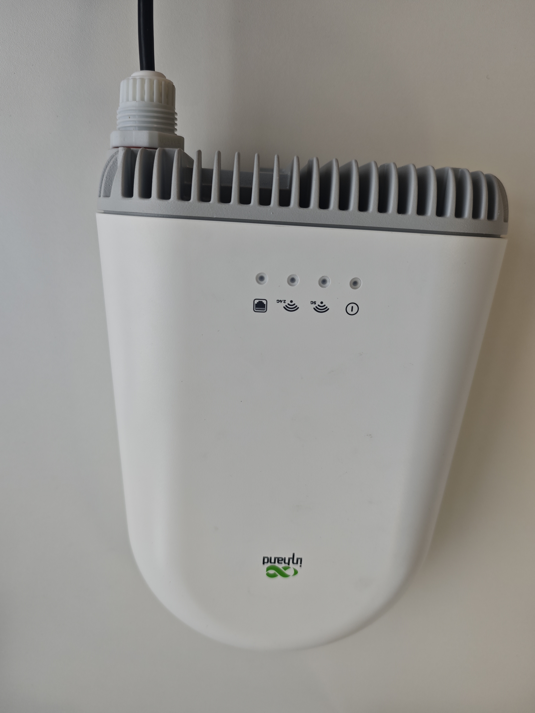
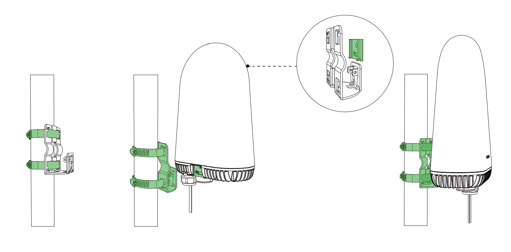
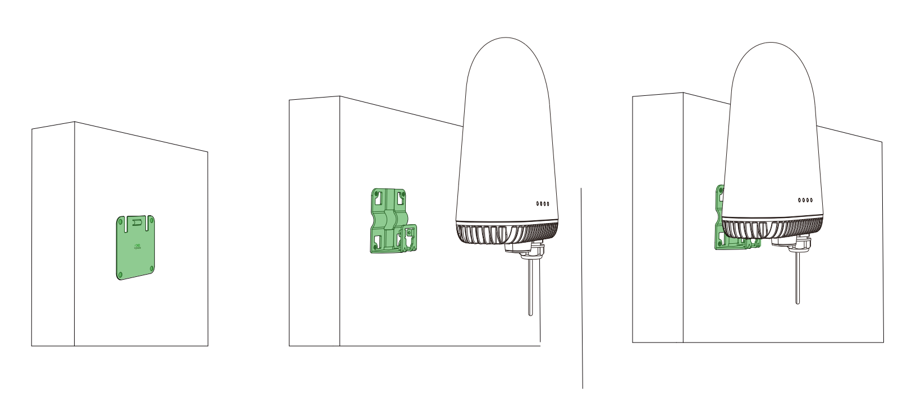
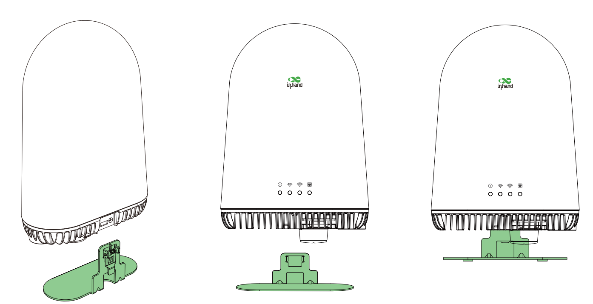
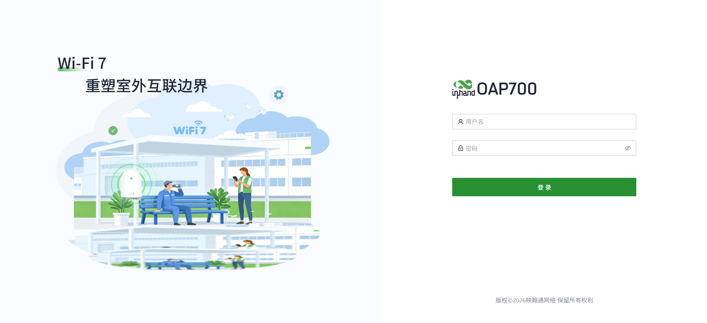

# 1. 包装清单

开箱后请按表 1 逐项清点，如有缺项请停止安装并联系售后服务。

<strong>图 1 配件清单</strong>

**表 1 包装清单**

| 序号 | 物品 | 数量 | 备注 |
|---|---|---|---|
| 1 | OAP700 | 1 | OAP700整机 |
| 2 | POE供电盒 | 1 | 以太网供电（PoE）适配器 |
| 3 | 电源线 | 1 | 1 m 电源线 |
| 4 | 抱箍圈 | 2 | 抱杆安装组件 |
| 5 | 网线 | 1 | 1 m 网线 |
| 6 | 螺钉+卡针 | 4 | 4组螺钉，1个卡针 |
| 7 | 底座 | 1 | 桌面安装件 |
| 8 | 背夹组件 | 1 | 壁挂安装件 |
| 9 | 防水接头 | 2 | 防水接头+防水接头盖，线缆防水密封用 |
| 10 | 防水接头胶塞 | 2 | 线缆防水密封用 |
| 11 | 防水盖 | 2 | 接口舱防水密封用 |
| 12 | 堵头工具 | 1 | 安装防水盖或抱箍圈时使用 |

---

# 2. 外观与接口说明

表 2 中的编号与【图 2】上的编号一一对应，安装时请按编号识别接口。

**表 2 接口与部件说明**

| 编号 | 名称 | 说明 |
|---|---|---|
| 1 | LAN口 | 1 × 2.5 Gbps RJ45，数据专用。位于底壳接口盖内 |
| 2 | WAN口(POE受电口) | 1 × 2.5 Gbps RJ45。供电方式：IEEE 802.3at（Type 2, PoE+）受电，向下兼容 IEEE 802.3af|
| 3 | 复位键（RESET） | 凹陷式按键，需用取卡针按压；长按 10 秒恢复出厂设置 |

<strong>图 2 接口示意图</strong>

<strong>图 3 整机外观图</strong>

---

# 3. 指示灯状态说明

上电后请对照表 3 判断设备状态。

<strong>图 4 指示灯说明</strong>

**表 3 指示灯状态说明**

| 指示灯 | 状态 | 含义 |
|--------|------|------|
| 系统状态灯 | 常灭 | 设备未上电 |
|  | 红色常亮 | 系统启动中 |
|  | 绿色常亮 | 系统工作正常 |
|  | 红色闪烁 | 系统错误 |
|  | 蓝色闪烁 | 系统升级中 |
| Wi-Fi 2.4G | 常灭 | AP功能禁用/Radio关闭 |
|  | 绿色常亮 | 作为AP正常工作 |
| Wi-Fi 5G | 常灭 | AP功能禁用/Radio关闭 |
|  | 绿色常亮 | 作为AP正常工作 |
| 以太网指示灯 | 常灭 | WAN/LAN均未工作 |
|  | 绿色常亮 | 仅LAN/WAN连接 |
|  | 蓝色常亮 | WAN和LAN均已连接 |

---

# 4. 安装前准备

## 4.1 工具清单

表 4 中的工具请在开工前备齐。

**表 4 工具清单**

| 序号 | 工具 | 用途 |
|---|---|---|---|
| 1 | 网线 | 2根RJ45网线 |
| 2 | 十字螺丝刀 | 安装底座、背夹组件、抱箍圈螺钉 |
| 3 | 电钻及钻头 | 壁挂安装时钻膨胀螺栓孔 |
| 4 | 扳手 | 拧紧螺母、膨胀螺栓 |
| 5 | 水平尺 | 确认设备安装水平 |

## 4.2 环境要求

1. 请确认供电条件：IEEE 802.3at（Type 2, PoE+）受电，向下兼容 IEEE 802.3af。
2. 请确认网线支持 1000 Mbps 传输，随箱网线长度为 1 m；超出 1 m 时请另行准备网线。
3. 请在工作温度 −30 ℃ ~ 70 ℃、相对湿度 ≤ 95%（无凝结）的环境中安装与运行。
4. 请确认安装位置防护等级满足 IP67，接口舱盖在非接线状态下保持关闭。
5. 请确认安装面可承重：设备重量约 1.5 kg。
6. 请确认抱杆直径在 Ø0 mm ~ Ø100 mm 范围内（抱杆安装时）。
7. 请确认壁挂墙面为混凝土或实心砖墙（壁挂安装时）。

## 4.3 安全提示

**警告**：设备采用以太网供电（PoE），请勿带电插拔 WAN（PoE 受电口）网线，以防触电或损坏端口。

**警告**：请使用随箱 POE供电盒与电源线供电，勿使用其他型号电源，输出电压超出 DC 50 V 可能造成设备损坏甚至起火。

**注意**：WAN、LAN口在不使用时请保持防水盖与底壳接口盖关闭并拧紧，防止进水造成设备损坏。

---

# 5. 硬件安装步骤

## 5.1 开箱检查

1. 打开包装箱，取出全部物品。
2. 对照表 1 逐项清点，确认 12 项物品齐全、无破损。
3. 检查设备外观，确认外壳无裂纹、接口无变形。
4. 清点不符时，请停止安装并联系售后服务（见第 9 章）。

## 5.2 天线连接

本产品内置5根天线：2 根双频全向天线 + 2 根双频定向天线 + 1 根 5 GHz 全向天线。

## 5.3 线缆连接

**警告**：连接网线前请确认 POE供电盒尚未接通电源，严禁带电插拔。

**注意**：防水接头与防水盖未拧紧会导致进水。

1. 将防水接头盖穿入网线。
2. 将防水接头胶塞沿切口处掰开，并包裹住网线。
3. 将防水接头穿入网线，并将防水接头胶塞塞进接头。

<strong>图 5 防水接头安装示意</strong>

4. 将穿有防水接头的网线一段插入设备的WAN（POE供电）口，听到"咔哒"声确认安装到位。
5. 拧紧防水接头，并将防水接头盖与防水接头对齐拧紧。
6. 将网线另一端接入POE供电盒的POE口。

<strong>图 6 WAN口网线接入示意</strong>

7. 如需接入终端设备，请先取下底壳接口盖，放置于干燥处。网线一端连接终端设备，另一端插入设备的LAN口（注意安装防水接头）。连接完成后，装回底壳接口盖并固定好螺钉。如无需接入终端设备，可跳过此步骤。
8. 将空闲接口装上防水盖并旋紧，推荐使用堵头工具。

## 5.4 安装固定

按现场安装方式选择 5.4.1、5.4.2 或 5.4.3 其中一种，只需执行其中一节。

### 5.4.1 抱杆安装（抱箍固定）

**注意**：安装前请确认抱杆直径在 Ø0 mm ~ Ø100 mm 范围内，超出该范围不得使用抱箍圈安装。

1. 将 2 个抱箍圈穿入背夹组件。
2. 将背夹贴近抱杆，使抱箍圈环绕抱杆，调节抱箍圈松紧，直至背夹无晃动。
3. 用水平尺检查设备处于水平状态，如有偏差请松开抱箍圈调整。
4. 将设备挂到背夹组件上，听到“咔哒”声则表明设备已固定完成。

<strong>图 7 抱杆安装示意图</strong>

### 5.4.2 壁挂安装（墙面固定）

**警告**：钻孔前请确认墙体内部无电力线、燃气管与水管；不明管线位置时请停止施工并联系专业人员。

1. 取出背夹组件，在墙面标记 4 个钻孔位置。
2. 按标记位置钻 4 个孔。
3. 敲入膨胀螺栓 4 条。
4. 将背夹组件对准膨胀螺栓挂装到位。
5. 装上螺母后拧紧，直至背夹组件无晃动。
6. 将设备挂装到背夹组件上并锁紧固定位，听到“咔哒”声则表明设备已固定完成。
7. 用水平尺检查设备处于水平状态，如有偏差请调整后重新拧紧。

<strong>图 8 壁挂安装示意图</strong>

### 5.4.3 桌面安装（底座固定）

1. 将底座平放于干燥、平整的台面上。
2. 将设备底部安装位对准底座卡槽。
3. 下压设备至底座完全卡入，确认无松动。

<strong>图 9 桌面安装示意图</strong>

## 5.5 上电

**警告**：请确认电源插座额定值满足要求，且插座接地良好。

1. 将随箱电源线（1 m）一端插入 POE供电盒电源输入口。
2. 将电源线另一端插入电源插座。
3. 观察指示灯面板，确认系统状态灯绿色常亮。
4. 等待 60 秒，观察指示灯状态，对照表 3 判断。
5. 系统指示灯不亮时，请检查电源线两端插接与插座供电。

---

# 6. 首次配置上网

## 6.1 配置前准备

1. 用网线将电脑连接至设备的 LAN 口。
2. 打开电脑浏览器，输入管理地址 `https://192.168.2.1`。
3. 在登录页面输入账号与密码。首次登录的账号密码请查看设备背面的铭牌。

<strong>图 10 OAP700登录页面</strong>

## 6.2 有线方式上网

**操作步骤**

1. 用网线将电脑连接至设备的 LAN 口。
2. 浏览器访问 `https://192.168.2.1` 并登录。
3. 进入【配置 >> WAN】页面，将 WAN 口的连接方式设置为动态 IP（DHCP）。
4. 保存设置。
5. 确认 以太网指示灯 常亮（对照表 3）。

**验证方法**

1. 在电脑命令行输入 `ipconfig`（Windows）或 `ifconfig`（macOS/Linux），确认本机已获取 IP 地址。
2. 在命令行输入 `ping 223.5.5.5`，收到 4 条回复、丢包率为 0%。
3. 打开浏览器访问 `http://www.baidu.com`，页面正常显示。
4. 以上 3 条全部满足即为配置成功；任一条不满足请按第 7 章排查。

## 6.3 恢复出厂设置

1. 确认设备处于上电状态，系统指示灯 绿色常亮。
2. 取随箱取卡针，插入复位键孔内。
3. 按住复位键不放，持续 10 秒，待系统指示灯蓝色常亮后松开。
4. 等待设备自动重启，过程约 60 秒。
5. 重新访问 `https://192.168.2.1`，确认登录页恢复默认状态。
6. 用设备铭牌上的默认账号与密码重新登录，按 6.2 重新配置上网。

**注意**：恢复出厂设置会清除全部已配置内容，包括上网参数与自定义设置，执行前请确认可提供铭牌上的默认账号与密码。

---

# 7. 常见问题速查

**表 5 常见问题速查表**

| 序号 | 现象 | 可能原因 | 处理方法 |
|---|---|---|---|
| 1 | 系统指示 灯不亮 | 电源线未插紧；插座无电；POE供电盒故障 | 重新插紧电源线两端；换一个已知有电的插座；更换 POE供电盒后重试；仍不亮联系售后 |
| 2 | 以太网指示灯绿色常亮但无法上网 | 网线未插到位；上级光猫 LAN 口无输出；网线损坏 | 重新插拔 WAN 端网线至"咔"声；将同一根网线直连光猫与电脑验证；更换网线 |
| 3 | 以太网指示灯常亮但无法上网 | WAN 未设为动态 IP；上级网络未放通 | 按 6.2 第 3 步重新设置为动态 IP；用电脑直连光猫验证上级网络 |
| 4 | 电脑获取不到 IP 地址 | 网线接在LAN 口；设备未完成启动 | 将网线改接 LAN；等待 60 秒后重新获取 |
| 5 | 无法访问 `192.168.2.1` | 电脑未获取 192.168.2.x 网段地址；浏览器使用了代理 | 在命令行输入 `ipconfig` 确认本机 IP；关闭浏览器代理后重试；按 6.3 恢复出厂设置后重试 |
| 6 | 设备运行中指示灯全灭 | 市电中断；设备过温保护；电源线松脱 | 检查市电与插座；确认工作温度；重新插紧电源线两端 |
| 7 | 接口舱内有水迹 | 底壳接口盖或防水盖未拧紧；防水接头装反 | 立即断电；擦干后重新安装底壳接口盖、防水盖与防水接头；仍进水联系售后 |

---

# 8. 安全与合规注意事项

**警告**

1. 请勿自行拆卸、改装本设备，非专业人员拆卸可能导致触电，且失去保修资格。
2. 请勿在有易燃、易爆气体或粉尘的环境中安装、使用本设备。
3. 请勿将设备与水源直接接触；清洁时请先断电，然后用干布擦拭。
4. 设备工作电压为 DC 50 V、0.66 A，请勿使用非随箱电源供电。
5. 雷雨天气请勿在抱杆、墙面上进行安装作业。

**注意**

1. 请勿让设备跌落、撞击或承受超载；设备重量 1.5 kg，安装支架需按第 5 章固定。
2. 请勿堵塞设备外壳散热结构。
3. 长期停用时请断开电源，并保持底壳接口盖与防水盖关闭。
4. 请按当地法规处置废弃设备与包装，勿随生活垃圾丢弃。

**认证与合规信息**

| 项目 | 信息 |
|---|---|
| 型号 | OAP700 |
| 工作温度 | −30 ℃ ~ 70 ℃ |
| 存储温度 | −40 ℃ ~ 85 ℃ |
| 相对湿度 | 5% ~ 95%，无凝结 |
| 尺寸 | 235 mm × 167.93 mm × 81.93 mm |
| 重量 | 1.5 kg |

---

# 9. 售后与技术支持信息

**北京映翰通网络技术股份有限公司（总部）**

电话：010-8417 0010

地址：北京市朝阳区紫月路18号院3号楼5层

**成都办事处**

电话：028-8679 8244

地址：四川省成都市武侯区天府大道北段1777号中国太平金融大厦14层

**广州办事处**

电话：020-8562 9571

地址：广州市天河区黄埔大道中660号汇金国际金融中心B栋1913单元

**武汉办事处**

电话：027-8716 3566

地址：武汉市洪山区关山大道465号光谷新发展国际中心B座5层

**上海办事处**

电话：021-5480 8501

地址：上海市普陀区国浩长风城北座326室
