# 北京映翰通OAP700产品用户手册

## 声明

首先非常感谢您选择本公司产品！在使用前，请您仔细阅读本用户手册，遵守以下声明，将有助于维护知识产权和法律合规性，以确保您的使用体验与产品的最新信息相一致。如有任何疑问或需要获取书面许可，请随时联系我们的技术支持团队。

- 版权声明

本用户手册包含受版权保护的内容，版权归北京映翰通网络技术股份有限公司及其许可者所有。未经书面许可，任何单位和个人不得擅自摘抄、复制本手册的部分或全部内容，且不得以任何形式传播。

- 免责声明

由于产品技术和规格不断更新，本公司不能承诺用户手册中的资料与实际产品完全一致。因此，不承担由于实际技术参数与用户手册不符而引起的任何争议。任何关于产品的改动恕不提前通知，本公司保留最终更改权和解释权

- 版权信息

本用户手册内容受版权法律保护，版权归北京映翰通网络技术股份有限公司及其许可者所有，保留一切权利。未经书面许可，不得擅自使用、复制或传播本手册的内容。


## 技术支持

**北京映翰通网络技术股份有限公司（总部）**

电话：010-8417 0010

地址：北京市朝阳区紫月路18号院3号楼5层

**成都办事处**

电话：028-8679 8244

地址：四川省成都市武侯区天府大道北段1777号中国太平金融大厦14层

**广州办事处**

电话：020-8562 9571

地址：广州市天河区黄埔大道中660号汇金国际金融中心B栋1913单元

**武汉办事处**

电话：027-8716 3566

地址：武汉市洪山区关山大道465号光谷新发展国际中心B座5层

**上海办事处**

电话：021-5480 8501

地址：上海市普陀区国浩长风城北座326室

## 1 安全须知

### 1.1 警告

**警告**

1. 设备由 IEEE 802.3at PoE 供电，安装、拆卸网线或维护前，必须先断开 PoE 交换机／供电注入器的输出，严禁带电插拔。
2. 本产品为户外设备，通常安装于墙面、抱杆或屋顶等高处。高空与登高作业必须由**经过培训的合格专业人员**执行，作业时须佩戴安全带、使用合格梯具或升降平台，并遵守当地高处作业安全规范。
3. 雷雨、大风、结冰等恶劣天气条件下**禁止室外施工**。设备安装应符合当地防雷与接地规范，避免雷击浪涌通过网线引入室内设备。
4. 安装位置应远离强电线路、高压线、变压器及其他强电磁干扰源，不得与电力电缆同管敷设。
5. 请勿在易燃易爆环境中使用本设备（本产品非防爆设备）。

**注意**

1. 请使用符合 IEEE 802.3at（Type 2，PoE+）的供电设备；本产品向下兼容 IEEE 802.3af。整机功耗 ≤ 15 W。
2. 设备工作温度为 −30 °C ~ +70 °C，相对湿度 5% ~ 95%（无凝结）。超出该范围使用可能导致设备损坏或寿命降低。
3. 请勿遮挡、包裹设备壳体的散热结构。本产品采用无风扇被动散热，依靠压铸铝一体基体散热，安装时应留有足够散热空间。
4. 安装完成后必须压紧所有进线口的密封件与防水接头，否则将破坏 IP67 防护等级，导致进水损坏。
5. 请勿自行拆解设备外壳。自行拆解将导致 IP67 防护等级失效，并可能失去保修资格。
6. 请勿使用非原装或未经认证的网线、PoE 电源、安装配件。
7. 请保持设备铭牌信息清晰可读，切勿撕毁、涂改序列号与初始管理凭据标签。

**说明**

- 设备支持 IEEE 802.11be（Wi-Fi 7）无线通信，属于无线电发射设备，请在符合当地无线电管理法规（国家码）的区域内使用。
- 投入使用后，建议立即修改默认管理密码，并关闭不使用的管理服务（如 Telnet）。

---

## 2 产品介绍

### 2.1 产品概述


OAP700 是一款面向户外场景的企业级 Wi-Fi 7 接入点，集成 BE5000 双频并发、2×2.5GE 有线端口、可切换定向／全向天线硬件方案与 AI Agent 智能运维能力，整机封装于 IP67 防护外壳之中。它专为文旅景区、户外园区、交通场站、露天体育场馆、光伏电站等大面积户外覆盖场景设计，支持 IEEE 802.3at PoE 单线部署，并提供多 SSID 业务隔离，可实现访客、监控、业务网络分区接入，兼顾覆盖范围与部署效率。

OAP700 突破了传统户外 AP 覆盖形态单一的局限，通过硬件 RF 开关在定向覆盖与全向覆盖之间灵活切换，单台设备即可适配走廊式、广场式等多种户外拓扑，无需在现场更换天线或增补设备。

OAP700 同时是一款 AI 原生运维的户外 AP，依托 小星云管家 云管理平台与 AI Agent 实现远程故障诊断，让户外网络运维从"跑现场"变为"对话式远程运维"。

### 2.2 主要特性

| 特性 | 说明 |
| --- | --- |
| BE5000 Wi-Fi 7 双频 | IEEE 802.11be，5 GHz 3×3 + 2.4 GHz 2×2 空间流，PHY 峰值速率约 5 Gbps |
| 2.5G 有线端口 | 双 2.5G 以太网端口（WAN 支持 PoE 受电、LAN 数据专用），2.5 Gbps 线速转发 |
| 定向／全向天线切换 | 内置 5 根天线，通过硬件 RF 开关切换定向与全向覆盖模式，一机适配多种户外拓扑 |
| Wi-Fi 7 全套特性 | 上下行 MU-MIMO、上下行 OFDMA、4K-QAM、BSS Color、TWT |
| 大容量接入 | 最大关联客户端 300+，活跃并发 100+（每用户保底 ≥ 20 Mbps） |
| 无缝漫游 | 支持 802.11k/v/r 快速漫游，语音／视频业务不断线 |
| 多 SSID 独立广播 | 最多 16 个 SSID 独立配置，区分访客、安防、业务接入网络 |
| 户外级可靠 | IP67 防护、−30 °C ~ +70 °C 宽温工作、压铸铝一体化被动散热、抗紫外线聚合物外壳 |
| PoE 单线部署 | IEEE 802.3at PoE 受电，单网线同时完成供电与联网 |
| AI Agent 智能运维 | 依托  小星云管家 云端 AI Agent，实现远程故障诊断与参数优化 |

### 2.3 典型应用场景

| 场景 | 典型应用 |
| --- | --- |
| 文旅景区 | 古城、街区、度假区大范围 Wi-Fi 覆盖；游船、码头、海岛等宽温高湿高盐雾环境接入 |
| 户外园区 | 产业园、办公园区的广场、连廊、停车场覆盖；工厂物流园区户外作业区、AGV 调度与安防监控 |
| 交通场站 | 高铁站、机场广场、公交枢纽大客流高并发接入；高速公路服务区、收费站沿线覆盖 |
| 露天体育场馆 | 体育场、露天剧场高密度并发接入，依托 BSS Color 抑制同频干扰；营地、滑雪场宽温运行 |
| 商业户外 | 商业步行街、户外餐饮区、露营地、露天集市与快闪活动 |
| 智慧农业 | 温室大棚、田间作业区农业物联终端与监控视频回传；规模化养殖场环境监测与设备联动 |

### 2.4 外观与接口

#### 2.4.1 产品外形

| 正视图 | 侧视图 | 俯视图 |
| :---: | :---: | :---: |
| 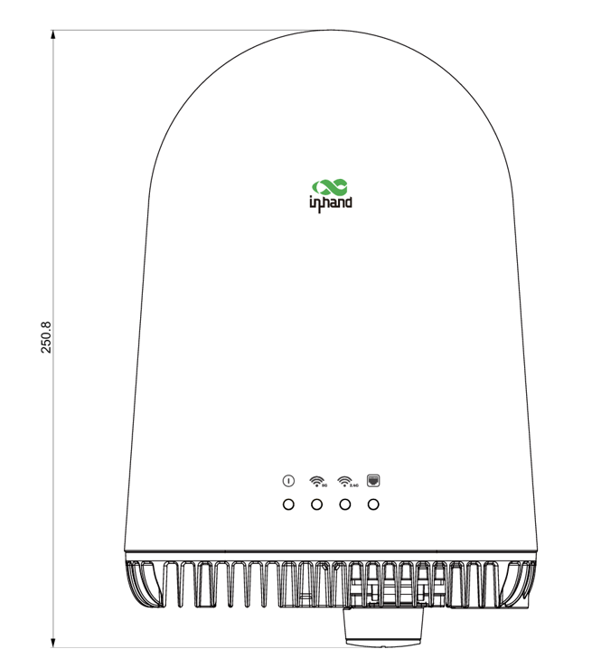 | 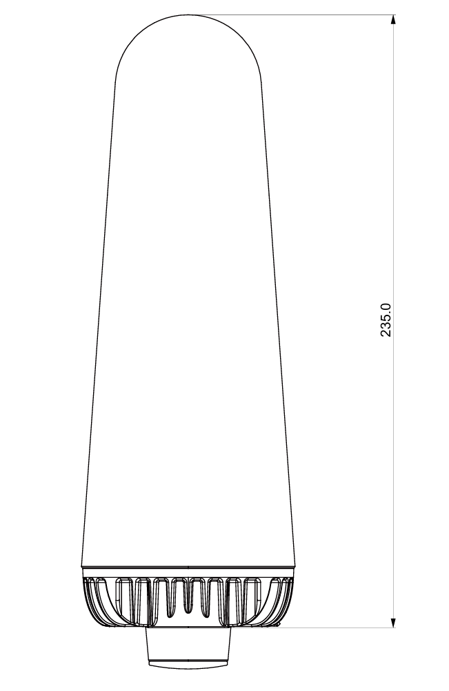 | 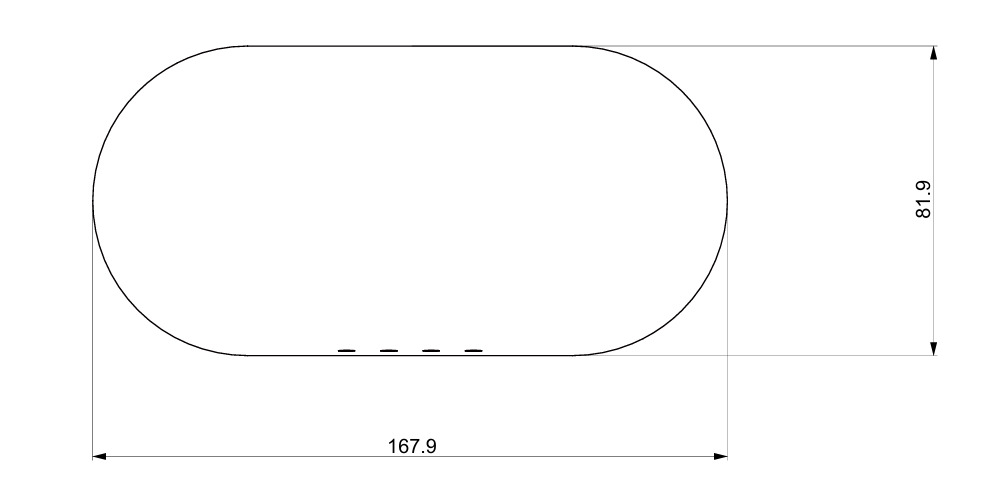 |

> **说明**
> 1. 所有尺寸单位为毫米（mm），括号内为英寸（in）。
> 2. 所有尺寸均为近似值，仅供参考。
> 3. 图纸不得用于生产制造。
> 4. 尺寸受零部件及制造公差影响。
> 5. 规格如有变更，恕不另行通知。

#### 2.4.2 指示灯

设备面板共设置 4 个指示灯，自左向右依次为：

| 指示灯 | 状态 | 含义 |
|--------|------|------|
| 系统状态灯 | 常灭 | 设备未上电 |
|  | 红色常亮 | 系统启动中 |
|  | 绿色常亮 | 系统工作正常 |
|  | 红色闪烁 | 系统错误 |
|  | 蓝色闪烁 | 系统升级中 |
| Wi-Fi 2.4G | 常灭 | AP功能禁用/Radio关闭 |
|  | 绿色常亮 | 作为AP正常工作 |
| Wi-Fi 5G | 常灭 | AP功能禁用/Radio关闭 |
|  | 绿色常亮 | 作为AP正常工作 |
| 以太网指示灯 | 常灭 | WAN/LAN均未工作 |
|  | 绿色常亮 | 仅LAN/WAN连接 |
|  | 蓝色常亮 | WAN和LAN均已连接 |


#### 2.4.3 接口与按键

| 名称 | 类型 | 说明 |
| --- | --- | --- |
| WAN 口（PoE WAN） | 1 × 2.5 Gbps RJ45 | 上行接口，支持 PoE 受电，同时承载数据传输；支持 DHCP／静态 IP、MTU 配置 |
| LAN 口 | 1 × 2.5 Gbps RJ45 | 数据专用下行接口，2.5 Gbps 线速转发 |
| Reset 按键 | 1 个 | 用于将设备恢复至出厂状态；具体按压方式与时间见机身丝印标识及随箱 QSG |
| 天线 | 内置 5 根 | 2 根双频全向 + 2 根双频定向 + 1 根 5 GHz 全向；由硬件 RF 开关切换定向／全向模式 |

### 2.5 包装清单

开箱后请核对以下内容，如发现缺失或损坏，请立即与经销商联系。

| 类别 | 名称 | 数量 |
| --- | --- | --- |
| 标配 | OAP700 主机 | 1 |
| 标配 | 1 m RJ45 网线 | 1 |
| 标配 | 安装配件（壁挂／抱杆／屋顶） | 1 |
| 标配 | 快速入门手册 | 1 |
| 选购 | IEEE 802.3at PoE 电源适配器／PoE 交换机 | 按需 |

---

## 3 安装与连接

### 3.1 安装环境要求

| 项目 | 要求 |
| --- | --- |
| 工作温度 | −30 °C ~ +70 °C |
| 存储温度 | −40 °C ~ +85 °C |
| 相对湿度 | 5% ~ 95%，无凝结 |
| 防护等级 | IP67（安装后须压紧进线口密封件） |
| 供电 | IEEE 802.3at（Type 2，PoE+），向下兼容 802.3af；功耗 ≤ 15 W |
| 安装面 | 能够承受设备重量（约 1.5 kg）及风载的牢固墙面、抱杆或屋顶结构 |
| 散热 | 周围保留散热空间，勿遮挡壳体散热结构 |
| 覆盖参考 | 视距（LOS）理想环境下最大覆盖半径约 150 m，实际距离受环境、干扰与终端能力影响 |

### 3.2 安装方式

OAP700 支持**壁挂、抱杆、屋顶**三种安装方式，随箱提供对应安装配件。

**一般安装步骤**

1. **选择安装位置**：结合覆盖目标（线性场景选定向模式，面状场景选全向模式）确定位置；避免遮挡物，并保证天线前方无大面积金属构件。
2. **固定支架**：使用配套安装配件与膨胀螺栓／抱杆箍件将支架牢固固定于墙面、抱杆或屋顶基座。
3. **挂装设备**：将设备挂装至支架并锁紧防脱螺钉，确认设备水平、牢固、不松动。
4. **布放网线**：将符合 Category 5e 及以上的网线一端接入设备 **WAN（PoE）** 口，另一端接入 PoE 交换机／PoE 注入器的受电设备端口；如需下挂有线设备，再由 **LAN** 口引出网线。
5. **防水处理**：整理进线，使用随箱防水接头／密封圈压紧线缆与出线口，确保整机 IP67 防护完整；网线应预留**滴水弯**，防止雨水沿线流入接口。
6. **上电自检**：接通 PoE 供电，观察系统灯、以太网灯与 Wi-Fi 指示灯状态；待设备启动完成后进入第 4.1 节登录管理界面进行配置。

**说明**
- 详细安装步骤、支架装配图与扭矩要求以随箱《快速入门手册》为准。
- 抱杆安装时，请确认抱杆直径在安装配件允许范围内。

### 3.3 组网方式

OAP700 支持两种工作模式，可在 Web 界面"**系统 > 系统设置**"中切换：

| 模式 | 名称 | 说明 |
| --- | --- | --- |
| FAT-Routing | 路由模式 | 设备作为网关工作，WAN 口连接上级网络，本机提供 NAT、DHCP、路由与无线接入；支持静态路由与访客网络隔离 |
| FAT-Bridge | 桥接模式 | 设备作为二层桥接接入点工作，有线与无线同属上级网络，由上级设备负责网关与 DHCP |


### 3.4 上电后的初始检查

1. 系统指示灯正常亮起，表示设备已供电并开始启动。
2. 以太网口指示灯亮起，表示 WAN 口与 PoE 交换机链路已建立。
3. 使用一台有线或无线终端与设备网络连通（默认有线网段为 `192.168.2.0/24`，设备管理地址 `192.168.2.1`）。
4. 打开浏览器访问 `https://192.168.2.1`，能够显示登录页面即表示安装与供电正常。

---

## 4 设备软件功能

本章介绍 OAP700 Web 管理界面的各项软件功能。设备的全部配置操作与状态查询均通过 Web 管理界面完成，管理地址默认为 `https://192.168.2.1`，无需安装客户端软件。

**说明**：设备还可通过云平台进行远程集中管理，详见第 5 章。

### 4.1 登录 Web 管理界面

登录是使用设备管理功能的前提。本节说明如何从终端建立与设备的管理连接、完成身份验证并进入管理界面，以及如何修改管理员密码与设置会话自动退出。

**术语说明**

| 术语 | 定义 |
| --- | --- |
| HTTPS | 基于 TLS 加密的 HTTP 协议，用于防止管理口令与配置内容在传输过程中被窃听或篡改。 |
| 会话 | 一次登录成功至退出或超时之间的时间段，期间的配置操作均归属于当前登录账号。 |

#### 4.1.1 连接方式

| 方式 | 操作 |
| --- | --- |
| 有线 | 终端网线接入 OAP700 LAN 口（路由模式下由设备 DHCP 分配地址）或接入上级网络 |
| 无线 | 终端搜索并连接设备的 SSID（出厂默认 SSID 见机身标签） |
| 管理地址 | 浏览器输入 `https://192.168.2.1`（HTTP 会自动跳转至 HTTPS） |
| 管理账号 | 初始用户名及密码见设备机身标签（每台设备出厂唯一密码） |

**注意**：请使用 HTTPS 访问管理界面。若浏览器提示证书不受信任，属于设备使用自签名证书的正常提示，点击"继续访问"即可。

#### 4.1.2 登录步骤

1. 打开浏览器，在地址栏输入 `https://192.168.2.1` 并回车，进入登录页面。

   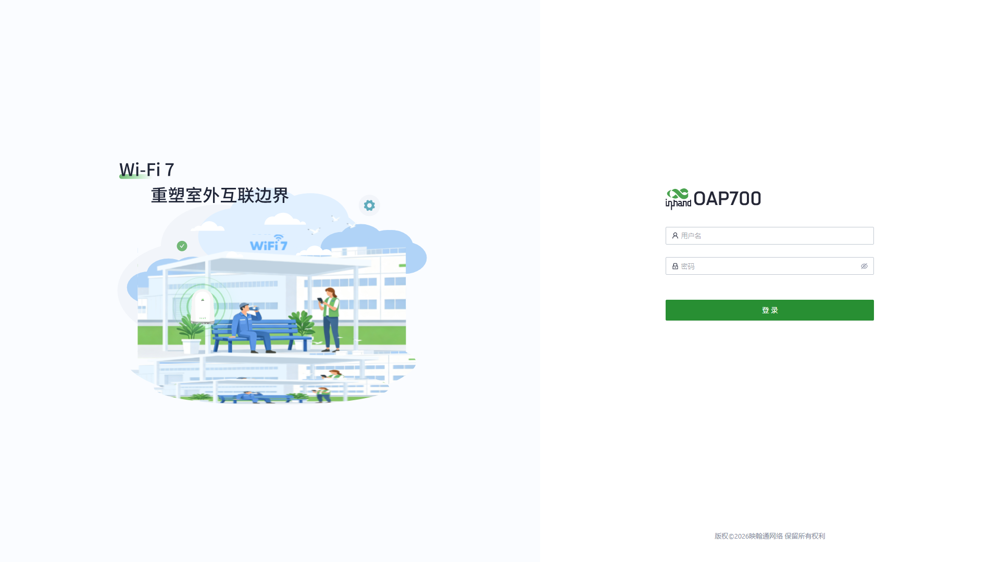

   **图 4-1 OAP700 Web 管理登录界面**

2. 输入**用户名**与**密码**。
3. 点击"**登 录**"按钮，进入"仪表盘"页面。

**注意**
- 出厂设备不存在通用默认密码，初始密码预印于机身标签；请勿使用示例文档中的任何口令。
- 首次登录后请立即通过"**系统 > 账号管理**"修改密码。
- 连续登录失败会被记录到"状态 > 事件"中，便于安全审计。

#### 4.1.3 界面总览

登录后界面分为三个区域：

| 区域 | 位置 | 内容 |
| --- | --- | --- |
| 顶部栏 | 页面上方 | 产品标识、"小星云管家"云平台入口、Internet 联网状态、当前账号、语言切换 |
| 左侧导航 | 页面左侧 | 仪表盘、状态、配置、Wi-Fi、系统 五个主菜单（左下角按钮可折叠导航栏） |
| 内容区 | 页面右侧 | 各功能页面的配置表单、列表与图表 |

#### 4.1.4 修改管理员密码

1. 进入"**系统 > 账号管理**"。
2. 输入**用户名**、**新密码**、**确认密码**。
3. 点击"**保 存**"。

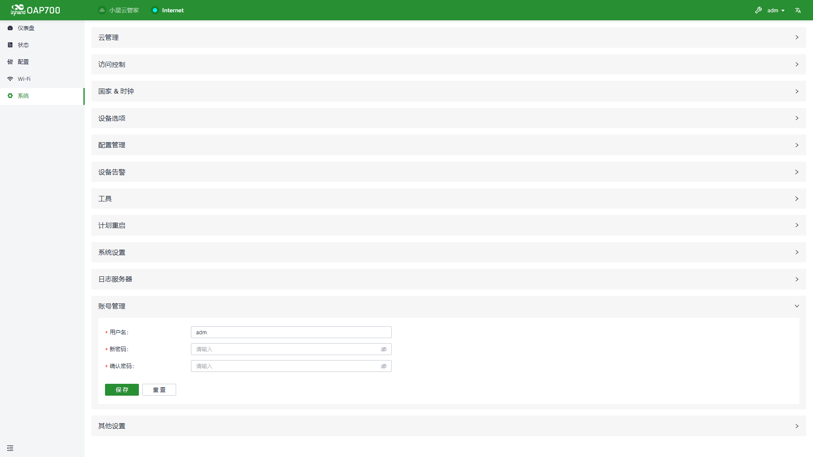

**图 4-2 账号管理**

**注意**：修改密码后请立即使用新密码重新登录并妥善保管。忘记密码时，只能通过 Reset 按键恢复出厂设置（会清除全部配置）。

#### 4.1.5 退出与自动注销

- 点击右上角账号名称可退出登录。
- 在"**系统 > 其他设置**"中可设置 Web 登录超时，超时后会话自动退出，降低无人值守终端被误用的风险。

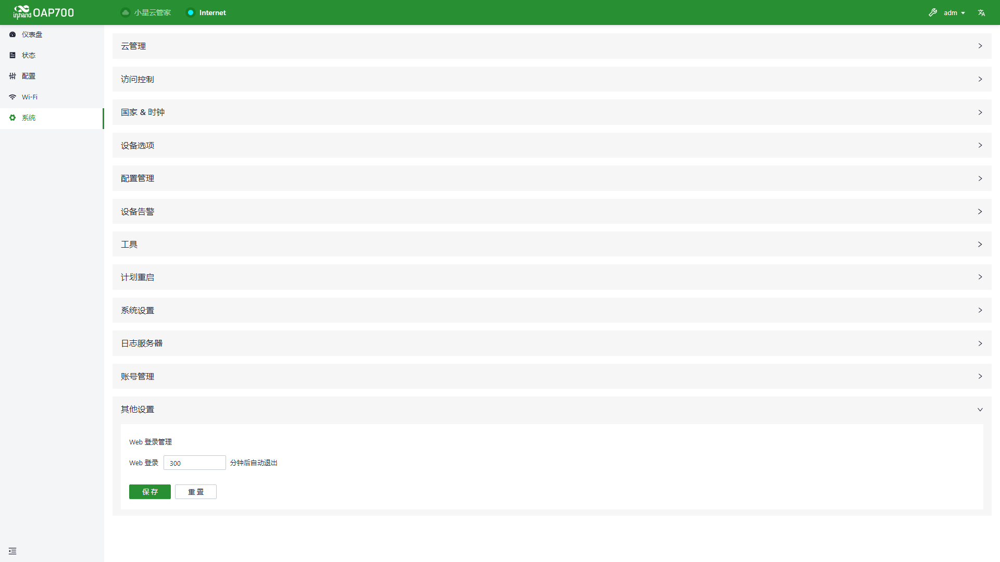

**图 4-3 Web 登录超时设置**

### 4.2 仪表盘（Dashboard）

仪表盘集中呈现设备的标识信息、接口链路状态、流量统计与无线接入负载，用于在单一页面内判断设备是否正常运行、上行链路是否在线，是日常巡检的首选页面。

**术语说明**

| 术语 | 定义 |
| --- | --- |
| 上行接口（WAN） | 连接上级网络的接口。路由模式下设备经该接口获取外网地址，同时通过该接口接受 PoE 供电。 |
| 链路状态 | 端口与对端设备之间物理连接是否已建立。 |
| 许可状态 | 设备已获取的软件许可情况；未许可时部分云平台功能受限。 |

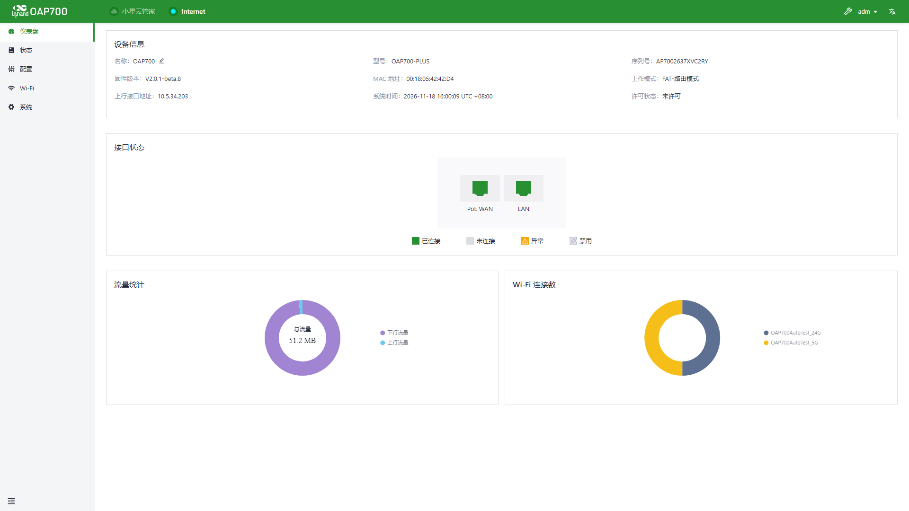

**图 4-4 仪表盘**

| 区块 | 内容 | 说明 |
| --- | --- | --- |
| 设备信息 | 名称、型号、序列号、固件版本、MAC 地址、工作模式、上行接口地址、系统时间、许可状态 | 名称旁的铅笔图标可直接编辑设备名称 |
| 接口状态 | PoE WAN、LAN 链路状态图示 | 图例：**已连接**（绿）／**未连接**（灰）／**异常**（黄叹号）／**禁用**（斜纹） |
| 流量统计 | 总流量、下行流量、上行流量环形图 | 用于观察整机上下行业务量 |
| Wi-Fi 连接数 | 按 SSID 分组的客户端数量分布 | 用于判断各 SSID 的负载是否均衡 |

**说明**：上行接口地址显示 WAN 侧获取到的 IP；若为路由模式 + DHCP 且未获取到地址，请检查上级网络，详见第 6.3 节。

### 4.3 状态监控

"状态"菜单从终端、行为记录与系统运行三个维度反映设备当前状况，用于确认接入情况、追溯配置与安全事件、定位运行异常。

**术语说明**

| 术语 | 定义 |
| --- | --- |
| 客户端 | 通过有线或无线方式接入本设备的终端设备。 |
| 事件 | 设备对重要操作与状态变化（登录、配置变更、重启、联网状态变化等）生成的结构化记录，按时间顺序保存，可导出用于审计。 |
| 日志 | 设备运行过程中输出的连续文本记录，信息量大于事件记录，可用于深入分析故障。 |
| RSSI | 接收信号强度指示，反映终端与设备之间的无线信号强弱，数值越大信号越好。 |
| MAC 地址 | 终端网卡的唯一硬件标识地址。 |
| VLAN | 虚拟局域网，用于在同一物理网络上划分相互隔离的逻辑网络。 |

"状态"菜单包含**客户端**、**事件**、**日志**三个标签页。

#### 4.3.1 客户端

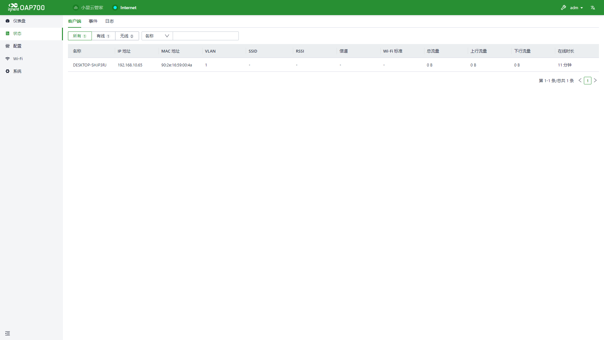

**图 4-5 客户端列表**

页面顶部按接入类型统计终端数量：**所有 / 有线 / 无线**，并提供关键字搜索。

列表字段说明：

| 字段 | 说明 |
| --- | --- |
| 名称 | 终端主机名或设备名 |
| IP 地址 | 终端获取的 IPv4 地址 |
| MAC 地址 | 终端网卡物理地址 |
| VLAN | 终端所属 VLAN（默认为 Default/1） |
| SSID | 终端接入的无线网络名称（有线终端显示"-"） |
| RSSI | 无线信号强度 |
| 信道 | 当前工作信道 |
| Wi-Fi 标准 | 终端协商的无线标准（如 802.11be） |
| 总流量 / 上行流量 / 下行流量 | 该终端累计与当前流量 |
| 在线时长 | 终端持续在线时间 |

**用途**：核对异常终端、确认访客与业务网络是否隔离、查看弱信号终端是否需要调整 AP 位置或天线模式。

#### 4.3.2 事件

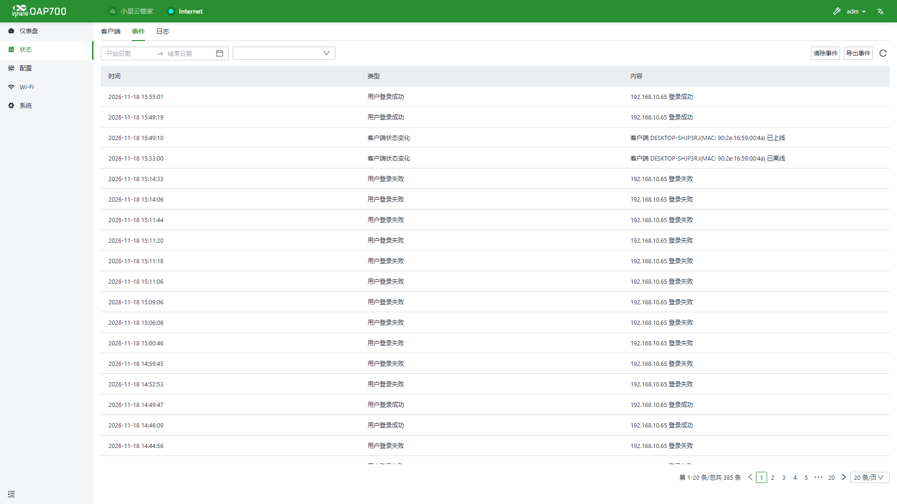

**图 4-6 事件记录**

- 字段：**时间、类型、内容**。
- 常见事件类型：用户登录成功、用户登录失败、客户端状态变化、配置变化、重启、升级、联网状态变化等。
- 支持**清除事件**与**导出事件**（导出文件可用于故障回溯与合规审计）。
- 列表支持分页与每页条数调整。

#### 4.3.3 日志

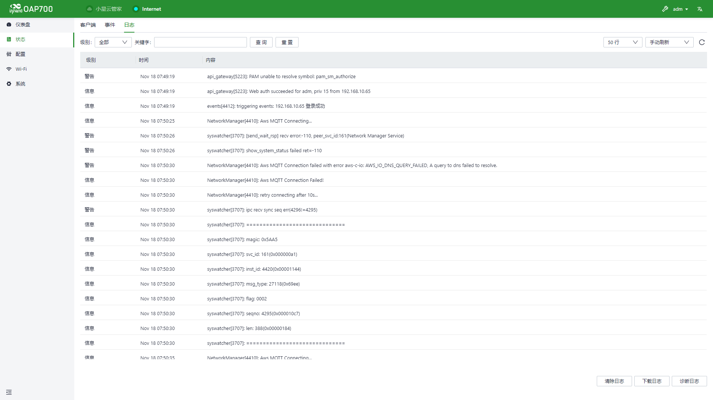

**图 4-7 系统日志**

| 功能 | 说明 |
| --- | --- |
| 级别筛选 | 按日志级别过滤（全部／信息／警告等） |
| 关键字查询 | 输入关键字后点击"查 询"定位日志；"重 置"清除条件 |
| 显示行数 | 可选择一次显示的行数（如 50 行） |
| 手动刷新 | 手动拉取最新日志 |
| 清除日志 | 清空本地日志缓冲 |
| 下载日志 | 导出日志文件 |
| 诊断日志 | 生成／下载用于技术支持的诊断日志 |

**说明**：日志中出现 `AWS_IO_DNS_QUERY_FAILED`、`MQTT Connection failed` 等信息，通常表示设备无法解析云平台域名（DNS 不可用或外网不通），请先检查 WAN 配置与 DNS 设置。

### 4.4 网络配置

"配置"菜单定义设备的有线网络结构，包括上行口的接入参数与本地网络的地址规划。本节内容决定设备能否接入上级网络，以及下挂终端能否获得可用地址。

**术语说明**

| 术语 | 定义 |
| --- | --- |
| WAN（广域网口） | 连接上级网络的上行接口，本设备同时通过该接口接受 PoE 供电。 |
| LAN（局域网） | 设备下侧的内部网络，终端由此获取地址并相互通信。 |
| DHCP | 动态主机配置协议。由设备自动为终端分配 IP 地址、子网掩码与网关，免去逐台手工配置。 |
| 子网掩码 | 与 IP 地址配合使用，标识地址中网络位与主机位的分界，决定该网络可容纳的地址范围。 |
| 网关 | 终端访问其他网络时转发数据的地址，通常为本网络设备的 LAN 地址。 |
| DNS | 域名解析服务器，负责将域名转换为 IP 地址。 |
| MTU | 最大传输单元，单个网络包允许的最大字节数。仅在与上级设备要求不一致的特殊组网下才需调整。 |
| 访客网络 | 与主网络地址隔离的独立网络，用于限制外部终端访问内部业务资源。 |

"配置"菜单包含 **WAN** 与 **本地网络** 两个标签页。

#### 4.4.1 WAN 配置


**图 4-8 WAN 配置**

| 参数 | 可选值／说明 |
| --- | --- |
| 类型 | `DHCP`（自动获取）／`静态 IP` |
| IP 地址 | 静态 IP 模式下的本机 WAN 地址 |
| 掩码 | 子网掩码 |
| 网关地址 | 上级网关 IP |
| 主 DNS / 备 DNS | 域名解析服务器；DHCP 模式下通常由上级自动下发 |
| MTU | 最大传输单元，特殊组网（如 PPPoE、隧道）时才需调整 |

操作：修改完成后点击"**保 存**"生效；点击"**重 置**"恢复为本次修改前的取值。

**说明**：WAN 口同时是 PoE 受电口，配置网络参数时不会影响供电。

#### 4.4.2 本地网络

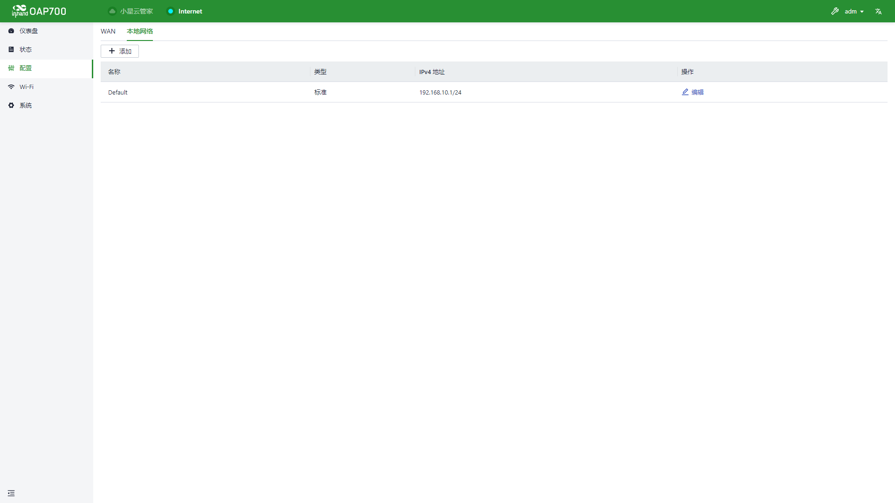

**图 4-9 本地网络**

列表字段：**名称、类型、IPv4 地址、操作（编辑）**，右上角"**添加**"用于新建网络。

点击"**添加**"后弹出"添加网络"对话框：

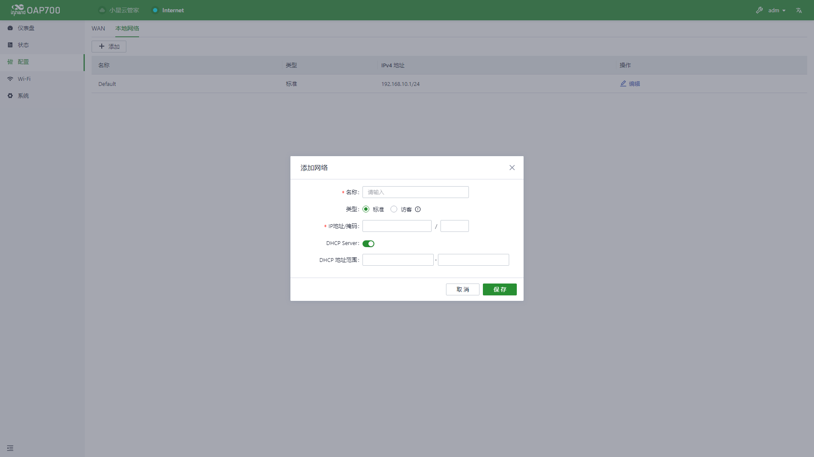

**图 4-10 添加网络（含访客网络）**

| 参数 | 说明 |
| --- | --- |
| 名称 | 网络名称 |
| 类型 | `标准`（主网络）／`访客`（Guest） |
| IP 地址/掩码 | 该网络的网段地址，如 `192.168.10.1/24` |
| DHCP Server | 是否启用本网络的 DHCP 服务器 |
| DHCP 地址范围 | 自动分配的 IP 地址区间 |

**注意**：访客网络使用**独立 IP 段与独立 DHCP 地址池**，与主网络隔离，可防止访客终端访问内部业务网。为访客 SSID 绑定访客网络，即可实现业务分区（参见 4.5.1 节 VLAN 绑定）。

### 4.5 无线网络配置

"Wi-Fi"菜单用于建立无线接入服务，包括无线网络名称的创建与安全设置、射频参数与天线覆盖形态的调整，以及访客认证页面的配置。通过将 SSID 绑定到指定网络，可实现不同业务的接入隔离。

**术语说明**

| 术语 | 定义 |
| --- | --- |
| SSID | 服务集标识，即终端搜索到的无线网络名称。本设备最多支持 16 个 SSID 独立配置。 |
| Radio（射频） | 负责无线信号收发的硬件单元。本设备包含 2.4 GHz 与 5 GHz 两个射频。 |
| 信道 | 射频所占用的频率区间编号。相邻设备使用相同信道会产生同频干扰。 |
| 频宽 | 单个信道占用的频率宽度。频宽越大可承载的速率越高，但抗干扰能力相应下降。 |
| 发射功率 | 射频的信号发射强度，影响覆盖距离及对邻近设备的干扰程度。 |
| 定向天线 / 全向天线 | 定向天线将能量集中于单一方向，适用于道路、走廊等线性场景；全向天线沿水平方向均匀辐射，适用于广场、场馆等面状场景。 |
| VLAN 绑定 | 将某个 SSID 关联到指定网络，使该 SSID 下的终端只能获得该网络分配的地址。 |
| 用户隔离 | 启用后同一 SSID 下的无线终端之间无法直接互访，常用于访客接入场景。 |
| Portal 认证 | 终端首次访问网络时被重定向至认证页面，完成规定动作后方可上网的网络准入方式。 |
| RADIUS | 集中式认证服务器，用于校验用户账号与密码。 |

"Wi-Fi"菜单包含 **SSIDs**、**Radio**、**Portal** 三个标签页。

#### 4.5.1 SSID 管理

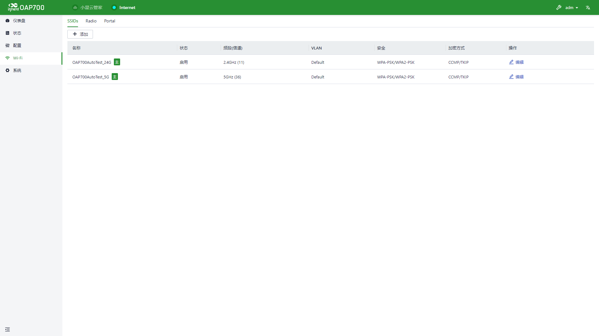

**图 4-11 SSID 列表**

| 字段 | 说明 |
| --- | --- |
| 名称 | SSID 名称，带"主"标记的为该频段的主 SSID |
| 状态 | 启用／禁用 |
| 频段(信道) | 2.4 GHz 或 5 GHz 及当前信道 |
| VLAN | SSID 绑定的 VLAN／网络 |
| 安全 | 加密认证方式 |
| 加密方式 | CCMP、CCMP/TKIP 等 |
| 操作 | 编辑 |

OAP700 最多支持 **16 个 SSID 独立配置**，可分别用于访客、安防监控与生产业务接入。

##### 添加 SSID

点击"**添加**"，在"添加 Wi-Fi"对话框中填写：


**图 4-12 添加 Wi-Fi**

| 参数 | 说明 |
| --- | --- |
| 名称 | SSID 名称（必填） |
| 状态 | 启用／关闭该 SSID |
| 频段 | `2.4GHz` ／ `5GHz`（必填，单选） |
| 安全 | `OPEN`（无认证）、`WPA2-PSK`、`WPA3-PSK`、`WPA-PSK/WPA2-PSK`、`WPA2-PSK/WPA3-PSK` 等（必填） |
| 加密方式 | 如 `CCMP`、`CCMP/TKIP` |
| 密码 | 预共享密钥（OPEN 以外必填） |
| VLAN | 该 SSID 绑定的网络／VLAN，默认 `Default`（必填） |
| 用户隔离 | 启用后同一 SSID 下的无线终端之间互相隔离 |
| 隐藏 SSID | 启用后不广播该 SSID 名称，终端需手动输入名称连接 |

##### 编辑 SSID

点击列表中目标 SSID 的"**编辑**"，可修改上述全部参数。

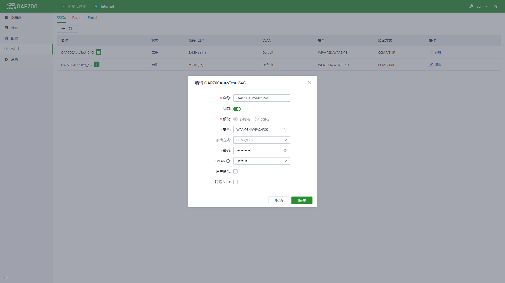

**图 4-13 编辑 SSID**

**注意**
- 同一 SSID 下启用"用户隔离"后，终端之间无法直接互访，适用于访客网络；若需终端互通（如无线投屏、打印机共享），请关闭该项。
- 安全方式优先选择 **WPA3-PSK** 或 **WPA2-PSK/WPA3-PSK**；仅当存在老旧终端无法连接时才回退到 WPA2 或 WPA。

#### 4.5.2 Radio 射频参数与天线模式


**图 4-14 射频参数与天线模式**

| 分组 | 参数 | 可选值 |
| --- | --- | --- |
| 2.4 GHz Radio | 频宽 (MHz) | `20`、`40` |
| 2.4 GHz Radio | 信道 | `自动` 或手动指定（依国家码开放范围，如 3~11） |
| 2.4 GHz Radio | 发射功率 | `自动`、`高`、`中`、`低`、`自定义` |
| 5 GHz Radio | 频宽 (MHz) | `20`、`40`、`80`、`160` |
| 5 GHz Radio | 信道 | `自动` 或手动指定（依国家码开放范围） |
| 5 GHz Radio | 发射功率 | `自动`、`高`、`中`、`低`、`自定义` |
| 天线模式 | 覆盖形态 | `全向天线` ／ `定向天线` |

**天线模式选择建议**

| 模式 | 适用场景 | 覆盖特点 |
| --- | --- | --- |
| 定向天线 | 道路、走廊、廊道、岸线等线性场景 | 远距离线性覆盖 |
| 全向天线 | 广场、场馆、园区等面状场景 | 360° 均匀覆盖 |

**说明**
- 天线模式通过硬件 RF 开关切换，可在 Web 界面或云平台一键切换，**无需现场更换天线**。
- 射频参数修改点击"**保 存**"后生效，已连接的终端可能短暂重连。
- 信道与功率建议保持 `自动`，由设备规避干扰；仅在存在固定同频干扰源时手动指定。

#### 4.5.3 Portal 认证


**图 4-15 Portal 列表**

列表字段：**名称、认证方式、目标 SSID、操作**。点击"**添加**"创建 Portal：

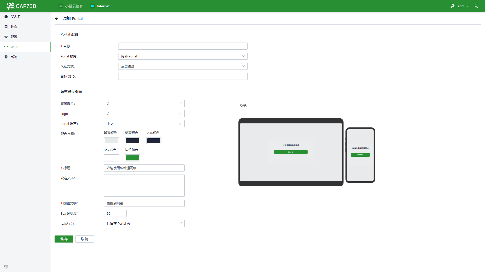

**图 4-16 添加 Portal**

| 分组 | 参数 | 说明 |
| --- | --- | --- |
| Portal 设置 | 名称 | Portal 配置名称 |
| Portal 设置 | Portal 服务 | `内部 Portal`（本地认证页） |
| Portal 设置 | 认证方式 | `点击通过`（点击即通过）／用户认证 |
| Portal 设置 | 目标 SSID | 该 Portal 绑定生效的 SSID |
| 访客登录页面 | 背景图片 / Logo | 可上传自定义图片，支持"无" |
| 访客登录页面 | Portal 语言 | 如 `中文` |
| 访客登录页面 | 配色方案 | 背景颜色、标题颜色、文本颜色、Box 颜色、按钮颜色 |
| 访客登录页面 | 文案 | 标题、欢迎文本、按钮文字 |
| 访客登录页面 | Box 透明度 | 弹窗透明度 |
| 访客登录页面 | 预览 | 实时预览访客看到的认证页面 |
| 后续行为 | 认证通过后 | `停留在 Portal 页` 等 |

**说明**
- 本产品支持**本地 Portal**（内置 Splash Page）以及**对接第三方 Portal 服务器**（URL 重定向）与**外部 RADIUS** 用户认证；**不支持云端 Portal**。
- 免认证方式支持**上网凭证**与 **MAC 白名单**。
- 免认证与外部认证的详细参数请参见《OAP700 规格书》第 5 章或联系技术支持。

### 4.6 系统管理

"系统"菜单提供设备自身的运行维护功能，涵盖云端接入、管理面访问安全、时间与国家码、固件升级与恢复出厂、配置备份、告警通知、网络诊断、定时重启、工作模式、远程日志、账号与登录策略等。本节各项设置直接决定设备的可管理性、安全性与可维护性。

**术语说明**

| 术语 | 定义 |
| --- | --- |
| 固件 | 设备运行的系统软件。升级固件可获取功能增强与缺陷修复。 |
| 国家码 | 所在国家或地区的标识，决定无线可用信道与发射功率上限，须与部署地的无线电管理法规一致。 |
| NTP | 网络时间协议，用于从时间服务器同步系统时间。系统时间是日志时间戳与证书有效性的基础。 |
| syslog | 系统日志协议，可将设备本地日志转发至中心服务器集中保存。 |
| SMTP | 简单邮件传输协议，设备据此向指定邮箱发送告警通知。 |
| 访问源地址 | 允许访问指定管理服务的来源网段范围，相当于管理面的地址白名单。 |
| 看门狗 | 硬件定时监测电路。系统长时间无响应时自动触发重启，以维持设备可用。 |

"系统"页面采用分组折叠面板，各分组点击后展开配置区；其中"**设备告警**"与"**工具**"为独立页面。

#### 4.6.1 云管理

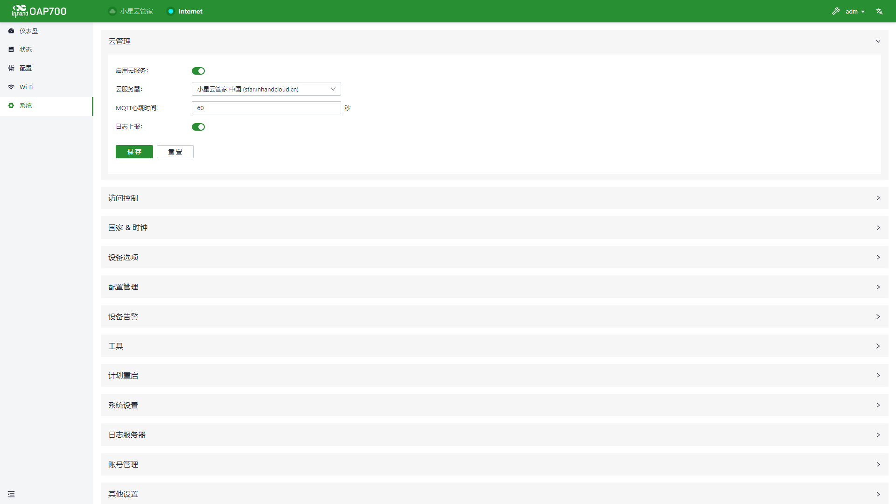

**图 4-17 云管理**

| 参数 | 说明 |
| --- | --- |
| 启用云服务 | 开关设备接入云平台 |
| 云服务器 | `小星云管家 中国 (star.inhandcloud.cn)` ／ `小星云管家 全球 (star.inhandcloud.com)` |
| MQTT 心跳时间 | 与云平台的 MQTT 心跳周期（秒） |
| 日志上报 | 是否将设备日志上报至云平台 |

**说明**：设备接入小星云管家平台后，首次上线时间通常小于 60 s；具体接入流程参见第 5 章。

#### 4.6.2 访问控制

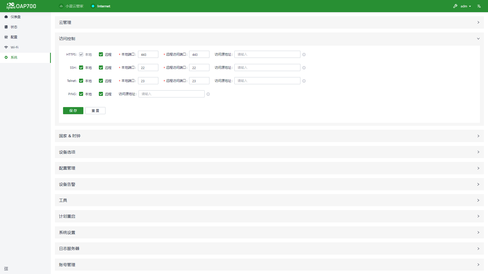

**图 4-18 访问控制**

对管理面服务逐项设置**本地**访问与**远程**访问开关、端口与来源地址限制：

| 服务 | 默认本地端口 | 说明 |
| --- | --- | --- |
| HTTPS | 443 | Web 管理界面（推荐保留本地，按需关闭远程） |
| SSH | 22 | 命令行管理 |
| Telnet | 23 | 明文命令行管理，**建议关闭** |
| PING | — | 网络连通性探测，可限制来源地址 |

- **访问源地址**：留空表示不限制；可填写允许访问的网段，实现管理面 IP 白名单。
- 修改后点击"**保 存**"生效。

**注意**：Telnet 为明文协议，存在口令与内容被窃听的风险。除调试需要外，请取消勾选 Telnet 的"本地／远程"并保存。

#### 4.6.3 国家 & 时钟

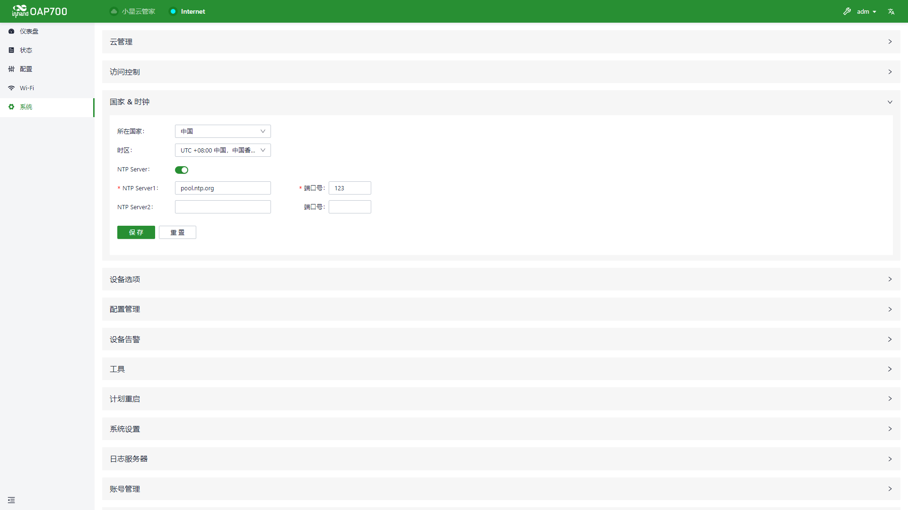

**图 4-19 国家与时钟**

| 参数 | 说明 |
| --- | --- |
| 所在国家 | 决定可用信道、功率上限等射频合规参数，如 `中国` |
| 时区 | 如 `UTC +08:00` |
| NTP Server1 / 2 | 时间同步服务器地址与端口号 |

**注意**：请务必设置正确的国家码，否则可能导致无线信道／功率超出当地法规允许范围。系统时间影响事件、日志时间戳与证书有效性，请配置可用的 NTP 服务器。

#### 4.6.4 设备选项

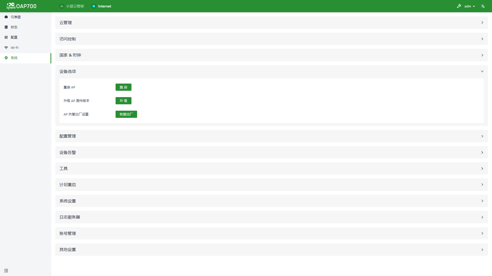

**图 4-20 设备选项（重启／升级／恢复出厂）**

| 操作 | 按钮 | 说明 |
| --- | --- | --- |
| 重启 AP | 重 启 | 重新启动设备，配置保留 |
| 升级 AP 固件版本 | 升 级 | 上传固件 → 校验 → 升级 → 自动重启 |
| AP 恢复出厂设置 | 恢复出厂 | 清除全部配置，恢复出厂默认值 |

**警告**：升级过程中严禁断电，否则可能导致设备无法启动。恢复出厂设置会丢失全部自定义配置，执行前请先在"配置管理"中导出备份。

#### 4.6.5 配置管理

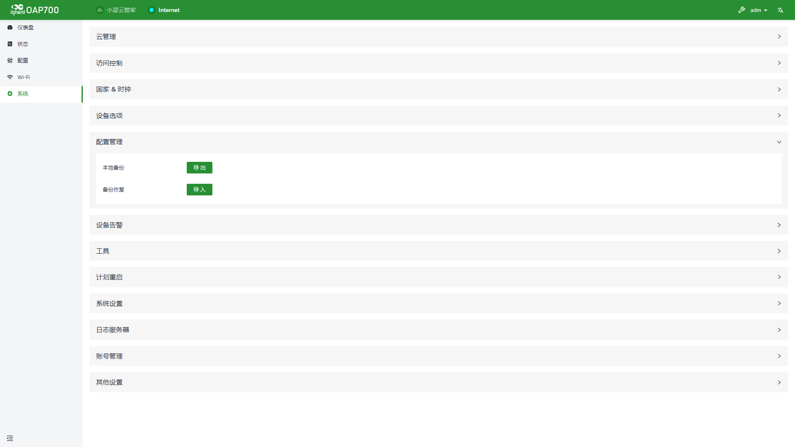

**图 4-21 配置管理**

| 操作 | 按钮 | 说明 |
| --- | --- | --- |
| 本地备份 | 导 出 | 将当前配置导出为备份文件并保存到本地 |
| 备份恢复 | 导 入 | 上传此前导出的配置文件恢复设备配置 |

**说明**：建议在每次重要配置变更后、以及固件升级前各导出一份配置备份。

#### 4.6.6 设备告警

路径：**系统 > 设备告警**（独立页面）

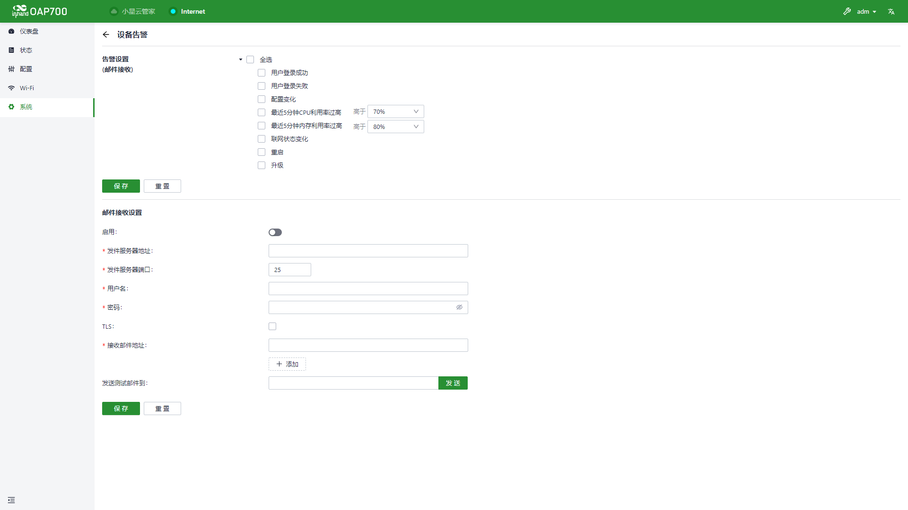

**图 4-22 设备告警与邮件设置**

**告警设置（邮件接收）** 可勾选的告警项：

- 用户登录成功、用户登录失败、配置变化
- 最近 5 分钟 CPU 利用率过高（高于 70%）
- 最近 5 分钟内存利用率过高（高于 80%）
- 联网状态变化、重启、升级

**邮件接收设置**：启用、发件服务器地址、发件服务器端口、用户名、密码、TLS、接收邮件地址（可"添加"多个）、发送测试邮件（"发 送"）。配置完成后点击"**保 存**"。

**说明**：先点击"发送测试邮件"验证 SMTP 可用，可避免因邮件服务器配置错误而漏报警。

#### 4.6.7 工具（诊断工具）

路径：**系统 > 工具**（独立页面）

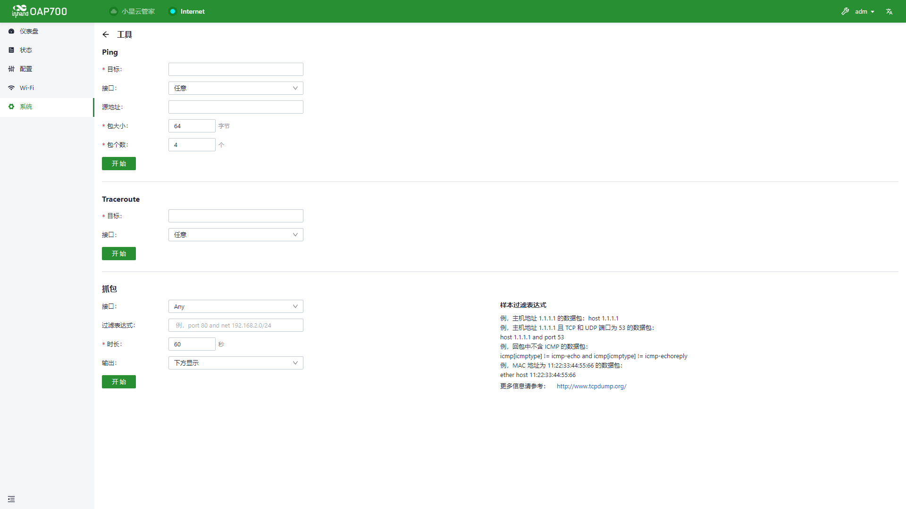

**图 4-23 Ping / Traceroute / 抓包**

| 工具 | 参数 | 说明 |
| --- | --- | --- |
| Ping | 目标、接口（任意）、源地址、包大小（字节）、包个数（个） | 测试网络连通性与丢包、时延 |
| Traceroute | 目标、接口（任意） | 追踪路由路径，定位故障网络段 |
| 抓包 | 接口（Any）、过滤表达式、时长（秒）、输出（下方显示） | 按 tcpdump 语法抓取报文 |

**常用过滤表达式示例（界面内置样例）**

```
host 1.1.1.1                                    # 主机 1.1.1.1 的数据包
host 1.1.1.1 and port 53                        # 主机 1.1.1.1 且 TCP/UDP 端口 53
icmp[icmptype] != icmp-echo and icmp[icmptype] != icmp-echoreply   # 非 Echo 请求/应答
ether host 11:22:33:44:55:66                     # MAC 地址 11:22:33:44:55:66
```

更多语法参考：http://www.tcpdump.org/

**说明**：排查"能上 WLAN 但打不开网页"一类问题时，可先 Ping 网关 → Ping 公网 IP（如 `114.114.114.114`）→ Ping 域名（如 `www.baidu.com`），据此判断是链路、IP 还是 DNS 故障。

#### 4.6.8 计划重启

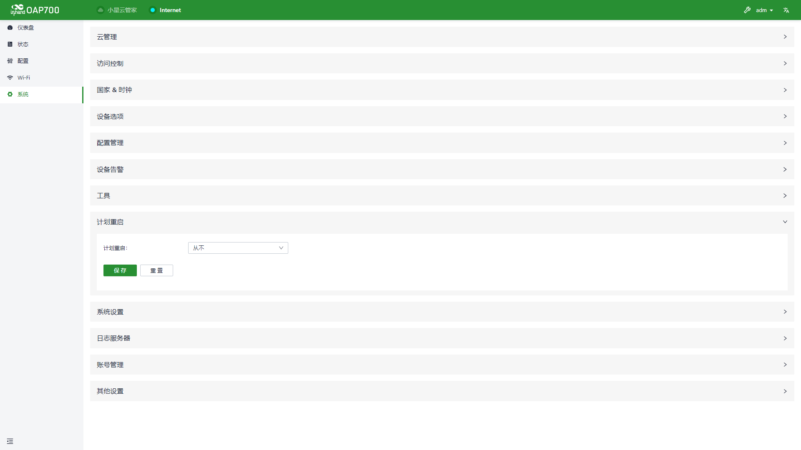

**图 4-24 计划重启**

可设置周期性自动重启计划（默认 `从不`），点击"**保 存**"生效。

**说明**：设备内置硬件看门狗，一般无需依赖计划重启维持稳定；如需设定，请避开业务高峰时段。

#### 4.6.9 系统设置（工作模式）

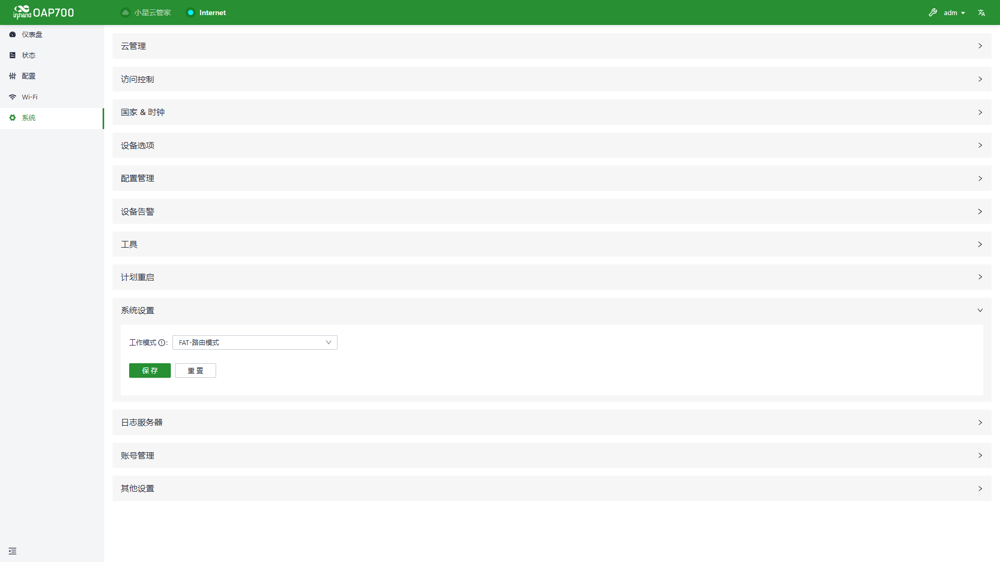

**图 4-25 工作模式切换**

| 可选值 | 说明 |
| --- | --- |
| FAT-路由模式 | 作为网关工作，提供 NAT／DHCP／路由 |
| FAT-桥接模式 | 作为二层桥接 AP 工作，网络由上级设备管理 |

**注意**：切换工作模式会改变设备管理地址与网络结构，保存后需重新连接并登录。

#### 4.6.10 日志服务器

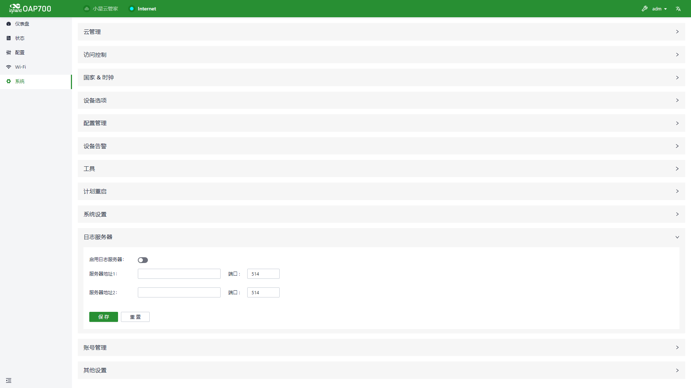

**图 4-26 远程日志服务器**

| 参数 | 说明 |
| --- | --- |
| 启用日志服务器 | 开关远程日志上报 |
| 服务器地址1 / 端口 | 主 syslog 服务器 |
| 服务器地址2 / 端口 | 备 syslog 服务器 |

**说明**：设备本地日志空间有限，建议将日志集中发送到 syslog 服务器长期留存，便于多站点统一审计。

#### 4.6.11 账号管理

参见 [4.1.4 修改管理员密码](#414-修改管理员密码)。字段：**用户名、新密码、确认密码**。

#### 4.6.12 其他设置（Web 登录管理）

参见 [4.1.5 退出与自动注销](#415-退出与自动注销)。可设置 Web 登录后无操作多少分钟自动退出。

### 4.7 工程师模式

工程师模式用于在用户授权下，由映翰通技术支持工程师建立临时远程协助会话，以便在现场无法处置时完成故障定位。该功能默认处于关闭状态，会话具有临时性，排障结束后应立即关闭。

**术语说明**

| 术语 | 定义 |
| --- | --- |
| 配置码 | 由技术支持提供的授权码，用于启动工程师模式，仅对本次会话有效。 |
| 会话代码 | 本地脚本运行后生成的一次性标识，技术支持凭该标识接入本次协助会话。 |


**图 4-27 工程师模式**

**操作流程**

1. 联系技术支持工程师获取**配置码**。
2. 将配置码粘贴到输入框，点击"**启动工程师模式**"。
3. 下载生成的 `engineer-mode.ps1` 脚本。
4. 在 Windows 上双击运行脚本，并将脚本输出的**会话代码**告知工程师。
5. 排障结束后，可点击"**返回本地页面**"关闭会话。

**注意**：请仅在官方技术支持人员主动联系您、且您本人已知情并授权的情况下使用该功能；会话结束后建议立即确认状态已回到"未开启"。

## 5 云管理与 AI 智能运维

### 5.1 云平台管理

OAP700 由小星云管家（https://star.inhandcloud.cn）提供云端管理，顶部栏"小星云管家"为云平台入口。

| 能力 | 说明 |
| --- | --- |
| 快速上线 | 设备接入平台后首次上线时间 < 60 s |
| 设备监控 | 设备状态、流量、客户端实时查看 |
| 批量运维 | 跨站点统一配置下发与固件升级 |
| 告警通知 | 设备异常即时告警 |

**接入步骤**

1. 在"系统 > 云管理"中开启"**启用云服务**"，选择云服务器（中国／全球），保存。
2. 确认设备 WAN 可访问外网且 DNS 正常（否则日志会出现 MQTT／DNS 解析失败告警）。
3. 登录云平台，将设备绑定到相应站点后即可查看状态。

### 5.2 AI Agent 智能运维

通过 AI 网络助手，可用**自然语言**管理设备完整生命周期，尤其适合站点分散、人工到场成本高的户外网络：

| 能力 | 说明 |
| --- | --- |
| 设备监控 | 自然语言查询，AI 自动检索并返回结果 |
| 故障诊断 | AI 执行多步诊断并给出完整分析与修复建议（识别掉线、弱覆盖、射频干扰等） |
| 配置管理 | 用自然语言读取或修改配置，或将配置复制到其他设备 |
| 自适应调优 | 基于现场频谱与接入数据推荐信道、发射功率、天线模式等最优配置 |
| 固件升级 | AI 管理从版本选择到完成的全过程，降低人为失误风险 |
| 远程终端 | 通过自然语言发起，直接访问设备 |
| 批量操作 | 自然语言批量下发，无需逐台执行 |

**说明**：设备侧提供 **Agent CLI / API** 作为 AI Agent 的管控入口，用于基于业务意图的自动化运维编排；该功能不提供 Web UI 配置项。

---

## 6 故障排查

### 6.1 指示灯与启动异常

| 现象 | 可能原因 | 处理建议 |
| --- | --- | --- |
| 所有指示灯不亮 | 未供电／PoE 端口未使能／网线故障 | 确认 PoE 交换机端口已开启供电；更换网线；更换端口测试 |
| 系统灯异常 | 启动失败或配置异常 | 断电重启一次；仍异常则按 Reset 恢复出厂 |
| 以太网灯不亮 | 链路未建立 | 检查网线、对端端口、网线水晶头压接质量 |
| Wi-Fi 灯不亮 | 对应射频被关闭 | 检查 Radio 配置与 SSID 状态 |

### 6.2 无法登录管理界面

| 现象 | 处理建议 |
| --- | --- |
| 浏览器无法打开页面 | 确认终端与设备同网段（使用 `https://192.168.2.1`；检查以太网灯状态 |
| 页面能打开但提示证书不受信任 | 自签名证书属正常现象，选择"继续访问" |
| 提示账号或密码错误 | 使用机身标签上的初始凭据；检查是否开启了大小写；确认是否被他人修改 |
| 配置过访问控制后被拒绝 | 检查"系统 > 访问控制"中对应服务是否限制了来源地址或关闭了本地访问 |
| 登录后很快被登出 | 检查"系统 > 其他设置"中的 Web 登录超时时间 |
| 忘记管理密码 | 通过 Reset 按键恢复出厂设置（会清除全部配置） |

### 6.3 无法上网

按以下顺序逐步定位：

1. **看仪表盘接口状态**：PoE WAN 是否为"已连接"。未连接 → 检查网线与上级端口。
2. **看上行接口地址**：路由模式 + DHCP 下应获取到地址；为空 → 检查上级 DHCP 或改为静态 IP。
3. **Ping 测试**（系统 > 工具）：先 Ping 网关 → 再 Ping 公网 IP（如 `114.114.114.114`）→ 最后 Ping 域名。
   - 网关不通：检查 WAN 网段、掩码、网关地址是否配错。
   - 公网通、域名不通：检查主／备 DNS 设置。
4. **检查 MTU**：仅当特定组网下出现"能 Ping 通但网页打不开"时尝试调整 MTU。
5. **Traceroute / 抓包**：定位丢包网络段，并将抓包文件提交技术支持。

### 6.4 无线相关问题

| 现象 | 处理建议 |
| --- | --- |
| 搜不到 SSID | 确认 SSID 状态为"启用"；关闭"隐藏 SSID"测试；确认对应频段 Radio 正常；确认终端支持该频段与国家码 |
| 连接不上／反复掉线 | 核对密码与安全方式；尝试安全方式回退为 `WPA-PSK/WPA2-PSK`；关闭"用户隔离"测试；确认 VLAN 绑定正确 |
| 终端连上但无法访问 | 检查 SSID 绑定的网络是否配置了 DHCP 与地址池；检查是否被访客网络隔离；检查 Portal 是否需要先完成认证 |
| 网速慢／延迟高 | 查看信道是否拥挤（Radio 中改信道或设为自动）；降低频宽互扰；调整发射功率；确认天线模式与场景匹配（线性→定向，面状→全向）；查看"客户端"中 RSSI 是否过低 |
| 多 AP 场景同频干扰严重 | 利用 BSS Color 与 802.11k/v/r 漫游；错开相邻 AP 信道；必要时降低发射功率 |
| 漫游掉线 | 确认终端支持 802.11k/v/r；在多 AP 间验证信号重叠覆盖 |

### 6.5 云平台与告警异常

| 日志／现象 | 说明 | 处理建议 |
| --- | --- | --- |
| `MQTT Connecting...` 反复重试 | 云连接未建立 | 检查"云管理"是否启用、云服务器区域选择是否正确 |
| `AWS_IO_DNS_QUERY_FAILED` | 无法解析云平台域名 | 检查 WAN 与 DNS 配置，改用可用的主／备 DNS |
| 收不到告警邮件 | SMTP 配置错误 | 检查发件服务器地址／端口／TLS／账号口令；使用"发送测试邮件"验证 |
| 时间戳异常 | 未同步时间 | 配置可用 NTP 服务器与正确时区 |

### 6.6 恢复出厂设置

依次尝试以下方式（自上而下影响由小到大）：

1. **软恢复**：系统 > 设备选项 > **AP 恢复出厂设置**。
2. **硬恢复**：长按机身 **Reset** 按键10秒,等待系统指示灯蓝色常亮后松开，蓝色闪烁即说明设备开始进行恢复出厂。

**警告**：恢复出厂会清除全部配置，包括 SSID、安全设置、网络参数与账号密码，执行前请先导出配置备份并记录必要信息。

---

## 7 维护与保养

| 周期 | 维护内容 |
| --- | --- |
| 每月（或每次大雨／大风后） | 检查设备安装是否牢固、抱杆／螺钉有无松动锈蚀；检查进线口密封与防水接头是否完好；检查指示灯与联网状态 |
| 每季度 | 清洁壳体表面灰尘与遮挡物（使用中性清洁剂与软布，勿使用腐蚀性溶剂）；核对系统时间与 NTP；检查散热区域是否被异物遮挡 |
| 持续 | 保持固件为最新稳定版本；定期导出配置备份；启用设备告警与远程日志服务器；观察"状态 > 日志"中的异常与告警 |
| 按需 | 在"系统 > 工具"中执行 Ping／Traceroute／抓包，形成例行巡检记录 |

**注意**

1. 长期露天运行需关注外壳是否粉化、黄变、密封圈是否老化，出现破损应及时联系售后更换，以免 IP67 失效进水。
2. 盐雾、高湿环境（码头、海岛）应缩短巡检周期。
3. 固件升级前务必先导出配置备份，并选择稳定版本。

---

## 8 技术规格

### 8.1 硬件规格

| 项目 | 规格 |
| --- | --- |
| 处理器 | 四核 Cortex-A73 |
| 内存 | 512 MB DDR4 |
| 存储 | 128 MB SPI NAND Flash |
| Wi-Fi 标准 | IEEE 802.11be（Wi-Fi 7），2.4 GHz + 5 GHz 双频并发 |
| 空间流 | 5 GHz 3×3 : 3SS；2.4 GHz 2×2 : 2SS |
| 信道带宽 | 5 GHz：20/40/80/160 MHz；2.4 GHz：20/40 MHz |
| 调制方式 | 5 GHz 最高 4096-QAM；2.4 GHz 最高 1024-QAM |
| Wi-Fi 峰值速率 | 约 5 Gbps（5 GHz 4324 Mbps + 2.4 GHz 688 Mbps） |
| WAN 口 | 1 × 2.5 Gbps RJ45，支持 PoE 受电 |
| LAN 口 | 1 × 2.5 Gbps RJ45，数据专用 |
| 天线 | 内置 5 根：2 根双频全向 + 2 根双频定向 + 1 根 5 GHz 全向；RF 开关切换定向／全向模式 |
| 供电方式 | IEEE 802.3at（Type 2, PoE+）受电，向下兼容 IEEE 802.3af |
| 功耗 | ≤ 15 W |
| 复位按键 | 1 个 Reset 按键 |
| 指示灯 | 1 个系统灯、1 个 2.4 GHz Wi-Fi 灯、1 个 5 GHz Wi-Fi 灯、1 个以太网口指示灯 |
| 看门狗 | 支持 |
| 散热方式 | 结构—散热一体化被动散热，无风扇设计 |
| 防护等级 | IP67 |
| 外壳材质 | 抗紫外线聚合物外壳 + 压铸铝散热片一体化结构 |
| 颜色 | 白色 |
| 工作温度 | −30 °C ~ +70 °C |
| 存储温度 | −40 °C ~ +85 °C |
| 相对湿度 | 5% ~ 95%，无凝结 |
| 尺寸 | 235 mm × 167.93 mm × 81.93 mm |
| 重量 | 约 1.5 kg（参考值） |
| 安装方式 | 壁挂、抱杆、屋顶安装 |

### 8.2 无线规格

| 项目 | 规格 |
| --- | --- |
| 标准与规格 | IEEE 802.11be（Wi-Fi 7），BE5000，2.4 GHz + 5 GHz 双频并发 |
| 空间流 | 5 GHz 3×3 : 3SS + 2.4 GHz 2×2 : 2SS |
| 信道带宽 | 5 GHz：20/40/80/160 MHz；2.4 GHz：20/40 MHz |
| 调制方式 | 5 GHz 最高 4096-QAM；2.4 GHz 最高 1024-QAM |
| 最大关联客户端数 | 300+ |
| 最大活跃并发用户 | 100+，每用户保底 ≥ 20 Mbps |
| 覆盖距离 | 视距（LOS）理想环境下最大覆盖半径 150 m；实际距离受环境、干扰、终端能力影响 |
| 多 SSID | 最多 16 个 SSID 独立配置（每 SSID 独立名称与加密） |
| 无线安全 | WPA3-Personal（SAE）／WPA3-Enterprise（802.1X + RADIUS）／WPA2-PSK 回退 |
| Wi-Fi 7 特性 | MU-MIMO（DL+UL）、OFDMA（DL+UL）、4K-QAM（4096-QAM）、BSS Color、TWT（Target Wake Time） |
| 天线模式 | 定向模式（线性场景）／全向模式（360° 面状场景），Web 或云平台一键切换 |
| 快速漫游 | 802.11k 邻居报告、802.11v BSS 切换管理、802.11r 快速 BSS 切换（Over-the-DS + Over-the-Air） |

### 8.3 有线与网络服务

| 项目 | 规格 |
| --- | --- |
| WAN 口 | 1 × 2.5 Gbps RJ45，支持 DHCP／静态 IP、MTU 配置与 PoE 受电 |
| LAN 口 | 1 × 2.5 Gbps RJ45，数据专用 |
| 端口吞吐 | 2.5 Gbps 线速转发 |
| 工作模式 | 路由模式（FAT-Routing）／桥接模式（FAT-Bridge），可切换 |
| 本地网络 | 主网络 + 访客网络（Guest，独立 IP 段与独立 DHCP，与主网络隔离） |
| 静态路由 | 路由模式下支持静态路由 |
| 本地 Portal | Splash Page／Logo／语言／配色可自定义；点击直通、用户认证；上网凭证、MAC 白名单免认证；可绑定指定 SSID |
| 外部对接 | 支持 URL 重定向至第三方 Portal 服务器、支持外部 RADIUS 用户认证（不支持云端 Portal） |
| 诊断工具 | Ping、Traceroute、抓包（pcap） |
| 日志 | 本地日志、远程 syslog 服务器、事件导出 |

### 8.4 安全特性

| 类别 | 特性 |
| --- | --- |
| 设备安全 | Secure Boot（硬件辅助安全启动 + 签名 bootloader 链）、签名固件（校验通过方可刷写） |
| 账号安全 | 每台设备出厂唯一密码（预印标签），无通用默认密码 |
| 传输加密 | WPA3（Wi-Fi）／HTTPS（管理面）／TLS 1.3（云端通信） |
| 访问控制 | 管理面 IP 白名单、服务端口（HTTPS/SSH/Telnet/PING）本地与远程控制、Web 登录超时 |
| 网络隔离 | 访客网络与主网络隔离（独立 IP 段 + 独立 DHCP）；最多 16 个 SSID 独立配置，按业务划分接入域 |

### 8.5 可靠性与认证

| 类别 | 项目 | 规格 |
| --- | --- | --- |
| 防护等级 | IP 防护 | IP67 |
| 防护等级 | 盐雾测试 | 48 小时，符合 IEC 60068-2-52 |
| 机械可靠性 | 振动 | 1.0 / 4.0 / 100.0 / 200.0 Hz 扫频；符合 IEC 60068-2-6 |
| 机械可靠性 | 冲击 | 符合 IEC 60068-2-27 |
| 机械可靠性 | 跌落 | 裸机 75 cm；整机带包装 1 m；符合 IEC 60068-2-32 |
| 机械可靠性 | 温度循环 | 符合 IEC 60068-2-14 |
| 机械可靠性 | 湿热循环 | 符合 IEC 60068-2-30 |
| 电气可靠性 | 浪涌保护 | 网口共模 2 kV（CM）；电源共模 2 kV（CM）／差模 1 kV（DM）；符合 IEC 61000-4-5 Level 3 |
| 电气可靠性 | ESD | 接触 6 kV ／ 空气 8 kV；符合 IEC 61000-4-2 Level 3 |
| 电气可靠性 | 工作环境 | −30 °C ~ +70 °C；5% ~ 95% 相对湿度，无凝结 |
| 电气可靠性 | 存储环境 | −40 °C ~ +85 °C；5% ~ 95% 相对湿度，无凝结 |
| 电气可靠性 | MTBF | ≥ 100,000 h @ 25 °C |
| 认证 | 无线电与电磁兼容 | FCC\*、IC\*、CE\*、CTA\*、SRRC\* |
| 认证 | 环保 | RoHS / REACH |

> \* 带 \* 标识代表对应认证尚在申请流程中。

---

## 附录 A 默认参数与缩略语

### A.1 默认参数速查

| 项目 | 默认值 |
| --- | --- |
| 管理协议 | HTTPS（HTTP 自动跳转 HTTPS） |
| 默认管理地址 | `192.168.2.1`（LAN Default 网段 `192.168.2.0/24`） |
| 默认用户名 | 见机身标签 |
| 初始密码 | 每台设备出厂唯一，见机身标签 |
| WAN 接入类型 | DHCP（可改为静态 IP） |
| 工作模式 | FAT-路由模式 |
| 2.4 GHz 射频 | 频宽可选 20/40 MHz；发射功率可选 自动/高/中/低/自定义 |
| 5 GHz 射频 | 频宽可选 20/40/80/160 MHz；发射功率可选 自动/高/中/低/自定义 |
| 天线模式 | 全向天线／定向天线（按场景选择） |
| HTTPS / SSH / Telnet 端口 | 443 / 22 / 23 |
| 云服务器 | 小星云管家 中国（star.inhandcloud.cn） |
| 许可状态 | 见仪表盘"许可状态"（未许可时部分云功能受限） |

> 界面截图取自测试样机，上述具体数值（信道、IP、SSID 名称等）以设备实际显示为准。

### A.2 缩略语

| 缩略语 | 全称 | 含义 |
| --- | --- | --- |
| AP | Access Point | 无线接入点 |
| BSS | Basic Service Set | 基本服务集 |
| DHCP | Dynamic Host Configuration Protocol | 动态主机配置协议 |
| ESD | Electrostatic Discharge | 静电放电 |
| FAT | Fat AP（独立工作模式） | 独立管理的胖接入点 |
| IP | Internet Protocol | 互联网协议 |
| MU-MIMO | Multi-User Multiple-Input Multiple-Output | 多用户多入多出 |
| MTBF | Mean Time Between Failures | 平均无故障工作时间 |
| MTU | Maximum Transmission Unit | 最大传输单元 |
| NTP | Network Time Protocol | 网络时间协议 |
| OFDMA | Orthogonal Frequency Division Multiple Access | 正交频分多址接入 |
| PoE | Power over Ethernet | 以太网供电 |
| QAM | Quadrature Amplitude Modulation | 正交幅度调制 |
| RADIUS | Remote Authentication Dial-In User Service | 远程用户认证拨号服务 |
| RF | Radio Frequency | 射频 |
| RSSI | Received Signal Strength Indicator | 接收信号强度指示 |
| SAE | Simultaneous Authentication of Equals | 对等同时认证（WPA3 握手） |
| SN | Serial Number | 序列号 |
| SSID | Service Set Identifier | 服务集标识（无线网络名称） |
| syslog | System Logging Protocol | 系统日志协议 |
| TWT | Target Wake Time | 目标唤醒时间 |
| VLAN | Virtual Local Area Network | 虚拟局域网 |
| WAN | Wide Area Network | 广域网（上行口） |

---

