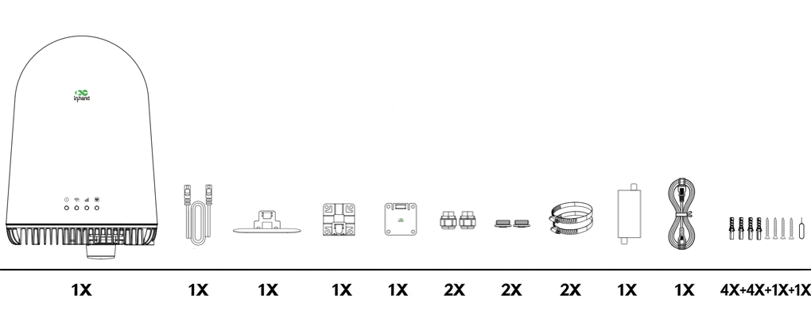
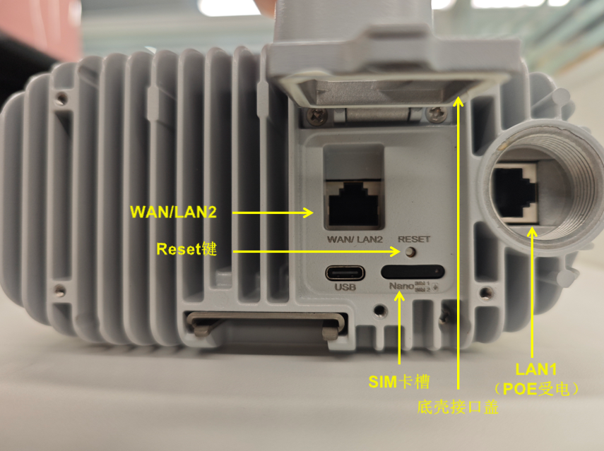
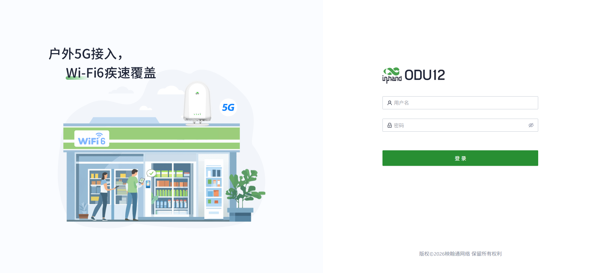
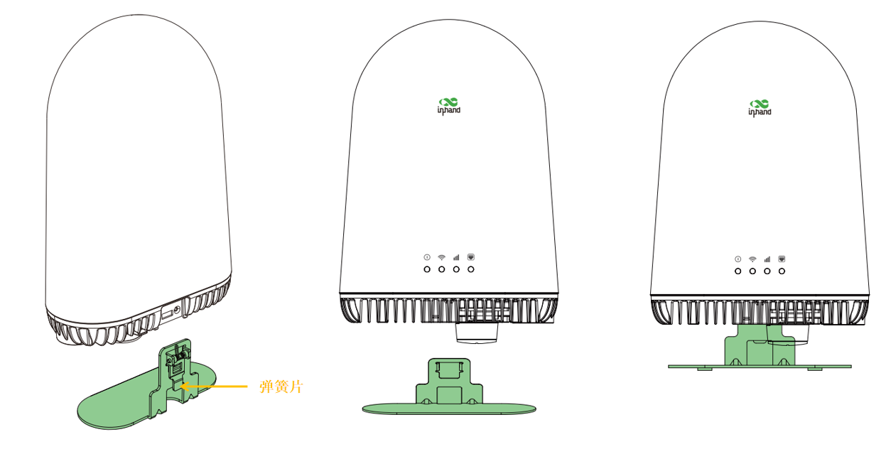
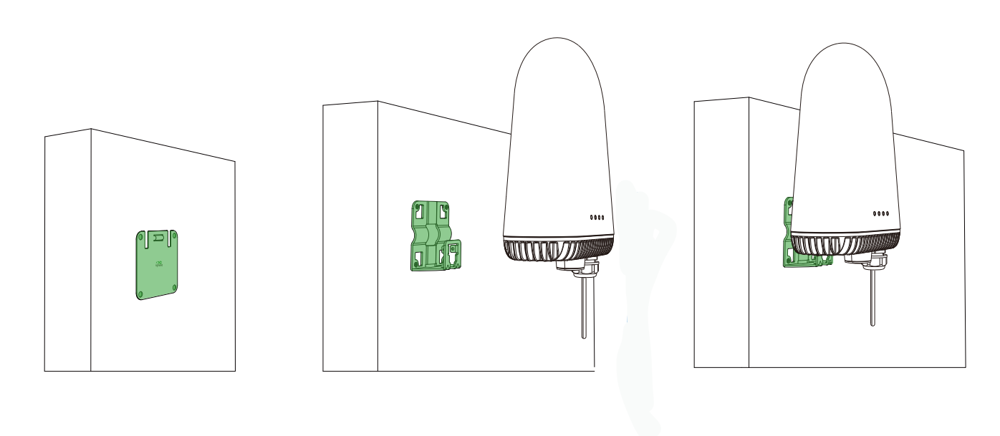
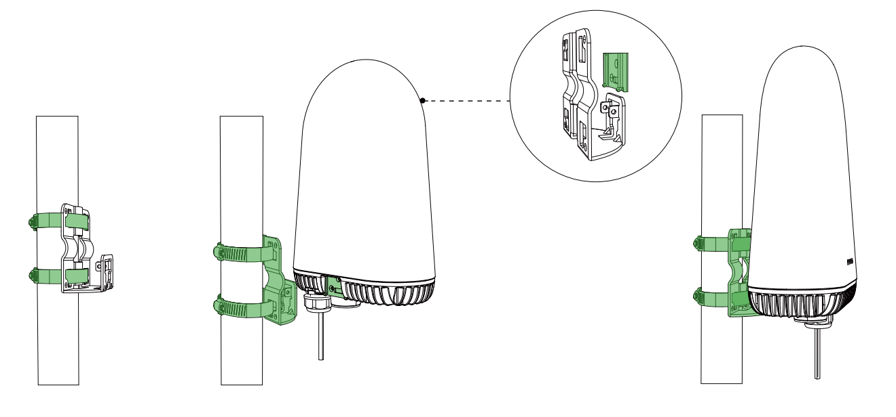
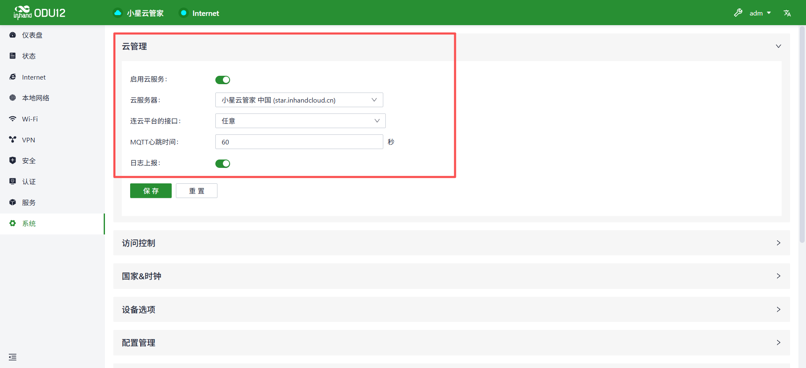
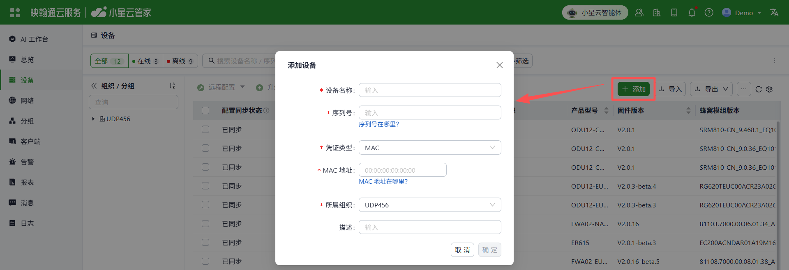

**包装清单**

ODU12配有标准配件。当你收到后，请检查确认是否配齐。
如有遗漏或损失，请联系映翰通销售或技术支持人员。

<strong>图 1 ODU12配件清单</strong>

| 序号 | 物料名称 | 数量 | 描述 |
|------|------|------|------|
| 1 | ODU12 | 1 | ODU12路由器整机 |
| 2 | 网线 | 1 | 1米网线 |
| 3 | 底座 | 1 | 桌面安装件 |
| 4 | 背夹组件 | 1 | 壁挂安装件 |
| 5 | 墙面安装参考安装工具 | 1 | 壁挂安装件 |
| 6 | 防水接头 | 2 | - |
| 7 | 防水盖 | 2 | - |
| 8 | 抱箍圈 | 2 | 壁挂安装组件 |
| 9 | POE供电盒 | 1 | - |
| 10 | 电源线 | 1 | 1米电源线 |
| 11 | 其他安装配件 | 1 | 4*螺钉，1个取卡针 |

**快速使用指南**

ODU12接口示意：

<strong>图 2 ODU12接口</strong>

**1. 装入SIM卡或插入网线**

（1）插入网线（使用宽带上网）
 直接将网线插入WAN/LAN2口。

（2）装入SIM卡（使用蜂窝上网）
 - 打开底壳接口盖，使用取卡针取出卡托；
 - 将Nano-SIM卡放置在卡托上，确保缺角边对齐后，将卡托插回卡槽内。
> 注意：**插拔SIM卡时，请务必在设备断电状态下进行，否则可能导致设备异常。**

**2. 访问和调试设备**

（1）接入电源（POE受电）。

（2）使用以太网线将设备的LAN接口与电脑连接，然后在浏览器中访问https://192.168.2.1 进入设备的登录页面；

<strong>图 4-1 设备本地登录页面</strong>

（3）查看设备背面铭牌，获取登录用户名和密码。输入后，即可登录到设备本地进行调试和配置。
> 注意：建议在首次使用后及时修改密码。如需使用小星云管家管理设备，请在安装前保存设备铭牌上的序列号及MAC地址。

**3. 安装ODU12**

方式一：桌面安装
（1）将底座对准ODU12背面下方的卡口，然后将底座缓慢向前推进到底端；
（2）按压弹簧片，听到“咔哒”即固定完成。
（3）使用防水接头及防水盖盖住未使用的接口，避免进水。

<strong>图 3 ODU12桌面安装示意</strong>

方式二：壁挂安装

（1）将墙面安装参考工具贴在墙面预定位置，按四个角的圆孔标记打孔；
（2）将背夹组件贴于墙面，打入螺钉；
（3）将设备挂到背夹的挂板上即可。
（4）使用防水接头及防水盖盖住未使用的接口，避免进水。

<strong>图 4 ODU12壁挂安装示意</strong>

方式三：立杆安装

（1）将2根抱箍圈穿过背夹组件，然后固定到杆上；
（2）将设备挂到背夹的挂板上；
（3）使用防水接头及防水盖盖住未使用的接口，避免进水。

<strong>图 5 ODU12立杆安装示意</strong>

**4. 云管理设备**

（1）登录到设备本地，并在“系统 -> 云管理”页面启用云服务；ODU12默认开启云管理。

<strong>图 6 云管理配置</strong>

（2）登录小星云管家APP. 点击下方"设备"目录进入【设备】页面，点击右上角菜单按钮，选择【添加设备】，扫描ODU12机身上的二维码添加设备。

<strong>图 7 扫码下载小星云管家APP</strong>

你也可以登录小星云管家（https://star.inhandcloud.cn），进入”设备“菜单，点击“添加”，并录入设备铭牌上的序列号及MAC地址；

<strong>图 5-2 添加设备到小星云管家</strong>

（3）添加成功后，即可远程管理您的设备。

**恢复出厂**

如需重置设备，需按照以下步骤将设备恢复出厂设置：

1. 在设备上电状态下，长按Reset按钮10秒。
2. 系统指示灯由蓝色常亮变为蓝色闪烁，表明设备已恢复出厂设置。
3. 设备稍后将正常启动。

**状态灯**

| 指示灯 | 状态 | 含义 |
|--------|------|------|
| 系统 | 常灭 | 设备未上电 |
|  | 红色常亮 | 系统启动中 |
|  | 红色闪烁 | 系统错误 |
|  | 绿色常亮 | 系统运行中 |
|  | 蓝色闪烁 | 系统升级中 |
| Wi-Fi | 常灭 | Wi-Fi禁用 |
|  | 绿色闪烁 | Wi-Fi驱动加载中 |
|  | 绿色常亮 | AP正常工作 |
| 蜂窝信号 | 常灭 | 蜂窝功能禁用 |
|  | 红色闪烁 | 已拨号连接 |
|  | 红色常亮 | 信号值≤9 |
|  | 蓝色常亮 | 10≤信号值≤19 |
|  | 绿色常亮 | 信号值≥20 |
| 以太网口 | 常灭 | 以太网未连接 |
|  | 红色常亮 | 仅WAN口已连接 |
|  | 绿色常亮 | 仅LAN口已连接 |
|  | 蓝色常亮 | LAN口和WAN口均已连接 |

**常见问题**

1.状态灯不亮

请检查电源是否通电。

2.无法访问到设备本地页面

请检查PC是否与设备的LAN口连接。如已连接，请确认PC与设备同网段，并检查是否使用HTTPS。

3.设备添加到小星云管家后，一直处于离线状态

先确认设备是否通电通网，然后登录设备本地检查云管理功能是否开启。如果以上都正常，再到小星云平台上确认设备是否有许可证。