# 北京映翰通车载路由器VR624产品系列用户手册

## 声明

首先非常感谢您选择本公司产品！在使用前，请您仔细阅读本用户手册，遵守以下声明，将有助于维护知识产权和法律合规性，以确保您的使用体验与产品的最新信息相一致。如有任何疑问或需要获取书面许可，请随时联系我们的技术支持团队。

- 版权声明

本用户手册包含受版权保护的内容，版权归北京映翰通网络技术股份有限公司及其许可者所有。未经书面许可，任何单位和个人不得擅自摘抄、复制本手册的部分或全部内容，且不得以任何形式传播。

- 免责声明

由于产品技术和规格不断更新，本公司不能承诺用户手册中的资料与实际产品完全一致。因此，不承担由于实际技术参数与用户手册不符而引起的任何争议。任何关于产品的改动恕不提前通知，本公司保留最终更改权和解释权

- 版权信息

本用户手册内容受版权法律保护，版权归北京映翰通网络技术股份有限公司及其许可者所有，保留一切权利。未经书面许可，不得擅自使用、复制或传播本手册的内容。

## 图形界面约定

| 符号 | 含义 | 示例 |
|------|------|------|
| `< >` | 表示变量或参数，需替换为实际值 | `<IP地址>` 表示需填入具体IP |
| `" "` | 表示界面上的文字标签 | 点击"保存"按钮 |
| `→` | 表示菜单层级或操作顺序 | 【网络】→【蜂窝】 |
| `【 】` | 表示菜单或页面名称 | 进入【系统设置】页面 |
| 注意 | 提醒操作中应注意的事项，不当的操作可能会导致数据丢失或者设备损坏。 | - |
| 说明 | 对操作内容的描述进行必要的补充和说明。 | - |

## 技术支持

**北京映翰通网络技术股份有限公司（总部）**

电话：010-8417 0010

地址：北京市朝阳区紫月路18号院3号楼5层

**成都办事处**

电话：028-8679 8244

地址：四川省成都市武侯区天府大道北段1777号中国太平金融大厦14层

**广州办事处**

电话：020-8562 9571

地址：广州市天河区黄埔大道中660号汇金国际金融中心B栋1913单元

**武汉办事处**

电话：027-8716 3566

地址：武汉市洪山区关山大道465号光谷新发展国际中心B座5层

**上海办事处**

电话：021-5480 8501

地址：上海市普陀区国浩长风城北座326室


## 1. 产品概述


VR624 是一款专为车载网络设计的坚固型 5G 路由器。设备提供高达 3.4 Gbps 的 5G NR SA/NSA 下行速率、Wi-Fi 6 3000 Mbps 无线覆盖、4 个 M12 X-coded 千兆以太网端口以及多星座 GNSS 定位能力，可为车载视频监控、遥测回传、自动售检票、乘客 Wi-Fi 等业务提供稳定可靠的网络通道。

### 1.1 核心特性

| 特性 | 说明 |
| --- | --- |
| 高速连接 | 支持 5G NSA/SA，下行速率高达 3.4 Gbps；Wi-Fi 6 吞吐 3000 Mbps，满足实时视频、遥测与车队通信需求 |
| 坚固设计 | M12 X-coded 防振动连接器，金属外壳，无风扇被动散热，工作温度 −30 °C ~ +70 °C |
| 集成定位 | 内置 GNSS（GPS、BDS、Galileo、GLONASS、QZSS），定位精度 < 1.5 m，支持实时车辆跟踪与路线优化 |
| 企业级安全 | 硬件 TPM 2.0 加密芯片，配合防火墙、VPN、访问控制等多层软件安全策略，支持 WPA3 |
| 双 SIM 容灾 | 抽屉式双 Nano-SIM 卡槽（可选 eSIM），支持基于流量、拨号失败、检测失败等条件的自动切换 |
| 云管理 | 兼容 InHand DeviceLive 云平台，支持实时监控、远程诊断、批量配置与 OTA 升级 |
| 行业合规 | 通过 CE、E-Mark（ECE R10 / ECE R118）、FCC、PTCRB、ITxPT 等认证 |


## 2. 规格参数

### 2.1 硬件规格

| 参数 | 规格 |
| --- | --- |
| 处理器 | 1.3 GHz 工业级 CPU |
| 内存 | 512 MB DDR3 |
| 存储 | 128 MB Flash |
| 蜂窝模组 | 5G NR NSA/SA，下行速率高达 3.4 Gbps |
| SIM 卡槽 | 1 × 抽屉式双 Nano-SIM 卡槽 + 1 × eSIM（可选） |
| 以太网端口 | 4 × M12 X-coded 8 针母座，10/100/1000 Mbps 自适应 |
| I/O 接口 | 2 × 输入（点火检测 / 低电量警告） |
| Wi-Fi | IEEE 802.11 ax/ac/a/b/g/n，Wi-Fi 6，2.4 GHz + 5 GHz，3000 Mbps |
| Wi-Fi 安全 | WPA3-Enterprise、WPA2-Enterprise、WEP/TKIP/AES 加密 |
| Wi-Fi 最大功率 | 5 GHz：20 dBm；2.4 GHz：20 dBm |
| Wi-Fi 覆盖范围 | 50 米视距（实际距离取决于环境） |
| GNSS 接收器 | GPS、BDS、Galileo、GLONASS、QZSS |
| 定位精度 | < 1.5 m（CEP50） |
| 跟踪灵敏度 | −162 dBm |
| 导航更新率 | 10 Hz |
| 天线接口 | 4 × SMA（5G）、2 × SMA（4G）、2 × RP-SMA（Wi-Fi）、1 × SMA（GNSS） |
| 指示灯 | 1 × 系统、1 × 蜂窝、1 × 信号、1 × 2.4G Wi-Fi、1 × 5G Wi-Fi |
| 接地端子 | 支持 |
| 安全芯片 | TPM 2.0 |
| 实时时钟 | 支持 RTC |
| 电源 | DC 9–48 V，过流保护，防反接 |
| 功耗 | 待机 5.3 W；典型工作 8.5 W；最大 17.8 W |
| 复位按钮 | 用于恢复出厂设置 |
| 外壳 | 金属外壳 |
| 散热 | 无风扇被动散热 |
| 防护等级 | IP30 |
| 工作温度 | −30 °C ~ +70 °C |
| 存储温度 | −40 °C ~ +85 °C |
| 环境湿度 | 5% ~ 95%（无冷凝） |
| 尺寸 | 177 × 144.4 × 42 mm |
| 重量 | 810 g |
| 安装方式 | 壁挂安装（DIN 导轨安装需选配支架） |
| MTBF | MIL-HDBK-217F N2, GM @ 20 °C：17.8 年；@ 40 °C：12.5 年 |

### 2.2 环境与可靠性

| 测试项目 | 标准 | 等级/结果 |
| --- | --- | --- |
| ESD（静电放电） | EN61000-4-2，ISO16750-2:4.7 | 3 级 |
| 辐射抗扰度 | EN61000-4-3，ISO16750-2:4.6 | 3 级 |
| EFT（电快速瞬变） | EN61000-4-4，ISO16750-2:4.3 | 3 级 |
| 浪涌 | EN61000-4-5，ISO16750-2:4.4 | 3 级 |
| 传导抗扰度 | EN61000-4-6，ISO16750-2:4.5 | 3 级 |
| 振荡波 | EN61000-4-12，ISO16750-2:4.8 | 3 级 |
| 工频磁场 | EN61000-4-8，ISO16750-3:4.1.2 | 水平/垂直 400 A/m（≥ 2 级） |
| 冲击 | IEC60068-2-27，ISO16750-3:4.1.1 | 符合 |
| 振动 | IEC60068-2-6，ISO16750-3:4.1.2 | 符合 |
| 自由跌落 | IEC60068-2-32，ISO16750-3:4.1.3 | 符合 |
| 铁路标准 EMC | EN50155，EN50121 | 符合 |
| 防火 | EN45545 | 符合 |

### 2.3 软件能力

| 类别 | 支持内容 |
| --- | --- |
| 网络接入 | APN、VPDN；CHAP、PAP 认证 |
| 广域网协议 | 静态 IP、DHCP、PPPoE |
| 路由协议 | 静态路由、BGP、OSPF |
| TCP/IP 协议栈 | TCP、UDP、IPv4、IPv6、ICMP、NTP、DNS、HTTP、HTTPS、SSL/TLS、ARP、VRRP、PPP、PPPoE、SSH |
| DHCP / DNS | DHCP 服务器与客户端；DNS 代理、DNS 过滤、自定义 DNS 服务器；DDNS（多提供商） |
| 防火墙 | 状态包检测、入站/出站规则、端口转发、NAT（SNAT/DNAT）、MAC 过滤、域名过滤、局域网防火墙 |
| 访问控制 | 802.1X 认证；基于 MAC/IP/端口/协议的访问控制 |
| 策略路由 | 基于源/目的地的路由、基于域名的路由、强制路由 |
| VPN | IPsec、L2TP、OpenVPN、WireGuard |
| 加密 | TPM 2.0 硬件级加密 |
| 流量整形 | 接口级带宽控制、基于队列的流量管理 |
| 链路管理 | WAN/蜂窝链路故障切换；主备/负载均衡；ICMP 检测 |
| 链路监控 | 实时状态、延迟、抖动、丢包率、历史趋势、自动健康检查、告警通知 |
| 双 SIM 切换 | 基于流量阈值、拨号失败、异常时段、检测失败自动切换，支持智能回退 |
| 链路检测 | 心跳包检测、断线自动重拨、内置看门狗自动恢复 |
| Wi-Fi 模式 | AP 模式、客户端模式 |
| 定位服务 | GNSS IP 转发 / 串口转发（NMEA RMC、GSA、GGA、GSV），上报间隔可配置 |
| 系统管理 | 仪表板、链路监控、系统/诊断日志、告警规则、邮件告警、Ping、Traceroute、抓包、Iperf |
| 配置管理 | 配置导入/导出、备份与恢复、固件升级（Web/云/自动）、模组固件升级 |
| 远程访问 | Web 管理界面、CLI、远程 Web/CLI 访问 |

> **说明**：部分功能（如串口透传、Portal 认证、QoS 等）是否开放取决于具体固件版本与授权配置，请以设备实际界面为准。

---

## 3. 包装清单与选配件

### 3.1 标准包装

| 组件 | 数量 | 说明 |
| --- | --- | --- |
| VR624 主机 | 1 | 安装于车厢内，支持壁挂或 DIN 导轨安装 |
| VR624 电源线 | 1 | - |

### 3.2 标准部署配置

| 组件 | 数量 | 描述 |
| --- | --- | --- |
| 5G/4G 天线 | 4 / 2 | 蜂窝网络外置天线（按频段配置） |
| Wi-Fi 天线 | 2 | Wi-Fi 覆盖外置天线 |
| GNSS 天线 | 1 | 定位天线 |
| SIM 卡 | 1 | 双 Nano-SIM，支持故障切换 |
| 以太网连接 | 4 | M12 X-coded 连接器，用于车载以太网设备 |

### 3.3 可选配件

- M12 X-coded 转 RJ45 以太网电缆
- M12 X-coded 转 M12 X-coded 以太网电缆
- M12 X-coded 转 M12 D-coded 以太网电缆
- 天线套件（Cellular + Wi-Fi + GNSS）
- DIN 导轨安装支架
- VR624 定制化电源线

---

## 4. 硬件说明与安装

### 4.1 接口说明

**M12 以太网端口（×4）**

- M12 X-coded 8 针母座连接器
- 10/100/1000 Mbps 自适应
- 防振动设计，适用于移动环境
- 其中 WAN 与 LAN1 为复用端口，具体分配以界面配置为准

**I/O 接口（×2）**

| 通道 | 功能 |
| --- | --- |
| 输入 1 | 点火检测 |
| 输入 2 | 低电量警告 |

**其他**

- 天线接口：4 × SMA（5G）、2 × SMA（4G）、2 × RP-SMA（Wi-Fi）、1 × SMA（GNSS）
- SIM 卡槽：抽屉式双 Nano-SIM（可选 eSIM）
- 电源输入：DC 9–48 V，具备过流保护与防反接能力
- 接地端子：用于 EMC 合规接地
- 复位按钮：恢复出厂设置

### 4.2 指示灯

设备面板设有 5 个指示灯，用于快速判断运行状态：

| 指示灯 | 状态 | 含义 |
|--------|------|------|
| 系统状态灯 | 常灭 | 设备未上电 |
|  | 红色常亮 | 系统启动中 |
|  | 绿色闪烁 | 系统工作正常 |
|  | 红色闪烁 | 系统错误 |
|  | 黄色闪烁 | 系统升级中 |
| 蜂窝状态灯 | 绿色闪烁 | 蜂窝连接中 |
|  | 绿色常亮 | 蜂窝连接成功 |
|  | 红色闪烁 | 拨号故障 |
| 蜂窝信号灯 | 常灭 | 无蜂窝连接 |
|  | 红色常亮 | 信号质量较差 |
|  | 黄色常亮 | 信号质量中等 |
|  | 绿色常亮 | 信号质量好 |
| Wi-Fi 2.4G | 常灭 | AP&STA未使能 |
|  | 绿色闪烁 | 2.4G正常工作 |
|  | 绿色常亮 | 工作模式为STA且未关联AP |
| Wi-Fi 5G | 常灭 | AP&STA未使能 |
|  | 黄色闪烁 | 5G正常工作 |
|  | 黄色常亮 | 工作模式为STA且未关联AP |

详细的端口连接状态（已连接 / 未连接 / 异常 / 禁用）可在 Web 管理界面「仪表盘 → 接口状态」中查看。

### 4.3 安装方式

**壁挂安装（标准配置）**

- 附带标准壁挂支架
- 螺丝固定安装，确保稳固

**DIN 导轨安装（可选）**

- 需选配 DIN 导轨套件，适用于工业机柜环境
- 支持免工具安装和拆卸

### 4.4 安装步骤

| 步骤 | 任务 |
| --- | --- |
| 1 | 在车厢内安装 VR624 主机 |
| 2 | 连接外置天线（蜂窝 / Wi-Fi / GNSS） |
| 3 | 插入 SIM 卡（双 SIM 配置） |
| 4 | 连接电源（DC 9–48 V） |
| 5 | 连接以太网设备（直连最多 4 台，更多设备可通过交换机扩展） |
| 6 | 连接串口 / I/O 电缆（如需要） |
| 7 | 上电并验证系统状态 |

### 4.5 安装注意事项

- 确保天线位置以获得最佳信号接收，天线应尽量远离金属遮挡与干扰源
- 连接前确认电源电压在 **9–48 V DC** 范围内
- 为满足 EMC 合规要求，正确连接接地端子
- 布线应远离热源和车辆移动部件
- 插入 SIM 卡前确认卡片方向，避免带电插拔
- 设备为 IP30 防护等级，请安装在避免水溅与粉尘直击的位置
- 安装环境温度须在 −30 °C ~ +70 °C 范围内

---

## 5. 快速上手

### 5.1 连接网络

任选一种方式连接到路由器：

| 方式 | 操作 |
| --- | --- |
| 有线 | 用网线将电脑连接至 LAN 端口（M12 接口，需配套线缆） |
| 无线 | 连接默认 Wi-Fi SSID（默认名称形如 `VR624-A00003`，密码以设备标签或出厂配置为准） |

默认局域网地址：**192.168.2.1**

### 5.2 登录 Web 管理界面

1. 打开浏览器，访问：**https://192.168.2.1/**
2. 输入设备铭牌上的默认用户名与密码；
3. 点击 **登录**


> **安全提示**：首次登录后请立即进入 **系统 → 账号管理** 修改默认密码。设备使用 HTTPS 加密访问，浏览器首次访问时可能会提示证书告警，属于正常现象，可继续访问。

### 5.3 首次配置（上网 + Wi-Fi）

**第一步：确认上行链路**

进入 **Internet** 页面，确认已启用的上行链路（WAN 或 Cellular）状态正常。

- 有线宽带：编辑 `WAN` 条目，将 IPv4 类型设置为 `DHCP`（或按运营商要求选择 PPPoE / 静态 IP）
- 5G 蜂窝：确认已插入 SIM 卡，并启用 `Cellular` 上行链路

**第二步：配置 Wi-Fi**

进入 **Wi-Fi → SSIDs** 页面：

1. 点击 **添加**（或对已有 SSID 点击 **编辑**）
2. 设置 SSID 名称、频段（2.4 GHz / 5 GHz）
3. 选择安全模式（推荐 `WPA2-PSK` 或更高）并设置密码
4. 点击 **保存**

**第三步：验证联网**

进入 **状态 → 链路监控**，查看上行链路的运营商、流量、延迟与丢包情况；也可使用 **系统 → 工具** 中的 Ping 功能验证外网连通性。

---

## 6. Web 管理界面说明

### 6.1 界面总览

登录后界面分为三个区域：

| 区域 | 位置 | 作用 |
| --- | --- | --- |
| 顶部栏 | 页面上方 | 显示 DeviceLive 云平台入口、Internet 联网状态、当前登录用户与语言切换 |
| 左侧导航 | 页面左侧 | 12 个功能模块入口 |
| 主内容区 | 页面中部 | 各模块的具体配置与状态页面 |

左侧导航模块一览：

| 序号 | 模块 | 主要内容 |
| --- | --- | --- |
| 1 | 仪表盘 | 设备信息、接口状态、流量统计 |
| 2 | 状态 | 链路监控、蜂窝信号、客户端、VPN、GNSS、路由表、会话、I/O、事件、日志 |
| 3 | Internet | 上行链路表、链路探测与备份策略 |
| 4 | 本地网络 | 局域网网段、VLAN、DHCP |
| 5 | Wi-Fi | SSID 与射频参数 |
| 6 | 路由 | 静态路由、BGP、OSPF |
| 7 | VPN | IPsec、L2TP、WireGuard、OpenVPN |
| 8 | 安全 | 防火墙、策略路由、NAT、过滤 |
| 9 | 认证 | 802.1X |
| 10 | 服务 | 接口、DHCP、DNS、GNSS、SNMP、电源管理等 |
| 11 | 工业接口 | 数字量输入（I/O） |
| 12 | 系统 | 云管理、访问控制、时间、升级、账号等 |

---

### 6.2 仪表盘

> **功能介绍**：设备运行状态的首页总览页面，集中展示设备身份信息、各端口连接状态与流量概况。  
> **主要用途**：一眼掌握设备型号、固件版本、联网方式、端口是否连通、流量消耗与客户端排名，是日常巡检、远程确认设备是否正常的第一站。  


**路径：仪表盘**

仪表盘集中展示设备身份信息、端口连接状态与流量概况，是日常巡检的首选页面。


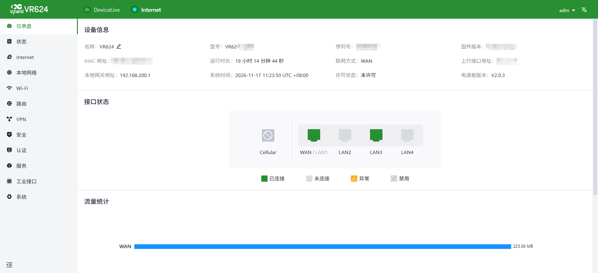

**设备信息**

| 字段 | 说明 |
| --- | --- |
| 名称 | 设备名称，可点击编辑 |
| 型号 | 设备型号（如 VR624-GLNR） |
| 序列号 | 设备唯一序列号 |
| 固件版本 | 当前 Web 系统固件版本 |
| MAC 地址 | 设备网卡物理地址 |
| 运行时长 | 自上次启动以来的运行时间 |
| 联网方式 | 当前生效的上行方式（如 WAN） |
| 上行接口地址 | 当前上行接口获得的 IP 地址 |
| 本地网关地址 | 局域网网关地址（默认 192.168.200.1） |
| 系统时间 | 当前系统时间与时区 |
| 许可状态 | 云平台许可状态 |
| 电源板版本 | 电源板固件版本 |

**接口状态**

以图形方式显示 `Cellular`、`WAN | LAN1`、`LAN2`、`LAN3`、`LAN4` 的连接情况，图例含义：

| 图例 | 含义 |
| --- | --- |
| 绿色 | 已连接 |
| 灰色 | 未连接 |
| 黄色警告 | 异常 |
| 斜纹 | 禁用 |

**流量统计 / Wi-Fi 连接数 / 客户端流量 Top5**

- **流量统计**：按上行接口展示累计流量
- **Wi-Fi 连接数**：按 SSID 统计当前接入的无线客户端数量
- **客户端流量 Top5**：展示流量占用最高的 5 个客户端

---

### 6.3 状态

> **功能介绍**：状态模块汇集 10 个实时观测标签页，覆盖链路、信号、客户端、VPN、定位、路由、会话、I/O 与系统记录。  
> **主要用途**：实时查看设备与网络的运行数据，是故障定位与运行验收的主要数据来源。  


**路径：状态**

状态模块提供 10 个标签页，用于实时观测与故障定位。

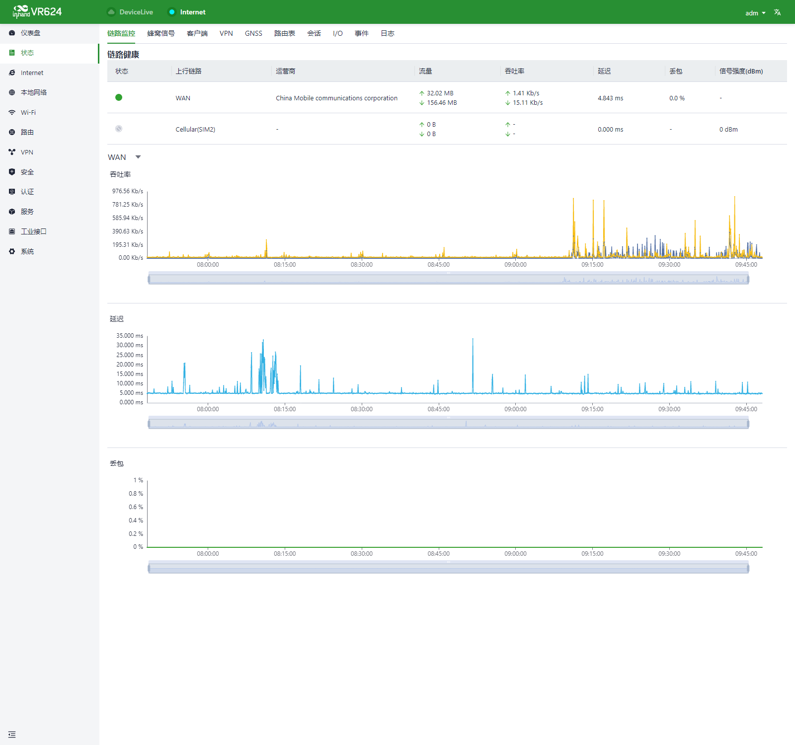

#### 6.3.1 链路监控

> **功能介绍**：以上行链路为单位，实时显示每条链路（WAN、Cellular 等）的状态、运营商、流量、吞吐率、延迟、丢包率与信号强度。  
> **主要用途**：判断网络「通不通、快不快、稳不稳」，是发现链路劣化、验证链路切换效果的核心页面。  


以「链路健康」表展示每条上行链路的运行指标：

| 列 | 说明 |
| --- | --- |
| 状态 | 链路当前状态 |
| 上行链路 | 接口名称（WAN、Cellular 等） |
| 运营商 | 蜂窝网络运营商 |
| 流量 | 累计收发流量 |
| 吞吐率 | 当前实时速率 |
| 延迟 | 链路往返时延 |
| 丢包 | 丢包率 |
| 信号强度(dBm) | 蜂窝信号强度 |

#### 6.3.2 蜂窝信号

> **功能介绍**：以历史趋势曲线展示信号强度、RSSI、RSCP、EC/IO 等蜂窝信号指标的变化情况。  
> **主要用途**：判断信号质量是否长期偏弱、定位信号劣化的时段与路段，为天线安装位置的调整提供依据。  


以趋势图形式展示信号强度、RSSI、RSCP、EC/IO 等指标的历史曲线，便于判断信号质量劣化时段。

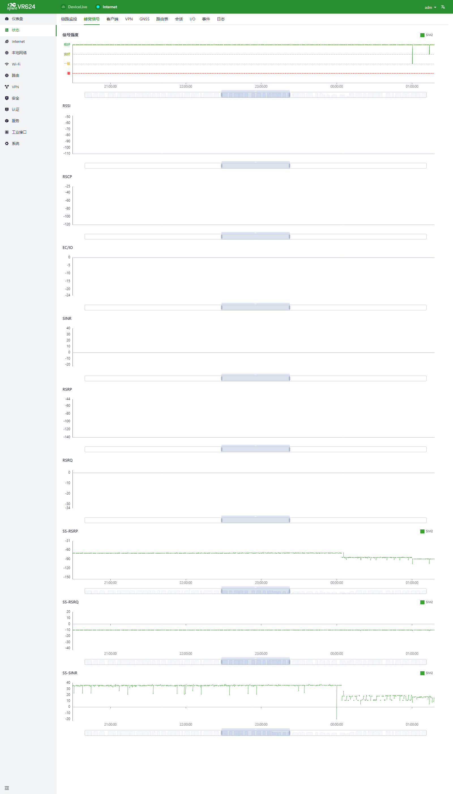

#### 6.3.3 客户端

> **功能介绍**：列出当前接入路由器的全部客户端（有线 / 无线），包含主机名、IP / MAC、VLAN、流量与在线时长。  
> **主要用途**：确认哪些设备已经接入、谁在大量占用流量、某台设备是否掉线。  


展示当前接入设备的所有客户端，可按「所有 / 有线 / 无线」筛选：

| 列 | 说明 |
| --- | --- |
| 名称 | 客户端主机名 |
| IP 地址 / MAC 地址 | 网络标识 |
| VLAN | 所属网络 |
| 连接 | 接入方式（有线/无线） |
| 总流量 / 上行流量 / 下行流量 | 流量统计 |
| 在线时长 | 本次接入时长 |


#### 6.3.4 VPN

> **功能介绍**：显示 IPsec、L2TP、OpenVPN 等隧道的运行状态、对端地址、可用子网、流量与最近连接时长。  
> **主要用途**：确认远程接入隧道是否建立成功、是否长时间中断、是否有流量通过。  


展示 IPsec、L2TP、OpenVPN 隧道的运行状态，包含状态、名称、上行接口、接口地址、对端地址、可用子网、流量与最近连接时长。

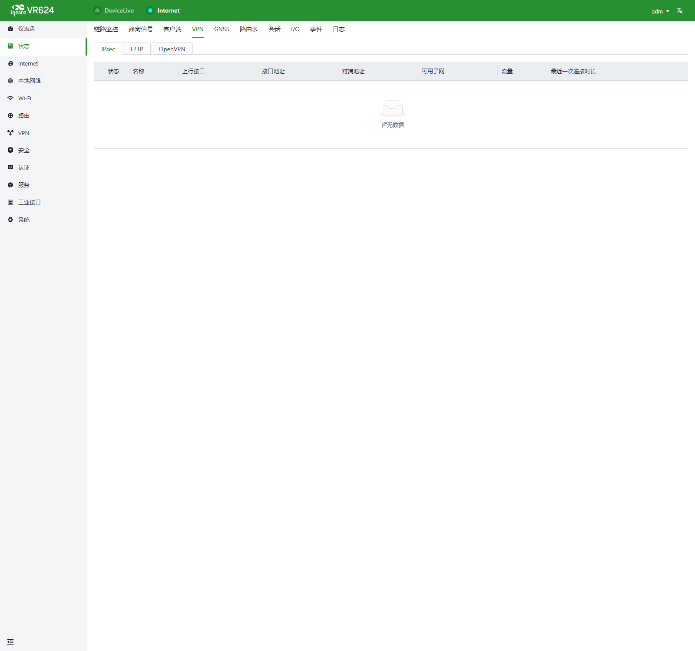

#### 6.3.5 GNSS

> **功能介绍**：显示设备当前的定位结果，包括定位时间、纬度、经度、海拔、速度与卫星数量。  
> **主要用途**：确认定位是否成功、卫星数是否足够、精度能否满足车辆跟踪需求。  


显示当前定位信息：定位时间、纬度、经度、海拔、速度、卫星数量。


#### 6.3.6 路由表

> **功能介绍**：展示设备当前生效的全部路由条目（Default / Connected / Static / BGP / OSPF 等），含目的网络、下一跳、出接口与距离/度量值。  
> **主要用途**：分析数据包的实际转发路径，判断静态路由、策略路由或动态路由是否按预期生效。  


展示当前生效的路由条目：

| 列 | 说明 |
| --- | --- |
| 类型 | Default / Connected / Static 等 |
| 目的网络 | 目标网段 |
| 下一跳 | 下一跳地址 |
| 接口 | 出接口 |
| 距离/度量 | 管理距离与度量值 |

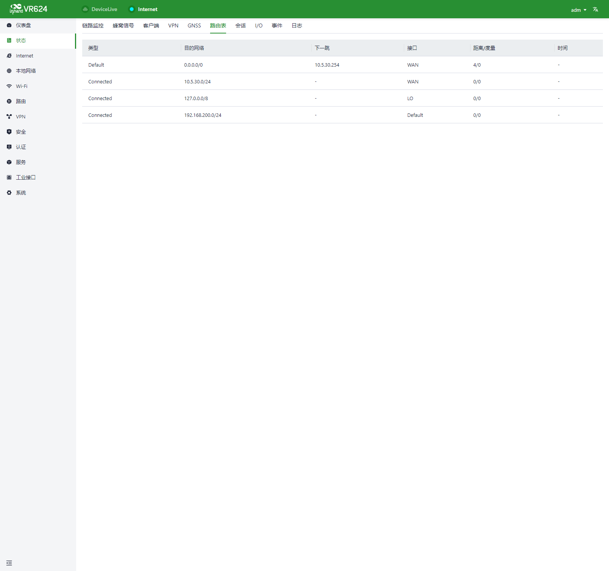

#### 6.3.7 会话

> **功能介绍**：展示设备当前的 NAT 会话表，包含协议、存活时间、状态与会话内容，支持关键字查询与导出。  
> **主要用途**：查看内网主机与外网之间的实时连接情况，判断连接是被阻断、超时还是根本没建立。  

展示设备当前的 NAT 会话表，支持关键字查询、手动刷新与行数设置。可查看协议、存活时间、状态与会话内容，用于排查连接异常。

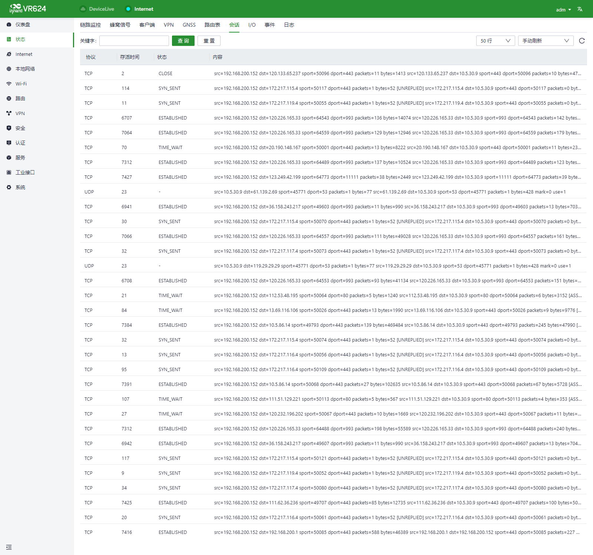

#### 6.3.8 I/O

> **功能介绍**：显示数字量输入通道（如 DI1、DI2）的实时电平状态（高 / 低电平）。  
> **主要用途**：确认点火信号、低电量告警等外部开关量是否被设备正确采集。  

显示数字量输入通道的实时电平状态（如 DI1 高/低电平）。


#### 6.3.9 事件

> **功能介绍**：记录设备关键事件（用户登录、配置变化、客户端上下线、链路切换等），支持清除事件与导出事件。  
> **主要用途**：快速回溯「什么时间发生了什么」，是定位故障时间点的第一手记录。  

记录设备关键事件（用户登录、配置变化、客户端上下线、链路切换等），支持 **清除事件** 与 **导出事件**。

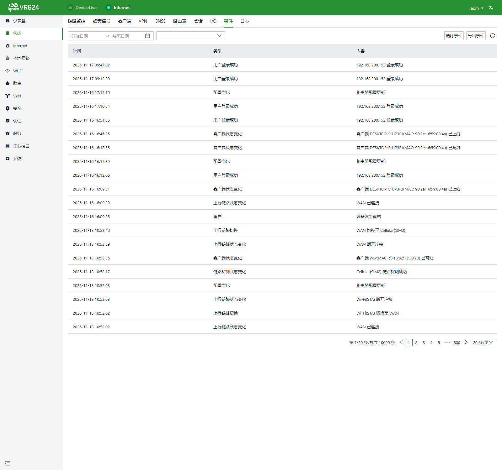

#### 6.3.10 日志

> **功能介绍**：展示系统运行日志，支持按级别筛选、关键字查询与导出。  
> **主要用途**：查看系统级的详细运行过程与报错信息，是深度排障的主要依据。  


展示系统运行日志，支持按级别筛选、关键字查询、手动刷新与行数设置，是深度排障的主要依据。

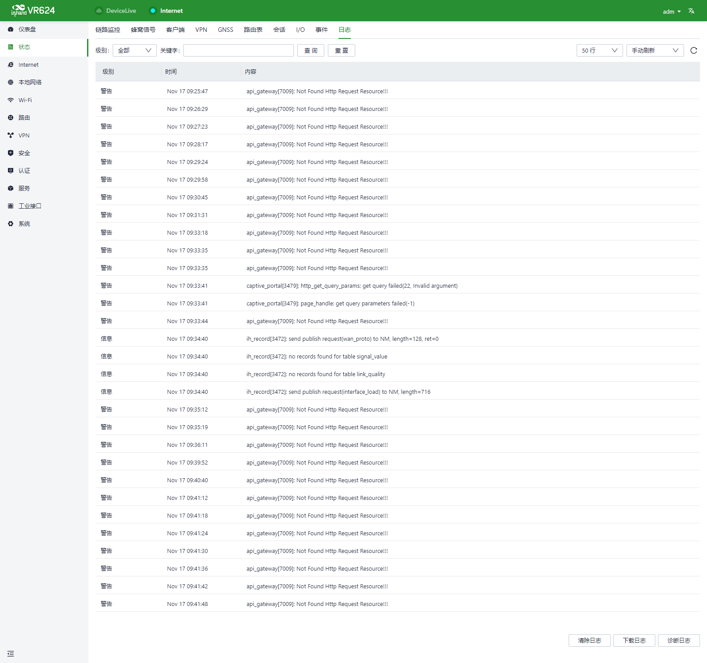

---

### 6.4 Internet（上行链路）

> **功能介绍**：管理设备所有上行（外网）链路的模块，涵盖有线宽带 WAN、5G 蜂窝 Cellular、Wi-Fi 中继等接入方式，以及链路探测与备份策略。  
> **主要用途**：决定设备「怎么上网、走哪条线上网、断了如何切换」，是路由器最核心的联网配置页面。  
> **配置时机**：设备首次上线、更换运营商或 APN、新增宽带线路、需要双链路备份或负载均衡时配置。

**路径：Internet**

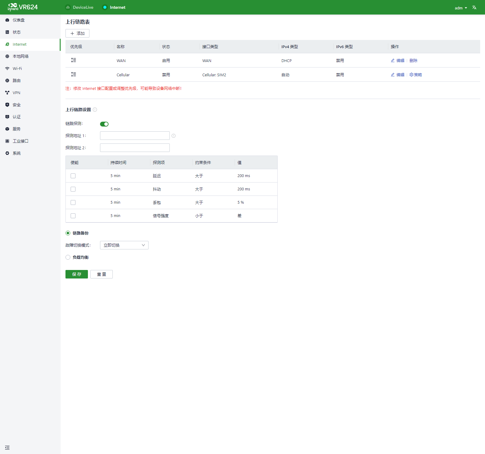

#### 6.4.1 上行链路表

> **功能介绍**：以列表形式管理各条上行链路，可执行添加、编辑、删除与策略操作，并设置链路优先级。  
> **主要用途**：为每条链路指定接入方式与参数（IP 获取方式、APN、Wi-Fi 中继等），并决定故障时的切换顺序。  
> **配置时机**：新增或修改上网线路、切换主备链路顺序时配置；修改本页或调整优先级可能导致网络中断，请在可恢复的前提下操作。

管理设备的所有上行链路，可执行 **添加、编辑、删除、策略** 操作。

| 列 | 说明 |
| --- | --- |
| 优先级 | 链路优先级，数值越小优先级越高 |
| 名称 | 链路名称 |
| 状态 | 启用 / 禁用 |
| 接口类型 | WAN、Cellular 等 |
| IPv4 类型 / IPv6 类型 | 地址获取方式（DHCP、PPPoE、静态等） |

> ⚠️ **注意**：修改 Internet 接口配置或调整优先级，可能导致设备网络中断，请在确认可恢复的前提下操作。

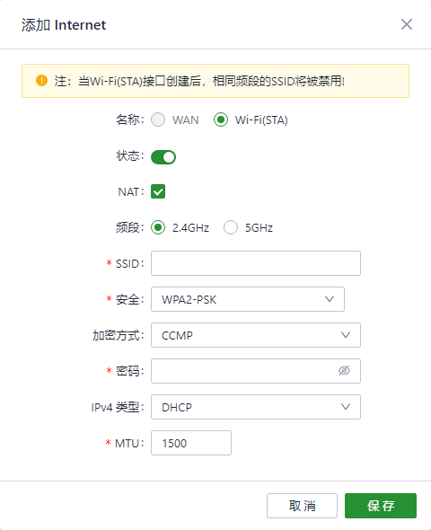

添加上行链路时可选择接口类型：

| 接口类型 | 关键参数 |
| --- | --- |
| WAN | IPv4 类型、IPv6 类型、MTU、NAT |
| Wi-Fi(STA) | 频段（2.4 GHz / 5 GHz）、SSID、安全、加密方式、密码 |
| Cellular | SIM 卡选择、APN 等 |

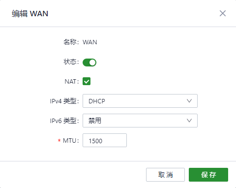

#### 6.4.2 上行链路设置

> **功能介绍**：配置链路探测（延迟、抖动、丢包率、信号强度的判定阈值）与链路备份模式（立即切换 / 负载均衡）。  
> **主要用途**：让设备自动判断链路「是否真的可用」，在质量劣化时主动切换到更好的链路，避免长时间使用一条已经不稳定的线路。  
> **配置时机**：部署双链路或多链路时配置；出现链路「显示在线但实际不通」、切换不及时或切换过于频繁时，调整这里的阈值。

**链路探测**：配置探测地址与判定阈值，用于自动判断链路可用性。

| 探测项 | 默认约束条件 |
| --- | --- |
| 延迟 | 大于 200 ms（持续 5 min） |
| 抖动 | 大于 200 ms（持续 5 min） |
| 丢包 | 大于 5%（持续 5 min） |
| 信号强度 | 小于「差」（持续 5 min） |

**链路备份**：

- **故障切换模式**：`立即切换` 或 `负载均衡`
- 检测方式基于 ICMP

---

### 6.5 本地网络

> **功能介绍**：管理设备的局域网网段、VLAN 划分与各网段的基础参数（网关地址、地址池等）。  
> **主要用途**：定义车内网络的地址规划。例如，把售票、监控等业务网络与乘客 Wi-Fi 分网段隔离，便于统一管理与安全控制。  
> **配置时机**：默认的 Default 网络（192.168.200.1/24）不满足地址规划、需要多网段或 VLAN 隔离、需要变更网关地址时配置。

**路径：本地网络**

管理设备的局域网网段、VLAN 与 DHCP 服务。


默认网络：

| 名称 | 类型 | 模式 | IPv4 地址 | VLAN |
| --- | --- | --- | --- | --- |
| Default | 标准 | IP 模式 | 192.168.200.1/24 | 1 |

点击 **添加** 或 **编辑** 可配置：

| 配置项 | 说明 |
| --- | --- |
| 名称 | 网络名称 |
| 模式 | IP 模式 / VLAN Only 模式 |
| 类型 | 标准 / 访客 |
| VLAN | VLAN ID |
| IP 地址/掩码 | 网关地址与子网掩码 |
| DHCP Server | 是否启用 DHCP 服务 |
| DHCP 地址范围 | 自动分配的地址池 |
| IPv6 | IPv6 相关配置 |

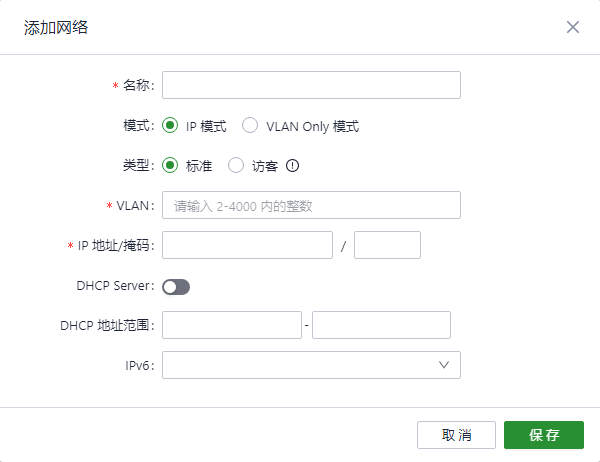

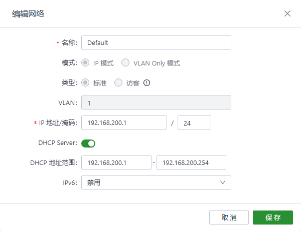

---

### 6.6 Wi-Fi

> **功能介绍**：Wi-Fi 模块由 SSIDs（无线网络名称与安全配置）和 Radio（射频参数）两部分组成。  
> **主要用途**：搭建无线覆盖，为乘客 Wi-Fi 或车载无线终端提供接入。  
> **配置时机**：首次上线设置乘客 Wi-Fi、更换 Wi-Fi 密码、新增访客网络、调整覆盖与抗干扰能力时进入本模块。

**路径：Wi-Fi**

#### 6.6.1 SSIDs

> **功能介绍**：管理无线网络的名称、频段、安全模式与密码，以及绑定网络、用户隔离、隐藏 SSID 等选项。  
> **主要用途**：创建或修改对外广播的 Wi-Fi，控制谁能接入、接入到哪个网段、无线终端之间是否允许互访。  
> **配置时机**：首次配置 Wi-Fi、定期更换密码、新增访客网络、需要隔离无线终端（如乘客之间不可互访）时配置。

管理无线网络名称与安全配置。

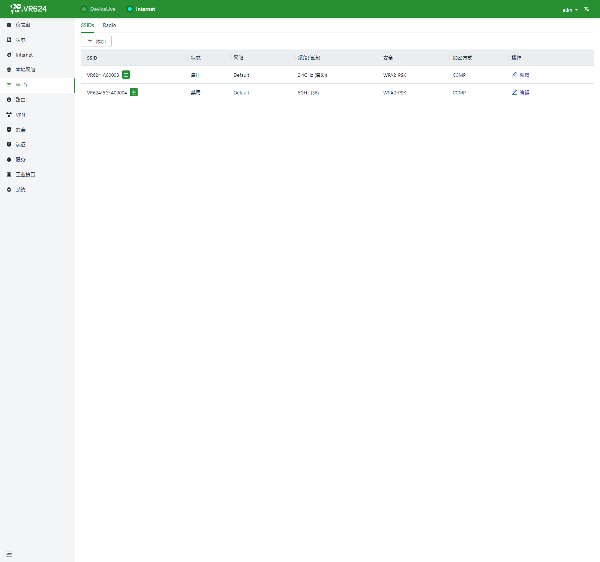

| 列 | 说明 |
| --- | --- |
| SSID | 无线网络名称 |
| 状态 | 启用 / 禁用 |
| 网络 | 绑定的本地网络 |
| 频段(信道) | 2.4 GHz / 5 GHz 及信道 |
| 安全 | 安全模式（如 WPA2-PSK） |
| 加密方式 | 如 CCMP |

点击 **添加** 或 **编辑** 可配置：

| 配置项 | 说明 |
| --- | --- |
| SSID | 无线网络名称 |
| 状态 | 启用 / 禁用 |
| 频段 | 2.4 GHz / 5 GHz |
| 安全 / 加密方式 / 密码 | 无线安全设置 |
| 网络 | 绑定的本地网络 |
| 用户隔离 | 是否禁止无线客户端互访 |
| 隐藏 SSID | 是否广播网络名称 |

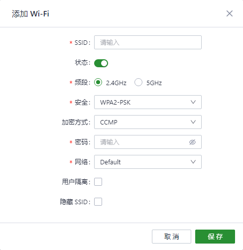

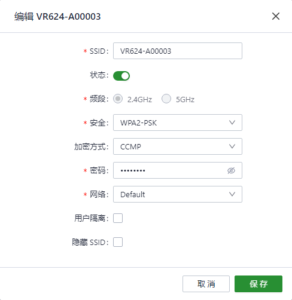

#### 6.6.2 Radio

> **功能介绍**：配置 2.4 GHz 与 5 GHz 的频宽、信道和发射功率。  
> **主要用途**：优化无线覆盖范围与实际速率，规避同频干扰（多车密集停放、场站环境尤为明显）。  
> **配置时机**：一般保持「自动」即可；当无线速率不达标、周边 Wi-Fi 干扰严重、覆盖距离不足或需要降低发射功率时再调整。

配置射频参数：

| 参数 | 2.4 GHz | 5 GHz |
| --- | --- | --- |
| 频宽 (MHz) | 20 / 40 | 20 / 40 / 80 / 160 |
| 信道 | 自动 | 按需选择（如 36） |
| 发射功率 | 高 | 高 |

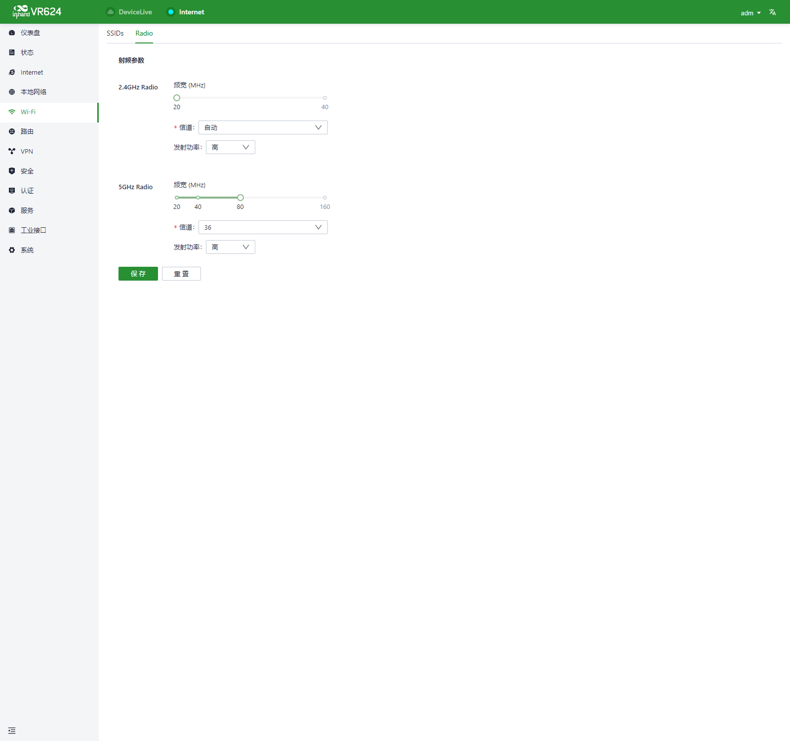

---

### 6.7 路由

> **功能介绍**：路由模块告诉设备「去某个网段应该走哪条路」，提供静态路由、BGP、OSPF 三种方式。  
> **主要用途**：实现多网段互通、指定特定业务的转发路径，或与上级网络设备动态交换路由信息。  
> **配置时机**：车内存在多个网段、需要访问车厂/总部内网，或与上级设备运行动态路由协议时配置；普通单车单网段场景无需改动。

**路径：路由**

#### 6.7.1 静态路由

> **功能介绍**：手动指定目的网络、下一跳地址、出接口与优先级的固定路由条目。  
> **主要用途**：手动打通到指定内网网段的访问路径，规则简单明确、出现问题时也便于逐条核对。  
> **配置时机**：需要访问某个特定网段（如总部内网、车厂调度系统）而设备无法自动学到该路由时添加。


点击 **添加** 配置：

| 配置项 | 说明 |
| --- | --- |
| 目的地址/网络 | 目标 IP 或网段 |
| 类型 | 路由类型 |
| 下一跳 | 下一跳地址 |
| 接口 | 出接口 |
| 优先级 | 路由优先级 |
| 描述 | 备注信息 |

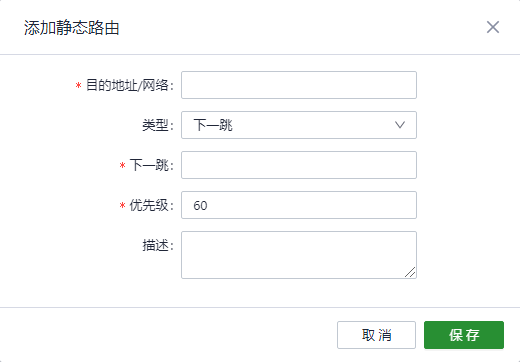

#### 6.7.2 BGP

> **功能介绍**：BGP 动态路由配置页，包含全局参数（AS 号、Router ID、保活与保持时间）、需宣告的网段、邻居设置与路由重分发。  
> **主要用途**：与上级路由器自动交换路由信息，拓扑或链路变化时自动收敛，减少人工维护静态路由的工作量。  
> **配置时机**：设备需接入企业网或运营商的 BGP 网络时配置，AS 号与邻居地址需由网络管理员提供；普通车载场景一般不使用。

| 区块 | 配置项 |
| --- | --- |
| 全局设置 | 状态、AS 号、Router ID、保活时间、保持时间、本地优先级、EBGP 距离、IBGP 距离、Local 距离 |
| 网络 | 需宣告的 IP 地址与子网掩码 |
| 邻居设置 | 对端 IP 地址、AS 号、BGP 更新间隔、EBGP 跳数 |
| 路由重定向 | 重定向类型与度量值 |

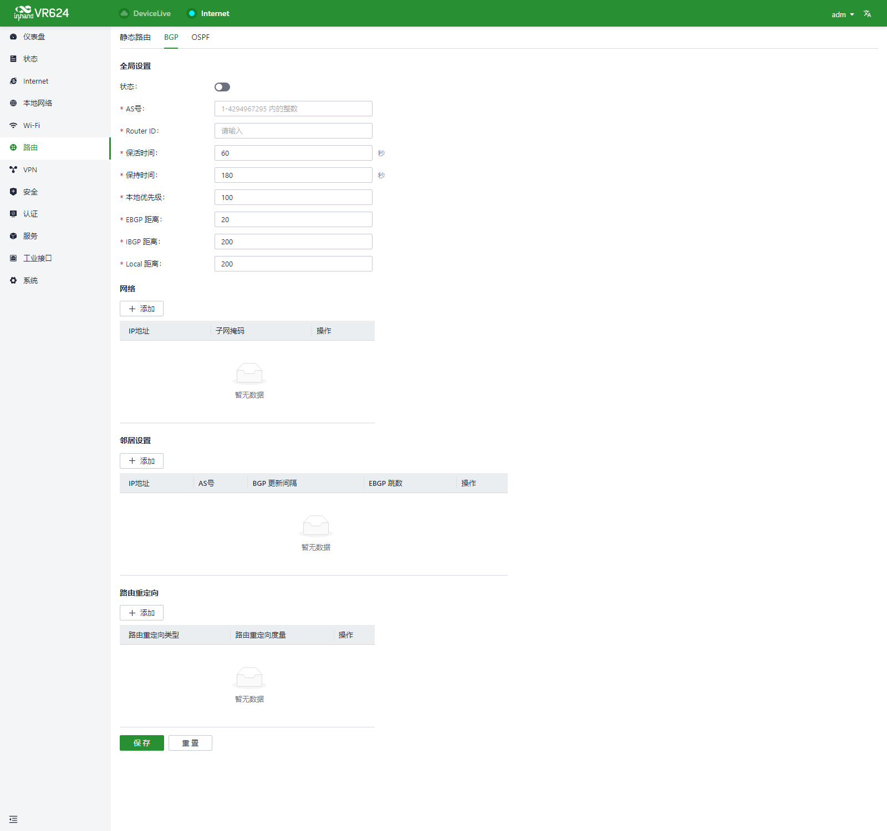

#### 6.7.3 OSPF

> **功能介绍**：OSPF 动态路由配置页，包含本地 Router ID、OSPF 区域，以及默认路由 / 静态路由 / 直连路由的重分发设置。  
> **主要用途**：在多设备网络中自动学习与收敛路由，支持链路冗余，避免手工维护大量路由条目。  
> **配置时机**：与支持 OSPF 的汇聚交换机或路由器互联时配置，区域与参数需与网络侧保持一致；普通车载场景一般不使用。

| 区块 | 配置项 |
| --- | --- |
| 全局设置 | 状态、本地路由ID、重定向默认路由、重定向静态路由、重定向直连路由 |
| 区域 | OSPF 区域 ID |

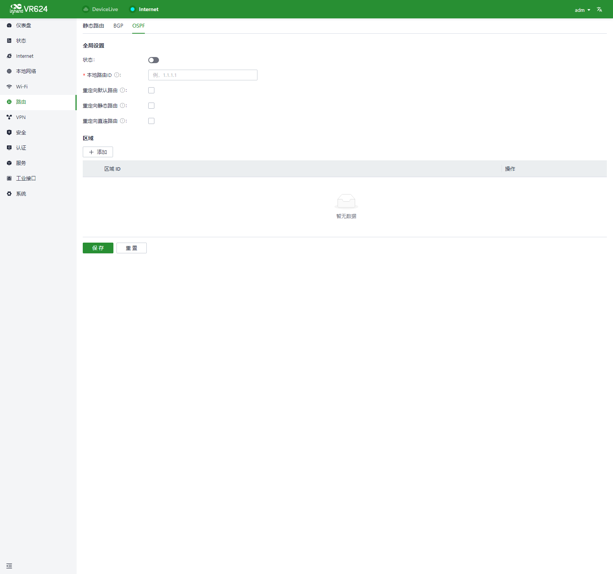

---

### 6.8 VPN

> **功能介绍**：VPN 模块用于在公网之上建立加密隧道，提供 IPsec、L2TP、WireGuard、OpenVPN 四种类型。  
> **主要用途**：让总部安全地远程访问车内设备与内网，或让车辆访问公司内部系统，避免设备与业务直接暴露在公网中。  
> **配置时机**：需要远程运维、数据回传总部、访问内网业务系统时配置；选型时按对端设备支持的 VPN 类型确定。

**路径：VPN**

#### 6.8.1 IPsec VPN

> **功能介绍**：站点对站点（Site-to-Site）的 IPsec 隧道配置，包含 IKE 版本与协商模式、预共享密钥、本地/对端子网以及 IKE 与 IPsec 加密策略。  
> **主要用途**：在车辆与公司网关之间建立稳定的加密通道，实现两侧内网直接互通，适合固定对端的长期互联。  
> **配置时机**：需要与总部、数据中心或第三方网关建立固定互联时配置；参数需与对端设备协商一致（密钥、子网、加密算法）。

点击 **添加** 进入配置页：

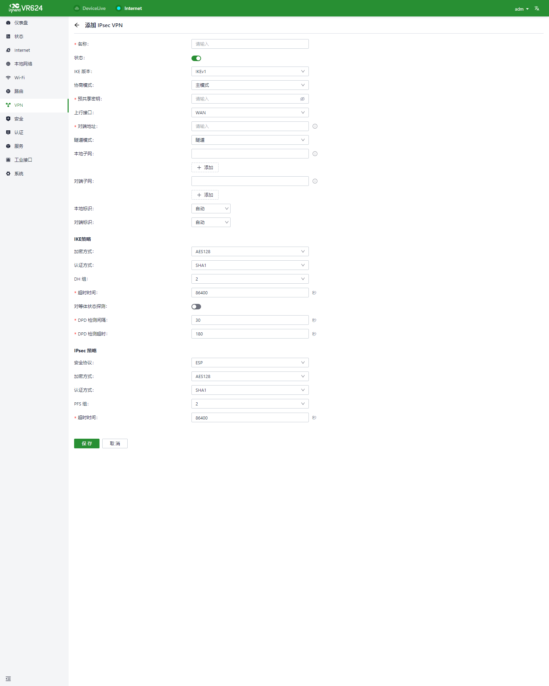

| 配置组 | 配置项 |
| --- | --- |
| 基础 | 名称、状态、上行接口、对端地址、隧道模式 |
| 协商 | IKE 版本（IKEv1/IKEv2）、协商模式、预共享密钥 |
| 子网 | 本地子网、对端子网 |
| 标识 | 本地标识、对端标识（可设为自动） |
| IKE 策略 | 加密方式、认证方式、DH 组、超时时间、DPD 检测间隔、DPD 检测超时 |
| IPsec 策略 | 安全协议（ESP）、加密方式、认证方式 |

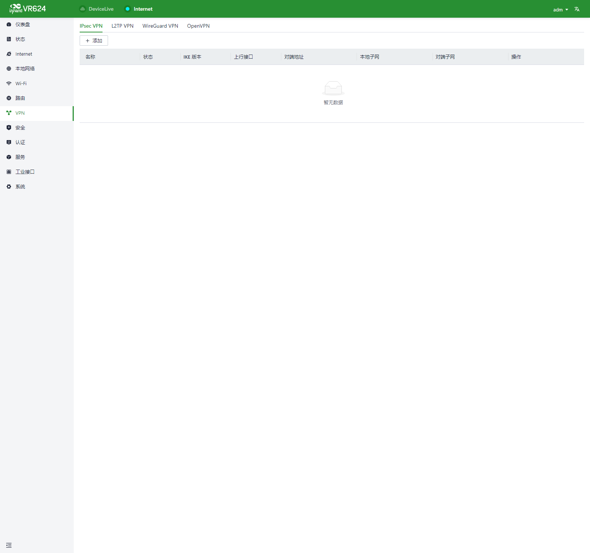

#### 6.8.2 L2TP VPN

> **功能介绍**：L2TP 隧道配置，提供服务器与客户端两种模式，通过用户名 / 密码拨号建立连接。  
> **主要用途**：为移动办公人员或对端设备提供简单的远程拨号接入方式，部署门槛低、终端配置简便。  
> **配置时机**：需要以账号密码方式远程拨入设备，或对接已有的 L2TP 服务端时配置。

分为 **服务器** 与 **客户端** 两个标签页。

| 配置项 | 说明 |
| --- | --- |
| 名称 | 隧道名称 |
| 状态 | 启用 / 禁用 |
| 上行接口 | 出接口（默认 Any） |
| VPN 通信地址 / 地址池 | 分配给客户端的地址范围 |
| 用户名 / 密码 | 拨号凭证 |
| 认证模式 | 默认 AUTO |
| 启用隧道验证功能 | 隧道完整性校验 |

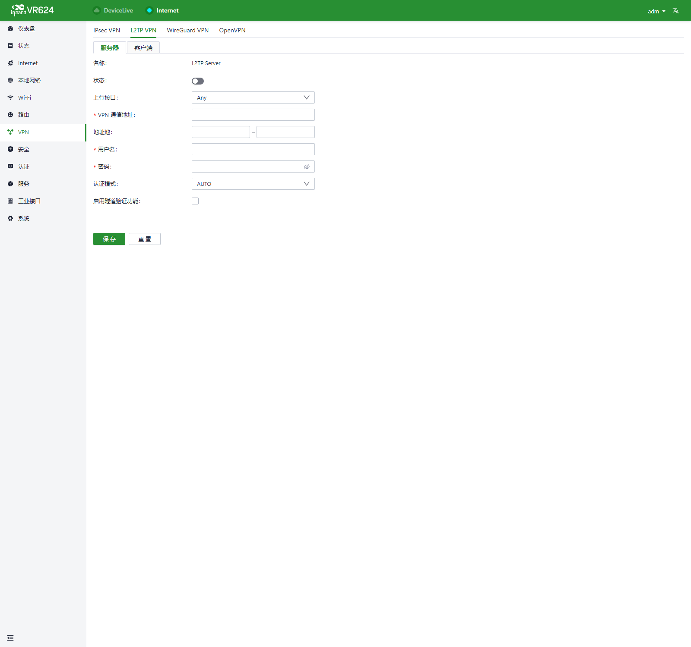

#### 6.8.3 WireGuard VPN

> **功能介绍**：基于密钥对的轻量级 VPN 隧道配置，包含隧道地址、侦听端口、对端管理与 NAT 共享选项。  
> **主要用途**：以较低的 CPU 与内存开销建立加密隧道，配置简单、建链速度快，特别适合车载弱网与移动环境。  
> **配置时机**：对建链速度和设备负载敏感，或对端已使用 WireGuard 时优先选用。

点击 **添加** 配置：

| 配置项 | 说明 |
| --- | --- |
| 状态 | 启用 / 禁用 |
| 隧道名称 | 隧道标识 |
| 隧道地址/掩码 | 本端隧道地址 |
| 共享连接（NAT） | 是否启用 NAT 共享 |
| 侦听端口 | 监听端口号 |
| 对端个数 | 允许的对端数量 |

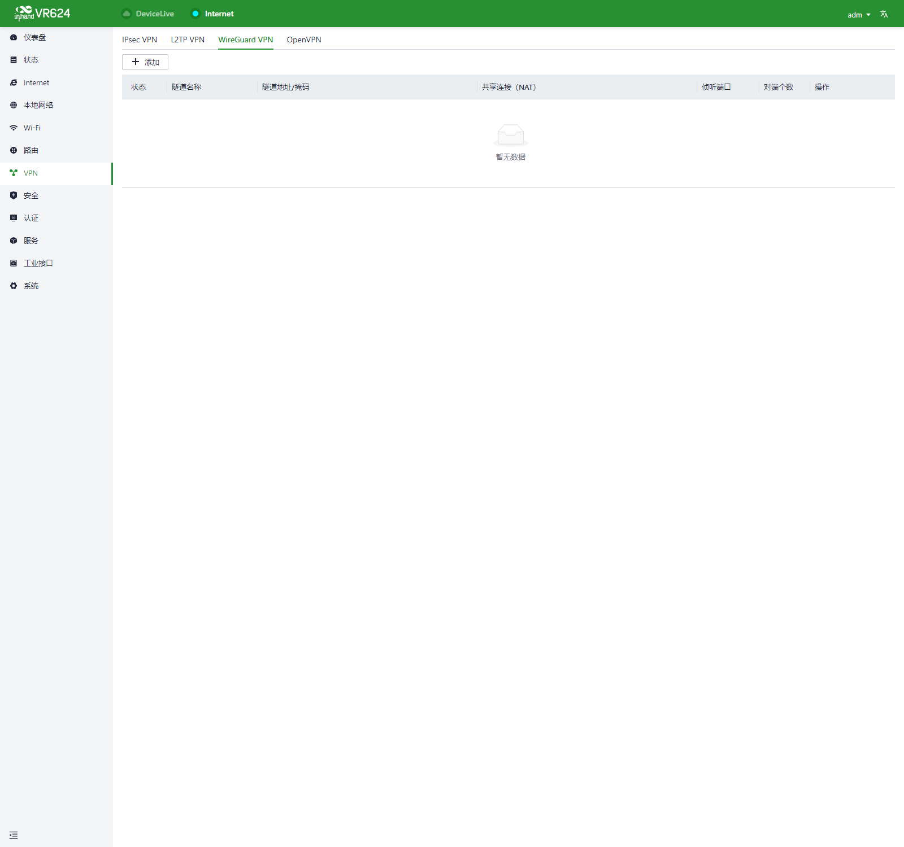

#### 6.8.4 OpenVPN

> **功能介绍**：OpenVPN 隧道配置，提供服务器与客户端两种模式，含服务端地址、端口、虚拟地址池、客户端账号与配置文件导出。  
> **主要用途**：让运维人员使用通用的 OpenVPN 客户端，从任意网络安全接入车辆内网。  
> **配置时机**：需要工程师远程登录车内设备或访问内网业务，且希望用标准 OpenVPN 客户端接入时配置。

分为 **服务器** 与 **客户端** 两个标签页。

| 配置项 | 说明 |
| --- | --- |
| 服务器名称 / 服务器地址 | 服务端标识与地址 |
| 指定上行接口 | 默认 WAN，可选自定义 |
| 端口号 / 协议类型 | 默认 UDP |
| 服务器虚拟地址/掩码长度 | 服务端隧道地址 |
| 客户端虚拟地址池 | 客户端地址分配池 |
| 更新客户端 DNS | 是否下发 DNS |
| 高级选项 | 扩展参数 |
| 客户端列表 | 用户名、密码、IP 地址/子网掩码 |
| 下载客户端配置文件 | 导出供终端使用的配置 |

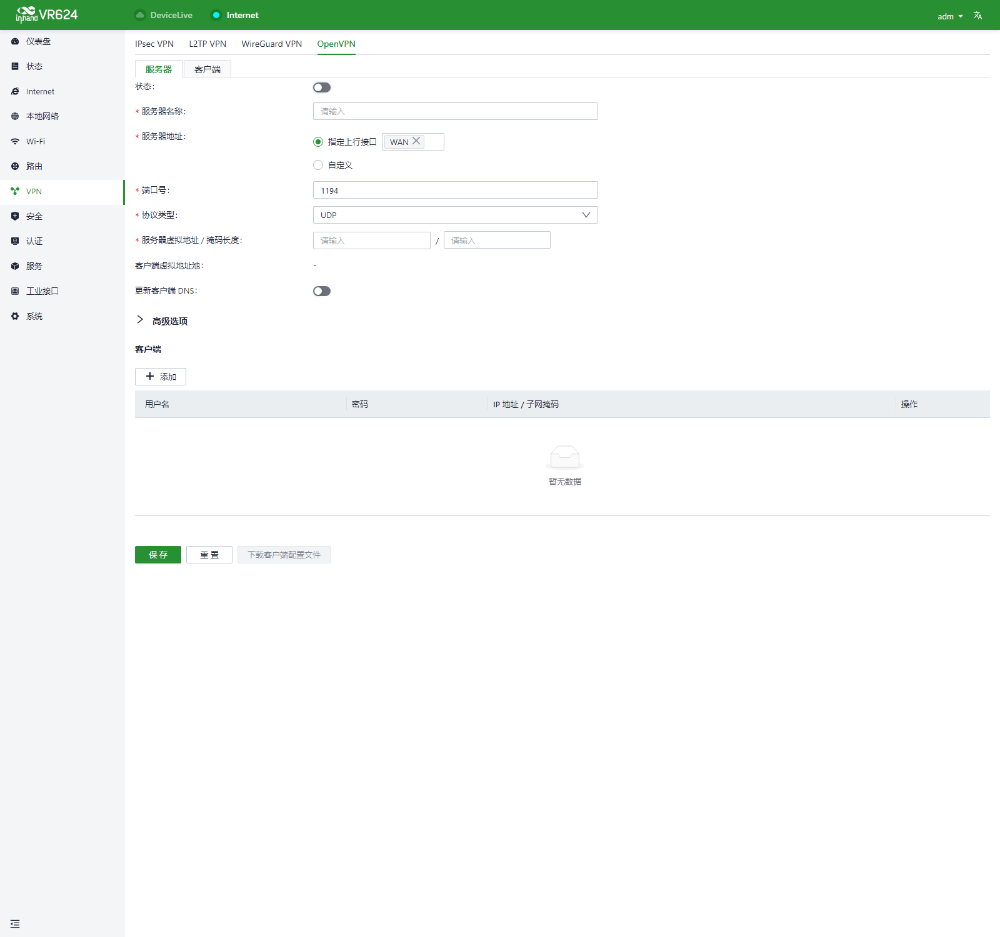

---

### 6.9 安全

> **功能介绍**：安全模块由防火墙（入站规则、出站规则、端口转发、NAT、MAC 地址过滤、域名过滤）与策略路由两部分组成。  
> **主要用途**：控制进出设备的数据流量，抵御外部访问、限制内网终端的上网范围，并按业务需求引导流量走向。  
> **配置时机**：需要对外提供服务、禁止某些设备或网站、按业务分配出口时配置；出厂默认「入站拒绝、出站允许」，已可满足基本安全需求。

**路径：安全**

安全模块包含 **防火墙**（外层）与 **策略路由** 两大标签，其中防火墙内含 6 个子标签。

#### 6.9.1 防火墙

> **功能介绍**：状态检测防火墙的六个子功能页：入站规则、出站规则、端口转发、网络地址转换（NAT）、MAC 地址过滤与域名过滤。  
> **主要用途**：放行或拦截外到内 / 内到外的流量、把公网端口映射到车内主机、限制可以上网的终端以及可访问的网站。  
> **配置时机**：需要从外网访问车内服务（NVR、业务服务器）时用端口转发；禁止某些终端上网用 MAC 过滤；限制访问特定网站用域名过滤。修改规则前请先确认对现有业务的影响。


**入站规则 / 出站规则**

| 列 | 说明 |
| --- | --- |
| 优先级 | 规则匹配顺序 |
| 名称 | 规则名称 |
| 状态 | 启用 / 禁用 |
| 接口 | 适用接口（如 All WANs） |
| 协议 | Any、TCP、UDP、ICMP 等 |
| 源 / 目的 | 源与目的地址范围 |
| 动作 | 允许 / 拒绝 |

出厂默认规则：

- **入站规则**：默认 **拒绝**（Default / All WANs / Any → Any）
- **出站规则**：默认 **允许**


**端口转发**

将公网端口映射到内网主机。

| 列 | 说明 |
| --- | --- |
| 名称 / 状态 | 规则标识与启用状态 |
| 接口 | 适用接口 |
| 公网端口 / 协议 | 对外监听端口与协议 |
| 本地地址 / 本地端口 | 内网目标主机与端口 |

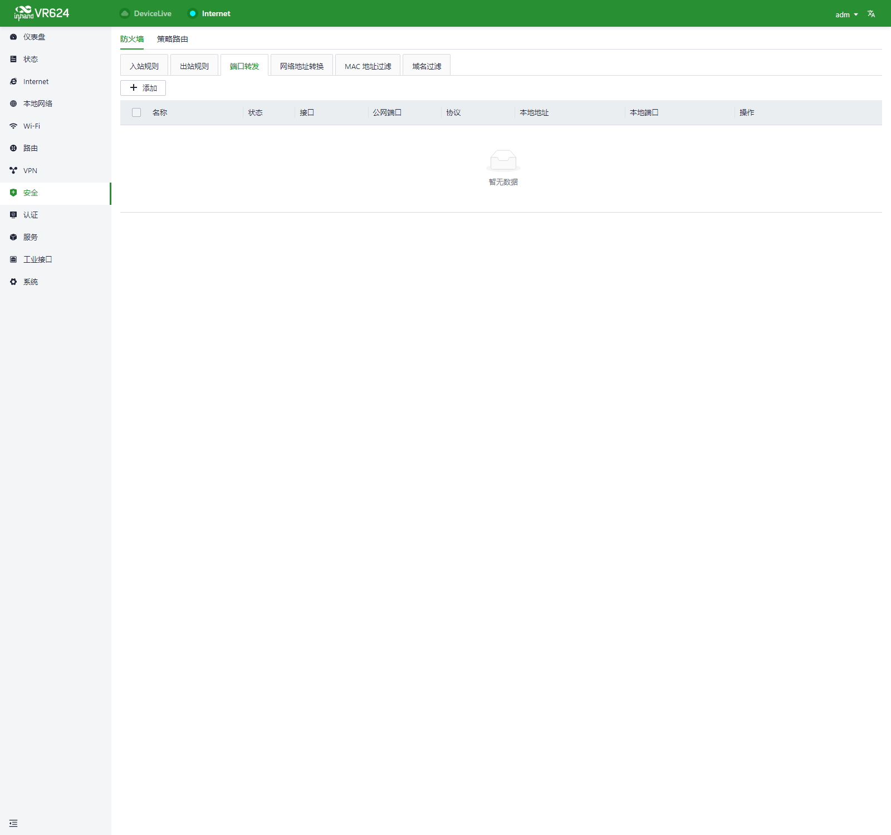

**网络地址转换（NAT）**

| 列 | 说明 |
| --- | --- |
| 名称 / 状态 / 类型 | 规则基本信息 |
| 协议 / 源 / 源端口 | 匹配条件 |
| 目的 / 目的端口 | 匹配条件 |
| 转换后地址 / 转换后端口 | 转换结果 |

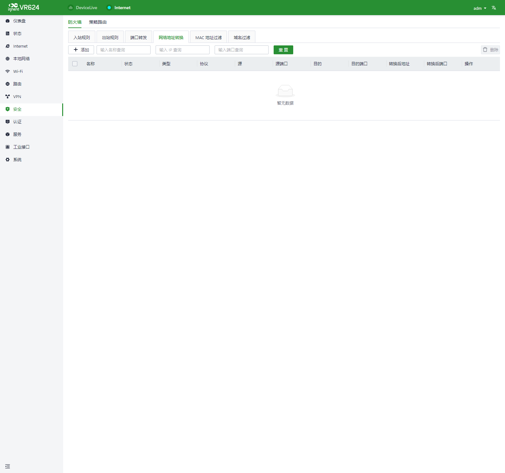

**MAC 地址过滤**

提供三种模式：**无限制 / 黑名单 / 白名单**，可添加 MAC 地址、状态与描述。


**域名过滤**

提供三种模式：**无限制 / 黑名单 / 白名单**，可添加域名与描述。

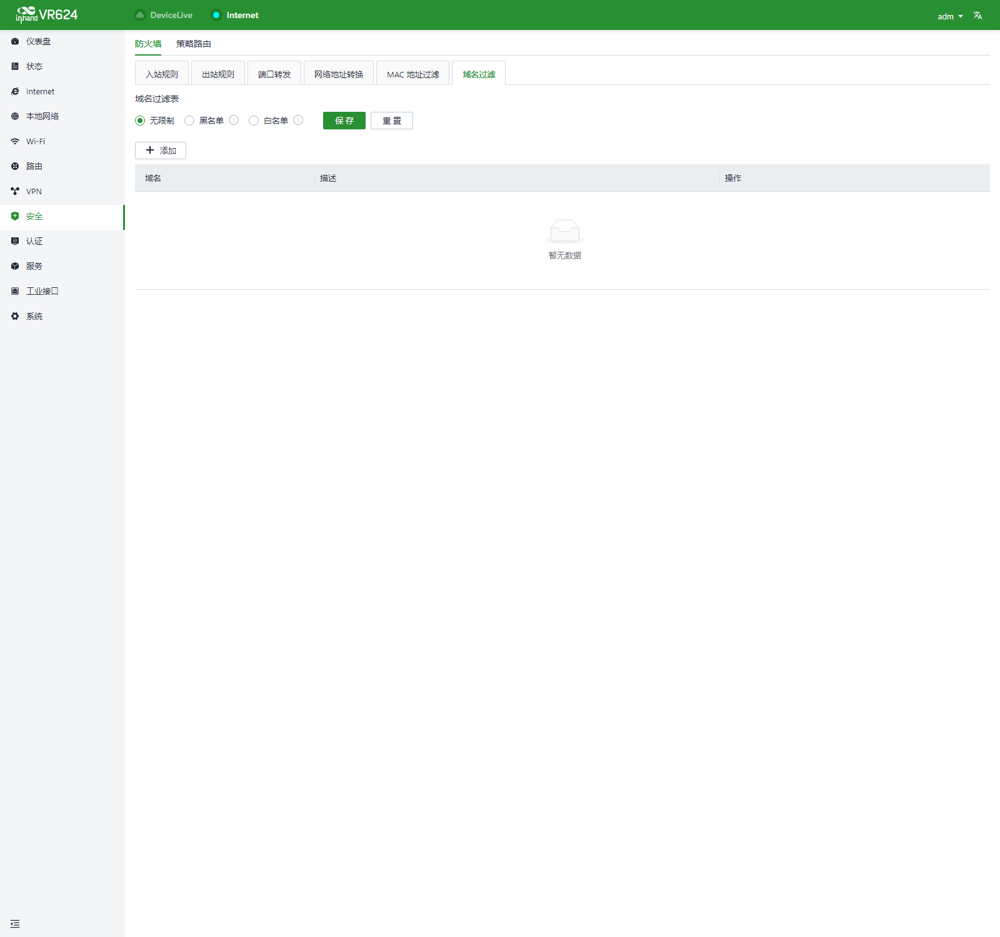

**添加规则示例**

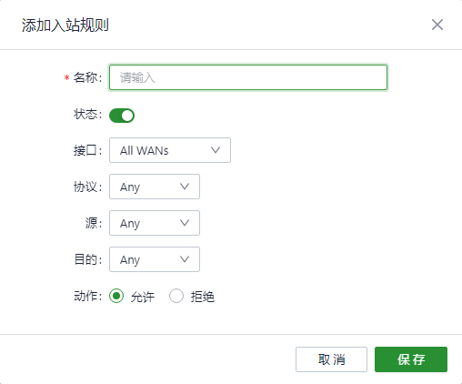

#### 6.9.2 策略路由

> **功能介绍**：按源 / 目的地址、协议等条件匹配流量，并指定其出接口，可设置是否强制转发。  
> **主要用途**：让特定业务（如视频回传、售票数据）固定走某条链路，实现业务分流与带宽的合理规划。  
> **配置时机**：多链路部署中需要按业务分配出口，或某类流量必须走指定线路（如视频走大流量卡）时配置。

| 列 | 说明 |
| --- | --- |
| 优先级 / 名称 / 状态 | 规则基本信息 |
| 协议 | 匹配协议 |
| 源 / 目的 | 匹配地址范围 |
| 出口 | 指定出接口 |
| 强制转发 | 是否强制按策略转发 |


---

### 6.10 认证（802.1X）

> **功能介绍**：有线端口的 802.1X 认证配置，使设备作为客户端向 RADIUS 服务器发起接入认证。  
> **主要用途**：只有通过认证的设备才能接入上级网络，防止私接设备或未授权终端进入企业网。  
> **配置时机**：接入的交换机或园区网要求 802.1X 认证时配置；服务器地址、端口与共享密钥需向网络管理员获取。

**路径：认证**

配置有线 802.1X 端口认证。

| 配置项 | 说明 |
| --- | --- |
| 开启802.1X | 启用/关闭 802.1X |
| 端口 | 适用端口（默认「所有」） |
| 服务器 | 认证服务器地址 |
| 认证端口 / 计费端口 | RADIUS 服务端口 |
| 密钥 | 共享密钥 |

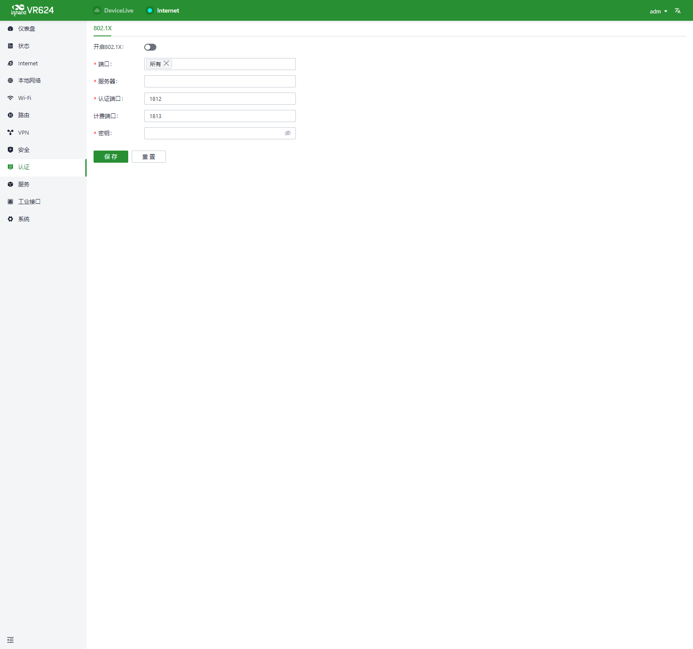

---

### 6.11 服务

> **功能介绍**：服务模块汇集设备的各类后台服务，包括接口管理、DHCP、DNS、固定地址、DDNS、短信控制、AT 服务、GNSS、SNMP、电源管理、环路检测与 IGMP Snooping。  
> **主要用途**：按需启用和调整这些通用服务，支撑地址分配、网络管理、定位输出与车载电源策略等能力。  
> **配置时机**：默认配置通常可直接使用；需要启用某项服务（如 SNMP 网管、DDNS、短信控制）或调整其参数时，展开对应面板配置。

**路径：服务**

服务模块以折叠面板形式组织，点击面板标题展开配置。

#### 6.11.1 接口管理

> **功能介绍**：管理 LAN2 / LAN3 / LAN4 物理端口的启用状态、绑定的本地网络与链路速率。  
> **主要用途**：控制每个网口是否可用、归属哪个网段，必要时固定协商速率，便于隔离故障端口。  
> **配置时机**：需要禁用未使用的网口、把某网口划入其他网段，或排查端口协商异常时配置。

管理 LAN2 / LAN3 / LAN4 端口的状态、绑定网络与链路速率。

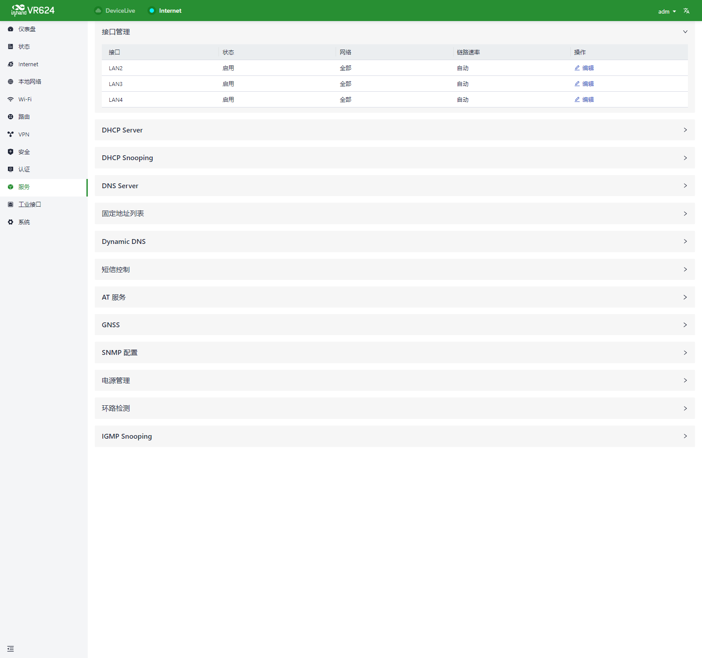

#### 6.11.2 DHCP Server

> **功能介绍**：DHCP 服务器配置页，为各本地网络内的终端自动分配 IP 地址，可设置地址池、租期与下发的 DNS。  
> **主要用途**：让接入的终端无需手工设置即可获得 IP 并上网，是局域网正常工作的基础服务。  
> **配置时机**：默认已在 Default 网络启用；新增本地网络、需要扩大地址池、调整租期或指定下发 DNS 时配置。

| 列 | 说明 |
| --- | --- |
| 网络 | 所属本地网络 |
| 状态 | 启用 / 禁用 |
| DHCP 地址范围 | 地址池 |
| 租期 | 租约时长（如 1 天） |
| DNS | 下发的 DNS |

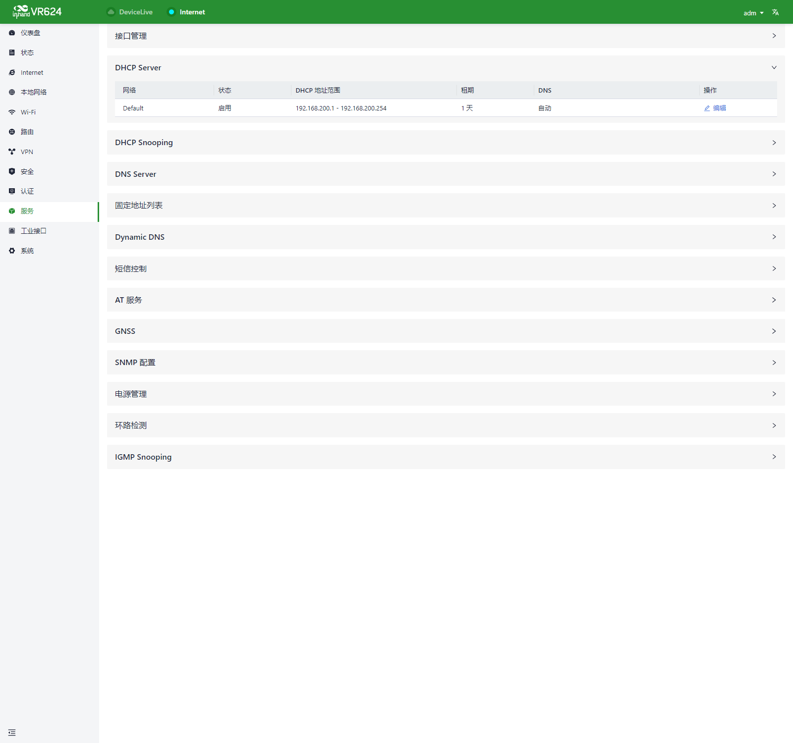

#### 6.11.3 DHCP Snooping

> **功能介绍**：DHCP Snooping 安全功能开关，启用后只信任指定端口的 DHCP 应答，丢弃其他端口的非法响应。  
> **主要用途**：防范车内私接路由器或伪 DHCP 服务器发放错误地址，避免终端获取异常 IP 而无法上网。  
> **配置时机**：车内终端较多、存在私接设备风险时建议启用；出现「部分终端拿到陌生网段 IP」时排查使用。

启用后可防范非法 DHCP 服务器。

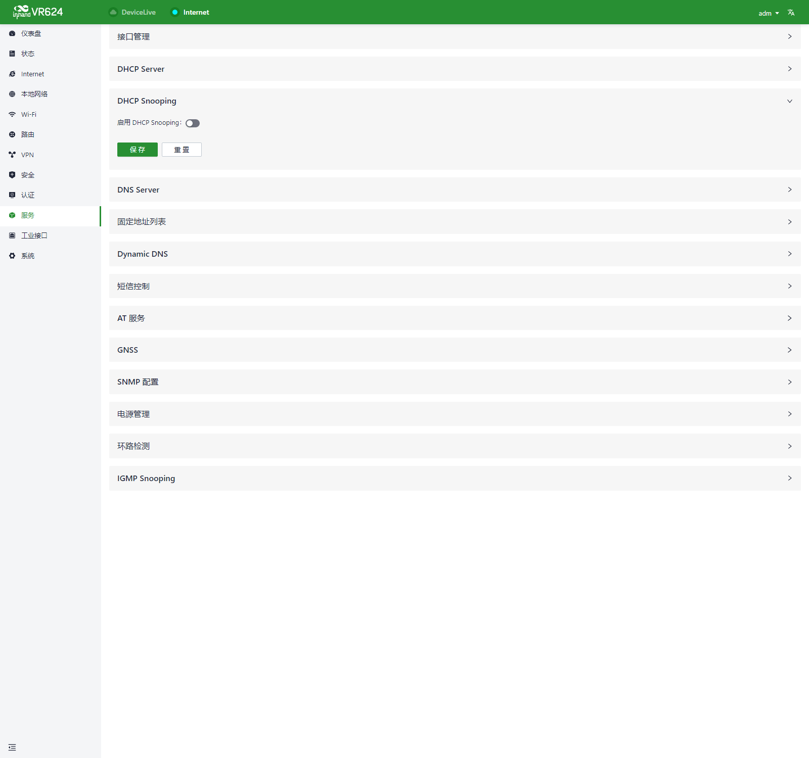

#### 6.11.4 DNS Server

> **功能介绍**：全局 DNS 服务器配置页，设置 DNS Server1 与 DNS Server2。  
> **主要用途**：指定设备的域名解析出口，可替换运营商 DNS 以提升解析速度、避免劫持，或与企业内网 DNS 保持一致。  
> **配置时机**：默认使用上行链路下发的 DNS；出现解析慢、解析结果异常，或需要统一指定公司 DNS 时配置。

配置 DNS Server1 / DNS Server2。

> **说明**：此处 DNS Server 全局生效，但不会影响原上行接口的链路探测和切换逻辑。

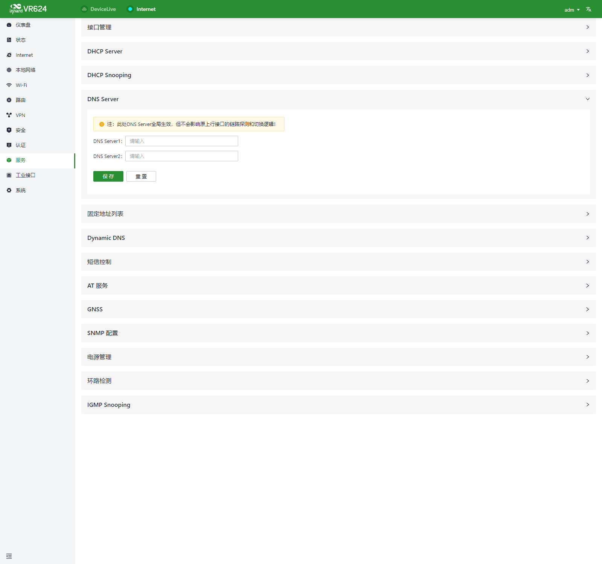

#### 6.11.5 固定地址列表

> **功能介绍**：按 MAC 地址为指定终端保留固定 IP 地址（地址保留 / 静态绑定）。  
> **主要用途**：保证摄像头、工控机、售票机等重要设备的 IP 始终不变，便于端口转发、IP 白名单与业务系统对接。  
> **配置时机**：需要对某台设备做端口映射、IP 白名单或固定地址访问时添加；可在 **状态 → 客户端** 中查到其 MAC。

为指定 MAC 地址保留固定 IP，列表包含网络、MAC 地址、IP 地址与客户端名称。

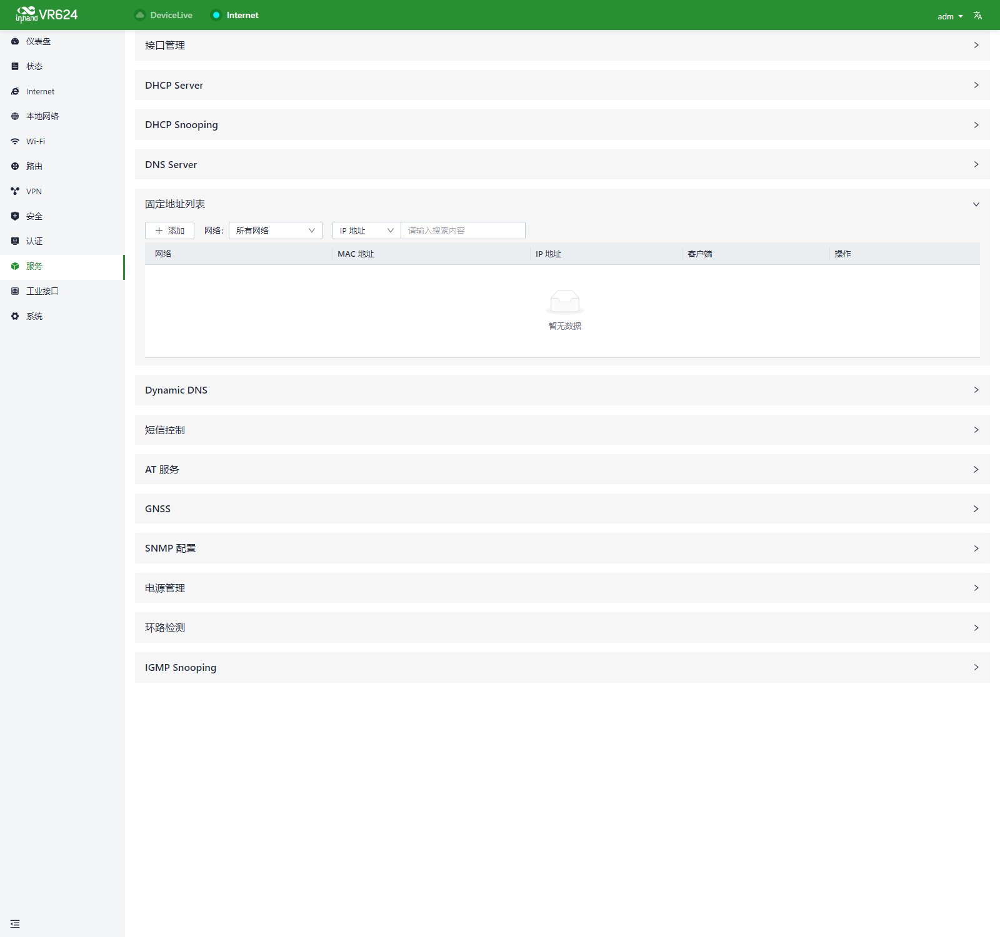

#### 6.11.6 Dynamic DNS

> **功能介绍**：动态域名解析（DDNS）配置页，将设备变化的公网 IP 自动绑定到固定域名，可指定服务商、账号与更新间隔。  
> **主要用途**：公网 IP 变化后仍可通过固定域名访问车辆，免去记录与更换 IP 的麻烦。  
> **配置时机**：需要从外网通过域名访问车辆，且上行链路为动态获取 IP（5G / 4G 蜂窝、家用宽带）时配置。

| 配置项 | 说明 |
| --- | --- |
| 服务提供商 | DDNS 厂商 |
| 域名 / 用户名 / 密码 | 账号信息 |
| URL 地址 | 更新接口地址 |
| 更新间隔（分钟） | 刷新周期 |
| 上行接口 | 使用的出接口 |

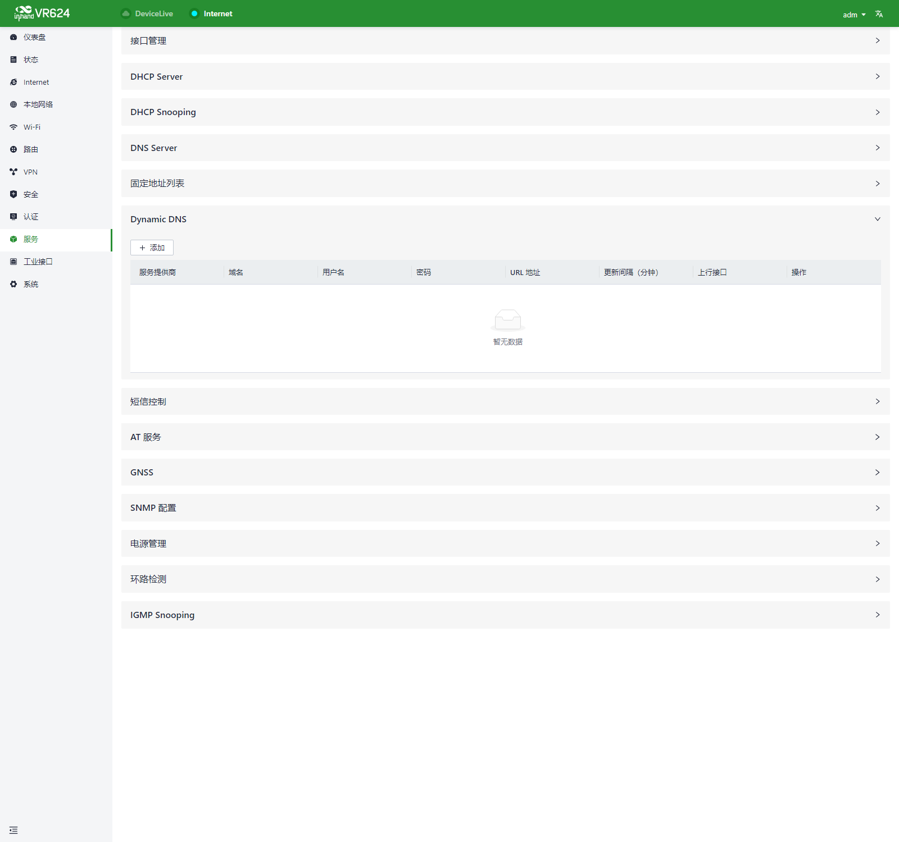

#### 6.11.7 短信控制

> **功能介绍**：短信控制功能，通过预设的短信内容触发设备动作，并可限定允许发送的手机号码。  
> **主要用途**：在设备无法上网或不便登录 Web 界面时，用手机短信远程查询状态、切换链路或执行其他指令。  
> **配置时机**：需要无网络的远程运维手段，或希望把短信作为网络中断时的兜底控制方式时配置。

通过短信触发设备动作，列表包含状态、短信内容、动作、认证方式与发信者手机号码。

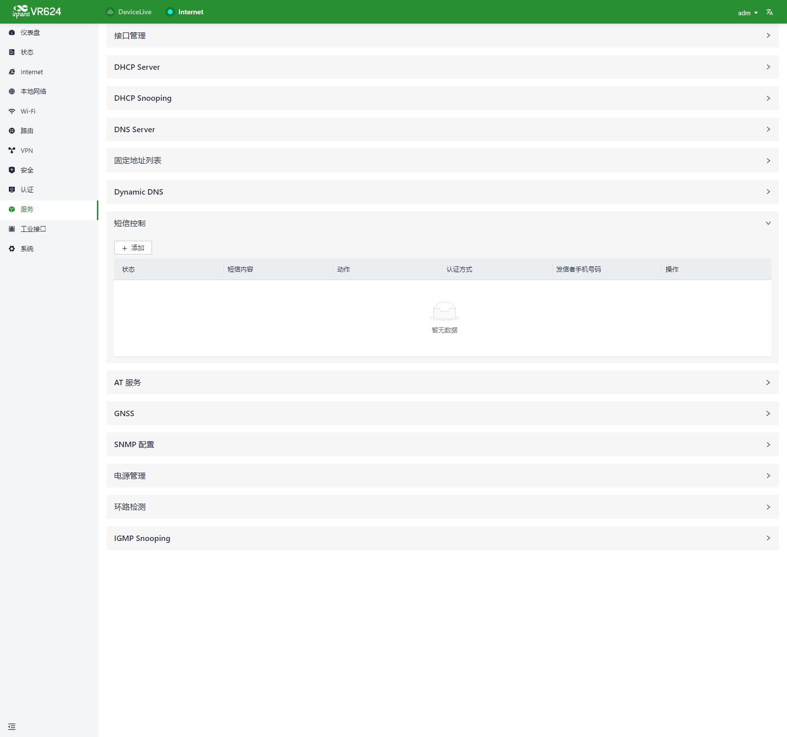

#### 6.11.8 AT 服务

> **功能介绍**：AT 指令服务器，允许通过 TCP 网络通道远程向蜂窝模组下发 AT 指令，可设置协议、侦听端口与空闲超时。  
> **主要用途**：远程读取或设置 5G 模组参数、执行运营商网络调试，无需到现场接串口线。  
> **配置时机**：需要远程诊断通信模组、配合运营商做网络参数调测时启用；日常使用无需开启，注意启用后应限制访问来源。

**路径：服务 → AT 服务**（独立页面）

配置 AT 指令服务器，用于通过网络通道下发 AT 指令。

| 配置项 | 说明 |
| --- | --- |
| 状态 | 启用 / 禁用 |
| 协议 | 默认 TCP |
| 侦听端口 | 服务端口 |
| 通道空闲时间 | 空闲超时（秒） |


#### 6.11.9 GNSS

> **功能介绍**：GNSS 定位服务配置页，包含基础参数、NMEA 数据的网络转发、定位状态开关、卫星时间同步与调试模式。  
> **主要用途**：把车辆位置（经纬度、速度、时间）提供给车载终端或调度平台，并可用卫星时间校准系统时钟。  
> **配置时机**：需要向第三方平台输出定位数据（IP 转发）、需要高精度时间同步时配置；仅在 **状态 → GNSS** 查看位置则无需改动本页。

**路径：服务 → GNSS**（独立页面）

| 配置项 | 说明 |
| --- | --- |
| 基础设置 | GNSS 基础参数 |
| GNSS IP 转发 | 通过网络转发 NMEA 数据 |
| GNSS 状态 | 定位状态开关 |
| 更新设备时间 | 使用卫星时间同步系统时钟 |
| Debug 模式 | 调试信息输出 |


#### 6.11.10 SNMP 配置

> **功能介绍**：SNMP 网管协议配置页，支持 SNMP V1&V2c 与 V3，可导出 MIB 文件供网管系统加载。  
> **主要用途**：让企业网管平台（NMS）统一采集设备状态、流量与告警，把路由器纳入现有监控体系。  
> **配置时机**：客户已有 SNMP 网管系统、需要集中监控车载设备时配置；团体名 / 用户名与密钥需按网管平台要求设置，建议使用 V3。

支持 SNMP V1&V2c 与 SNMP V3，并可 **导出 MIB 文件** 用于网管系统对接。

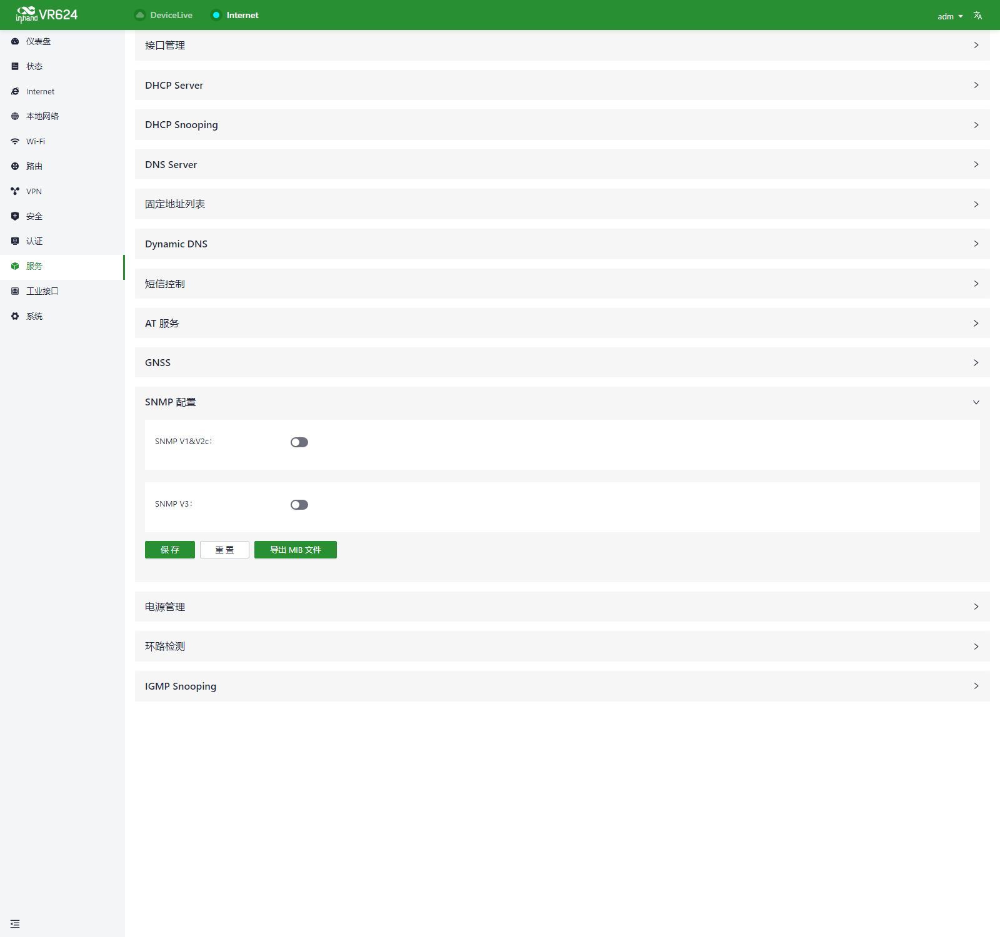

#### 6.11.11 电源管理

> **功能介绍**：面向车载供电环境的电源策略配置，包括休眠电压、工作电压阈值、低压关机延时、点火信号关机延时与 ITxPT 选项。  
> **主要用途**：实现「点火自动开机、熄火延时关机」，并在电瓶电压过低时及时关机，防止车辆因亏电无法启动。  
> **配置时机**：设备接入车辆电瓶供电时**必须配置**；阈值与延时需根据车辆电瓶电压、用电负载与运维需求设定。

针对车载电源环境的专项配置：

| 配置项 | 说明 |
| --- | --- |
| 休眠电压 | 低于该电压进入休眠 |
| 工作电压 | 正常工作电压阈值 |
| 低电压关闭延时 | 低压持续多久后关机（秒） |
| 点火信号关闭延时 | 点火信号消失后延时关机（秒） |
| ITxPT | ITxPT 相关配置 |

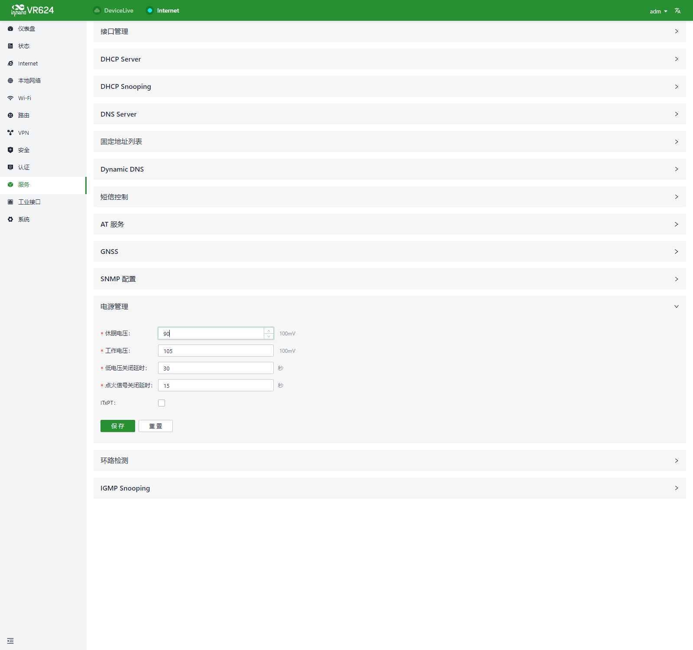

#### 6.11.12 环路检测

> **功能介绍**：二层环路检测功能，启用后持续监测网络环路，发现时自动阻断相关端口。  
> **主要用途**：避免环路引发广播风暴导致全网瘫痪、无线卡顿等严重问题。  
> **配置时机**：车内存在多台交换机、布线可能形成环路，或网络出现异常卡顿、CPU 高占用时启用。

启用后可检测并阻断二层环路，避免广播风暴。


#### 6.11.13 IGMP Snooping

> **功能介绍**：组播侦听功能，通过监听组播成员关系，只把组播数据转发给需要的端口。  
> **主要用途**：优化视频监控等组播业务的转发，减少不必要的广播，节省有线与无线带宽。  
> **配置时机**：车内使用组播类业务（部分监控、信息发布）并出现组播泛洪、带宽异常时启用。

启用后可优化组播流量转发，减少不必要的广播。


---

### 6.12 工业接口

> **功能介绍**：数字量输入（DI）通道的参数配置页，可设置输入通道的上拉使能等电气属性。  
> **主要用途**：使设备正确采集点火信号、低电量告警等外部开关量，为电源管理与告警联动提供输入。  
> **配置时机**：接入开关量信号后出现电平误判、读数不稳定时，按实际接线方式调整；实时电平在 **状态 → I/O** 查看。

**路径：工业接口**

配置数字量输入通道参数。

| 配置项 | 说明 |
| --- | --- |
| DI1 Pull-up | 数字量输入 1 的上拉使能 |

实时电平状态可在 **状态 → I/O** 中查看。


---

### 6.13 系统

> **功能介绍**：系统模块集中管理设备的全局设置，包括云管理、访问控制、国家与时钟、固件升级、配置备份、计划重启、日志服务器、账号、告警与诊断工具。  
> **主要用途**：完成设备的初始化设置、安全加固与日常维护，是部署和运维阶段都会用到的模块。  
> **配置时机**：设备首次上线时一次性完成基础设置（改密码、校时、访问控制、告警），此后按需进入维护（备份、升级）。

**路径：系统**

#### 6.13.1 云管理

> **功能介绍**：设备接入 DeviceLive 云平台的开关与参数设置，包含云服务器地址、连云接口、MQTT 心跳时间与日志上报。  
> **主要用途**：实现车队集中监控、远程诊断、批量配置与 OTA 升级，免去逐台到现场维护。  
> **配置时机**：使用云平台统一管理车队时配置（接入步骤见第 7 章）；单台本地使用、无集中管理需求时可不启用。

| 配置项 | 说明 |
| --- | --- |
| 启用云服务 | 开启/关闭云平台接入 |
| 云服务器 | 如 DeviceLive 中国（device.inhandcloud.cn） |
| 连云平台的接口 | 使用「任意」或指定接口 |
| MQTT心跳时间 | 心跳间隔（秒） |
| 日志上报 | 是否向平台上报日志 |

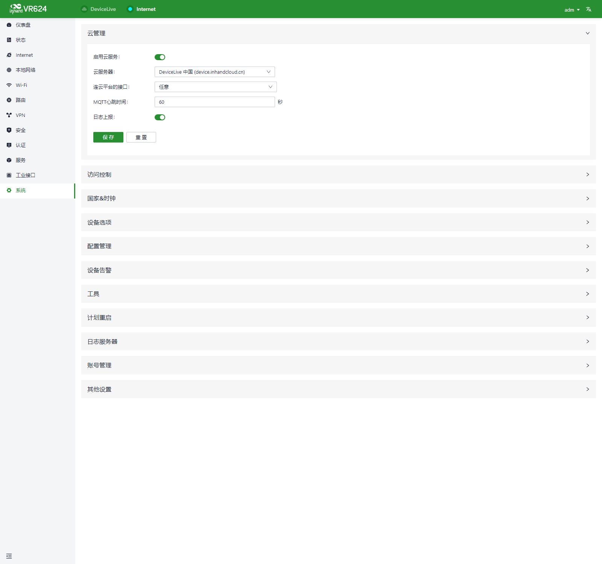

#### 6.13.2 访问控制

> **功能介绍**：分别配置 HTTPS、SSH、Telnet、PING 服务的本地 / 远程访问权限、端口与允许的来源地址。  
> **主要用途**：限制谁可以登录和探测设备，收敛暴露面，降低被远程扫描与攻击的风险。  
> **配置时机**：设备上线前的安全加固必做项；建议关闭 Telnet 与远程 PING，并把访问源地址限制在运维网段内。

分别配置 HTTPS、SSH、Telnet、PING 的本地/远程访问权限：

| 配置项 | 说明 |
| --- | --- |
| 本地 / 远程 | 是否允许本端或远端发起 |
| 本地端口 / 远程访问端口 | 服务端口 |
| 访问源地址 | 允许访问的来源网段 |

> **安全建议**：非必要请关闭 Telnet 与远程 PING，并限制访问源地址范围。

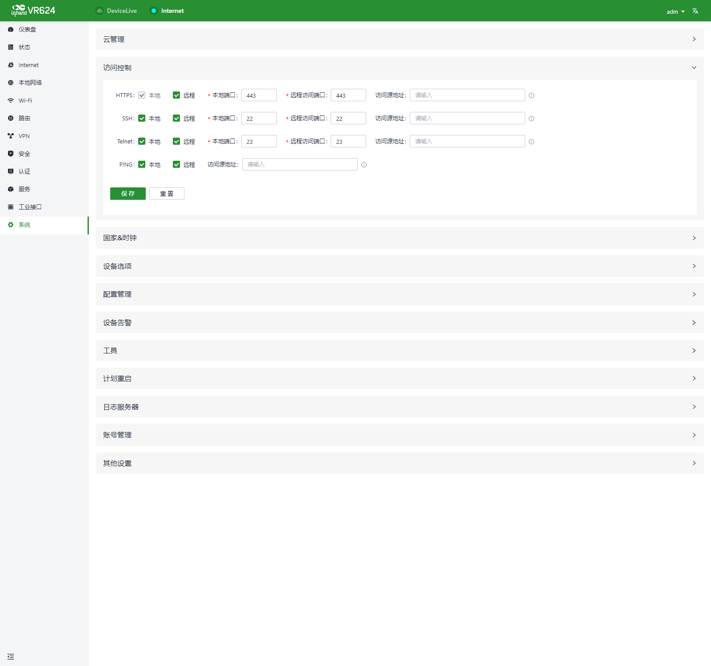

#### 6.13.3 国家 & 时钟

> **功能介绍**：设置设备所在国家 / 地区、系统时区与 NTP 时间同步服务器。  
> **主要用途**：使 Wi-Fi 信道与发射功率符合当地无线电法规，并保证日志、事件的时间准确可追溯。  
> **配置时机**：设备首次部署时设置，国家 / 地区必须与实际部署地一致；日志时间不准或跨时区部署时调整。

| 配置项 | 说明 |
| --- | --- |
| 所在国家 | 影响射频信道与功率合规性 |
| 时区 | 系统时区 |
| NTP Server1 / NTP Server2 | 时间同步服务器及端口号 |

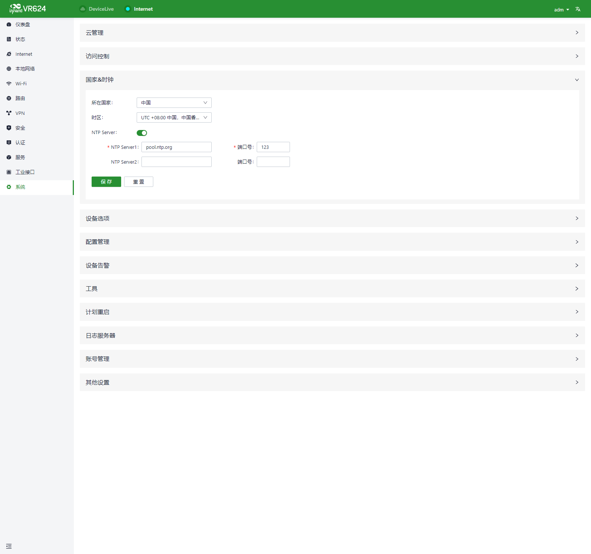

#### 6.13.4 设备选项

> **功能介绍**：执行设备级操作的页面，包括重启、Web 系统固件升级、5G 模组固件升级、电源板固件升级与恢复出厂设置。  
> **主要用途**：通过升级获取新功能与缺陷修复，或在设备严重异常时彻底重置。  
> **配置时机**：官方发布新固件、功能异常需升级修复、设备需重置时使用；**操作前务必先在「配置管理」中导出配置备份**，并保证升级过程中不断电。

| 操作 | 说明 |
| --- | --- |
| 重启路由器 | 重新启动设备 |
| 升级路由器固件版本 | 升级 Web 系统固件（支持差分文件升级） |
| 升级模组固件版本 | 升级 5G 模组固件 |
| 升级电源板固件版本 | 升级电源板固件 |
| 路由器恢复出厂设置 | 清除所有配置并恢复默认 |

> ⚠️ **注意**：升级与恢复出厂前，请先在「配置管理」中导出配置备份。

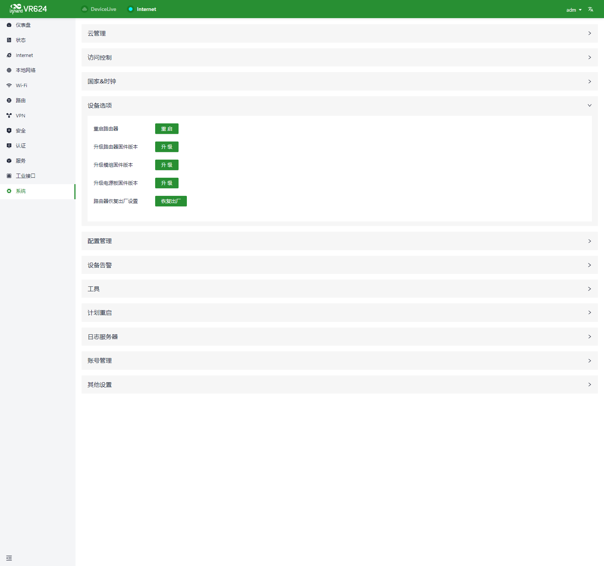

#### 6.13.5 配置管理

> **功能介绍**：配置文件的导出（本地备份）与导入（备份恢复）功能。  
> **主要用途**：保存可复用的配置模板，在设备更换、故障恢复时快速还原，也可作为变更前的回退点。  
> **配置时机**：每次重要配置变更前后、每月例行备份，以及批量部署前制作标准模板时使用。

| 操作 | 说明 |
| --- | --- |
| 本地备份 → 导出 | 导出当前配置文件 |
| 备份恢复 → 导入 | 导入配置文件恢复设置 |

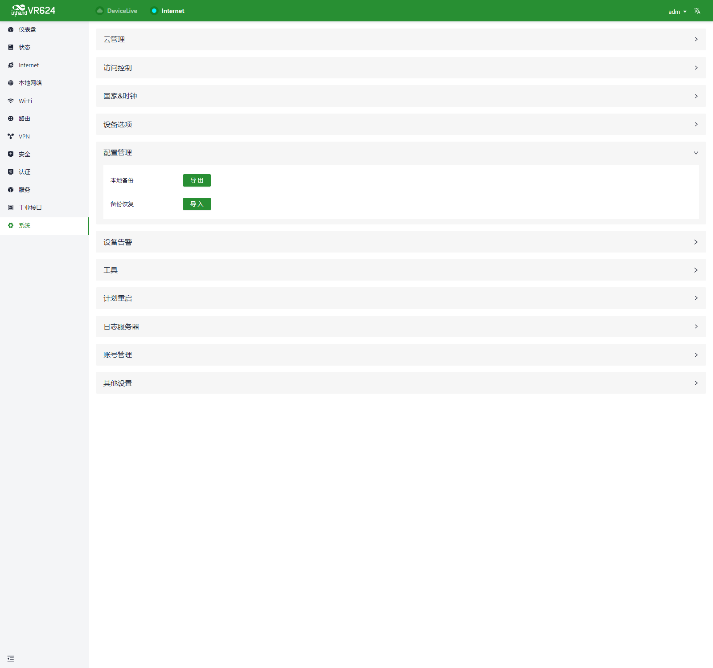

#### 6.13.6 计划重启

> **功能介绍**：设置设备按计划自动重启的时间规则（默认为「从不」）。  
> **主要用途**：长期无人值守运行后自动清理内存、释放残留连接，提升设备的长期稳定性。  
> **配置时机**：设备常年不重启且偶发卡顿、响应缓慢时设置；重启时间请避开业务高峰（建议安排在夜间低峰时段）。

设置设备定时重启计划（默认「从不」），用于长期运行后的自动维护。

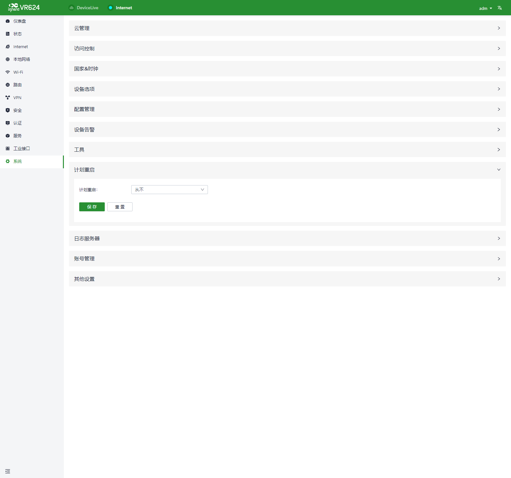

#### 6.13.7 日志服务器

> **功能介绍**：远程日志（syslog）配置页，启用后把设备日志实时发送到指定的日志服务器，支持两台地址与端口。  
> **主要用途**：集中留存日志，即使设备丢失或损坏仍可追溯历史记录，便于审计与批量分析。  
> **配置时机**：客户建有统一日志中心或有安全审计要求时配置；单机使用可不启用，本地查看日志即可。

启用后可将日志发送至远程 syslog 服务器，支持服务器地址 1 / 2 及端口号配置。

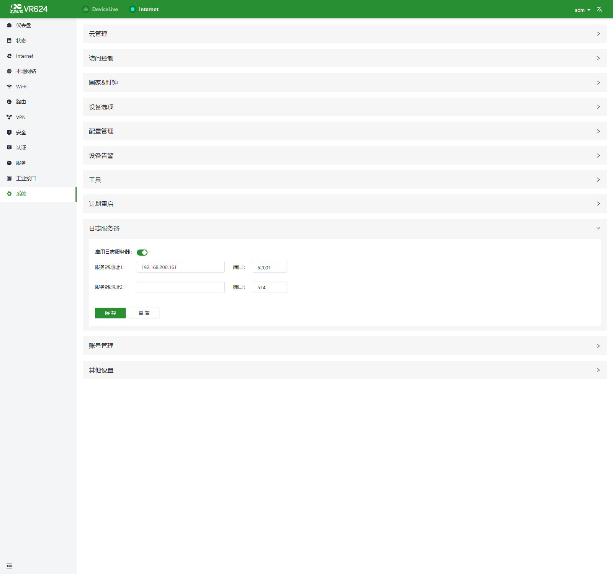

#### 6.13.8 账号管理

> **功能介绍**：管理账号的密码修改页面。  
> **主要用途**：更换出厂默认密码，防止他人使用公开的默认口令登录并篡改设备配置。  
> **配置时机**：**首次登录后建议立即修改默认密码**，之后定期更换；人员交接时也应同步修改。

修改管理账号密码：

| 配置项 | 说明 |
| --- | --- |
| 用户名 | 当前账号 |
| 新密码 / 确认密码 | 设置新密码 |


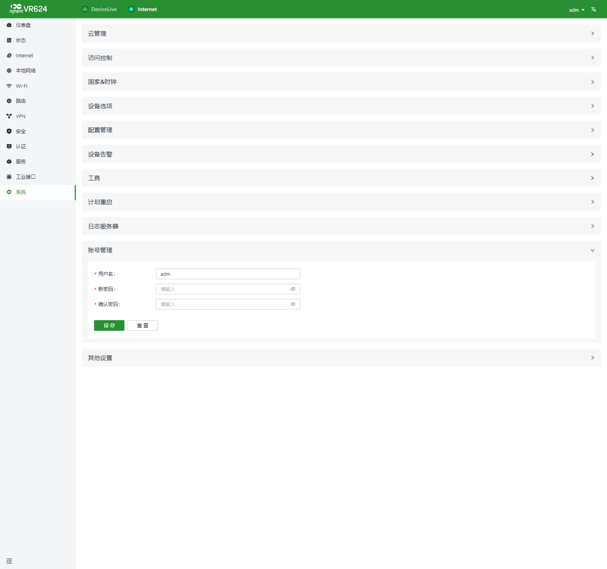

#### 6.13.9 其他设置

> **功能介绍**：杂项设置页，包含 Web 登录超时自动退出、自动重启开关与 SIP ALG（语音业务应用层网关）。  
> **主要用途**：提升管理界面的会话安全，并兼容特定业务（如 VoIP 语音）的穿透需求。  
> **配置时机**：默认值一般可直接使用；需要缩短登录会话超时、开启自动重启，或语音业务建立异常时调整。

| 配置项 | 说明 |
| --- | --- |
| Web 登录管理 | 无操作若干分钟后自动退出 |
| 自动重启 | 定时自动重启开关 |
| SIP ALG | SIP 应用层网关（语音业务穿透） |

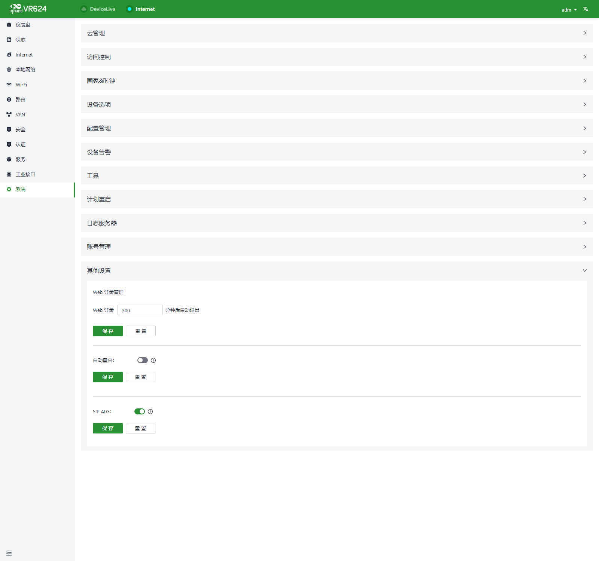

#### 6.13.10 设备告警

> **功能介绍**：告警配置页，选择需要邮件通知的事件（链路切换、探测状态变化、CPU/内存过高、登录、VPN 状态等），并配置邮件发送服务器与收件人。  
> **主要用途**：设备异常时第一时间主动通知运维人员，把「事后被动发现」变成「事前/事中主动告警」。  
> **配置时机**：**设备上线时建议必配**；至少勾选「上行链路切换」「探测状态变化」，并点击「发送测试邮件到」验证通道可用。

**路径：系统 → 设备告警**（独立页面）

**告警设置（邮件接收）**，可勾选的告警事件包括：

- 用户登录成功 / 用户登录失败
- 配置变化
- 最近 5 分钟 CPU 利用率过高（阈值默认 70%）
- 最近 5 分钟内存利用率过高（阈值默认 70%）
- 蜂窝流量到达阈值
- 探测状态变化
- VPN 状态变化
- 客户端状态变化
- 上行链路状态变化 / 上行链路切换 / WAN-LAN1 切换
- 环路检测
- 运营商切换
- 重启 / 升级

**邮件接收设置**：发件服务器地址与端口、用户名、密码、TLS、接收邮件地址，并支持发送测试邮件。

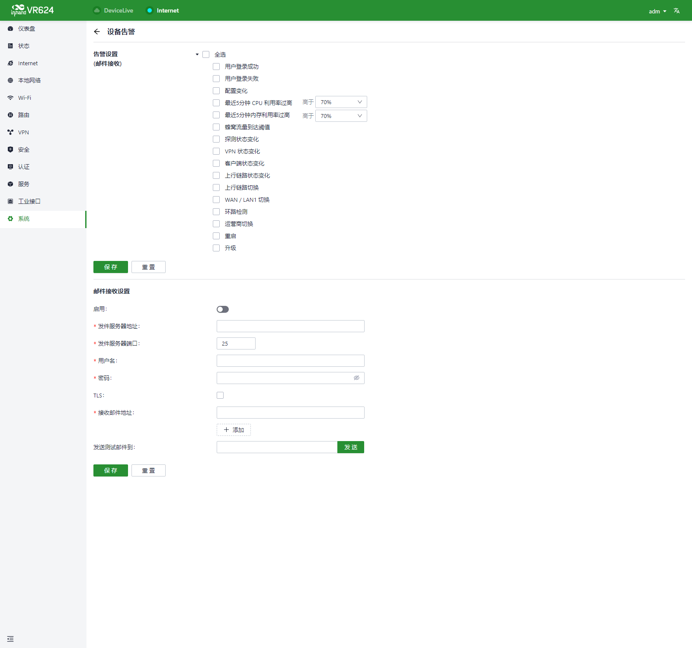

#### 6.13.11 工具

> **功能介绍**：内置的网络诊断工具集，包含 Ping、Traceroute、抓包与 Iperf 四类工具。  
> **主要用途**：在现场直接验证连通性、定位丢包节点、抓取报文分析协议问题、测试链路带宽，无需外接电脑工具。  
> **配置时机**：无需配置，随时可用；现场排查网络故障、录制问题证据提交技术支持时使用。

**路径：系统 → 工具**

| 工具 | 用途 | 主要参数 |
| --- | --- | --- |
| Ping | 网络连通性测试 | 目标、接口、源地址、包大小、包个数、输出 |
| Traceroute | 路由跟踪 | 目标、接口 |
| 抓包 | 网络数据分析 | 输出、导出、接口、过滤表达式、时长 |
| Iperf | 网络性能测试 | 界面内置使用指南 |

**抓包过滤表达式示例**：

```text
host 1.1.1.1                                  # 主机地址 1.1.1.1 的数据包
host 1.1.1.1 and port 53                      # 1.1.1.1 且 TCP/UDP 端口为 53
icmp[icmptype] != icmp-echo and icmp[icmptype] != icmp-echoreply   # 非 Echo 请求/回复的 ICMP
```

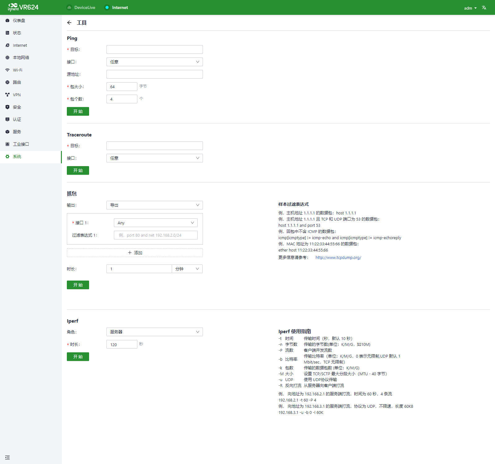

---

## 7. 云管理与 DeviceLive 平台

VR624 可接入 **DeviceLive** IoT 设备管理平台（`https://device.inhandcloud.cn/`），实现对大规模车队路由器的集中管理。

### 7.1 云管理功能

| 功能 | 描述 |
| --- | --- |
| 实时监控 | 实时设备状态、信号强度、数据使用情况可视化 |
| 远程诊断 | 无需现场接入即可进行远程故障排查 |
| 批量管理 | 同时配置多台设备 |
| 车队监控 | 从单一仪表板跟踪整个车队 |
| 远程维护 | 通过远程配置和故障排查减少现场维护 |
| OTA 更新 | 空中固件和配置更新 |
| 告警管理 | 关键事件即时通知 |
| 位置跟踪 | 实时车辆定位和路线跟踪 |

### 7.2 接入步骤

1. 在 DeviceLive 平台注册账号并添加设备；
2. 登录路由器 Web 界面，进入 **系统 → 云管理**；
3. 打开 **启用云服务**，选择云服务器（如 DeviceLive 中国）；
4. 选择 **连云平台的接口**（默认「任意」）；
5. 按需配置 MQTT 心跳时间与日志上报
6. 点击 **保存**。

---

## 8. 典型配置流程

### 8.1 车辆首次上线检查清单

- [ ] 天线已全部连接并紧固（蜂窝 / Wi-Fi / GNSS）
- [ ] SIM 卡已正确插入（双卡场景确认主备卡槽）
- [ ] 电源电压在 9–48 V 范围内，接地端子已连接
- [ ] 设备已上电，系统指示灯正常
- [ ] 能够访问 https://192.168.200.1/ 并成功登录
- [ ] **Internet** 页面中上行链路状态为已启用
- [ ] **状态 → 链路监控** 中延迟、丢包正常
- [ ] **状态 → GNSS** 中能获取到有效定位
- [ ] Wi-Fi SSID 已启用且密码可用
- [ ] 已修改默认密码

### 8.2 配置双 SIM 自动切换

1. 插入两张 Nano-SIM 卡
2. 进入 **Internet**，确认 `Cellular` 上行链路状态
3. 在链路备份设置中选择故障切换模式：
   - **立即切换**：主链路故障即刻切换
   - **负载均衡**：多链路分担负载
4. 结合链路探测阈值（延迟 / 抖动 / 丢包 / 信号强度）触发切换

### 8.3 配置远程接入（VPN）

以 IPsec 为例：

1. 进入 **VPN → IPsec VPN → 添加**
2. 填写名称、上行接口、对端地址
3. 选择 IKE 版本与协商模式，设置预共享密钥
4. 填写本地子网与对端子网
5. 配置 IKE 策略与 IPsec 策略（加密 / 认证 / DH 组）
6. 保存后在 **状态 → VPN** 中确认隧道建立

### 8.4 配置链路质量告警

1. 进入 **系统 → 设备告警**
2. 勾选需要关注的事件（如「上行链路切换」「探测状态变化」）
3. 配置邮件接收设置（发件服务器、收件人）
4. 点击 **发送测试邮件到** 验证告警通道
5. 保存配置

---

## 9. 维护与故障排查

### 9.1 日常维护建议

| 周期 | 建议操作 |
| --- | --- |
| 每日 | 关注 **仪表盘** 接口状态与 **状态 → 链路监控** 指标 |
| 每周 | 检查 **状态 → 事件** 中的异常记录 |
| 每月 | 导出配置备份（**系统 → 配置管理**） |
| 按需 | 关注官方固件发布，通过 **系统 → 设备选项** 升级 |

### 9.2 常见问题（FAQ）

**Q1：无法打开设备本地页面 https://192.168.2.1/**

- 确认电脑已通过有线或无线方式接入路由器
- 确认本机 IP 与路由器同网段（如 192.168.2.x）
- 更换浏览器重试，或清除浏览器缓存
- 确认地址前缀为 `https://`

**Q2：用户名或密码错误**

- 出厂默认为设备铭牌上的账号和，密码，注意区分大小写
- 若已修改过密码且遗忘，可使用设备 **Reset按钮** 恢复出厂设置
- 恢复出厂会清除全部配置，请提前备份

**Q3：设备无法上网**

1. 查看 **仪表盘 → 接口状态**，确认上行端口为「已连接」
2. 进入 **Internet**，确认上行链路已启用、优先级正确
3. 有线场景：确认运营商线路与 IPv4 类型（DHCP/PPPoE/静态）配置正确
4. 蜂窝场景：确认 SIM 卡已启用、APN 配置正确、**状态 → 蜂窝信号** 中信号强度正常
5. 使用 **系统 → 工具 → Ping** 测试网关与外网地址

**Q4：Wi-Fi 无法连接**

- 进入 **Wi-Fi → SSIDs**，确认对应 SSID 状态为「启用」
- 确认密码与加密方式一致
- 确认「隐藏 SSID」未开启（除非终端手动输入名称）
- 尝试切换频段（2.4 GHz 穿透更好，5 GHz 速率更高）

**Q5：蜂窝信号弱 / 频繁掉线**

- 检查天线接头是否拧紧、天线是否被金属遮挡
- 查看 **状态 → 蜂窝信号** 中的 RSSI 趋势
- 调整 **Internet → 链路探测** 中的信号强度阈值
- 启用双 SIM 切换以提升可用性

**Q6：设备发热是否正常？**

- VR624 采用无风扇被动散热，金属外壳发热属正常现象
- 请确保安装位置通风良好，环境温度不超过 +70 °C
- 避免在设备上方覆盖杂物

**Q7：如何查看是哪个设备占用流量？**

- 进入 **仪表盘 → 客户端流量 Top5**
- 或进入 **状态 → 客户端** 查看各终端的上下行流量与在线时长

**Q8：如何远程排查现场问题？**

- 通过 **系统 → 云管理** 接入 DeviceLive 平台，使用远程诊断能力
- 或通过 **状态 → 日志 / 事件** 导出现场数据后分析

### 9.3 恢复出厂设置

| 方式 | 操作 |
| --- | --- |
| Web 界面 | **系统 → 设备选项 → 路由器恢复出厂设置** |
| 硬件复位 | 长按10秒Reset按钮（详见设备丝印标识） |

> ⚠️ 恢复出厂将清除所有配置（含 Wi-Fi 密码、VPN、防火墙规则等），请先在 **系统 → 配置管理** 中导出备份。

---


> **文档说明**
> - 文档内截图取自测试环境，其中的 IP 地址、序列号、MAC 地址、流量数值等均为测试数据，具体以实际设备为准。
> - 不同固件版本的界面布局与功能项可能略有差异，请以设备实际显示为准。
> - 规格书中的部分高级功能（如串口透传、Portal 认证、QoS 等）是否开放，取决于固件版本与授权配置。
